# delta — 河口デルタの形成と、砂泥比・植生・波による形の違い

[English](en/README.md)

土砂を運ぶ川が海や湖の静かな水に流れ込むと、河口の前に砂が積もって河口砂州ができ、流れが
砂州の両脇へ分かれ、分かれた流路の先にまた砂州ができます。これを繰り返して河口デルタが育ちます。
デルタの形は、川が運ぶ土砂の量と粒の大きさ、流量の変動や植生、そして波や潮汐がその土砂を
どう配り直すかで決まります。この例題は、波のない静かな海に川が流れ込む最も簡単な構成から
始めて、砂と泥の割合、出水と植生、斜めから来る波、波を解く沿岸の波浪場、潮汐の順に機構を一つずつ
加え、デルタの形の変わり方を比べます。再現したいデルタに ENCflow のどの機構が要るかを選ぶ
手引きとして使ってください。値は現象を見やすくするための模式値で、特定のデルタの再現では
ありません。

## 実際のデルタで起きていること

- **河口砂州と分岐**: 川の流れは海に出ると噴流として横に広がり、急に遅くなります。運ばれてきた
  砂は河口のすぐ前に落ちて河口砂州になり、砂州が水面近くまで育つと、流れはその両脇へ分かれます。
  分かれた流路の先でも同じことが起き、分岐を繰り返して分流路の網ができます(Wright 1977、
  Edmonds & Slingerland 2007)。
- **ローブと流路の乗り換え**: 分流路の先に堆積が進んで張り出した部分(ローブ)が伸びると、流路は
  長く緩やかになり、やがて流れはより短く急な経路へ乗り換えて、別の場所に新しいローブを作ります。
  ミシシッピ川のデルタは、千年程度ごとにローブを乗り換えながら広がってきました(Coleman ら 1998)。
- **泥は沖へ、砂は河口の近くに**: 細かい泥はゆっくり沈むので、河口から遠くまで運ばれ、デルタの
  前面の沖に薄く広く積もります(プロデルタ)。
- **デルタの形を決める三つの力**: 川の土砂の供給、波、潮汐のどれが強いかで、デルタは河川卓越型
  (ミシシッピ川の鳥趾状など)、波浪卓越型(ブラジルのサンフランシスコ川の尖った弧状など)、
  潮汐卓越型(ガンジス・ブラマプトラ川など)に分けられます(Galloway 1975)。実際のデルタは
  この三つの間のどこかにあります。
- **砂と泥の割合**: 泥の多い川のデルタは、泥で固まった岸に挟まれた少数の長い分流路が沖へ伸びる
  鳥趾状になりやすく、砂の多い川のデルタは、短い分流路が多数ある半円の扇状になりやすい
  (Orton & Reading 1993、Edmonds & Slingerland 2010)。
- **出水と植生**: 土砂は主に出水のときに運ばれ、低水のときには砂州が水面から現れます。現れた
  砂州に植生が根付くと、次の出水でも削られにくくなり、分流路の位置が安定します。泥の粘着性と
  植生は、どちらも岸を固める働きをします(Lauzon & Murray 2018)。
- **波**: 斜めから来る波は、砕波帯で砂を岸沿いに運びます(沿岸漂砂)。沿岸漂砂は河口の突き出しを
  均して前縁を滑らかな弧状にし、風下側へ砂嘴を伸ばします。河川の土砂の供給と、波が岸沿いに運び
  去れる量の比で、デルタは鳥趾状から弧状・尖った形へ移ります(Nienhuis ら 2015)。斜めの波を
  受けるデルタは風下側へ偏ります(Bhattacharya & Giosan 2003)。波は泥もかき混ぜて沈みにくくします。
- **潮汐**: 潮の満ち引きで流れが往復する河口では、流れに沿う細長い砂州が並び、河口が海へ向かって
  漏斗状に広がります(Dalrymple & Choi 2007)。

## 再現に必要な機構

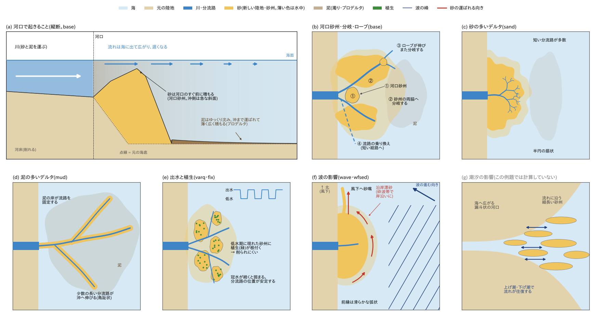

模式図(縮尺は誇張。平面は上が北)。(a)(b) 波のない河口で起きること。(c)〜(f) 砂泥比・植生・
波で変わるデルタの形。(g) 潮汐の影響(段 6・7)。括弧内は対応するケース。

**再現したいデルタと、加える機構**: 波のない河口(段 1)から始めて、機構を一つずつ加えます。
段 2 以降はどれも段 1 の機構を土台にして、その段の機構を加えます(段 5 は段 4 の沿岸漂砂を沿岸の
波浪場に置き換え、段 7 は段 6 の川を小さくします)。

| 段 | 再現したい現象・デルタ | 加える機構 | 主な設定 | ケース |
|---|---|---|---|---|
| 1 | 河口砂州・分岐・ローブ・流路の乗り換え(河川卓越型の基本) | 浅水流、砂の掃流砂と泥の浮遊砂、河床の勾配による流砂の向きの補正、安息角崩落。海は通常のセル | `f_fluvial`・`fluv_bcfeed = 1`、`f_suspend`・`inflow_cs`・`f_bedfines`、`fluv_slope = 1`、`f_repose = 1`、`f_htype = 2`・`f_bc_e = 2` | base |
| 2 | 砂の多い扇状、泥の多い鳥趾状 | 段 1 と同じ機構で、泥の量(流入濃度)を変える | `inflow_cs` | sand・mud |
| 3 | 出水と植生で安定した分流路 | 流量の時系列、植生の定着(冠水で弱まる)、側岸侵食 | `inflow_val`、`f_fixation`(`fix_tdec`・`fix_ctau_bank`)、`f_berode` | varq・fix |
| 4 | 波の影響を受けたデルタ(弧状の前縁・砂嘴・風下への偏り) | 斜めの波による沿岸漂砂(波を解かない概算)。砂の供給は量を決めて与える | `fn_wave`(`wave_lsm`・`wave_vmax`)、`inflow_qb`・`fluv_bcfeed = 0` | baseqb・wave |
| 5 | 段 4 に加えて、波の屈折・デルタの陰・波による流れ・泥のかき混ぜ・遡上による砂の打ち上げ | 沿岸の波浪場、波による攪拌と輸送、遡上域の輸送(段 4 の沿岸漂砂の代わり) | `fn_wavefield`(`wf_flow = 2`・`f_wf_current = 1`)、`f_wfsed`、`f_wfswash`、背景粘性 `p_diffusion_nu` | wfsed |
| 6 | 潮汐の影響を受けたデルタ(干満で冠水・干出する干潟、潮で変わる河口の流れ) | 沖の辺に潮位の時系列を与える(海域マスクの帯)。morfac を潮汐なしより下げ(この例では、潮の 1 周期の地形変化が小さいとまでは言えない)、海岸に交わる辺は外にも海岸が続く扱いにする | `fn_sw`・`fn_tide`(`titype = 2`)、`morfac`、`f_bc_n`・`f_bc_s = 3` | notide・tide |
| 7 | 潮汐卓越型の側へ: 潮の出入りが川を上回るデルタ(デルタの上の干潟と、下げ潮の水路。潮流で砂が往復してできる形は、この例の規模では現れない) | 段 6 と同じ機構で、川の流量と土砂を小さくする(潮の出入りを相対的に大きくする) | `inflow_val`・`inflow_qb`(川の流量と土砂)、`morfac` | smallq・tidedom |

**現象と機構の対応**:

| 実際の現象 | ENCflow での表し方 | 設定 |
|---|---|---|
| 川が海へ流れ込み、噴流が広がって遅くなる | 浅水流(運動量保存形。噴流の広がりと減速、河口の背水を解く)。海は通常のセルに初期水位を与え、沖の辺を長波放射にして海面を保つ | `f_htype = 2`・`e0`、`f_bc_e = 2` |
| 川が砂を運び、河口の前に積もって河口砂州ができ、分岐する | 掃流砂の流砂量式(芦田・道上式)と河床の連続式。上流からは流れが運べるだけの砂が来る(入口の河床を固定する容量給砂) | `f_fluvial = 1`、`f_qbform = 1`、`fluv_bcfeed = 1` |
| 砂州の側面へ砂が広がり、ローブが丸くなる | 河床の勾配による流砂の向きの補正と、安息角を超えた斜面の崩落 | `fluv_slope = 1`、`f_repose = 1` |
| 泥が沖まで運ばれて薄く積もり、積もった泥が再び巻き上がる | 浮遊砂の移流と沈降(泥の実効的な沈降速度を直接与える)。河床の細粒分の帳簿で、積もった泥だけが巻き上がる | `f_suspend = 1`、`inflow_cs`、`susp_wf`、`f_bedfines = 1` |
| 出水と低水が繰り返す | 区間流入の流量の時系列 | `inflow_val` |
| 低水のときに現れた砂州に植生が根付いて削られにくくなり、冠水が続くと弱まる | 定着度: 水面から出ている間に育って侵食の閾値と粗度を上げ、冠水すると減衰する。河岸への効き方は別の係数で与える | `f_fixation = 1`、`fix_tfix`・`fix_ctau`・`fix_cn`・`fix_tdec`・`fix_ctau_bank` |
| 流れが河岸を削って後退させる | 側岸侵食(水面より高い隣のセルを、河岸の脚部の掃流力で崩す) | `f_berode = 1` |
| 斜めの波が砕波帯で砂を岸沿いに運ぶ | 沖波から求めた沿岸漂砂(CERC 式)を、砕波帯の掃流砂として運ぶ。汀線の向きは水深の勾配から取る。流れの速い河道のセルは波から外す | `fn_wave`、`wave_lsm`、`wave_vmax` |
| 波が屈折・砕波してデルタの陰ができ、沿岸流が起こる。波が砂と泥をかき混ぜ、遡上が砂を打ち上げる | 沿岸の波浪場(波の向きと高さを解く。河口の流れが波を止める)、波による流れ、波と流れによる攪拌と輸送、遡上域の輸送 | `fn_wavefield`、`wf_flow = 2`、`f_wf_current = 1`、`f_wfsed = 1`、`f_wfswash = 1` |
| 潮の満ち引きで海面が上下し、干潟が冠水・干出し、流れが往復する | 沖の辺の数列を海域マスクにして潮位の時系列を与え、その内側の海と河口は浅水流で解く。地形の加速は、潮の 1 周期の地形変化が小さい範囲でしか使えない(「注意」の「潮汐と地形の加速」) | `fn_sw`、`fn_tide`、`morfac` |
| 地形の変化は流れよりずっと遅い | 地形の変化量を morfac 倍して時間を縮める | `morfac` |

二次流(蛇行の外岸を深くする流れ、`f_secflow`)は使いません。デルタの大きな形は河口砂州での
分岐で決まり、噴流の縁や砂州を回り込む流れに二次流の項を入れると、実際にはない流線の曲がりを
拾いやすいためです。各機構の設定は、ユーザーガイドの[掃流砂](../../docs/users_guide/geomorph.md#掃流砂f_fluvial)
(容量給砂・勾配の補正・定着・側岸侵食)、[浮遊砂](../../docs/users_guide/geomorph.md#浮遊砂f_suspend)
(細粒分の帳簿)、[波浪による沿岸漂砂](../../docs/users_guide/geomorph.md#波浪による沿岸漂砂fn_wave)、
[沿岸の波浪場](../../docs/users_guide/wavefield.md)、[潮位](../../docs/users_guide/tide.md)、
[境界条件](../../docs/users_guide/boundary.md)(長波放射・側方 Neumann)にあります。

## 幾何と設定

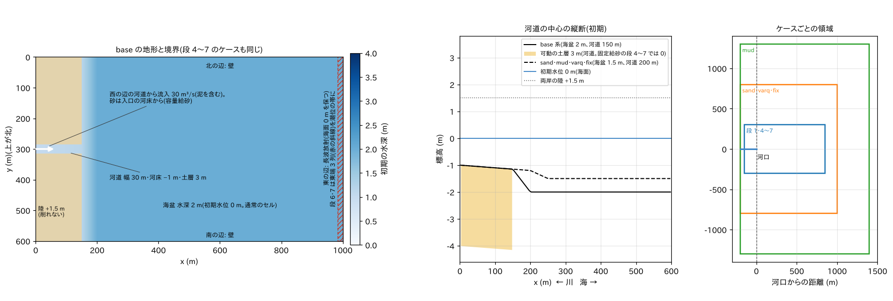

左: base の初期地形と境界(上が北)。中: 河道の中心の縦断。右: ケースごとの領域の大きさ(河口を
原点に)。

- **河道と陸地**: 西の辺から、幅 30 m(6 セル)の掘り込み河道(河床 −1 m、勾配 1/1000)が東へ
  150 m(base・baseqb・wave・wfsed)または 200 m(sand・mud・varq・fix)流れ、河口から 50 m の
  斜面で平らな海盆の底へつながります。河道の両岸は +1.5 m の乾いた陸地で、削れません(土層 0)。
  河道の河床は土層 3 m の可動床です(砂の量を決めて与える baseqb・wave・wfsed では、河道も
  削れない水路にして、砂は河口に出てから動きます)。
- **海**: 海盆の水深は 2 m(base・baseqb・wave・wfsed)または 1.5 m(sand・mud・varq・fix)。海は
  海域マスクを使わず、通常のセルに初期水位 0 m を与えて表します。東の辺は長波放射で海面を 0 m に
  保ち、北・南・西の辺は壁です(段 6・7 の南北の辺は側方 Neumann)。
- **川**: 西の辺の河道 6 セルから流量 30 m³/s を入れます(varq・fix は出水 30 m³/s と低水 6 m³/s を
  20 分ずつ繰り返す)。砂(粒径 0.5 mm)は容量給砂(入口の河床を固定し、流れが運べるだけの砂を
  上流から入れる)、泥は体積濃度 `inflow_cs` で流入させ、沈降速度 1 mm/s で沈みます。
- **潮汐(段 6・7)**: 東端 3 列(15 m)を海域マスクの帯にし、M2 分潮(周期 12.42 時間)、潮差 2 m
  (振幅 1 m)の潮位を与えます。初期水位 0 m(平均潮位)から上げ潮で始まります。潮差は海盆の水深と
  同じ大きさで、干潮で海盆の水深は 1 m、満潮で 3 m になります。南北の辺は、外にも同じ海岸が続く
  側方 Neumann にします。
- **時間**: 地形の変化を morfac 倍(100 または 200)して、水理 15〜24 時間の計算で地形 1500〜4000
  時間分の変化を見ます(潮汐のケースは morfac を下げて潮 5 周期 = 水理 62.1 時間を解きます。下げ方の
  限界は「注意」の「潮汐と地形の加速」)。以下の時間はすべて地形時間です。
- 格子間隔は 5 m、入力は make_init.py が作ります(`make`)。

| 段 | ケース | 設定ファイル | 領域・海盆の水深 | 川の流量・泥の濃度 | 加える機構 | 地形時間 | 所要(4 スレッド) |
|---|---|---|---|---|---|---|---|
| 1 | base | param.txt | 1000 × 600 m、2 m | 30 m³/s、泥 0.0005 | — | 1500 h(morfac 100) | 45 分 |
| 2 | sand | param_sand.txt | 1200 × 1600 m、1.5 m | 30 m³/s、泥 0.00015 | 泥を減らす | 4000 h(morfac 200) | 2 時間 |
| 2 | mud | param_mud.txt | 1600 × 2600 m、1.5 m | 30 m³/s、泥 0.001 | 泥を増やす | 4000 h | 3.5 時間 |
| 3 | varq | param_varq.txt | 1200 × 1600 m、1.5 m | 出水 30 / 低水 6 m³/s を 20 分ずつ、泥 0.0005 | 流量の変動 | 4000 h | 2 時間 |
| 3 | fix | param_fix.txt | 同上 | 同上 | 流量の変動 + 植生の定着(c_τ 3、T_fix 100 h、粗度の増分比 2、冠水の減衰 T_dec 50 h、河岸の係数 0.5)+ 側岸侵食 | 4000 h | 1.5 時間 |
| 4 | baseqb | param_baseqb.txt | base と同じ | base と同じ。砂は固定給砂 0.00715 m³/s(base の平均) | 波なしの基準(砂の量を決めて与える) | 1500 h | 1 時間 |
| 4 | wave | param_wave.txt | 同上 | 同上 | 沖波(有義波高 0.6 m、周期 6 s、東南東から入射角 30°)の沿岸漂砂 | 1500 h | 1 時間 |
| 5 | wfsed | param_wfsed.txt | 同上 | 同上 | wave と同じ波(方向分散 20°)を、沿岸の波浪場と、波による攪拌・輸送、遡上域の輸送で | 1500 h | 50 分 |
| 6 | notide | param_notide.txt | base と同じ(南北の辺は側方 Neumann) | baseqb と同じ | 潮汐なしの基準 | 1490 h(morfac 100) | 40 分 |
| 6 | tide | param_tide.txt | 同上(東端 3 列は潮位の帯) | 同上 | M2 潮汐(潮差 2 m) | 1490 h(morfac 24、潮 5 周期) | 2 時間 |
| 7 | smallq | param_smallq.txt | notide と同じ | 3 m³/s(1/10)、泥 0.0005、砂は固定給砂 0.000715 m³/s(1/10) | 潮汐なしの基準(川を 1/10 に) | 14900 h(morfac 1000) | 40 分 |
| 7 | tidedom | param_tidedom.txt | tide と同じ | smallq と同じ | M2 潮汐(潮差 2 m) | 14900 h(morfac 240、潮 5 周期) | 2 時間 |

c_τ は定着しきったときの侵食の閾値の増分比(粗度の増分比も同じ形)、T_fix は定着が進む時間、T_dec は
冠水中に定着が弱まる時間です。

## 実行方法

```bash
cd examples/delta
make                                # 実行ファイルへのリンクと入力(z_*.txt・sd_*.txt、潮汐の sw_tide.txt・tide_m2.txt)
./encflow param.txt                 # base(ほかは ./encflow param_sand.txt など)
python3 plot_results.py base        # fig_base_evolution.png・fig_base_final.png・fig_base_timeseries.png・timeseries_base.csv
python3 plot_results.py mechanism   # 機構の模式図 figs/mechanism.png(計算結果を使わない)
python3 plot_results.py setup       # 設定の図 figs/setup.png
python3 plot_results.py tide        # 潮汐のケースは fig_tide_phases.png(最後の 1 周期の流れ)・fig_tide_series.png(水位・河口の流量)も
python3 plot_results.py tidecmp     # 潮汐なしとの比較図 figs/tide_cmp.png・figs/tidedom_cmp.png と数表(4 ケースの計算の後)
```

図化には Python 3 と NumPy・matplotlib が要ります。引数に `en` を足すと、英語ラベルの図を
en/figs/ に書きます。plot_results.py が描くのは 1 ケースの堆積厚の時間発展・最終地形・時系列で、
figs/ の `<ケース>_evolution.png`・`<ケース>_final.png`・`<ケース>_phases.png`・`<ケース>_series.png` は
これと同じ形式の図です。ケースを並べた
比較の図(sandmud・sandmud_timeseries・fixation・wave_cmp・ensemble)と、汀線半径・分流路の本数の
集計のスクリプトは、この例題に含まれていません。

## 結果

陸化は河口より沖で水深 0.05 m 未満のセルの面積、汀線半径は河口から汀線(水深 0.05 m)までの
距離の平均と標準偏差(標準偏差 / 平均 = 凹凸比)、最大半径は河口から最も遠い陸地までの距離 R、
分流路の本数は河口を中心とする半径 0.5 R・0.8 R の円弧を横切る流路の数です。図はどれも上が北で、
色は地盤高の変化(堆積厚)、黒線は汀線です。

数表と図は 2026 年 10 月 20〜29 日の版(段 6・7 は 11 月 2 日の版)で計算した値です。デルタの形は実現ごとに違うので(「注意」の
「形は実現ごとに違う」)、同じ設定で計算し直すと、ローブの位置や分流路の本数は変わり、堆積・陸化・
最大半径も数 % の範囲で変わり得ます。

### 段 1: 波のない河口 — 河口砂州・分岐・ローブ(base)

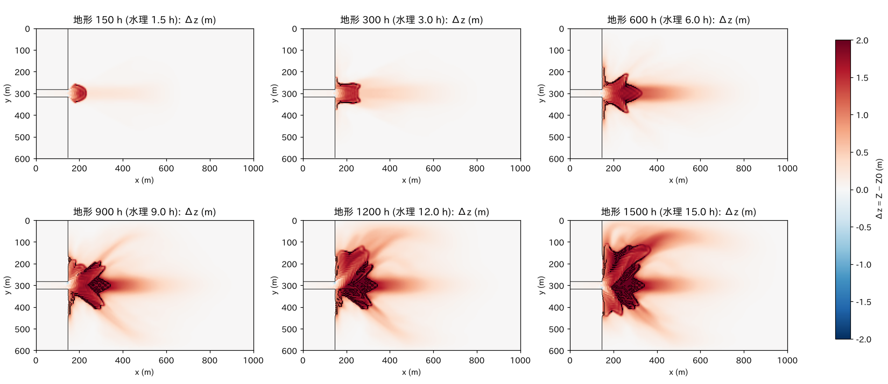

- **河口砂州と分岐**: 地形 150 h で河口の前に厚さ 1.5 m ほどの河口砂州ができ、300 h で流れが砂州の
  両脇へ分かれて、砂州が陸になります。
- **ローブ**: 600〜900 h で 2 本の分流路が斜め前方へ伸び、ローブが育ちます。前方への前進は 190 m で
  頭打ちになり、その後は側方のローブが育ちます。
- **砂と泥の分かれ**: 1500 h で陸化 15.7×10³ m²、堆積 194×10³ m³(供給の 97 %)。入った土砂は砂
  3.9 万 m³・泥 8.1 万 m³(固体の体積)で、砂はデルタの本体に、泥はその外側 600〜800 m の
  プロデルタに薄く積もります(下の図の右下)。

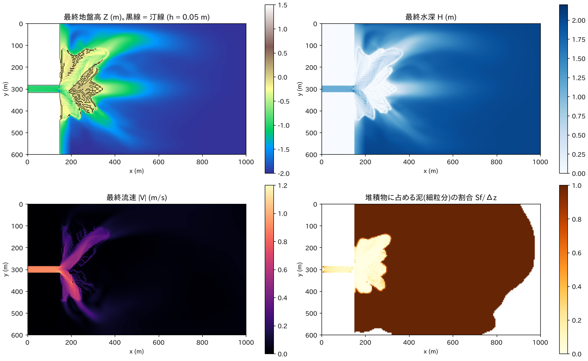

base の地形 1500 h。左上: 地盤高、右上: 水深、左下: 流速、右下: 堆積物に占める泥の割合。

### 段 2: 砂と泥の割合 — 扇状と鳥趾状(sand・mud)

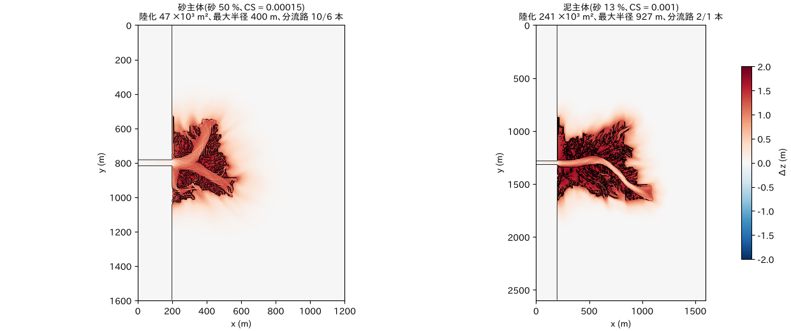

地形 4000 h の堆積厚。左: 砂の多い sand、右: 泥の多い mud。図の題の砂の割合(50 %・13 %)は
概算で、下の表の割合は計算で実際に入った量から求めた値です。

| | 砂の多い sand | 泥の多い mud |
|---|---|---|
| 泥の流入濃度(入った土砂に占める砂) | 0.00015(57 %) | 0.001(15 %) |
| 堆積(供給に対する割合) | 247×10³ m³(98 %) | 816×10³ m³(97 %) |
| 陸化 | 47×10³ m² | 241×10³ m² |
| 汀線半径 平均 ± 標準偏差(凹凸比) | 295 ± 60 m(0.20) | 533 ± 225 m(0.42) |
| 分流路(0.5 R / 0.8 R) | 10 / 6 本 | 2 / 1 本 |

- **砂が多いと扇状**: 半円に近い扇に、短い分流路が多数できます。
- **泥が多いと鳥趾状**: 一度 3 本に分かれたあと 1 本が勝ち、細長い分流路が沖へ 900 m 伸びます。
- 供給量の違い(泥の多い方が 3.3 倍)を除いても、汀線の凹凸と分流路の本数は形の違いとして
  残ります。「泥が多いほど分流路が少なく細長い」という向きは、ほかのモデル(DeltaRCM: Liang ら
  2015、Delft3D: Edmonds & Slingerland 2010・Caldwell & Edmonds 2014)や水槽実験(Hoyal & Sheets
  2009)と同じです。

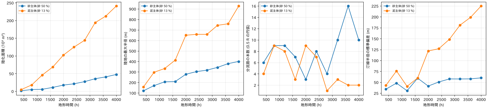

左から陸化、最大半径、分流路の本数(0.5 R)、汀線半径の標準偏差の時間変化。

### 段 3: 出水と植生 — 分流路の安定(varq・fix)

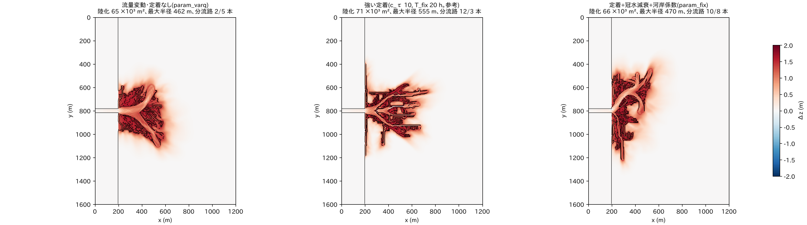

地形 4000 h の堆積厚。左: 流量の変動だけ(varq)、中: 参考(冠水で弱まらない強い定着)、右: 定着+
冠水の減衰+河岸の係数(fix)。

| | 陸化 (10³ m²) | 最大半径 (m) | 汀線半径 平均 / 標準偏差 (m) | 分流路(0.5 R / 0.8 R)と幅 |
|---|---|---|---|---|
| varq(流量の変動、定着なし) | 65 | 462 | 302 / 98 | 2 / 5 本(幅 50〜100 m) |
| 参考: 冠水で弱まらない強い定着(c_τ 10、T_fix 20 h、冠水の減衰なし) | 71 | 555 | 355 / 127 | 12 / 3 本(幅 5〜10 m) |
| fix(定着+冠水の減衰+河岸の係数+側岸侵食) | 67 | 470 | 318 / 69 | 10 / 8 本(幅 20〜30 m) |

- **定着なし(varq)**: 出水のたびに砂州が冠水して削られ直し、幅の広い分流路が位置を変えながら
  扇を作ります。
- **冠水で弱まらない定着(参考)**: 一度現れた砂州がそのまま固まり、分流路が格子の幅の直線的な
  水路になります。実際の植生は長く冠水すると弱るので、冠水中の減衰 `fix_tdec` を出水の継続時間
  程度に与えます。
- **定着+冠水の減衰+河岸の係数(fix)**: 分流路が幅 20〜30 m の滑らかな水路として安定し、汀線の
  凹凸は最も小さくなります。分流路を広げているのは、冠水で定着が弱まった砂州の河床の侵食で、
  側岸侵食の寄与は小さいです。

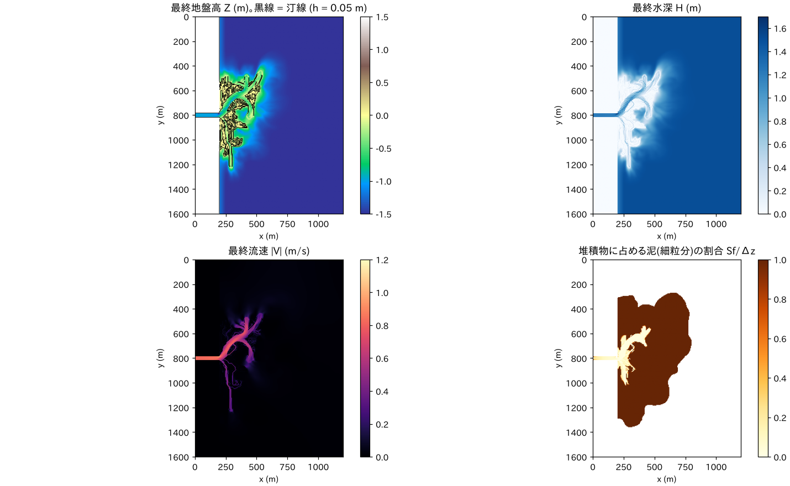

fix の地形 4000 h(並びは base の最終地形の図と同じ)。

### 段 4: 斜めの波 — 沿岸漂砂による弧状のデルタ(baseqb・wave)

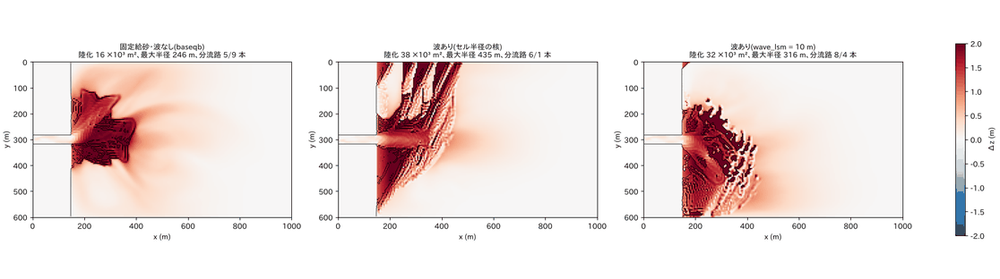

地形 1500 h の堆積厚。左: 波なし(baseqb)、中: 参考(汀線の向きを格子の幅で取ったもの、
`wave_lsm = 0`)、右: 波あり(wave)。

wave は、波なしの基準 baseqb に沖波(有義波高 0.6 m、周期 6 s、東南東から来て汀線への入射角 30°)を
加えたものです。河川の砂の供給は同じ(3.86 万 m³ 固体。堆積は 195 対 194×10³ m³)で、河川の土砂の
供給と、波が岸沿いに運べる量の比 R は約 0.5 です。汀線の向きは長さ `wave_lsm = 10 m`(格子間隔の
2 倍)で平滑化して取ります。

| | baseqb(波なし) | wave(波あり) | 参考: wave で `wave_lsm = 0` |
|---|---|---|---|
| 陸化 | 16.0×10³ m² | 31.6×10³ m² | 37.8×10³ m² |
| 最大半径 | 246 m | 316 m | 435 m |
| 汀線半径 平均 / 標準偏差 | 182 / 49 m | 244 / 58 m | 266 / 79 m |
| 分流路(0.5 R / 0.8 R) | 5 / 9 本 | 8 / 4 本 | 6 / 1 本 |

- **波なし(baseqb)**: 河口砂州が分岐して、分流路の網をもつローブ状のデルタになります。
- **波あり(wave)**: 河口砂州から風下(北)へ砂嘴が伸び、堆積は河口の両側の汀線に沿って広がって、
  前縁が弧状で風下側へ偏ったデルタになります(陸化は 2 倍、0.8 R の分流路は 9 本から 4 本に
  減る)。砂嘴、弧状の前縁、汀線に沿う堆積、分流路の減少という、波の影響を受けたデルタの特徴が
  出ます。
- **汀線の向きの平滑化 `wave_lsm`**: 沿岸漂砂の向きは、水深の勾配から取った汀線の向きで決まります。
  これを格子の幅で取ると(参考列)、高角の波による汀線の不安定が格子の幅で育ち、堆積の中に波の峰に
  平行な指状の砂州が並んで、陸化と最大半径が過大になります。汀線の向きは物理的な長さ `wave_lsm`
  (格子間隔の 2 倍〜砕波帯の幅の 1/4)で平滑化して取ってください。
- 堆積の中に残る小さな水たまりは、沿岸漂砂が乾いたセルの砂を動かさないためにできるもので、
  安息角崩落(`f_repose`)が均します。

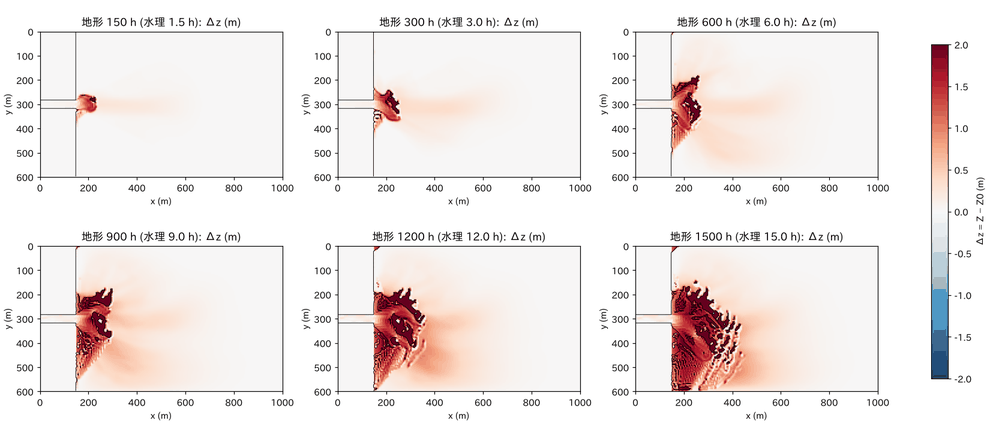

### 段 5: 波を解く — 屈折・陰・沿岸流・遡上(wfsed)

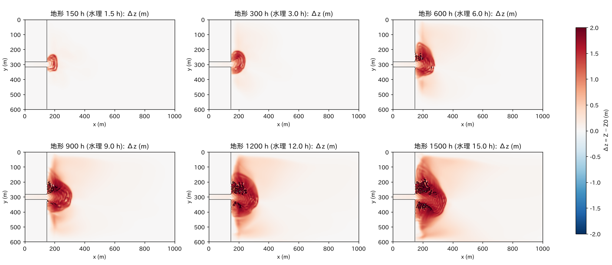

wfsed は、wave と同じ河川・給砂・波を、CERC 型の沿岸漂砂(`fn_wave`)の代わりに、波を解く沿岸の
波浪場(`fn_wavefield`)と、波による攪拌と輸送で与えます。沖波(有義波高 0.6 m、周期 6 s、進む向き
150°、方向分散 20°)を東の辺から入れ、屈折・砕波・デルタ自身の陰を波浪場が求めます。河口の噴流は、
流れによる波の変化(`f_wf_current = 1`)で波を止めます(wave の `wave_vmax` に当たる)。波による流れ
(放射応力とローラー、GLM、波と流れの摩擦。`wf_flow = 2`)が北向きの沿岸流を起こし、砂と泥は波の
軌道流速でかき混ぜられて、Euler 平均流速と、波の歪度・非対称による岸向きの速度で運ばれます
(`f_wfsed = 1`)。汀線では、遡上域の輸送(`f_wfswash = 1`、前浜の平衡勾配 `wfswash_tanbe = 0.1`)が
浅瀬の砂を遡上の届く高さまで打ち上げます。南北の辺は、波が側方 Neumann(外にも同じ海岸が続く)、
流れが壁(wave と同じ)です。

| 地形 1500 h | wfsed | 参考: 遡上域の輸送なし(`f_wfswash = 0`) |
|---|---|---|
| 堆積(かさ) | 154×10³ m³(砂 64×10³ m³ = 給砂のほぼ全量、泥 89×10³ m³ = 供給の 66 %) | 154×10³ m³(砂 64×10³ m³、泥 90×10³ m³ = 67 %) |
| 陸化(水深 0.05 m 未満) | 7.5×10³ m² | 5.3×10³ m² |
| 陸地の地盤高の平均 | 0.30 m | 0.08 m |
| 浅瀬(水深 0.5 m 未満) | 19.6×10³ m² | 23.7×10³ m² |
| 河口からの陸地の最大前進 | 142 m | 118 m |
| 河道軸より北の堆積の割合 | 0.51(砂は 0.49) | 0.52(砂は 0.51) |

(`python3 plot_results.py wfsed` の集計と、最終の地盤高 Z・泥の厚さ Sf・水深 H から求めた砂と泥・
南北の内訳、陸地の地盤高。陸化と浅瀬は河口より沖のセルの面積。参考列は param_wfsed.txt の
`f_wfswash` を 0 にした計算)

- **砂の広がり方**: wave(CERC)では河口砂州から北へ砂嘴が伸びて陸化が 31.6×10³ m² に達するのに
  対し、wfsed では、砂は河口の前に沿岸方向 390 m・沖へ 210 m ほどの浅い弧状の台地として広がり、
  北(風下)への偏りは小さくなります。
- **陸のでき方**: 遡上域の輸送が台地の頂の砂を遡上の届く高さまで積み上げ、陸地は地形 450 h に
  現れて 1500 h まで増え続けます。陸地は河口の両脇の台地の頂(北側が大きい)に、平均 0.30 m
  (静水面の上。遡上の上限に近い)の高まりとして育ちます。遡上域の幅が格子の 1 セルほどなので、
  陸地の縁は 1 セル規模で入り組み、陸地の中に浅い水たまり(1 セル)が残ります。終了までに遡上域の
  輸送が乾いた前浜へ運び上げた砂は 2.5×10³ m³(固体)、運び出したのは 0.4×10³ m³ です。
- **遡上域の輸送を切ると(参考列)**: 砂は浅瀬にとどまり、陸化は約 3 割少ない 5.3×10³ m²、陸地の
  地盤高は平均 0.08 m(静水面とほぼ同じ高さの砂州の頂)で、その分浅瀬が広くなります(23.7×10³ m²)。
  陸化の大きさは遡上域の輸送の係数と前浜の平衡勾配 `wfswash_tanbe`(粒径から与える量)に依るので、
  汀線の形は wave(CERC)と合わせて読んでください(ユーザーガイドの[遡上域の輸送](../../docs/users_guide/wavefield.md#遡上域の輸送f_wfswash))。
- **泥**: 泥は波にかき混ぜられて沈みにくく、薄い層(x > 500 m で平均 6 cm)として海盆全体に
  広がります。終了時にも供給の 22 % が水中に浮遊していて、12 % は東の開いた辺から出ます(base では
  供給の 97 % が堆積)。

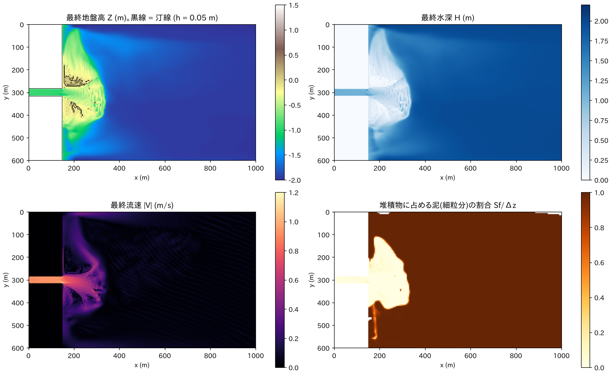

wfsed の地形 1500 h(並びは base の最終地形の図と同じ)。

### 段 6: 潮汐 — 干満のある河口(notide・tide)

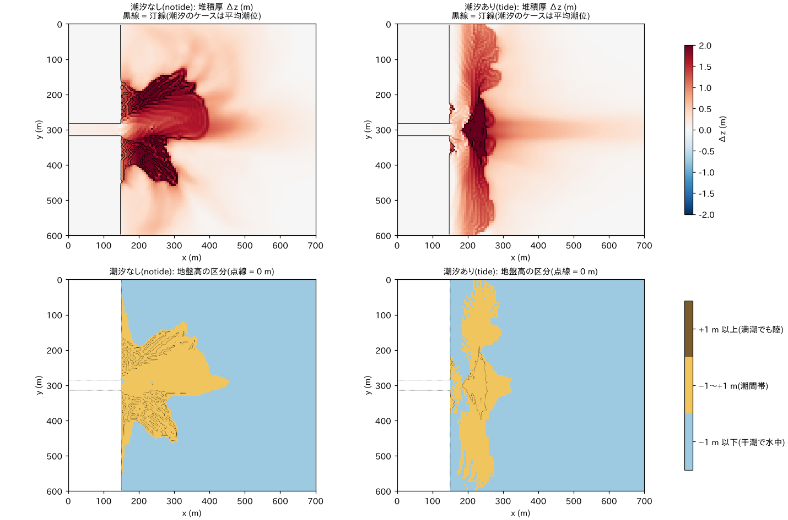

地形 1490 h(tide は平均潮位の上げ潮のとき)。上: 堆積厚と汀線。下: 地盤高の区分(干潮の水位 −1 m 以下、
潮間帯の高さ −1〜+1 m、満潮の水位 +1 m 以上)。左: 潮汐なし(notide)、右: 潮汐あり(tide)。

tide は、潮汐なしの基準 notide と同じ川(30 m³/s)と土砂に、潮差 2 m の M2 潮汐を加えたものです。notide は
baseqb の南北の辺を tide と同じ側方 Neumann にしたもので、二つは潮汐と地形の加速(notide は morfac 100、
tide は 24)だけが違います。

| 地形 1490 h | notide(潮汐なし) | tide(潮汐あり) |
|---|---|---|
| 堆積(かさ) | 170×10³ m³(砂 64×10³ m³ = 給砂の全量、泥 106×10³ m³ = 供給の 79 %) | 134×10³ m³(砂 50×10³ m³ = 給砂の 78 %、泥 84×10³ m³ = 供給の 63 %) |
| 南北の辺から掃流で出た土砂(固体) | 0 | 16×10³ m³(給砂の 22 % の砂と、砂に混じって動いた泥) |
| 砂の本体(砂 0.3 m 以上)の広がり: 海岸沿い × 沖へ | 300 m × 212 m | 600 m(領域の幅いっぱい)× 132 m |
| 陸化(平均潮位で水深 0.05 m 未満) | 17.2×10³ m² | 6.9×10³ m²(河口砂州の島。頂は +0.66 m) |
| 干潟(干潮で干上がり、満潮で冠水する) | — | 36.7×10³ m² |
| 河口の流量(最後の 1 周期) | 30 m³/s | 29.2〜30.7 m³/s(逆流しない) |
| 干潟を出入りする潮の流量 πP/T(P は干潟の上の満潮の水量) | — | 4.1 m³/s(川の 14 %) |

(`python3 plot_results.py tidecmp` の集計と、計算の終わりの台帳(南北の辺から出た土砂)。砂と泥の内訳は
最終の地盤高 Z と泥の厚さ Sf から。πP/T は干潟の出入りを正弦で近似した流量の振幅で、この例題の目安)

- **満潮と干潮で川の出口が変わる**: 満潮では、河口の噴流が沖へまっすぐ出ます。潮が引くと河口の前の砂州
  (頂は +0.66 m)が島として現れ、川の流れは島の両脇に分かれて、海岸の足もとの溝(地盤高 −1.1 m 前後)を
  南北へ回り込みます(干潮で 0.7〜0.8 m/s)。
- **堆積は海岸沿いに広がる**: 干潮のたびに海岸沿いへ回り込む流れが砂を運ぶので、砂の本体は領域の幅
  いっぱいに広がり、給砂の 2 割強は南北の辺から出ていきます(外にも同じ海岸が続く扱い)。この砂は
  潮 4・5 周期目の干潮の前後に出たもので(それまではほぼ 0)、段 7 の確かめ(morfac を半分にした計算)
  から、この量は morfac に依ると考えられます。沖への広がりは notide の 6 割です。平均潮位で陸になるのは
  河口砂州の島だけですが、干潮には 36.7×10³ m² の干潟が現れます。
- **河川卓越のまま**: 河道は狭く、両岸は満潮より高いので、河口より上流で潮がためる水は少なく、河口の
  流量は 29〜31 m³/s で逆流しません。干潟を出入りする潮の流量も川の 14 % です。上げ潮のときも、干潮に
  川の水が通る水路で岸向きに流れるのは 6 % のセルだけで、海盆の潮流は 0.05 m/s 程度(最大 0.14 m/s)と、
  砂が動き始める流速(限界無次元掃流力 0.05 から、水深 1〜2 m で約 0.25〜0.3 m/s)に届きません。tide は
  潮汐の影響を受けた河川卓越型のデルタで、潮汐は潮流よりも水位の上下を通じて(川の出口と背水の強さを
  変えて)形を変えています。
- **干潮の河道**: 干潮で海が −1 m まで下がっても、河口の手前の河道の水位は −0.57 m にとどまり(河口の先の
  流路の水位で決まる)、河口の流れは 1.4 m/s に速まります。満潮の背水で河口近くの河道に積もった砂
  (厚さ約 9 cm)は、干潮の速い流れが洗い流します。
- **海岸の足もとの溝**: 干潮に川の流れが通る溝は、この例の海岸が削れない垂直の段差(陸 +1.5 m、その前の
  海底 −1.2 m)であることによります。実際の潮汐のある海岸は緩やかな干潟で、川は干潟を刻む流路を通って
  沖へ出ます(緩やかな海岸との比較はしていません)。

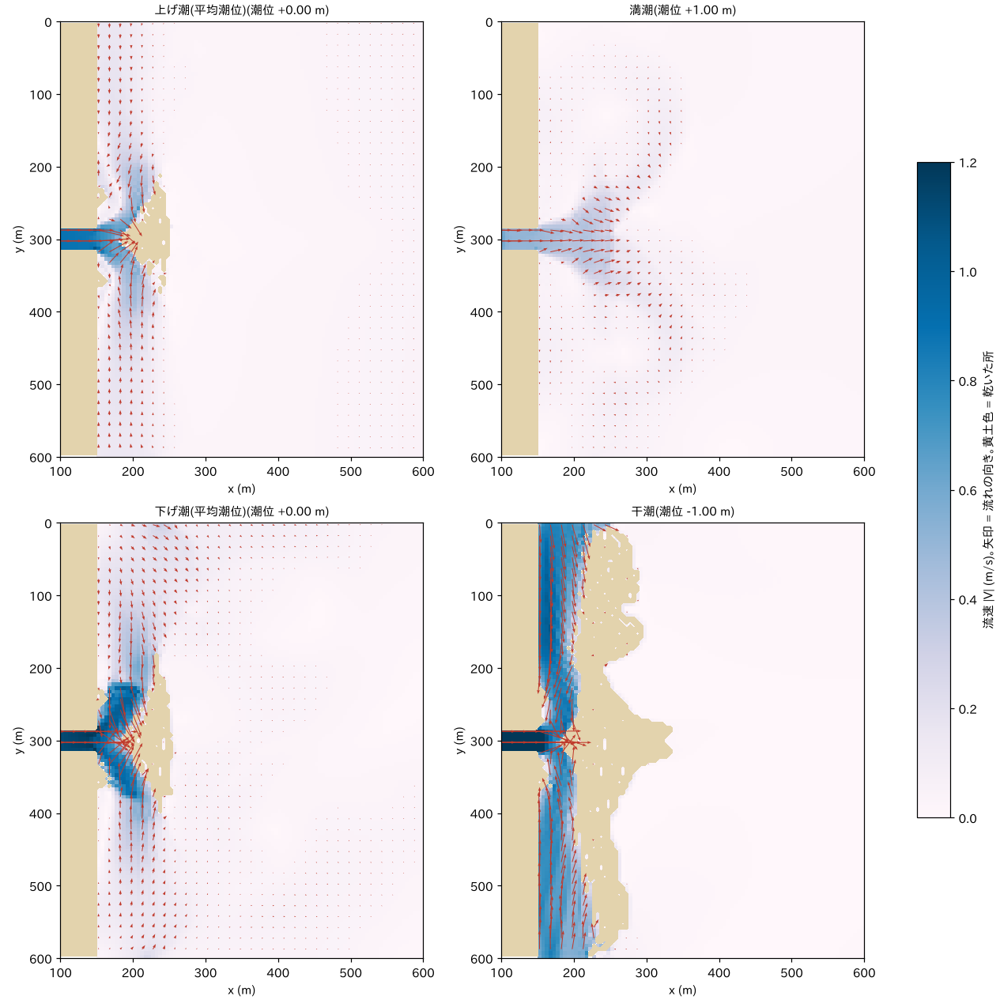

tide の最後の 1 周期(地形 1192〜1490 h)の流れ。左上から順に上げ潮(平均潮位)、満潮、下げ潮(平均
潮位)、干潮。色は流速、矢印は流れの向き、黄土色は乾いた所。

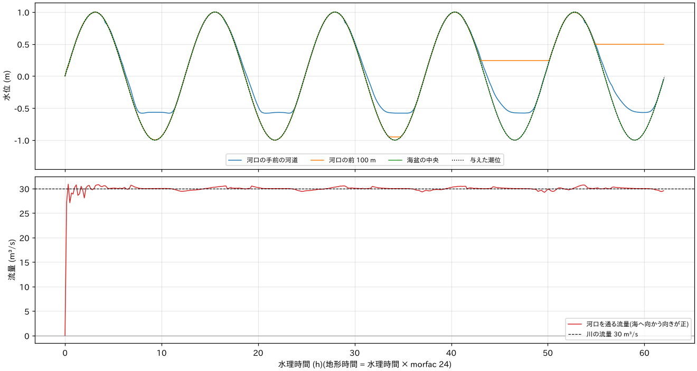

上: 河口の手前の河道、河口の前 100 m、海盆の中央の水位と、与えた潮位(河口の前 100 m の線は、干上がって
いる間は地盤高で水平になる)。下: 河口を通る流量。

### 段 7: 潮の出入りが川を上回る — 干潟と下げ潮の水路(smallq・tidedom)

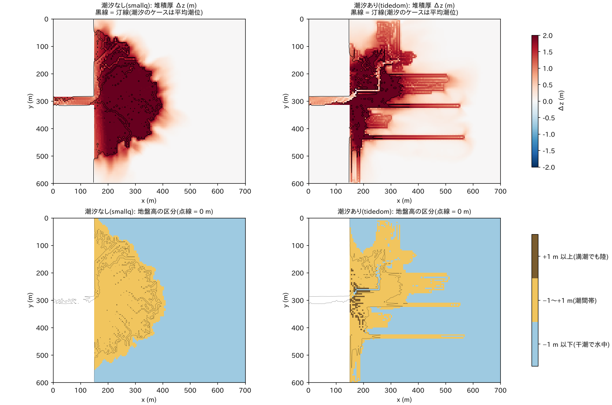

地形 14900 h(tidedom は平均潮位の上げ潮のとき)。並びは段 6 の図と同じ。左: 潮汐なし(smallq)、右: 潮汐
あり(tidedom)。

tidedom は、tide の川の流量と土砂を 1/10 にしたもの(3 m³/s。泥の濃度は同じなので泥の量も 1/10)で、
潮汐・海盆・地形は tide と同じです。土砂が 1/10 なので morfac を 10 倍の 240 にし、潮 5 周期で地形
14900 h を見ます(潮の 1 周期に入る土砂は tide と同じ)。smallq は同じ川で潮汐のない基準です
(morfac 1000)。

| 地形 14900 h | smallq(潮汐なし) | tidedom(潮汐あり) |
|---|---|---|
| 堆積(かさ) | 192×10³ m³(砂 64×10³ m³ = 給砂の全量、泥 128×10³ m³ = 供給の 95 %) | 193×10³ m³(砂 63×10³ m³ = 給砂の 99 %、泥 130×10³ m³ = 供給の 97 %) |
| 南北の辺から掃流で出た土砂(固体) | 0 | 0.57×10³ m³(給砂の 1 % 弱の砂と、砂に混じって動いた泥) |
| 砂の本体(砂 0.3 m 以上)の広がり: 海岸沿い × 沖へ | 365 m × 188 m | 600 m(領域の幅いっぱい)× 412 m |
| 陸化(平均潮位で水深 0.05 m 未満) | 64.7×10³ m² | 34.1×10³ m² |
| 満潮でも陸(地盤高 +1 m 以上) | — | 3.4×10³ m²(元の海岸沿い。ほとんどが +1.0〜1.05 m) |
| 干潟(干潮で干上がり、満潮で冠水する) | — | 72.0×10³ m² |
| 河口の流量(最後の 1 周期) | 3 m³/s | 2.6〜3.1 m³/s(逆流しない。周期の始めに川の出口が移る間は 1.2〜4.1 m³/s) |
| 干潟を出入りする潮の流量 πP/T | — | 7.3 m³/s(川の 2.4 倍) |

(集計の仕方は段 6 の表と同じ。tidedom の沖への広がりは、下に書く沖へ伸びる筋の先までの値)

- **潮の出入りが川を上回る**: デルタの上の干潟を出入りする潮の流量(πP/T。段 6 と同じ目安)は 7.3 m³/s で、
  川(3 m³/s)の 2.4 倍です(tide は 0.14 倍)。この目安では、潮が川を上回ります。干潟が育つにつれて
  大きくなる値で、地形 8942 h では 1.6 倍です(砂が南の辺から出て干潟が狭かった morfac 120 の計算では
  0.94 倍。下の「morfac を下げた確かめ」)。
- **デルタの上が干潟になる**: smallq では海面の高さにそろった陸(64.7×10³ m²。堆積 0.3 m 以上の範囲の
  地盤高の中央値 +0.02 m)が広がるのに対し、tidedom のデルタの上は潮間帯の高さの干潟(72.0×10³ m²。
  同じ中央値 −0.60 m)になり、満潮でも陸なのは元の海岸沿いの 3.4×10³ m² だけです(高さは満潮の水位と
  ほぼ同じ)。泥は供給の 97 % が積もり(smallq は 95 %)、干潟の堆積は平均で砂 0.64 m、泥 1.08 m です。
- **下げ潮と干潮の水路**: 下げ潮と干潮には、川の水と干潟から抜ける水が、干潟を刻む水路に集まります
  (干潮で、水路の流速の中央値 0.5 m/s、最大 1.0 m/s)。水路の道筋は潮の周期ごとに変わります。潮 4 周期目
  までの干潮には川の水は東の海盆へ出ていましたが、最後の周期の始めに北の辺へ向かう水路に移り
  (図の上げ潮のパネルはその途中)、干潮には北の辺から 10.7 m³/s(川の 3.6 倍)が出ていきます。
- **上げ潮の流れは砂を動かさない**: 上げ潮(平均潮位)には、海は沖から干潟の上へゆっくり広がり、干潟の上の
  流速は 90 % のセルで 0.1 m/s 以下、0.25 m/s を超えるのは 1 % 未満のセルです(潮 2〜5 周期目の上げ潮。
  ただし最後の周期の上げ潮では 7 % のセルが 0.25 m/s を超える。川の出口が移る途中で、川の水が干潟の上を
  速く流れる)。砂は川と下げ潮の流れでだけ動き、干潮のたびに低い海面へ向かう速い流れが
  砂を運ぶので、砂の本体は smallq より海岸沿いに広がり、沖へは干潮の水路の跡が筋になって伸びます
  (下の「沖へまっすぐ伸びる筋」)。上げ潮と下げ潮で砂が往復してできる
  形(潮流に沿う細長い砂州、漏斗状の河口)は現れません。tidedom は、潮の出入りが川を上回り、デルタの上が
  干潟と下げ潮の水路になったデルタですが、潮汐卓越型のデルタの形はこの規模では作れません。
- **潮流が弱い理由**: 連続の式から、ある地点の潮流の速さは、その地点より陸側で潮が満たす水域の奥行き L
  にほぼ比例します(u ≈ L × 潮位の上がる速さ ÷ 水深)。この例では潮位の上がる速さが最大 1.4×10⁻⁴ m/s、
  水深が約 2 m なので、海盆の沖の端(L = 835 m)でも 0.06 m/s で、砂が動き始める 0.3 m/s には L が
  約 4 km 要ります(潮の行き来の距離と同じ程度。この例題の目安)。デルタの前面は海岸のすぐ前にあるので、
  陸側の水域はさらに小さく、潮流はほとんど生じません。実際の潮汐卓越型のデルタでは、潮が分流路を遠くまで
  遡り、海へ広がる河口と広い潮間帯が大きな潮の出入りを作ります(Dalrymple & Choi 2007)。
- **沖へまっすぐ伸びる筋**: 図の y = 315 m と 435 m に沿って x = 550〜570 m まで伸びる 2 本の筋は、
  幅 1 セル(5 m)の溝(地盤高の中央値 −0.7〜−0.9 m)と、その両側の自然堤防(同 −0.4〜−0.5 m。元の海底は
  −2.0 m)です。2 本とも潮 2 周期目の干潮の前後の半周期(平均潮位の下げから次の平均潮位の上げまで。地形
  1490 h)にできたもので、その干潮には川の水がこの 2 本の溝に分かれて沖へ流れていました(0.7 m/s)。
  その後は溝にほとんど流れがなく、形は変わりません。y = 200〜270 m の、x = 500〜520 m まで伸びる筋の束は、
  潮 4 周期目の干潮の前後に、東へ流れた川の水がつくったものです。溝の幅は格子の幅で、流路の幅が格子の幅まで細ると
  流路が格子の向きにそろうこと(「注意」の「分流路の解像」)と、morfac 240 では干潮の前後の半周期が地形
  1490 h に当たり、その間に溝と自然堤防が育ちきることによります(tidedom では 1 回の地形更新の上限
  `fluv_dzmax` が 16,155 辺で働いた。smallq では 425 辺)。これらの筋は、潮流が作る細長い砂州では
  ありません。morfac を下げると、筋は短くなるか、できません(次の項目)。
- **morfac を下げた確かめ**: morfac を 120 と 60 にした計算(param_tidedom.txt の `morfac` を 120・60、
  `tt` を 268272・536544 にして潮 6・12 周期)を、地形 8942 h(tidedom の潮 3 周期)で比べました。3 つの
  計算とも、デルタの上は干潟と下げ潮の水路になり(干潟は morfac 240・120・60 の順に 42.3・32.1・
  46.0×10³ m²)、上げ潮には干潟の上の流れが弱く(ほとんどの上げ潮で 90 % のセルが 0.1 m/s 以下)、干潮には
  水路が速く流れます(流速の中央値 0.45〜0.52 m/s)。潮汐卓越型の形はどれにも現れません。違ったのは
  次の 2 点です。沖へ伸びる筋は、morfac 240 の 2 本(上の項目)が、120 では x = 430 m までの 1 本になり、
  60 ではできず、代わりにデルタが南東へ x = 460 m までまとまって広がります。筋は morfac の大きい計算に
  特有のものとして読んでください。もう一つは南北の辺から出る砂です。morfac 120 では、潮 4〜6 周期目の
  干潮に川の水が海岸沿いの水路を通って南の辺へ流れ(0.7〜0.9 m/s)、給砂の 40 % が主に南の辺から
  出ました(240 と 60 では 1 %)。干潟もその分狭く、干潟を出入りする潮の流量は川の 0.94 倍です(240 は
  1.6 倍、60 は 1.5 倍)。干潮の水路がどこへ向かうかは、分流路への流れの配分と同じく計算ごとに違い
  (「注意」の「形は実現ごとに違う」)、この 3 つの計算では、morfac の効果と実現ごとの違いを分けられ
  ません。南北の辺から出る砂の量と、それで変わる干潟の広さは、干潮の水路が辺に届くかで大きく変わる
  値として読んでください(「注意」の「海岸に交わる辺」)。morfac 60 で十分かは、さらに下げた計算がない
  ので確かめていません。

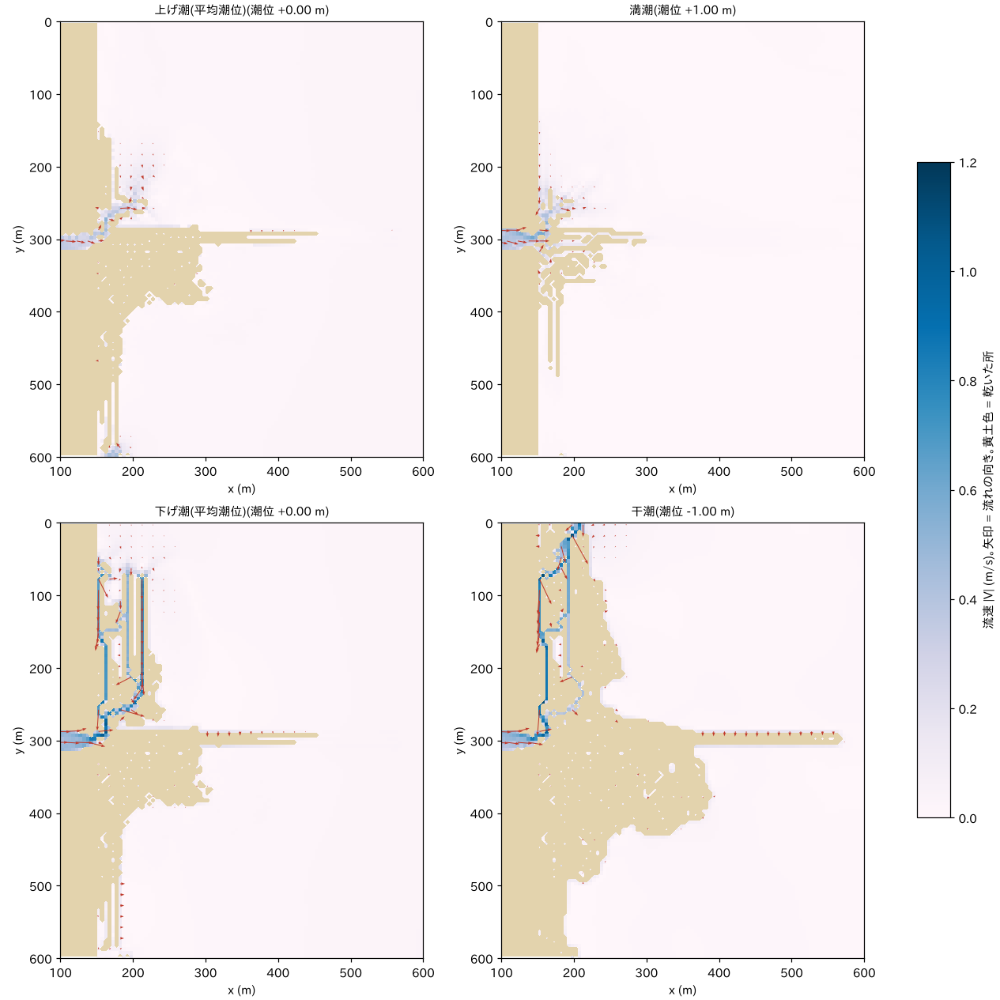

tidedom の最後の 1 周期(地形 11923〜14904 h)の流れ。並びは段 6 の図と同じ。上げ潮は、川の出口が東の
海盆から北の辺へ移る途中の時刻で、川の水が干潟の上を速く流れています。

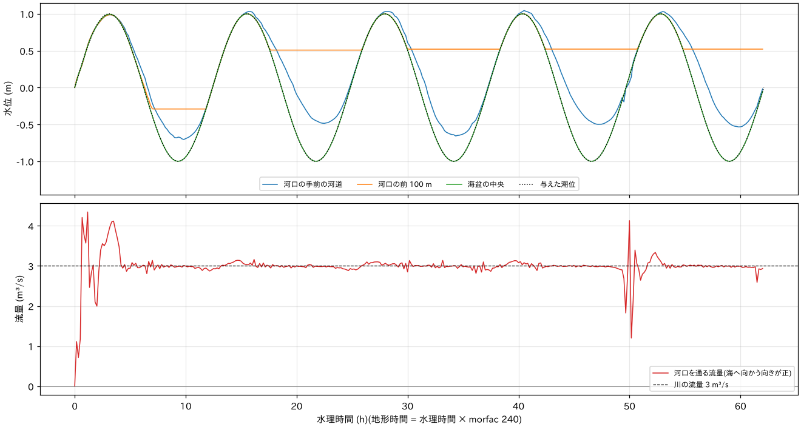

並びは段 6 の図と同じ。河口の流量は、計算の始め(水理 4 時間)に川の水が河道を満たす間と、最後の周期の
始めに川の出口が移る間(水理 49.5〜52.5 h。1.2〜4.1 m³/s)を除いて 2.6〜3.2 m³/s で、逆流しません。

## このモデルで表せないこと(実際の現象との違い)

- **潮汐卓越型のデルタの形**: 段 6・7 は沖の帯の潮位で干満を与え、満潮と干潮で変わる川の出口、干潟、
  下げ潮の水路を表しますが、潮汐卓越型のデルタの形(潮流に沿う細長い砂州、海へ広がる漏斗状の河口)は
  できません。これらは上げ潮と下げ潮の両方で砂を動かす潮流が作るもので、潮流が速くなるには、その
  地点より陸側に、潮の行き来の距離(数 km)ほどの水域が要ります(段 7)。この例は領域が 1 km で河道が
  狭く、潮が川を遡ることも、潮の波が海岸沿いに伝わることも表していません。数 km の領域で潮汐卓越型の
  形ができるかは確かめていません。
- **淡水と海水の密度差**: 流れは水深平均の 1 層で、河口から出た淡水が重い海水の上に広がって沖へ
  運ばれる浮力の効果(Wright 1977)は解きません。
- **泥の性質**: 泥は実効的な沈降速度(`susp_wf`)と、巻き上げの閾値・速さ(`susp_tausc`・`susp_esa`)で
  表します。フロックの形成、圧密、泥の粘着性による岸の強さは直接は表しません。これらの値は
  校正量です。
- **粒の大きさ**: 土砂は砂 1 粒径(掃流砂)と泥 1 種類(浮遊砂)の 2 種類だけです。
- **植生**: 定着度という一つの量で表す現象論的な扱いです(育つ時間、冠水で弱まる時間、侵食の閾値と
  粗度の上がり方)。植生の種類・高さ・密度は表さず、流れへの抵抗は粗度の増分(`fix_cn`)で
  まとめて与えます。係数 c_τ・T_fix・T_dec には文献の標準値がなく、校正が要ります。
- **波**: wave(CERC 型)は波を解かず、沖波から汀線帯の沿岸漂砂だけを与えます。波による攪拌、
  岸沖方向の輸送、波による流れはありません。wfsed は波の屈折・砕波・陰と、波による流れ・攪拌・
  輸送を解きますが、回折と反射は扱わず、遡上そのものも解かずに、遡上域の輸送を経験式で与えます。
- **時間の縮め**: 地形の変化を morfac 倍しているので、出水と低水の 1 周期(水理 44 分)は地形
  147 h に当たります。実際の出水の頻度や継続時間とは対応しません。
- **海面の変化と地盤の沈下**: 与えていません(感度実験の入口を参照)。
- **規模**: 河道幅 30 m・水深 1〜2 m の小さな模式で、実際の大河のデルタの規模ではありません。

## 注意

- **海は通常のセルで表す**: 海を海域マスク(`fn_sw`)にすると、海のセルは掃流砂を通さず、浮遊砂を
  系外へ捨てるので、デルタは海へ前進できません。デルタが育つ範囲は通常のセルに初期水位を与えて
  表し、海面は沖の辺の長波放射(`f_bc_e = 2`。基準水位は `e0` から自動)で保ちます。
- **形は実現ごとに違う**: 乱数は使っておらず計算は決定的ですが、河口砂州を挟む 2 本の分流路への
  流れの配分は不安定な釣り合いで、丸め誤差ほどの違いが指数的に増えます(150 h ごとに 10〜40 倍、
  900 h で飽和)。どちら側にローブが育つかは、コンパイラやスレッド数で変わることがあります。形は
  実現ごとに違っても、堆積・陸化・最大半径は数 % しか違いません(下の図: 地盤高に ±2 cm の擾乱を
  入れた 5 実現と、相関のある擾乱の 1 実現)。平均的な形を論じるときは、複数の実現の統計で比べて
  ください。
- **分流路の解像**: 分流路は、その幅の 1/5 以下の格子間隔で解像してください。河道軸を 20° 回しても
  分岐の角度は変わらず、格子の対角線に揃うことはありません。ただし岸が固く、流路の幅が格子の幅
  まで細ると、流路は 8 方位に見えます(格子間隔 2.5 m の計算で、主要な分流路の幅が m 単位で保たれる
  ことを確かめています)。
- **領域の広さ**: デルタが非対称に育っても壁に届かないよう、領域に余裕を取ってください。
  地形 4000 h で最も大きく育つ mud は、河口から沖へ 1400 m、横へ ±1300 m 取っています。
- **波を当てるときの砂の与え方**: 容量給砂(入口の河床を固定して、流れが運べるだけの砂を入れる)と
  波を組むと、波が河口の砂を岸沿いに運び去るほど入口の流砂量が増え、河川の砂の供給が波で決まって
  しまいます。波を当てるケースでは、砂を固定給砂(`inflow_qb`、`fluv_bcfeed = 0`)で与え、陸地の中の
  河道を削れない水路(土層 0)にします。固定給砂のまま河道を削れるようにすると、流れが運べる量が
  給砂より多いので、波がなくても入口が土層の下まで掘れます。baseqb は、この与え方で波だけを除いた
  基準です。
- **河口の規則 `wave_vmax`**: 河道の流れの水深が砕波水深(この例では約 1.1 m)を超えると、河道が
  波の来る水域と判定され、河道の中の浅い砂州に沿岸漂砂が働いて河床が発散することがあります。
  `wave_vmax` を河道の流速とデルタの前面の流速の間(この例では河道 0.8 m/s、前面 0.3 m/s に対して
  0.5 m/s)に与えて、流れの速いセルを波から外してください(検定は test/wave_river)。
- **波の入射角**: `wave_dir` は、河道の正面から ±22.5° 以内を避けてください(波の届き方を風上の
  8 方向で伝えるので、正面の波は河道に沿って河道へ入ります)。入射角が 45° 前後を超える斜めの波では、
  汀線の突き出しが均されずに育ち、河口から波の峰に沿う砂嘴が伸び続けます(高角の波による不安定。
  実際の砂嘴・岬ができる機構。Ashton ら 2001)。この例は突き出しを均す 30° です。
- **wfsed の背景粘性**: 流れによる波の変化と、波による流れを組むと、沖の静かな水域に格子規模の流速の
  縞が育つので、小さな背景粘性(`f_diffusion_term = 2`、`p_diffusion_nu = 0.05` m²/s)で止めています
  (ユーザーガイドの[沖の格子規模の縞と背景粘性](../../docs/users_guide/wavefield.md#沖の格子規模の縞と背景粘性wf_flow-と組むとき))。
- **潮汐と地形の加速**: morfac は、地形の変化が流れの変化よりずっと遅いことを使って時間を縮める
  近似で、潮汐のように周期のある外力では、潮の 1 周期の地形の変化が小さい範囲でしか使えません
  (Roelvink 2006)。この例の潮汐のケースは、計算時間との折り合いで morfac を 24(tidedom は土砂が 1/10
  なので 240)にとどめ、潮 5 周期を解いています。潮の 1 周期で入る砂は tide の最後のデルタの砂の
  4 分の 1 で、1 周期の地形の変化は小さいとは言えません。tidedom を morfac 120・60 にした確かめ(段 7)
  では、干潟と、上げ潮と下げ潮の流れの違いは同じように現れましたが、沖へ伸びる筋は morfac 240 でだけ
  長く伸び、60 ではできませんでした。地形の細部は、morfac に依る値として読んでください(南北の辺から
  出る土砂の量は、下の「海岸に交わる辺」)。潮汐なしの基準は流れが定常なので、計算の軽い morfac 100
  (smallq は 1000)で同じ地形時間を見ています。
- **潮汐のケースの比べ方**: 出力は潮の 1/4 周期ごとです(平均潮位の上げ・満潮・平均潮位の下げ・
  干潮)。陸地の広さは潮位で変わるので、堆積・陸化などは平均潮位(上げ)のフレームで比べます。
- **潮位の帯**: 潮位は東端 3 列の海域マスクの帯で与えます。帯に出た浮遊砂は系外へ出て、掃流砂は帯の
  縁で止まります(帯はデルタから 600 m 以上離してある)。帯の見かけの水柱厚 `hsea0` は海盆の水深
  (2 m)にそろえています(make_init.py が作る tide_m2.txt)。
- **潮位の与え方**: 潮位は毎ステップ更新し(`dt_tiupdate = 0.005` 分 = 0.3 s。計算刻み以下)、潮位表
  `tival` は 4.5 分ごとに与えます(make_init.py が作る tide_m2.txt)。この海盆の固有周期は 10〜18 分
  (奥行き 835 m、水深 1〜3 m)で、既定の 1 分ごとの階段状の更新と 15.5 分ごとの潮位表では、海盆に
  固有振動(静振)が起き、帯の手前に潮流(0.06 m/s)の 2 倍の往復流が残りました(ユーザーガイドの
  [潮位](../../docs/users_guide/tide.md#パラメータと既定値の根拠))。
- **海岸に交わる辺**: 潮汐のケースでは干潮のたびに川の流れが海岸沿いに回り込み、堆積が海岸沿いに
  広がるので、南北の辺を側方 Neumann(`f_bc_n`・`f_bc_s = 3`。外にも同じ海岸が続く)にしています。
  壁のままだと堆積が壁に当たります。比べる基準(notide・smallq)も同じ辺にそろえています。側方 Neumann の
  辺は、海岸沿いに回り込んだ川の水と土砂をそのまま外へ出し(tide の最後の 1 周期では、川の水のほとんどが
  南北の辺から出る)、潮の時刻によっては潮の出入りの一部も通します。辺を通る流れが海盆に加える流速は
  0.03 m/s 程度で、土砂は動かしません。干潮の水路が海岸沿いに辺まで届くと、川の水と一緒に砂も外へ
  出ます。出る量は、水路が辺に届くかで決まり、計算ごとに大きく違います(地形 8942 h までに、段 7 の
  tidedom と morfac 60 の確かめでは給砂の 1 %、morfac 120 の確かめでは 40 %)。この例の領域は河口から
  南北に 300 m ずつで、辺から出る量を減らすには、領域を南北に広げることが考えられます(確かめて
  いません)。

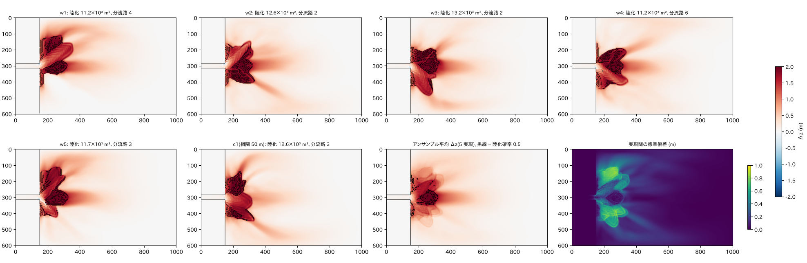

base と同じ構成の地形 1200 h。上段と下段左 2 枚: 地盤高に擾乱を入れた 6 実現(w1〜w5 は ±2 cm の
白色の擾乱、c1 は相関長 50 m の擾乱)。下段右 2 枚: 5 実現の平均の堆積厚(黒線 = 陸になる確率 0.5)と、
実現の間の標準偏差。

## 感度実験の入口

- 砂と泥の割合 → `inflow_cs`(DeltaRCM の f_sand に当たる)。
- 泥の沈降と巻き上げ → `susp_wf`、`susp_tausc`、`susp_esa`。
- 分流路の安定 → `fix_tfix`、`fix_ctau`、`fix_tdec`(出水の継続時間程度)、`fix_ctau_bank`、出水と
  低水の周期(`inflow_val`)。
- 二次流 → `f_secflow = 1`、`sec_nstar = 7`(examples/meander の値)。
- 河川と波の比 R → 固定給砂 `inflow_qb` と沖波 `wave_h0`・`wave_t`。入射角 → `wave_dir`。汀線の向きの
  平滑化長 → `wave_lsm`(格子間隔の 2 倍〜砕波帯の幅の 1/4)。
- 波浪場のケース → 沖波 `wf_hm0`・`wf_trep`・`wf_dir`・`wf_spread`、岸向きの速度の係数
  `wfsed_facsk`・`wfsed_facas`、遡上域の輸送の前浜の平衡勾配 `wfswash_tanbe`(粒径が大きいほど急)と
  係数 `wfswash_kc`・`wfswash_kl`、背景粘性 `p_diffusion_nu`(&list_enc)、砕波による水平混合
  `wf_break_visc`(&list_enc)、砕波の乱れによる攪拌 `f_wfsed_turb`([沿岸の波浪場](../../docs/users_guide/wavefield.md))。
  流れの南北の辺も側方 Neumann(`f_bc_n`・`f_bc_s` = 3)にできます(param_wfsed.txt は wave と比べる
  ために壁)。
- 海面の変化・地盤の沈下 → 沖の辺に海域マスクの帯を置いて `fn_tide` で海面の時系列を、地盤の沈下は
  `fn_bedmotion` で与える。
- 潮汐 → 潮差と周期は make_init.py の `ATIDE`・`TM2`(tide_m2.txt を作り直す)。川に対する潮の強さは
  川の流量と土砂(`inflow_val`・`inflow_qb`)で変える(段 7)。潮の 1 周期の地形変化を小さく保つよう
  `morfac` も合わせて変える(この例の morfac は計算時間との折り合いで、この条件を満たしていない。
  「注意」の「潮汐と地形の加速」)。

## 参考文献

- Ashton, A., Murray, A. B. and Arnoult, O. (2001): Formation of coastline features by large-scale
  instabilities induced by high-angle waves. *Nature*, 414, 296–300.
- Bhattacharya, J. P. and Giosan, L. (2003): Wave-influenced deltas: geomorphological implications for
  facies reconstruction. *Sedimentology*, 50, 187–210.
- Caldwell, R. L. and Edmonds, D. A. (2014): The effects of sediment properties on deltaic processes and
  morphologies: A numerical modeling study. *J. Geophys. Res. Earth Surf.*, 119, 961–982.
- Coleman, J. M., Roberts, H. H. and Stone, G. W. (1998): Mississippi River delta: an overview.
  *J. Coastal Res.*, 14(3), 698–716.
- Dalrymple, R. W. and Choi, K. (2007): Morphologic and facies trends through the fluvial–marine
  transition in tide-dominated depositional systems: A schematic framework for environmental and
  sequence-stratigraphic interpretation. *Earth-Sci. Rev.*, 81, 135–174.
- Edmonds, D. A. and Slingerland, R. L. (2007): Mechanics of river mouth bar formation: Implications for
  the morphodynamics of delta distributary networks. *J. Geophys. Res.*, 112, F02034.
- Edmonds, D. A. and Slingerland, R. L. (2010): Significant effect of sediment cohesion on delta
  morphology. *Nature Geosci.*, 3, 105–109.
- Galloway, W. E. (1975): Process framework for describing the morphologic and stratigraphic evolution
  of deltaic depositional systems. In Broussard, M. L. (ed.), *Deltas: Models for Exploration*, Houston
  Geological Society, 87–98.
- Hoitink, A. J. F., Wang, Z. B., Vermeulen, B., Huismans, Y. and Kästner, K. (2017): Tidal controls on
  river delta morphology. *Nature Geosci.*, 10, 637–645.
- Hoyal, D. C. J. D. and Sheets, B. A. (2009): Morphodynamic evolution of experimental cohesive deltas.
  *J. Geophys. Res.*, 114, F02009.
- Lauzon, R. and Murray, A. B. (2018): Comparing the cohesive effects of mud and vegetation on delta
  evolution. *Geophys. Res. Lett.*, 45, 10437–10445.
- Leonardi, N., Canestrelli, A., Sun, T. and Fagherazzi, S. (2013): Effect of tides on mouth bar
  morphology and hydrodynamics. *J. Geophys. Res. Oceans*, 118, 4169–4183.
- Liang, M., Voller, V. R. and Paola, C. (2015): A reduced-complexity model for river delta formation –
  Part 1: Modeling deltas with channel dynamics. *Earth Surf. Dynam.*, 3, 67–86.
- Nienhuis, J. H., Ashton, A. D. and Giosan, L. (2015): What makes a delta wave-dominated? *Geology*,
  43(6), 511–514.
- Orton, G. J. and Reading, H. G. (1993): Variability of deltaic processes in terms of sediment supply,
  with particular emphasis on grain size. *Sedimentology*, 40, 475–512.
- Roelvink, J. A. (2006): Coastal morphodynamic evolution techniques. *Coastal Eng.*, 53, 277–287.
- Wright, L. D. (1977): Sediment transport and deposition at river mouths: a synthesis. *Geol. Soc. Am.
  Bull.*, 88, 857–868.
