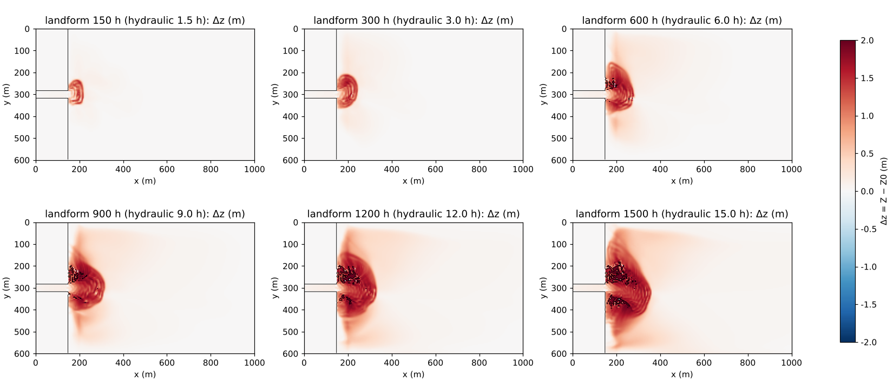
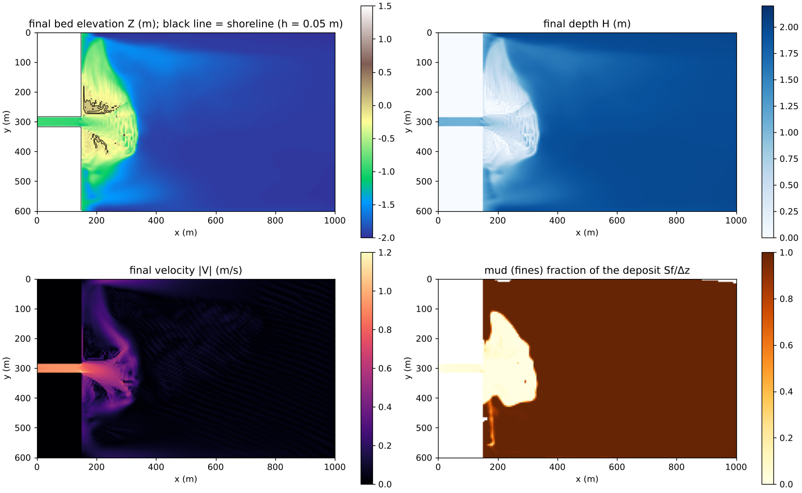

# delta — formation of a river-mouth delta (a sediment-feeding river entering a still-water basin)

> English mirror of examples/delta/README.md. The Japanese file is the master copy.

[日本語](../README.md)

This example builds a DeltaRCM-type configuration — a river enters still water
and builds a mouth bar, bifurcates around the bar, grows lobes and switches
channels — with ENCflow's existing features alone (settings only; no code
changes). The overall picture of the trials, the discussion of the mechanisms
and the correspondence to other models are in
[docs/delta_plan.md](../../../docs/delta_plan.md) (in Japanese); the set-up
procedure is in "River-mouth deltas" of
[docs/users_guide/geomorph.md](../../../docs/en/users_guide/geomorph.md).

## Common configuration

- **The sea is ordinary cells + an initial water level, not a sea mask**
  (f_htype = 2, e0 = 0). Sea cells accept no sediment, so the delta cannot
  advance into a sea mask. The far edge (east) is a long-wave radiation
  boundary (f_bc_e = 2; the reference level is derived automatically from e0)
  that holds the sea level.
- On the west side a dug channel 30 m (6 cells) wide (bed at −1 m, gradient
  0.001). Both banks are dry, non-erodible land at +1.5 m (soil depth 0). A
  50 m slope from the river mouth down to the flat basin floor.
- Sand (0.5 mm) is bedload Exner (Ashida–Michiue formula) + capacity feed
  `fluv_bcfeed = 1` (the bed at the inlet is fixed = the equilibrium load
  arrives from upstream). Mud is the inflow concentration of suspended
  sediment `inflow_cs` (the cohesive-mud reading, with the settling velocity
  `susp_wf = 1 mm/s` given directly) + the ledger of fines in the bed
  `f_bedfines`.
- Correction of the transport direction by the bed slope `fluv_slope = 1`
  and angle-of-repose avalanching `f_repose = 1` (30°). Secondary flow
  `f_secflow` is not used (the overall shape of the delta is set by the
  bifurcation at the mouth bar).
- The landform time is accelerated with `morfac` (100–200). The difference
  between the landform outputs `Z0001…` and `Z0000` is the deposit thickness.
- The inputs are made by `make_init.py` (`make` generates z_<case>.txt and
  sd_<case>.txt).

## Configurations

| Case | Parameter file | Domain and basin | Sand:mud | Inflow | Landform time | Run time (4 threads) |
|---|---|---|---|---|---|---|
| base | param.txt | 1000 × 600 m, 2 m | mud 0.0005 (1:1.7) | 30 m³/s constant | 1500 h (morfac 100) | 45 min |
| sand | param_sand.txt | 1200 × 1600 m, 1.5 m | mud 0.00015 (sand 57 %) | constant | 4000 h (morfac 200) | 2 h |
| mud | param_mud.txt | 1600 × 2600 m, 1.5 m | mud 0.001 (sand 15 %) | constant | 4000 h | 3.5 h |
| varq | param_varq.txt | 1200 × 1600 m, 1.5 m | mud 0.0005 | flood 30 / low flow 6 m³/s, 20 min each | 4000 h | 2 h |
| fix | param_fix.txt | same | same | same + fixation (c_τ 3, T_fix 100 h, submerged decay T_dec 50 h, bank coefficient 0.5) + bank-erosion law | 4000 h | 1.5 h |
| baseqb | param_baseqb.txt | same as base | same | constant. Sand as a fixed feed of 0.00715 m³/s (the actual mean of base); the channel within the land is non-erodible | 1500 h | 1 h |
| wave | param_wave.txt | same | same | baseqb + offshore waves H₀ 0.6 m, T 6 s, direction of travel 150°; shoreline-orientation smoothing length wave_lsm 10 m; river-mouth rule wave_vmax 0.5 m/s | 1500 h | 1 h |
| wfsed | param_wfsed.txt | same | same | baseqb + coastal wave field (offshore waves H_m0 0.6 m, T 6 s, direction of travel 150°, directional spreading 20°, action of the current on the waves) and process-based sediment transport (f_wfsed). The north and south sides are walls for the flow and lateral Neumann for the waves | 1500 h | about 5 h (2 threads, run alongside other jobs; for reference) |

## Running

```bash
make                         # links and inputs (z_*.txt, sd_*.txt)
./encflow param.txt          # base (the others: param_sand.txt etc.)
python3 plot_results.py base # fig_base_evolution.png, fig_base_final.png, fig_base_timeseries.png, timeseries_base.csv
```

## Results

**base** (figures `figs/base_evolution.png`, `figs/base_final.png`): at
landform time 150 h a mouth bar (+1.5 m); at 300 h the flow bifurcates around
the bar and the bar emerges as land; at 600–900 h two distributaries extend
obliquely forward and lobes grow; the forward advance levels off at 190 m,
after which the lateral lobes grow. At 1500 h, 15.7×10³ m² of emerged land and
194×10³ m³ of deposit (97 % of the supply). The sand and the mud separate:
sand in the delta body, mud spread thinly over the prodelta 600–800 m
outside.


**Sand/mud ratio** (figures `figs/sandmud.png`, `figs/sandmud_timeseries.png`):

| | Sand-dominated (sand) | Mud-dominated (mud) |
|---|---|---|
| Deposit (fraction of supply) | 247×10³ m³ (98 %) | 816×10³ m³ (97 %) |
| Emerged land | 47×10³ m² | 241×10³ m² |
| Shoreline radius, mean ± standard deviation (rugosity) | 295 ± 60 m (0.20) | 533 ± 225 m (0.42) |
| Distributaries | 6–10 | 1–2 |

The sand-dominated case is a nearly semicircular fan with many short
distributaries. The mud-dominated case bifurcates once into three, after which
one wins and a long narrow distributary extends 900 m offshore: a bird-foot
delta. Even after removing the difference in supply, the rugosity and the
number of distributaries remain as differences in shape, consistent with
"the more mud, the fewer and longer the distributaries" of DeltaRCM, Delft3D
and experiments.


**Discharge variation and fixation** (figures `figs/fixation.png`,
`figs/fix_final.png`):

| | Emerged land (10³ m²) | Maximum radius (m) | Shoreline mean/standard deviation (m) | Distributaries |
|---|---|---|---|---|
| varq (no fixation) | 65 | 462 | 302 / 98 | 2–5 (50–100 m wide) |
| Strong fixation (reference; c_τ 10, T_fix 20 h, no decay) | 71 | 555 | 355 / 127 | 12 (5–10 m wide) |
| fix (fixation + submerged decay + bank coefficient) | 67 | 470 | 318 / 69 | 10 (20–30 m wide) |

Without fixation the bars are re-submerged and re-eroded at every flood and
the wide distributaries shift position. With fixation without the submerged
decay (reference) the exposed bars become permanent and the distributaries
collapse into straight grid-width channels (the reason `fix_tdec` was added =
developer.md §84.13). With fixation plus the submerged decay and the bank
coefficient, the distributaries stabilize as smooth channels 20–30 m wide and
the shoreline rugosity is smallest. The main cause of the widening is the bed
erosion of bars whose fixation has been reset by the submerged decay; the
contribution of the bank-erosion law is small.


**Waves** (figures `figs/wave_cmp.png`, `figs/wave_evolution.png`; the
longshore transport of fn_wave, developer.md §84.15, docs/wave_plan.md): the
case wave adds offshore waves (H₀ = 0.6 m, T = 6 s, incident from the
east-southeast at an angle of 30°) to the fixed-feed reference baseqb. The
shoreline-orientation smoothing is the physical length wave_lsm = 10 m
(= 2Δx). The river sand Q_r is the same (feed 38.6×10³ m³ solid; deposit 195
versus 194 ×10³ m³ bulk), and the ratio to the longshore transport the waves
can carry is R ≈ 0.5.

| | baseqb (no waves) | wave (with waves, wave_lsm 10 m) | Reference: with waves, cell-radius kernel |
|---|---|---|---|
| Emerged land | 16.0×10³ m² | 31.6×10³ m² | 37.8×10³ m² |
| Maximum radius | 246 m | 316 m | 435 m |
| Shoreline radius mean / standard deviation | 182 / 49 m | 244 / 58 m | 266 / 79 m |
| Distributaries (0.5 R / 0.8 R) | 5 / 9 | 8 / 4 | 6 / 1 |
| North–south asymmetry | 0.55 | 0.85 | 0.93 |

Without waves the mouth bar bifurcates into a lobate delta with a network of
distributaries. With waves a spit extends downdrift (north) from the mouth
bar, the deposit spreads along the shoreline on both sides of the mouth, and
the delta becomes arcuate with smooth edges and skewed to the downdrift side
(twice the emerged land; the distributaries drop to 4). The features of a
wave-dominated delta (spit, arcuate front, deposition along the shoreline,
fewer distributaries) appear. With the earlier cell-radius kernel,
finger-like bars parallel to the wave crests lined up at grid spacing within
the deposit (grid-scale growth of the high-angle instability), and the emerged
land and the maximum radius were overestimated (reference column; developer.md
§84.15 stage 3 (a)). The small puddles left within the deposit are a
consequence of the rule that waves cannot erode cells that have dried out
(R1), and can be smoothed out with angle-of-repose avalanching (f_repose).


Record of the trials that led to this configuration (why the rule wave_vmax
and the fixed feed were introduced):

| Setting | Behavior |
|---|---|
| Head-on incidence (direction of travel 180°), capacity feed | The whole channel with depth ≤ h_b becomes a surf zone and the waves run up the channel. The capacity feed replaces the sand that the longshore transport carries away from the mouth, the supply is 5.5 times that of base, and the basin fills with grid-width bars (`figs/wave_headon_evolution.png`) |
| Incidence angle 45° (135°), capacity feed | The threshold of the high-angle instability. A spit along the wave crests keeps extending 600 m from the mouth (the counterpart of the flying spit of CEM; `figs/wave_a45_evolution.png`) |
| Incidence angle 30° (150°), capacity feed | The waves keep leveling the mouth bar so the transport capacity at the inlet never falls, and the supply is 11 times that of base. The basin fills along a front parallel to the wave crests (`figs/wave_capfeed_evolution.png`) |
| Incidence angle 30°, fixed feed 0.00715 m³/s, erodible channel | The flow depth in the channel (1.2–2.2 m) exceeds h_b = 1.07 m, the whole channel becomes a wave source, and the positive feedback of the longshore transport acting on bars inside the channel diverges (stops) at 1.25 h of hydraulic time. → The river-mouth rule wave_vmax was added (test/wave_river) |

The fixed feed scours the inlet of an erodible channel down to the 3 m soil
layer within 1 h even without waves (transport capacity > feed), so the
channel within the land was made non-erodible (a hard channel that carries the
feed). The verification of the longshore transport itself is in
test/wave_shore (linear theory of a straight shoreline) and test/wave_river
(the river-mouth rule).


**Coastal wave field (V12)** (figures `figs/wfsed_evolution.png`, `figs/wfsed_final.png`; the coastal
wave field fn_wavefield and process-based sediment transport f_wfsed, developer.md §90 and
docs/wavefield_plan.md, Japanese): the case wfsed gives the same river, feed and waves as wave, not
through the CERC-type longshore transport (fn_wave) but through the coastal wave field, which resolves
the waves, and process-based sediment transport. The offshore waves (H_m0 = 0.6 m, T = 6 s, direction of
travel 150°, directional spreading 20°) enter from the east side; the wave field gives refraction,
breaking and the shadow of the delta itself, and the change of waves by currents (`f_wf_current = 1`)
gives the blocking of the waves by the river-mouth jet (the counterpart of the rule wave_vmax of wave).
The wave-driven flow (radiation stress with the roller, GLM and wave–current friction; `wf_flow = 2`)
drives a northward longshore current, and sand and mud are stirred by the orbital velocity and carried by
the Eulerian mean velocity and the onshore velocity of wave skewness and asymmetry. The north and south
sides are lateral Neumann for the waves and walls for the flow (as in wave; a lateral Neumann boundary
of the flow becomes unstable at the side where the longshore current enters; developer.md §90.16,
Japanese).

| Landform 1500 h | wfsed (coastal wave field) |
|---|---|
| Deposit (bulk) | 147×10³ m³ (sand 64×10³ m³ = nearly all of the feed; mud 83×10³ m³ = 61 % of the supply) |
| Emerged land (h < 0.05 m) | 4.1×10³ m² |
| Shallows (h < 0.5 m) | 20.6×10³ m² |
| Maximum land advance from the river mouth | 142 m |
| Fraction of the deposit north of the channel axis | 0.55 (sand 0.52) |

(Totals of `python3 plot_results.py wfsed`, with the sand/mud and north/south split computed from the final
Z, Sf and H. The emerged land and the shallows are the areas of cells seaward of the river mouth.)

Whereas in wave (CERC) a spit extended downdrift (north) from the mouth bar and the emerged land
reached 31.6×10³ m², with the process-based transport of the wave field the sand spreads in front of the
mouth as a shallow arcuate platform about 450 m alongshore and 180 m seaward, and the emerged land stays
at 4.1×10³ m² (the crests of the bars on both sides of the mouth). The shallows keep spreading with time
(from 5.5×10³ m² at 900 h of landform time to 20.6×10³ m² at 1500 h), and the skew to the north
(downdrift) is small. The phase-averaged waves stop short of the shoreline and there is no swash-zone
transport (the process that builds up beaches and berms), so the sand stays in the shallows and hardly
becomes land (see "Scope and restrictions on combinations" in [coastal wave
field](../../../docs/en/users_guide/wavefield.md)). The waves keep the mud from settling: it spreads over the
whole basin as a thin layer (7 cm on average for x > 500 m), 22 % of the supply is still suspended in the
water at the end, and the remaining 17 % left through the open east side (in base 97 % of the supply is
deposited). Whether the shallow platform becomes land depends on swash-zone processes, so read any
discussion of the shoreline shape together with wave (CERC). The diagonal stripes offshore in the final
velocity panel are a grid-scale oscillation of the velocity that grows with time (a grid-scale deviation
of 0.01 m/s at 3.3 h of hydraulic time and a maximum |V| of 0.15 m/s at 15 h; the water level is smooth,
with grid-scale deviations below 0.1 mm); its cause has not been investigated (docs/handoff.md, Japanese).




## Findings and notes

- **Symmetry breaking**: there is no random number and the computation is
  deterministic. Up to the mouth bar everything is perfectly symmetric; the
  distribution between the two distributaries on either side of the bar is
  an unstable equilibrium, so round-off error is amplified exponentially
  (10–40 times every 150 h, saturating at 900 h). Which side the lobe grows
  on can change with the compiler or the thread count. The shape differs
  between realizations, but the integrated quantities (deposit, emerged land,
  maximum radius) differ by only a few % (figure `figs/ensemble.png`:
  5 realizations with ±2 cm perturbations of the ground height and
  1 realization with a correlated perturbation). Discuss the average shape
  with the statistics of several realizations.
- **Grid orientation**: rotating the channel axis by 20° leaves the relative
  angle of the bifurcation unchanged; there is no locking to the grid
  diagonals. However, when the walls are hard and the channel width drops to
  the grid spacing, the channels appear in 8 directions (delta_plan.md §3).
  Resolve the distributaries with at least width/5 cells (confirmed at
  dx 2.5 m that the widths of the main distributaries are preserved to the
  meter; §2.7).
- **Domain**: so that asymmetrically growing realizations do not reach the
  walls, 1500 m seaward of the mouth and at least ±1300 m sideways (mud is
  wide for that reason).
- Tidal currents, the buoyancy of the freshwater plume and the consolidation of mud are not included. The
  waves of fn_wave (wave) act only through the longshore transport; stirring, sheltering and wave-driven
  flow with resolved waves are in the coastal wave field case (wfsed).
- With executables before 2026-10-21, the avalanching and bank-erosion
  volumes in the warning at the end of the run included the "virtual flux"
  of the walls of the non-erodible land (the terrain is correct;
  developer.md §84.14).

## Entry points for sensitivity experiments

- Sand:mud ratio → `inflow_cs` (the counterpart of f_sand in DeltaRCM).
- Settling and resuspension of mud → `susp_wf`, `susp_tausc`, `susp_esa`.
- Sea-level change and subsidence → place a strip of sea mask at the far edge and use `fn_tide`; the ground with `fn_bedmotion`.
- Persistence of distributaries → `fix_tfix`, `fix_ctau`, `fix_tdec` (about the duration of a flood), `fix_ctau_bank`,
  the period of floods and low flows (`inflow_val`).
- Secondary flow on/off → `f_secflow = 1`, `sec_nstar = 7` (the values of examples/meander).
- River-to-wave ratio R → `inflow_qb` (fixed feed) and `wave_h0`, `wave_t`. Shoreline-orientation smoothing length → `wave_lsm` (2Δx to 1/4 of the surf-zone width). Incidence angle → `wave_dir`
  (within ±22.5° of head-on to the channel axis is not allowed; 45° is the threshold of the high-angle instability. See the header of param_wave.txt).
- The coastal wave field case → offshore waves `wf_hm0`, `wf_trep`, `wf_dir`, `wf_spread`; the coefficients of
  the onshore velocity `wfsed_facsk`, `wfsed_facas`; horizontal mixing by wave breaking `wf_break_visc`
  (&list_enc); stirring by breaking turbulence `f_wfsed_turb` ([coastal wave
  field](../../../docs/en/users_guide/wavefield.md)). Avoid making the north and south sides lateral Neumann for
  the flow: the flow diverges when it becomes non-uniform near the side where the longshore current enters
  (developer.md §90.16, Japanese).
