# delta — formation of a river-mouth delta, and how the sand/mud ratio, vegetation and waves change its shape

> English mirror of examples/delta/README.md. The Japanese file is the master copy.

[日本語](../README.md)

When a river carrying sediment flows into the still water of a sea or lake, sand settles in front
of the mouth to form a mouth bar, the flow splits around both sides of the bar, and another bar
forms at the end of each new channel. A river-mouth delta grows by repeating this. The shape of a
delta is set by the amount and grain size of the sediment the river carries, by the variation of
the discharge and by vegetation, and by how waves and tides redistribute that sediment. This
example starts from the simplest configuration, a river flowing into a calm sea without waves,
adds the mechanisms one at a time in the order sand/mud ratio, floods and vegetation, oblique
waves, and the coastal wave field that resolves the waves, and compares how the shape of the
delta changes. Use it as a guide to choosing which ENCflow mechanisms the delta you want to
reproduce needs. The values are schematic, chosen to make the phenomena visible, and do not
reproduce any particular delta. The schematic, the set-up figure and the figures of wfsed have
English labels; the other result figures have Japanese labels (shared with the Japanese version).

## What happens in real deltas

- **Mouth bar and bifurcation**: on entering the sea, the river flow spreads sideways as a jet and
  slows down abruptly. The sand it carries drops just in front of the mouth and forms a mouth
  bar; once the bar has grown close to the water surface, the flow splits around both sides of
  it. The same happens at the end of each new channel, and repeated bifurcation builds a network
  of distributaries (Wright 1977; Edmonds & Slingerland 2007).
- **Lobes and avulsion**: as deposition at the end of the distributaries builds a protruding part
  (a lobe), the channel becomes longer and gentler, and eventually the flow switches to a shorter,
  steeper path and builds a new lobe elsewhere. The Mississippi River delta has grown by switching
  its lobes about every thousand years (Coleman et al. 1998).
- **Mud goes offshore, sand stays near the mouth**: fine mud settles slowly, so it is carried far
  from the mouth and spreads as a thin, wide layer offshore of the delta front (the prodelta).
- **Three forces that shape a delta**: depending on which of river sediment supply, waves and tides
  is strongest, deltas are classed as river-dominated (such as the bird's-foot of the Mississippi),
  wave-dominated (such as the cuspate arc of the São Francisco River in Brazil) and tide-dominated
  (such as the Ganges–Brahmaputra) (Galloway 1975). Real deltas lie somewhere between these three.
- **The ratio of sand to mud**: a delta of a muddy river tends to become a bird's-foot, with a few
  long distributaries reaching offshore between banks stiffened by mud; a delta of a sandy river
  tends to become a semicircular fan with many short distributaries (Orton & Reading 1993;
  Edmonds & Slingerland 2010).
- **Floods and vegetation**: sediment is carried mainly during floods, and at low flow the bars
  emerge from the water. When vegetation takes root on the emerged bars, they become harder to erode
  in the next flood and the distributaries stay in place. The cohesion of mud and vegetation both
  act to stiffen the banks (Lauzon & Murray 2018).
- **Waves**: oblique waves carry sand along the shore in the surf zone (longshore transport). The
  longshore transport smooths out the protrusion of the mouth, making the front a smooth arc, and
  extends a spit to the downdrift side. Depending on the ratio of the river sediment supply to the
  amount the waves can carry away along the shore, a delta changes from a bird's-foot to an arcuate
  or cuspate shape (Nienhuis et al. 2015). A delta exposed to oblique waves is skewed to the
  downdrift side (Bhattacharya & Giosan 2003). Waves also stir the mud and keep it from settling.
- **Tides**: at a mouth where the flow reverses with the rise and fall of the tide, bars elongated
  along the flow line up and the mouth widens seaward like a funnel (Dalrymple & Choi 2007).

## Mechanisms needed for the reproduction

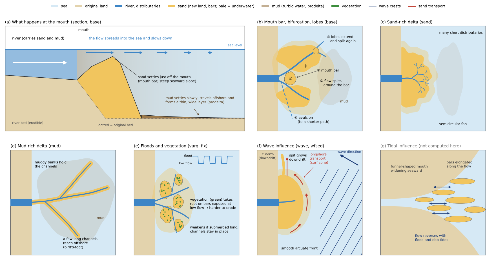

Schematic (scales exaggerated; plan views have north up). (a)(b) What happens at a river mouth
without waves. (c)–(f) The shape of the delta as changed by the sand/mud ratio, vegetation and
waves. (g) The influence of tides (not computed in this example). The names in parentheses are
the corresponding cases.

**The delta to reproduce, and the mechanisms to add**: starting from a river mouth without waves
(stage 1), the mechanisms are added one at a time. Each stage includes the mechanisms of the
previous stage (stage 5 replaces the longshore transport of stage 4 with the coastal wave field).

| Stage | Phenomenon or delta to reproduce | Mechanisms to add | Main settings | Cases |
|---|---|---|---|---|
| 1 | Mouth bar, bifurcation, lobes, avulsion (the basis of a river-dominated delta) | Shallow-water flow, bedload of sand and suspended load of mud, correction of the transport direction by the bed slope, angle-of-repose avalanching. The sea is ordinary cells | `f_fluvial`, `fluv_bcfeed = 1`; `f_suspend`, `inflow_cs`, `f_bedfines`; `fluv_slope = 1`; `f_repose = 1`; `f_htype = 2`, `f_bc_e = 2` | base |
| 2 | A sandy fan, a muddy bird's-foot | The same mechanisms as stage 1, changing the amount of mud (the inflow concentration) | `inflow_cs` | sand, mud |
| 3 | Distributaries stabilized by floods and vegetation | Time series of the discharge, fixation by vegetation (weakened when submerged), bank erosion | `inflow_val`; `f_fixation` (`fix_tdec`, `fix_ctau_bank`); `f_berode` | varq, fix |
| 4 | A wave-influenced delta (arcuate front, spit, skew to the downdrift side) | Longshore transport by oblique waves (an estimate without resolving the waves). The sand supply is given as a fixed amount | `fn_wave` (`wave_lsm`, `wave_vmax`); `inflow_qb`, `fluv_bcfeed = 0` | baseqb, wave |
| 5 | Stage 4 plus wave refraction, the shadow of the delta, wave-driven flow, stirring of mud, and sand pushed up by the swash | The coastal wave field, stirring and transport by waves, swash-zone transport (in place of the longshore transport of stage 4) | `fn_wavefield` (`wf_flow = 2`, `f_wf_current = 1`); `f_wfsed`; `f_wfswash`; background viscosity `p_diffusion_nu` | wfsed |
| — | Tide-dominated (reversing flow, bars along the flow, funnel-shaped mouth) | Reversing tidal flow from a time series of the tide level (a strip of sea mask along the offshore side) | `fn_tide` | Not in this example (not checked) |

**Phenomena and mechanisms**:

| Real phenomenon | How ENCflow represents it | Settings |
|---|---|---|
| The river flows into the sea, and the jet spreads and slows down | Shallow-water flow (momentum-conservative form; resolves the spreading and deceleration of the jet and the backwater at the mouth). The sea is ordinary cells with an initial water level, and the offshore side is a long-wave radiation boundary that holds the sea level | `f_htype = 2`, `e0`; `f_bc_e = 2` |
| The river carries sand, which settles in front of the mouth, forms a mouth bar and splits the flow | Bedload transport formula (Ashida–Michiue) and the bed continuity equation. From upstream comes as much sand as the flow can carry (capacity feed, which fixes the bed at the inlet) | `f_fluvial = 1`, `f_qbform = 1`, `fluv_bcfeed = 1` |
| Sand spreads to the flanks of the bars and the lobes become rounded | Correction of the transport direction by the bed slope, and avalanching of slopes steeper than the angle of repose | `fluv_slope = 1`, `f_repose = 1` |
| Mud is carried offshore and settles as a thin layer; the settled mud is resuspended | Advection and settling of suspended sediment (the effective settling velocity of mud is given directly). With the ledger of fines in the bed, only settled mud is resuspended | `f_suspend = 1`, `inflow_cs`, `susp_wf`, `f_bedfines = 1` |
| Floods and low flows alternate | Time series of the discharge of a segment inflow | `inflow_val` |
| Vegetation takes root on bars exposed at low flow and makes them harder to erode; it weakens when submerged for long | Degree of fixation: grows while out of the water and raises the erosion threshold and the roughness; decays when submerged. Its effect on banks is given by a separate coefficient | `f_fixation = 1`; `fix_tfix`, `fix_ctau`, `fix_cn`, `fix_tdec`, `fix_ctau_bank` |
| The flow erodes banks and makes them retreat | Bank erosion (a neighbouring cell higher than the water surface is collapsed by the shear on the bank toe) | `f_berode = 1` |
| Oblique waves carry sand along the shore in the surf zone | Longshore transport computed from the offshore waves (CERC formula) is moved as bedload in the surf zone. The shoreline orientation is taken from the depth gradient. Fast-flowing channel cells are excluded from the waves | `fn_wave`, `wave_lsm`, `wave_vmax` |
| Waves refract and break, the delta casts a shadow, and a longshore current develops. Waves stir sand and mud, and the swash pushes sand up | The coastal wave field (resolves the direction and height of the waves; the river-mouth current stops the waves), wave-driven flow, stirring and transport by waves and currents, swash-zone transport | `fn_wavefield`, `wf_flow = 2`, `f_wf_current = 1`, `f_wfsed = 1`, `f_wfswash = 1` |
| Landform change is much slower than the flow | The amount of landform change is multiplied by morfac to shorten the time | `morfac` |

Secondary flow (the flow that deepens the outer bank of a meander, `f_secflow`) is not used. The
overall shape of a delta is set by the bifurcation at the mouth bar, and adding the secondary-flow
term to the flow at the edges of the jet and around the bars tends to pick up streamline
curvature that does not exist in reality. The settings of each mechanism are in the user's guide:
[bedload](../../../docs/en/users_guide/geomorph.md#bedload-f_fluvial) (capacity feed, slope
correction, fixation, bank erosion), [suspended
sediment](../../../docs/en/users_guide/geomorph.md#suspended-sediment-f_suspend) (ledger of fines),
[wave-driven longshore transport](../../../docs/en/users_guide/geomorph.md#wave-driven-longshore-transport-fn_wave),
[coastal wave field](../../../docs/en/users_guide/wavefield.md) and
[tide level](../../../docs/en/users_guide/tide.md).

## Geometry and settings

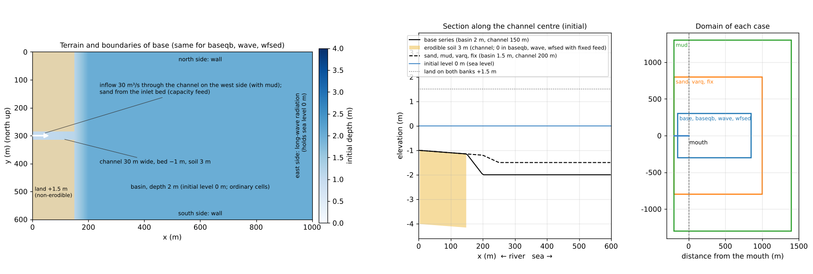

Left: initial terrain and boundaries of base (north up). Middle: section along the channel centre.
Right: size of the domain of each case (origin at the river mouth).

- **Channel and land**: from the west side, a dug channel 30 m wide (6 cells; bed at −1 m, gradient
  1/1000) runs east for 150 m (base, baseqb, wave, wfsed) or 200 m (sand, mud, varq, fix) and
  connects to the flat basin floor through a 50 m slope from the mouth. Both banks are dry land at
  +1.5 m that cannot be eroded (soil depth 0). The channel bed is an erodible bed with 3 m of soil
  (in baseqb, wave and wfsed, which give the sand as a fixed amount, the channel is also a
  non-erodible conduit, and the sand starts to move once it leaves the mouth).
- **Sea**: the basin is 2 m deep (base, baseqb, wave, wfsed) or 1.5 m deep (sand, mud, varq, fix).
  The sea is represented not by a sea mask but by ordinary cells with an initial water level of
  0 m. The east side holds the sea level at 0 m with long-wave radiation; the north, south and west
  sides are walls.
- **River**: 30 m³/s flows in through the 6 channel cells on the west side (varq and fix alternate
  floods of 30 m³/s and low flows of 6 m³/s, 20 min each). Sand (grain size 0.5 mm) comes from the
  capacity feed (the bed at the inlet is fixed and as much sand as the flow can carry enters from
  upstream); mud enters with the volume concentration `inflow_cs` and settles at 1 mm/s.
- **Time**: the landform change is multiplied by morfac (100 or 200), so 15–24 hours of hydraulic
  computation show 1500–4000 hours of landform change. All times below are landform times.
- The grid spacing is 5 m, and make_init.py creates the inputs (`make`).

| Stage | Case | Parameter file | Domain, basin depth | River discharge, mud concentration | Mechanisms added | Landform time | Run time (4 threads) |
|---|---|---|---|---|---|---|---|
| 1 | base | param.txt | 1000 × 600 m, 2 m | 30 m³/s, mud 0.0005 | — | 1500 h (morfac 100) | 45 min |
| 2 | sand | param_sand.txt | 1200 × 1600 m, 1.5 m | 30 m³/s, mud 0.00015 | less mud | 4000 h (morfac 200) | 2 h |
| 2 | mud | param_mud.txt | 1600 × 2600 m, 1.5 m | 30 m³/s, mud 0.001 | more mud | 4000 h | 3.5 h |
| 3 | varq | param_varq.txt | 1200 × 1600 m, 1.5 m | floods of 30 / low flows of 6 m³/s, 20 min each; mud 0.0005 | variation of the discharge | 4000 h | 2 h |
| 3 | fix | param_fix.txt | same | same | variation of the discharge + fixation by vegetation (c_τ 3, T_fix 100 h, roughness increment ratio 2, submerged decay T_dec 50 h, bank coefficient 0.5) + bank erosion | 4000 h | 1.5 h |
| 4 | baseqb | param_baseqb.txt | same as base | same as base; sand as a fixed feed of 0.00715 m³/s (the mean of base) | reference without waves (sand given as a fixed amount) | 1500 h | 1 h |
| 4 | wave | param_wave.txt | same | same | longshore transport by offshore waves (significant wave height 0.6 m, period 6 s, from the east-southeast at an incidence angle of 30°) | 1500 h | 1 h |
| 5 | wfsed | param_wfsed.txt | same | same | the same waves as wave (directional spreading 20°) through the coastal wave field, stirring and transport by waves, and swash-zone transport | 1500 h | 50 min |

c_τ is the ratio by which the erosion threshold increases at full fixation (the roughness
increment ratio has the same form), T_fix is the time over which fixation progresses, and T_dec is
the time over which fixation weakens while submerged.

## How to run

```bash
cd examples/delta
make                                # links to the executables and the inputs (z_*.txt, sd_*.txt)
./encflow param.txt                 # base (the others: ./encflow param_sand.txt etc.)
python3 plot_results.py base        # fig_base_evolution.png, fig_base_final.png, fig_base_timeseries.png, timeseries_base.csv
python3 plot_results.py mechanism   # schematic of the mechanisms, figs/mechanism.png (uses no results)
python3 plot_results.py setup       # set-up figure, figs/setup.png
```

Plotting needs Python 3 with NumPy and matplotlib. Adding `en` to the arguments writes figures with
English labels to en/figs/. plot_results.py draws the time evolution of the deposit thickness, the
final landform and the time series of one case; `<case>_evolution.png` and `<case>_final.png` in
figs/ are figures of the same form. The scripts for the figures that set cases side by side
(sandmud, sandmud_timeseries, fixation, wave_cmp, ensemble) and for the totals of the shoreline
radius and of the number of distributaries are not included in this example.

## Results

Emerged land is the area of cells seaward of the mouth with depth below 0.05 m; the shoreline
radius is the mean and standard deviation of the distance from the mouth to the shoreline (depth
0.05 m) (standard deviation / mean = rugosity); the maximum radius R is the distance from the mouth
to the farthest land; and the number of distributaries is the number of channels crossing arcs of
radius 0.5 R and 0.8 R centred on the mouth. All figures have north up; the colour is the change in
ground elevation (deposit thickness) and the black line is the shoreline.

The tables and figures were computed with the version of 20–29 October 2026. Because the shape of
the delta differs between realizations (see "The shape differs between realizations" in the
notes), recomputing with the same settings changes the positions of the lobes and the number of
distributaries, and the deposit, emerged land and maximum radius can change within a few %.

### Stage 1: a river mouth without waves — mouth bar, bifurcation, lobes (base)

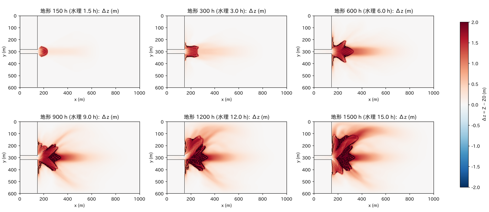

- **Mouth bar and bifurcation**: at 150 h of landform time a mouth bar about 1.5 m thick forms in
  front of the mouth; at 300 h the flow splits around both sides of the bar and the bar becomes
  land.
- **Lobes**: at 600–900 h two distributaries extend obliquely forward and lobes grow. The forward
  advance levels off at 190 m, after which the lateral lobes grow.
- **Separation of sand and mud**: at 1500 h there are 15.7×10³ m² of emerged land and 194×10³ m³ of
  deposit (97 % of the supply). The sediment that entered is 39×10³ m³ of sand and 81×10³ m³ of
  mud (solid volumes); the sand forms the body of the delta and the mud settles thinly over the
  prodelta 600–800 m outside it (lower right of the figure below).

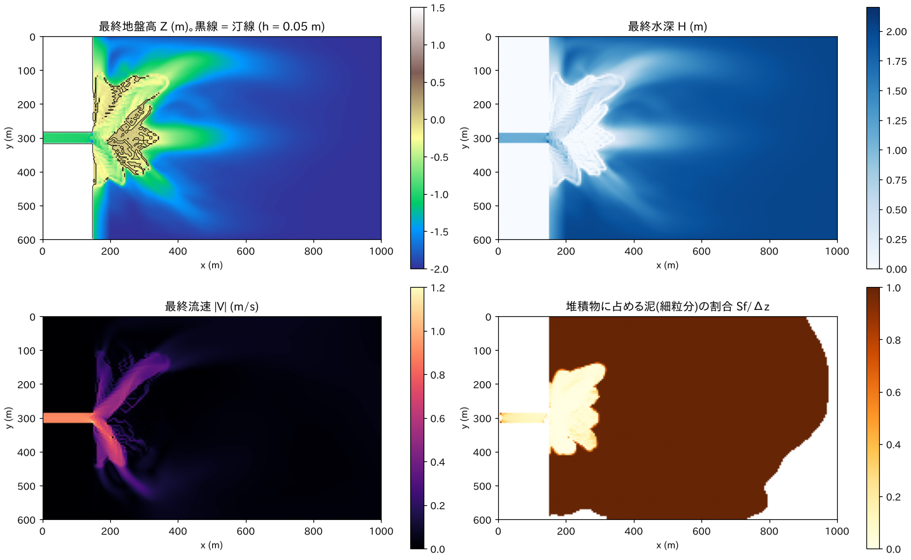

base at 1500 h. Upper left: ground elevation; upper right: depth; lower left: velocity; lower
right: mud fraction of the deposit.

### Stage 2: the ratio of sand to mud — fan and bird's-foot (sand, mud)

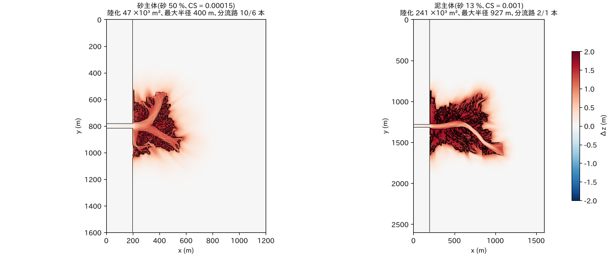

Deposit thickness at 4000 h. Left: sand, with more sand; right: mud, with more mud. The sand
fractions in the figure titles (50 %, 13 %) are rough estimates; the fractions in the table below
are computed from the amounts that actually entered in the computation.

| | sand (more sand) | mud (more mud) |
|---|---|---|
| Mud inflow concentration (sand fraction of the sediment that entered) | 0.00015 (57 %) | 0.001 (15 %) |
| Deposit (fraction of the supply) | 247×10³ m³ (98 %) | 816×10³ m³ (97 %) |
| Emerged land | 47×10³ m² | 241×10³ m² |
| Shoreline radius, mean ± standard deviation (rugosity) | 295 ± 60 m (0.20) | 533 ± 225 m (0.42) |
| Distributaries (0.5 R / 0.8 R) | 10 / 6 | 2 / 1 |

- **More sand gives a fan**: a nearly semicircular fan with many short distributaries.
- **More mud gives a bird's-foot**: after splitting once into three, one channel wins and a long,
  narrow distributary extends 900 m offshore.
- Even after removing the difference in supply (3.3 times more for mud), the rugosity of the
  shoreline and the number of distributaries remain as differences in shape. The trend "the more
  mud, the fewer and longer the distributaries" is the same as in other models (DeltaRCM: Liang et
  al. 2015; Delft3D: Edmonds & Slingerland 2010, Caldwell & Edmonds 2014) and in flume experiments
  (Hoyal & Sheets 2009).

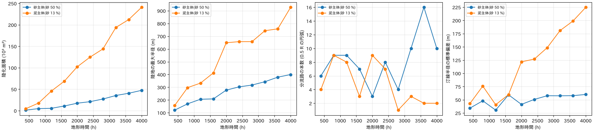

From the left: emerged land, maximum radius, number of distributaries (0.5 R), and standard
deviation of the shoreline radius over time.

### Stage 3: floods and vegetation — stable distributaries (varq, fix)

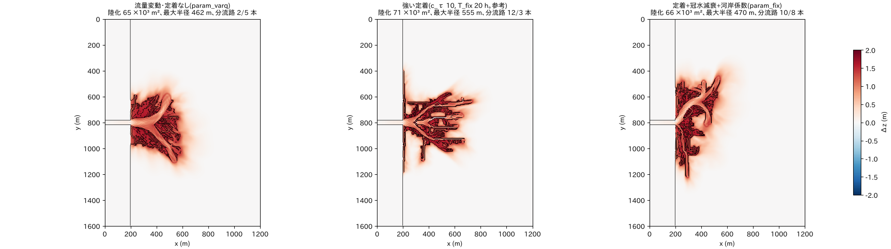

Deposit thickness at 4000 h. Left: discharge variation only (varq); middle: reference (strong
fixation that does not weaken when submerged); right: fixation + submerged decay + bank coefficient
(fix).

| | Emerged land (10³ m²) | Maximum radius (m) | Shoreline radius mean / standard deviation (m) | Distributaries (0.5 R / 0.8 R) and width |
|---|---|---|---|---|
| varq (discharge variation, no fixation) | 65 | 462 | 302 / 98 | 2 / 5 (50–100 m wide) |
| Reference: strong fixation that does not weaken when submerged (c_τ 10, T_fix 20 h, no submerged decay) | 71 | 555 | 355 / 127 | 12 / 3 (5–10 m wide) |
| fix (fixation + submerged decay + bank coefficient + bank erosion) | 67 | 470 | 318 / 69 | 10 / 8 (20–30 m wide) |

- **No fixation (varq)**: at every flood the bars are submerged and eroded again, and wide
  distributaries build a fan while shifting position.
- **Fixation that does not weaken when submerged (reference)**: once a bar has emerged it stays
  fixed, and the distributaries become straight channels one grid cell wide. Real vegetation
  weakens when submerged for long, so the submerged decay `fix_tdec` is set to about the duration
  of a flood.
- **Fixation + submerged decay + bank coefficient (fix)**: the distributaries stabilize as smooth
  channels 20–30 m wide, and the rugosity of the shoreline is smallest. What widens the
  distributaries is the erosion of the bed of bars whose fixation has weakened while submerged;
  the contribution of bank erosion is small.

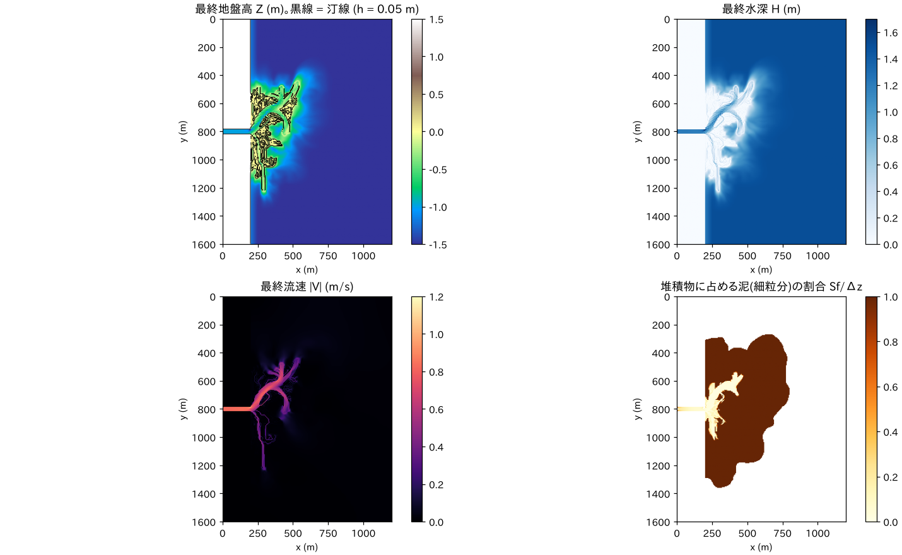

fix at 4000 h (the panels are arranged as in the final landform of base).

### Stage 4: oblique waves — an arcuate delta by longshore transport (baseqb, wave)

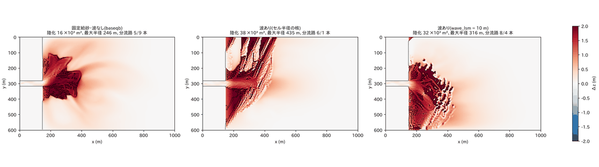

Deposit thickness at 1500 h. Left: without waves (baseqb); middle: reference (shoreline
orientation taken at the grid scale, `wave_lsm = 0`); right: with waves (wave).

wave adds offshore waves (significant wave height 0.6 m, period 6 s, coming from the
east-southeast at an incidence angle of 30° to the shoreline) to baseqb, the reference without
waves. The river sand supply is the same (38.6×10³ m³ solid; deposit 195 versus 194×10³ m³), and
the ratio R of the river sediment supply to the amount the waves can carry along the shore is about
0.5. The shoreline orientation is taken after smoothing over a length `wave_lsm = 10 m` (twice the
grid spacing).

| | baseqb (no waves) | wave (with waves) | Reference: wave with `wave_lsm = 0` |
|---|---|---|---|
| Emerged land | 16.0×10³ m² | 31.6×10³ m² | 37.8×10³ m² |
| Maximum radius | 246 m | 316 m | 435 m |
| Shoreline radius mean / standard deviation | 182 / 49 m | 244 / 58 m | 266 / 79 m |
| Distributaries (0.5 R / 0.8 R) | 5 / 9 | 8 / 4 | 6 / 1 |

- **Without waves (baseqb)**: the mouth bar bifurcates and a lobate delta with a network of
  distributaries forms.
- **With waves (wave)**: a spit extends downdrift (north) from the mouth bar, the deposit spreads
  along the shoreline on both sides of the mouth, and the delta becomes arcuate in front and skewed
  to the downdrift side (twice the emerged land; the distributaries at 0.8 R drop from 9 to 4). The
  features of a wave-influenced delta (spit, arcuate front, deposition along the shoreline, fewer
  distributaries) appear.
- **Smoothing of the shoreline orientation, `wave_lsm`**: the direction of the longshore transport
  is set by the shoreline orientation taken from the depth gradient. If it is taken at the grid
  scale (reference column), the shoreline instability due to high-angle waves grows at the grid
  scale, finger-like bars parallel to the wave crests line up within the deposit, and the emerged
  land and the maximum radius are overestimated. Take the shoreline orientation after smoothing
  over a physical length `wave_lsm` (twice the grid spacing to 1/4 of the surf-zone width).
- The small puddles left within the deposit form because the longshore transport does not move the
  sand of dry cells; angle-of-repose avalanching (`f_repose`) smooths them out.

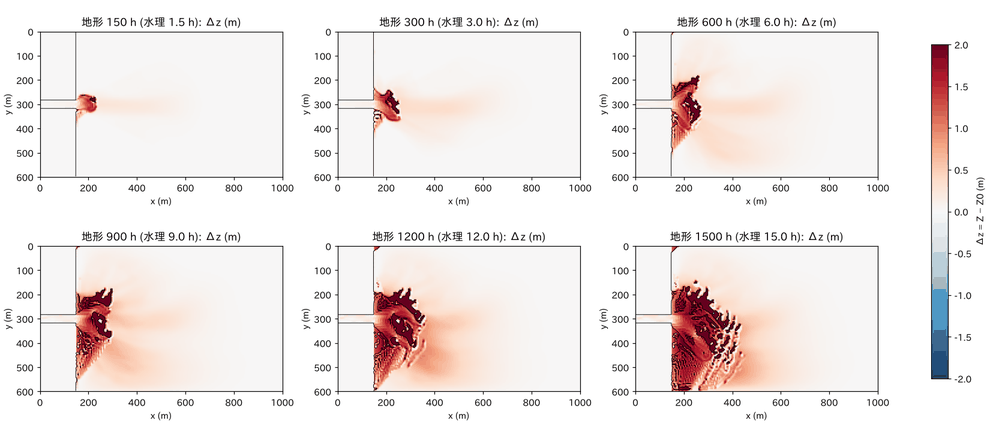

### Stage 5: resolving the waves — refraction, shadow, longshore current, swash (wfsed)

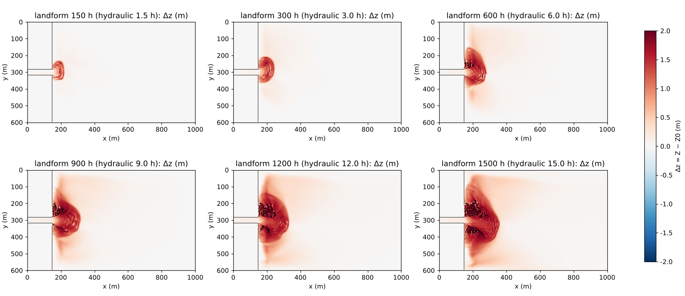

wfsed gives the same river, feed and waves as wave, not through the CERC-type longshore transport
(`fn_wave`) but through the coastal wave field (`fn_wavefield`), which resolves the waves, and
stirring and transport by waves. The offshore waves (significant wave height 0.6 m, period 6 s,
direction of travel 150°, directional spreading 20°) enter from the east side, and the wave field
computes refraction, breaking and the shadow of the delta itself. The river-mouth jet stops the
waves through the change of waves by currents (`f_wf_current = 1`; the counterpart of `wave_vmax`
in wave). The wave-driven flow (radiation stress with the roller, GLM, wave–current friction;
`wf_flow = 2`) drives a northward longshore current, and sand and mud are stirred by the orbital
velocity of the waves and carried by the Eulerian mean velocity and the onshore velocity due to
wave skewness and asymmetry (`f_wfsed = 1`). At the shoreline, the swash-zone transport
(`f_wfswash = 1`, equilibrium foreshore slope `wfswash_tanbe = 0.1`) pushes the sand of the
shallows up to the height the swash reaches. On the north and south sides the waves are lateral
Neumann (the same coast continues outside) and the flow meets walls (as in wave).

| Landform 1500 h | wfsed | Reference: without swash-zone transport (`f_wfswash = 0`) |
|---|---|---|
| Deposit (bulk) | 154×10³ m³ (sand 64×10³ m³ = nearly all of the feed; mud 89×10³ m³ = 66 % of the supply) | 154×10³ m³ (sand 64×10³ m³; mud 90×10³ m³ = 67 %) |
| Emerged land (depth below 0.05 m) | 7.5×10³ m² | 5.3×10³ m² |
| Mean ground elevation of the land | 0.30 m | 0.08 m |
| Shallows (depth below 0.5 m) | 19.6×10³ m² | 23.7×10³ m² |
| Maximum land advance from the river mouth | 142 m | 118 m |
| Fraction of the deposit north of the channel axis | 0.51 (sand 0.49) | 0.52 (sand 0.51) |

(Totals of `python3 plot_results.py wfsed`, with the sand/mud and north/south split and the ground
elevation of the land computed from the final ground elevation Z, mud thickness Sf and depth H. The
emerged land and the shallows are the areas of cells seaward of the river mouth. The reference
column is a run with `f_wfswash` set to 0 in param_wfsed.txt.)

- **How the sand spreads**: whereas in wave (CERC) a spit extends north from the mouth bar and the
  emerged land reaches 31.6×10³ m², in wfsed the sand spreads in front of the mouth as a shallow
  arcuate platform about 390 m alongshore and 210 m seaward, with little skew to the north
  (downdrift).
- **How land forms**: the swash-zone transport piles the sand on the crest of the platform up to
  the height the swash reaches; land appears at 450 h of landform time and keeps growing until
  1500 h. The land grows on the crest of the platform on both sides of the mouth (larger on the
  north side) as a rise averaging 0.30 m (above the still water level, close to the runup limit).
  The swash zone is about one cell wide, so the edges of the land are ragged at the scale of one
  cell and shallow pools (one cell) remain inside the land. By the end, the swash-zone transport
  has moved 2.5×10³ m³ (solid) of sand onto the dry foreshore and 0.4×10³ m³ off it.
- **Without the swash-zone transport (reference column)**: the sand stays in the shallows; the
  emerged land is about 30 % smaller at 5.3×10³ m², the land averages 0.08 m in elevation (bar
  crests at about the still water level), and the shallows are correspondingly wider
  (23.7×10³ m²). The amount of emerged land depends on the coefficients of the swash-zone transport
  and on the equilibrium foreshore slope `wfswash_tanbe` (a quantity given from the grain size), so
  read the shape of the shoreline together with wave (CERC) ("Swash-zone transport" in the
  [user's guide](../../../docs/en/users_guide/wavefield.md#swash-zone-transport-f_wfswash)).
- **Mud**: the waves stir the mud and keep it from settling, and it spreads over the whole basin as
  a thin layer (6 cm on average for x > 500 m). At the end, 22 % of the supply is still suspended in
  the water and 12 % has left through the open east side (in base 97 % of the supply is deposited).

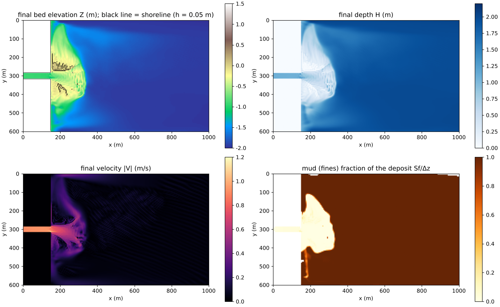

wfsed at 1500 h (the panels are arranged as in the final landform of base).

## What this model cannot represent (differences from real phenomena)

- **Tides**: this example has no tides. Placing a strip of sea mask along the offshore side and
  giving a time series of the tide level (`fn_tide`) produces a reversing tidal flow, but whether
  this can be used for the formation of a tide-dominated delta (bars elongated along the flow, a
  funnel-shaped mouth) has not been checked.
- **Density difference between fresh water and sea water**: the flow is a single depth-averaged
  layer; the buoyancy effect by which fresh water leaving the mouth spreads over the heavier sea
  water and is carried offshore (Wright 1977) is not resolved.
- **Properties of mud**: mud is represented by an effective settling velocity (`susp_wf`) and the
  threshold and rate of resuspension (`susp_tausc`, `susp_esa`). Flocculation, consolidation and
  the strength that the cohesion of mud gives to banks are not represented directly. These values
  are calibration parameters.
- **Grain sizes**: the sediment consists of only two kinds, sand of one grain size (bedload) and one
  kind of mud (suspended load).
- **Vegetation**: a phenomenological treatment by a single quantity, the degree of fixation (the time
  to grow, the time to weaken when submerged, and how much the erosion threshold and the roughness
  rise). The species, height and density of the vegetation are not represented, and the resistance
  to the flow is lumped into a roughness increment (`fix_cn`). The coefficients c_τ, T_fix and T_dec
  have no standard values in the literature and need calibration.
- **Waves**: wave (CERC type) does not resolve the waves and only gives the longshore transport in
  the shoreline band from the offshore waves. There is no stirring by waves, no cross-shore
  transport and no wave-driven flow. wfsed resolves wave refraction, breaking and shadow, and the
  wave-driven flow, stirring and transport, but it does not treat diffraction or reflection, and it
  does not resolve the swash itself either: the swash-zone transport is given by empirical formulas.
- **Compressed time**: because the landform change is multiplied by morfac, one cycle of flood and
  low flow (44 min of hydraulic time) corresponds to 147 h of landform time. It does not correspond
  to the frequency or duration of real floods.
- **Sea-level change and subsidence of the ground**: not given (see the entry points for
  sensitivity experiments).
- **Scale**: a small schematic with a 30 m wide channel and depths of 1–2 m, not the scale of the
  delta of a real large river.

## Notes

- **Represent the sea by ordinary cells**: if the sea is a sea mask (`fn_sw`), sea cells pass no
  bedload and discard suspended sediment out of the system, so the delta cannot advance into the
  sea. Represent the area where the delta grows by ordinary cells with an initial water level, and
  hold the sea level with long-wave radiation on the offshore side (`f_bc_e = 2`; the reference
  level is derived automatically from `e0`).
- **The shape differs between realizations**: no random numbers are used and the computation is
  deterministic, but the distribution of the flow between the two distributaries on either side of
  the mouth bar is an unstable balance, so differences as small as round-off grow exponentially
  (10–40 times every 150 h, saturating at 900 h). Which side the lobe grows on can change with the
  compiler or the thread count. Although the shape differs between realizations, the deposit,
  emerged land and maximum radius differ by only a few % (figure below: 5 realizations with ±2 cm
  perturbations of the ground elevation and 1 realization with a correlated perturbation). When
  discussing the average shape, compare statistics over several realizations.
- **Resolving the distributaries**: resolve the distributaries with a grid spacing of at most 1/5 of
  their width. Rotating the channel axis by 20° does not change the bifurcation angle, and there is
  no alignment with the grid diagonals. However, when the banks are stiff and the channel width
  drops to the grid spacing, the channels appear in 8 directions (a computation with a grid spacing
  of 2.5 m confirmed that the widths of the main distributaries are preserved to the meter).
- **Size of the domain**: leave room in the domain so that a delta growing asymmetrically does not
  reach the walls. mud, which grows largest by 4000 h, extends 1400 m seaward of the mouth and
  ±1300 m sideways.
- **How to give the sand when waves act**: combining the capacity feed (fixing the bed at the inlet
  and letting in as much sand as the flow can carry) with waves makes the sand transport at the
  inlet increase as the waves carry the sand at the mouth away along the shore, so the river sand
  supply ends up being decided by the waves. In cases with waves, give the sand as a fixed feed
  (`inflow_qb`, `fluv_bcfeed = 0`) and make the channel within the land a non-erodible conduit (soil
  depth 0). If the channel is left erodible with a fixed feed, the flow can carry more than the
  feed, so the inlet is dug down below the soil layer even without waves. baseqb is the reference
  that removes only the waves from this way of giving the sand.
- **River-mouth rule `wave_vmax`**: when the flow depth in the channel exceeds the breaking depth
  (about 1.1 m in this example), the channel is judged to be water reached by the waves, the
  longshore transport acts on shallow bars inside the channel, and the bed can diverge. Set
  `wave_vmax` between the velocity in the channel and that at the delta front (0.5 m/s in this
  example, against 0.8 m/s in the channel and 0.3 m/s at the front) to exclude fast-flowing cells
  from the waves (verified in test/wave_river).
- **Incidence angle of the waves**: avoid `wave_dir` within ±22.5° of head-on to the channel (the
  reach of the waves is propagated from upwind in 8 directions, so head-on waves enter the channel
  along it). For waves more oblique than about 45°, the protrusions of the shoreline grow instead
  of being smoothed, and a spit keeps extending from the mouth along the wave crests (the high-angle
  wave instability, the mechanism by which real spits and capes form; Ashton et al. 2001). This
  example uses 30°, which smooths the protrusions.
- **Background viscosity of wfsed**: combining the change of waves by currents with the wave-driven
  flow makes grid-scale velocity stripes grow in the quiet water offshore, so a small background
  viscosity (`f_diffusion_term = 2`, `p_diffusion_nu = 0.05` m²/s) stops them ("Grid-scale stripes
  offshore and background viscosity" in the [user's
  guide](../../../docs/en/users_guide/wavefield.md#grid-scale-stripes-offshore-and-background-viscosity-with-wf_flow)).

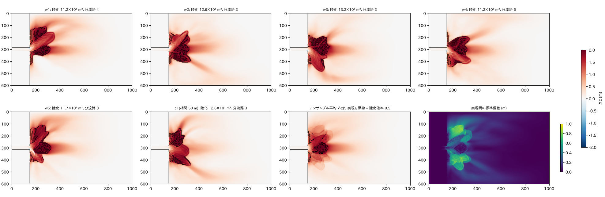

The same configuration as base at 1200 h. Top row and the left two of the bottom row:
6 realizations with perturbations of the ground elevation (w1–w5 with white ±2 cm perturbations,
c1 with a perturbation of correlation length 50 m). Right two of the bottom row: the mean deposit
thickness of the 5 realizations (black line = probability 0.5 of becoming land) and the standard
deviation between realizations.

## Entry points for sensitivity experiments

- Ratio of sand to mud → `inflow_cs` (the counterpart of f_sand in DeltaRCM).
- Settling and resuspension of mud → `susp_wf`, `susp_tausc`, `susp_esa`.
- Stability of the distributaries → `fix_tfix`, `fix_ctau`, `fix_tdec` (about the duration of a
  flood), `fix_ctau_bank`, the period of floods and low flows (`inflow_val`).
- Secondary flow → `f_secflow = 1`, `sec_nstar = 7` (the values of examples/meander).
- River-to-wave ratio R → the fixed feed `inflow_qb` and the offshore waves `wave_h0`, `wave_t`.
  Incidence angle → `wave_dir`. Smoothing length of the shoreline orientation → `wave_lsm` (twice
  the grid spacing to 1/4 of the surf-zone width).
- The coastal wave field case → offshore waves `wf_hm0`, `wf_trep`, `wf_dir`, `wf_spread`; the
  coefficients of the onshore velocity `wfsed_facsk`, `wfsed_facas`; the equilibrium foreshore slope
  of the swash-zone transport `wfswash_tanbe` (steeper for coarser sand) and its coefficients
  `wfswash_kc`, `wfswash_kl`; the background viscosity `p_diffusion_nu` (&list_enc); horizontal
  mixing by wave breaking `wf_break_visc` (&list_enc); stirring by breaking turbulence
  `f_wfsed_turb` ([coastal wave field](../../../docs/en/users_guide/wavefield.md)). The north and
  south sides can also be lateral Neumann for the flow (`f_bc_n`, `f_bc_s` = 3; param_wfsed.txt keeps
  walls for comparison with wave).
- Sea-level change and subsidence of the ground → place a strip of sea mask along the offshore side
  and give the sea level as a time series with `fn_tide`, and the subsidence of the ground with
  `fn_bedmotion`.
- Tides → likewise, give a tidal time series to `fn_tide` (not checked in this example).

## References

- Ashton, A., Murray, A. B. and Arnoult, O. (2001): Formation of coastline features by large-scale
  instabilities induced by high-angle waves. *Nature*, 414, 296–300.
- Bhattacharya, J. P. and Giosan, L. (2003): Wave-influenced deltas: geomorphological implications for
  facies reconstruction. *Sedimentology*, 50, 187–210.
- Caldwell, R. L. and Edmonds, D. A. (2014): The effects of sediment properties on deltaic processes and
  morphologies: A numerical modeling study. *J. Geophys. Res. Earth Surf.*, 119, 961–982.
- Coleman, J. M., Roberts, H. H. and Stone, G. W. (1998): Mississippi River delta: an overview.
  *J. Coastal Res.*, 14(3), 698–716.
- Dalrymple, R. W. and Choi, K. (2007): Morphologic and facies trends through the fluvial–marine
  transition in tide-dominated depositional systems: A schematic framework for environmental and
  sequence-stratigraphic interpretation. *Earth-Sci. Rev.*, 81, 135–174.
- Edmonds, D. A. and Slingerland, R. L. (2007): Mechanics of river mouth bar formation: Implications for
  the morphodynamics of delta distributary networks. *J. Geophys. Res.*, 112, F02034.
- Edmonds, D. A. and Slingerland, R. L. (2010): Significant effect of sediment cohesion on delta
  morphology. *Nature Geosci.*, 3, 105–109.
- Galloway, W. E. (1975): Process framework for describing the morphologic and stratigraphic evolution
  of deltaic depositional systems. In Broussard, M. L. (ed.), *Deltas: Models for Exploration*, Houston
  Geological Society, 87–98.
- Hoyal, D. C. J. D. and Sheets, B. A. (2009): Morphodynamic evolution of experimental cohesive deltas.
  *J. Geophys. Res.*, 114, F02009.
- Lauzon, R. and Murray, A. B. (2018): Comparing the cohesive effects of mud and vegetation on delta
  evolution. *Geophys. Res. Lett.*, 45, 10437–10445.
- Liang, M., Voller, V. R. and Paola, C. (2015): A reduced-complexity model for river delta formation –
  Part 1: Modeling deltas with channel dynamics. *Earth Surf. Dynam.*, 3, 67–86.
- Nienhuis, J. H., Ashton, A. D. and Giosan, L. (2015): What makes a delta wave-dominated? *Geology*,
  43(6), 511–514.
- Orton, G. J. and Reading, H. G. (1993): Variability of deltaic processes in terms of sediment supply,
  with particular emphasis on grain size. *Sedimentology*, 40, 475–512.
- Wright, L. D. (1977): Sediment transport and deposition at river mouths: a synthesis. *Geol. Soc. Am.
  Bull.*, 88, 857–868.
