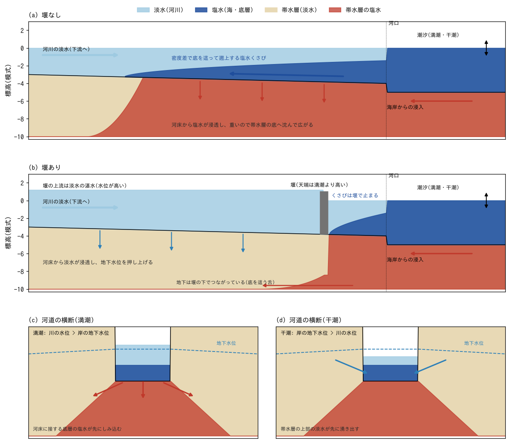
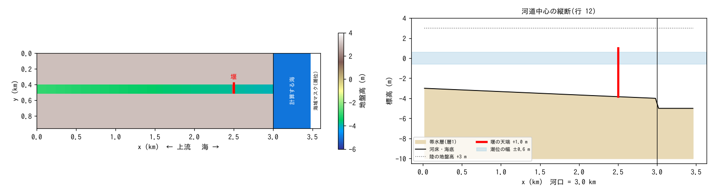
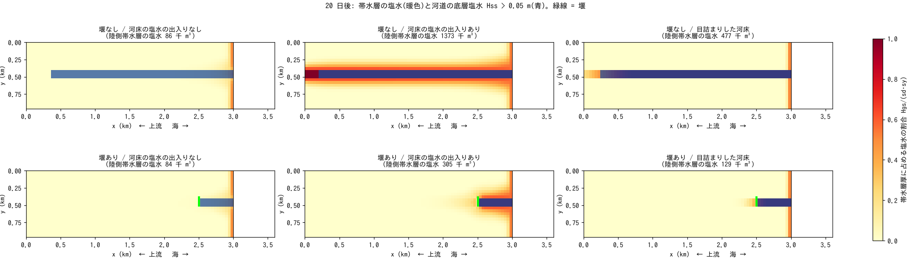
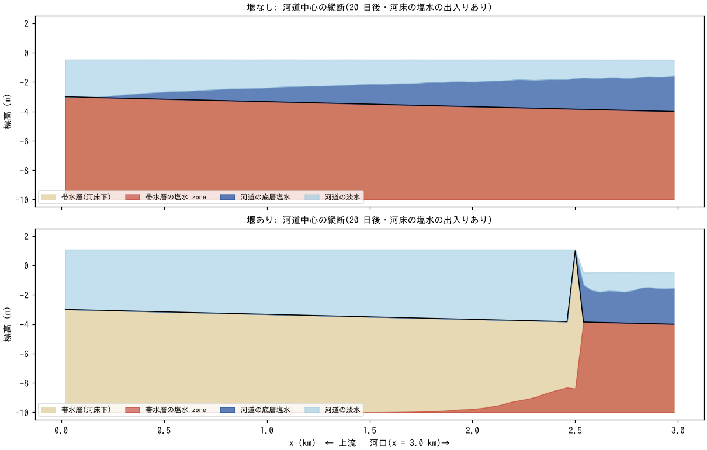
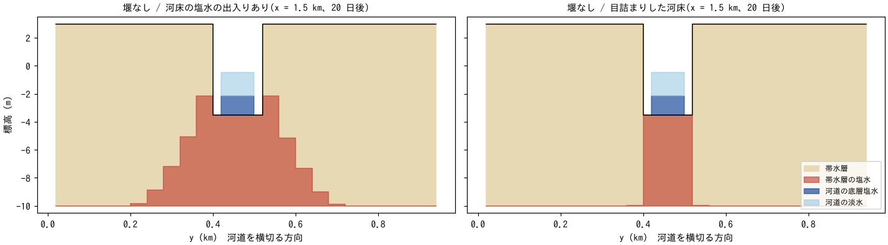
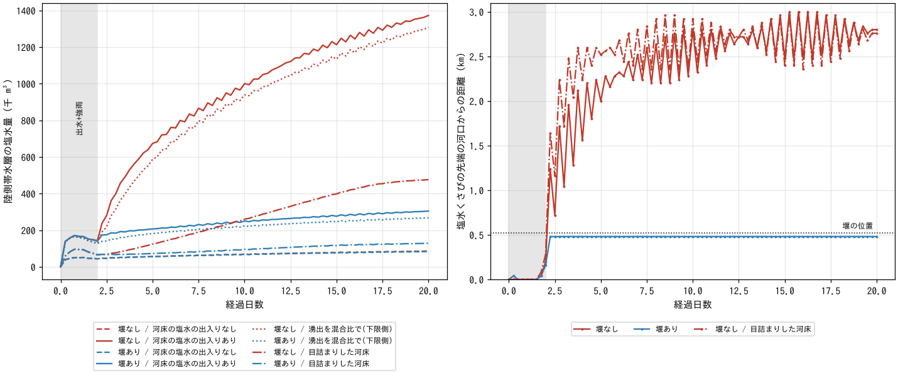

# estuary_barrage — 河口堰と塩水くさび・周辺地盤の塩水化

[English](en/README.md)

河口堰があるときとないときで、(1) 感潮河川を遡上する**塩水くさび**と、(2) 河床から
周辺の**帯水層へ入る塩水**がどう違うかを、平面 2 次元の理想化地形で比べる例題。
[淡塩2層](../../docs/users_guide/salt.md)(fn_salt)と[地下水](../../docs/users_guide/gwflow.md)
(fn_gwflow)、[潮位](../../docs/users_guide/tide.md)(fn_tide)を組み合わせる。
河床が目詰まりしている場合との比較も含む。値は現象を見やすくするための模式値で、
実河川の代表値ではない。

## 実際の河口で起きていること

- **塩水くさび**: 海水は河川水より約 2.5 % 重い。川の流量が少ない時期(低水期・
  渇水期)には、淡水が表層を海へ流れ出る下を、海水が河床に沿ってくさび状に遡上する。
  潮の干満で水位と流れが往復し、くさびの先端も前後する。出水で流量が増えると
  押し戻される。潮汐の弱い河口ほど淡水と塩水の層がはっきり分かれ(弱混合型)、
  潮汐の強い河口では上下が混ざって汽水域になる。
- **塩害**: 遡上した塩水は、農業用水や水道の取水を塩分で使えなくする。河床や河岸から
  しみ込んだ塩水は、川沿いの地下水も塩水化する。
- **河床の目詰まり**: 河床には細かい土粒子が堆積して目詰まりし、下の砂礫層より水を
  通しにくい層ができていることが多い(透水性が 1〜3 桁低い)。目詰まりの程度で、川と
  地下水の間の水と塩水の出入りの大きさが変わる。
- **河口堰**: 河口近くに堰を設けて塩水の遡上を止め、上流側を淡水の湛水域にする
  (平常時はゲートを閉じて上を越流させ、出水時にはゲートを開けて洪水を流す)。上流の
  水位が上がるので、川沿いの地下水は河床からしみ込む淡水で涵養される。
- **地下の経路**: 堰は川の水を止めるが、帯水層は堰の下でもつながっている。海岸からも
  地下で海水が浸入する。淡水と塩水の境界の深さは、海面より上の淡水の水頭のおよそ
  40 倍になる(Ghyben–Herzberg 関係。密度差 2.5 % の逆数)。

## 再現に必要な機構



模式図(縮尺は誇張)。(a) 堰なし: 塩水くさびが遡上し、河床からしみ込んだ塩水が帯水層の
底へ沈んで広がる。(b) 堰あり: くさびは堰で止まり、上流は淡水が浸透する。帯水層は堰の
下でつながっている。(c)(d) 河道の横断: 潮の干満で川の水位と岸の地下水位の上下が
入れ替わり、浸透と湧出が交互に起こる。

この例題で働いている機構と、それを担う設定:

| 実際の現象 | モデルの機構 | 設定 |
|---|---|---|
| 川の淡水が海へ流れ、潮の干満で流れが往復する | 浅水流(水深平均の流れ)。海域で潮位を与え、上流端から河川流量を入れる | fn_tide(M2 潮汐)、区間流入 |
| 海水が河床に沿って遡上する | 地表の塩水層(水深のうち底にある塩水の厚さ)。密度差が生む底の圧力差で這い上がる重力流と、流れに運ばれる分で動く | `f_salt_surf = 1` |
| 堰で塩水が止まる | 堰は地形の段(天端 +1.0 m > 満潮位 +0.6 m)。越流は下流向きだけで、底の塩水は天端より上に達した分しか越えられない | 地盤高 z の段 |
| 河床から塩水がしみ込む・地下水が湧き出す | 河床からの浸透(Green-Ampt)は、河床に接する底層の塩水から先に入る。帯水層から溢れる水は、上部の淡水から先に出る。満潮で川の水位が岸の地下水位より高いと浸透、干潮で低いと湧出 | `f_salt_exch = 1`(既定)、`f_gwvertical = 2` |
| しみ込んだ塩水が地盤の中で広がる | 帯水層の塩水は最下部にあり(重いので沈む)、密度差と地下水位の勾配で横に流れる | `f_salt_gw = 1`、`f_gwlateral = 1` |
| 海岸から地下で海水が浸入する | 海の下の帯水層を塩水で満たしておく。海底下から陸側へ流れる | `fn_salt_hgs0` |
| 堰の下を地下の塩水がくぐる | 帯水層は堰の位置でも連続(特別な設定は要らない) | — |
| 河床の目詰まり(比較ケース) | 河床交換能: 河道セルの浸透能を k_bed に置き換え、河道と岸の間の帯水層の流れも同じ上限で絞る(塩水も同じ) | `f_gwbed = 1`、`fn_rw`(河道マスク) |

河床から地盤への出入り(4 行目)を切ると(`f_salt_exch = 0`)、河床からしみ込む水も
湧き出す水も淡水として扱われ、川の塩水は地盤へ入らない。この例題ではその場合も計算し、
地盤の塩水化のどれだけが川を経由したものかを比べる。

## 幾何と設定



左: 地形(赤 = 堰)。右: 河道中心の縦断。

3.6 km × 0.96 km、dx = dy = 40 m(90 × 24 セル)。西が上流、東が海。

| x (km) | 列 i | 内容 |
|---|---|---|
| 0〜3.0 | 1〜75 | 陸(地盤高 +3 m)と河道(幅 120 m = 行 11〜13、河床 −3 → −4 m) |
| 3.0〜3.48 | 76〜87 | 計算する海(水深 5 m。初期は全層塩水 `fn_salt_hss0`) |
| 3.48〜3.6 | 88〜90 | 海域マスク(潮位を強制する全塩水の境界) |

- **堰**: 河口から 500 m(i = 63)の河道 3 セルを天端 +1.0 m の地形にする。
  ゲートを閉じて上を越流させている平常時の河口堰に当たる。堰の上流は湛水する
  (初期水位 +1.2 m から)。
- **潮汐**: M2(周期 12.42 時間)振幅 0.6 m(`data/tide.txt`。gen_data.py が生成)。
- **河川流量**: 西端の河道に、最初の 1.5 日は出水 200 m³/s、2 日目に平水 20 m³/s
  へ下げて以後一定(低水期 = くさびが遡上する)。
- **地下水**: 層 1(帯水層の底 −10 m、土層厚 = 地盤高 + 10 m、比湧水量 0.2)。
  鉛直は Green-Ampt(K_sv = 1e-4 m/s。河床も同じ)、側方は非線形 Boussinesq
  (K_sh = 1e-2 m/s。礫混じりの砂。20 日で岸の帯水層の変化が見える速さにする
  ための値で、1e-4〜1e-3 m/s の帯水層では同じ変化に年単位かかる)。
- **帯水層の初期状態**: 初期の地下貯留を直接与える入力はないので、陸の帯水層は
  空から始め、最初の 42 時間の一様降雨 50 mm/h と出水の河川水で淡水を満たす
  (この間は出水がくさびを河道の外に押し出している)。海底下の帯水層は初期に
  全層塩水(`fn_salt_hgs0`)。
- dt = 2 s、20 日。1 ケース 15 分前後(gfortran、4 スレッド)。

| ケース | 設定ファイル | 堰 | f_salt_exch(河床・地表と帯水層の間の塩水の出入り) |
|---|---|---|---|
| 堰なし | param_nobarrage.txt | なし | 1(既定: 浸透は底層の塩水から、湧出は上部の淡水から) |
| 堰あり | param_barrage.txt | あり | 1 |
| 堰なし・出入りなし | param_nobarrage_off.txt | なし | 0(出入りする水を淡水として扱う = 川を経由する塩水化を切った比較) |
| 堰あり・出入りなし | param_barrage_off.txt | あり | 0 |
| 堰なし・湧出を混合比で | param_nobarrage_mix.txt | なし | 2(湧き出す水を帯水層の塩水の割合で混ぜる = 下限側の見積もり) |
| 堰あり・湧出を混合比で | param_barrage_mix.txt | あり | 2 |
| 堰なし・目詰まりした河床 | param_nobarrage_clog.txt | なし | 1。河床交換能 k_bed = 1e-6 m/s(周囲の浸透能 1e-4 m/s の 2 桁下) |
| 堰あり・目詰まりした河床 | param_barrage_clog.txt | あり | 1。同上 |

共通の設定(浅水流・境界・降雨・地下水)は param_common.txt にまとめ、各 param が
fn_enc・fn_boundary・fn_precip・fn_gwflow で同じファイルを指す。目詰まりした河床の
2 ケースは、地下水の設定を param_gwflow_clog.txt(同じ値に河床交換能を加えたもの)から
読み、河道マスク data/rw.txt を使う。

## 実行方法

```
cd examples/estuary_barrage
make                    # リンクと data/(gen_data.py)
make run                # 8 ケースを順に計算(1 ケース 15 分前後)
python3 plot_results.py # figs/*.png と数表(引数 en で英語版を en/figs/ に)
```

## 結果



20 日後の平面。左から河床の塩水の出入りなし・あり・目詰まりした河床。暖色 = 帯水層厚に
占める塩水の割合 Hgs/(sd·sy)、青 = 河道の底層塩水(Hss > 0.05 m。その下の帯水層は
隠れる)、緑線 = 堰。



20 日後の河道中心の縦断(f_salt_exch = 1)。赤 = 帯水層の塩水、濃い青 = 河道の底層
塩水、薄い青 = 河道の淡水。



20 日後の河道を横切る断面(堰なし、河口から 1.5 km)。河床が開いていると塩水は岸の
帯水層の底へ広がり、目詰まりしていると河道の真下に留まる。



左: 河口より上流側(x < 3 km)の帯水層の塩水量(点線 = 湧出を混合比で配分する下限側の
見積もり、一点鎖線 = 目詰まりした河床)。右: 塩水くさびの先端(河道中心で Hss > 0.05 m の最上流)の河口からの距離。
6 時間ごとの値で、潮汐の位相で振れる。灰色は出水と強雨の前段。

| ケース | 帯水層の塩水量 (千 m³) | 河床下の帯水層の塩水の前線(割合 0.5)の河口からの距離 (km) | 堰位置より上流の河床下の塩水割合 | 同区間で岸から 80 m 以内の塩水割合 | くさびの先端(最後の 2 日、河口から km) | 河道の底層塩水量(最後の 2 日の平均、千 m³) |
|---|---:|---:|---:|---:|---:|---:|
| 堰なし・出入りなし | 86 | —(海岸だけ) | 0.002 | 0.001 | 2.40〜2.76 | 519 |
| 堰なし | 1,373 | 3.00(河道の全長) | 1.000 | 0.491 | 2.64〜2.92 | 585 |
| 堰なし・湧出を混合比で | 1,309 | 2.96 | 0.952 | 0.464 | 2.44〜2.80 | 527 |
| 堰あり・出入りなし | 84 | —(海岸だけ) | 0.001 | 0.000 | 0.48(堰) | 148 |
| 堰あり | 305 | 0.48(堰) | 0.026 | 0.013 | 0.48(堰) | 158 |
| 堰あり・湧出を混合比で | 268 | 0.48(堰) | 0.015 | 0.007 | 0.48(堰) | 155 |
| 堰なし・目詰まりした河床 | 477 | 2.76 | 0.891 | 0.001 | 2.56〜2.92 | 572 |
| 堰あり・目詰まりした河床 | 129 | 0.48(堰) | 0.014 | 0.000 | 0.48(堰) | 156 |

(数表は `python3 plot_results.py` が出力する。)

- **塩水くさび**: 堰なしのくさびは河口から 2.4〜2.9 km(3 km の河道のほぼ上流端)まで
  入り、潮の干満で前後する。堰ありでは堰の直下流で止まる(越流は下流向きだけで、底の
  塩水は天端に届かない)。
- **川を経由しない塩水化**: 河床・地表と帯水層の間の塩水の出入りを切ると(出入りなし)、
  帯水層の塩水は海岸から地下で浸入した分だけで、堰の有無で変わらない(86 / 84 千 m³)。
- **川を経由する塩水化**: 出入りありでは、堰なしで 1,373、堰ありで 305 千 m³(20 日目でも
  増え続けている)。堰なしでは、くさびが乗る河床の下の帯水層が河道の全長で全層塩水に
  なり、岸から 80 m 以内でも半分が塩水になる(岸へ 200 m ほど広がる)。満潮のたびに
  河床から底層の塩水がしみ込み、重いので帯水層の底へ沈んで横へ広がるためである。
  堰ありでは塩水化は堰の下流 500 m に留まり、上流は淡水の浸透で地下水位が上がる。
  ただし帯水層の底に沿って堰の下をくぐり、上流へ 0.7 km ほど入り込む薄い塩水の舌が
  残る(堰より上流の河床下の塩水割合 2.6 %)。地下の経路は堰では止まらない。
- **見積もりの幅**: モデルは、河床からしみ込んだ塩水がすぐに帯水層の底へ沈むと扱う
  (既定)。そのため満潮で入った塩水は干潮でも戻らず、河床直下の塩水化は多めに出る
  (上限側)。逆の極端として、湧き出す水が帯水層の塩水の割合で混ざって出る扱い
  (f_salt_exch = 2)でも計算すると、堰なし 1,309・堰あり 268 千 m³ で、差は 5〜12 %。
  くさびが乗る河床からはそもそも塩水しかしみ込まないので、結果はこの扱いにほとんど
  よらない。堰の効果(堰なしの 4〜5 分の 1)は幅の両端で同じ。
- **目詰まりした河床**: 河床交換能を周囲の浸透能の 2 桁下(1e-6 m/s)にすると、帯水層の
  塩水量は堰なしで 1,373 → 477、堰ありで 305 → 129 千 m³ に減る。塩水は河道の真下の
  帯水層には入る(堰より上流の河床下の塩水割合 0.89)が、岸の帯水層へはほとんど広がらない
  (岸から 80 m 以内で 0.001)。河床からしみ込む量も、河道の下から岸へ抜ける量も同じ
  上限で絞られるためで、20 日では川沿いの地盤は淡水のまま残る。塩水くさびそのものは
  目詰まりの影響をほとんど受けない(2.6〜2.9 km)。堰の効果は目詰まりした河床でも同じ
  向きで(477 → 129 千 m³)、堰の下をくぐる舌は 0.3 km に短くなる。
- 最初の 2 日(出水と強雨)の間の帯水層の塩水は、海底下の帯水層と河口付近から
  入ったもの(出入りありのケースは、出水中も河口付近に残る塩水が河床から
  しみ込む分だけ多い。堰の有無ではまだ差がない)。

## このモデルで表せないこと(実際の現象との違い)

- **層の混合**: 鉛直方向は淡水と塩水の 2 層の厚さで表し、境界は常に鋭い。実際の河口で
  起こる層の境界での混合(汽水の生成)や、流速の鉛直分布は解かない。くさびの先端位置は、
  塩水層の摩擦の係数(salt_ni)や流れが塩水層を運ぶ割合(salt_alpha)で変わるので、
  実際の河川に当てはめるには観測による校正が要る。
- **地下の遷移帯**: 実際の帯水層では、淡水と塩水の間に分散で幅のある遷移帯ができ、
  重い塩水が指状に沈み込む(フィンガリング)。ここでは塩水は即座に帯水層の底へ移り、
  遷移帯はない。正味の浸透がない場所では、河床の塩水は帯水層へ入らない。
- **時間の縮め**: 側方の透水係数 1e-2 m/s は 20 日で変化を見るための値。一般的な
  帯水層(1e-4〜1e-3 m/s)では同じ広がりに年単位かかる。
- **河床交換能は与える値**: 目詰まりの程度(k_bed)は河床の透水試験や河川と地下水の
  水位差・流量の観測から決める与件で、この例題の 1e-6 m/s は模式値。目詰まりの層の
  時間変化(出水での洗い流しや細粒分の再堆積)は表していない。
- **ゲート操作**: 天端は固定で、出水時にゲートを開ける操作は表していない。

## 注意

- **堰は地形で与える**: 河道を横断する堰の天端は地盤高の段で表す(堤防・海岸堤防の
  仮想壁は河道と堤内地・海と陸の境にだけ立てられ、横断構造物には使えない)。天端が
  満潮位より低いと、満潮時に海側から上流へ越える流れが塩水を運ぶ(水深平均の塩水の
  割合で運ぶので、天端より下の塩水層も越えたことになる)。
- カルバート・ゲートの構造物([構造物](../../docs/users_guide/structure.md))は水だけを
  運び、塩水を運ばない。
