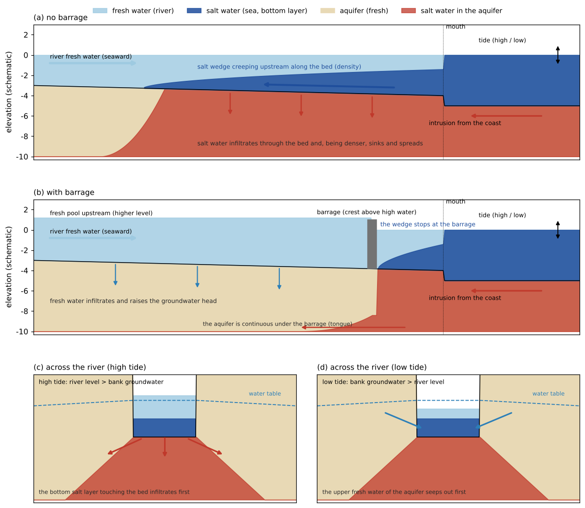
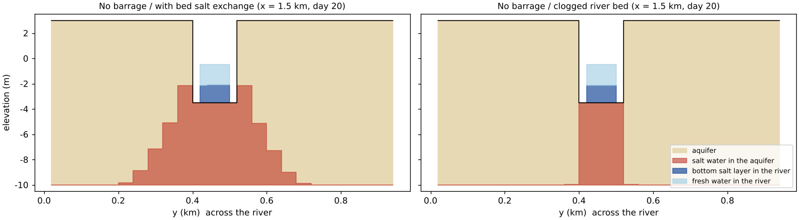

# estuary_barrage — an estuary barrage, the salt wedge and salinization of the surrounding ground

> English mirror of examples/estuary_barrage/README.md. The Japanese file is the master copy.

[日本語](../README.md)

An example comparing, on idealised terrain in horizontal 2D, how (1) the
**salt wedge** travelling up a tidal river and (2) the **salt water entering
the surrounding aquifer** through the river bed differ with and without an
estuary barrage. It combines the
[fresh and salt water layers](../../../docs/en/users_guide/salt.md) (fn_salt),
[groundwater](../../../docs/en/users_guide/gwflow.md) (fn_gwflow) and the
[tide](../../../docs/en/users_guide/tide.md) (fn_tide). A comparison with a
clogged river bed is included. The values are schematic, chosen to make the
phenomena visible, and are not representative of a real river.

## What happens in a real estuary

- **Salt wedge**: seawater is about 2.5 % denser than river water. When the
  river discharge is low (low-flow and drought seasons), seawater travels up
  along the river bed as a wedge beneath the fresh water flowing out to sea at
  the surface. The tide moves the water level and the flow back and forth, and
  the tip of the wedge moves with it. When a flood raises the discharge, the
  wedge is pushed back. The weaker the tide, the more sharply the fresh and salt
  layers are separated (salt-wedge type); in estuaries with strong tides the
  layers mix into brackish water.
- **Salt damage**: salt water that has travelled upstream makes irrigation and
  water-supply intakes unusable. Salt water seeping through the bed and banks
  also salinizes the groundwater along the river.
- **Clogging of the river bed**: fine particles deposited on the river bed
  often clog it, forming a layer that passes water less easily than the gravel
  below (hydraulic conductivity 1 to 3 orders of magnitude lower). The degree of
  clogging changes how much water and salt water are exchanged between the
  river and the groundwater.
- **Estuary barrage**: a barrage near the mouth stops the salt water from
  travelling upstream and turns the upstream reach into a fresh-water pool (in
  normal operation the gates are closed and water overflows them; during floods
  the gates are opened to pass the flood). The upstream water level rises, so
  the groundwater along the river is recharged by fresh water seeping through
  the bed.
- **Subsurface path**: the barrage stops the river water, but the aquifer is
  continuous beneath it. Seawater also intrudes underground from the coast. The
  depth of the fresh–salt interface is about 40 times the freshwater head above
  sea level (the Ghyben–Herzberg relation; the reciprocal of the 2.5 % density
  difference).

## Mechanisms needed for the reproduction



Schematic (scales exaggerated). (a) No barrage: the salt wedge travels
upstream, and salt water seeping through the bed sinks to the bottom of the
aquifer and spreads. (b) With barrage: the wedge stops at the barrage and fresh
water infiltrates upstream; the aquifer is continuous under the barrage.
(c)(d) Across the river: with the tide, the river level and the bank
groundwater level swap order, so infiltration and seepage alternate.

The mechanisms at work in this example and the settings that carry them:

| Real phenomenon | Mechanism in the model | Setting |
|---|---|---|
| River fresh water flows to the sea; the tide moves the flow back and forth | Shallow-water flow (depth-averaged). The tide level is imposed in the sea, the river discharge enters at the upstream end | fn_tide (M2 tide), segment inflow |
| Seawater travels up along the river bed | Surface salt layer (the thickness of salt water at the bottom of the water depth). It moves by a gravity current, creeping up driven by the bottom pressure difference from the density difference, and by being carried by the flow | `f_salt_surf = 1` |
| The barrage stops the salt water | The barrage is a step in the terrain (crest +1.0 m > high water +0.6 m). Overflow goes downstream only, and bottom salt water can cross only the part that reaches above the crest | step in the ground elevation z |
| Salt water seeps through the bed, groundwater seeps out | Infiltration through the bed (Green-Ampt) takes the bottom salt water touching the bed first. Water overflowing the aquifer leaves from the upper fresh water first. Infiltration when the river level is above the bank groundwater at high tide, seepage when below at low tide | `f_salt_exch = 1` (default), `f_gwvertical = 2` |
| Infiltrated salt water spreads in the ground | Salt water in the aquifer is at the bottom (denser, it sinks) and flows sideways driven by the density difference and the groundwater gradient | `f_salt_gw = 1`, `f_gwlateral = 1` |
| Seawater intrudes underground from the coast | The aquifer under the sea is filled with salt water and flows landward from below the sea floor | `fn_salt_hgs0` |
| Subsurface salt water passes under the barrage | The aquifer is continuous at the barrage too (no special setting needed) | — |
| Clogging of the river bed (comparison cases) | River-bed exchange capacity: the infiltration capacity of river cells is replaced by k_bed, and the aquifer flow between the river and the banks is throttled by the same cap (salt water too) | `f_gwbed = 1`, `fn_rw` (river mask) |

Turning off the exchange between the bed and the ground (row 4;
`f_salt_exch = 0`) treats water infiltrating through the bed and water seeping
out as fresh, so salt water from the river does not enter the ground. This
example also computes that case to compare how much of the salinization of the
ground comes via the river.

## Geometry and settings


Left: terrain (red = barrage). Right: longitudinal section along the river
centre.

3.6 km × 0.96 km, dx = dy = 40 m (90 × 24 cells). Upstream is west, the sea
is east.

| x (km) | Column i | Contents |
|---|---|---|
| 0–3.0 | 1–75 | Land (ground elevation +3 m) and the river (120 m wide = rows 11–13, bed −3 → −4 m) |
| 3.0–3.48 | 76–87 | Solved sea (5 m deep; initially entirely salt water, `fn_salt_hss0`) |
| 3.48–3.6 | 88–90 | Sea mask (all-salt boundary forcing the tide) |

- **Barrage**: the three river cells 500 m from the mouth (i = 63) are given
  terrain with a crest at +1.0 m. This corresponds to an estuary barrage in
  normal operation with its gates closed and overflowing. The river upstream of
  the barrage is ponded (starting from an initial water level of +1.2 m).
- **Tide**: M2 (period 12.42 hours), amplitude 0.6 m (`data/tide.txt`,
  generated by gen_data.py).
- **River discharge**: into the western end of the river, a flood of
  200 m³/s for the first 1.5 days, lowered to a normal 20 m³/s on day 2 and
  constant thereafter (low-flow season = the wedge travels upstream).
- **Groundwater**: layer 1 (aquifer bottom −10 m, soil-layer thickness =
  ground elevation + 10 m, specific yield 0.2). Vertical: Green-Ampt
  (K_sv = 1e-4 m/s, the same for the river bed); lateral: nonlinear
  Boussinesq (K_sh = 1e-2 m/s, sand with gravel; a value chosen so that the
  change in the bank aquifer is visible within 20 days — in an aquifer of
  1e-4 to 1e-3 m/s the same change takes years).
- **Initial state of the aquifer**: there is no input that gives the initial
  subsurface storage directly, so the land aquifer starts empty and is filled
  with fresh water by uniform rain of 50 mm/h for the first 42 hours and the
  river water of the flood (during this time the flood keeps the wedge out of
  the river). The aquifer under the sea is initially entirely salt
  (`fn_salt_hgs0`).
- dt = 2 s, 20 days. About 15 minutes per case (gfortran, 4 threads).

| Case | Settings file | Barrage | f_salt_exch (exchange of salt water between the bed / ground surface and the aquifer) |
|---|---|---|---|
| No barrage | param_nobarrage.txt | none | 1 (default: infiltration takes the bottom salt water first, seepage the upper fresh water first) |
| Barrage | param_barrage.txt | yes | 1 |
| No barrage, no exchange | param_nobarrage_off.txt | none | 0 (exchanged water treated as fresh = comparison with salinization via the river turned off) |
| Barrage, no exchange | param_barrage_off.txt | yes | 0 |
| No barrage, seepage by mixing ratio | param_nobarrage_mix.txt | none | 2 (seeping water mixed in the aquifer's salt fraction = lower-bound estimate) |
| Barrage, seepage by mixing ratio | param_barrage_mix.txt | yes | 2 |
| No barrage, clogged river bed | param_nobarrage_clog.txt | none | 1, with river-bed exchange capacity k_bed = 1e-6 m/s (two orders below the surrounding infiltration capacity 1e-4 m/s) |
| Barrage, clogged river bed | param_barrage_clog.txt | yes | 1, the same |

The common settings (shallow water, boundaries, rain, groundwater) are
collected in param_common.txt, and each param points to the same file with
fn_enc, fn_boundary, fn_precip and fn_gwflow. The two clogged-bed cases read
the groundwater settings from param_gwflow_clog.txt (the same values plus the
river-bed exchange capacity) and use the river mask data/rw.txt.

## How to run

```
cd examples/estuary_barrage
make                       # links and data/ (gen_data.py)
make run                   # the eight cases in turn (about 15 minutes each)
python3 plot_results.py en # en/figs/*.png and the table (without en: figs/, Japanese labels)
```

## Results


Plan view after 20 days. From left: no bed salt exchange, with exchange,
clogged river bed. Warm colours = salt fraction of the aquifer thickness
Hgs/(sd·sy), blue = bottom salt layer in the river (Hss > 0.05 m; it hides the
aquifer below), green line = barrage.


Longitudinal section along the river centre after 20 days
(f_salt_exch = 1). Red = salt water in the aquifer, dark blue = bottom salt
layer in the river, light blue = fresh water in the river.



Cross-section across the river after 20 days (no barrage, 1.5 km from the
mouth). With an open bed the salt water spreads along the bottom of the bank
aquifer; with a clogged bed it stays right below the river.


Left: salt in the aquifer landward of the mouth (x < 3 km) (dotted = the
lower-bound estimate with seepage split by mixing ratio, dash-dot = clogged
river bed). Right: distance of
the salt-wedge tip (the most upstream cell on the river centre line with
Hss > 0.05 m) from the mouth. Values every 6 hours; they swing with the tidal
phase. Grey = the preliminary flood-and-rain stage.

| Case | Salt in the aquifer (10³ m³) | Distance of the salt front below the bed (fraction 0.5) from the mouth (km) | Salt fraction below the bed upstream of the barrage site | Salt fraction within 80 m of the banks in the same reach | Wedge tip (last 2 days, km from mouth) | Bottom salt in the river (mean over the last 2 days, 10³ m³) |
|---|---:|---:|---:|---:|---:|---:|
| No barrage, no exchange | 86 | — (coast only) | 0.002 | 0.001 | 2.40–2.76 | 519 |
| No barrage | 1,373 | 3.00 (whole river) | 1.000 | 0.491 | 2.64–2.92 | 585 |
| No barrage, seepage by mixing ratio | 1,309 | 2.96 | 0.952 | 0.464 | 2.44–2.80 | 527 |
| Barrage, no exchange | 84 | — (coast only) | 0.001 | 0.000 | 0.48 (barrage) | 148 |
| Barrage | 305 | 0.48 (barrage) | 0.026 | 0.013 | 0.48 (barrage) | 158 |
| Barrage, seepage by mixing ratio | 268 | 0.48 (barrage) | 0.015 | 0.007 | 0.48 (barrage) | 155 |
| No barrage, clogged river bed | 477 | 2.76 | 0.891 | 0.001 | 2.56–2.92 | 572 |
| Barrage, clogged river bed | 129 | 0.48 (barrage) | 0.014 | 0.000 | 0.48 (barrage) | 156 |

(The table is printed by `python3 plot_results.py`.)

- **Salt wedge**: without a barrage the wedge travels 2.4–2.9 km from the
  mouth (almost to the upstream end of the 3 km river) and moves back and forth
  with the tide. With the barrage it stops just downstream of the barrage
  (overflow goes downstream only, and the bottom salt water does not reach the
  crest).
- **Salinization not via the river**: with the exchange of salt water between
  the bed / ground surface and the aquifer turned off (no exchange), the salt in
  the aquifer is only what intrudes underground from the coast, and it does not
  change with the barrage (86 / 84 ×10³ m³).
- **Salinization via the river**: with the exchange, 1,373 ×10³ m³ without the
  barrage and 305 ×10³ m³ with it (still increasing on day 20). Without the
  barrage the aquifer below the bed covered by the wedge becomes entirely salt
  along the whole river, and half of the aquifer within 80 m of the banks
  becomes salt (the salt spreads about 200 m into the banks). This is because at
  every high tide the bottom salt water seeps through the bed and, being
  denser, sinks to the bottom of the aquifer and spreads sideways. With the
  barrage salinization stays within the 500 m downstream of it, and upstream the
  groundwater head rises with the fresh infiltration. A thin tongue of salt
  water still passes under the barrage along the aquifer bottom and reaches
  about 0.7 km upstream (salt fraction below the bed upstream of the barrage
  2.6 %); the subsurface path is not stopped by the barrage.
- **Range of the estimate**: the model treats salt water seeping through the
  bed as sinking to the bottom of the aquifer at once (default). Salt water that
  enters at high tide therefore does not return at low tide, and salinization
  right below the bed comes out on the high side (upper bound). Computing the
  opposite extreme, where seeping water leaves mixed in the aquifer's salt
  fraction (f_salt_exch = 2), gives 1,309 ×10³ m³ without the barrage and
  268 ×10³ m³ with it, 5–12 % lower. Only salt water seeps through a bed covered
  by the wedge in the first place, so the result hardly depends on this
  treatment. The effect of the barrage (a quarter to a fifth of the no-barrage
  case) is the same at both ends of the range.
- **Clogged river bed**: with the river-bed exchange capacity two orders below
  the surrounding infiltration capacity (1e-6 m/s), the salt in the aquifer
  falls from 1,373 to 477 ×10³ m³ without the barrage and from 305 to
  129 ×10³ m³ with it. Salt water still enters the aquifer right below the river
  (salt fraction below the bed upstream of the barrage site 0.89) but hardly
  spreads into the bank aquifer (0.001 within 80 m of the banks). Both the
  infiltration through the bed and the flow from below the river into the banks
  are throttled by the same cap, so within 20 days the ground along the river
  stays fresh. The salt wedge itself is hardly affected by the clogging
  (2.6–2.9 km). The effect of the barrage points the same way with a clogged bed
  (477 → 129 ×10³ m³), and the tongue under the barrage shortens to 0.3 km.
- The salt in the aquifer during the first 2 days (flood and heavy rain) comes
  from the aquifer under the sea and near the mouth (the cases with the exchange
  have more, by the salt water that stays near the mouth during the flood and
  seeps through the bed; there is no difference between with and without the
  barrage yet).

## What this model cannot represent (differences from real phenomena)

- **Mixing of the layers**: the vertical is represented by the thicknesses of
  two layers, fresh and salt, with an always sharp interface. Mixing at the
  interface (generation of brackish water) and the vertical velocity profile in
  real estuaries are not solved. The position of the wedge tip changes with the
  friction coefficient of the salt layer (salt_ni) and the share of the salt
  layer carried by the flow (salt_alpha), so applying it to a real river needs
  calibration against observations.
- **Subsurface transition zone**: in real aquifers dispersion creates a
  transition zone of finite width between fresh and salt water, and dense salt
  water sinks in fingers (fingering). Here the salt water moves to the bottom of
  the aquifer at once and there is no transition zone. Where there is no net
  infiltration, salt water on the river bed does not enter the aquifer.
- **Compressed time**: the lateral hydraulic conductivity of 1e-2 m/s is a value
  for seeing the change within 20 days. In typical aquifers (1e-4 to
  1e-3 m/s) the same spreading takes years.
- **The river-bed exchange capacity is a given value**: the degree of clogging
  (k_bed) is a given to be determined from permeability tests of the bed or
  from observations of the water-level difference and flow between the river
  and the groundwater; 1e-6 m/s in this example is a schematic value. Changes of
  the clogging layer over time (scouring by floods, redeposition of fines) are
  not represented.
- **Gate operation**: the crest is fixed; opening the gates during floods is not
  represented.

## Notes

- **Give the barrage as terrain**: give the crest of a barrage across the river
  as a step in the ground elevation (the virtual walls of levees and seawalls
  can stand only between a river and the protected land or between sea and
  land, and cannot be used for a structure across the river). If the crest is
  lower than high water, the flow over it from the sea side to upstream at high
  tide carries salt water (it is carried with the depth-averaged fraction of
  salt water, so the salt layer below the crest is counted as having crossed
  too).
- Culvert and gate structures ([structures](../../../docs/en/users_guide/structure.md))
  carry only water, not salt water.
