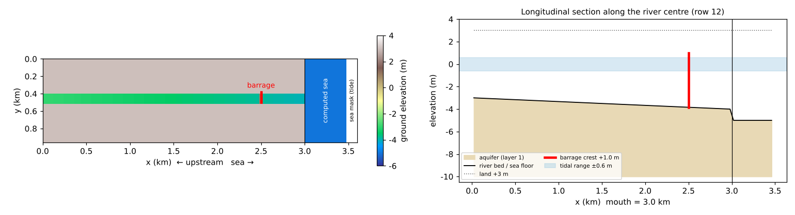
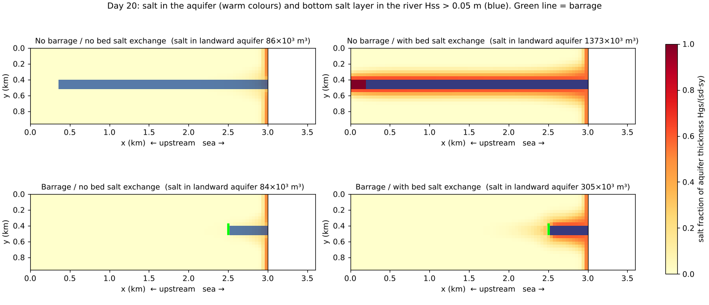
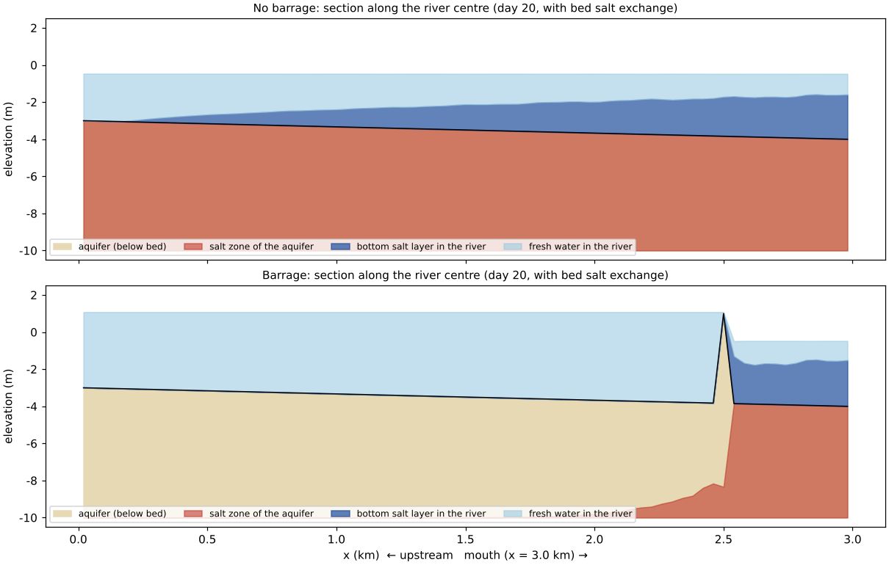
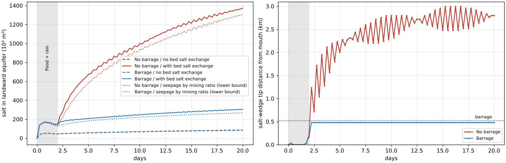

# estuary_barrage — an estuary barrage, the salt wedge and salinization of the surrounding ground

> English mirror of examples/estuary_barrage/README.md. The Japanese file is the master copy.

[日本語](../README.md)

An example comparing, on idealised terrain in horizontal 2D, how the presence
of an estuary barrage affects (1) the **salt wedge** travelling up a tidal
river and (2) the amount of **salt water entering the surrounding aquifer**
through the river bed. It uses the surface salt layer and the subsurface salt
zone of the [fresh and salt water layers](../../../docs/en/users_guide/salt.md)
(fn_salt), and the fresh/salt split of the surface–subsurface exchange
`f_salt_exch` (added 2026-10-29: infiltration takes the bottom salt water
touching the bed first, seepage releases the upper fresh water of the aquifer
first). Six cases: with/without barrage × exchange split none (the behaviour
before 2026-10-29) / on (default 1) / mixing ratio (2 = lower-bound sensitivity
case).

"2D" means horizontal 2D; the vertical is represented by the thicknesses of
two layers, salt and fresh water (sharp interface). The vertical velocity
profile and mixing (generation of brackish water) are not solved. The values
are schematic, chosen to make the phenomena visible, and are not
representative of a real river.

## Geometry and settings



Left: terrain (red = barrage). Right: longitudinal section along the river
centre.

3.6 km × 0.96 km, dx = dy = 40 m (90 × 24 cells). Upstream is west, the sea
is east.

| x (km) | Column i | Contents |
|---|---|---|
| 0–3.0 | 1–75 | Land (ground elevation +3 m) and the river (120 m wide = rows 11–13, bed −3 → −4 m) |
| 3.0–3.48 | 76–87 | Solved sea (5 m deep; initially entirely salt water, `fn_salt_hss0`) |
| 3.48–3.6 | 88–90 | Sea mask (all-salt boundary forcing the tide) |

- **Barrage**: the three river cells 500 m from the mouth (i = 63) are given
  terrain with a crest at +1.0 m. This corresponds to an estuary barrage in
  normal operation with its gates closed and overflowing (the crest is above
  high water +0.6 m). The river upstream of the barrage is ponded (starting
  from an initial water level of +1.2 m).
- **Tide**: M2 (period 12.42 hours), amplitude 0.6 m (`data/tide.txt`,
  generated by gen_data.py).
- **River discharge**: into the western end of the river, a flood of
  200 m³/s for the first 1.5 days, lowered to a normal 20 m³/s on day 2 and
  constant thereafter (low-flow season = the wedge travels upstream).
- **Groundwater**: layer 1 (aquifer bottom −10 m, soil-layer thickness =
  ground elevation + 10 m, specific yield 0.2). Vertical: Green-Ampt
  (K_sv = 1e-4 m/s, the same for the river bed); lateral: nonlinear
  Boussinesq (K_sh = 1e-2 m/s, sand with gravel; a value chosen so that the
  change in the bank aquifer is visible within 20 days — in an aquifer of
  1e-4 to 1e-3 m/s the same change takes years).
- **Initial state of the aquifer**: there is no input that gives the initial
  subsurface storage directly, so the land aquifer starts empty and is filled
  with fresh water by uniform rain of 50 mm/h for the first 42 hours and the
  river water of the flood (during this time the flood keeps the wedge out of
  the river). The aquifer under the sea is initially entirely salt
  (`fn_salt_hgs0`).
- dt = 2 s, 20 days. About 15 minutes per case (gfortran, 4 threads).

| Case | Settings file | Barrage | f_salt_exch |
|---|---|---|---|
| No barrage | param_nobarrage.txt | none | 1 (default) |
| Barrage | param_barrage.txt | yes | 1 (default) |
| No barrage, no exchange split | param_nobarrage_off.txt | none | 0 |
| Barrage, no exchange split | param_barrage_off.txt | yes | 0 |
| No barrage, seepage by mixing ratio | param_nobarrage_mix.txt | none | 2 (lower-bound sensitivity case) |
| Barrage, seepage by mixing ratio | param_barrage_mix.txt | yes | 2 (lower-bound sensitivity case) |

The common settings (shallow water, boundaries, rain, groundwater) are
collected in param_common.txt, and each param points to the same file with
fn_enc, fn_boundary, fn_precip and fn_gwflow.

## How to run

```
cd examples/estuary_barrage
make                       # links and data/ (gen_data.py)
make run                   # the six cases in turn (about 15 minutes each)
python3 plot_results.py en # en/figs/*.png and the table (without en: figs/, Japanese labels)
```

## Results



Plan view after 20 days. Warm colours = salt fraction of the aquifer thickness
Hgs/(sd·sy), blue = bottom salt layer in the river (Hss > 0.05 m), green line =
barrage.



Longitudinal section along the river centre after 20 days (with the exchange
split). Red = salt zone of the aquifer, dark blue = bottom salt layer in the
river, light blue = fresh water in the river.



Left: salt in the aquifer landward of the mouth (x < 3 km) (dotted = the
lower-bound sensitivity case with seepage split by mixing ratio). Right:
distance of the salt-wedge tip (the most upstream cell on the river centre line
with Hss > 0.05 m) from the mouth (with the exchange split). Values every 6
hours; they swing with the tidal phase. Grey = the preliminary flood-and-rain
stage.

| Case | Salt in the aquifer (10³ m³) | Distance of the salt front below the bed (fraction 0.5) from the mouth (km) | Salt fraction below the bed upstream of the barrage site | Salt fraction within 80 m of the banks in the same reach | Wedge tip (last 2 days, km from mouth) | Bottom salt in the river (mean over the last 2 days, 10³ m³) |
|---|---:|---:|---:|---:|---:|---:|
| No barrage, no exchange split | 86 | — (coast only) | 0.002 | 0.001 | 2.40–2.76 | 519 |
| No barrage | 1,373 | 3.00 (whole river) | 1.000 | 0.491 | 2.64–2.92 | 585 |
| No barrage, seepage by mixing ratio | 1,309 | 2.96 | 0.952 | 0.464 | 2.44–2.80 | 527 |
| Barrage, no exchange split | 84 | — (coast only) | 0.001 | 0.000 | 0.48 (barrage) | 148 |
| Barrage | 305 | 0.48 (barrage) | 0.026 | 0.013 | 0.48 (barrage) | 158 |
| Barrage, seepage by mixing ratio | 268 | 0.48 (barrage) | 0.015 | 0.007 | 0.48 (barrage) | 155 |

(The table is printed by `python3 plot_results.py`.)

- **Salt wedge in the river**: without a barrage the wedge travels 2.4–2.9 km
  from the mouth (almost to the upstream end of the 3 km river) and swings with
  the tide. With the barrage it stops just downstream of the barrage whatever the
  exchange split (the +1.0 m crest is above high water, so neither the salt water
  creeping along the bottom nor reverse overflow crosses it).
- **Salinization of the ground (no exchange split = behaviour before
  2026-10-29)**: the salt in the aquifer does not change with the barrage
  (86 / 84 ×10³ m³; intrusion from the coast only). Because infiltration is
  implicitly fresh, salinization via the river cannot appear in principle.
- **Salinization of the ground (with the exchange split)**: 1,373 ×10³ m³
  without the barrage and 305 ×10³ m³ with it (still increasing on day 20).
  Without the barrage the aquifer below the bed covered by the wedge becomes
  entirely salt along the whole river, and half of the aquifer within 80 m of the
  banks becomes salt (the salt spreads about 200 m into the banks). With the
  barrage salinization stays within the 500 m downstream of it, and below the
  bed upstream of the barrage the salt fraction is 2.6 % (a thin tongue that
  passes under the barrage along the aquifer bottom and reaches about 0.7 km
  upstream; the subsurface path is not stopped by the barrage).
- **Range between the upper and lower bounds**: even in the lower-bound
  sensitivity case with seepage split by mixing ratio (f_salt_exch=2), the salt
  is 1,309 ×10³ m³ without the barrage and 268 ×10³ m³ with it, 5–12 % below the
  default (upper side). Only salt water infiltrates from a bed covered by the
  wedge, so salinization right below the bed hardly depends on the
  immediate-overturn assumption. The effect of the barrage (a quarter to a fifth
  of the no-barrage case) is the same at both ends of the range.
- The salt in the aquifer during the first 2 days (flood and heavy rain) comes
  from the aquifer under the sea and near the mouth (the cases with the exchange
  split have more, by the salt water that stays near the mouth during the flood
  and infiltrates through the bed; there is no difference between with and
  without the barrage yet).

## Notes

- **Salinization right below the river bed is on the high side (default)**:
  infiltrated salt water is placed at the bottom of the aquifer immediately (the
  immediate overturn of the sharp interface), so the exchange becomes
  one-directional — salt water enters from the bed at high tide and the upper
  fresh water of the aquifer leaves at low tide. In reality part of the
  infiltrated salt water returns before it sinks. The lower side is the
  f_salt_exch=2 case; in this example the range is small (results above).
- **Give the barrage as terrain**: give the crest of a barrage across the river
  as a step in the ground elevation (the virtual walls of levees and seawalls
  stand only between a river and the protected land or between sea and land,
  and the gravity current of the surface salt water does not cross them either,
  but they cannot be used for a structure across the river). If the crest is
  lower than high water, the flow over it from the sea side to upstream at high
  tide carries salt water (it is carried with the depth-averaged concentration
  ratio, so the salt layer below the crest is counted as having crossed too).
- **Gate operation is not represented**: opening the gates during floods
  (lowering the crest over time) could be expressed by moving the crest
  elevation with prescribed bed motion (fn_bedmotion, as in
  [levee_breach](../../levee_breach/en/README.md)), but this example does not
  examine it (docs/handoff.md). Culvert and gate structures carry only water,
  not salt water.
- Fingering (finger-like sinking of salt water driven by the density
  difference) and dispersion are not represented. Where there is no net
  infiltration, salt water on the river bed does not enter the aquifer.
