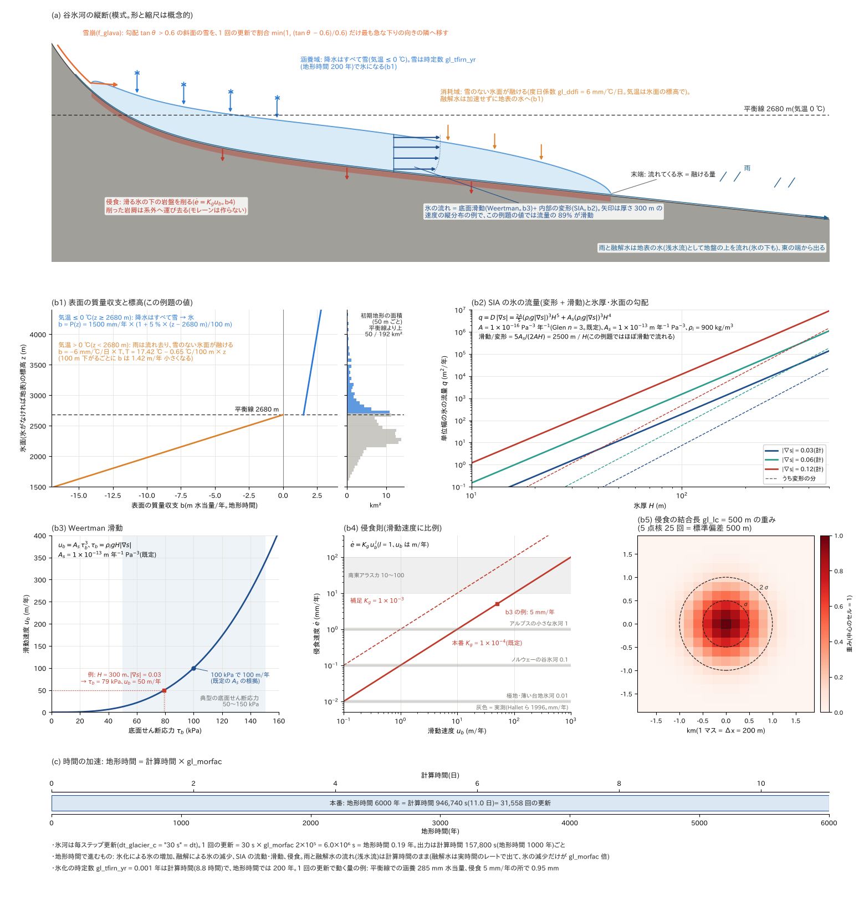
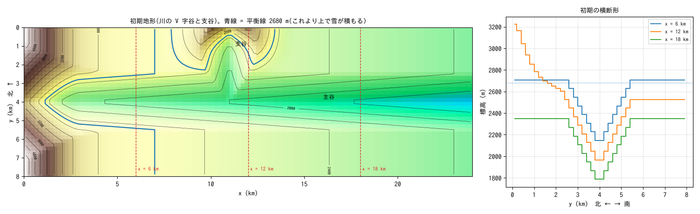
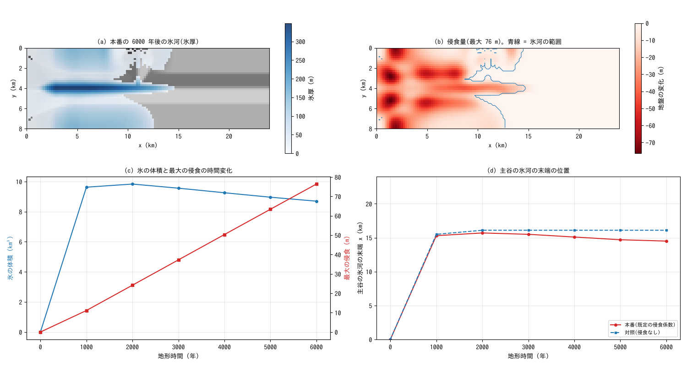
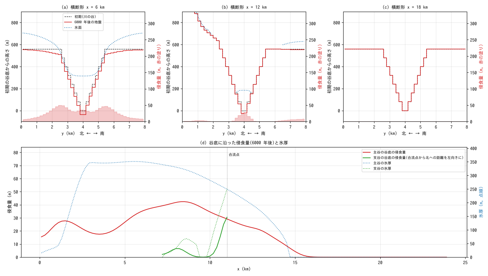
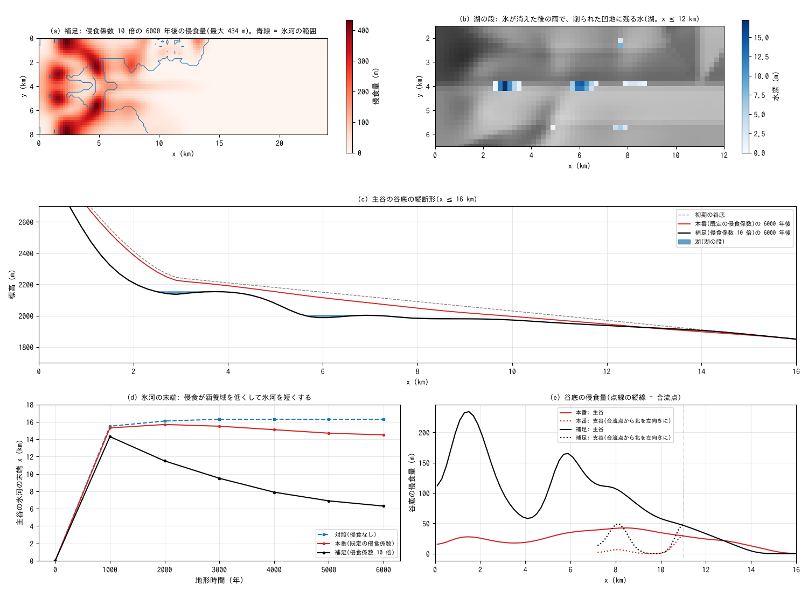

# glacier_valley — 氷河の谷: 川の V 字谷に氷河が育ち、谷を削り始める

[English](en/README.md)

川が刻んだ V 字谷と支谷に、寒冷な一定の気候(平衡線 2680 m)のもとで氷河を育て、地形時間
6000 年のあいだ谷を削らせます。雪の堆積・雪崩・氷化・浅氷近似(SIA)の流動・底面滑動・氷河侵食
を一つの計算で動かし、氷河の侵食がどこに集まり、どのくらいの速さで進むかを見ます
([ユーザーガイド](../../docs/users_guide/glacier.md))。本番は侵食係数などを既定の値のまま使い、
侵食の速さは実測の範囲に収まります。そのため 6000 年で谷の形が変わる量は数十 m にとどまり、
U 字の横断形や湖を満たす凹地はまだできません。補足として侵食係数を 10 倍にした計算(6 万年分の
侵食に相当)を行い、凹地と湖・懸谷の段ができる一方で、侵食が氷河を短くすることを見ます。値は
現象を見やすくするための模式値で、特定の谷の再現ではありません。

## 実際の氷河の谷で起きていること

- **氷河の成り立ち**: 平衡線(1 年の涵養と消耗が釣り合う高さ)より上で越年した雪が氷になり、
  氷は自重で変形しながら、底面で滑りながら下流へ流れます。平衡線より下では氷が融け、氷河の末端は
  流れてくる氷と融ける量が釣り合う所に落ち着きます(Cuffey & Paterson 2010)。
- **氷河侵食**: 滑る氷の底に挟まった岩屑が岩盤を磨き(削磨)、割れ目の入った岩塊を剥ぎ取ります
  (剥離)。侵食の速さは滑動速度にほぼ比例するとされ(Humphrey & Raymond 1994)、速度の 2 乗に
  比例するという報告もあります(Herman ら 2015)。
- **侵食の速さ**: 実測の侵食速度は、極地の氷河や結晶質の岩盤の上の薄い台地氷河の 0.01 mm/yr から、
  ノルウェーの温暖な谷氷河の 0.1 mm/yr、アルプスの小さな温暖氷河の 1 mm/yr、南東アラスカの大きく
  速い温暖氷河の 10〜100 mm/yr まで、桁で違います(Hallet ら 1996)。
- **氷河の谷の地形**: 氷河に削られた谷は、U 字の横断形(トラフ谷)、縦断形の閉じた凹地(過剰侵食。
  氷が消えると湖になる)、本谷との合流点で支谷の谷底が高く残る懸谷を持ちます。侵食は氷の流量が
  大きい平衡線の付近で最も速く、本谷は支谷の氷が加わる合流点の下流で深く削られ、流量の少ない支谷は
  取り残されて懸谷になります(MacGregor ら 2000、Anderson ら 2006)。これらの地形は、氷期と間氷期が
  繰り返す数十万年をかけてできます(MacGregor ら 2000 は過去 40 万年の気候の変化で計算しています)。
  U 字の横断形は、谷の横断面の中の氷の流れが決める侵食の分布でできます。定常の U 字に達するまで
  およそ 10 万年かかるという計算があります(Harbor ら 1988、Harbor 1992)。
- **侵食と氷河の大きさの帰還**: 侵食で谷が深くなり涵養域が低くなると、同じ気候でも後の氷河は短く
  なります(Kaplan ら 2009、Anderson ら 2012)。

## 再現に必要な機構

| 機構 | 設定 | この例題での役割 |
|---|---|---|
| 気温と降水の標高変化 | `&list_meteo`(気温減率 0.65 ℃/100 m、`f_prec_lapse`) | 季節のない一定の気候。0 ℃ の高さが平衡線になる |
| 積雪 | `fn_snow`(雨と雪の境・融雪の閾値 0 ℃) | 平衡線より上では降水がすべて雪として積もる |
| 雪崩 | `f_glava`(限界勾配 0.6) | 急な斜面の雪を下へ移す |
| 氷化・融解 | `gl_tfirn_yr`・`gl_ddfi` | 積もった雪が氷になり、平衡線より下の氷面が融ける |
| 氷の流動 | `f_glflow`(SIA)・`f_glslide`(Weertman 滑動。`gl_as` は既定) | 氷が谷に沿って流れ、台地の氷が谷へ流れ落ちる |
| 氷河侵食 | `f_glero`(`gl_kg` は既定、侵食の結合長 `gl_lc` は既定の 500 m) | 滑る氷の下の岩盤を削る。削った岩屑は系外へ運び去る |
| 時間の加速 | `gl_morfac` = 2×10⁵、毎ステップ更新(`dt_glacier_c`) | 1 回の更新(30 s)が地形時間 0.19 年 |
| 地表の水 | 浅水流(東の端は自由流出) | 雨と融解水が谷を流れ下る |
| 湖の段 | 浅水流だけ | 補足の最終の地形に雨を降らせ、流れ去らない水を見る |



(a) 谷氷河の縦断の模式図(形と縮尺は概念的)。平衡線 2680 m(気温 0 ℃)より上では降水がすべて雪になり、
雪は時定数 gl_tfirn_yr(地形時間 200 年)で氷になります。勾配 0.6 を超える斜面の雪は、1 回の更新で
割合 min(1, (tanθ − 0.6)/0.6) だけ下の隣のセルへ移ります(雪崩)。平衡線より下では雨が流れ去り、雪の
ない氷面が融けます。氷は底面滑動と内部の変形で流れ、滑る氷の下の岩盤が削られます(削った岩屑は
系外へ運び去り、堆積させません)。末端は、流れてくる氷と融ける量が釣り合う所に落ち着きます。
(b1) この例題の値で ENCflow が与える表面の質量収支 b(地形時間の 1 年あたり)。気温は氷面の標高 z で
17.42 ℃ − 0.65 ℃/100 m × z、降水は 1500 mm/年 × (1 + 5 % × (z − 2680 m)/100 m) です。
平衡線より上では降水の全量が氷になり(雪崩で移る分を除く)、下では雪のない氷面が度日係数 6 mm/℃/日
で融けます(度日法で、昇華・再凍結は表しません)。b は平衡線で 0 から +1.5 m/年 へ跳び、
平衡線より下では 100 m 下がるごとに 1.42 m/年 小さくなります。右は初期地形の標高分布で、
平衡線より上は 192 km² のうち 50 km² です。平衡線のすぐ上に台地が広がるので、平衡線が
少し動くだけで涵養域が大きく変わります(下の「注意」)。(b2) SIA の単位幅の氷の流量(Glen の n = 3、
Weertman の m = 3 は固定)。変形の項 (2A/5)(ρ_i g|∇s|)³H⁵ と滑動の項 A_s(ρ_i g|∇s|)³H⁴ の比は
H : 2500 m で、この例題の氷は厚さ 300 m でも流量の 89 % が滑動です。(b3) Weertman 滑動
u_b = A_s τ_b³(既定の A_s = 10⁻¹³ m 年⁻¹ Pa⁻³ は 100 kPa で 100 m/年)。(b4) 侵食則 ė = K_g u_b
(本番 K_g = 10⁻⁴、補足 10⁻³)と、実測の侵食速度の範囲(Hallet ら 1996)。厚さ 300 m・氷面の勾配 0.03
の氷は τ_b = 79 kPa、u_b = 50 m/年 で、侵食は 5 mm/年 です(b3 の例)。侵食は τ_b の 3 乗に
比例するので、急な斜面では薄い氷でも速く削れます(結果の谷頭の斜面と肩の縁)。(b5) 侵食の結合長
gl_lc = 500 m。侵食に使う τ_b は、周りの氷のあるセルの駆動応力をベクトルのままこの重み(標準偏差
500 m)で平均した大きさで、流動には局所の値を使います(ガウス核を谷を横切る向きにも同じ長さで
当てるのは ENCflow 独自の簡略化。ユーザーガイドの「侵食の結合長」)。(c) 1 回の更新(30 s)は地形時間
0.19 年で、6000 年は計算時間 946,740 s(約 11 日)です。氷の増減・流動・侵食だけを gl_morfac 倍で
進め、雨と融解水の流れは加速しないので、氷と水の質量の収支は一致しません(時間加速の近似)。

## 幾何と設定



左: 初期地形(段彩と陰影、等高線は 200 m ごと)。青線が平衡線 2680 m で、これより上で雪が積もります。
赤い破線は横断形を描く位置です。右: 初期の横断形。

24 km × 8 km、Δx = 200 m(120 × 40 セル)。地形は、谷の肩の台地と支谷の谷頭の山塊からなる
「隆起した面」に、主谷と支谷の 2 本の V 字谷(谷壁の勾配 0.4)を刻んだものです(`make_terrain.py`)。

- **主谷**: 西から東へ流れ、谷の軸は y = 4 km。谷底の勾配は 0.03(東端で 1570 m)で、谷頭
  (x < 3 km)は 3100 m まで盆地状に上がります。谷の肩の台地は谷底から 600 m 上にあり、谷頭に
  向かって高くなります(x = 0 で 1300 m 上)。
- **支谷**: 北の端から x = 11 km で主谷に直角に合流します(谷底の勾配 0.12)。谷頭を高さ 900 m の
  山塊が囲み、平衡線より高い涵養域になります。合流点では支谷の谷底と主谷の谷底が同じ高さです
  (川の谷の合流。Playfair の法則)。
- **気候**: 季節のない一定の気候です。気温は標高 0 m で 17.42 ℃、減率 0.65 ℃/100 m で、0 ℃ の
  高さが平衡線 2680 m になります。降水は年 1500 mm(0.1711 mm/h)で、平衡線から 100 m 上がるごとに
  5% 増えます。雨と雪の境と融雪の閾値は 0 ℃ で、平衡線より上では降水がすべて雪として積もり、
  下では雨になります。度日係数は雪 4、氷 6 mm/℃/day です。
- **氷河**: 滑動係数 `gl_as`、侵食係数 `gl_kg`(べき指数 1)、侵食の結合長 `gl_lc`(500 m)は既定の値
  です。氷化の時定数 `gl_tfirn_yr` = 0.001 は計算時間の年(約 9 時間)で、積もった雪は数時間で
  氷になり、動かない雪として溜まりません(地形時間に直すと 200 年の遅れで、氷河が育つ始めの時期を
  遅らせるだけです)。
- **時間**: dt = 30 s で、毎ステップ氷河を更新し(`dt_glacier_c = "30 s"`)、`gl_morfac` = 2×10⁵ で
  加速します(1 回の更新 = 地形時間 0.19 年)。地形時間 6000 年は計算時間 946,740 s(約 11 日)で、
  出力は 1000 年ごとです。
- **境界**: 東の端は水の自由流出(川の出口)です。氷は領域の外へ出られないので、氷河の末端が東の
  端に届かない大きさにしてあります。

| 構成 | 設定ファイル | 内容 |
|---|---|---|
| 本番 | param_glacial.txt | 既定の侵食係数で 6000 年 |
| 補足 | param_glacial_x10.txt | 侵食係数 `gl_kg` だけを 10 倍(1e-3)にして 6000 年 |
| 湖の段 | param_lakes.txt | 補足の最終の地盤高に 1 日 20 mm/h の雨、その後 2 日は雨なし(氷・雪の計算は使わない) |
| 対照 | param_glacial_noero.txt | 侵食なし(`f_glero = 0`)。氷河の大きさを本番と比べる |

## 実行方法

```
cd examples/glacier_valley
make               # bin/ の実行ファイルへのリンクと初期地形(make_terrain.py)
make run           # 本番(4 スレッドで約 10 分)
make run-x10       # 補足(約 5 分)
make run-lakes     # 湖の段(補足の最終の地形を prep_lakes.py が data/z_glacial.txt に写す。約 3 分)
make run-noero     # 対照(約 10 分)
make plot          # figs/*.png と en/figs/*.png
python3 plot_schematic.py   # 説明図 figs/mechanism.png だけ(計算の前に描ける。en で英語版)
```

mechanism.png は計算結果を使わない(式と設定の値と make_terrain.py の地形だけで描く)ので、計算の
前に描けます。本番だけでも setup.png・glacier.png・valley.png は描けます。補足・湖の段・対照が
あると、x10.png と対照の線が加わります。スレッド数は `OMP_NUM_THREADS` で指定します。図化には
Python 3・NumPy・matplotlib が要ります。

## 結果

### 本番: 6000 年で氷河が削る場所と速さ



(a) 6000 年後の氷厚(灰色は 6000 年後の地盤の陰影図で、氷厚 1 m 以上の所に氷厚の色を重ねる)。
(b) 侵食量の分布(青線は氷河の範囲)。(c) 氷の体積と最大の侵食量。(d) 主谷の氷河の末端の位置
(対照と比べる)。

- **氷河の成長**: 雪から約 1000 年で、両側の台地を覆う厚さ 150 m ほどの氷と、x ≈ 15.3 km まで
  伸びる谷氷河(最大の厚さ約 370 m)ができ、末端は 2000 年に 15.7 km まで進みます。支谷では谷頭に
  厚さ 60 m ほどの小さな氷河ができ、主谷の氷が支谷の出口から 1 km あまり入り込みます。
- **侵食の分布**: 6000 年後の侵食量は、谷頭の急な斜面で最大 76 m、台地の氷が谷へ流れ落ちる肩の縁で
  30〜60 m、主谷の谷底で 16〜42 m です。急な斜面の上では、薄い氷でも底面のせん断応力が大きく、
  滑動と侵食が速くなります。
- **侵食の速さ**: 主谷の谷底の侵食速度(2000〜6000 年の平均)は、氷の下の平均で年 5.0 mm、最大で
  年 7.4 mm(x ≈ 8 km。氷の流量が最も大きい所)です。アルプスの小さな温暖氷河(1 mm/yr)と
  南東アラスカの大きな氷河(10〜100 mm/yr)の間で、実測の範囲に入ります(Hallet ら 1996)。侵食は
  末端に向かって小さくなり、末端より下流の谷は変わりません。
- **侵食で氷河が短くなる**: 侵食なしの対照では、氷河は 2000 年で定常になり、末端は 16.1 km の
  ままです。本番の末端は 2000 年の 15.7 km から 6000 年の 14.5 km へ後退し、氷の体積は 12% 減り
  ます。侵食で涵養域(谷頭の斜面や肩)が低くなるので、同じ気候でも氷河が短くなります
  (Kaplan ら 2009、Anderson ら 2012)。



(a)〜(c) 横断形(左の軸)と侵食量(右の軸、赤の塗り)。(d) 主谷と支谷の谷底に沿った侵食量と氷厚
(支谷は合流点から北への距離を左向きにとる)。

- **懸谷の始まり**: 合流点の主谷の谷底は 31 m 下がり、その 1.7 km 上流の支谷の谷底は変わりません。
  削られるのは、主谷の氷が入り込んだ支谷の出口だけです。
- **U 字にはならない**: x = 6 km では谷底(35 m)より谷壁の上部(45 m 前後)が多く削られ、
  x = 12 km では谷底(29 m)が最も削られて V 字が深くなります。U 字の横断形はできません
  (下の「このモデルで表せないこと」)。
- **閉じた凹地はまだない**: 縦断形に閉じた凹地はできず、6000 年後の地形に湖の段と同じ雨を降らせる
  と、水はすべて流れ去ります(`python3 prep_lakes.py result_glacial/Z9998.txt` のあと
  `./encflow param_lakes.txt` で確かめられます)。谷底の勾配 0.03(1 km で 30 m)を逆転させるには、
  下流に向かって 1 km あたり 30 m 以上小さくなる侵食の差が要り、本番の速さでは 1 万年以上かかります。

### 補足: 侵食係数 10 倍(6 万年分の侵食)と湖



(a) 侵食係数 10 倍の 6000 年後の侵食量。(b) 湖の段の後に残る水。(c) 主谷の谷底の縦断形と湖。
(d) 氷河の末端の位置(対照・本番・補足)。(e) 谷底の侵食量(本番と補足)。

氷河の大きさは数百〜千年で地形に追いつき、そのあいだに地盤が下がる量は氷厚に比べて小さいので、
侵食係数を 10 倍にすることは、気候を一定にしたまま時間を 10 倍に進めること(6 万年分の侵食)に
ほぼ等しくなります。侵食の速さそのものが実測に合うという意味ではありません。

- **閉じた凹地と湖**: 主谷の谷底に閉じた凹地が 2 つでき、湖の段では、谷頭の斜面の足元
  (x ≈ 2.5〜3.5 km)に深さ 17 m、x ≈ 5.7〜6.9 km に深さ 31 m の湖が残ります。ほかに深さ 2〜6 m の
  小さな湖が 3 つでき、水は合わせて 1450 万 m³ です。
- **合流点の段**: 主谷の谷底は合流点で 57 m 下がり、合流点の 1.7 km 上流の支谷の谷底はほとんど
  変わりません(0.7 m)。懸谷の段の始まりです。
- **氷河の後退**: 末端は 1000 年の 14.3 km から 6000 年の 6.1 km まで後退し、支谷に入り込んで
  いた主谷の氷は 3000 年までに消えます(支谷の谷頭の小さな氷河は残ります)。侵食が涵養域を低く
  する帰還が、本番の 10 倍の速さで進みます。地盤は肩の縁で最大 437 m、主谷の谷頭で 235 m 下がり
  ます。
- **解釈の限界**: 実際には、6 万年のあいだ気候は一定ではなく、氷期と間氷期が繰り返します。凹地が
  できる場所は、侵食が下流に向かって急に小さくなる所で、氷河の大きさの変わり方によって変わります。

## このモデルで表せないこと(実際の現象との違い)

- **U 字の横断形**: 浅氷近似(SIA)は、各セルの氷の流れをその場の氷厚と表面の勾配だけで決めます。
  谷壁との摩擦のように横断方向へ伝わる応力は表さないので、氷に覆われた横断面の侵食は谷の中央と
  谷壁で大きく違わず、V 字は形を保ったまま下がります。U 字の横断形を作るには、横断面の中の流れを
  解く計算が要ります(Harbor 1992)。
- **モレーン・岩屑の運搬**: 削った岩屑は氷と融解水が系外へ運び去るものとして扱い、堆積させません。
  モレーン・アウトウォッシュ・エスカーは表れません。
- **氷の温度**: 氷はすべて融点にある(温暖氷河)として扱い、氷のある所ではどこでも滑動と侵食が
  起きます。高所の薄い氷が岩盤に凍り付いて滑らない状態は表しません。谷頭の急な斜面と肩の縁の
  侵食は、そのぶん大きめに出ている可能性があります。
- **谷頭の壁の後退**: カールの壁を後退させる凍結破砕・落石と、カールの底を回転するように削る流れは
  表しません。
- **気候**: 季節のない一定の気候で、氷期と間氷期の繰り返しはありません。
- **領域の端**: 氷は領域の外へ出られません。

## 注意

- **侵食の結合長**: 侵食に使う駆動応力を、氷のあるセルの中で既定の 500 m の長さで平均しています
  (`gl_lc`。ユーザーガイドの「侵食の結合長」)。0 にすると局所の値になり、侵食が格子規模の点に
  集中しやすくなります。
- **領域の端は氷の分水界**: 北と南の端では氷が出ていけないので、端は鏡に映した対称な分水界として
  働きます。谷頭の斜面の端の列で侵食が大きいのは、そこで氷が厚くなるためです。
- **氷河の大きさは平衡線に敏感**: x < 7 km の谷の肩の台地が平衡線のすぐ上にあるので、平衡線を
  少し動かすだけで涵養域の広さが大きく変わります(平衡線を 2750 m にすると、末端は 10.9 km で、
  支谷の合流点に届きません)。
- **更新の間隔**: 1 回の氷河の更新は地形時間 0.19 年です。更新の間隔を地形時間で数十年に延ばすと、
  時間の分割による不自然な結果が出ます(1 年以下を目安にします)。
- **小さな湖**: 補足の湖のうち、肩の縁にできる深さ 6 m の湖は 1〜3 セルの大きさで、格子の解像度に
  近いものです。
- 検証は [test/glacier](../../test/glacier/README.md)(SIA の解析解・侵食の結合長の検定など)。

## 感度実験の入口

- `temp0`・`prec_zref`(平衡線の高さ): 氷河の大きさ。台地が平衡線をまたぐので変化が大きく出ます。
- `gl_kg`(侵食係数): 侵食の速さ。氷河が定常に近いあいだは、時間の長さを変えるのとほぼ同じ効果です。
- `gl_lc`(侵食の結合長): 侵食の分布のなめらかさ。
- `tt`(地形時間の長さ): 本番の延長。凹地ができるかどうか。
- `make_terrain.py` の `MASSIF`(支谷の谷頭の山塊)・`WALL`・`SLOPE`: 支谷の氷河の大きさと谷の形。

## 参考文献

- Anderson, R. S., Molnar, P. and Kessler, M. A. (2006): Features of glacial valley profiles simply
  explained. *J. Geophys. Res.*, 111, F01004. doi:10.1029/2005JF000344(要旨で確認)
- Anderson, R. S., Dühnforth, M., Colgan, W. and Anderson, L. (2012): Far-flung moraines: Exploring the
  feedback of glacial erosion on the evolution of glacier length. *Geomorphology*, 179, 269–285.
  doi:10.1016/j.geomorph.2012.08.018(要旨で確認)
- Cuffey, K. M. and Paterson, W. S. B. (2010): *The Physics of Glaciers*, 4th ed. Elsevier.
- Hallet, B., Hunter, L. and Bogen, J. (1996): Rates of erosion and sediment evacuation by glaciers: A review
  of field data and their implications. *Global Planet. Change*, 12, 213–235.(要旨と引用文献で確認)
- Harbor, J. M. (1992): Numerical modeling of the development of U-shaped valleys by glacial erosion.
  *Geol. Soc. Am. Bull.*, 104, 1364–1375.(書誌と引用文献で確認)
- Harbor, J. M., Hallet, B. and Raymond, C. F. (1988): A numerical model of landform development by glacial
  erosion. *Nature*, 333, 347–349. doi:10.1038/333347a0(要旨で確認)
- Herman, F., Beyssac, O., Brughelli, M., Lane, S. N., Leprince, S., Adatte, T., Lin, J. Y. Y., Avouac, J.-P.
  and Cox, S. C. (2015): Erosion by an Alpine glacier. *Science*, 350, 193–195.
- Humphrey, N. F. and Raymond, C. F. (1994): Hydrology, erosion and sediment production in a surging
  glacier: Variegated Glacier, Alaska, 1982–83. *J. Glaciol.*, 40, 539–552.
- Kaplan, M. R., Hein, A. S., Hubbard, A. and Lax, S. M. (2009): Can glacial erosion limit the extent of
  glaciation? *Geomorphology*, 103, 172–179. doi:10.1016/j.geomorph.2008.04.020(要旨で確認)
- MacGregor, K. R., Anderson, R. S., Anderson, S. P. and Waddington, E. D. (2000): Numerical simulations of
  glacial-valley longitudinal profile evolution. *Geology*, 28, 1031–1034.(要旨で確認)
