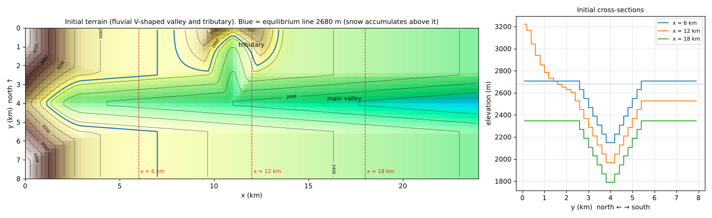
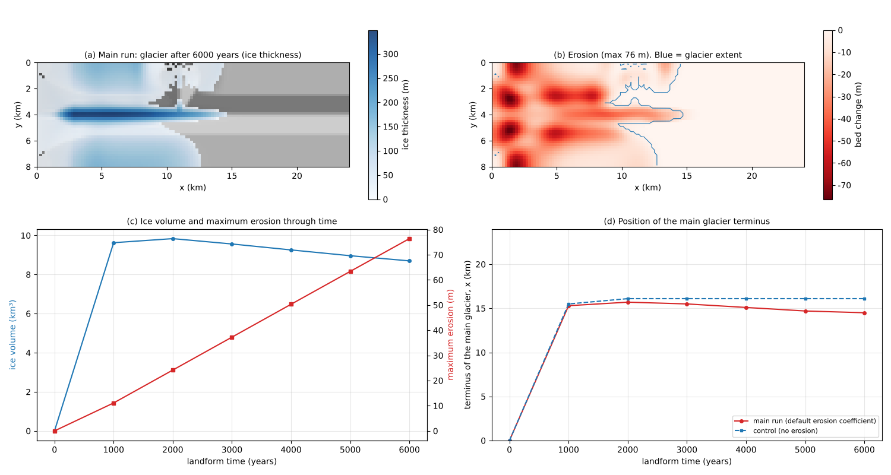
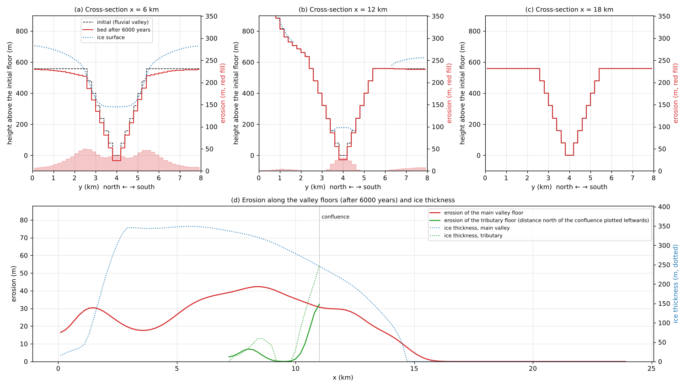
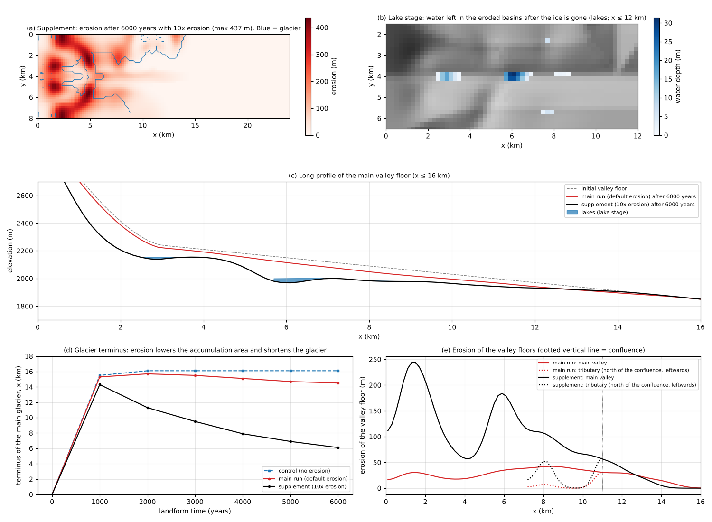

# glacier_valley — A glacial valley: a glacier grows in a fluvial V-shaped valley and starts to cut it

> English mirror of examples/glacier_valley/README.md. The Japanese file is the master copy.

[日本語](../README.md)

A glacier is grown in a fluvial V-shaped valley with a tributary under a constant cold climate
(equilibrium line 2680 m), and is left to cut the valley for 6000 years of landform time. Snow
accumulation, avalanching, conversion to ice, flow by the shallow-ice approximation (SIA), basal sliding
and glacial erosion run in one calculation, and the example looks at where glacial erosion concentrates
and how fast it proceeds ([users guide](../../../docs/en/users_guide/glacier.md)). The main run keeps the
erosion coefficient and the other values at their defaults, and the erosion rates fall within the
measured range. As a result, the valley shape changes by only tens of metres in 6000 years, and neither a
U-shaped cross-section nor a basin that would hold a lake forms yet. As a supplement, a run with ten
times the erosion coefficient (equivalent to 60,000 years of erosion) shows that basins with lakes and a
step at the tributary junction form, while erosion makes the glacier shorter. The values are schematic,
chosen to make the processes easy to see; they do not reproduce a particular valley.

## What happens in real glacial valleys

- **How a glacier works**: above the equilibrium line (the height where a year's accumulation and
  ablation balance), snow that survives the year turns into ice, and the ice flows downvalley by
  deforming under its own weight and by sliding on its bed. Below the equilibrium line the ice melts,
  and the terminus settles where the ice that flows in balances the melt (Cuffey & Paterson 2010).
- **Glacial erosion**: debris held in the base of sliding ice polishes the bedrock (abrasion) and
  plucks out jointed blocks (quarrying). The erosion rate is taken to be roughly proportional to the
  sliding speed (Humphrey & Raymond 1994); a dependence on the square of the speed has also been
  reported (Herman et al. 2015).
- **How fast**: measured erosion rates differ by orders of magnitude, from 0.01 mm/yr for polar
  glaciers and thin temperate plateau glaciers on crystalline bedrock, through 0.1 mm/yr for temperate
  valley glaciers in Norway and 1 mm/yr for small temperate glaciers in the Alps, to 10–100 mm/yr for
  large, fast temperate glaciers in southeast Alaska (Hallet et al. 1996).
- **Landforms of glacial valleys**: valleys cut by glaciers have U-shaped cross-sections (troughs),
  closed basins in the long profile (overdeepenings, which hold lakes after the ice is gone), and hanging
  valleys, whose floors are left high where they join the main valley. Erosion is fastest near the
  equilibrium line, where the ice discharge is largest; the main valley is cut deeper below the
  confluence, where the tributary ice joins, and the tributary, with less ice, is left behind as a
  hanging valley (MacGregor et al. 2000; Anderson et al. 2006). These landforms take hundreds of
  thousands of years of repeated glacials and interglacials (MacGregor et al. 2000 ran their model through
  the climate changes of the past 400,000 years). The U-shaped cross-section comes from the distribution
  of erosion set by the ice flow within the cross-section; one calculation takes about 100,000 years to
  reach a steady U shape (Harbor et al. 1988; Harbor 1992).
- **Feedback of erosion on glacier size**: when erosion deepens the valley and lowers the accumulation
  area, later glaciers are shorter even under the same climate (Kaplan et al. 2009; Anderson et al. 2012).

## Mechanisms needed

| Mechanism | Setting | Role in this example |
|---|---|---|
| Change of temperature and precipitation with height | `&list_meteo` (lapse rate 0.65 °C/100 m, `f_prec_lapse`) | A constant climate without seasons. The 0 °C height becomes the equilibrium line |
| Snow cover | `fn_snow` (rain/snow boundary and melt threshold 0 °C) | Above the equilibrium line all precipitation accumulates as snow |
| Avalanching | `f_glava` (critical slope 0.6) | Moves snow on steep slopes downhill |
| Conversion to ice and melt | `gl_tfirn_yr`, `gl_ddfi` | Accumulated snow becomes ice; the ice surface melts below the equilibrium line |
| Ice flow | `f_glflow` (SIA), `f_glslide` (Weertman sliding; `gl_as` at its default) | Ice flows along the valley, and plateau ice flows down into the valley |
| Glacial erosion | `f_glero` (`gl_kg` at its default; erosion coupling length `gl_lc` at its default of 500 m) | Cuts the bedrock under sliding ice. Eroded debris is carried out of the domain |
| Time acceleration | `gl_morfac` = 2×10⁵, update every step (`dt_glacier_c`) | One update (30 s) is 0.19 years of landform time |
| Surface water | Shallow-water flow (free outflow at the east edge) | Rain and meltwater flow down the valley |
| Lake stage | Shallow-water flow only | Rain on the final terrain of the supplement; looks at the water that does not drain |

## Geometry and settings



Left: initial terrain (colour relief with shading; contours every 200 m). The blue line is the
equilibrium line, 2680 m; snow accumulates above it. The red dashed lines mark where the cross-sections
are drawn. Right: initial cross-sections.

24 km × 8 km, Δx = 200 m (120 × 40 cells). The terrain is an "uplifted surface", made of the plateau at
the valley shoulders and a massif around the head of the tributary, into which two V-shaped valleys, the
main valley and the tributary, are cut (wall slope 0.4; `make_terrain.py`).

- **Main valley**: flows from west to east, with its axis at y = 4 km. The floor slope is 0.03 (1570 m at
  the east edge), and the head (x < 3 km) rises like a basin to 3100 m. The plateau at the shoulders is
  600 m above the floor and rises towards the head (1300 m above it at x = 0).
- **Tributary**: joins the main valley at right angles at x = 11 km, coming from the north edge (floor
  slope 0.12). A massif 900 m high surrounds its head and gives it an accumulation area above the
  equilibrium line. At the confluence, the tributary floor and the main floor are at the same height
  (a fluvial junction; Playfair's law).
- **Climate**: a constant climate without seasons. The temperature is 17.42 °C at sea level with a lapse
  rate of 0.65 °C/100 m, so the 0 °C height, the equilibrium line, is 2680 m. Precipitation is 1500 mm a
  year (0.1711 mm/h) and increases by 5% for every 100 m above the equilibrium line. The rain/snow
  boundary and the melt threshold are 0 °C: above the equilibrium line all precipitation accumulates as
  snow, and below it falls as rain. The degree-day factors are 4 (snow) and 6 (ice) mm/°C/day.
- **Glacier**: the sliding coefficient `gl_as`, the erosion coefficient `gl_kg` (exponent 1) and the
  erosion coupling length `gl_lc` (500 m) are at their defaults. The conversion time constant
  `gl_tfirn_yr` = 0.001 is in years of computational time (about 9 hours): accumulated snow turns into ice
  within hours and does not build up as static snow (in landform time this is a delay of 200 years, which
  only delays the early growth of the glacier).
- **Time**: dt = 30 s; the glacier is updated every step (`dt_glacier_c = "30 s"`) and accelerated by
  `gl_morfac` = 2×10⁵ (one update = 0.19 years of landform time). The 6000 years of landform time are
  946,740 s of computational time (about 11 days), with output every 1000 years.
- **Boundaries**: free outflow of water at the east edge (the river outlet). Ice cannot leave the domain,
  so the glacier is sized so that its terminus stays short of the east edge.

| Configuration | Settings file | Content |
|---|---|---|
| Main run | param_glacial.txt | 6000 years with the default erosion coefficient |
| Supplement | param_glacial_x10.txt | Only the erosion coefficient `gl_kg` is multiplied by 10 (1e-3); 6000 years |
| Lake stage | param_lakes.txt | 20 mm/h of rain for one day on the final bed of the supplement, then two days without rain (no ice or snow calculation) |
| Control | param_glacial_noero.txt | No erosion (`f_glero = 0`). The glacier size is compared with the main run |

## How to run

```
cd examples/glacier_valley
make               # links to the executables in bin/ and the initial terrain (make_terrain.py)
make run           # main run (about 10 minutes with 4 threads)
make run-x10       # supplement (about 5 minutes)
make run-lakes     # lake stage (prep_lakes.py copies the final terrain of the supplement to data/z_glacial.txt; about 3 minutes)
make run-noero     # control (about 10 minutes)
make plot          # figs/*.png and en/figs/*.png
```

With the main run alone, setup.png, glacier.png and valley.png can be drawn. With the supplement, the lake
stage and the control, x10.png and the control line are added. Set the number of threads with
`OMP_NUM_THREADS`. The figures need Python 3, NumPy and matplotlib.

## Results

### Main run: where and how fast the glacier cuts in 6000 years



(a) Ice thickness after 6000 years. (b) Distribution of erosion (the blue line is the glacier extent).
(c) Ice volume and maximum erosion. (d) Position of the terminus of the main glacier (compared with the
control).

- **Growth of the glacier**: within about 1000 years, snow builds ice about 150 m thick that covers the
  plateaus on both sides, and a valley glacier (up to about 370 m thick) that extends to x ≈ 15.7 km. In
  the tributary, a small glacier about 60 m thick forms at its head, and the ice of the main valley pushes
  a little over 1 km into the mouth of the tributary.
- **Distribution of erosion**: after 6000 years the erosion is at most 76 m on the steep slopes of the
  valley head, 30–60 m at the shoulder edges where plateau ice flows down into the valley, and 16–42 m on
  the floor of the main valley. On steep slopes, even thin ice has a large basal shear stress, so sliding
  and erosion are fast.
- **How fast**: the erosion rate of the main valley floor (averaged over 2000–6000 years) is 5.0 mm a
  year on average under the ice and 7.4 mm a year at most (x ≈ 8 km, where the ice discharge is largest).
  This lies between small temperate glaciers in the Alps (1 mm/yr) and large glaciers in southeast Alaska
  (10–100 mm/yr), within the measured range (Hallet et al. 1996). Erosion decreases towards the terminus,
  and the valley below the terminus does not change.
- **Erosion makes the glacier shorter**: in the control without erosion, the glacier becomes steady by
  2000 years and its terminus stays at 16.1 km. The terminus of the main run retreats from 15.7 km at
  2000 years to 14.5 km at 6000 years, and the ice volume decreases by 12%. Erosion lowers the
  accumulation area (the slopes of the valley head and the shoulders), so the glacier becomes shorter
  under the same climate (Kaplan et al. 2009; Anderson et al. 2012).



(a)–(c) Cross-sections (left axis) and erosion (right axis, red fill). (d) Erosion along the floors of the
main valley and the tributary, and ice thickness (the tributary is plotted with the distance north of the
confluence leftwards).

- **The beginning of a hanging valley**: the main valley floor at the confluence is lowered by 31 m, while
  the tributary floor 1.7 km upstream does not change. Only the mouth of the tributary, where the ice of the
  main valley pushes in, is cut.
- **No U shape**: at x = 6 km the upper valley walls (around 45 m) are cut more than the floor (35 m),
  and at x = 12 km the floor (29 m) is cut the most, so the V deepens. No U-shaped cross-section forms (see
  "What this model cannot represent" below).
- **No closed basin yet**: no closed basin forms in the long profile, and when the same rain as in the
  lake stage falls on the terrain after 6000 years, all the water drains away (check with
  `python3 prep_lakes.py result_glacial/Z9998.txt` followed by `./encflow param_lakes.txt`). Reversing the
  floor slope of 0.03 (30 m in 1 km) needs an erosion difference that decreases downstream by more than
  30 m per km, which takes more than 10,000 years at the rates of the main run.

### Supplement: ten times the erosion coefficient (60,000 years of erosion) and lakes



(a) Erosion after 6000 years with ten times the erosion coefficient. (b) Water left after the lake stage.
(c) Long profile of the main valley floor and the lakes. (d) Position of the glacier terminus (control,
main run, supplement). (e) Erosion of the valley floors (main run and supplement).

The glacier size catches up with the terrain within several hundred to a thousand years, and the bed is
lowered by little compared with the ice thickness in that time, so multiplying the erosion coefficient by
10 is nearly the same as running time ten times faster under the same constant climate (60,000 years of
erosion). It does not mean that the erosion rate itself matches measurements.

- **Closed basins and lakes**: two closed basins form on the floor of the main valley, and after the
  lake stage lakes remain in them: 17 m deep at the foot of the slope of the valley head
  (x ≈ 2.5–3.5 km) and 31 m deep at x ≈ 5.7–6.9 km. Three more small lakes 2–6 m deep form, and the
  water totals 14.5 million m³.
- **Step at the confluence**: the main valley floor at the confluence is lowered by 57 m, while the
  tributary floor 1.7 km upstream of the confluence hardly changes (0.7 m): the beginning of the step of
  a hanging valley.
- **Retreat of the glacier**: the terminus retreats from 14.3 km at 1000 years to 6.1 km at 6000 years,
  and the main-valley ice that had pushed into the tributary is gone by 3000 years (the small glacier at
  the tributary head remains). The feedback by which erosion lowers the accumulation area proceeds ten times faster than in the
  main run. The bed is lowered by up to 437 m at the shoulder edges and by 235 m at the head of the main
  valley.
- **Limits of the interpretation**: in reality the climate is not constant for 60,000 years; glacials and
  interglacials alternate. Basins form where erosion decreases sharply downstream, and where that happens
  changes with the way the glacier size changes.

## What this model cannot represent (differences from real glaciers)

- **U-shaped cross-sections**: the shallow-ice approximation (SIA) sets the ice flow of each cell only
  from the local ice thickness and surface slope. It does not carry stresses across the valley, such as
  the drag of the valley walls, so under the ice the erosion differs little between the valley centre and
  the walls, and the V lowers while keeping its shape. A U-shaped cross-section needs a calculation that
  resolves the flow within the cross-section (Harbor 1992).
- **Moraines and debris transport**: eroded debris is treated as carried out of the domain by the ice and
  meltwater, and is not deposited. No moraines, outwash or eskers appear.
- **Ice temperature**: all ice is treated as being at the melting point (temperate), so sliding and
  erosion occur wherever there is ice. Thin ice frozen to its bed at high altitude, which does not slide,
  is not represented. The erosion of the steep slopes of the valley head and of the shoulder edges may be
  overestimated for that reason.
- **Retreat of the valley head**: frost shattering and rockfall that make cirque headwalls retreat, and
  the rotational flow that scoops out cirque floors, are not represented.
- **Climate**: a constant climate without seasons; there is no alternation of glacials and interglacials.
- **Domain edges**: ice cannot leave the domain.

## Notes

- **Erosion coupling length**: the driving stress used for erosion is averaged over the default length of
  500 m within ice-covered cells (`gl_lc`; "Erosion coupling length" in the users guide). With 0 it becomes
  the local value, and erosion tends to concentrate at grid-scale points.
- **The domain edges are ice divides**: ice cannot leave through the north and south edges, so each edge
  acts as a mirror-symmetric ice divide. Erosion is large in the edge rows of the slopes of the valley head
  because the ice is thicker there.
- **The glacier size is sensitive to the equilibrium line**: the plateau at the valley shoulders for
  x < 7 km lies just above the equilibrium line, so moving the line a little changes the size of the
  accumulation area a lot (in a trial run with the equilibrium line at 2750 m, the terminus was at 10.9 km
  and did not reach the tributary confluence).
- **Update interval**: one glacier update is 0.19 years of landform time. Lengthening the interval to tens
  of years of landform time gives unnatural results from the time splitting (aim for one year or less).
- **Small lakes**: among the lakes of the supplement, the 6 m deep lakes at the shoulder edges are 1–3
  cells in size, close to the grid resolution.
- Verification is in [test/glacier](../../../test/glacier/en/README.md) (the SIA analytical solution, the
  check of the erosion coupling length, and others).

## Where to start sensitivity experiments

- `temp0`, `prec_zref` (height of the equilibrium line): the glacier size. The change is large because the
  plateau straddles the equilibrium line.
- `gl_kg` (erosion coefficient): the erosion rate. While the glacier is close to steady, this has nearly
  the same effect as changing the length of time.
- `gl_lc` (erosion coupling length): the smoothness of the erosion pattern.
- `tt` (length of landform time): extending the main run; whether basins form.
- `MASSIF` (the massif at the tributary head), `WALL`, `SLOPE` in `make_terrain.py`: the size of the
  tributary glacier and the shape of the valleys.

## References

- Anderson, R. S., Molnar, P. and Kessler, M. A. (2006): Features of glacial valley profiles simply
  explained. *J. Geophys. Res.*, 111, F01004. doi:10.1029/2005JF000344 (checked against the abstract)
- Anderson, R. S., Dühnforth, M., Colgan, W. and Anderson, L. (2012): Far-flung moraines: Exploring the
  feedback of glacial erosion on the evolution of glacier length. *Geomorphology*, 179, 269–285.
  doi:10.1016/j.geomorph.2012.08.018 (checked against the abstract)
- Cuffey, K. M. and Paterson, W. S. B. (2010): *The Physics of Glaciers*, 4th ed. Elsevier.
- Hallet, B., Hunter, L. and Bogen, J. (1996): Rates of erosion and sediment evacuation by glaciers: A review
  of field data and their implications. *Global Planet. Change*, 12, 213–235. (checked against the abstract
  and citing literature)
- Harbor, J. M. (1992): Numerical modeling of the development of U-shaped valleys by glacial erosion.
  *Geol. Soc. Am. Bull.*, 104, 1364–1375. (checked against the bibliographic record and citing literature)
- Harbor, J. M., Hallet, B. and Raymond, C. F. (1988): A numerical model of landform development by glacial
  erosion. *Nature*, 333, 347–349. doi:10.1038/333347a0 (checked against the abstract)
- Herman, F., Beyssac, O., Brughelli, M., Lane, S. N., Leprince, S., Adatte, T., Lin, J. Y. Y., Avouac, J.-P.
  and Cox, S. C. (2015): Erosion by an Alpine glacier. *Science*, 350, 193–195.
- Humphrey, N. F. and Raymond, C. F. (1994): Hydrology, erosion and sediment production in a surging
  glacier: Variegated Glacier, Alaska, 1982–83. *J. Glaciol.*, 40, 539–552.
- Kaplan, M. R., Hein, A. S., Hubbard, A. and Lax, S. M. (2009): Can glacial erosion limit the extent of
  glaciation? *Geomorphology*, 103, 172–179. doi:10.1016/j.geomorph.2008.04.020 (checked against the
  abstract)
- MacGregor, K. R., Anderson, R. S., Anderson, S. P. and Waddington, E. D. (2000): Numerical simulations of
  glacial-valley longitudinal profile evolution. *Geology*, 28, 1031–1034. (checked against the abstract)
