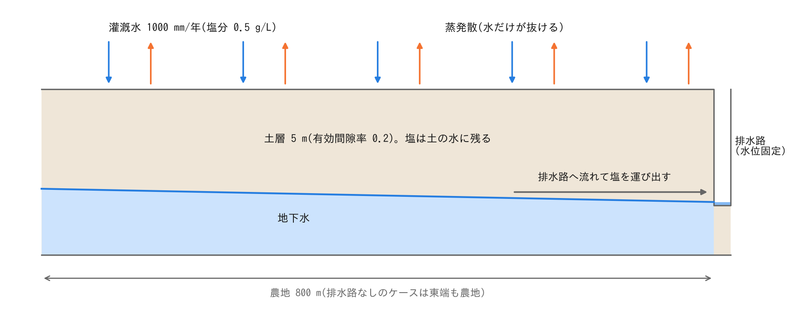
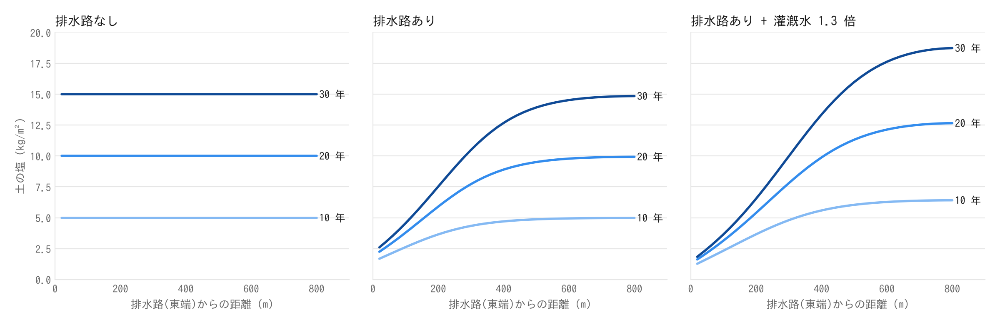
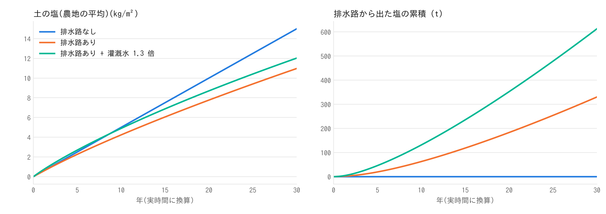

# irrigation_salt — 灌漑農地の土にたまる塩と排水路の効果

[English](en/README.md)

乾いた土地の灌漑農地では、灌漑水に溶けたわずかな塩が、土に年々たまります。水は蒸発散で
大気へ戻りますが、塩は土に残るからです。排水路で地下水を抜けば塩も運び出せますが、効くのは
排水路の近くだけです。この例題は、塩分 0.5 g/L の水で 30 年灌漑した農地の土の塩を、排水路の
ない農地・ある農地・水を多めにかけた農地で比べます。数十年の変化を、
[時間の圧縮](../../docs/users_guide/time.md#時間の圧縮長期の水塩収支の計算)で 1 ケース 10 秒ほどで
計算します。値は現象を見やすくするための模式値で、特定の農地の再現ではありません。

## 実際の農地で起きていること

- **塩は灌漑水が運んでくる**: 真水に見える川の水にも塩が溶けています。塩分 0.5 g/L の水を
  年に 1000 mm かけると、1 ha あたり年 5 t の塩が農地に入ります。
- **蒸発散は水だけを抜く**: 作物と地面から水が大気へ戻ると、塩は土の水に残って濃くなります。
  土の水の塩分が数 g/L を超えると、多くの作物は水を吸いにくくなって収量が落ちます。
- **排水が塩を運び出す**: 蒸発散より多くかけた水は、土を通り抜けて排水路や深い地下水へ出て、
  塩を一緒に運びます。かけた水のうち排水になる割合を洗脱率といい、長い時間の後の排水の
  塩分は「灌漑水の塩分 ÷ 洗脱率」になります(Ayers & Westcot 1985)。
- **排水のない農地は塩がたまり続ける**: 排水の出口がないと、地下水位が上がって地面からの
  蒸発が増え、塩は土に残ります。中央アジアのアラル海の流域のように、大規模な灌漑で地下水位の
  上昇と塩類集積が広がった地域があります。

## 再現に必要な機構



農地の断面の模式図です(計算結果ではありません)。灌漑水(青の矢印)が塩を持ち込み、蒸発散
(橙の矢印)は水だけを抜きます。排水路の近くの地下水は排水路へ流れて、塩を運び出します。

| 実際の現象 | ENCflow での表し方 | 設定 |
|---|---|---|
| 灌漑水が塩を持ち込む | 雨として与える水に濃度を持たせる | `fn_precip`、`wq_rain_conc` |
| 水がしみ込み、塩も土へ入る | Green-Ampt の浸透と、浸透水に同伴する物質(地下の質量プール) | `f_gwvertical = 2`、`f_wq_infil = 1`(既定) |
| 蒸発散で水だけが抜け、塩は土に残る | 蒸発散は水だけを引く。地下水から引く分は、土の水が少ないほど減る | `fn_evap`(`f_evmodel = 1`、`evap_hglim`) |
| 地下水が排水路へ流れて塩を運び出す | 土層の側方流と、同伴する物質。排水路は水位規定セル(流れ込んだ水と塩は系外へ) | `f_gwlateral = 1`、`&list_bound_stage` |
| 数十年かけて進む | 時間の圧縮(圧縮率 M = 1000。速さを 1000 倍、期間を 1/1000) | 設定ファイルの値の読み替え |

## 幾何と設定

820 m × 100 m、dx = dy = 20 m(41 × 5 セル)。平らな農地(地盤高 10 m)で、土層は厚さ 5 m、
有効間隙率 0.2(水の容量 1.0 m)、側方の透水係数 1e-4 m/s です。排水路のあるケースでは、
東端の 1 列を深さ 3.5 m の排水路にして、水位を地表下 3.4 m に固定します。

- **灌漑**: 年 1000 mm を一年中同じ速さで、一様な雨として与えます。塩分 0.5 g/L。
- **蒸発散**: 可能蒸発散は年 1500 mm。地下水から引く分は、地下の貯留が 0.6 m(地下水面が
  地表下 2 m)より少ないと、貯留に比例して減ります(`evap_hglim = 0.6`)。
- **初期状態**: 地下の貯留 0.4 m(蒸発散が年 1000 mm になり、灌漑と釣り合う水準)。塩なし。
- **時間の圧縮**: 灌漑の強さ・可能蒸発散・浸透能・側方の透水係数を 1000 倍にし、30 年を
  10.96 日で計算します(dt = 10 s)。塩分と土層の大きさは変えません。

| ケース | 設定ファイル | 内容 |
|---|---|---|
| 排水路なし | param_nodrain.txt | 出口のない農地 |
| 排水路あり | param_drain.txt | 東端に排水路 |
| 排水路あり + 灌漑水 1.3 倍 | param_leach.txt | 排水路のある農地に、年 1300 mm をかける |
| 圧縮率の確かめ | param_drain_m100.txt | 「排水路あり」を圧縮率 100 で計算する |

## 実行方法

```
cd examples/irrigation_salt
make                    # リンクと入力(gen_data.py)
make run                # 4 ケースを順に計算(1 スレッドで計 2〜3 分)
python3 plot_results.py # figs/*.png と数表(引数 en で英語版を en/figs/ に)
```

## 結果



排水路(東端)からの距離に対する土の塩(10・20・30 年)。



左: 農地の平均の土の塩。右: 排水路から出た塩の累積。

| ケース | 30 年に入った塩 | 土に残った塩 | 排水路から出た塩 | 蒸発散 | 排水 |
|---|---:|---:|---:|---:|---:|
| 排水路なし | 1230 t | 1230 t | 0 | 1000 mm/年 | 0 |
| 排水路あり | 1230 t | 900 t | 330 t(27 %) | 989 mm/年 | 11 mm/年 |
| 排水路あり + 灌漑水 1.3 倍 | 1599 t | 986 t | 613 t(38 %) | 1240 mm/年 | 60 mm/年 |

| 30 年の土の塩 (kg/m²)。括弧は土の水の塩分 (g/L) | 排水路から 20 m | 200 m | 400 m | 800 m |
|---|---:|---:|---:|---:|
| 排水路なし | 15.0 (37.5) | 15.0 (37.5) | 15.0 (37.5) | 15.0 (37.5) |
| 排水路あり | 2.6 (7.8) | 7.5 (19.4) | 12.7 (31.9) | 14.9 (37.2) |
| 排水路あり + 灌漑水 1.3 倍 | 1.8 (5.2) | 6.6 (13.5) | 13.4 (26.0) | 18.7 (36.1) |

- **排水路なし**: 入った塩がすべて土に残り、年 0.5 kg/m²(灌漑水量 × 塩分)ずつ一様に増えます。
  30 年で 15 kg/m²、土の水の塩分は海水(約 35 g/L)を超えます。
- **排水路あり**: 排水路の近くの土の塩は 6 分の 1 になりますが、400 m 離れると排水路なしの
  8 割を超え、800 m ではほとんど変わりません。排水路が運び出したのは入った塩の 27 % です。
  地下水が排水路へ流れる範囲でしか塩は出ていきません。
- **水を多めにかける**: 排水路の近くでは土の塩がさらに減りますが、遠い所では増えます(800 m で
  14.9 → 18.7 kg/m²)。余分にかけた水の大半は、地下水位を上げて蒸発散を増やすだけで
  (989 → 1240 mm/年)、排水に回るのは年 60 mm です。排水が届かない所では、多くかけた分だけ
  塩が多く入ります。洗い流すには、排水路の間隔を縮めるなど、排水の届く範囲を広げる必要があります。
- **圧縮率の確かめ**: 圧縮率 100 と 1000 の 30 年の土の塩の差は、最大で 0.04 % です。この例題は
  地表に流れがなく、すべての過程の速さを同じ倍率にしているので、圧縮率によらず同じ結果になります。

## 結果の読み方と限界

- **土は 1 枚の層で、中は完全に混ざる**とみなしています。根のある浅い所と深い地下水を分けないので、
  土の水の塩分は土層全体の平均です。実際には、蒸発で地表近くに塩が集まり、灌漑や雨で下へ動きます。
- **蒸発散**は、地下の貯留が多い(地下水面が浅い)ほど増える関係を、貯留量に比例する形で近似して
  います(`evap_hglim`)。作物の種類・生育の時期・塩分による吸水の低下は表しません。
- **灌漑**は一年中同じ速さの一様な雨として与えています。季節・輪番・水路からの漏水は表しません。
- **塩**は水に溶けたまま動く物質として扱い、溶解度の上限は与えていません(この例題の最大
  37.5 g/L は、塩化ナトリウムの溶解度よりずっと小さい)。石膏などの溶けにくい塩の析出を見るには
  溶解度 `wq_csat` を、土への吸着を見るには地下輸送の遅延化係数 `wq_rg` を与えます
  ([水質](../../docs/users_guide/wq.md))。
- **時間の圧縮**は、洪水や季節の変化のような速い現象を表しません
  ([時間の圧縮](../../docs/users_guide/time.md#時間の圧縮長期の水塩収支の計算)の前提)。

## 参考文献

- Ayers, R. S. and Westcot, D. W. (1985): *Water quality for agriculture*. FAO Irrigation and Drainage Paper 29 Rev. 1.(灌漑水の塩分・洗脱率と土の塩分の関係)
