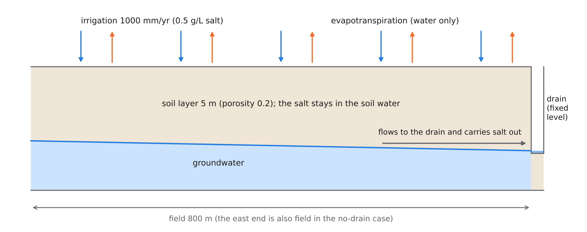
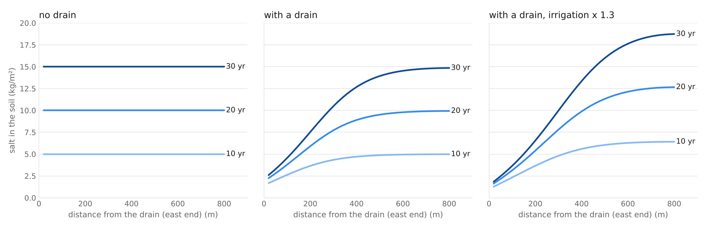
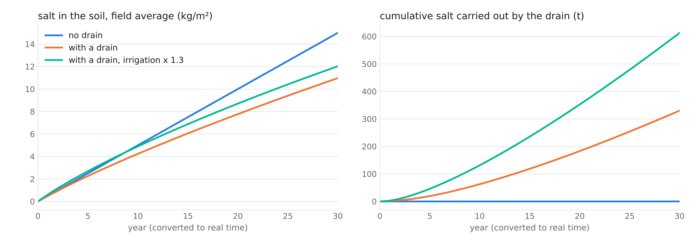

# irrigation_salt — salt accumulating in the soil of an irrigated field and the effect of a drain

> English mirror of examples/irrigation_salt/README.md. The Japanese file is the master copy.

[日本語](../README.md)

In the irrigated fields of dry regions, the small amount of salt dissolved in the irrigation
water accumulates in the soil year after year: the water returns to the atmosphere by
evapotranspiration, but the salt stays in the soil. A drain that removes groundwater also
carries salt away, but it works only near the drain. This example compares the soil salt of a
field irrigated for 30 years with water of 0.5 g/L salinity, for a field without a drain, a
field with a drain, and a field given more water. The change over decades is computed in about
10 seconds per case with
[time compression](../../../docs/en/users_guide/time.md#time-compression-long-term-water-and-salt-balances).
The values are schematic, chosen to show the phenomenon clearly, and do not reproduce a
particular field.

## What happens in a real field

- **The irrigation water brings the salt**: river water that looks fresh also carries dissolved
  salt. Applying 1000 mm per year of water with 0.5 g/L of salt brings 5 t of salt per hectare
  per year into the field.
- **Evapotranspiration removes water only**: when water returns to the atmosphere from the crop
  and the ground, the salt stays in the soil water and becomes more concentrated. When the
  salinity of the soil water exceeds a few g/L, many crops take up water less easily and the
  yield falls.
- **Drainage carries the salt out**: water applied in excess of evapotranspiration passes
  through the soil to drains and deep groundwater and carries salt with it. The fraction of the
  applied water that becomes drainage is called the leaching fraction, and after a long time
  the salinity of the drainage becomes "salinity of the irrigation water ÷ leaching fraction"
  (Ayers & Westcot 1985).
- **A field without drainage keeps accumulating salt**: without an outlet, the water table
  rises, evaporation from the ground increases, and the salt stays in the soil. In regions such
  as the basin of the Aral Sea in Central Asia, large-scale irrigation has spread the rise of
  the water table and the accumulation of salt.

## Mechanisms needed for the reproduction



A schematic cross-section of the field (not a computed result). The irrigation water (blue
arrows) brings the salt, and evapotranspiration (orange arrows) removes water only. The
groundwater near the drain flows to the drain and carries the salt out.

| Real phenomenon | Representation in ENCflow | Settings |
|---|---|---|
| The irrigation water brings the salt | A concentration given to water applied as rain | `fn_precip`, `wq_rain_conc` |
| Water soaks in, and the salt enters the soil | Green-Ampt infiltration and the substance accompanying the infiltrating water (subsurface mass pool) | `f_gwvertical = 2`, `f_wq_infil = 1` (default) |
| Evapotranspiration removes water only and the salt stays in the soil | Evapotranspiration takes water only. The part taken from groundwater decreases as the soil water decreases | `fn_evap` (`f_evmodel = 1`, `evap_hglim`) |
| Groundwater flows to the drain and carries the salt out | Lateral flow of the soil layer and the accompanying substance. The drain is a row of water-level cells (the water and salt that flow in leave the system) | `f_gwlateral = 1`, `&list_bound_stage` |
| It proceeds over decades | Time compression (compression factor M = 1000: speeds × 1000, period × 1/1000) | The reading of the values in the parameter files |

## Geometry and settings

820 m × 100 m, dx = dy = 20 m (41 × 5 cells). A flat field (ground elevation 10 m) with a soil
layer 5 m thick, an effective porosity of 0.2 (water capacity 1.0 m) and a lateral hydraulic
conductivity of 1e-4 m/s. In the cases with a drain, the column at the east end is a drain
3.5 m deep whose water level is fixed 3.4 m below the ground surface.

- **Irrigation**: 1000 mm per year at a constant rate all year, given as uniform rain. Salinity
  0.5 g/L.
- **Evapotranspiration**: the potential evapotranspiration is 1500 mm per year. The part taken
  from groundwater decreases in proportion to the subsurface storage when the storage is below
  0.6 m (water table 2 m below the surface) (`evap_hglim = 0.6`).
- **Initial state**: subsurface storage 0.4 m (the level at which evapotranspiration is 1000 mm
  per year and balances the irrigation). No salt.
- **Time compression**: the irrigation intensity, the potential evapotranspiration, the
  infiltration capacity and the lateral hydraulic conductivity are multiplied by 1000, and 30
  years are computed in 10.96 days (dt = 10 s). The salinity and the size of the soil layer are
  not changed.

| Case | Parameter file | Content |
|---|---|---|
| No drain | param_nodrain.txt | A field without an outlet |
| Drain | param_drain.txt | A drain at the east end |
| Drain + 1.3 times the irrigation water | param_leach.txt | 1300 mm per year applied to the field with the drain |
| Check of the compression factor | param_drain_m100.txt | "Drain" computed with a compression factor of 100 |

## How to run

```
cd examples/irrigation_salt
make                    # link and inputs (gen_data.py)
make run                # the 4 cases in turn (2-3 minutes in total on 1 thread)
python3 plot_results.py # figs/*.png and the tables (argument en: English version in en/figs/)
```

## Results



Soil salt against the distance from the drain (east end) after 10, 20 and 30 years.



Left: mean soil salt of the field. Right: cumulative salt exported through the drain.

| Case | Salt brought in over 30 years | Salt left in the soil | Salt exported through the drain | Evapotranspiration | Drainage |
|---|---:|---:|---:|---:|---:|
| No drain | 1230 t | 1230 t | 0 | 1000 mm/yr | 0 |
| Drain | 1230 t | 900 t | 330 t (27 %) | 989 mm/yr | 11 mm/yr |
| Drain + 1.3 times the irrigation water | 1599 t | 986 t | 613 t (38 %) | 1240 mm/yr | 60 mm/yr |

| Soil salt after 30 years (kg/m²). In parentheses: salinity of the soil water (g/L) | 20 m from the drain | 200 m | 400 m | 800 m |
|---|---:|---:|---:|---:|
| No drain | 15.0 (37.5) | 15.0 (37.5) | 15.0 (37.5) | 15.0 (37.5) |
| Drain | 2.6 (7.8) | 7.5 (19.4) | 12.7 (31.9) | 14.9 (37.2) |
| Drain + 1.3 times the irrigation water | 1.8 (5.2) | 6.6 (13.5) | 13.4 (26.0) | 18.7 (36.1) |

- **No drain**: all the salt that entered stays in the soil and grows uniformly by 0.5 kg/m²
  per year (irrigation depth × salinity). After 30 years it is 15 kg/m², and the salinity of
  the soil water exceeds that of seawater (about 35 g/L).
- **Drain**: the soil salt near the drain falls to one sixth, but 400 m away it exceeds 80 % of
  the no-drain value, and at 800 m it hardly differs. The drain exported 27 % of the salt that
  entered. Salt leaves only within the range where groundwater flows to the drain.
- **Applying more water**: the soil salt decreases further near the drain but increases far
  from it (14.9 → 18.7 kg/m² at 800 m). Most of the extra water only raises the water table and
  increases evapotranspiration (989 → 1240 mm/yr); only 60 mm per year goes to drainage. Where
  the drainage does not reach, more water simply brings more salt. Washing the salt out needs a
  wider reach of the drainage, for example a closer spacing of the drains.
- **Check of the compression factor**: the soil salt after 30 years differs by at most 0.04 %
  between compression factors of 100 and 1000. This example has no surface flow and all
  processes are sped up by the same factor, so the result does not depend on the compression
  factor.

## How to read the results, and limits

- **The soil is one layer and is assumed fully mixed inside.** The shallow root zone and the
  deep groundwater are not separated, so the salinity of the soil water is the mean of the
  whole soil layer. In reality, evaporation gathers salt near the surface, and irrigation and
  rain move it downward.
- **Evapotranspiration**: the relation by which it increases with more subsurface storage (a
  shallower water table) is approximated as proportional to the storage (`evap_hglim`). The
  kind of crop, the growth stage and the reduction of water uptake by salinity are not
  represented.
- **Irrigation** is given as uniform rain at a constant rate all year. Seasons, rotation and
  seepage from canals are not represented.
- **Salt** is treated as a substance that moves dissolved in the water, and no solubility limit
  is given (the maximum of this example, 37.5 g/L, is far below the solubility of sodium
  chloride). To look at the precipitation of sparingly soluble salts such as gypsum, give the
  solubility `wq_csat`; to look at sorption to the soil, give the retardation factor of
  subsurface transport `wq_rg` ([Water quality](../../../docs/en/users_guide/wq.md)).
- **Time compression** does not represent fast phenomena such as floods and seasonal changes
  (the premises of
  [time compression](../../../docs/en/users_guide/time.md#time-compression-long-term-water-and-salt-balances)).

## References

- Ayers, R. S. and Westcot, D. W. (1985): *Water quality for agriculture*. FAO Irrigation and Drainage Paper 29 Rev. 1. (relation between the salinity of the irrigation water, the leaching fraction and the soil salinity)
