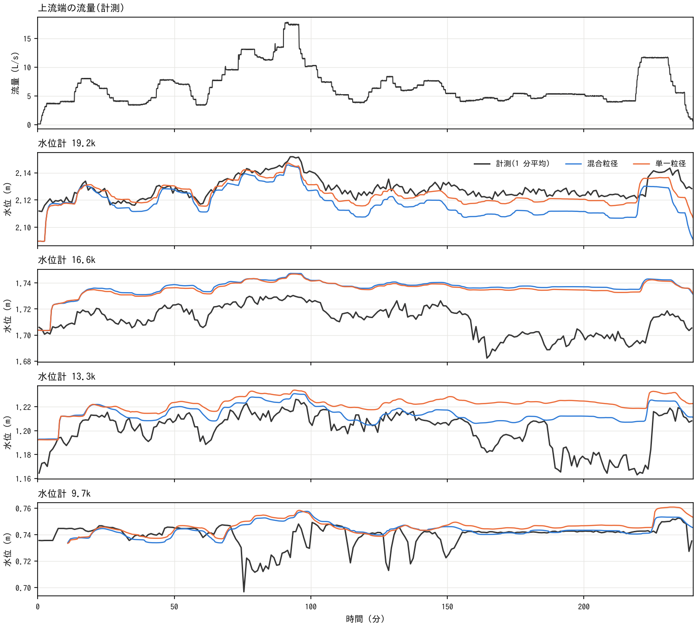
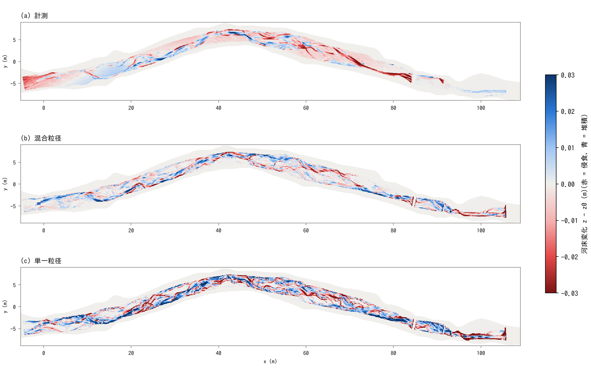
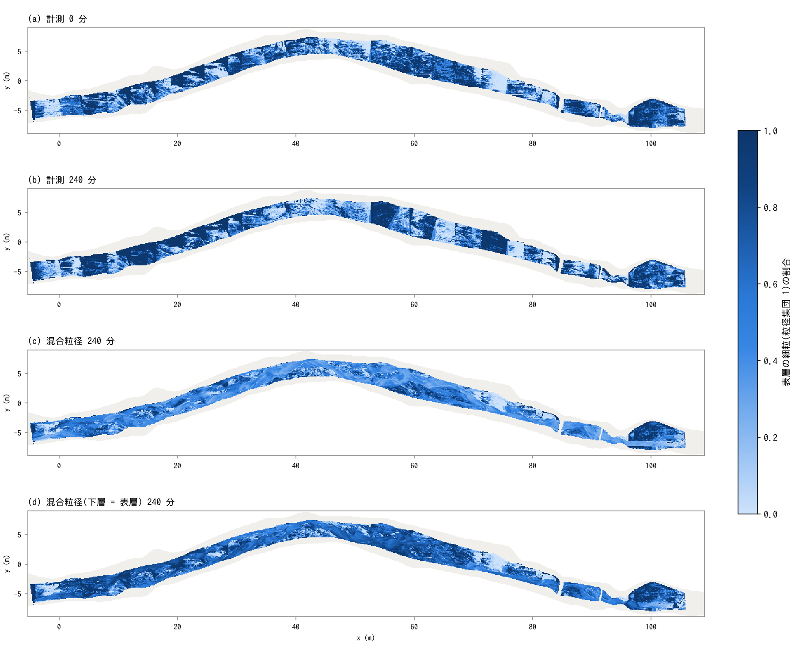

# joganji_flume — 常願寺川の 1/100 移動床模型(国総研)のケース 2-1 を混合粒径で計算し、計測と比べる

[English](en/README.md)

国土技術政策総合研究所(国総研)河川研究室が公開している、常願寺川の移動床模型の実験データを使う例題です。
模型は 8.4〜20.0 km を水平・鉛直とも 1/100 で作ったものです。「セグメント１河川の二極化に関する実験」の
ケース 2 から、通水 1 回目のケース 2-1(240 分)を計算し、水位・河床の変化・表層の粒度を計測と比べます。

河床材料は 0.57・3.0・6.6 mm の 3 つの粒径集団の混合で、供給する土砂の 94 % が最も細かい砂です。粒径の違いが
結果を左右するので、ENCflow の混合粒径 `f_bedmix` で計算し、同じ条件の単一粒径の計算と並べます。混合粒径は、
掃流砂を粒径階に分け、河床の粒度を交換層 1 枚と下層 1 枚で持つ方式です。

**結果の要約**

- **水位**: 水位計 20 か所の RMSE の中央値は約 12 mm です(水深は 2〜5 cm)。
- **河床の変化の大きさ**: 混合粒径では、変化が 5 mm を超える面積と侵食の量が計測に近くなります。単一粒径は
  変化が大きすぎます。
- **河床の変化の場所**: 計測と合いません(点ごとの相関 0.1〜0.25)。計測の細い澪筋の掘れ込みと、中流・下流端の
  河床低下は出ません。
- **流れ**: 計算では流れが低水路の幅に広がり、計測のように 1 本の澪筋に集まりません。
  - 計測の流速(PIV の水面の流速)に計算の水深を掛けると、断面の流量の 6 割にしかなりません。計算は浅い所にも
    水を流しすぎています。
  - 格子・移流項・粗度の分布・水平の渦粘性(乱流モデル)を変えても、この差は縮まりません(「流速」)。
  - 地形の側の安息角崩落や、流砂の向きを曲げる河床勾配の項を変えても、流れの集中はほとんど変わりません
    (「感度」)。
- **表層の粒度**: 計測では平均がほとんど変わらないのに対し、計算は細粒が抜けて粗くなりすぎます。
- **感度の構成**: 下流端の条件や下層の組成を変えても、変化の場所の不一致は変わりません(「感度」)。

粒径を混ぜることで変化の大きさは計測に近づきますが、この格子と設定では、澪筋の形成と表層の粒度の分布までは
再現できません。これがこの例題の結論です。理由の候補は「このモデルで表せないこと・精度の限界」にまとめています。


## 実験とデータ

- **模型**: 常願寺川の 8.4〜20.0 km を 1/100 で再現した移動床模型で、長さは約 116 m です。
  - 低水路(幅 1.2〜4.9 m)が移動床で、移動床の厚さは 6〜24 cm(中央値 10.5 cm)です。
  - 高水敷と、上滝床固め・宮路床固めの区間は固定床です。
- **粒径集団**: 1 = 0.57 mm(珪砂)、2 = 3.0 mm(砂)、3 = 6.6 mm(着色した砂利)。
- **ケース 2-1**:
  - 流量は 240 分の時系列で、0.12〜17.8 L/s です。10 L/s を超えるのは計 40 分です。フルード相似では原型の
    約 12〜1800 m³/s にあたります。
  - 上流端から計 26.2 L の土砂を供給します。粒径集団 1 が 93.7 %、2 が 6.3 % です。
  - 下流端の水位は与えません(元のデータの設定は「フリー」)。
- **計測**:
  - 水位計 21 か所の水位の時系列、93 分の流速、通水の前後の河床高と表層の粒度があります。表層の粒度は、約 5 cm
    のメッシュごとの粒径集団の割合です。
  - 240 分で移動床の河床は平均 2.4 mm 下がり、正味で 0.86 m³(空隙込み)が出ていきました。
  - 移動床の表層の粒度の平均は、ほとんど変わっていません(細粒の割合が 58.4 → 58.6 %)。

データの出典と利用条件は、末尾の「データの出典と利用条件」にあります。

## 入力の作り方

`extract_nilim.py` が国総研の Excel(118 MB)から、この例題が使う量だけを `data_nilim/` に抜き出します。
抜き出した CSV(gzip、計 6 MB)の値は Excel のままで、各ファイルの冒頭の `#` 行に出典と加工の内容を書いています。
元の Excel の表層の粒度のシートで、I = 999 の行の番号の欄が「固定床」となっているのは、999 と読み替えています。

`make_init.py` が `data_nilim/` から計算の入力を作ります。

- **格子**: 元の格子は河道に沿う約 5 cm の曲線格子です。これを 10 cm の正方格子に写します(有効なセル 61691、
  うち移動床 35762)。
  - 河床高と固定床高は、セル中心を含む四辺形の中で双一次補間します。移動層の厚さは、河床高 − 固定床高です。
  - 表層の粒度は四辺形(メッシュ)の値をそのまま使い、固定床と移動床の区別は最も近い格子点に従います。
- **粗度**: 元のデータの値です。低水路は 0.035 で、下流端の 8.4k だけ 0.023 です。高水敷は 0.013 です。
- **表層と下層の粒度**:
  - 交換層の初期の組成は、計測の表層の粒度です。
  - 下層の組成は計測がないので、模型に敷いた混合砂の配合(小橋ら 2026)を全域に置きます。これは仮定です。
- **上下流の端**: 端の断面は格子に対して斜めなので、東西の外縁まで固定床の短い延長(最長 0.9 m)を足します。
  - 上流側の外縁のうち低水路の幅の 28 セルから流量を入れ、下流側の外縁は自由流出にします。流量は通水能で各セルに
    配分します(`inflow_dist = 2`)。
  - 延長の床は、端の断面の河床高を水平に写したものです。下流端の延長の高さが、落ち口の高さになります。
  - 模型の下流端の固定床の高さは元のデータにないので、端の断面の初期の河床高と仮定しています(「感度」)。
- **流入部**: 上流端から移動床が始まるまでの固定床(約 2.6 m)は、低水路の幅を水平な床に置き換えています。
  - 床の高さは、移動床の最初の断面の河床高の中央値です。
  - 元のデータの流入部には深い溜まりと溝と高い構造があります。そのままでは流入が閉じ込められて水が積み上がり、
    深い水が時間刻みを律し、給砂も溝に溜まります。
  - 計測の区間より上流の部分です。
- **給砂**: 元のデータの給砂量が、空隙込みの体積か固体の体積かは書かれていません。
  - 空隙込みと見なし、1 − 空隙率(0.6)を掛けて固体の体積にしています。`make_init.py --feed-solid` で変えられます。
  - 混合粒径の計算には粒径集団ごとの時系列(`fn_inflow_qbmix`)、単一粒径の計算には合計(`fn_inflow_qb`)を与えます。
- **初期の水**: 通水の前から基底流量が流れていたので、固定床の助走計算の最終の水深を初期値にします。
  助走計算は、乾いた河床に 3 L/s を 5 分入れてから、基底流量で 30 分流します(`param_spinup.txt`)。

## 計算の設定

| 項目 | 値 | 根拠 |
|---|---|---|
| 流砂量式 | 芦田・道上(`f_qbform = 1`) | 元の実験の粒径の範囲(砂〜細礫)に合う式 |
| 粒径階 | 0.57・3.0・6.6 mm(`bmix_d`) | 元のデータの粒径集団の D50 |
| 遮蔽係数 | 修正 Egiazaroff(既定) | 芦田・道上(1972)式 (31) |
| 交換層厚 | 既定(初期の交換層の組成の D90 の 2 倍) | 文献の目安の上端(Parker の電子書籍) |
| 限界掃流力 | 0.05(`fluv_tausc`) | 芦田・道上の混合砂礫の平均粒径の値 |
| 掃流力 | 与えられた粗度のまま(`fluv_taufac = 1`) | 下の「掃流力」 |
| 流砂の向き | 河床勾配の項と平衡二次流の項 | 既定の係数 |
| 河岸 | 安息角崩落(32°) | 非粘着性の砂礫 |
| 時間刻み | dt = 0.04 s、地形の更新 0.24 s、`morfac = 1` | 尖頭流量でクーラン数 0.66 |

**掃流力**: 低水路の粗度係数 0.035 は、粒子の粗度の 2〜2.5 倍で、形状抵抗を含みます。流砂に効かせる掃流力を
どう取るかで、流砂量は 1 桁以上違います。93 分の計測の流速と水深から、粒径階ごとの流砂量を見積もって比べました。

- **与えられた粗度のまま**: 流量が 10 L/s を超える 40 分だけで、約 0.4 m³(固体)の土砂が流れます。計測の正味の
  流出(約 0.5 m³。固体)と同じ桁です。
- **粒子の粗度の分だけ**: 有効掃流力の比は 0.15〜0.24 になります。比を 0.3 や 0.5 にしても流砂量は 1/20〜1/5 に
  なり、計測の流出を説明できません。
- **芦田・道上の有効掃流力**(`f_taupart = 2`): この模型の条件では流砂量が 0.05〜0.15 倍になり、やはり説明でき
  ません。この式は砂の河床で作られたもので、水深が粒径の十数倍しかないこの模型では、形状抵抗を大きく見積もる
  側に外れる可能性もあります。

そこでこの例題は、与えられた粗度のまま(比 1)にしています。計測の土砂の収支に合わせた簡略です。計測の正味の
減少は、ほとんどが 5 mm を超える局所の変化によるもので、計測の区画ごとの小さな基準のずれでは説明できません。

## 実行方法

```bash
cd examples/joganji_flume
make              # 実行ファイルへのリンクと入力(make_init.py)
make spinup       # 助走計算(4 スレッドで約 18 分)と初期水深 h_spinup.txt
make run          # 混合粒径(param.txt)と単一粒径(param_single.txt)を順に
make figs         # 図と数表(日英)
```

計算時間は、4 コアの計算機で 2 本を 2 スレッドずつ並べて、各約 6 時間でした。240 分の計算に、実時間の約 1.5 倍
かかります。

2 本を並べて回すなら、`make run` の代わりに次を別々の端末で実行します。

```bash
OMP_NUM_THREADS=2 ./encflow param.txt 2>&1 | tee Screen_result.log
```

```bash
OMP_NUM_THREADS=2 ./encflow param_single.txt 2>&1 | tee Screen_result_single.log
```

格子を 5 cm にする方法は「感度実験の入口」にあります。

## 結果

数値は `python3 plot_results.py` の数表(表 1〜5)から写しています。

### 水位



計算の水位は、水位計を中心とする 3 × 3 セルのうち、濡れたセルの平均です。下流端の断面にある 8.4k だけは、
模型にない延長にかかるセルを除いた 3 セルで比べます。比べるのは、流量が 5 L/s 以上の時間(計 148 分)の
5 分平均です。

水位計 20 か所の RMSE の中央値は、混合粒径で 11.6 mm、単一粒径で 13.0 mm です。17.7k は、水位計のまわりの
セルが濡れないので除いています。水深 2〜5 cm に対して小さくはありませんが、10 cm のセルの平均の河床と、計測の
点の河床の違い(数 cm)と同じ程度です。

誤差が最も大きいのは 14.2k(+38 mm)で、計算の 3 × 3 セルが計測の点より高い所にあります。粒径の扱いによる
水位の違いは小さく、水位は河床の変化より、格子と粗度で決まっています。

### 河床の変化



| | 変化が 5 mm を超える面積 | 侵食 / 堆積 (m³、かさ) | 標準偏差 | 相関(17.1k より下流) | RMSE(同) |
|---|---|---|---|---|---|
| 計測 | 41 % | 1.52 / 0.64 | 8.9 mm | — | — |
| 混合粒径 | 40 % | 1.19 / 1.17 | 11.9 mm | 0.20 | 12.7 mm |
| 単一粒径 | 57 % | 2.07 / 2.03 | 18.3 mm | 0.25 | 16.7 mm |

- **変化の大きさ**: 混合粒径は、変化が 5 mm を超える面積と侵食の量が計測に近く、単一粒径は変化が大きすぎます。
  - 混合粒径では粗い粒径階が動きにくく、表層が粗くなって流砂が減ります。この効果が、変化を計測の大きさに
    抑えています。
- **変化の場所**: 計算の変化も澪筋や砂州に沿いますが、場所は計測と一致しません。
  - 計測の特徴は、細い澪筋に沿った 3〜7 cm の掘れ込みと、その脇の堆積です。
  - 点ごとの相関は、全体で 0.12、17.1k より下流で 0.2 です。変化 0 と比べた誤差の改善(BSS)は負です。
  - 93 分の流速でも、計測では流れが幅数十 cm の 1 本の澪筋に集まるのに対し、計算は低水路の幅に広がります。
    澪筋を掘り込む力が分散します(「流速」)。
- **区間の収支**: 計測では中流と下流端の区間が減りましたが、混合粒径の計算は中流をほとんど変えず、上流端の
  区間を掘って下流端の区間に積みます。区間ごとの値は「感度」の表にあります。
  - 計算の土砂の流出は 240 分で 6.8 L(固体)で、計測の正味の減少に届きません。
  - 下流端の延長は初期の河床の高さの固定床なので、下流端からの河床低下を止める堰として働きます(「感度」)。
- **上流の区間**: 計測では、17.1k より上流の移動床の約半分のセルで、河床高が 240 分の後も厳密に同じです。
  19.0k より上流では 8 割にのぼり、下がった点がありません。
  - 移動層の厚さ(約 11 cm)と表層の粒度(細粒 80 %)からは、動かない理由が見当たりません。通水後にこの区間を
    測り直したかは、元のデータに書かれていません。
  - そのため、点ごとの比較は 17.1k より下流でも示しています。
  - 計算は移動床の始まりで固定床まで掘れ、縦断の図では最上流の区間が枠の外に出ます。


### 表層の粒度



移動床の表層の細粒(粒径集団 1)の割合の平均は、計測では 58.4 → 58.6 % とほとんど変わりません。混合粒径の
計算では 45.1 % まで下がり、表層が粗くなりすぎます。計測との点ごとの相関は 0.20 です。

計算で表層が粗くなる理由は二つです。

- 細粒が交換層から抜けること
- 侵食で、下層が交換層に入ること。下層は、仮定した混合砂の配合で、細粒が 37.4 % しかありません。

計測の表層は、2 m ごとの平均でも 20〜90 % の間で大きく入れ替わります(縦断の図の (b)・(c))。計算の交換層の
組成の変化はそれより小さく、場所も合いません。

### 流速(93 分)


計測の流速は、天井のカメラの画像を PIV で解析した水面の流速です。元のデータの「解析範囲外」は水が流れていない
所なので、比べる点から除きます。

計測が 0.05 m/s を超える 2.5 万点で比べると(表 5)、平均の流速は混合粒径 0.29 m/s、単一粒径 0.27 m/s、計測
0.27 m/s で同じです。一方、点ごとの相関は 0.30 と 0.22 にとどまります。計測では速い流れが 1 本の澪筋に
集まり、計算では低水路の幅に広がります。

- **ばらつき**: 計測の流速の変動係数は 0.78 で、計算の 0.28 の 3 倍近くあります。
  - 計測の点の 4 割は 0.05 m/s 以下です。
  - そこは計算では、水深 2 cm ほどの所を 0.24 m/s で流れています(表 5b)。
- **流量の釣り合い**: 計測の流速に計算の水深を掛けて断面で足すと、計算の流量の 6 割にしかなりません(表 5b)。
  - 計算の流量の 4 割は、計測で 0.05 m/s 以下か、流れていない所を通ります。
  - 水面の流速は水深平均より速いので、計測の流速が正しければ、実際の流れは計算より狭く深い澪筋に集まって
    いたことになります。
  - 浅い所の PIV の値が小さく出ている可能性もあります。遅い点は流れの縁に多く、横の隣が流れていない点では
    7 割が 0.05 m/s 以下です。3 列以上内側の点では 3 割弱です。
  - どちらがどれだけ効いているかは分かりません。
- **抵抗則では表せない遅さ**: 計算の水深と勾配のまま計測の遅い点の流速にするには、マニングの粗度が 0.3 ほど
  要ります。粒径と相対水深から見積もる抵抗(Ferguson 2007 の式)は 0.02〜0.03 で、その 1/10 です。
- **計算の側の確かめ**: 計測の 240 分の河床を固定床にして 17 L/s を流しても、計算の流速の変動係数は 0.28 の
  ままです。
  - 5 cm の格子、移流項の 1 次風上、相対水深で変えた粗度の分布でも、ほとんど変わりません。
  - 水平の渦粘性(乱流モデル。ゼロ方程式の `f_diffusion_term = 2`)は速い所と遅い所の差をならす向きに働き、
    変動係数はかえって少し下がります。
  - 計算の浅い所の流速は、ほぼ一様な勾配のマニング式どおりです。
  - 詳しい数値は developer.md §120.8 にあります。

### 台帳

混合粒径の粒径階ごとの収支は、240 分で残差 1e-13 m³ で閉じます。交換層の供給量制限は、粒径階 × セルの更新の
1.3 % で働きました。

安息角崩落が動かした土砂は、混合粒径で 25.4 m³、単一粒径で 17.2 m³ です(かさ。辺ごとの更新の合計)。河床の
変化の量より 1 桁大きく、1 回が平均 5 cm³ ほどの小さな崩落が絶えず続いています。

ただし、この量は河床の変化の量を表しません。崩落が起きるのは、隣のセルとの勾配が 32°を超える辺だけです。
そのような辺は移動床の約 7 万の辺のうち数十で、多くは移動床の上流端から 26 m にあります。同じ所で、流砂が
削っては崩れることを繰り返しています(「感度」)。

## 感度

### 下流端の条件と下層の組成

基本の構成(混合粒径)から 1 か所だけ変えた 3 構成を、`make sub` で計算します。計算時間は基本の構成と同じです。
数値は `plot_results.py` の表 1〜4・6 から写しています。

| | I 1〜500 | 501〜1000 | 1001〜1500 | 1501〜2000 | 2001〜2362 | 表層の細粒の割合 | 相関(全体 / 17.1k より下流) | RMSE(全体) |
|---|---|---|---|---|---|---|---|---|
| 計測 | +22 | −510 | −209 | +64 | −243 | 58.6 % | — | — |
| 基本の構成 | −132 | −55 | +11 | +26 | +128 | 45.1 % | 0.12 / 0.20 | 14.2 mm |
| 下層 = 表層(`param_sub.txt`) | −445 | −421 | +353 | −46 | +440 | 61.0 % | 0.15 / 0.27 | 20.9 mm |
| 下流端 = 固定床高(`param_outlet.txt`) | −132 | −55 | +11 | +26 | −525 | 44.4 % | 0.18 / 0.25 | 15.6 mm |
| 下流端 = 敷と段落ち(`param_sill.txt`) | −132 | −55 | +13 | +24 | +85 | 44.9 % | 0.12 / 0.20 | 14.2 mm |

区間の欄は、移動床の 240 分の正味の体積変化(L、かさ)です。表層の細粒の割合は、移動床の平均です。

下流端から 2 m ごとに平均した、240 分の河床変化(mm)は次のとおりです(表 6)。

| | 0〜2 m | 2〜4 m | 4〜6 m | 6〜8 m | 8〜10 m |
|---|---|---|---|---|---|
| 計測 | −14 | −10 | −7 | −6 | −2 |
| 基本の構成 | 0 | +3 | +3 | +1 | +5 |
| 下流端 = 固定床高 | −31 | −25 | −18 | −9 | −2 |
| 下流端 = 敷と段落ち | −5 | +2 | +3 | +1 | +5 |

- **下流端の延長を固定床高に**(`param_outlet.txt`): 延長の床を、移動層の底の高さまで下げた構成です。
  低水路の幅で平均 9 cm 低くなります。
  - 下流端から 8〜10 m の河床が下がり、計測と同じ形の低下が出ます。ただし、深さは計測の約 2 倍です。
  - 下流端から 7 m 上流の水位計 9.1k の水位は、低下が上流へ進むにつれて下がり、最後の 1 時間には計測より
    25 mm 低くなります。計測の水位に、このような低下は見えません。
  - 上流の 4 区間は基本の構成と同じです。全体の相関は上がりますが、低下が深すぎるので RMSE は大きくなります。
- **下流端の敷と段落ち**(`param_sill.txt`): 模型の下流端の形に合わせた構成です。
  - 模型の下流端は、河床変化の小さい断面を固定床とし、沈砂池へ落差で自然落下させています(小橋ら 2026)。
  - 基本の構成では落ち口が延長の先にあり、落ち口へ向かう加速が移動床の端に届きません。この構成は、移動床の
    端に接する延長の 1 セルを敷として残し、その先を 10 cm 下げます。落ち口の高さは基本の構成と同じです。
  - 掘れるのは移動床の端の局所だけで、端から 0.3 m の平均は −18 mm です。計測の 8〜10 m にわたる低下は出ません。
  - 土砂の流出は基本の構成の約 4.6 倍になり(表 4)、増えた分は端の洗掘から来ています。
  - 9.1k の水位は基本の構成と同じです。端の断面の 8.4k は、落ち口へ向かって水面が下がるので、計測より少し
    低くなります。
- **下流端の低下の読み**: 計測では、下流端から 7 m までの低水路の河床が、幅のほぼ全体で下がっています。
  - 落ち口を移動床の端に置いても、局所的な洗掘にしかなりません。落ち口を下げると、同じ長さの低下は出るものの
    深すぎ、9.1k の水位が計測から外れていきます。
  - 模型の下流端の固定床の高さは、元のデータにありません。元のデータの最も下流の断面 8.4k も移動床で、240 分で
    低水路の平均 13 mm 下がっています。
  - 水位からは、落ち口が大きく低かった形跡はありません。そこでこの例題は、落ち口を端の断面の初期の河床高と
    する基本の構成を使います。計測の低下の原因は、これらの構成からは分かりません。
- **下層の組成**(`param_sub.txt`): 下層を、仮定した混合砂の配合ではなく、各セルの初期の表層と同じ組成にした
  構成です。
  - 240 分の表層の細粒の割合は 61.0 % で、基本の構成より計測に近くなります。点ごとの相関も少し上がります。
    基本の構成で表層が粗くなるのは、主に、侵食で交換層に入る下層を粗い配合と仮定したためです。
  - その代わり河床が動きやすくなり、変化が大きすぎます。中流(I 501〜1000)の侵食は計測に近づきますが、その
    下流の I 1001〜1500 は、計測と逆に堆積します。
  - 模型の下層の組成は計測されていないので、どちらが模型に近いかは決められません。
- どの構成でも、変化の場所の不一致は変わりません(点ごとの相関 0.3 未満)。

### 安息角崩落と河床勾配の項(124 分)

基本の構成から 1 か所だけ変えた 2 構成を、主な出水と 93 分の流速の計測を含む 124 分まで計算しました。表の計測の
河床は 240 分の値なので、構成どうしの比較に使います。

| | 河床変化の標準偏差 | 澪筋の深さ | 相関(全体 / 17.1k より下流) | 流れの集中(93 分) | 流速の相関 / 変動係数(93 分) |
|---|---|---|---|---|---|
| 計測(240 分) | 8.9 mm | −31.2 mm | — | — | — / 0.778 |
| 基本の構成 | 11.1 mm | −32.3 mm | 0.132 / 0.207 | 0.529 | 0.303 / 0.278 |
| 安息角崩落なし(`f_repose = 0`) | 11.0 mm | −32.7 mm | 0.135 / 0.205 | 0.530 | 0.290 / 0.280 |
| `fluv_muk = 0.7` | 11.2 mm | −33.0 mm | 0.125 / 0.197 | 0.535 | 0.309 / 0.281 |

表の値の意味は次のとおりです。

- 河床変化の標準偏差・相関・澪筋の深さは、124 分の低水路の移動床のセルの値です。
- 澪筋の深さは、1 m の縦断の区間ごとに、河床の区間の中央値からの 5 % 点を取った平均です。初期は −29.5 mm です。
- 流れの集中は、低水路のうち単位幅流量の大きい 2 割のセルが運ぶ流量の割合です。
- 流速は表 5 の値です。

水位(0〜124 分)は、比べられる 20 か所で、3 構成とも 0.4 mm 以内で同じです。

- **安息角崩落なし**: 低水路の河床は、ほとんど変わりません。
  - 崩落は、隣のセルとの勾配が 32°を超える辺だけで起きます。10 cm の格子では、隣どうしの高さの差 62.5 mm に
    あたります。
  - 澪筋の掘れ込みは 1〜3 cm なので、この格子ではそこまで急な辺はできません。計算の河床でも計測の河床でも、
    辺の勾配の 99 % は 20°未満です。
  - 違いが出るのは、初めから急な辺のある移動床の上流端の近く(上流端から 26 m)と、上滝床固め 1 の直下の
    洗掘穴です。
  - 上流端では、移動床の最初のセルが、水平な床に置き換えた流入部より最大 16 cm 高くなっています(「入力の
    作り方」)。崩落があると崩れて固定床まで掘れ、ないと乾いたまま残ります。
  - 床固めの直下の穴は、崩落がないと深くなり、124 分で移動層の底(−205 mm)に届きます。基本の構成でも
    −155 mm まで掘れますが、計測の河床にこの穴はありません。
- **`fluv_muk = 0.7`**: 流砂の向きを河床の横断勾配で曲げる項を、0.8 倍に弱めた構成です。
  - 動摩擦係数を、既定の 0.45(Asahi ら 2013)から、Hasegawa (1989) が概算に使う 0.7 にします。項の説明は
    ユーザーガイドの[掃流砂](../../docs/users_guide/geomorph.md#掃流砂f_fluvial)にあります。
  - 澪筋の深さと流れの集中が少し増えるほかは、基本の構成とほぼ同じです。
- どちらの構成も流れの集中と流速の分布をほとんど変えないので、240 分までは計算していません。
- 計算するには、`param.txt` の写しで `f_repose = 1` を 0 にするか `fluv_muk = 0.7` を足し、`tt = 7440` と別の
  `dir_result` にします。

### 感度実験の入口

- `fluv_taufac`: 有効掃流力の比です。0.3・0.5 にすると、流砂量の見積もりが 1/20〜1/5 になります(「掃流力」)。
- `bmix_la`: 交換層厚です。既定は初期の交換層の組成の D90 の 2 倍で、この例題では 8.5 mm です。薄いと交換層の
  供給量制限が働きやすくなり、厚いと表層の組成の変化が遅くなります。
- `bmix_sub0`: 下層の組成です。与えなければ交換層と同じ組成になり、上の `param_sub.txt` がこの構成です。
- 粗度 `rn.txt`: 元のデータの値を `make_init.py` が写します。低水路の一様な 0.035 は形状抵抗を含みます。
- `python3 make_init.py --dx 0.05`: 5 cm の格子で、澪筋が 6〜10 セルになります。`dt` を半分にし、計算量は約
  8 倍です。格子を変えたら `make spinup` からやり直します。
- `python3 make_init.py --feed-solid 1`: 給砂の量を固体の体積と見なします。給砂は 1.67 倍になります。

## このモデルで表せないこと・精度の限界

- **層序**: 下層は一様な混合 1 枚で、その組成は仮定(敷いた混合砂の配合)です。
  - 前の通水で作られた層や、表層の下の粗粒の層は表しません。
  - 表層の粒度の変化は、下層の組成の仮定で大きく変わります(「感度」)。
- **澪筋への流れの集中**: 計測では大きな流量で流れが幅数十 cm の 1 本の澪筋に集まって掘れ込みますが、計算では
  流れが低水路の幅に広がります。流れが集まらないので、澪筋の掘れ込みと計測の中流の河床低下も出ません。
  - 計測の 240 分の河床を固定床にしても、計算の流れは集まりません。格子・移流項・粗度の分布・水平の渦粘性を
    変えても、効果は小さいです(「流速」)。計算で澪筋が掘れないことや、格子の粗さだけが原因ではありません。
  - 安息角崩落を止めても、河床勾配の項を弱めても、流れの集中はほとんど変わりません(「感度」)。
  - 計測の遅い点の流速は、計算の水深では粒径による抵抗で説明できない遅さです。実際の水深が計算より浅かった
    (浅い所に水が広がらなかった)か、浅い所の PIV の値が小さく出ているか、その両方です。
  - 水位の誤差(約 12 mm)は、浅い所の 1 cm ほどの水深の違いを見分けられるほど小さくありません。
  - 有効掃流力(`f_taupart = 2`)は、試算で流砂量が計測の収支を説明できないほど小さくなるので計算していません
    (「掃流力」)。
- **格子**: 10 cm の格子では、低水流の細い流路(幅 0.3〜1 m)が 3〜10 セルしかなく、セルの平均の河床高が細い
  澪筋の底より高くなります。そのため基底流量では水位計の多くのセルが干上がるので、水位は流量が 5 L/s 以上の
  時間だけで比べています。
- **掃流力**: 形状抵抗を含む粗度のまま流砂量を計算しています(「掃流力」)。河床波の有無で流砂量が変わる効果は
  表しません。
- **給砂の体積**: 空隙込みと仮定しています。固体の体積なら、給砂は 1.67 倍です。
- **流入部**: 上流端の固定床の溜まりと高い構造を、水平な床に置き換えています。
- **下流端**: 模型の下流端の固定床の高さは元のデータにないので、落ち口の高さを端の断面の初期の河床高と仮定して
  います。
  - 計測では下流端から 8〜10 m の低水路の河床が幅のほぼ全体で下がりますが、計算では出ません。
  - 落ち口を移動床の端に置いても、端の局所的な洗掘になるだけです。落ち口を固定床高まで下げると、低下は出るものの
    深すぎ、上流の水位が計測より下がります(「感度」)。
- **交換層**: 結果が交換層厚に依存し、細かい下層へ掘り込む所などでは式が悪設定になりえます(ユーザーガイドの
  [解説](../../docs/users_guide/sediment.md#混合粒径f_bedmix))。
- **表層の粒度の計測**: 計測は画像解析による表層の見かけの割合で、計算の交換層(厚さ約 1 cm)の平均の組成とは
  定義が違います。
  - 元のデータの注記では、場所により精度にばらつきがあります。
  - 計測の分布には区画の境目の直線の模様があり、区画ごとに割合がまとまって入れ替わる所もあります。点ごとの
    比較の意味は限られます。
- **二極化**: 論文の主題(低水路の幅の縮小と単列化)は、ケース 2 の 8 回の通水を通じた変化です。この例題は
  1 回目(2-1)だけを計算します。

## データの出典と利用条件

`data_nilim/` のファイルは、次の資料を加工して作成しました。

- 出典: 国土技術政策総合研究所 河川研究室「模型実験等データアーカイブ」セグメント１河川の二極化に関する実験
  (令和 7 年度)「【河道の二極化】ケース2模型実験データ.xlsx」
  (<https://www.nilim.go.jp/lab/fbg/tech/kadounikyokukacase2.xlsx>。技術情報のページ
  <https://www.nilim.go.jp/lab/fbg/tech/tech.html> から)。2026-11-22 に取得し、2026-11-23 にサーバのファイルと
  大きさ・更新日(2026-06-16)が同じことを確かめました。
- 利用条件: 政府標準利用規約(第 2.0 版)。出典を記載し、加工したことを示せば、複製・加工・再配布ができます。
- 加工の内容: ケース 2-1 の比較に要るシート・列だけを抜き出し、列を並べ替えて CSV にし、gzip しました。
  値は変えていません(I = 999 の行の番号の読み替えを除く)。抜き出しの手順は `extract_nilim.py` です。

## 参考文献

- 小橋力也・田端幸輔・松井大生・小嶋宝・瀬﨑智之 (2026): 土砂供給量の減少に伴うセグメント 1 河川の二極化に
  関する実験的研究. 河川技術論文集, 32, 277–282. doi:10.11532/river.32.0_277
- Ferguson, R. (2007): Flow resistance equations for gravel- and boulder-bed streams. *Water Resour. Res.*, 43,
  W05427. doi:10.1029/2006WR005422(式の形と係数 a1 = 6.5・a2 = 2.5 はユーザーガイドの
  [解説](../../docs/users_guide/sediment.md#3-掃流砂f_fluvial)と同じ。本文は未読)
- 芦田和男・道上正規 (1972): 移動床流れの抵抗と掃流砂量に関する基礎的研究. 土木学会論文報告集, 206, 59–69.
  doi:10.2208/jscej1969.1972.206_59
- 平野宗夫 (1971): Armoring をともなう河床低下について. 土木学会論文報告集, 195, 55–65.
  doi:10.2208/jscej1969.1971.195_55
- Parker, G. (2004): *1D Sediment Transport Morphodynamics with Applications to Rivers and Turbidity Currents*.
  電子書籍, 第 17 章. <https://hydrolab.illinois.edu/people/parkerg/morphodynamics_e-book.htm>
- Asahi, K., Shimizu, Y., Nelson, J. and Parker, G. (2013): Numerical simulation of river meandering with
  self-evolving banks. *J. Geophys. Res. Earth Surf.*, 118(4), 2208–2229.(式 (22) の μs = 1.0・μk = 0.45)
- Hasegawa, K. (1989): Universal bank erosion coefficient for meandering rivers. *J. Hydraul. Eng.*, 115(6),
  744–765.(桁の見積りに μs = 1.0・μk = 0.7)

## 関連文書

- [土砂・地形変化の混合粒径](../../docs/users_guide/geomorph.md#混合粒径f_bedmix)・[解説](../../docs/users_guide/sediment.md#混合粒径f_bedmix)
- 混合粒径の検定: [test/bedmix](../../test/bedmix/README.md)
- 設計の文書: docs/mixed_sediment_plan.md
