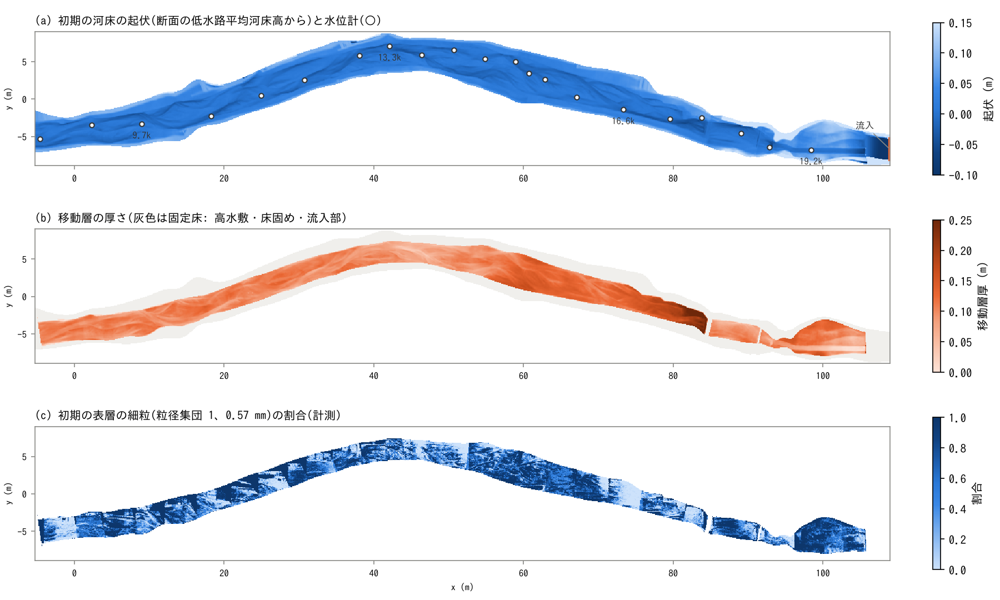
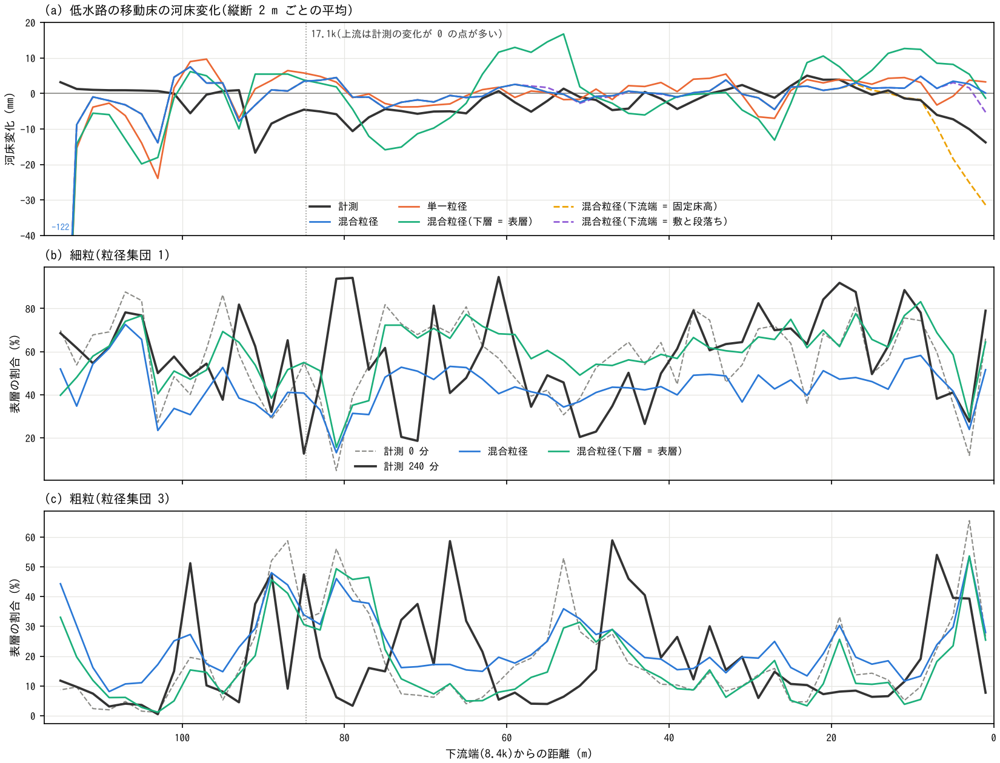
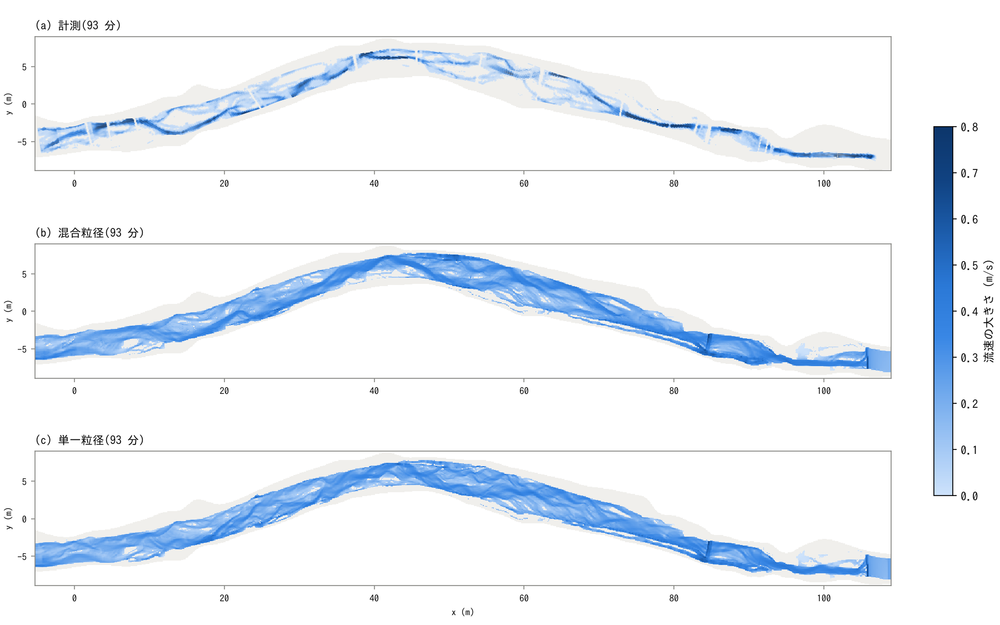

# joganji_flume — 常願寺川の 1/100 移動床模型(国総研)のケース 2-1 を混合粒径で計算し、計測と比べる

[English](en/README.md)

国土技術政策総合研究所(国総研)河川研究室が公開している、常願寺川の 8.4〜20.0 km を水平・鉛直とも 1/100 で
作った移動床模型の実験データ(「セグメント１河川の二極化に関する実験」のケース 2)から、通水 1 回目のケース 2-1
(240 分)を取り出して計算し、水位・河床の変化・表層の粒度を計測と比べる例題です。河床材料は 0.57・3.0・6.6 mm の
3 つの粒径集団の混合で、供給する土砂の 94 % が最も細かい砂という条件なので、粒径の違いが結果を左右します。
ENCflow の混合粒径(`f_bedmix`。掃流砂の粒径階 × 交換層 1 枚・下層 1 枚)で計算し、同じ条件の単一粒径の計算と
並べます。

**結果の要約**: 水位は流量 5 L/s 以上の時間で水位計 20 か所の RMSE の中央値が約 12 mm(水深 2〜5 cm)。河床の
変化は、混合粒径では変化が 5 mm を超える面積(40 %)と侵食の量(1.2 m³)が計測(41 %、1.5 m³)に近く、単一粒径は
変化が大きすぎます(57 %、2.1 m³)。一方、変化の場所は計測と合わず(点ごとの相関 0.1〜0.25)、計測の細い澪筋の
掘れ込みと中流・下流端の河床低下は出ません。計算では流れが低水路の幅に広がり、計測のように 1 本の澪筋に集まり
ません。計測の流速(PIV の水面の流速)に計算の水深を掛けると断面の流量の 6 割にしかならず、計算は浅い所にも
流しすぎています。格子・移流項・粗度の分布・水平の渦粘性(乱流モデル)を変えても、この差は縮まりません(「流速」)。
表層の粒度は、計測では平均がほとんど変わらないのに対し、計算は細粒が抜けて粗くなりすぎます。
感度の構成では、下流端の延長を固定床高に下げると計測と同じ形の下流端からの河床低下が出ますが、深さが計測の
約 2 倍で、上流の水位も下がります。模型の下流端は固定床の断面から落差で落とす形なので、落ち口は端の断面の初期の
河床の高さにあたります。下層を初期の表層と同じ組成にすると表層は粗くならない代わりに河床の変化が大きくなり
すぎます(「感度」)。粒径を混ぜることで変化の大きさは計測に近づきますが、この格子と設定では澪筋の形成と
表層の粒度の分布までは再現できない、というのがこの例題の結論です(理由の候補は「このモデルで表せないこと・
精度の限界」)。



## 実験とデータ

- **模型**: 常願寺川の 8.4〜20.0 km(模型で約 116 m)を縮尺 1/100(水平・鉛直)で再現した移動床模型。低水路
  (幅 1.2〜4.9 m、中央値 3.1 m)が移動床、高水敷は固定床(粗度係数 0.013)で、上滝床固め・宮路床固めの区間も
  固定床です。移動床の厚さは 6〜24 cm(中央値 10.5 cm)。
- **粒径集団**: 1 = 0.57 mm(珪砂)、2 = 3.0 mm(砂)、3 = 6.6 mm(着色した砂利)。表層の粒度は、通水の前後の
  メッシュ(約 5 cm)ごとの粒径集団の割合と、パターン分類の結果があります。
- **ケース 2-1**: 240 分の流量の時系列(1 秒ごと、0.12〜17.8 L/s。フルード相似で原型の約 12〜1800 m³/s。
  10 L/s を超えるのは計 40 分)と、上流端の給砂(計 26.2 L。粒径集団 1 が 93.7 %、2 が 6.3 %、3 は 0)。
  下流端の水位の設定は「フリー」(水位を与えない)です。
- **計測**: 水位計 21 か所の水位の時系列(約 6 秒ごと)、通水後の全格子点の河床高、表層の粒度、93 分の流速。
  2-1 の 240 分で、移動床の河床は平均 2.4 mm 下がり(標準偏差 9.3 mm、最大の低下 7 cm・上昇 5.6 cm)、正味の体積で
  0.86 m³(空隙込み)が出ていきました(侵食 1.50 m³、堆積 0.64 m³)。移動床の表層の粒径集団の割合の平均は、
  ほとんど変わっていません(粒径集団 1 が 58.4 → 58.6 %)。

データの出典と利用条件は末尾の「データの出典と利用条件」にあります。

## 入力の作り方

`extract_nilim.py` が国総研の Excel(118 MB)から、この例題が使う量だけを `data_nilim/`(gzip した CSV、計 6 MB)に
抜き出します。値は Excel のまま(丸めない)で、各ファイルの冒頭の `#` 行に出典と加工の内容を書いています。
元の Excel の表層の粒度のシートで I = 999 の行の番号の欄が「固定床」と書かれているのは、999 に読み替えています。
`make_init.py` が `data_nilim/` から計算の入力を作ります。

- **格子**: 元の格子は河道に沿う曲線格子(2363 × 87 点、約 5 cm)なので、10 cm の正方格子(1143 × 179、
  有効なセル 61691、移動床 35762)に写します。正方格子のセル中心が入る四辺形を探し、四辺形の中の位置で
  格子点の値(河床高・固定床高)を双一次補間します。表層の粒度は四辺形(メッシュ)の値をそのまま使い、
  固定床・移動床の区別は最も近い格子点に従います。移動層の厚さ = 河床高 − 固定床高(固定床は 0)。
- **粗度**: 低水路(左右の低水路河岸の法線の間)は断面ごとの値(0.035。下流端の 8.4k だけ 0.023)を縦断に
  線形補間し、高水敷は 0.013 です(元のデータの値)。
- **表層と下層の粒度**: 交換層の初期の組成は計測の表層の粒度(メッシュの値)です。下層の組成は計測がないので、
  模型に敷いた混合砂の配合(粒径集団 1〜3 が 37.4・41.4・21.2 %。小橋ら 2026)を全域に置きます(仮定)。
- **上下流の端**: 上流端と下流端の断面は格子に対して斜めなので、区間流入と自由流出を置けるよう、東西の外縁まで
  固定床の短い延長(最長 0.9 m)を足し、端の断面の河床高を水平に写します。区間流入は東の外縁のうち上流端の
  低水路の幅の 28 セル(流量は通水能按分 `inflow_dist = 2`)、西の外縁は自由流出です。
- **流入部**: 上流端から移動床が始まるまでの固定床(約 2.6 m)のうち低水路の幅は、移動床の最初の断面の河床高の
  中央値(2.247 m)の水平な床に置き換えています。元のデータの流入部には溜まりと溝(最深 1.49 m)と、上流端の
  断面だけにある高い構造(最高 3.27 m)があり、そのままでは流入が閉じ込められて水が積み上がり、深い水が
  時間刻みを律し、給砂が溝に溜まるためです。計測の区間(最も上流の水位計は 19.2k)より上流の固定床です。
- **給砂**: 元のデータの給砂量(L/s)が空隙込みの体積か固体の体積かは書かれていないので、空隙込みと見なし、
  1 − 空隙率(0.6)を掛けて固体体積にしています(`make_init.py --feed-solid` で変えられます)。混合粒径の
  計算は粒径集団ごとの時系列(`fn_inflow_qbmix`)、単一粒径の計算は合計(`fn_inflow_qb`)で与えます。
- **初期の水**: 通水の前から基底流量(0.117 L/s)が流れていたので、固定床の助走計算(乾いた河床に 3 L/s を
  5 分入れ、基底流量に下げて 30 分)の最終の水深を初期値にします(`param_spinup.txt`)。

## 計算の設定

| 項目 | 値 | 根拠 |
|---|---|---|
| 流砂量式 | 芦田・道上(`f_qbform = 1`) | 元の実験の粒径の範囲(砂〜細礫)に合う式 |
| 粒径階 | 0.57・3.0・6.6 mm(`bmix_d`) | 元のデータの粒径集団の D50 |
| 遮蔽係数 | 修正 Egiazaroff(既定) | 芦田・道上(1972)式 (31) |
| 交換層厚 | 既定(初期の交換層の組成の D90 の 2 倍) | 文献の目安の上端(Parker の電子書籍) |
| 限界掃流力 | 0.05(`fluv_tausc`) | 芦田・道上の混合砂礫の平均粒径の値 |
| 掃流力 | 与えられた粗度のまま(`fluv_taufac = 1`) | 下の「掃流力」 |
| 流砂の向き | 河床勾配の項と平衡二次流の項 | 既定の係数 |
| 河岸 | 安息角崩落(32°) | 非粘着性の砂礫 |
| 時間刻み | dt = 0.04 s、地形の更新 0.24 s、`morfac = 1` | 尖頭流量でクーラン数 0.66 |

**掃流力**: 粗度係数 0.035 は粒子の粗度(Strickler の式で 0.57 mm なら 0.014、表層の平均粒径 2.2 mm なら 0.017)の
2〜2.5 倍で、形状抵抗を含みます。粒子の粗度の分だけを流砂に効かせる(有効掃流力の比 0.15〜0.24)か、与えられた
粗度のまま使うかで、流砂量は 1 桁以上違います。93 分(流量 17 L/s)の計測の流速と水深から粒径階ごとの流砂量を
見積もると、与えられた粗度のままでは断面を通る流砂量が約 0.18 L/s(固体)で、流量が 10 L/s を超える 40 分だけ
でも 0.4 m³ になり、計測の正味の流出(約 0.5 m³。固体)と同じ桁です。比を 0.3 や 0.5 にすると 1/20〜1/5 になって
計測を説明できないので、与えられた粗度のまま(比 1)にしています。計測の正味の体積変化の大半は 5 mm を超える
局所の変化(侵食 1.33 m³、堆積 0.56 m³)で、5 mm 以下の変化の和は −0.15 m³ です。芦田・道上の原式の
有効掃流力(式 (11)。`f_taupart = 2`)を使うと、この模型の条件(水深 2〜5 cm、平均粒径 1〜4 mm)では
τ*e/τ* が 0.14〜0.28 で、流砂量は与えられた粗度のままの 0.05〜0.15 倍になり(試算)、計測の正味の流出を
説明できません。この模型は水深が粒径の十数倍しかない浅い砂礫の床で、砂の河床で作られた式 (11) は形状抵抗を
大きく見積もる側に外れる可能性もあります。この例題の選び方(比 1)は、計測の土砂の収支に合わせた簡略です。

## 実行方法

```bash
cd examples/joganji_flume
make              # 実行ファイルへのリンクと入力(make_init.py)
make spinup       # 助走計算(4 スレッドで約 18 分)と初期水深 h_spinup.txt
make run          # 混合粒径(param.txt)と単一粒径(param_single.txt)を順に
make figs         # 図と数表(日英)
```

計算時間は 4 コアの計算機で、2 本を 2 スレッドずつ並べて各約 6 時間でした(240 分の計算に実時間の約 1.5 倍)。
2 本を並べて回すなら、`make run` の代わりに次を別々の端末で実行します(それぞれ 2 スレッド)。

```bash
OMP_NUM_THREADS=2 ./encflow param.txt 2>&1 | tee Screen_result.log
```

```bash
OMP_NUM_THREADS=2 ./encflow param_single.txt 2>&1 | tee Screen_result_single.log
```

格子を 5 cm にするには `python3 make_init.py --dx 0.05` で入力を作り直し、`dt` を半分にします(計算量は約 8 倍)。

## 結果

数値は `python3 plot_results.py` の数表(表 1〜5)から写しています。

### 水位


計算の水位は、水位計を中心とする 3 × 3 セルのうち濡れたセルの平均です。下流端の断面にある 8.4k だけは、
3 × 3 セルの 6 つが下流端の延長(模型にない部分)にかかるので、それを除いた 3 セルで比べます。
流量が 5 L/s 以上の時間(計 148 分)の 5 分平均で比べると、水位計 20 か所(17.7k は水位計のまわりのセルが
濡れないので除く)の RMSE の中央値は混合粒径で 11.6 mm(4〜45 mm)、単一粒径で 13.0 mm(5〜42 mm)、誤差の平均は
+3.6 mm と +5.5 mm です。水深は 2〜5 cm なので相対的には小さくありませんが、10 cm のセルの平均の河床と計測の
点の河床の違い(数 cm)と同じ程度です。誤差が最も大きいのは 14.2k(+38 mm)で、計算の 3 × 3 セルが計測の点より
高い所にあります。粒径の扱いによる水位の違いは小さく、水位は河床の変化より、格子と粗度で決まっています。

### 河床の変化


| | 変化が 5 mm を超える面積 | 侵食 / 堆積 (m³、かさ) | 標準偏差 | 相関(17.1k より下流) | RMSE(同) |
|---|---|---|---|---|---|
| 計測 | 41 % | 1.52 / 0.64 | 8.9 mm | — | — |
| 混合粒径 | 40 % | 1.19 / 1.17 | 11.9 mm | 0.20 | 12.7 mm |
| 単一粒径 | 57 % | 2.07 / 2.03 | 18.3 mm | 0.25 | 16.7 mm |

- **変化の大きさ**: 混合粒径は、変化が 5 mm を超える面積(40 %)と侵食の量が計測(41 %)に近く、単一粒径は
  変化が大きすぎます(面積 57 %、侵食・堆積とも計測の 1.4〜3 倍)。粗い粒径階が動きにくく、表層が粗くなって
  流砂が減る効果が、混合粒径で変化を計測の大きさに抑えています。
- **変化の場所**: 計測は、細い澪筋に沿った 3〜7 cm の掘れ込み(x = 60〜85 m、5〜10 m など)と、その脇の堆積が
  特徴です。計算の変化も澪筋や砂州に沿いますが、場所は計測と一致せず、点ごとの相関は 0.12(全体)〜0.2
  (17.1k より下流)で、BSS(変化 0 と比べた点ごとの誤差の改善)は負です。93 分の流速(表 5)でも、計測では流れが
  幅数十 cm の 1 本の澪筋に集まるのに対し、計算は低水路の幅に広がり(平均の流速は 0.29 と 0.27 m/s で同じ、
  分布の相関は 0.30)、澪筋を掘り込む力が分散します。
- **区間の収支**: 計測では中流(I 501〜1000)で 0.51 m³、下流端の区間(I 2001〜2362)で 0.24 m³ が減りましたが、
  混合粒径の計算は中流をほとんど変えず(−0.06 m³)、上流端の区間(I 1〜500。移動床の始まり)を 0.13 m³ 掘り、
  下流端の区間に 0.13 m³ 積みます。下流端の延長は初期の河床の高さの固定床なので、下流端からの河床低下を止める
  堰として働きます(下の「感度」)。計算の土砂の流出は 240 分で 6.8 L(固体。給砂は 15.7 L)で、計測の正味の
  減少(0.86 m³、かさ)に届きません。
- **上流の区間**: 計測では 17.1k より上流の移動床の 45 %(19.0k より上流では 80 %)のセルの河床高が 240 分の
  後も厳密に同じで、下がった点がありません。移動層の厚さ(約 11 cm)と表層の粒度(細粒 80 %)からは、流れに
  対して動かない理由が見当たらず、通水後にこの区間を測り直したかは元のデータに書かれていません。計算は
  移動床の始まりで固定床まで掘れ(最深 0.26 m)、2 m ごとの平均の縦断で最上流の 1 区間が −0.12 m になります。
  点ごとの比較は、計測の変化が 0 の点がまれな 17.1k より下流でも示しています。



### 表層の粒度


移動床の表層の細粒(粒径集団 1)の割合の平均は、計測では 58.4 → 58.6 % とほとんど変わらないのに対し、混合
粒径の計算は 45.1 % まで下がり(粗い粒径集団 2・3 が 32.5・22.5 %)、計測との点ごとの相関は 0.20 です。計算では
細粒が交換層から抜けるのと、侵食で下層(仮定した混合砂の配合。細粒 37.4 %)が交換層に入るのとで表層が粗く
なります。計測の表層は 2 m ごとの平均でも 20〜90 % の間で大きく入れ替わります(縦断の図の (b)・(c))が、計算の
交換層の組成の変化はそれより小さく、場所も合いません。

### 流速(93 分)



計測の流速は、天井のカメラの画像の PIV 解析から求めた水面の流速です(元のデータの注記。「解析範囲外」は水が
流れていない所で、比べる点から除きます)。計測が 0.05 m/s を超える 2.5 万点で比べると(表 5)、平均の流速は
混合粒径 0.29 m/s・単一粒径 0.27 m/s・計測 0.27 m/s で同じですが、点ごとの相関は 0.30 と 0.22 です。計測では
速い流れが 1 本の澪筋に集まり、計算では低水路の幅に広がります。

- **ばらつき**: 計測の流速の変動係数は 0.78 で、計算(0.28)の 3 倍近くあります。計測の点の 39 %(1.6 万点)は
  0.05 m/s 以下で、そこは計算では水深 1〜3 cm(中央 1.8 cm)を 0.24 m/s で流れる所です(表 5b)。
- **流量の釣り合い**: 計測の流速に計算の水深を掛けて断面で足すと、計算の流量の 60 %(断面の中央値)にしか
  なりません。計算の流量の 4 割は、計測で 0.05 m/s 以下(22 %)か流れていない所(19 %)を通ります(表 5b)。
  水面の流速は水深平均より速いので、計測の流速が正しければ、実際の流れは計算より狭く深い澪筋に集まっていた
  ことになります。浅い所の PIV の値が小さく出ている可能性もあります(横の隣が流れていない点では 72.8 % が
  0.05 m/s 以下、3 列以上内側の点では 26.5 %。表 5)。どちらがどれだけ効いているかは分かりません。
- **抵抗則では表せない遅さ**: 計算の水深と勾配のまま計測の遅い点の流速にするには、マニングの粗度が中央で 0.3
  要ります。粒径と相対水深から見積もる抵抗(Ferguson 2007 の式。交換層の D84 は中央 3 mm、水深との比は中央 6)
  は 0.02〜0.03 で、その 1/10 です(developer.md §120.8)。
- **計算の側の確かめ**: 計測の 240 分の河床を固定床にして 17 L/s を流しても、計算の流速の変動係数は 0.28
  (計測との相関 0.36)で、5 cm の格子(0.29)、移流項の 1 次風上(0.28)、粗度を相対水深で変えた分布(0.33)でも
  ほとんど変わりません。水平の渦粘性(乱流モデル。ゼロ方程式の `f_diffusion_term = 2`)は速い所と遅い所の差を
  ならす向きに働き、変動係数は 0.284 から α = 0.068 で 0.283、α = 0.8 で 0.275 に下がります(developer.md §120.8)。
  計算の浅い所の流速は、ほぼ一様な勾配のマニング式どおりです。

### 台帳

混合粒径の粒径階ごとの収支は 240 分で残差 1e-13 m³(在庫 23 m³)で閉じます。安息角崩落が動かした土砂は
混合粒径で 25.4 m³、単一粒径で 17.2 m³(かさ。辺ごとの更新の合計)で、河床の変化の量より 1 桁大きく、小さな
崩落(1 回の平均は約 5 cm³)が絶えず続いています。交換層の供給量制限は粒径階 × セルの更新の 1.3 % で発動しました。

## 感度

### 下流端の条件と下層の組成

基本の構成(混合粒径)から 1 か所だけ変えた 2 構成を、`make sub` で計算します(計算時間は基本の構成と同じ)。
数値は `plot_results.py` の表 1〜3・6 から写しています。

| | I 1〜500 | 501〜1000 | 1001〜1500 | 1501〜2000 | 2001〜2362 | 表層の細粒の割合 | 相関(全体 / 17.1k より下流) | RMSE(全体) |
|---|---|---|---|---|---|---|---|---|
| 計測 | +22 | −510 | −209 | +64 | −243 | 58.6 % | — | — |
| 基本の構成 | −132 | −55 | +11 | +26 | +128 | 45.1 % | 0.12 / 0.20 | 14.2 mm |
| 下層 = 表層(`param_sub.txt`) | −445 | −421 | +353 | −46 | +440 | 61.0 % | 0.15 / 0.27 | 20.9 mm |
| 下流端 = 固定床高(`param_outlet.txt`) | −132 | −55 | +11 | +26 | −525 | 44.4 % | 0.18 / 0.25 | 15.6 mm |

区間の欄は移動床の 240 分の正味の体積変化(L、かさ)、表層の細粒の割合は移動床の平均です。

- **下流端の延長の高さ**(`param_outlet.txt`): 延長の床を、端の断面の初期の河床高ではなく固定床高(移動層の
  底。低水路の幅で平均 9 cm 低い)にすると、下流端の区間(I 2001〜2362)は 0.52 m³ 減ります(基本の構成は
  0.13 m³ 増え、計測は 0.24 m³ 減る)。下がるのは下流端から 8〜10 m までで、2 m ごとの平均は下流端から
  −31・−25・−18・−9 mm です(表 6)。計測も同じ長さで下がっていて(−14・−10・−7・−6 mm)、深さはこの構成の
  半分ほどです。基本の構成にはこの低下がありません(+0・+3・+3・+1 mm)。上流の 4 区間は基本の構成と
  0.4 L 以内で同じです。移動床の全体の相関は下流端の低下の形が合う分だけ上がります(0.12 → 0.18)が、低下が
  深すぎるので RMSE は大きくなります(14.2 → 15.6 mm)。下流端から 7 m 上流の水位計 9.1k の水位は、計測との
  誤差の平均が基本の構成の −1 mm に対し、この構成では −14 mm です(下流端の断面の 8.4k は、元の格子の内側の
  セルが延長への落ち口になって水深 2 mm 未満になるので比べられません)。模型の下流端は、経年的な河床変化の
  小さい断面(富立大橋)を固定床とし、沈砂池との間に落差を設けて自然落下させています(小橋ら 2026)。落ち口は
  端の断面の初期の河床の高さにあたり、延長を固定床高まで下げたこの構成は、模型より低い落ち口を置いたことに
  なります。計測の下流端の河床低下は、落ち口へ向かって流れが速くなる所の局所的な洗掘の可能性があります。
  計算では落ち口(自由流出の外縁)が延長(固定床、最長 0.9 m)の先にあり、この加速が移動床の端に届きません。
  この例題は、落ち口の高さが模型に合う基本の構成(延長を初期の河床高)を使います。
- **下層の組成**(`param_sub.txt`): 下層を、仮定した混合砂の配合(細粒 37.4 %)ではなく、各セルの初期の表層と
  同じ組成にすると、240 分の表層の細粒の割合の平均は 61.0 % で、基本の構成(45.1 %)より計測(58.6 %)に
  近く、点ごとの相関も少し上がります(0.20 → 0.24)。基本の構成で表層が粗くなるのは、主に、侵食で交換層に
  入る下層を粗い配合と仮定したためです。その代わり河床が動きやすくなり、変化が大きすぎます(RMSE 20.9 mm。
  上流の 2 区間の侵食 0.87 m³、I 1001〜1500 と下流端の区間の堆積 0.79 m³)。I 501〜1000 の侵食(0.42 m³)は
  計測(0.51 m³)に近づきますが、I 1001〜1500 は計測(減少)と逆に堆積します。模型の下層の組成は計測されて
  いないので、どちらが模型に近いかは決められません。
- どちらの構成でも、変化の場所の不一致(点ごとの相関 0.3 未満)は変わりません。

### 感度実験の入口

- `fluv_taufac`(有効掃流力の比): 0.3・0.5 にすると流砂量の見積もりが 1/20〜1/5 になります(上の「掃流力」)。
- `bmix_la`(交換層厚。既定は初期の交換層の組成の D90 の 2 倍で、この例題では 8.5 mm): 薄いと交換層の
  供給量制限の発動が増え、厚いと表層の組成の変化が遅くなります。
- `bmix_sub0`(下層の組成。与えなければ交換層と同じ組成): 上の `param_sub.txt` はこれを与えない構成です。
- `repose_phi`(安息角 32°): 台帳では小さな崩落が絶えず続いていて、澪筋の縁をならしている可能性があります。
- 粗度(`rn.txt`。元のデータの値を `make_init.py` が写します): 低水路の一様な 0.035 は形状抵抗を含みます。
- `python3 make_init.py --dx 0.05`: 5 cm の格子で、澪筋が 6〜10 セルになります(`dt` を半分にし、計算量は
  約 8 倍)。格子を変えたら `make spinup` からやり直します。
- `python3 make_init.py --feed-solid 1`: 給砂の量を固体の体積と見なします(給砂は 1.67 倍)。

## このモデルで表せないこと・精度の限界

- **層序**: 下層は一様な混合 1 枚で、その組成は仮定(敷いた混合砂の配合)です。前の通水で作られた層や、表層の
  下の粗粒の層は表しません。表層の粒度の変化は下層の組成の仮定で大きく変わります(「感度」)。
- **澪筋への流れの集中**: 計測では大きな流量で流れが幅数十 cm の 1 本の澪筋に集まり、そこが掘れ込みますが、
  計算では流れが低水路の幅に広がります。計測の 240 分の河床を固定床にしても計算の流れは集まらず、5 cm の格子、
  移流項の 1 次風上、粗度の相対水深による分布、水平の渦粘性のどれも効果が小さいので(「流速」)、計算で澪筋が
  掘れないことや格子の粗さだけが原因ではありません。計測の遅い点の流速は、計算の水深では粒径による抵抗で
  説明できない遅さで、実際の水深が計算より浅かった(浅い所に水が広がらなかった)か、浅い所の PIV の値が小さく
  出ているかのどちらか(または両方)です。水位の誤差(RMSE 約 12 mm)は、浅い所の 1 cm ほどの水深の違いを
  見分けられるほど小さくありません。流れが集まらないので、澪筋の掘れ込みと計測の中流の河床低下も出ません。
  有効掃流力を使っていないことと、安息角崩落の小さな崩落が澪筋の縁を絶えずならすこと(台帳)は、地形の発達に
  効く候補として切り分けていません。
- **格子**: 10 cm の格子では、低水流の細い流路(幅 0.3〜1 m)は 3〜10 セルで粗く、セルの平均の河床高が細い澪筋の
  底より高くなります。そのため基底流量では水位計の多くのセルが干上がり、水位は流量が 5 L/s 以上の時間だけで
  比べています。
- **掃流力**: 有効掃流力(`f_taupart = 2`)を使わず、形状抵抗を含む粗度のまま流砂量を計算しています(上の「掃流力」)。
  河床波の有無で流砂量が変わる効果は表しません。
- **給砂の体積**: 空隙込みと仮定しています(固体の体積なら給砂は 1.67 倍)。
- **流入部**: 上流端の固定床の溜まりと高い構造を水平な床に置き換えています。
- **下流端**: 元のデータの下流端の水位の設定は「フリー」で、模型の下流端の断面は固定床で、沈砂池との間に
  落差を設けて自然落下させています(小橋ら 2026)。計算は延長を端の断面の初期の河床高(落ち口の高さ)に固定し、
  自由流出の外縁を延長(最長 0.9 m)の先に置きます。計測では下流端から 8〜10 m の河床が下がります(240 分で
  下流端の 2 m の平均 −14 mm)が、計算では落ち口へ向かう加速が移動床の端に届かず、この低下を表しません
  (「感度」)。
- **交換層**: 交換層厚に結果が依存し、細かい下層へ掘り込む所などでは式が悪設定になりえます(ユーザーガイドの
  [解説](../../docs/users_guide/sediment.md#混合粒径f_bedmix))。
- **表層の粒度の計測**: 計測は画像解析による表層の見かけの割合で(元のデータの注記では、場所により精度に
  ばらつきがある)、計算の交換層(厚さ約 1 cm)の平均の組成とは定義が違います。計測の分布には区画の境目の
  直線の模様があり、240 分の分布では区画ごとに割合がまとまって入れ替わる所(例: x = 52〜60 m)があるので、
  点ごとの比較の意味は限られます。
- **二極化**: 論文の主題(低水路の幅の縮小と単列化)はケース 2 の 8 回の通水を通じた変化で、この例題は 1 回目
  (2-1)だけを計算します。

## データの出典と利用条件

`data_nilim/` のファイルは、次の資料を加工して作成しました。

- 出典: 国土技術政策総合研究所 河川研究室「模型実験等データアーカイブ」セグメント１河川の二極化に関する実験
  (令和 7 年度)「【河道の二極化】ケース2模型実験データ.xlsx」
  (<https://www.nilim.go.jp/lab/fbg/tech/kadounikyokukacase2.xlsx>。技術情報のページ
  <https://www.nilim.go.jp/lab/fbg/tech/tech.html> から)。2026-11-22 に取得し、2026-11-23 にサーバのファイルと
  大きさ・更新日(2026-06-16)が同じことを確かめました。
- 利用条件: 政府標準利用規約(第 2.0 版)。出典を記載し、加工したことを示せば、複製・加工・再配布ができます。
- 加工の内容: ケース 2-1 の比較に要るシート・列だけを抜き出し、列を並べ替えて CSV にし、gzip しました
  (値は変えていません。I = 999 の行の番号の読み替えを除く)。抜き出しの手順は `extract_nilim.py` です。

## 参考文献

- 小橋力也・田端幸輔・松井大生・小嶋宝・瀬﨑智之 (2026): 土砂供給量の減少に伴うセグメント 1 河川の二極化に
  関する実験的研究. 河川技術論文集, 32, 277–282. doi:10.11532/river.32.0_277
- Ferguson, R. (2007): Flow resistance equations for gravel- and boulder-bed streams. *Water Resour. Res.*, 43,
  W05427. doi:10.1029/2006WR005422(式の形と係数 a1 = 6.5・a2 = 2.5 はユーザーガイドの
  [解説](../../docs/users_guide/sediment.md#3-掃流砂f_fluvial)と同じ。本文は未読)
- 芦田和男・道上正規 (1972): 移動床流れの抵抗と掃流砂量に関する基礎的研究. 土木学会論文報告集, 206, 59–69.
  doi:10.2208/jscej1969.1972.206_59
- 平野宗夫 (1971): Armoring をともなう河床低下について. 土木学会論文報告集, 195, 55–65.
  doi:10.2208/jscej1969.1971.195_55
- Parker, G. (2004): *1D Sediment Transport Morphodynamics with Applications to Rivers and Turbidity Currents*.
  電子書籍, 第 17 章. <https://hydrolab.illinois.edu/people/parkerg/morphodynamics_e-book.htm>

## 関連文書

- [土砂・地形変化の混合粒径](../../docs/users_guide/geomorph.md#混合粒径f_bedmix)・[解説](../../docs/users_guide/sediment.md#混合粒径f_bedmix)
- 混合粒径の検定: [test/bedmix](../../test/bedmix/README.md)
- 設計の文書: docs/mixed_sediment_plan.md
