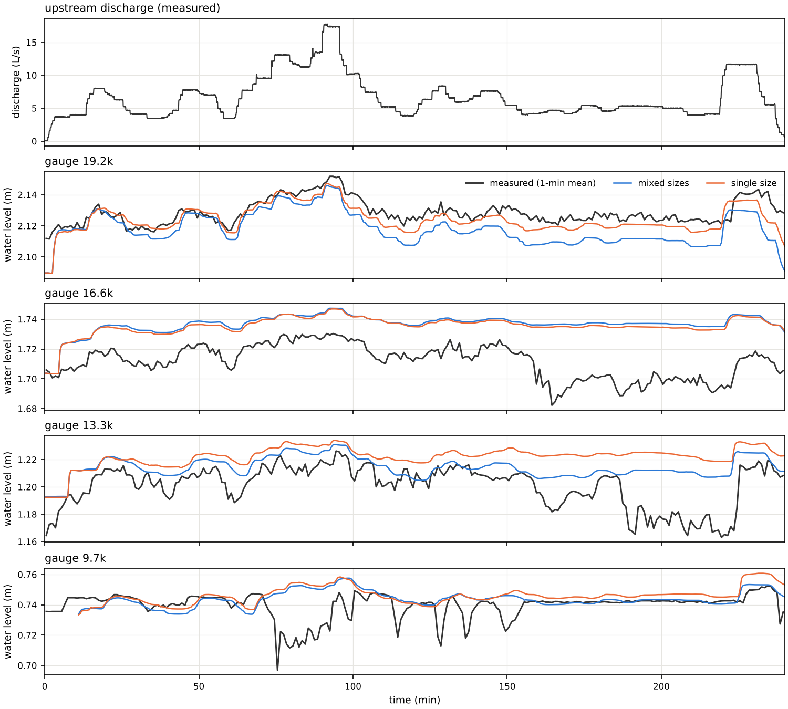
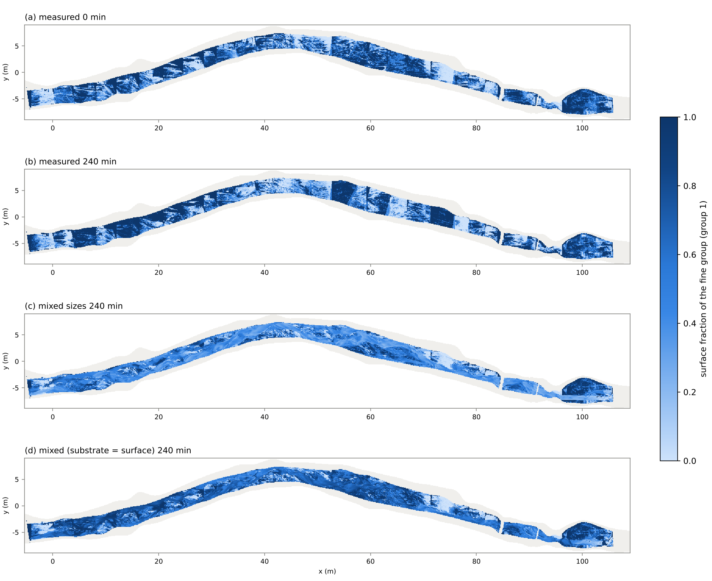

# joganji_flume — Case 2-1 of the NILIM 1/100 movable-bed model of the Joganji River, computed with mixed grain sizes and compared with the measurements

> English mirror of examples/joganji_flume/README.md. The Japanese file is the master copy.

[日本語](../README.md)

This example uses the data of a movable-bed model of the Joganji River, published by the River Division of the
National Institute for Land and Infrastructure Management (NILIM). The model covers km 8.4 to 20.0 at 1/100
horizontally and vertically. From case 2 of the "experiments on the bipolarization of segment-1 rivers", the example
computes the first run, case 2-1 (240 min), and compares water levels, bed change and surface composition with the
measurements.

The bed material is a mixture of three size groups, 0.57, 3.0 and 6.6 mm, and 94 % of the supplied sediment is the
finest sand. The grain sizes drive the result, so the run uses ENCflow's mixed grain sizes, `f_bedmix`, and is shown
side by side with a single-size run under the same conditions. Mixed grain sizes split the bed load into size
classes and hold the bed composition in one exchange layer and one substrate.

**Summary of the results**

- **Water levels**: the median RMSE at 20 gauges is about 12 mm (the depths are 2 to 5 cm).
- **Magnitude of the bed change**: with mixed sizes, the area changed by more than 5 mm and the eroded volume come
  close to the measurement. The single-size run changes too much.
- **Locations of the bed change**: they do not match the measurement (point-by-point correlation 0.1 to 0.25). The
  incisions along narrow threads and the degradation of the middle reach and the downstream end do not appear.
- **Flow**: in the model the flow spreads over the width of the low-water channel instead of gathering into one
  thread as in the measurement.
  - The measured velocity (the surface velocity from PIV) times the modelled depth gives only six tenths of the
    discharge of a section. The model sends too much water through shallow places.
  - Changing the grid, the advection, the roughness map or the horizontal eddy viscosity (a turbulence model) does
    not narrow this gap ("Velocity").
  - On the side of the bed, changing repose collapse or the bed-slope term that turns the transport hardly changes
    the concentration of the flow ("Sensitivity").
- **Surface composition**: the measured mean hardly changes, whereas the model loses fines and coarsens too much.
- **Sensitivity configurations**: changing the downstream-end condition or the substrate composition does not remove
  the mismatch in the locations of the change ("Sensitivity").

Mixing the grain sizes brings the magnitude of the change close to the measurement, but with this grid and these
settings the formation of threads and the pattern of the surface composition are not reproduced. That is the
conclusion of this example. The candidate reasons are collected under "What this model cannot represent and the
limits of accuracy".


## Experiment and data

- **Model**: a movable-bed model of the Joganji River, km 8.4 to 20.0, at 1/100. It is about 116 m long.
  - The low-water channel (1.2 to 4.9 m wide) is a movable bed, 6 to 24 cm thick (median 10.5 cm).
  - The floodplains and the reaches of the Kamidaki and Miyaji grade-control sills are fixed bed.
- **Size groups**: 1 = 0.57 mm (silica sand), 2 = 3.0 mm (sand), 3 = 6.6 mm (coloured gravel).
- **Case 2-1**:
  - The discharge is a 240-min series from 0.12 to 17.8 L/s. It exceeds 10 L/s for 40 min in total. By Froude
    similarity this is about 12 to 1800 m³/s in the prototype.
  - 26.2 L of sediment in total is fed at the upstream end: 93.7 % group 1 and 6.3 % group 2.
  - No water level is imposed at the downstream end (the original data set it to "free").
- **Measurements**:
  - Water-level series at 21 gauges, velocities at 93 min, and the bed elevation and surface composition before and
    after the run. The surface composition is the fraction of each size group on meshes of about 5 cm.
  - Over 240 min the movable bed lowered by 2.4 mm on average, and a net 0.86 m³ (bulk) left the reach.
  - The mean surface composition of the movable bed hardly changed (fraction of fines 58.4 → 58.6 %).

The source of the data and the terms of use are under "Source of the data and terms of use" at the end.

## How the inputs are made

`extract_nilim.py` extracts only the quantities this example uses from the NILIM Excel file (118 MB) into
`data_nilim/`. The values in the extracted CSV files (gzipped, 6 MB in total) are those of the Excel file, and the
`#` lines at the top of each file state the source and the processing. In the surface-composition sheet of the
original file, the index cell of the rows I = 999 reads "固定床" (fixed bed); it is read as 999.

`make_init.py` makes the model inputs from `data_nilim/`.

- **Grid**: the original grid is a curvilinear grid of about 5 cm along the channel. It is mapped to a square grid of
  10 cm (61691 valid cells, 35762 of them movable).
  - The bed and fixed-bed elevations are interpolated bilinearly inside the quadrilateral that contains the cell
    centre. The movable-layer thickness is the bed elevation minus the fixed-bed elevation.
  - The surface composition takes the value of the quadrilateral (mesh), and fixed versus movable follows the nearest
    grid point.
- **Roughness**: the values of the original data. The low-water channel is 0.035, except 0.023 at 8.4k at the
  downstream end. The floodplains are 0.013.
- **Surface and substrate composition**:
  - The initial exchange-layer composition is the measured surface composition.
  - The substrate composition is not measured, so the blend of the sand laid in the model (Kobashi et al. 2026) is
    placed everywhere. This is an assumption.
- **Upstream and downstream ends**: the end sections are oblique to the grid, so short fixed-bed extensions (up to
  0.9 m) are added to reach the east and west edges.
  - The discharge enters through the 28 cells of the upstream edge across the low-water channel, and the downstream
    edge is a free outflow. The discharge is split among the cells by conveyance (`inflow_dist = 2`).
  - The floor of an extension copies the bed elevation of the end section horizontally. The level of the downstream
    extension becomes the height of the lip.
  - The level of the fixed bed at the scale model's downstream end is not in the original data, so it is assumed to
    be the initial bed level of the end section ("Sensitivity").
- **Inlet**: in the fixed bed from the upstream end to the start of the movable bed (about 2.6 m), the width of the
  low-water channel is replaced by a level floor.
  - The floor is at the median bed elevation of the first movable section.
  - The inlet of the original data has a deep sump, a trench and high structures. As they are, the inflow is trapped
    and piles up, the deep water limits the time step, and the feed settles in the trench.
  - This part is upstream of the measured reach.
- **Feed**: the original data do not say whether the feed rate is a bulk volume or a solid volume.
  - It is taken as a bulk volume and multiplied by 1 − porosity (0.6) to give a solid volume. Change this with
    `make_init.py --feed-solid`.
  - The mixed-size run is given a series per size group (`fn_inflow_qbmix`), the single-size run the total
    (`fn_inflow_qb`).
- **Initial water**: a base flow was running before the run, so the initial depth is the final depth of a fixed-bed
  spin-up. The spin-up puts 3 L/s on a dry bed for 5 min and then runs the base flow for 30 min
  (`param_spinup.txt`).

## Settings

| Item | Value | Basis |
|---|---|---|
| Transport formula | Ashida–Michiue (`f_qbform = 1`) | suited to the grain-size range of the experiment (sand to fine gravel) |
| Size classes | 0.57, 3.0, 6.6 mm (`bmix_d`) | D50 of the size groups of the original data |
| Hiding function | modified Egiazaroff (default) | Ashida and Michiue (1972) eq. (31) |
| Exchange-layer thickness | default (twice the D90 of the initial exchange-layer composition) | upper end of the guidance in the literature (Parker's e-book) |
| Critical Shields number | 0.05 (`fluv_tausc`) | Ashida and Michiue's value for the mean size of a sand–gravel mixture |
| Shear stress | the given roughness as it is (`fluv_taufac = 1`) | "Shear stress" below |
| Transport direction | bed-slope term and equilibrium secondary-flow term | default coefficients |
| Banks | repose collapse (32°) | non-cohesive sand and gravel |
| Time step | dt = 0.04 s, bed update every 0.24 s, `morfac = 1` | Courant number 0.66 at the peak discharge |

**Shear stress**: the Manning n of 0.035 in the low-water channel is 2 to 2.5 times the grain roughness and includes
form drag. How the shear stress acting on the transport is taken changes the transport by more than an order of
magnitude. The per-class transport was estimated from the measured velocities and depths at 93 min and compared.

- **The given roughness as it is**: over the 40 min above 10 L/s alone, about 0.4 m³ (solid) of sediment passes. This
  is the same order as the measured net outflow (about 0.5 m³, solid).
- **Only the grain-roughness share**: the effective shear-stress ratio becomes 0.15 to 0.24. Even a ratio of 0.3 or
  0.5 gives 1/20 to 1/5 of the transport and cannot explain the measured outflow.
- **Ashida and Michiue's effective shear stress** (`f_taupart = 2`): under the conditions of this model the transport
  becomes 0.05 to 0.15 times, which again cannot explain the measurement. The formula was built for sand beds, and in
  this model, with a depth of only ten-odd grain sizes, it may also err on the side of overestimating the form drag.

This example therefore uses the given roughness as it is (ratio 1). It is a simplification matched to the measured
sediment budget. Most of the measured net loss comes from local changes larger than 5 mm, so small offsets between
the survey sections cannot explain it.

## Running

```bash
cd examples/joganji_flume
make              # links to the executables and the inputs (make_init.py)
make spinup       # spin-up (about 18 min with 4 threads) and the initial depth h_spinup.txt
make run          # mixed sizes (param.txt) and single size (param_single.txt) in turn
make figs         # figures and tables (Japanese and English)
```

On a 4-core machine the two runs took about 6 h each when run side by side with 2 threads each. The 240 min take
about 1.5 times real time.

To run the two side by side, run these in separate terminals instead of `make run`.

```bash
OMP_NUM_THREADS=2 ./encflow param.txt 2>&1 | tee Screen_result.log
```

```bash
OMP_NUM_THREADS=2 ./encflow param_single.txt 2>&1 | tee Screen_result_single.log
```

How to use a 5 cm grid is under "Starting points for sensitivity experiments".

## Results

The numbers are copied from the tables printed by `python3 plot_results.py` (tables 1 to 5).

### Water levels



The modelled water level is the mean over the wet cells among the 3 × 3 cells centred on a gauge. Only 8.4k, on the
downstream end section, is compared over three cells, leaving out the cells on the extension that the scale model
does not have. The comparison uses 5-min means over the time with a discharge of 5 L/s or more (148 min in total).

The median RMSE over 20 gauges is 11.6 mm with mixed sizes and 13.0 mm with a single size. 17.7k is left out because
the cells around the gauge do not get wet. With depths of 2 to 5 cm this is not small, but it is of the same order as
the difference between the mean bed of a 10 cm cell and the bed at the measurement point (a few cm).

The largest error is at 14.2k (+38 mm), where the model's 3 × 3 cells lie higher than the measurement point. The
treatment of grain sizes changes the water levels little; the water levels are set by the grid and the roughness
rather than by the bed change.

### Bed change


| | area changed by more than 5 mm | erosion / deposition (m³, bulk) | standard deviation | correlation (downstream of 17.1k) | RMSE (same) |
|---|---|---|---|---|---|
| measured | 41 % | 1.52 / 0.64 | 8.9 mm | — | — |
| mixed sizes | 40 % | 1.19 / 1.17 | 11.9 mm | 0.20 | 12.7 mm |
| single size | 57 % | 2.07 / 2.03 | 18.3 mm | 0.25 | 16.7 mm |

- **Magnitude of change**: with mixed sizes, the area changed by more than 5 mm and the eroded volume are close to
  the measurement; with a single size the change is too large.
  - With mixed sizes the coarse classes move less, the surface coarsens and the transport drops. This keeps the
    change at the measured magnitude.
- **Location of change**: the model's changes also follow threads and bars, but not in the measured places.
  - The measurement is marked by incisions of 3 to 7 cm along narrow threads and deposition beside them.
  - The point-by-point correlation is 0.12 over the whole bed and 0.2 downstream of 17.1k. The improvement of the
    error over no change (BSS) is negative.
  - The velocities at 93 min show the same: in the measurement the flow gathers into one thread a few tens of
    centimetres wide, while in the model it spreads over the width of the low-water channel. The force that would
    cut a thread is spread out ("Velocity").
- **Reach budgets**: the measurement lost sediment in the middle reach and the reach at the downstream end, while the
  mixed-size run hardly changes the middle reach, cuts the upstream reach and deposits in the reach at the
  downstream end. The values per reach are in the table under "Sensitivity".
  - The model's sediment outflow over 240 min is 6.8 L (solid), far from the measured net loss.
  - The downstream extension is a fixed bed at the initial bed level, so it acts as a weir that stops degradation
    from the downstream end ("Sensitivity").
- **Upstream reach**: in the measurement, the bed elevation of about half of the movable cells upstream of 17.1k is
  exactly the same after 240 min. Upstream of 19.0k the share reaches 80 %, and no point lowered.
  - The movable-layer thickness (about 11 cm) and the surface composition (80 % fine) give no reason for the bed not
    to move. The original data do not say whether this reach was surveyed again after the run.
  - The point-by-point comparison is therefore also given for the reach downstream of 17.1k.
  - The model scours down to the fixed bed at the start of the movable bed, and the most upstream bin of the profile
    figure falls outside the frame.


### Surface composition



The mean surface fraction of the fine group (group 1) on the movable bed hardly changes in the measurement
(58.4 → 58.6 %). The mixed-size run drops to 45.1 %, and the surface coarsens too much. The point-by-point
correlation with the measurement is 0.20.

The surface of the model coarsens for two reasons.

- The fines leave the exchange layer.
- Erosion brings the substrate into the exchange layer. The substrate is the assumed blend of the laid sand, with
  only 37.4 % fines.

The measured surface turns over strongly even in 2 m bins, between 20 and 90 % (panels (b) and (c) of the profile
figure). The model's exchange-layer composition changes less and in other places.

### Velocity (93 min)


The measured velocity is the surface velocity obtained by PIV analysis of the images from the cameras on the ceiling.
"Outside the analysis range" in the original data marks places where no water flows, and those points are left out
of the comparison.

Over the 25 000 points where the measurement exceeds 0.05 m/s (table 5), the mean speed is the same: 0.29 m/s with
mixed sizes, 0.27 m/s with a single size and 0.27 m/s measured. The point-by-point correlation, however, stays at
0.30 and 0.22. In the measurement the fast flow gathers into one thread; in the model it spreads over the width of
the low-water channel.

- **Spread**: the coefficient of variation of the measured speed is 0.78, nearly three times the model's 0.28.
  - Four tenths of the measured points are 0.05 m/s or slower.
  - There the model has about 2 cm of water flowing at 0.24 m/s (table 5b).
- **Discharge balance**: the measured velocity times the modelled depth, summed over a section, gives only six
  tenths of the modelled discharge (table 5b).
  - Four tenths of the modelled discharge pass through points where the measurement is 0.05 m/s or slower or where
    no water flows.
  - Since the surface velocity is faster than the depth average, the actual flow, if the measured velocity is right,
    was gathered into threads narrower and deeper than in the model.
  - PIV may also read low in shallow water. The slow points lie mostly at the edges of the flow: 70 % of the points
    next to a point without flow are 0.05 m/s or slower, against just under 30 % of the points three or more columns
    inside.
  - How much each contributes is not known.
- **Slowness beyond a resistance law**: slowing the model to the measured speed at the slow points, with the
  modelled depth and slope, needs a Manning coefficient of about 0.3. The resistance estimated from the grain size and
  the relative depth (the equation of Ferguson 2007) is 0.02 to 0.03, a tenth of that.
- **Checks on the model side**: with the measured 240-min bed as a fixed bed and 17 L/s, the coefficient of variation
  of the modelled speed stays at 0.28.
  - A 5 cm grid, first-order upwind advection and a roughness map varying with the relative depth change it little.
  - A horizontal eddy viscosity (a turbulence model; the zero-equation model, `f_diffusion_term = 2`) acts to even
    out the fast and slow places, and the coefficient of variation even falls a little.
  - The modelled speed in shallow water follows Manning's equation with a nearly uniform slope.
  - The detailed numbers are in developer.md §120.8.

### Ledgers

The per-class balance of the mixed-size run closes to a residual of 1e-13 m³ over 240 min. The exchange-layer supply
limiter acted in 1.3 % of the class × cell updates.

Repose collapse moved 25.4 m³ with mixed sizes and 17.2 m³ with a single size (bulk, summed over edge updates). This
is an order of magnitude more than the bed change, as small collapses of about 5 cm³ each on average go on all the
time.

This volume, however, does not measure the bed change. Collapse acts only on edges steeper than 32° to the
neighbouring cell. Such edges are a few dozen of the about 70 000 edges of the movable bed, most of them within 26 m
of the upstream end of the movable bed. At the same places the transport cuts them and they collapse, over and over
("Sensitivity").

## Sensitivity

### Downstream-end condition and substrate composition

Three configurations that each change one thing in the base configuration (mixed sizes) are computed by `make sub`.
The cost is the same as the base configuration. The numbers are copied from tables 1–4 and 6 of `plot_results.py`.

| | I 1 to 500 | 501 to 1000 | 1001 to 1500 | 1501 to 2000 | 2001 to 2362 | surface fraction of fines | correlation (whole / downstream of 17.1k) | RMSE (whole) |
|---|---|---|---|---|---|---|---|---|
| measured | +22 | −510 | −209 | +64 | −243 | 58.6 % | — | — |
| base configuration | −132 | −55 | +11 | +26 | +128 | 45.1 % | 0.12 / 0.20 | 14.2 mm |
| substrate = surface (`param_sub.txt`) | −445 | −421 | +353 | −46 | +440 | 61.0 % | 0.15 / 0.27 | 20.9 mm |
| outlet at the fixed bed (`param_outlet.txt`) | −132 | −55 | +11 | +26 | −525 | 44.4 % | 0.18 / 0.25 | 15.6 mm |
| outlet sill and drop (`param_sill.txt`) | −132 | −55 | +13 | +24 | +85 | 44.9 % | 0.12 / 0.20 | 14.2 mm |

The reach columns are the net volume change of the movable bed over 240 min (L, bulk). The surface fraction of fines
is the mean over the movable bed.

The bed change after 240 min, averaged over 2 m bins from the downstream end (mm), is as follows (table 6).

| | 0 to 2 m | 2 to 4 m | 4 to 6 m | 6 to 8 m | 8 to 10 m |
|---|---|---|---|---|---|
| measured | −14 | −10 | −7 | −6 | −2 |
| base configuration | 0 | +3 | +3 | +1 | +5 |
| outlet at the fixed bed | −31 | −25 | −18 | −9 | −2 |
| outlet sill and drop | −5 | +2 | +3 | +1 | +5 |

- **Downstream extension at the fixed bed** (`param_outlet.txt`): the floor of the extension is lowered to the base
  of the movable layer, 9 cm lower on average across the low-water channel.
  - The bed lowers within 8–10 m of the downstream end, in the same shape as measured, but about twice as deep.
  - The water level at gauge 9.1k, 7 m upstream from the downstream end, falls as the lowering moves upstream, and in
    the last hour it is 25 mm below the measurement. The measured water level shows no such fall.
  - The four upstream reaches are the same as in the base configuration. The correlation over the whole bed rises,
    but the RMSE grows because the lowering is too deep.
- **Outlet sill and drop** (`param_sill.txt`): a configuration after the shape of the scale model's downstream end.
  - The downstream end of the scale model is a section with little bed change made a fixed bed, from which the water
    falls freely over a drop into the settling basin (Kobashi et al. 2026).
  - In the base configuration the lip lies beyond the extension, so the acceleration towards the lip does not reach
    the end of the movable bed. This configuration keeps the one cell of the extension next to the end of the movable
    bed as a sill and lowers the cells beyond it by 10 cm. The lip height is the same as in the base configuration.
  - The scour is local to the end of the movable bed, −18 mm on average within 0.3 m of the end. The measured
    lowering over 8–10 m does not appear.
  - The sediment outflow becomes about 4.6 times that of the base configuration (table 4), and the increase comes
    from the scour at the end.
  - The water level at 9.1k is the same as in the base configuration. At 8.4k on the end section the water surface
    falls towards the drop, so the level is a little below the measurement.
- **Reading of the lowering at the downstream end**: in the measurement, the bed of the low-water channel within 7 m
  of the downstream end lowers over nearly the whole width.
  - A lip at the end of the movable bed gives only local scour. A lowered lip gives a lowering of the same length but
    too deep, and the water level at 9.1k drifts away from the measurement.
  - The level of the fixed bed at the scale model's downstream end is not in the original data. The most downstream
    section of the original data, 8.4k, is itself movable bed and lowers by 13 mm on average across the low-water
    channel in 240 min.
  - The water levels show no sign of a much lower lip. This example therefore uses the base configuration, with the
    lip at the initial bed level of the end section. These configurations do not reveal the cause of the measured
    lowering.
- **Substrate composition** (`param_sub.txt`): the substrate is set to the initial surface composition of each cell
  instead of the assumed blend of the laid sand.
  - The mean surface fraction of fines after 240 min is 61.0 %, closer to the measurement than the base
    configuration, and the point-by-point correlation rises a little. The surface of the base configuration coarsens
    mainly because the substrate that erosion brings into the exchange layer is assumed to be the coarser blend.
  - In exchange the bed moves more easily and changes too much. The erosion of the middle reach (I 501 to 1000)
    approaches the measurement, but the reach below it, I 1001 to 1500, gains sediment, opposite to the measurement.
  - The substrate composition of the model was not measured, so which configuration is closer to the model cannot be
    decided.
- In none of the configurations does the mismatch in the locations of the change go away (point-by-point correlation
  below 0.3).

### Repose collapse and the bed-slope term (124 min)

Two configurations that each change one thing in the base configuration are computed to 124 min, which covers the
main flood and the velocity measurement at 93 min. The measured bed in the table is the one at 240 min, so the table
is for comparing the configurations with each other.

| | std of the bed change | thread depth | correlation (whole / downstream of 17.1k) | flow concentration (93 min) | velocity correlation / CV (93 min) |
|---|---|---|---|---|---|
| measured (240 min) | 8.9 mm | −31.2 mm | — | — | — / 0.778 |
| base configuration | 11.1 mm | −32.3 mm | 0.132 / 0.207 | 0.529 | 0.303 / 0.278 |
| no repose collapse (`f_repose = 0`) | 11.0 mm | −32.7 mm | 0.135 / 0.205 | 0.530 | 0.290 / 0.280 |
| `fluv_muk = 0.7` | 11.2 mm | −33.0 mm | 0.125 / 0.197 | 0.535 | 0.309 / 0.281 |

The values in the table mean the following.

- The std of the bed change, the correlation and the thread depth are for the movable cells of the low-water channel
  at 124 min.
- The thread depth is the mean, over 1-m reaches along the channel, of the 5th percentile of the bed relative to the
  reach median. It is −29.5 mm at the start.
- The flow concentration is the share of the discharge carried by the 20 % of the low-water-channel cells with the
  largest unit discharge.
- The velocity columns are from table 5.

The water levels (0 to 124 min) of the three configurations agree within 0.4 mm at the 20 gauges that can be
compared.

- **No repose collapse**: the bed of the low-water channel hardly changes.
  - Collapse acts only on edges steeper than 32° to the neighbouring cell. On the 10 cm grid this is a height
    difference of 62.5 mm between neighbours.
  - The incision of the threads is 1 to 3 cm, so it makes no edges that steep on this grid. On the modelled bed and
    on the measured bed alike, 99 % of the edges are below 20°.
  - Differences appear near the upstream end of the movable bed (within 26 m of it), where steep edges exist from
    the start, and in the scour hole just below Kamidaki grade-control sill 1.
  - At the upstream end, the first cells of the movable bed lie up to 16 cm above the level floor that replaces the
    inlet ("How the inputs are made"). With collapse they fall and are scoured down to the fixed bed; without it they
    stay dry.
  - The hole below the sill becomes deeper without collapse and reaches the bottom of the movable layer (−205 mm) by
    124 min. The base configuration also scours down to −155 mm there, but the measured bed has no such hole.
- **`fluv_muk = 0.7`**: a configuration that weakens the term turning the transport by the transverse bed slope to
  0.8 times.
  - The kinetic friction coefficient is raised from the default 0.45 (Asahi et al. 2013) to 0.7, the value Hasegawa
    (1989) uses for an estimate. The term is explained under
    [bedload](../../../docs/en/users_guide/geomorph.md#bedload-f_fluvial) in the user's guide.
  - Apart from slightly deeper threads and a slightly higher concentration, the results are nearly the same as the
    base configuration.
- Neither configuration changes the flow concentration or the velocity distribution much, so they are not computed
  to 240 min.
- To compute them, in a copy of `param.txt` set `f_repose = 1` to 0 or add `fluv_muk = 0.7`, and set `tt = 7440` and
  another `dir_result`.

### Starting points for sensitivity experiments

- `fluv_taufac`: the effective shear ratio. 0.3 or 0.5 brings the estimated transport down to 1/20 to 1/5
  ("Shear stress").
- `bmix_la`: the exchange-layer thickness. The default is twice the D90 of the initial exchange-layer composition,
  8.5 mm in this example. Thinner makes the exchange-layer supply limiter act more often; thicker slows the change of
  the surface composition.
- `bmix_sub0`: the substrate composition. When not given, it is the same as the exchange layer; `param_sub.txt` above
  is this configuration.
- Roughness `rn.txt`: `make_init.py` copies the values of the original data. The uniform 0.035 of the low-water
  channel includes form drag.
- `python3 make_init.py --dx 0.05`: a 5 cm grid, on which a thread spans 6 to 10 cells. Halve `dt`; the cost is about
  8 times. After changing the grid, start again from `make spinup`.
- `python3 make_init.py --feed-solid 1`: treats the feed as a solid volume. The feed becomes 1.67 times larger.

## What this model cannot represent and the limits of accuracy

- **Stratigraphy**: the substrate is one uniform mixture, and its composition is assumed (the blend of the laid sand).
  - Layers made by earlier runs and a coarse layer under the surface are not represented.
  - The change of the surface composition depends strongly on the assumed substrate composition ("Sensitivity").
- **Concentration of the flow into threads**: in the measurement the flow at high discharge gathers into one thread a
  few tens of centimetres wide, which incises, while in the model it spreads over the width of the low-water channel.
  Because the flow does not gather, the incision of the threads and the measured degradation of the middle reach do
  not appear either.
  - Even on the measured 240-min bed as a fixed bed the modelled flow does not gather. Changing the grid, the
    advection, the roughness map or the horizontal eddy viscosity has little effect ("Velocity"). Neither the threads
    not incising in the model nor the coarse grid is the only cause.
  - Switching off repose collapse or weakening the bed-slope term hardly changes the concentration of the flow
    ("Sensitivity").
  - The measured speed at the slow points is slower than the grain resistance can explain at the modelled depth.
    Either the actual depth was shallower than in the model (the water did not spread into shallow places), or PIV
    reads low in shallow water, or both.
  - The water-level errors (about 12 mm) are not small enough to tell apart a difference of about 1 cm in depth in
    shallow places.
  - The effective shear stress (`f_taupart = 2`) is not computed, because the estimate makes the transport too small
    to explain the measured budget ("Shear stress").
- **Grid**: on the 10 cm grid the narrow low-flow channels (0.3 to 1 m wide) are only 3 to 10 cells, and the mean bed
  of a cell is higher than the bottom of a narrow thread. At base flow many gauge cells are therefore dry, so water
  levels are compared only while the discharge is 5 L/s or more.
- **Shear stress**: the transport is computed with the roughness that includes form drag ("Shear stress"). The change
  of transport with and without bedforms is not represented.
- **Feed volume**: assumed to be a bulk volume. As a solid volume the feed would be 1.67 times larger.
- **Inlet**: the sump and high structures of the fixed bed at the upstream end are replaced by a level floor.
- **Downstream end**: the level of the fixed bed at the scale model's downstream end is not in the original data, so
  the lip is assumed to be at the initial bed level of the end section.
  - In the measurement the bed of the low-water channel within 8–10 m of the downstream end lowers over nearly the
    whole width, but the model does not give this.
  - A lip at the end of the movable bed gives only local scour at the end. Lowering the lip to the fixed bed gives
    the lowering but too deep, and the water level upstream falls below the measurement ("Sensitivity").
- **Exchange layer**: the results depend on the exchange-layer thickness, and the equations can become ill-posed, for
  example where the bed degrades into a finer substrate (the
  [supplement](../../../docs/en/users_guide/sediment.md#mixed-grain-sizes-f_bedmix) of the user's guide).
- **Measured surface composition**: the measurement is the apparent fraction at the surface from image analysis,
  which is defined differently from the mean composition of the model's exchange layer (about 1 cm thick).
  - The note in the original data says its accuracy varies from place to place.
  - The measured map shows straight lines at the boundaries of the sections it was assembled from, and in places the
    fraction changes as a block over whole sections. A point-by-point comparison means little.
- **Bipolarization**: the subject of the paper (narrowing of the low-water channel and a single thread) is a change
  over the eight runs of case 2. This example computes only the first run (2-1).

## Source of the data and terms of use

The files in `data_nilim/` were made by processing the following material.

- Source: National Institute for Land and Infrastructure Management, River Division, "Archive of hydraulic model
  experiment data", experiments on the bipolarization of segment-1 rivers (fiscal 2025),
  "【河道の二極化】ケース2模型実験データ.xlsx"
  (<https://www.nilim.go.jp/lab/fbg/tech/kadounikyokukacase2.xlsx>, from the technical-information page
  <https://www.nilim.go.jp/lab/fbg/tech/tech.html>). Downloaded on 2026-11-22; on 2026-11-23 the file on the server
  was confirmed to have the same size and modification date (2026-06-16).
- Terms of use: Government of Japan Standard Terms of Use (version 2.0). Copying, processing and redistribution are
  allowed with the source stated and the processing indicated.
- Processing: only the sheets and columns needed to compare case 2-1 were extracted, the columns reordered, written
  as CSV and gzipped. No value was changed, except reading the index of the rows I = 999. The extraction is
  `extract_nilim.py`.

## References

- Kobashi, R., Tabata, K., Matsui, D., Kojima, T. and Sezaki, T. (2026): 土砂供給量の減少に伴うセグメント 1 河川の
  二極化に関する実験的研究 (an experimental study on the bipolarization of a segment-1 river with a reduced sediment
  supply; title translated here). *Advances in River Engineering* (河川技術論文集), 32, 277–282 (in Japanese).
  doi:10.11532/river.32.0_277
- Ferguson, R. (2007): Flow resistance equations for gravel- and boulder-bed streams. *Water Resour. Res.*, 43,
  W05427. doi:10.1029/2006WR005422 (the form of the equation and the coefficients a1 = 6.5 and a2 = 2.5 are the same
  as in the [supplement](../../../docs/en/users_guide/sediment.md#3-bedload-f_fluvial) of the user's guide; the paper
  itself was not read)
- Ashida, K. and Michiue, M. (1972): Study on hydraulic resistance and bed-load transport rate in alluvial streams.
  *Proc. JSCE*, 206, 59–69 (in Japanese). doi:10.2208/jscej1969.1972.206_59
- Hirano, M. (1971): River-bed degradation with armoring. *Proc. JSCE*, 195, 55–65 (in Japanese).
  doi:10.2208/jscej1969.1971.195_55
- Parker, G. (2004): *1D Sediment Transport Morphodynamics with Applications to Rivers and Turbidity Currents*.
  e-book, Chapter 17. <https://hydrolab.illinois.edu/people/parkerg/morphodynamics_e-book.htm>
- Asahi, K., Shimizu, Y., Nelson, J. and Parker, G. (2013): Numerical simulation of river meandering with
  self-evolving banks. *J. Geophys. Res. Earth Surf.*, 118(4), 2208–2229 (μs = 1.0 and μk = 0.45 of eq. (22)).
- Hasegawa, K. (1989): Universal bank erosion coefficient for meandering rivers. *J. Hydraul. Eng.*, 115(6),
  744–765 (μs = 1.0 and μk = 0.7 for the order-of-magnitude estimate).

## Related documents

- [Mixed grain sizes in Sediment and landform change](../../../docs/en/users_guide/geomorph.md#mixed-grain-sizes-f_bedmix), [supplement](../../../docs/en/users_guide/sediment.md#mixed-grain-sizes-f_bedmix)
- Verification of mixed grain sizes: [test/bedmix](../../../test/bedmix/en/README.md)
- Design document: docs/mixed_sediment_plan.md (in Japanese)
