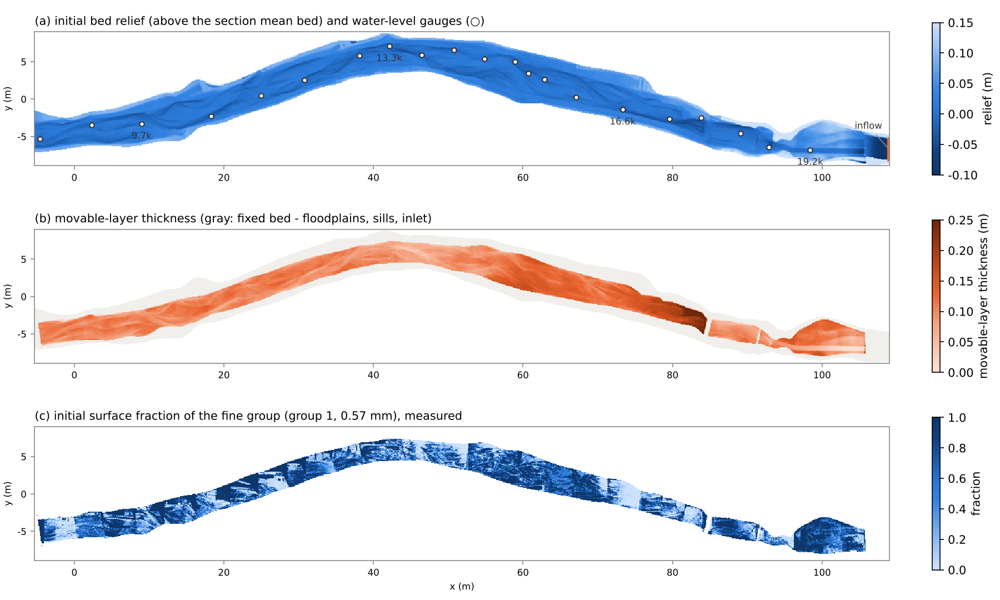
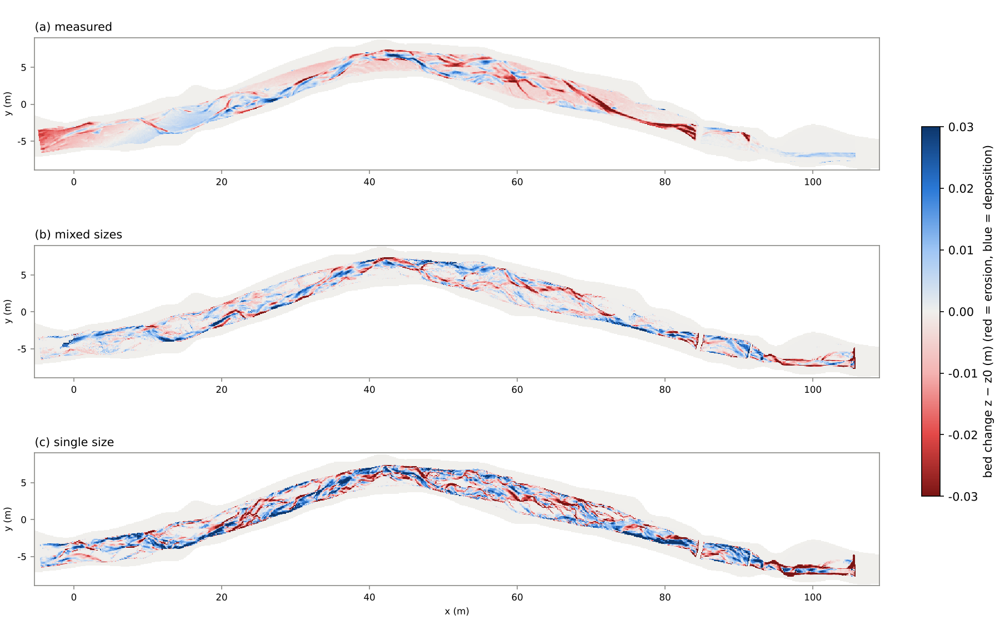
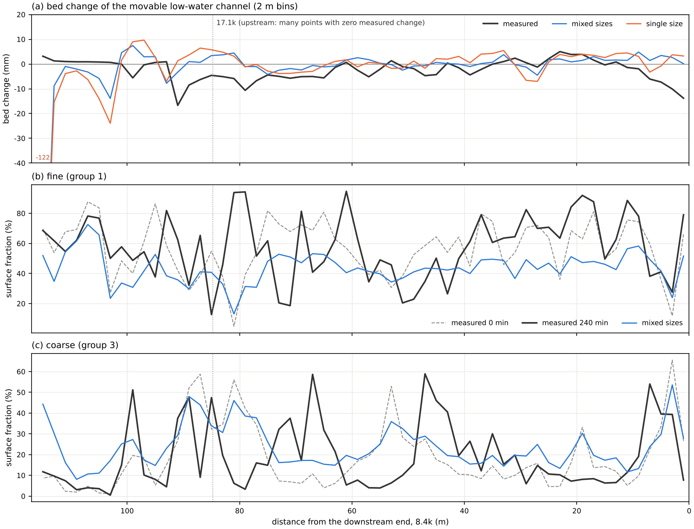
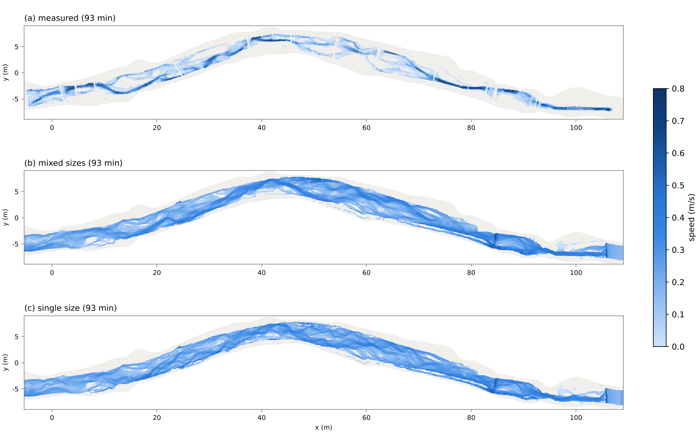

# joganji_flume — Case 2-1 of the NILIM 1/100 movable-bed model of the Joganji River, computed with mixed grain sizes and compared with the measurements

> English mirror of examples/joganji_flume/README.md. The Japanese file is the master copy.

[日本語](../README.md)

The River Division of the National Institute for Land and Infrastructure Management (NILIM) publishes the data of a
movable-bed model of the Joganji River, km 8.4 to 20.0, built at 1/100 horizontally and vertically ("experiments on
the bipolarization of segment-1 rivers", case 2). This example takes the first run, case 2-1 (240 min), computes it,
and compares water levels, bed change and surface composition with the measurements. The bed material is a mixture
of three size groups (0.57, 3.0 and 6.6 mm), and 94 % of the supplied sediment is the finest sand, so the grain sizes
drive the result. The run uses ENCflow's mixed grain sizes (`f_bedmix`: bed-load size classes × one exchange layer
and one substrate) and is shown side by side with a single-size run under the same conditions.

**Summary of the results**: the median RMSE of the water levels at 20 gauges is about 12 mm while the discharge is
5 L/s or more (depths of 2 to 5 cm). For the bed change, the mixed-size run is close to the measurement in the area
changed by more than 5 mm (40 %) and in the eroded volume (1.2 m³; measured 41 % and 1.5 m³), while the single-size run
changes too much (57 %, 2.1 m³). The locations of the change, however, do not match the measurement (point-by-point
correlation 0.1 to 0.25): the incisions along narrow threads and the degradation of the middle reach and the
downstream end do not appear. In the model the flow spreads over the width of the low-water channel instead of
gathering into one thread as in the measurement. For the surface composition, the measured mean hardly changes,
whereas the model loses fines and coarsens too much. Comparing the sensitivity configurations at 124 min, lowering the
downstream extension to the fixed bed produces a lowering from the downstream end of the same shape as measured, and
setting the substrate to the initial surface composition keeps the surface from coarsening at the cost of a larger bed
change ("Sensitivity").
Mixing the grain sizes brings the magnitude of the change close to the measurement, but with this grid and these
settings the formation of threads and the pattern of the surface composition are not reproduced; that is the
conclusion of this example (candidate reasons under "What this model cannot represent and the limits of accuracy").



## Experiment and data

- **Model**: a movable-bed model of the Joganji River, km 8.4 to 20.0 (about 116 m in the model), at a scale of
  1/100 (horizontal and vertical). The low-water channel (1.2 to 4.9 m wide, median 3.1 m) is a movable bed, the
  floodplains are a fixed bed (Manning n 0.013), and the reaches of the Kamidaki and Miyaji grade-control sills are
  also fixed. The movable layer is 6 to 24 cm thick (median 10.5 cm).
- **Size groups**: 1 = 0.57 mm (silica sand), 2 = 3.0 mm (sand), 3 = 6.6 mm (coloured gravel). For the surface, the
  data give the fraction of each group and a pattern classification on meshes of about 5 cm, before and after each
  run.
- **Case 2-1**: a 240-min discharge series (every second, 0.12 to 17.8 L/s; about 12 to 1800 m³/s in the
  prototype by Froude similarity; above 10 L/s for 40 min in total) and a sediment feed at the upstream end
  (26.2 L in total: 93.7 % group 1, 6.3 % group 2, none of group 3). The downstream water level is set to "free" (no
  water level imposed).
- **Measurements**: water-level time series at 21 gauges (about every 6 s), the bed elevation at all grid points
  after the run, the surface composition, and velocities at 93 min. In the 240 min of 2-1 the movable bed lowered by
  2.4 mm on average (standard deviation 9.3 mm, largest lowering 7 cm and rise 5.6 cm), and a net volume of 0.86 m³
  (bulk) left the reach (erosion 1.50 m³, deposition 0.64 m³). The mean surface fractions on the movable bed hardly
  changed (group 1: 58.4 → 58.6 %).

The source of the data and the terms of use are under "Source of the data and terms of use" at the end.

## How the inputs are made

`extract_nilim.py` extracts only the quantities this example uses from the NILIM Excel file (118 MB) into
`data_nilim/` (gzipped CSV, 6 MB in total). The values are those of the Excel file (not rounded), and the `#` lines at
the top of each file state the source and the processing. In the surface-composition sheet of the original file, the
index cell of the rows I = 999 reads "固定床" (fixed bed); it is read as 999. `make_init.py` makes the model inputs from
`data_nilim/`.

- **Grid**: the original grid is a curvilinear grid along the channel (2363 × 87 points, about 5 cm). It is mapped to
  a square grid of 10 cm (1143 × 179; 61691 valid cells, 35762 of them movable). For each square-cell centre the
  quadrilateral that contains it is found, and the grid-point values (bed elevation, fixed-bed elevation) are
  interpolated bilinearly at its position inside the quadrilateral. The surface composition takes the value of the
  quadrilateral (mesh), and fixed versus movable follows the nearest grid point. Movable-layer thickness = bed
  elevation − fixed-bed elevation (0 on the fixed bed).
- **Roughness**: in the low-water channel (between the left and right low-water bank lines) the value of each section
  (0.035; 0.023 only at 8.4k at the downstream end) is interpolated linearly along the channel; the floodplains are
  0.013 (the values of the original data).
- **Surface and substrate composition**: the initial exchange-layer composition is the measured surface composition
  (mesh values). The substrate composition is not measured, so the blend of the sand laid in the model (groups 1 to 3:
  37.4, 41.4 and 21.2 %; Kobashi et al. 2026) is placed everywhere (an assumption).
- **Upstream and downstream ends**: the end sections are oblique to the grid, so short fixed-bed extensions (up to
  0.9 m) reach the east and west edges of the grid, where the inflow segment and the free outflow can be placed; the
  bed elevation of the end section is copied horizontally. The inflow segment is the 28 cells of the east edge across
  the low-water channel at the upstream end (discharge split by conveyance, `inflow_dist = 2`); the west edge is a
  free outflow.
- **Inlet**: in the fixed bed from the upstream end to the start of the movable bed (about 2.6 m), the width of the
  low-water channel is replaced by a level floor at the median bed elevation of the first movable section
  (2.247 m). The inlet of the original data has a sump and a trench (deepest 1.49 m) and high structures that exist
  only in the upstream end section (up to 3.27 m); as they are, the inflow is trapped and piles up, the deep water
  limits the time step, and the feed settles in the trench. This is fixed bed upstream of the measured reach (the
  most upstream gauge is 19.2k).
- **Feed**: the original data do not say whether the feed rate (L/s) is a bulk volume or a solid volume. It is taken
  as a bulk volume and multiplied by 1 − porosity (0.6) to give a solid volume (change it with
  `make_init.py --feed-solid`). The mixed-size run is given a series per size group (`fn_inflow_qbmix`), the
  single-size run the total (`fn_inflow_qb`).
- **Initial water**: a base flow (0.117 L/s) was running before the run, so the initial depth is the final depth of a
  fixed-bed spin-up (3 L/s on a dry bed for 5 min, then the base flow for 30 min; `param_spinup.txt`).

## Settings

| Item | Value | Basis |
|---|---|---|
| Transport formula | Ashida–Michiue (`f_qbform = 1`) | suited to the grain-size range of the experiment (sand to fine gravel) |
| Size classes | 0.57, 3.0, 6.6 mm (`bmix_d`) | D50 of the size groups of the original data |
| Hiding function | modified Egiazaroff (default) | Ashida and Michiue (1972) eq. (31) |
| Exchange-layer thickness | default (twice the D90 of the initial exchange-layer composition) | upper end of the guidance in the literature (Parker's e-book) |
| Critical Shields number | 0.05 (`fluv_tausc`) | Ashida and Michiue's value for the mean size of a sand–gravel mixture |
| Shear stress | the given roughness as it is (`fluv_taufac = 1`) | "Shear stress" below |
| Transport direction | bed-slope term and equilibrium secondary-flow term | default coefficients |
| Banks | repose collapse (32°) | non-cohesive sand and gravel |
| Time step | dt = 0.04 s, bed update every 0.24 s, `morfac = 1` | Courant number 0.66 at the peak discharge |

**Shear stress**: the Manning n of 0.035 is 2 to 2.5 times the grain roughness (0.014 for 0.57 mm and 0.017 for the
mean surface size 2.2 mm by Strickler's formula) and includes form drag. Whether only the grain-roughness share acts
on the transport (an effective shear-stress ratio of 0.15 to 0.24) or the given roughness is used as it is changes
the transport rate by more than an order of magnitude. Estimating the per-class Ashida–Michiue transport from the
measured velocities and depths at 93 min (discharge 17 L/s), the given roughness gives about 0.18 L/s (solid) through a
section; over the 40 min above 10 L/s alone this is 0.4 m³, the same order as the measured net outflow (about 0.5 m³,
solid). A ratio of 0.3 or 0.5 gives 1/20 to 1/5 of that and cannot explain the measurement, so the given roughness is
used as it is (ratio 1). Most of the measured net volume change comes from local changes larger than 5 mm (erosion
1.33 m³, deposition 0.56 m³); the changes of 5 mm or less sum to −0.15 m³. ENCflow does not yet have the effective
shear stress of Ashida and Michiue's original formula (their eq. (11)), so this choice is a simplification matched to
the measured sediment budget.

## Running

```bash
cd examples/joganji_flume
make              # links to the executables and the inputs (make_init.py)
make spinup       # spin-up (about 18 min with 4 threads) and the initial depth h_spinup.txt
make run          # mixed sizes (param.txt) and single size (param_single.txt) in turn
make figs         # figures and tables (Japanese and English)
```

On a 4-core machine the two runs took about 6 h each when run side by side with 2 threads each (about 1.5 times real
time for the 240 min). To run the two side by side, run these in separate terminals instead of `make run` (2 threads
each).

```bash
OMP_NUM_THREADS=2 ./encflow param.txt 2>&1 | tee Screen_result.log
```

```bash
OMP_NUM_THREADS=2 ./encflow param_single.txt 2>&1 | tee Screen_result_single.log
```

For a 5 cm grid, remake the inputs with `python3 make_init.py --dx 0.05` and halve `dt` (about 8 times the cost).

## Results

The numbers are copied from the tables printed by `python3 plot_results.py` (tables 1 to 5).

### Water levels


Compared as 5-min means over the time with a discharge of 5 L/s or more (148 min in total), the median RMSE over 20
gauges (17.7k is left out because the cells around the gauge do not get wet) is 11.6 mm (4 to 45 mm) with mixed sizes
and 13.0 mm (5 to 42 mm) with a single size, and the mean errors are +3.6 mm and +5.5 mm. With depths of 2 to 5 cm
this is not small in relative terms, but it is of the same order as the difference between the mean bed of a 10 cm
cell and the bed at the measurement point (a few cm). The largest error is at 14.2k (+38 mm), where the model's 3 × 3
cells lie higher than the measurement point. The treatment of grain sizes changes the water levels little; the water
levels are set by the grid and the roughness rather than by the bed change.

### Bed change



| | area changed by more than 5 mm | erosion / deposition (m³, bulk) | standard deviation | correlation (downstream of 17.1k) | RMSE (same) |
|---|---|---|---|---|---|
| measured | 41 % | 1.52 / 0.64 | 8.9 mm | — | — |
| mixed sizes | 40 % | 1.19 / 1.17 | 11.9 mm | 0.20 | 12.7 mm |
| single size | 57 % | 2.07 / 2.03 | 18.3 mm | 0.25 | 16.7 mm |

- **Magnitude of change**: with mixed sizes, the area changed by more than 5 mm (40 %) and the eroded volume are close
  to the measurement (41 %); with a single size the change is too large (area 57 %, erosion and deposition 1.4 to 3
  times the measurement). The coarse classes move less, the surface coarsens and the transport drops, and this keeps
  the change of the mixed-size run at the measured magnitude.
- **Location of change**: the measurement is marked by incisions of 3 to 7 cm along narrow threads (x = 60 to 85 m,
  5 to 10 m and elsewhere) and deposition beside them. The model's changes also follow threads and bars, but not in
  the measured places: the point-by-point correlation is 0.12 (whole bed) to 0.2 (downstream of 17.1k), and the BSS
  (the improvement of the point-by-point error over no change) is negative. The velocities at 93 min (table 5) show
  the same: in the measurement the flow gathers into one thread a few tens of centimetres wide, while in the model it
  spreads over the width of the low-water channel (the mean speeds agree, 0.29 and 0.27 m/s; the correlation of the
  pattern is 0.30), which spreads the force that would cut a thread.
- **Reach budgets**: the measurement lost 0.51 m³ in the middle reach (I 501 to 1000) and 0.24 m³ in the reach at the
  downstream end (I 2001 to 2362). The mixed-size run hardly changes the middle reach (−0.06 m³), cuts 0.13 m³ from
  the upstream reach (I 1 to 500, the start of the movable bed) and deposits 0.13 m³ in the reach at the downstream
  end. The downstream extension is a fixed bed at the initial bed level and acts as a weir that stops degradation
  from the downstream end ("Sensitivity" below). The model's sediment outflow over 240 min is 6.8 L (solid; the feed
  is 15.7 L) and does not reach the measured net loss (0.86 m³, bulk).
- **Upstream reach**: in the measurement, the bed elevation of 45 % of the movable cells upstream of 17.1k (80 %
  upstream of 19.0k) is exactly the same after 240 min, and no point lowered. The movable-layer thickness (about
  11 cm) and the surface composition (80 % fine) give no reason for the bed to resist the flow, and the original data
  do not say whether this reach was surveyed again after the run. The model scours down to the fixed bed at the start
  of the movable bed (deepest 0.26 m), and the most upstream 2 m bin of the profile reaches −0.12 m. The
  point-by-point comparison is also given for the reach downstream of 17.1k, where points with zero measured change
  are rare.



### Surface composition


The mean surface fraction of the fine group (group 1) on the movable bed hardly changes in the measurement
(58.4 → 58.6 %), whereas the mixed-size run drops to 45.1 % (the coarser groups 2 and 3 reach 32.5 and 22.5 %), and
the point-by-point correlation with the measurement is 0.20. In the model the surface coarsens because the fines
leave the exchange layer and because erosion brings the substrate (the assumed blend of the laid sand, 37.4 % fine)
into the exchange layer. The measured surface turns over strongly even in 2 m bins, between 20 and 90 % (panels (b)
and (c) of the profile figure), while the model's exchange-layer composition changes less and in other places.

### Velocity (93 min)



Over the 25 000 points where the measurement exceeds 0.05 m/s, the mean speed is the same, 0.29 m/s (mixed sizes),
0.27 m/s (single size) and 0.27 m/s (measured), but the point-by-point correlation is 0.30 and 0.22. In the
measurement the fast flow gathers into one thread; in the model it spreads over the width of the low-water channel.
The measurement may be a surface velocity, but the original data do not describe the method.

### Ledgers

The per-class balance of the mixed-size run closes to a residual of 1e-13 m³ over 240 min (stock 23 m³). Repose
collapse moved 25.4 m³ with mixed sizes and 17.2 m³ with a single size (bulk, summed over edge updates), an order of
magnitude more than the bed change, as small collapses (about 5 cm³ on average) that go on all the time. The
exchange-layer supply limiter acted in 1.3 % of the class × cell updates.

## Sensitivity

### Downstream-end condition and substrate composition

Two configurations that each change one thing in the base configuration (mixed sizes) are computed by `make sub`
(the cost is the same as the base configuration). Shown here are their results at 124 min (the fifth output),
compared with the base configuration at the same time (table 6 of `plot_results.py`). The measurement is at 240 min,
a different time, and is listed for reference.

| | I 1 to 500 | 501 to 1000 | 1001 to 1500 | 1501 to 2000 | 2001 to 2362 | surface fraction of fines |
|---|---|---|---|---|---|---|
| base configuration (124 min) | −97 | −57 | +23 | +19 | +92 | 45.9 % |
| substrate = surface (`param_sub.txt`, 124 min) | −297 | −250 | +204 | +1 | +248 | 61.6 % |
| outlet at the fixed bed (`param_outlet.txt`, 124 min) | −97 | −57 | +23 | +19 | −384 | 45.4 % |
| measured (240 min, for reference) | +22 | −510 | −209 | +64 | −243 | 58.6 % |

The reach columns are the net volume change of the movable bed (L, bulk); the surface fraction of fines is the mean
over the movable bed.

- **Level of the downstream extension** (`param_outlet.txt`): with the floor of the downstream extension at the fixed
  bed (the base of the movable layer; 9 cm lower on average across the low-water channel) instead of the initial bed
  level of the end section, the bed lowers from the downstream end, and the reach at the downstream end (I 2001 to
  2362) loses 0.38 m³ by 124 min (the base configuration gains 0.09 m³). The lowering reaches about 8 m upstream
  from the end (2 m means of −26, −20, −13 and −6 mm from the end), and the four upstream reaches are within 0.1 L
  of the base configuration. The measurement at 240 min also shows the last 8 m or so lowered in the same shape
  (−14, −10, −7 and −6 mm), while the base configuration (0.13 m³ of deposition in the downstream reach at 240 min)
  has no such lowering. This shows that the end of the movable bed could lower in the model, but the only
  downstream-end condition in the original data is the water level set to "free"; the height of the overfall lip is
  not given. The base configuration therefore uses an extension that keeps the initial bed level of the end section
  (the side that causes no lowering from the downstream end), and the configuration lowered to the fixed bed (the
  side with the largest lowering) is shown beside it.
- **Substrate composition** (`param_sub.txt`): with the substrate set to the initial surface composition of each cell
  instead of the assumed blend of the laid sand (37.4 % fine), the mean surface fraction of fines is 61.6 %, closer to
  the measurement (58.6 %) than the base configuration (45.9 %). The surface of the base configuration coarsens mainly
  because the substrate that erosion brings into the exchange layer is assumed to be the coarser blend. In exchange
  the bed moves more easily: the reach changes keep the signs of the base configuration and grow (the erosion of the
  two upstream reaches from 0.15 to 0.55 m³, the deposition in I 1001 to 1500 and in the downstream reach from 0.12 to
  0.45 m³). The erosion of I 501 to 1000 reaches about half of the measured 240 min value, but I 1001 to 1500 gains
  sediment, opposite to the measurement (a loss).
- This comparison shows the differences between configurations at 124 min; it is not a point-by-point comparison
  with the 240 min measurement.

### Starting points for sensitivity experiments

- `fluv_taufac` (the effective shear ratio): 0.3 or 0.5 brings the estimated transport down to 1/20 to 1/5
  ("Shear stress" above).
- `bmix_la` (exchange-layer thickness; the default is twice the D90 of the initial exchange-layer composition, 8.5 mm
  in this example): thinner makes the exchange-layer supply limiter act more often; thicker slows the change of the
  surface composition.
- `bmix_sub0` (the substrate composition; when not given, the same as the exchange layer): `param_sub.txt` above is
  the configuration that leaves it out.
- `repose_phi` (the angle of repose, 32°): the ledgers show small collapses going on all the time, which may smooth
  the edges of the threads.
- Roughness (`rn.txt`; `make_init.py` copies the values of the original data): the uniform 0.035 of the low-water
  channel includes form drag.
- `python3 make_init.py --dx 0.05`: a 5 cm grid, on which a thread spans 6 to 10 cells (halve `dt`; about 8 times
  the cost). After changing the grid, start again from `make spinup`.
- `python3 make_init.py --feed-solid 1`: treats the feed as a solid volume (1.67 times the feed).

## What this model cannot represent and the limits of accuracy

- **Stratigraphy**: the substrate is one uniform mixture, and its composition is assumed (the blend of the laid
  sand). Layers made by earlier runs and a coarse layer under the surface are not represented. The change of the
  surface composition depends strongly on the assumed substrate composition ("Sensitivity").
- **Concentration of the flow into threads**: in the measurement the flow at high discharge gathers into one thread a
  few tens of centimetres wide, which incises, while in the model it spreads over the width of the low-water
  channel. The bottom of the initial threads and the section median are kept within 3 mm on the 10 cm grid
  (compared with the original 5 cm grid points), so the mapping to the grid is not the only cause. Possible reasons
  are the grid being coarse for the width of the threads (3 to 5 cells), a roughness given uniformly over the
  low-water channel, the missing effective shear stress, and small repose collapses that keep flattening the edges of
  the threads (ledger); this example does not separate which of them matters.
- **Grid**: on the 10 cm grid the narrow low-flow channels (0.3 to 1 m wide) are only 3 to 10 cells, and the mean bed
  of a cell is higher than the bottom of a narrow thread. At base flow many gauge cells are therefore dry, and water
  levels are compared only while the discharge is 5 L/s or more.
- **Shear stress**: there is no effective shear stress, so the transport is computed with the roughness that includes
  form drag ("Shear stress" above). The change of transport with and without bedforms is not represented.
- **Feed volume**: assumed to be a bulk volume (as a solid volume the feed would be 1.67 times larger).
- **Inlet**: the sump and high structures of the fixed bed at the upstream end are replaced by a level floor.
- **Downstream end**: the only downstream-end condition in the original data is the water level set to "free", and
  the height of the overfall lip is not given, so the extension is fixed at the initial bed level of the end section.
  In the measurement the bed within about 8 m of the downstream end lowers (−14 mm on average over the last 2 m at
  240 min), but in the base configuration it does not ("Sensitivity").
- **Exchange layer**: the results depend on the exchange-layer thickness, and the equations can become ill-posed, for
  example where the bed degrades into a finer substrate (the [supplement](../../../docs/en/users_guide/sediment.md#mixed-grain-sizes-f_bedmix)
  of the user's guide).
- **Measured surface composition**: the measurement is the apparent fraction at the surface, which is defined
  differently from the mean composition of the model's exchange layer (about 1 cm thick). The measured map shows
  straight lines at the boundaries of the sections it was assembled from, and in the map at 240 min the fraction
  changes as a block over whole sections in places (for example x = 52 to 60 m), so a point-by-point comparison
  means little.
- **Bipolarization**: the subject of the paper (narrowing of the low-water channel and a single thread) is a change
  over the eight runs of case 2; this example computes only the first run (2-1).

## Source of the data and terms of use

The files in `data_nilim/` were made by processing the following material.

- Source: National Institute for Land and Infrastructure Management, River Division, "Archive of hydraulic model
  experiment data", experiments on the bipolarization of segment-1 rivers (fiscal 2025),
  "【河道の二極化】ケース2模型実験データ.xlsx"
  (https://www.nilim.go.jp/lab/fbg/tech/kadounikyokukacase2.xlsx, from the technical-information page
  https://www.nilim.go.jp/lab/fbg/tech/tech.html). Downloaded on 2026-11-22; on 2026-11-23 the file on the server
  was confirmed to have the same size and modification date (2026-06-16).
- Terms of use: Government of Japan Standard Terms of Use (version 2.0). Copying, processing and redistribution are
  allowed with the source stated and the processing indicated.
- Processing: only the sheets and columns needed to compare case 2-1 were extracted, the columns reordered, written
  as CSV and gzipped (no value was changed, except reading the index of the rows I = 999). The extraction is
  `extract_nilim.py`.

## References

- Kobashi, R., Tabata, K., Matsui, D., Kojima, T. and Sezaki, T. (2026): 土砂供給量の減少に伴うセグメント 1 河川の
  二極化に関する実験的研究 (an experimental study on the bipolarization of a segment-1 river with a reduced sediment
  supply; title translated here). *Advances in River Engineering* (河川技術論文集), 32, 277–282 (in Japanese).
- Ashida, K. and Michiue, M. (1972): Study on hydraulic resistance and bed-load transport rate in alluvial streams.
  *Proc. JSCE*, 206, 59–69 (in Japanese). doi:10.2208/jscej1969.1972.206_59
- Hirano, M. (1971): River-bed degradation with armoring. *Proc. JSCE*, 195, 55–65 (in Japanese).
  doi:10.2208/jscej1969.1971.195_55
- Parker, G. (2004): *1D Sediment Transport Morphodynamics with Applications to Rivers and Turbidity Currents*.
  e-book, Chapter 17. https://hydrolab.illinois.edu/people/parkerg/morphodynamics_e-book.htm

## Related documents

- [Mixed grain sizes in Sediment and landform change](../../../docs/en/users_guide/geomorph.md#mixed-grain-sizes-f_bedmix), [supplement](../../../docs/en/users_guide/sediment.md#mixed-grain-sizes-f_bedmix)
- Verification of mixed grain sizes: [test/bedmix](../../../test/bedmix/en/README.md)
- Design document: docs/mixed_sediment_plan.md (in Japanese)
