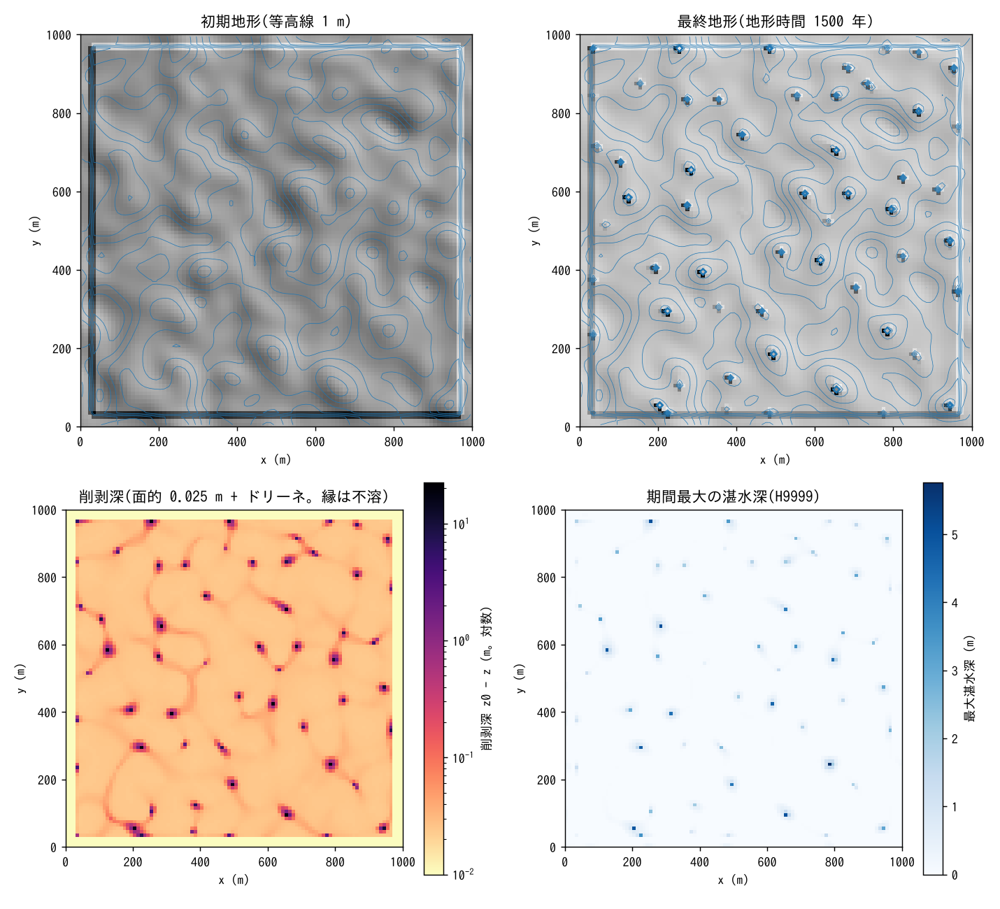
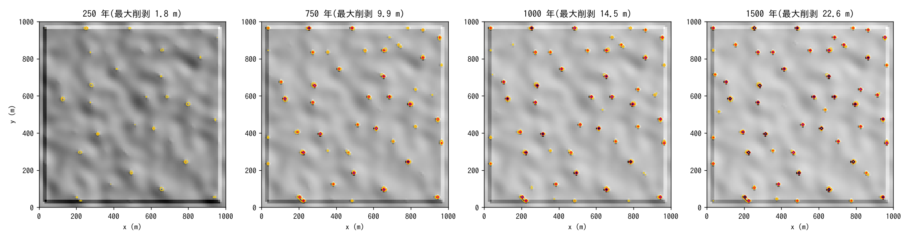
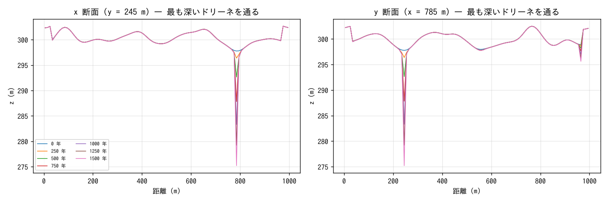
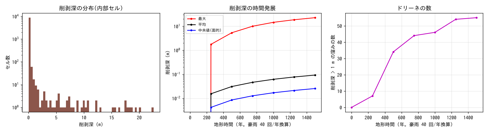
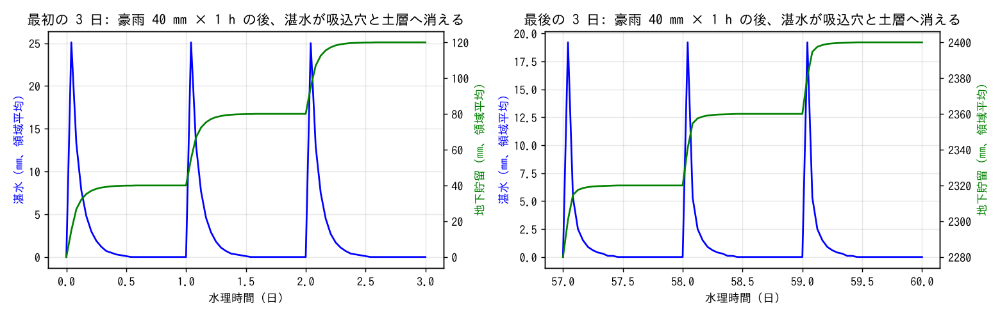

# examples/karst — 石灰岩台地のドリーネ群(カルスト地形)の形成実験

石灰岩台地に代表豪雨を繰り返し与え、**溶食 f_dissol**(面的溶食+吸込穴の
集中項)と**管路連続体層の吸込穴**(f_gwconduit の枡)で、窪みが選択的に
深まってドリーネ群が自己組織化する過程と、地表水が地下へ消える内陸排水の
水文を同じランで見る例題です。入力はこのディレクトリの `param.txt` と
生成地形 `z.txt`・可溶率 `sol.txt` だけです(developer.md §86、
docs/karst_plan.md)。

## 成因(モデルの中の因果)

- 雨水は土壌 CO₂ を取り込んで石灰岩を溶かす。涵養 1 m/yr あたり
  k_d = c_eq/ρ_r ≈ 4×10⁻⁵ m(c_eq = 100 mg/L、ρ_r = 2500 kg/m³)、
  すなわち 40 mm/kyr の**面的な削剥**が起きる(White 型の最大削剥速度)。
- 浸透しきれない雨は窪みに湛水し、吸込穴(ponor)から地下へ落ちる。
  その水も同じ溶解能をもつので、**集水の大きい窪みほど速く溶ける**。
  窪みが深まると湛水が増え、堰式の流入(∝ h^1.5)が増えてさらに溶ける
  — この正帰還が ENCflow では既存の地表 ⇄ 管路層の交換則だけで閉じる。
- 吸込穴の分布は与件(一様な小さい密度 = 「どこにでもできうる」)。
  洞窟の幾何は持たず、管路層は「地下へ消えた水の受け皿」として使う。

## 設定

| 項目 | 値 |
|---|---|
| 領域・格子 | 1000 × 1000 m、Δx = 10 m(100 × 100 セル)、四周壁(内陸排水) |
| 初期地形 | z ≈ 300 m の台地に相関長 ≈ 30 m・標準偏差 1 m の滑らかな起伏(白色雑音のガウス平滑。シード固定)。縁 3 セルは不溶(可溶率 0)の低い尾根(+3 m。非炭酸塩岩の帯) |
| 降雨 | 代表豪雨 40 mm/h × 1 h、1 日周期で反復(`t_cycle_c = "1d"`) |
| 土層・浸透 | 土層 0.5 m(sy 0.2)、Green-Ampt 10 mm/h → 豪雨の 1/4 が浸透(面的溶食の水量)、3/4 が表面流 |
| 吸込穴 | 管路連続体層の枡 1×10⁻⁴ 個/m²(1 ha に 1 個)、堰係数 2.66。管路層は側方流なし・容量 2000 m(受け皿)。土層の水は交換能 10 mm/h で管路層へ抜ける |
| 溶食 | c_eq = 100 mg/L、ρ_r = 2500 kg/m³、浸透量源 + 吸込穴項(f_sink = 1)、残渣率 0.1、可溶率マップ `sol.txt` |
| 時間 | dt = 2 s、地形更新 10 分毎 × morfac 1000(1 日 = 1000 回の豪雨 = 年 40 回なら 25 年)。60 日 = 地形時間 1.5 kyr。10 日毎に Z・H・Hg・Hgc を出力。約 1 時間(4 スレッド) |

```
make                                       # ../../bin/encflow へのリンク
python3 make_terrain.py                    # z.txt, sol.txt
./encflow param.txt > Screen.log           # 約 1 時間
python3 plot_results.py | tee analysis.txt # figs/*.png + 数表
```

## 検算

`plot_results.py` の数表(地形時間 1500 年 = 豪雨 60000 回を年 40 回で換算):

| 項目 | 値 |
|---|---|
| 水収支 | 最終 S_surf = 0、S_grnd = S_total = 2.400 m = 降雨累計 40 mm × 60 日(質量保存。湛水は毎日消える) |
| 溶けた岩の体積 | 地表の体積減少 Σ(z₀ − z)Δx² = 81736 m³、÷(1 − 残渣率 0.1) = 90817 m³ = 台帳の 90817 m³(全桁一致) |
| 面的削剥 | 湛水しなかったセルの削剥深の中央値 0.025 m = 16.7 mm/kyr(浸透する雨 ≈ 0.4 m/yr × k_d 4e-5) |
| 集中削剥 | 最大 22.6 m(面的の 900 倍)。削剥深 > 2 m の窪み 52 個(上位 22.6 / 20.1 / 19.3 / 18.6 / 18.4 m) |
| 体積の内訳 | 面的 ≈ 22000 m³(27 %)、集中(ドリーネ+排水路)≈ 60000 m³(73 %) |

地形時間の換算は「1 日の周期 = 代表豪雨 1 回、年 40 回」の仮定です
(1 日 × morfac 1000 = 1000 回 = 25 年)。

## 結果











- **ドリーネ群の自己組織化**。初期の浅い窪み(標準偏差 1 m の起伏が作る閉じた
  凹地)のうち、集水の大きいものから順に深まり、250 年で 7 個、500 年で 34 個、
  1250 年以降は 55 個でほぼ飽和する(窪み 1 個あたり集水 ≈ 1.5〜2 ha)。
  最深のドリーネは 1500 年で 22.6 m、深さは時間にほぼ比例して増える
  (集水面積が一定なら流入量が一定のため)。
- **面的削剥との桁差**。湛水しなかったセルは 1500 年で 2.5 cm(16.7 mm/kyr)
  しか下がらない。削剥深の対数図(左下)には、窪みへ水が流れ込む経路が
  面的より 2〜5 倍速く溶けた**浅い排水路の網**として現れる(湛水が流れた
  時間だけ吸込穴の流入が多い)。カルストの乾谷の雛形である。
- **内陸排水の水文**(hydrograph.png)。豪雨直後に領域平均 20〜25 mm の湛水が
  生じ、半日で吸込穴と土層へ消える(S_surf → 0)。地下貯留(土層+管路層)は
  階段状に増え、地表に水は残らない。最後の 3 日は最初の 3 日より湛水の
  ピークが小さい(窪みが深まり、流入が速くなった)。
- **形の限界**。ドリーネは横幅 1〜2 セル(10〜20 m)の深い穴で、実際の漏斗形
  (斜面の後退)にはならない。吸込穴が「セルの点」で、岩盤斜面の崩落・
  後退の過程(岩盤には f_repose が効かない)を持たないため。幅を持った
  ドリーネには吸込穴の密度を広げる(fn_gwc_inlet)か、斜面後退の過程を
  足す必要がある(docs/karst_plan.md §5 の積み残し)。

## 読み方の注意

- **加速係数の上限**。溶食は局所・線形で無条件安定ですが、「1 回の地形更新で
  窪みが掘れる深さ」が湛水深に比べて大きいと、水がその窪みに集中 → 流入増 →
  さらに掘れる正帰還が **1 回の豪雨の中で**暴走します(本設定では morfac = 10⁴
  で数時間で発散、10³ で安定)。更新あたりの Δz ≪ 湛水深 となる morfac を
  選んでください。地形時間を稼ぐにはリスタート連鎖を使います。
- **吸込穴の受け皿**。管路層の水頭が地表に達すると流入が止まり、窪みに水が
  残ります(貯留係数 0.1・深さ 50 m では 10 日で起きた)。本例題は貯留係数 1・
  深さ 1000 m・容量 2000 m で「地下へ消える」受け皿にしています。湧泉まで
  表すには側方通水 `gwc_cnd_m2s` と吐口 `fn_gwc_outfall`(examples/qanat、
  test/coastal_drain)を足します。
- 係数は校正値ではありません。c_eq・ρ_r は石灰岩地域の代表値、吸込穴の密度と
  堰係数、浸透能は形成様式が見える範囲で選んだ値です。溶食の飽和(谷頭で強く
  下流で弱い)は扱わず、蒸発散も差し引いていません。
- 深さ十数 m のドリーネが 1.5 kyr で形成されるのは、豪雨の 3/4 が表面流になり
  1 ha の集水が 1 セルに落ちる設定のためで、実地形の速度(0.1 m/kyr 級)
  より 1〜2 桁速い「形成様式の実験」です。
- 縁 3 セルは不溶の尾根(+3 m)で、縁からの流出は内側へ入ります。四周は壁
  なので、縁に接するセルは尾根沿いの集水で深まりやすい傾向が残ります。

## 関連

- [docs/users_guide/geomorph.md](../../docs/users_guide/geomorph.md)「石灰岩の溶食」、
  [sediment.md](../../docs/users_guide/sediment.md) — 式と既定値の根拠
- [docs/users_guide/gwflow.md](../../docs/users_guide/gwflow.md)「管路連続体層」— 吸込穴・湧泉
- [test/dissol](../../test/dissol/) — 解析検証、[docs/karst_plan.md](../../docs/karst_plan.md) — 設計と限界
- 用途集: [docs/users_guide/usecases.md](../../docs/users_guide/usecases.md)「カルスト地形」
