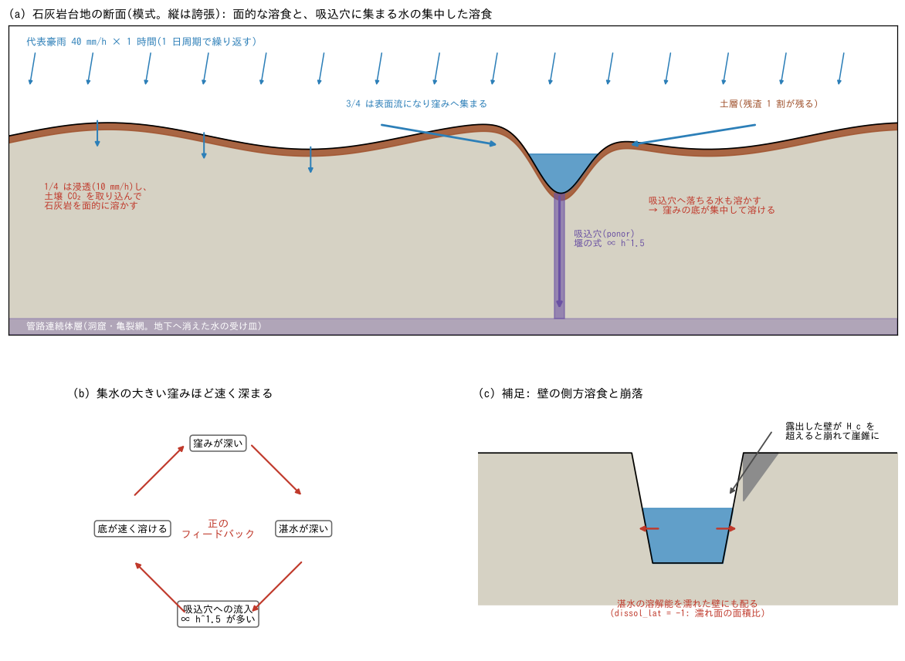
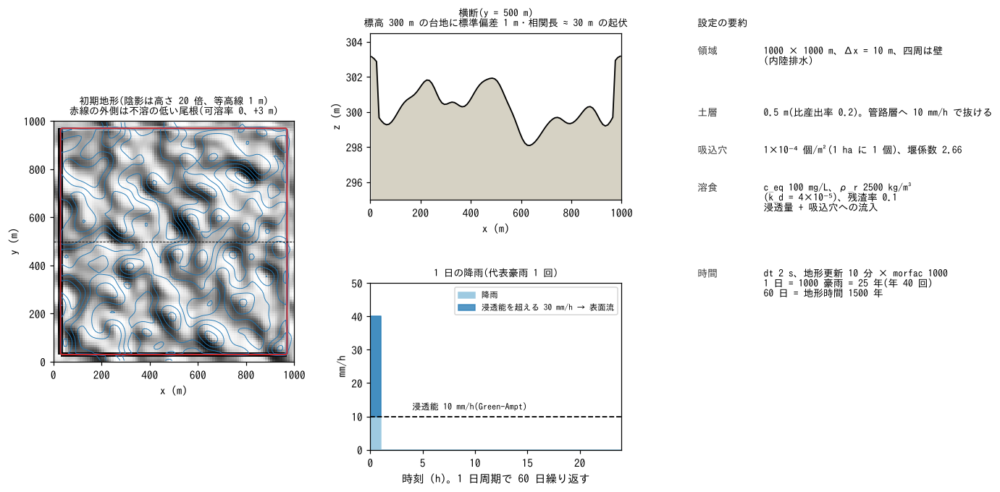
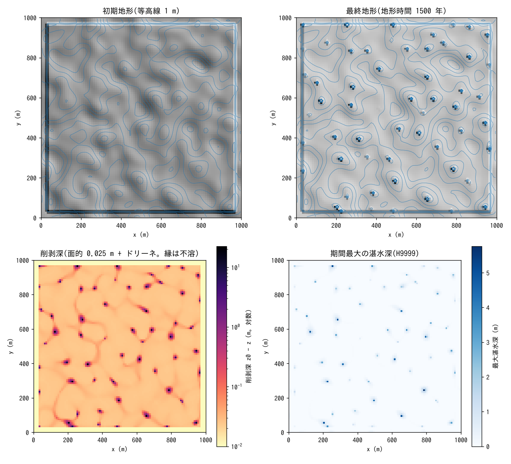
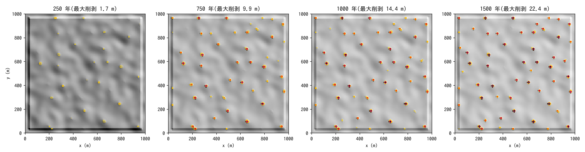
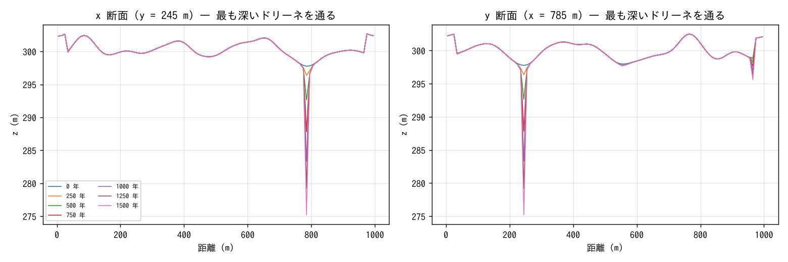
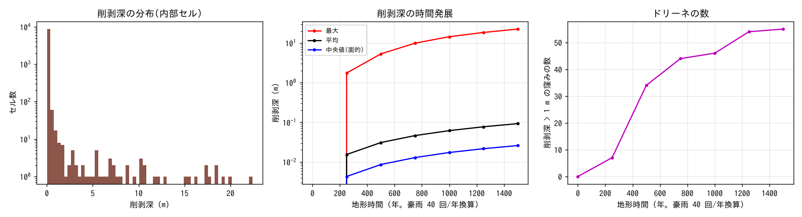
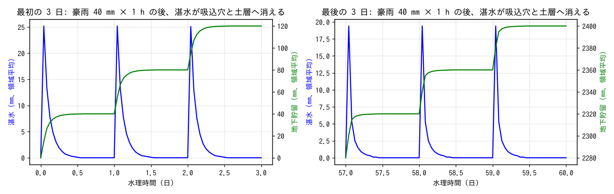
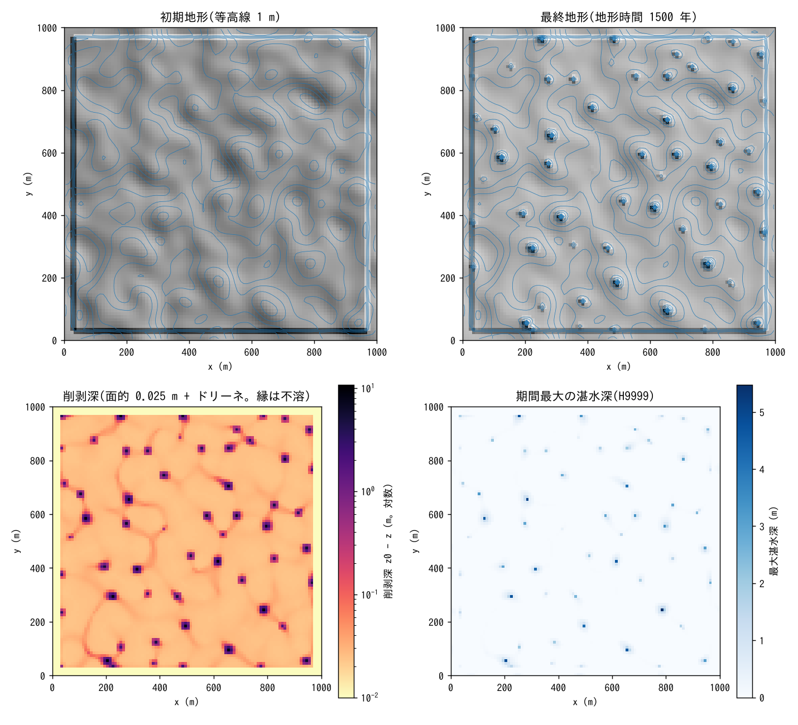
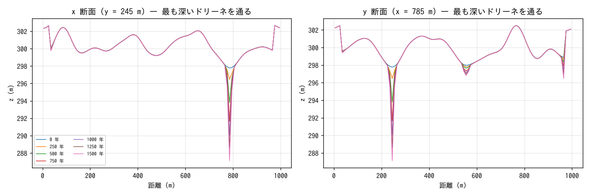
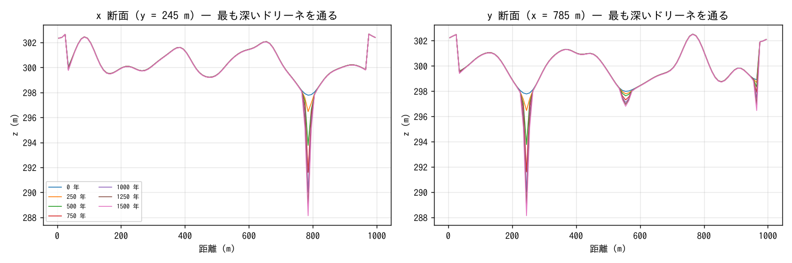

# karst — 石灰岩台地のドリーネ群(溶食と吸込穴によるカルスト地形の形成)

[English](en/README.md)

石灰岩の台地に代表的な豪雨を繰り返し降らせ、窪みが選択的に深まってドリーネ(閉じた窪地)の
群れができる過程と、地表の水が地下へ消える内陸排水の水文を、一つの計算で見る例題です。
石灰岩を溶かすのは[石灰岩の溶食](../../docs/users_guide/geomorph.md#石灰岩の溶食f_dissol)
(f_dissol。しみ込む水による面的な溶食と、吸込穴に流れ込む水による集中した溶食)、地表の水を
地下へ落とすのは[地下水](../../docs/users_guide/gwflow.md)の管路連続体層の枡(吸込穴)です。
補足では、湛水に接する壁の側方溶食と、壁の崩落を加えて窪みの形を比べます。値は形成の
様式を見るための模式値で、実際の地形の速さや形の再現ではありません。

## 実際のカルストで起きていること

- **雨水が石灰岩を溶かす**: 雨水は土壌中の二酸化炭素を取り込んで弱い酸になり、石灰岩を溶かし
  ます。溶けた岩は水とともに運び去られ、地表は少しずつ下がります。カルストの化学的な削剥の
  速さは 20〜100 mm/kyr 程度で、しみ込む水の量と水が溶かせる量で決まります(White 1984;
  Gabrovšek 2009)。
- **地表の水は地下へ消える(内陸排水)**: 石灰岩の台地には川がほとんどなく、雨水は割れ目や
  吸込穴(ponor)から地下の洞窟・亀裂の網へ流れ込みます(Ford and Williams 2007)。
- **ドリーネは水が集まる所で深まる**: 地表近くの割れ目の多い層(エピカルスト)が水を窪みの下へ
  集めると、そこで溶食が集中して窪みが深まり、集める水がさらに増えます。ドリーネやコックピット
  (窪地の群れ)の発達をこの水の集まり方で説明する考えがあります(Williams 1985)。
- **ドリーネの群れ**: 窪みは台地に多数並び、集水の大きいものから大きく育ちます。窪みに向かって
  水が流れる経路も、まわりより速く溶けます。
- **溶け残り**: 石灰岩に含まれる溶けない成分(粘土など)は、赤い土(テラロッサ)として残ります。

## 再現に必要な機構



模式図。(a) 石灰岩台地の断面(縦は誇張): 代表的な豪雨のうち、浸透能までの 1/4 はしみ込んで
石灰岩を面的に溶かし、残りの 3/4 は表面流になって窪みに集まる。窪みの吸込穴から地下へ落ちる
水も岩を溶かすので、窪みの底が集中して溶ける。(b) 集水の大きい窪みほど速く深まる正の
フィードバック。(c) 補足: 湛水に接する壁の側方溶食と、露出した壁の崩落。

| 実際の現象 | モデルの機構 | 設定 |
|---|---|---|
| 雨水が石灰岩を溶かす | 涵養の水量に比例する溶食 $`dz/dt = -k_d f_{\rm sol} q`$($`k_d = c_{\rm eq}/\rho_{\rm r}`$ = 4×10⁻⁵。溶けた岩は z から除き、残渣だけ土層に残す) | `f_dissol = 1`、`dissol_ceq`・`dissol_rho`、`dissol_src = 1`(浸透量) |
| 浸透しきれない雨が窪みにたまる | Green-Ampt の浸透(浸透能 10 mm/h < 雨 40 mm/h)と浅水流 | `gw_ksv_mmh = 10` |
| 窪みの吸込穴から地下へ | 管路連続体層の枡(吸込穴)。湛水深 h に対する堰の式(∝ h^1.5)で流入 | `f_gwconduit = 1`、`gwc_inlet`・`gwc_cw` |
| 吸込穴へ落ちる水も溶かす | 吸込穴への流入量に比例する溶食を加える | `dissol_sink = 1`、`dissol_fsink` |
| 地下へ消えた水(洞窟・亀裂の網) | 管路層は横に流さない受け皿(容量 2000 m) | `gwc_cnd_m2s = 0`、`gwc_cap` |
| 土層の水も地下へ抜ける | 土層から管路層への交換(10 mm/h) | `gwc_leak_layer = 1`、`gwc_leak_mmh` |
| 溶けない成分が土として残る | 溶けた岩の体積の 1 割を土層に残す | `dissol_fres = 0.1` |
| 台地の縁は石灰岩でない | 可溶率の分布(縁の 3 セルは 0) | `fn_dissol` |
| 長い時間 | 代表的な豪雨を 1 日周期で繰り返し、地形の変化だけを morfac 倍に加速する | `t_cycle_c = "1d"`、`morfac` |
| (補足)湛水に接する壁が溶ける | 側方溶食: 湛水の溶かす力を濡れた壁にも配る | `dissol_lat = -1` |
| (補足)露出した壁が崩れる | 崩落と崖錐(土層のない基岩も崩す) | `f_rockfall`、`rf_bedrock = 1` |

溶食の速さは、しみ込む水の量に溶かせる量 $`c_{\rm eq}`$(有効溶解能)を掛けた White (1984) の
最大削剥速度の形です。炭酸の化学平衡は解かず、土壌の CO₂ と温度の効果は $`c_{\rm eq}`$ 一つに
まとめます。ドリーネが自然にできるのは、窪みが深まると湛水が深くなり、吸込穴への流入
(堰の式 ∝ h^1.5)が増えてさらに溶ける正のフィードバックが、地表と管路層の交換の式だけで
閉じているためです。吸込穴の分布は与件で、どこにでもできうるように一様な小さい密度で与えます。

## 幾何と設定



左: 初期地形(陰影は高さを 20 倍に強調、等高線 1 m。赤線の外側は不溶の縁)。中上: 横断
(y = 500 m)。中下: 1 日の降雨と浸透能。右: 設定の要約。

1000 m × 1000 m、Δx = 10 m(100 × 100 セル)。四周は壁で、水は外へ出ません(内陸排水)。

- **地形**: 標高 300 m の台地に、相関長 ≈ 30 m・標準偏差 1 m の滑らかな起伏(白色雑音を
  ガウス核で平滑化。シード固定)を与え、閉じた浅い窪みを多数作ります(ドリーネの種。特定の
  間隔は持ち込まない)。縁の 3 セルは溶けない(可溶率 0)低い尾根(+3 m。石灰岩でない岩の帯)。
- **降雨**: 代表的な豪雨 40 mm/h × 1 時間を、1 日周期で 60 日繰り返します(`t_cycle_c = "1d"`)。
- **土層と浸透**: 土層 0.5 m(比産出率 0.2)、Green-Ampt 10 mm/h。豪雨の 1/4 がしみ込み(面的な
  溶食の水)、3/4 は表面流になります。土層の水は 10 mm/h で管路層へ抜けます。
- **吸込穴**: 管路連続体層の枡を 1×10⁻⁴ 個/m²(1 ha に 1 個)、堰係数 2.66。管路層は横に流さず
  (各セルの管路層は貯留だけ)、容量 2000 m・水頭の底は地表の 1000 m 下・貯留係数 1 として、
  地下へ消えた水の受け皿にします。
- **溶食**: 有効溶解能 c_eq = 100 mg/L、岩の密度 2500 kg/m³(k_d = 4×10⁻⁵)。浸透量と吸込穴への
  流入量の両方が溶かします。残渣率 0.1。
- **時間**: dt = 2 s、地形の更新は 10 分ごとで、morfac = 1000(1 日 = 1000 回の豪雨。年に 40 回
  なら 25 年)。60 日 = 地形時間 1500 年。10 日ごとに Z・H・Hg・Hgc を出力します。

| ケース | 設定ファイル | 内容 | 計算時間の目安 |
|---|---|---|---|
| 主ケース(床だけが溶ける) | param.txt | 浸透量と吸込穴への流入による溶食 | 約 1 時間(4 スレッド) |
| 補足: 側方溶食 | param_lat.txt | + 湛水に接する壁の側方溶食(`dissol_lat = -1`) | 約 1 時間 |
| 補足: 側方溶食 + 崩落 | param_rock.txt | + 崩落と崖錐(H_c = 5 m、窓の半径 10 m、`rf_bedrock = 1`) | 約 1 時間 |

## 実行方法

```
cd examples/karst
make                                        # 実行ファイルへのリンクと入力(make_terrain.py が z.txt・sol.txt を作る)
make run                                    # 主ケース(約 1 時間)
python3 plot_setup.py                       # figs/mechanism.png・setup.png(計算結果は使わない)
python3 plot_results.py | tee analysis.txt  # figs/maps・evolution・sections・stats・hydrograph.png と数表
make supp                                   # 補足の 2 ケース(各 1 時間)
python3 plot_results.py param_lat.txt       # 側方溶食: figs/*_lat.png
python3 plot_results.py param_rock.txt      # 側方溶食 + 崩落: figs/*_rock.png
```

引数 `en` を付けると英語ラベルの図を en/figs/ に描きます(`python3 plot_setup.py en`、
`python3 plot_results.py en`、`python3 plot_results.py param_lat.txt en` など)。

## 結果



左上: 初期地形、右上: 最終地形(地形時間 1500 年。陰影と等高線)。左下: 削剥深 z₀ − z(対数。
面的な溶食は 0.025 m、黒い点がドリーネ。縁は溶けない)。右下: 期間中の最大湛水深。



地形時間 250・750・1000・1500 年の地形(陰影)と削剥深の等高線(0.5・1・2・4・8 m。ドリーネは
1〜2 セル幅なので小さな輪に見える。題に最大の削剥深)。



最も深いドリーネを通る x 断面と y 断面の時間発展。



左: 削剥深の分布(内部のセル)。中: 削剥深の最大・平均・中央値(面的)の時間発展。右: 削剥深が
1 m を超えた窪み(ドリーネ)の数。



最初の 3 日(左)と最後の 3 日(右)の、領域平均の湛水(青)と地下貯留(緑)。

収支の確認(`plot_results.py` の数表。地形時間 1500 年 = 豪雨 6 万回を年 40 回で換算):

| 項目 | 値 |
|---|---|
| 水収支 | 最終の S_surf = 0、S_grnd = S_total = 2.400 m = 降雨の累計 40 mm × 60 日(湛水は毎日消える) |
| 溶けた岩の体積 | 地表の体積の減少 Σ(z₀ − z)Δx² = 81690 m³、÷(1 − 残渣率 0.1)= 90766 m³ = 台帳の 90766 m³(全桁一致) |
| 面的な削剥 | 湛水しなかったセルの削剥深の中央値 0.025 m = 16.9 mm/kyr(しみ込む雨 ≈ 0.4 m/yr × k_d 4×10⁻⁵) |
| 集中した削剥 | 最大 22.4 m(面的な削剥の 880 倍)。削剥深 > 2 m の窪み 52 個(深い順に 22.4 / 20.0 / 19.2 / 18.4 / 18.3 m) |
| 体積の内訳 | 面的 ≈ 22000 m³(27 %)、集中(ドリーネと排水路)≈ 59000 m³(73 %) |

地形時間の換算は「1 日の周期 = 代表的な豪雨 1 回、年 40 回」の仮定です(1 日 × morfac 1000 =
1000 回 = 25 年)。

- **ドリーネ群の自己組織化**: 初期の浅い窪み(標準偏差 1 m の起伏が作る閉じた凹地)のうち、
  集水の大きいものから順に深まり、250 年で 7 個、500 年で 34 個、1250 年以降は 54〜55 個で
  ほぼ飽和します(窪み 1 個あたりの集水 ≈ 1.5〜2 ha)。最も深いドリーネは 1500 年で 22.4 m で、深さは
  時間にほぼ比例して増えます(集水面積が一定なら流入量が一定のため)。
- **面的な削剥との桁の差**: 湛水しなかったセルは 1500 年で 2.5 cm(16.9 mm/kyr)しか下がりません。
  削剥深の対数の図(左下)には、窪みへ水が流れ込む経路が、面的な削剥より 2〜5 倍速く溶けた
  **浅い排水路の網**として現れます(湛水が流れた時間だけ吸込穴への流入が多い)。カルストの
  乾いた谷(乾谷)のひな形です。
- **内陸排水の水文**: 豪雨の直後に領域平均 20〜25 mm の湛水が生じ、半日で吸込穴と土層へ消えます
  (S_surf → 0)。地下の貯留(土層と管路層)は階段状に増え、地表に水は残りません。最後の 3 日は
  最初の 3 日より湛水のピークが小さく(窪みが深まり、流入が速くなった)なります。
- **形の限界**: ドリーネは横幅 1〜2 セル(10〜20 m)の深い穴で、実際の漏斗形(斜面の後退)には
  なりません。吸込穴が「セルの点」で、水が最も深いセルに集まるためです。側方溶食を加えると深さが
  半分になり幅が倍になりますが、穴の形は残ります(補足)。

## 補足: 側方溶食(param_lat.txt。dissol_lat = −1)

主ケースに、湛水の溶かす力を、濡れた面の面積の比 hΣL/(hΣL + Δx²) で「水面より床が高い隣のセル
(岩の壁)」にも配る[側方溶食](../../docs/users_guide/geomorph.md#石灰岩の溶食f_dissol)を加えます。

| 項目 | 床のみ(param.txt) | 側方溶食あり(param_lat.txt) |
|---|---|---|
| 溶けた岩の体積(台帳 = 地表の体積の差 ÷ 0.9) | 90766 m³ | 89474 m³(配分なので総量は同じ。差は湛水の経路の違い) |
| 面的な削剥(湛水しなかったセルの中央値) | 0.025 m | 0.025 m |
| 最も深いドリーネ | 22.4 m | 10.7 m |
| 最も深いドリーネの隣 8 セルの平均削剥 | 0.56 m | 2.01 m |
| 削剥深 > 1 m / > 2 m / > 5 m のセル数 | 77 / 53 / 38 | 162 / 68 / 22 |
| 削剥深 > 2 m の窪みの数 | 52 | 49 |



主ケースの図(maps.png)と同じ並び(側方溶食あり)。



- 壁への配分で、最も深い所の掘削が半分になり、隣のセルが 4 倍下がって、深さ > 1 m の面積が
  2 倍になります。窪みの数は変わりません(どこが深まるかは集水で決まり、側方溶食はその形を
  変える)。
- それでも穴の形は残ります。壁のセルは溶けても湛水の水面(穴の底から数 m)より高いままなので
  水が広がらず、壁の 8 セルで分け合う配分は床の 1 セルに集中する分より小さいからです。

## 補足: 側方溶食 + 崩落と崖錐(param_rock.txt。f_rockfall、rf_hc = 5 m、rf_bedrock = 1)

param_lat.txt に[崩落と崖錐](../../docs/users_guide/geomorph.md#崩落と崖錐f_rockfall)を加えます。
窪みの壁は土層のない基岩なので、基岩も崩す設定(`rf_bedrock = 1`)にし、1 セルの窓
(`rf_rc = 10 m`)の中の最低点との落差が限界高さ H_c = 5 m を超えた分の半分を、1 回の更新ごとに
崖錐(ht。土層 sd にも入る)として穴へ落とします(崖錐の安息角 35°)。

| 項目 | 側方溶食あり | + 崩落(H_c = 5 m) |
|---|---|---|
| 崩落で移した岩(台帳) | — | 639 m³(1.9 万エッジ更新)。うち崖錐として溶けた岩 622 m³(最終の崖錐は最大 0.02 m) |
| 最も深いドリーネ(地表) | 10.7 m | 9.6 m |
| 最も深いドリーネの土層厚 | 1.7 m(残渣) | 1.7 m(残渣。崖錐は溶けて残らない) |
| 隣 8 セルの平均削剥 | 2.01 m | 2.14 m |
| 削剥深 > 1 m / > 2 m のセル数 | 162 / 68 | 164 / 70 |



- 崩落は壁の露出面を H_c = 5 m 付近に保つだけで、地表の形はほとんど変わりません(隣のセルの削剥が
  0.1 m 増え、最も深い所が 1 m 浅くなる)。落ちた崖錐は石灰岩なので穴の中で溶け
  (developer.md §86.7)、残渣だけが土層に残り、壁は落差が H_c を超えた分だけ崩れて追いつきます。
- 深さ 10 m 級の穴を漏斗形に広げるには、H_c をもっと小さくする(穴の深さの 1/3 以下)か、窓
  `rf_rc` を広げて壁の面全体を対象にするか、格子を細かくする必要があります(Δx = 10 m では穴が
  1 セル幅なので、崩れるのは隣の 8 セルの縁だけ)。塔の裾が崩れる例は
  [tower_karst](../tower_karst/README.md) にあります。

## このモデルで表せないこと(実際の現象との違い)

- **洞窟は形を持たない**: 管路層は「地下へ消えた水の受け皿」で、洞窟の幾何や、流れによる洞窟の
  成長は扱いません。湧泉への流れも、この例題では扱いません。
- **溶かす力は一定**: 水は常に c_eq の分だけ溶かす(飽和していない一定の割合)ので、流れ下るに
  つれて飽和に近づき溶かす力が弱まることは表しません。蒸発散も差し引いていません。
- **ドリーネの形**: ドリーネは横幅 1〜2 セルの深い穴で、斜面が後退して漏斗形になることは、側方
  溶食や崩落を加えても十分には表せません(補足)。
- **吸込穴の分布は与件**: 吸込穴の密度は一様な与件で、時間とともに変わりません。
- **速さは実際より 1〜2 桁速い**: 深さ十数 m のドリーネが 1500 年でできるのは、豪雨の 3/4 が
  表面流になり、1 ha の集水が 1 セルに落ちる設定のためで、実際の地形の速さ(0.1 m/kyr 級)
  より 1〜2 桁速い「形成の様式の実験」です。
- **係数は校正値ではない**: c_eq・ρ_r は石灰岩地域の代表値、吸込穴の密度と堰係数、浸透能は
  形成の様式が見える範囲で選んだ値です。

## 注意

- **morfac の上限**: 溶食は局所的・線形で無条件に安定ですが、「1 回の地形の更新で窪みが掘れる
  深さ」が湛水深に比べて大きいと、水がその窪みに集まる → 流入が増える → さらに掘れる、という
  正のフィードバックが **1 回の豪雨の中で**暴走します(この設定では morfac = 10⁴ で数時間のうちに
  破綻、10³ で安定)。更新あたりの Δz が湛水深よりずっと小さくなる morfac を選んでください。
  地形時間を延ばすにはリスタートを連鎖させます。
- **安全弁 dissol_dzmax**: 1 セル・1 更新の溶食量の上限(超えた分の溶かす力は捨てる)を置けば
  morfac = 10⁴ でも計算できますが、穴の成長を頭打ちにします。dzmax = 0.05 m・morfac = 10⁴ で
  3 日(10³ の 30 日相当)を計算すると、平野の平均の低下は 0.037 m で 10³ の 0.041 m にほぼ等しく、
  吸込穴の最も深い所は −3.6 m で 10³ の −9.9 m より浅くなります。穴の深さを見る目的には
  向きません。
- **吸込穴の受け皿**: 管路層の水頭が地表に達すると流入が止まり、窪みに水が残ります(貯留係数
  0.1・深さ 50 m にすると 10 日で起きます)。この例題は貯留係数 1・深さ 1000 m・容量 2000 m で
  「地下へ消える」受け皿にしています。湧泉まで表すには、横の流れ `gwc_cnd_m2s` と吐口
  `fn_gwc_outfall` を足します([qanat](../qanat/README.md)、
  [test/coastal_drain](../../test/coastal_drain/README.md))。
- **縁**: 縁の 3 セルは溶けない尾根(+3 m)で、縁からの流れは内側へ入ります。四周は壁なので、縁に
  接するセルは尾根沿いの集水で深まりやすい傾向が残ります。
- 検証: [test/dissol](../../test/dissol/README.md)(溶食の解析解との比較)。

## 感度実験の入口

- `gwc_inlet`(吸込穴の密度)・`gwc_cw`(堰係数): ドリーネの数と間隔。
- `gw_ksv_mmh`(浸透能): 面的な溶食と表面流の配分。
- `dissol_ceq`: 溶ける速さ(k_d)。
- `morfac` と `dissol_dzmax`: 地形時間の稼ぎ方(上の注意)。
- `dissol_lat`、`rf_hc`・`rf_rc`: 窪みの形(補足)。

## 参考文献

- Ford, D. and Williams, P. (2007): *Karst Hydrogeology and Geomorphology*. John Wiley & Sons,
  Chichester.
- Gabrovšek, F. (2009): On concepts and methods for the estimation of dissolutional denudation rates
  in karst areas. *Geomorphology*, 106, 9–14.
- White, W. B. (1984): Rate processes: chemical kinetics and karst landform development. In: La Fleur,
  R. G. (ed.) *Groundwater as a Geomorphic Agent*, Allen & Unwin, 227–248.
- Williams, P. W. (1985): Subcutaneous hydrology and the development of doline and cockpit karst.
  *Z. Geomorphol. N.F.*, 29(4), 463–482.(書誌で確認)
