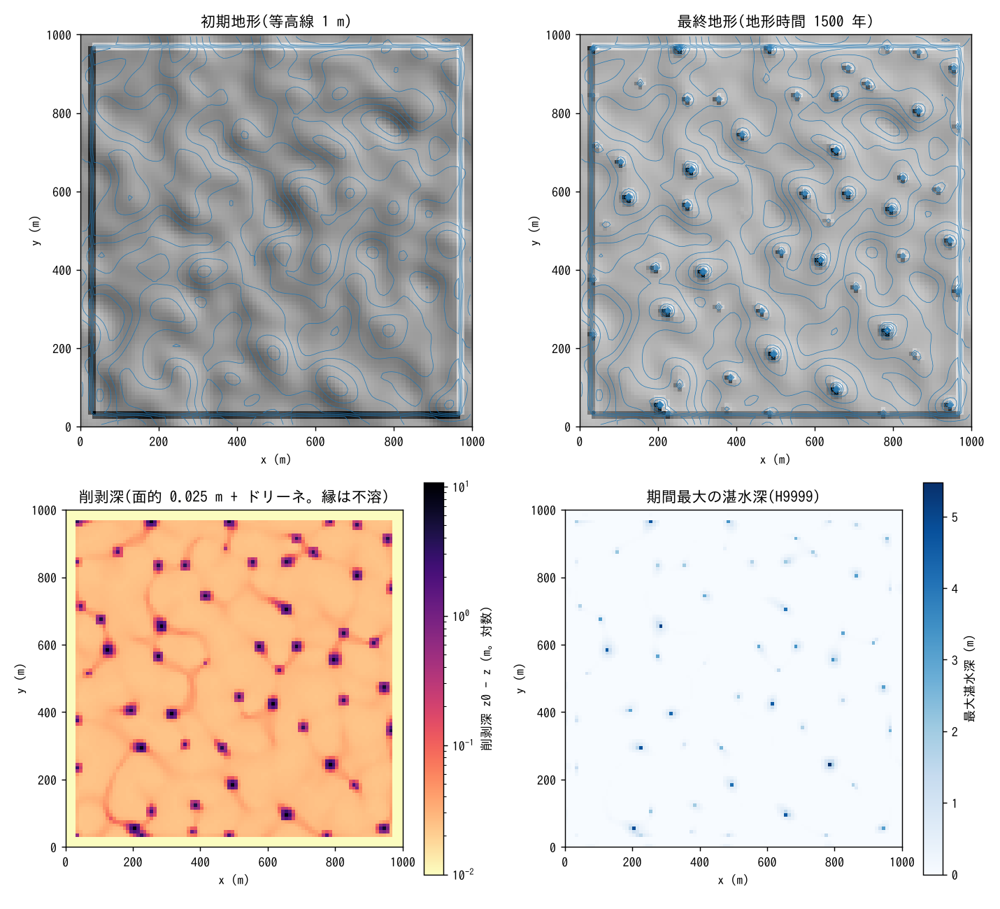
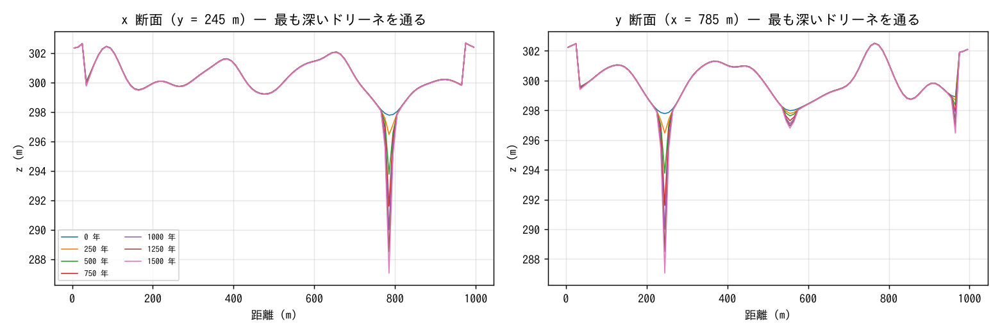
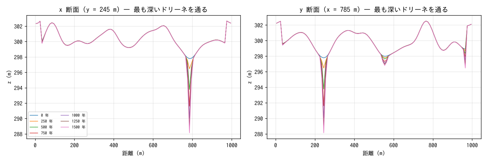

# examples/karst — formation experiment of a doline field on a limestone plateau (karst landforms)

> English mirror of examples/karst/README.md. The Japanese file is the master copy.

[日本語](../README.md)

A representative storm is applied repeatedly to a limestone plateau, and
with **dissolution f_dissol** (diffuse dissolution + the concentrated term
at sinks) and **the sinks of the conduit continuum layer** (the inlets of
f_gwconduit), this example shows in the same run the process by which
depressions deepen selectively and a doline field self-organizes, together
with the hydrology of internal drainage in which surface water vanishes
underground. The inputs are only `param.txt` in this directory and the
generated terrain `z.txt` and soluble-fraction map `sol.txt`
(developer.md §86, docs/karst_plan.md; in Japanese).

## Genesis (the causal chain inside the model)

- Rainwater takes up soil CO₂ and dissolves the limestone. Per 1 m/yr of
  recharge, k_d = c_eq/ρ_r ≈ 4×10⁻⁵ m (c_eq = 100 mg/L, ρ_r = 2500 kg/m³),
  i.e. a **diffuse denudation** of 40 mm/kyr occurs (the White-type
  maximum denudation rate).
- Rain that cannot infiltrate ponds in depressions and drops underground
  through sinks (ponors). That water has the same dissolution capacity,
  so **the depressions with larger catchments dissolve faster**. As a
  depression deepens, the ponding grows and the weir-type inflow
  (∝ h^1.5) increases, dissolving it further — in ENCflow this positive
  feedback closes with the existing surface ⇄ conduit-layer exchange law
  alone.
- The distribution of sinks is given (a uniform small density = "one may
  form anywhere"). No cave geometry is held; the conduit layer is used as
  "the receptacle for the water that vanished underground".

## Setup

| Item | Value |
|---|---|
| Domain and grid | 1000 × 1000 m, Δx = 10 m (100 × 100 cells), walls on all four sides (internal drainage) |
| Initial terrain | A plateau at z ≈ 300 m with smooth undulations of correlation length ≈ 30 m and standard deviation 1 m (Gaussian-smoothed white noise; fixed seed). The 3 edge cells are an insoluble (soluble fraction 0) low ridge (+3 m; a band of non-carbonate rock) |
| Rainfall | Representative storm 40 mm/h × 1 h, repeated with a 1-day period (`t_cycle_c = "1d"`) |
| Soil and infiltration | Soil 0.5 m (sy 0.2), Green-Ampt 10 mm/h → 1/4 of the storm infiltrates (the water amount of diffuse dissolution), 3/4 becomes surface flow |
| Sinks | Inlets of the conduit continuum layer at 1×10⁻⁴ /m² (one per ha), weir coefficient 2.66. The conduit layer has no lateral flow and a capacity of 2000 m (receptacle). The soil water drains into the conduit layer with an exchange capacity of 10 mm/h |
| Dissolution | c_eq = 100 mg/L, ρ_r = 2500 kg/m³, infiltration source + sink term (f_sink = 1), residue fraction 0.1, soluble-fraction map `sol.txt` |
| Time | dt = 2 s, terrain update every 10 min × morfac 1000 (1 day = 1000 storms = 25 years at 40 per year). 60 days = 1.5 kyr of morphological time. Z, H, Hg and Hgc output every 10 days. About 1 hour (4 threads) |

```
make                                       # link to ../../bin/encflow
python3 make_terrain.py                    # z.txt, sol.txt
./encflow param.txt > Screen.log           # about 1 hour
python3 plot_results.py | tee analysis.txt # figs/*.png + tables
./encflow param_lat.txt > Screen_lat.log   # with lateral dissolution (about 1 hour)
python3 plot_results.py param_lat.txt | tee analysis_lat.txt   # figs/*_lat.png
./encflow param_rock.txt > Screen_rock.log # + rockfall and talus (about 1 hour)
python3 plot_results.py param_rock.txt | tee analysis_rock.txt # figs/*_rock.png
```

## Checks

The tables of `plot_results.py` (morphological time 1500 years = 60000
storms converted at 40 per year):

| Item | Value |
|---|---|
| Water budget | Final S_surf = 0, S_grnd = S_total = 2.400 m = cumulative rainfall 40 mm × 60 days (mass conservation; the ponding vanishes every day) |
| Volume of dissolved rock | Surface volume decrease Σ(z₀ − z)Δx² = 81736 m³, ÷ (1 − residue fraction 0.1) = 90817 m³ = the ledger's 90817 m³ (all digits agree) |
| Diffuse denudation | Median denudation depth of the cells that never ponded 0.025 m = 16.7 mm/kyr (infiltrating rain ≈ 0.4 m/yr × k_d 4e-5) |
| Concentrated denudation | Maximum 22.6 m (900 times the diffuse value). 52 depressions with denudation depth > 2 m (the top five 22.6 / 20.1 / 19.3 / 18.6 / 18.4 m) |
| Volume breakdown | Diffuse ≈ 22000 m³ (27 %), concentrated (dolines + drainage channels) ≈ 60000 m³ (73 %) |

The conversion to morphological time assumes "one 1-day period = one
representative storm, 40 per year" (1 day × morfac 1000 = 1000 storms =
25 years).

## Results


- **Self-organization of the doline field.** Among the initial shallow
  depressions (closed hollows formed by the undulations of standard
  deviation 1 m), those with the largest catchments deepen first: 7 at
  250 years, 34 at 500 years, and about 55 from 1250 years on, nearly
  saturated (catchment ≈ 1.5–2 ha per depression). The deepest doline is
  22.6 m at 1500 years, and the depth grows almost in proportion to time
  (the inflow is constant if the catchment area is constant).
- **Orders of magnitude apart from diffuse denudation.** The cells that
  never ponded are lowered only 2.5 cm (16.7 mm/kyr) in 1500 years. In the
  logarithmic map of denudation depth (bottom left), the paths along which
  water flows into the depressions appear as a **network of shallow
  drainage channels** dissolved 2–5 times faster than the diffuse value
  (the sink inflow is larger for the time the ponded water flowed). This
  is the prototype of the dry valleys of karst.
- **Hydrology of internal drainage** (hydrograph.png). Right after the
  storm, ponding of 20–25 mm averaged over the domain appears and vanishes
  into the sinks and the soil within half a day (S_surf → 0). Subsurface
  storage (soil + conduit layer) increases stepwise, and no water remains
  on the surface. The last 3 days have smaller ponding peaks than the
  first 3 days (the depressions deepened and the inflow became faster).
- **Limits of the form.** The dolines are deep holes 1–2 cells (10–20 m)
  across and do not become the real funnel shape (retreat of the slopes),
  because the sink is "a point in a cell" and the water collects in the
  deepest cell. Adding the lateral dissolution below halves the depth and
  doubles the width, but the hole shape remains (there is no process of
  collapse and retreat of the rock walls; the remaining item of
  docs/karst_plan.md §5).

### With lateral dissolution (param_lat.txt; dissol_lat = −1)

The same configuration, but the dissolution capacity of the ponded water
is also distributed by the wetted-area ratio hΣL/(hΣL + Δx²) to "the
neighbouring cells whose floor is above the water surface (rock walls)"
([lateral dissolution](../../../docs/en/users_guide/geomorph.md#limestone-dissolution-f_dissol),
developer.md §86.3). `python3 plot_results.py param_lat.txt` draws
figs/*_lat.png.

| Item | Floor only (param.txt) | With lateral dissolution (param_lat.txt) |
|---|---|---|
| Volume of dissolved rock (ledger = surface volume difference ÷ 0.9) | 90817 m³ | 89510 m³ (a redistribution, so the total is the same; the difference comes from different ponding paths) |
| Diffuse denudation (median of the cells that never ponded) | 0.025 m | 0.025 m |
| Deepest doline | 22.6 m | 10.7 m |
| Mean denudation of the 8 cells adjacent to the deepest doline | 0.56 m | 2.03 m |
| Number of cells with denudation depth > 1 m / > 2 m / > 5 m | 77 / 53 / 38 | 163 / 68 / 22 |
| Number of depressions with denudation depth > 2 m | 52 | 49 |





- Distributing to the walls halves the excavation of the deepest part,
  lowers the adjacent cells 4 times more, and doubles the area deeper than
  1 m. The number of depressions does not change (where deepening occurs
  is decided by the catchment; lateral dissolution changes its shape).
- The hole shape nevertheless remains. Even when dissolved, the wall cells
  stay higher than the ponded water surface (a few metres above the
  bottom of the hole), so the water does not spread, and the share divided
  among 8 wall cells is smaller than the share concentrated on 1 floor
  cell.

### Lateral dissolution + rockfall and talus (param_rock.txt; f_rockfall, rf_hc = 5 m, rf_bedrock = 1)

Adds rockfall and talus `f_rockfall`
([rockfall and talus](../../../docs/en/users_guide/geomorph.md#rockfall-and-talus-f_rockfall),
developer.md §48.7) to param_lat.txt. The walls of the depressions are
bedrock without soil, so they are collapsed in bedrock mode
`rf_bedrock = 1`: half of the drop to the lowest point within a 1-cell
window (rf_rc = 10 m) in excess of the critical height H_c = 5 m is
dropped into the hole as talus (ht; it also enters the soil sd) at every
update (repose angle of the talus 35°). `python3 plot_results.py
param_rock.txt` draws figs/*_rock.png.

| Item | With lateral dissolution | + rockfall (H_c = 5 m) |
|---|---|---|
| Rock moved by rockfall (ledger) | — | 663 m³ (2.0 × 10⁴ edge updates; talus up to 2.5 m) |
| Deepest doline (surface) | 10.7 m | 9.7 m |
| Soil thickness in the deepest doline | 1.7 m (residue) | 2.8 m (residue + talus 1.1 m) |
| Mean denudation of the 8 adjacent cells | 2.03 m | 2.16 m |
| Number of cells with denudation depth > 1 m / > 2 m | 163 / 68 | 165 / 70 |



- Rockfall only keeps the exposed wall face near H_c = 5 m and hardly
  changes the surface form (the denudation of the adjacent cells increases
  by 0.1 m and the deepest part becomes 1 m shallower). Since dissolution
  continues under the talus (floor dissolution lowers z and keeps sd), the
  bottom of the hole keeps lowering while covered by talus, and the walls
  follow by collapsing only the part by which the drop exceeds H_c.
- To widen a hole of the 10 m class into a funnel shape, H_c must be made
  much smaller (1/3 of the hole depth or less), the window rf_rc widened
  to cover the whole wall face, or the grid refined (at Δx = 10 m the hole
  is one cell wide, so only the rims of the 8 adjacent cells collapse). An
  example in which the feet of towers collapse is
  [examples/tower_karst](../../tower_karst/en/README.md).

## Cautions for reading

- **Upper limit of the acceleration factor.** Dissolution is local, linear
  and unconditionally stable, but if "the depth a depression is excavated
  in one terrain update" is large compared with the ponding depth, the
  positive feedback water concentrating in that depression → more inflow →
  more excavation runs away **within a single storm** (in this
  configuration morfac = 10⁴ diverges within a few hours, 10³ is stable).
  Choose a morfac such that Δz per update ≪ ponding depth. To gain
  morphological time, use restart chains. With the safety valve
  `dissol_dzmax` (a cap on the dissolution per cell and update; the excess
  capacity is discarded), the run works even at morfac = 10⁴ (a trial with
  dzmax = 0.05 m for 3 days = the equivalent of 30 days × 10³: the mean
  lowering of the plain, 0.037 m, is nearly equal to the 0.041 m of 10³,
  but the deepest sink at −3.6 m is shallower than the −9.9 m of 10³ = the
  growth of the holes is capped, so it is not suited to the purpose of
  looking at hole depth).
- **The receptacle of the sinks.** When the head of the conduit layer
  reaches the surface, the inflow stops and water remains in the
  depressions (with storage coefficient 0.1 and depth 50 m this happened
  within 10 days). This example uses storage coefficient 1, depth 1000 m
  and capacity 2000 m as a receptacle that "vanishes underground". To
  represent springs as well, add the lateral conveyance `gwc_cnd_m2s` and
  outfalls `fn_gwc_outfall` (examples/qanat, test/coastal_drain).
- The coefficients are not calibrated values. c_eq and ρ_r are
  representative values for limestone regions; the sink density, the weir
  coefficient and the infiltration capacity were chosen in the range in
  which the mode of formation is visible. Saturation of the dissolution
  (strong at valley heads, weak downstream) is not treated, and
  evapotranspiration is not subtracted.
- That dolines over ten metres deep form in 1.5 kyr is because 3/4 of the
  storm becomes surface flow and the catchment of 1 ha drops into one
  cell; it is "an experiment on the mode of formation" 1–2 orders of
  magnitude faster than real landforms (of the order of 0.1 m/kyr).
- The 3 edge cells are an insoluble ridge (+3 m), and the runoff from the
  edge goes inward. Since all four sides are walls, the cells adjacent to
  the edge retain a tendency to deepen by the catchment along the ridge.

## Related

- [docs/users_guide/geomorph.md](../../../docs/en/users_guide/geomorph.md) "Limestone dissolution",
  [sediment.md](../../../docs/en/users_guide/sediment.md) — formulas and the basis of the defaults
- [docs/users_guide/gwflow.md](../../../docs/en/users_guide/gwflow.md) "Conduit continuum layer" — sinks and springs
- [test/dissol](../../../test/dissol/) (in Japanese) — analytical verification; [docs/karst_plan.md](../../../docs/karst_plan.md) (in Japanese) — design and limits
- Applications: [docs/users_guide/usecases.md](../../../docs/en/users_guide/usecases.md) "Karst landforms"
