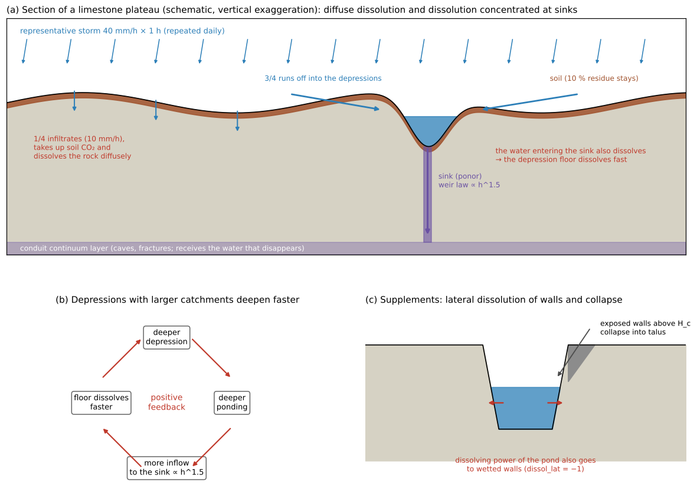
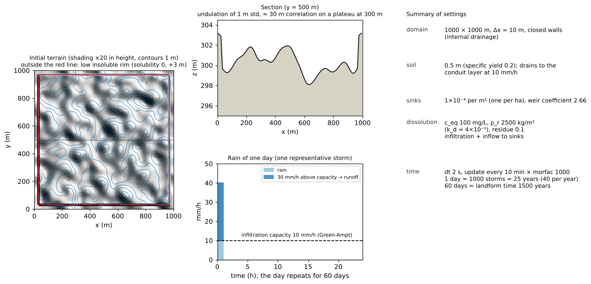
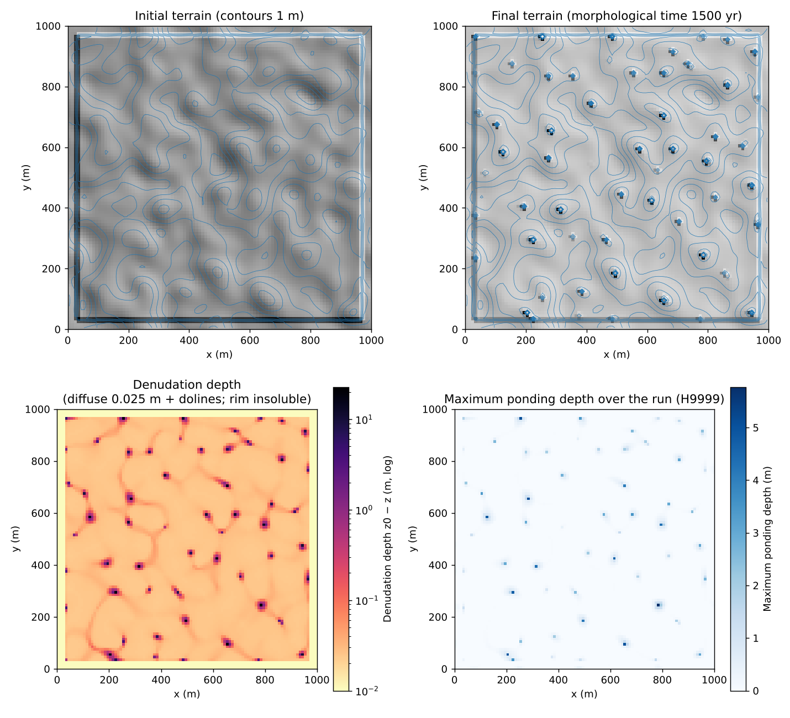
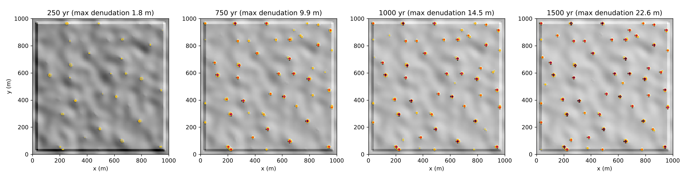
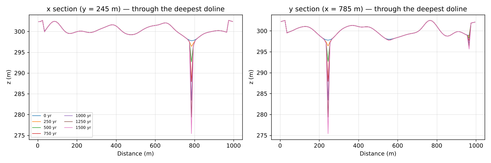
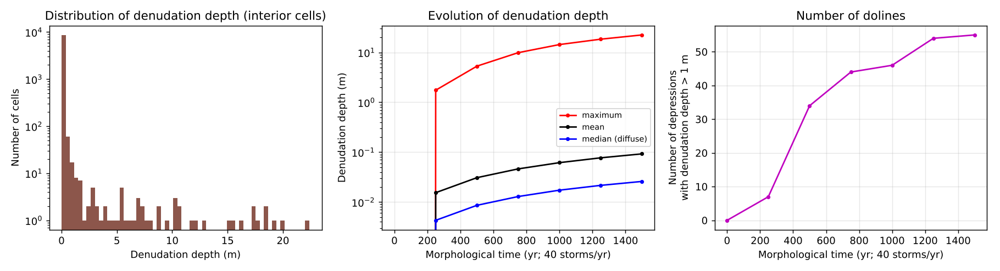
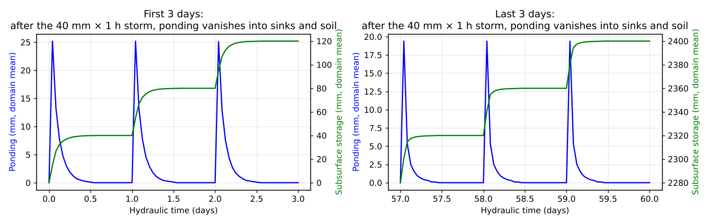
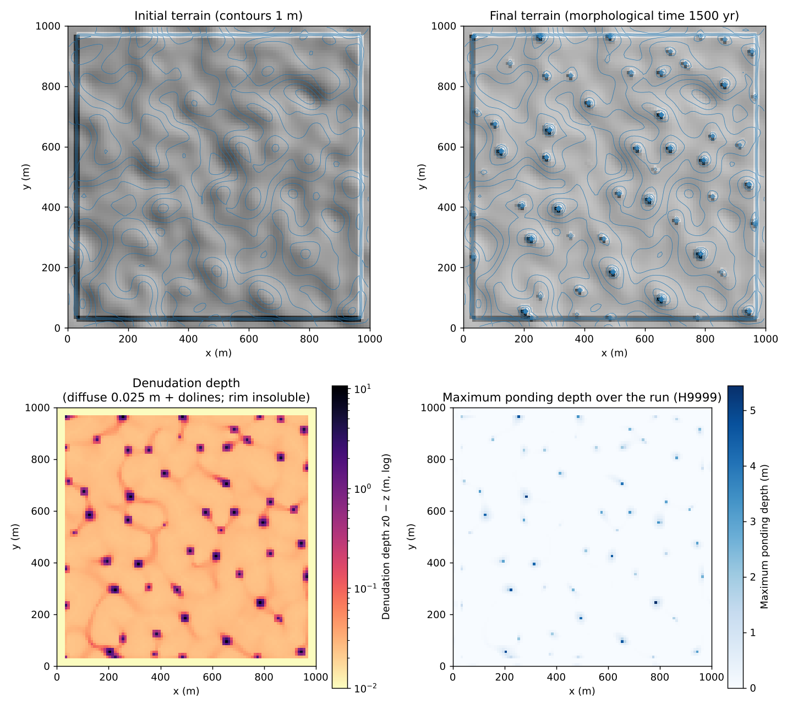
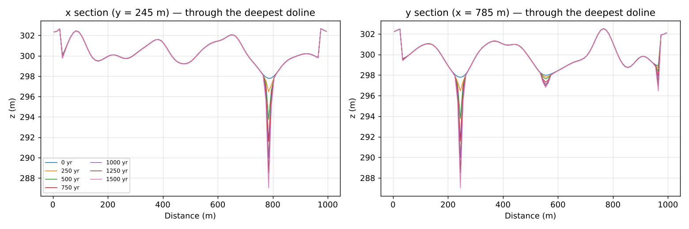
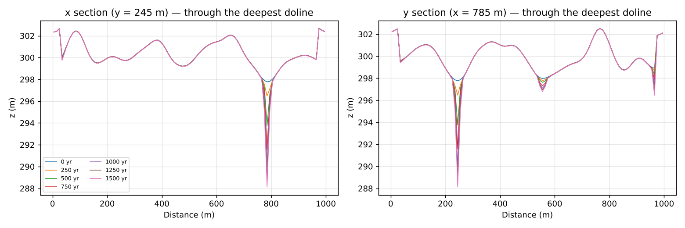

# karst — a field of dolines on a limestone plateau (karst landforms by dissolution and sinks)

> English mirror of examples/karst/README.md. The Japanese file is the master copy.

[日本語](../README.md)

This example repeats a representative storm on a limestone plateau and follows, in a single
run, how depressions deepen selectively into a field of dolines (closed depressions) and the
hydrology of internal drainage, in which the surface water disappears underground. The rock is
dissolved by [limestone dissolution](../../../docs/en/users_guide/geomorph.md#limestone-dissolution-f_dissol)
(f_dissol: diffuse dissolution by infiltrating water and concentrated dissolution by water flowing
into sinks), and the surface water is dropped underground by the inlets (sinks) of the conduit
continuum layer of [groundwater](../../../docs/en/users_guide/gwflow.md). The supplements add
lateral dissolution of walls in contact with ponded water and collapse of the walls, and compare
the shape of the depressions. The values are schematic, chosen to show the style of formation,
and do not reproduce the rates or forms of real landforms. The figures of the results have
Japanese labels (shared with the Japanese version).

## What happens in real karst

- **Rain water dissolves limestone**: rain water takes up carbon dioxide in the soil, becomes a
  weak acid and dissolves limestone. The dissolved rock is carried away with the water, and the
  surface is lowered little by little. Chemical denudation rates of karst are about 20 to
  100 mm/kyr, set by the amount of infiltrating water and how much it can dissolve (White 1984;
  Gabrovšek 2009).
- **Surface water disappears underground (internal drainage)**: limestone plateaus have almost no
  rivers; rain water flows through fractures and sinks (ponors) into networks of caves and
  fractures underground (Ford and Williams 2007).
- **Dolines deepen where water gathers**: when a fractured layer near the surface (the epikarst)
  gathers water below a depression, dissolution concentrates there, the depression deepens and it
  gathers even more water. There is an explanation of the development of dolines and cockpits
  (groups of depressions) by this way of gathering water (Williams 1985).
- **Fields of dolines**: many depressions line up on a plateau, and those with larger catchments
  grow larger. The paths along which water flows towards the depressions also dissolve faster
  than their surroundings.
- **Residue**: insoluble components of the limestone (clay and the like) remain as red soil
  (terra rossa).

## Mechanisms needed for the reproduction



Schematic. (a) Section of a limestone plateau (vertical exaggeration): of a representative storm,
the 1/4 up to the infiltration capacity soaks in and dissolves the limestone diffusely, and the
remaining 3/4 becomes surface flow and gathers in the depressions. The water falling underground
through the sink of a depression also dissolves the rock, so the floor of the depression
dissolves in a concentrated way. (b) The positive feedback by which depressions with larger
catchments deepen faster. (c) Supplements: lateral dissolution of walls in contact with ponded
water, and collapse of exposed walls.

| Real phenomenon | Mechanism in the model | Setting |
|---|---|---|
| Rain water dissolves limestone | Dissolution proportional to the amount of recharge $`dz/dt = -k_d f_{\rm sol} q`$ ($`k_d = c_{\rm eq}/\rho_{\rm r}`$ = 4×10⁻⁵; the dissolved rock is removed from z and only the residue stays in the soil) | `f_dissol = 1`, `dissol_ceq`, `dissol_rho`, `dissol_src = 1` (infiltration) |
| Rain that cannot infiltrate ponds in depressions | Green-Ampt infiltration (capacity 10 mm/h < rain 40 mm/h) and shallow-water flow | `gw_ksv_mmh = 10` |
| Water goes underground through sinks in the depressions | Inlets (sinks) of the conduit continuum layer; inflow by a weir law (∝ h^1.5) of the ponding depth h | `f_gwconduit = 1`, `gwc_inlet`, `gwc_cw` |
| The water falling into sinks also dissolves | Dissolution proportional to the inflow into the sinks is added | `dissol_sink = 1`, `dissol_fsink` |
| The water that disappeared (caves, fracture networks) | The conduit layer is a receptacle without lateral flow (capacity 2000 m) | `gwc_cnd_m2s = 0`, `gwc_cap` |
| Water in the soil also drains underground | Exchange from the soil to the conduit layer (10 mm/h) | `gwc_leak_layer = 1`, `gwc_leak_mmh` |
| Insoluble components remain as soil | 10 % of the dissolved rock volume stays in the soil | `dissol_fres = 0.1` |
| The edge of the plateau is not limestone | Distribution of solubility (0 on the 3 edge cells) | `fn_dissol` |
| A long time | The representative storm is repeated on a daily cycle and only the landform change is accelerated by morfac | `t_cycle_c = "1d"`, `morfac` |
| (Supplement) walls in contact with ponded water dissolve | Lateral dissolution: the dissolving power of the pond is also distributed to wetted walls | `dissol_lat = -1` |
| (Supplement) exposed walls collapse | Rockfall and talus (bedrock without soil also collapses) | `f_rockfall`, `rf_bedrock = 1` |

The dissolution rate has the form of the maximum denudation rate of White (1984): the amount of
infiltrating water times how much it can dissolve, $`c_{\rm eq}`$ (effective solubility). The
carbonate chemical equilibrium is not solved; the effects of soil CO₂ and temperature are folded
into the single $`c_{\rm eq}`$. Dolines form by themselves because the positive feedback — a
deeper depression gives deeper ponding, the inflow into the sink (weir law ∝ h^1.5) increases and
the floor dissolves faster — closes with the exchange laws between the surface and the conduit
layer alone. The distribution of sinks is given; it is a uniform small density so that a sink can
form anywhere.

## Geometry and settings



Left: initial terrain (shading with heights exaggerated 20 times, contours every 1 m; outside the
red line is the insoluble rim). Upper middle: section (y = 500 m). Lower middle: rain of one day
and the infiltration capacity. Right: summary of the settings.

1000 m × 1000 m, Δx = 10 m (100 × 100 cells). All four sides are walls, and no water leaves the
domain (internal drainage).

- **Terrain**: a smooth undulation with a correlation length of ≈ 30 m and a standard deviation of
  1 m (white noise smoothed by a Gaussian kernel; fixed seed) is given to a plateau at 300 m,
  creating many shallow closed depressions (seeds of dolines; no particular spacing is introduced).
  The 3 edge cells form a low insoluble ridge (solubility 0, +3 m; a band of non-limestone rock).
- **Rain**: a representative storm of 40 mm/h × 1 hour, repeated on a daily cycle for 60 days
  (`t_cycle_c = "1d"`).
- **Soil and infiltration**: soil 0.5 m (specific yield 0.2), Green-Ampt 10 mm/h. 1/4 of the storm
  soaks in (the water of diffuse dissolution) and 3/4 becomes surface flow. Water in the soil drains
  to the conduit layer at 10 mm/h.
- **Sinks**: inlets of the conduit continuum layer at 1×10⁻⁴ per m² (one per ha), weir coefficient
  2.66. The conduit layer has no lateral flow (the conduit layer of each cell only stores water),
  with capacity 2000 m, bottom of the head 1000 m below the surface and storage coefficient 1, as a
  receptacle for the water that disappears underground.
- **Dissolution**: effective solubility c_eq = 100 mg/L, rock density 2500 kg/m³ (k_d = 4×10⁻⁵).
  Both the infiltration and the inflow into the sinks dissolve. Residue fraction 0.1.
- **Time**: dt = 2 s; the landform is updated every 10 minutes with morfac = 1000 (1 day = 1000
  storms; at 40 a year, 25 years). 60 days = landform time 1500 years. Z, H, Hg and Hgc are written
  every 10 days.

| Case | Settings file | Content | Run time (approx.) |
|---|---|---|---|
| Main case (only the floor dissolves) | param.txt | dissolution by infiltration and by inflow into the sinks | about 1 hour (4 threads) |
| Supplement: lateral dissolution | param_lat.txt | + lateral dissolution of walls in contact with ponded water (`dissol_lat = -1`) | about 1 hour |
| Supplement: lateral dissolution + collapse | param_rock.txt | + rockfall and talus (H_c = 5 m, window radius 10 m, `rf_bedrock = 1`) | about 1 hour |

## How to run

```
cd examples/karst
make                                        # link to the executable and inputs (make_terrain.py writes z.txt, sol.txt)
make run                                    # main case (about 1 hour)
python3 plot_setup.py                       # figs/mechanism.png, setup.png (does not use the results)
python3 plot_results.py | tee analysis.txt  # figs/maps, evolution, sections, stats, hydrograph.png and the tables
make supp                                   # the 2 supplementary cases (about 1 hour each)
python3 plot_results.py param_lat.txt       # lateral dissolution: figs/*_lat.png
python3 plot_results.py param_rock.txt      # lateral dissolution + collapse: figs/*_rock.png
```

With the argument `en` the figures are drawn with English labels into en/figs/
(`python3 plot_setup.py en`, `python3 plot_results.py en`, `python3 plot_results.py param_lat.txt en`
and so on).

## Results

> **Note (2026-11-02)**: the numbers and figures of this example were computed with f_opening_dynamic = 2
> (recomputed on 2026-11-02 in the documentation branch, whose default was 2). The default of main has been 3
> since 2026-10-31 (developer.md §68.41 to §68.43); with 3 the surface-flow paths change, so the values change.
> The recomputation with the default 3 is still pending (handoff). To reproduce the README values, write
> `fn_enc = "-"` in `&list_sysparam` and `f_opening_dynamic = 2` in `&list_enc` of the param files.



Upper left: initial terrain, upper right: final terrain (landform time 1500 years; shading and
contours). Lower left: denudation depth z₀ − z (logarithmic; diffuse dissolution is 0.025 m, the
black dots are dolines; the edge does not dissolve). Lower right: maximum ponding depth over the
period.



Terrain (shading) and denudation depth (coloured dots) at landform times of 250, 750, 1000 and 1500
years (the maximum denudation depth is in each title).



Evolution of the x and y sections through the deepest doline.



Left: distribution of the denudation depth (interior cells). Middle: evolution of the maximum, mean
and median (diffuse) denudation depth. Right: number of depressions with denudation depth over 1 m
(dolines).



Domain-mean ponding (blue) and groundwater storage (green) over the first 3 days (left) and the last
3 days (right).

Budget check (tables of `plot_results.py`; landform time 1500 years = 60,000 storms at 40 a year):

| Item | Value |
|---|---|
| Water balance | final S_surf = 0, S_grnd = S_total = 2.400 m = cumulative rain 40 mm × 60 days (the ponding disappears every day) |
| Volume of dissolved rock | loss of surface volume Σ(z₀ − z)Δx² = 81736 m³, ÷ (1 − residue 0.1) = 90817 m³ = 90817 m³ of the ledger (all digits agree) |
| Diffuse denudation | median denudation depth of cells that did not pond 0.025 m = 16.7 mm/kyr (infiltrating rain ≈ 0.4 m/yr × k_d 4×10⁻⁵) |
| Concentrated denudation | maximum 22.6 m (900 times the diffuse denudation); 52 depressions with denudation depth > 2 m (deepest 22.6 / 20.1 / 19.3 / 18.6 / 18.4 m) |
| Breakdown of the volume | diffuse ≈ 22000 m³ (27 %), concentrated (dolines and drainage paths) ≈ 60000 m³ (73 %) |

The conversion of the landform time assumes "one daily cycle = one representative storm, 40 a year"
(1 day × morfac 1000 = 1000 storms = 25 years).

- **Self-organisation of the doline field**: of the initial shallow depressions (closed hollows made
  by the undulation of 1 m standard deviation), those with larger catchments deepen first: 7 at 250
  years, 34 at 500 years, and nearly saturated at 54 to 55 after 1250 years (catchment ≈ 1.5 to 2 ha per
  depression). The deepest doline is 22.6 m at 1500 years, and its depth grows almost in proportion
  to time (with a constant catchment, the inflow is constant).
- **Order-of-magnitude difference from diffuse denudation**: cells that did not pond are lowered by
  only 2.5 cm in 1500 years (16.7 mm/kyr). In the logarithmic map of the denudation depth (lower
  left), the paths along which water flows into the depressions appear as **a network of shallow
  drainage paths** that dissolved 2 to 5 times faster than diffuse denudation (the inflow into the
  sinks is larger for as long as the ponded water flows). They are the prototype of dry valleys of
  karst.
- **Hydrology of internal drainage**: just after each storm, ponding of 20 to 25 mm (domain mean)
  appears and disappears into the sinks and the soil within half a day (S_surf → 0). The
  groundwater storage (soil and conduit layer) increases in steps, and no water remains on the
  surface. The ponding peaks in the last 3 days are lower than in the first 3 days (the depressions
  deepened and the inflow became faster).
- **Limits of the form**: the dolines are deep holes 1 to 2 cells (10 to 20 m) wide and do not take
  the funnel shape of real dolines (retreat of the slopes). This is because a sink is a "point in a
  cell" and the water gathers into the deepest cell. Adding lateral dissolution halves the depth and
  doubles the width, but the hole shape remains (supplement).

## Supplement: lateral dissolution (param_lat.txt; dissol_lat = −1)

[Lateral dissolution](../../../docs/en/users_guide/geomorph.md#limestone-dissolution-f_dissol), which
distributes the dissolving power of the ponded water also to "neighbouring cells whose floor is
higher than the water surface (rock walls)" by the ratio of wetted areas hΣL/(hΣL + Δx²), is added to
the main case.

| Item | Floor only (param.txt) | With lateral dissolution (param_lat.txt) |
|---|---|---|
| Volume of dissolved rock (ledger = difference of surface volume ÷ 0.9) | 90817 m³ | 89510 m³ (a redistribution, so the total is the same; the difference comes from different paths of ponded water) |
| Diffuse denudation (median of cells that did not pond) | 0.025 m | 0.025 m |
| Deepest doline | 22.6 m | 10.7 m |
| Mean denudation of the 8 neighbours of the deepest doline | 0.56 m | 2.03 m |
| Cells with denudation depth > 1 m / > 2 m / > 5 m | 77 / 53 / 38 | 163 / 68 / 22 |
| Depressions with denudation depth > 2 m | 52 | 49 |



Same layout as the figure of the main case (maps.png), with lateral dissolution.



- With the distribution to the walls, the excavation of the deepest part is halved and the
  neighbouring cells go down 4 times as much, doubling the area deeper than 1 m. The number of
  depressions does not change (which depressions deepen is set by the catchments; lateral
  dissolution changes their shape).
- Still, the hole shape remains. Even as the wall cells dissolve, they stay higher than the water
  surface of the pond (a few metres above the floor of the hole), so the water does not spread, and
  the distribution shared among the 8 wall cells is smaller than what concentrates on the one floor
  cell.

## Supplement: lateral dissolution + rockfall and talus (param_rock.txt; f_rockfall, rf_hc = 5 m, rf_bedrock = 1)

[Rockfall and talus](../../../docs/en/users_guide/geomorph.md#rockfall-and-talus-f_rockfall) is added
to param_lat.txt. The walls of the depressions are bedrock without soil, so the setting that also lets
bedrock collapse (`rf_bedrock = 1`) is used, and half of the part of the drop to the lowest point within
a one-cell window (`rf_rc = 10 m`) exceeding the critical height H_c = 5 m is dropped into the hole at
each update as talus (ht; also added to the soil sd) (angle of repose of talus 35°).

| Item | With lateral dissolution | + collapse (H_c = 5 m) |
|---|---|---|
| Rock moved by collapse (ledger) | — | 663 m³ (20,000 edge updates; talus up to 2.5 m) |
| Deepest doline (surface) | 10.7 m | 9.7 m |
| Soil thickness of the deepest doline | 1.7 m (residue) | 2.8 m (residue + talus 1.1 m) |
| Mean denudation of the 8 neighbours | 2.03 m | 2.16 m |
| Cells with denudation depth > 1 m / > 2 m | 163 / 68 | 165 / 70 |



- Collapse only keeps the exposed face of the walls near H_c = 5 m, and the surface form hardly
  changes (the denudation of the neighbouring cells increases by 0.1 m and the deepest part becomes
  1 m shallower). Dissolution continues below the talus (dissolution of the floor lowers z and keeps
  the soil), so the floor of the hole goes down while covered by talus, and the walls follow by
  collapsing by as much as the drop exceeds H_c.
- To widen holes 10 m deep into funnels, H_c must be made much smaller (a third of the hole depth or
  less), the window `rf_rc` widened so that whole wall faces are targeted, or the grid made finer
  (with Δx = 10 m the hole is one cell wide, so only the edges of the 8 neighbouring cells collapse).
  An example in which the feet of towers collapse is [tower_karst](../../tower_karst/en/README.md).

## What this model cannot represent (differences from the real phenomenon)

- **Caves have no shape**: the conduit layer is "a receptacle for the water that disappeared
  underground"; the geometry of caves and their growth by flow are not treated. Flow to springs is not
  treated in this example either.
- **The dissolving power is constant**: water always dissolves an amount c_eq (a constant unsaturated
  rate), so the weakening of the dissolving power as the water approaches saturation downstream is not
  represented. Evapotranspiration is not subtracted either.
- **Shape of the dolines**: the dolines are deep holes 1 to 2 cells wide; retreat of the slopes into a
  funnel shape is not represented sufficiently even with lateral dissolution or collapse (supplements).
- **The distribution of sinks is given**: the density of sinks is a given uniform value and does not
  change with time.
- **The rates are 1 to 2 orders faster than real**: dolines over ten metres deep form in 1500 years
  because 3/4 of the storm becomes surface flow and the catchment of 1 ha falls into one cell; this is
  an "experiment on the style of formation", 1 to 2 orders faster than real landforms (0.1 m/kyr
  class).
- **The coefficients are not calibrated**: c_eq and ρ_r are representative values for limestone
  regions; the density of sinks, the weir coefficient and the infiltration capacity were chosen within
  the range where the style of formation is visible.

## Notes

- **Upper limit of morfac**: dissolution is local, linear and unconditionally stable, but if "the depth a
  depression can be dug in one landform update" is large compared with the ponding depth, the positive
  feedback — water gathers into that depression → the inflow increases → it is dug further — runs away
  **within one storm** (in this set-up morfac = 10⁴ breaks down within a few hours; 10³ is stable).
  Choose a morfac for which Δz per update is much smaller than the ponding depth. To extend the landform
  time, chain restarts.
- **Safety valve dissol_dzmax**: with a cap on the dissolution per cell and update (the dissolving power
  beyond it is discarded), morfac = 10⁴ also runs (testing dzmax = 0.05 m for 3 days = 30 days at 10³:
  the mean lowering of the plain, 0.037 m, is almost equal to 0.041 m at 10³, but the deepest sink, −3.6
  m, is shallower than −9.9 m at 10³ = the growth of the holes is capped). It is not suited to studying
  the depth of the holes.
- **Receptacle of the sinks**: when the head of the conduit layer reaches the surface, the inflow stops
  and water remains in the depressions (with a storage coefficient of 0.1 and a depth of 50 m this
  happened within 10 days). This example uses a storage coefficient of 1, a depth of 1000 m and a
  capacity of 2000 m, a receptacle into which water "disappears underground". To represent springs, add
  lateral flow `gwc_cnd_m2s` and an outfall `fn_gwc_outfall` ([qanat](../../qanat/en/README.md),
  [test/coastal_drain](../../../test/coastal_drain/en/README.md)).
- **Edge**: the 3 edge cells are an insoluble ridge (+3 m), and flow from the edge enters the interior.
  All four sides are walls, so cells next to the edge tend to deepen through catchment along the ridge.
- Verification: [test/dissol](../../../test/dissol/en/README.md) (comparison of dissolution with the
  analytical solution).

## Starting points for sensitivity experiments

- `gwc_inlet` (density of sinks), `gwc_cw` (weir coefficient): number and spacing of the dolines.
- `gw_ksv_mmh` (infiltration capacity): partition between diffuse dissolution and surface flow.
- `dissol_ceq`: rate of dissolution (k_d).
- `morfac` and `dissol_dzmax`: how landform time is gained (notes above).
- `dissol_lat`, `rf_hc`, `rf_rc`: shape of the depressions (supplements).

## References

- Ford, D. and Williams, P. (2007): *Karst Hydrogeology and Geomorphology*. John Wiley & Sons,
  Chichester.
- Gabrovšek, F. (2009): On concepts and methods for the estimation of dissolutional denudation rates in
  karst areas. *Geomorphology*, 106, 9–14.
- White, W. B. (1984): Rate processes: chemical kinetics and karst landform development. In: La Fleur,
  R. G. (ed.) *Groundwater as a Geomorphic Agent*, Allen & Unwin, 227–248.
- Williams, P. W. (1985): Subcutaneous hydrology and the development of doline and cockpit karst.
  *Z. Geomorphol. N.F.*, 29(4), 463–482. (checked against the bibliographic record)
