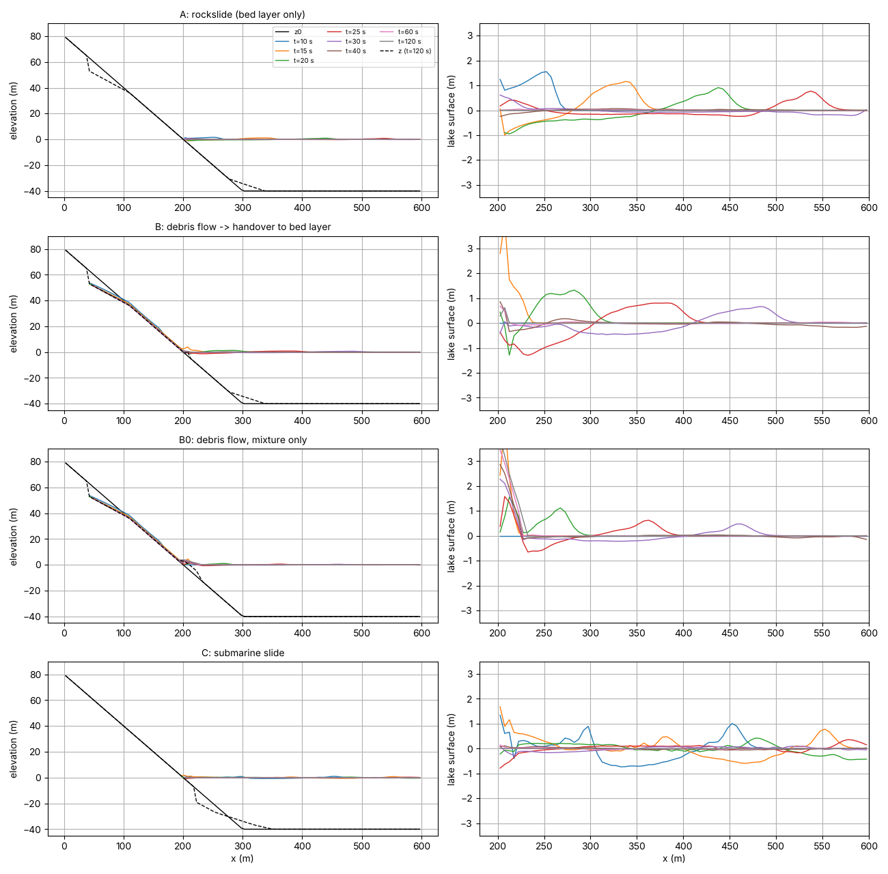
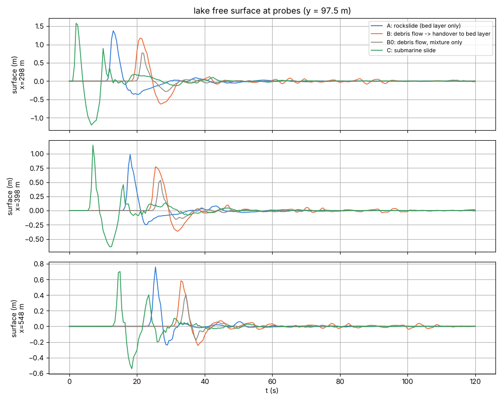
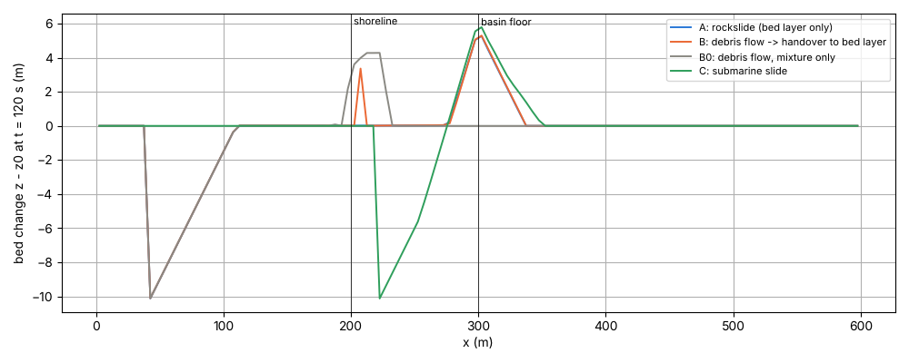
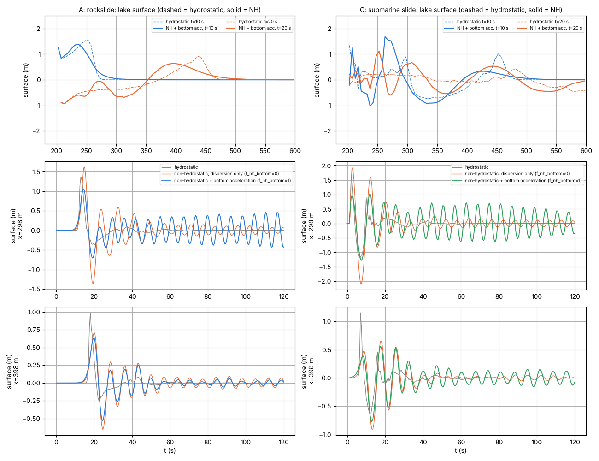

# landslide_tsunami — landslides and debris flows plunging into water and the tsunamis they generate (idealized case set)

> English mirror of examples/landslide_tsunami/README.md. The Japanese file is the master copy.

[日本語](../README.md)

Four patterns that estimate the phenomenon of a failed mass plunging into a
lake (reservoir, bay) and generating surface waves, using a combination of the
**moving bed layer f_bedslide** (developer.md §61, docs/landslide_tsunami_plan.md)
and the debris-flow model (f_debris), plus variants that superimpose the
**one-layer non-hydrostatic correction** (developer.md §69) on the two
bed-layer-only patterns (A and C). The settings are organized by the types
likely to be used in practice, so that the results can be compared side by
side on the same terrain with the same collapse volume. No code changes
(settings only).

## Common geometry

600 m × 200 m, dx = dy = 5 m. For x < 200 m a slope of gradient 0.4
(shoreline at x = 200 m, still-water surface e0 = 0); the same gradient
continues down underwater, and for x ≥ 300 m a flat lake bottom (z = −40 m).
The west edge is the mountain side (wall); the east, north and south edges
are long-wave radiation boundaries. The water body is of the "solved sea"
type (no sea mask; represented by the initial water level f_htype=2. The sea
of a sea mask is not solved and so cannot be a tsunami source). The collapse
is a planar slide of volume 19,110 m³ (slip-surface gradient 0.25,
daylighting at the ground surface at the lower end; make_init.py).

## The four patterns

| Case | Parameter file | On land | Underwater | Use |
|---|---|---|---|---|
| A | param_rockslide.txt | Bed layer hb (fn_bsinit) | Bed layer hb | Plunge of a dry large-scale collapse (debris avalanche, sector collapse). Inertia-free, driving head including buoyancy, a single model from land to water |
| B | param_debrisflow.txt | Debris-flow model (mixture hs; with inertia) | Handover to the bed layer hb in the ponded zone (bs_hplunge) | Plunge of a water-rich debris flow. The momentum exchange of the plunge is carried by the mixture (shallow-water equations), and after deceleration it is handed over to the bed layer |
| B0 | param_mixture_only.txt | Mixture | Stays a mixture (no handover) | Control for B. Shows the limit of a one-layer model (it does not run underwater) |
| C | param_submarine.txt | — | The mass on the underwater slope is mobilized as a bed layer | Submarine landslide (tsunami with a leading trough) |

The handover settings of B are the following four. The reasons are in
"Properties to be aware of" below.

```
bs_hplunge  = 2.0   ! hand over in cells with a ponded depth of 2 m or more
f_bsplunge  = 1     ! judge the ponded depth at still water (initial surface − current bed)
f_bsvplunge = 1     ! hand over after the mixture has slowed to the terminal velocity of the bed layer or below
bs_tstop    = 15.0  ! fix to the terrain only cells whose slow motion has lasted 15 s
```

## Non-hydrostatic versions (A and C)

| Case | Parameter files | Correction | What to look at |
|---|---|---|---|
| A_nh0 / C_nh0 | param_rockslide_nh0.txt / param_submarine_nh0.txt | f_nonhydrostatic=1, f_nh_slope=1 (bottom-slope terms) | The dispersion of the propagation only |
| A_nh / C_nh | param_rockslide_nh.txt / param_submarine_nh.txt | The above + f_nh_bottom=1 (moving-bottom acceleration term) | Dispersion + attenuation of the short waves from the bottom displacement to the surface (one-layer approximation of the Kajiura filter) |

The non-hydrostatic correction cannot be superimposed on B and B0 (debris-flow
model f_debris) (init stops; the free surface of the mixture, E + Hs, is
incompatible with the premise of the projection).

## How to run

```
cd examples/landslide_tsunami
make                                   # link to ../../bin/encflow and inputs (z.txt, slide.txt, submarine.txt)
./encflow param_rockslide.txt          # hydrostatic: 3–7 s each (120 s of simulation; gfortran, 4 threads)
./encflow param_debrisflow.txt
./encflow param_mixture_only.txt
./encflow param_submarine.txt
./encflow param_rockslide_nh0.txt      # non-hydrostatic: 15–35 s (250–900 CG iterations per step)
./encflow param_rockslide_nh.txt
./encflow param_submarine_nh0.txt
./encflow param_submarine_nh.txt
python3 plot_results.py                # figs/*.png and tables
```

The outputs are result_A / result_B / result_B0 / result_C and result_A_nh0 /
result_A_nh / result_C_nh0 / result_C_nh: Hb (bed-layer thickness), Vb
(bed-layer velocity), Hs (sediment column of the mixture), Z (terrain),
E (water level = z+h; the free surface of mixture cells is E + Hs) and the
time series in probes/.

## Results: the four hydrostatic patterns (recomputed 2026-10-06 and, with the default f_opening_dynamic = 3, on 2026-10-31; gfortran, dt = 0.05 s)

Recomputed after the fix of a real bug in the advection scheme (developer.md
§69.9; out-of-domain reference of the "further upwind" cell in MUSCL) since
the first version of 2026-09-30. The bed-layer-only A and C are unchanged;
B and B0, which use the mixture, changed in the deposition in the shoreline
zone and in the leading wave.
Recomputed on 2026-10-31 with the default f_opening_dynamic = 3 (developer.md §68.41): A and
C, which use only the bed layer, are nearly the same (the stopped and moving volumes of the bed
layer move by a few %), while B and B0, whose mixture flows down the land, change in the
deposition in the shoreline zone and in the leading wave (shoreline zone of B 1,164 → 883 m³,
leading wave +1.0 → +1.2 m; reach of B0 242 → 232 m, leading wave +0.5 → +0.8 m). The tables and
figures show the recomputed values.



Left: evolution of the ground and the free surface z+h+hs along the central
section (y = 97.5 m). The dashed line is the terrain at t = 120 s. Right:
enlargement of the lake surface.



Water-surface time series at three points in the lake (slope foot x = 298,
lake center 398, far-shore side 548 m). The propagation speed is
√(g·40) ≈ 20 m/s.



Terrain change at t = 120 s. In A, B and C the deposition gathers at the edge
of the flat lake bottom (x ≈ 300 m); in B0 (mixture only) it piles up within
50 m of the shoreline.

| Case | Deposition in the shoreline zone (x 200–275 m) | Lake bottom (275–350 m) | Runout | Leading wave x=298 m | x=548 m |
|---|---|---|---|---|---|
| A debris avalanche | 213 m³ | 18,820 m³ | 332 m | +1.37 m (13 s) | +0.76 m (25 s) |
| B debris flow → handover | 883 m³ | 17,351 m³ | 332 m | +1.17 m (21 s) | +0.58 m (33 s) |
| B0 mixture only | 9,482 m³ | 0 m³ | 232 m | +0.77 m (21 s) | +0.41 m (34 s) |
| C submarine landslide | 1 m³ | 17,514 m³ | 348 m | +1.58 m (2 s) / −1.20 m | +0.70 m (15 s) / −0.54 m |

Interpretation:

- **A and B have almost the same underwater runout** (332 m). A moves at the
  terminal velocity from right after release, so it reaches the shoreline
  early (8 s); B flows down the land as a mixture with inertia and hands
  over after plunging (15 s). B leaves 880 m³ in the shoreline zone before
  the handover, and its leading wave is +1.2 m against +1.4 m for A.
- **B0 does not run underwater.** The mixture loses its driving once the
  water surface becomes flat, so a wave from the increase in column height
  right after plunging (+0.8 m) appears but the sediment stays at the
  shoreline (the "free surface" of 3.4 m at x = 212 m is not water but a
  piled-up sediment column). To use the terrain results (position and
  thickness of the deposit), use B or A.
- **In C the trough leads.** The bottom drops at the scar (x 220–290 m) and
  the surface drops with it, rising on the deposition side. At x = 298 m,
  +1.6 m from the uplift of the deposition front right after release,
  followed by −1.2 m from the scar.
- The "plunge speeds" in the Log of B are the volume-weighted means of the
  mixture velocity at handover (3.1 m/s) and the terminal velocity of the bed
  layer (7.2 m/s). The mixture has mixed with the water column and
  decelerated before reaching the plunge cells, so in this case the handover
  loses no momentum (see the item on the bias below).

## Results: comparison with the non-hydrostatic versions (2026-10-06; recomputed 2026-10-31 with the default f_opening_dynamic = 3)



Top: lake surface along the central section (thin lines = hydrostatic, thick
lines = non-hydrostatic + acceleration term). Middle and bottom:
water-surface time series at the slope foot (x = 298 m) and the lake center
(x = 398 m) (grey = hydrostatic, orange = non-hydrostatic without the
acceleration term, blue/green = non-hydrostatic + acceleration term).

| Case | x=212 m | x=298 m | x=398 m | x=548 m | Underwater bed layer: stopped / moving (m³) |
|---|---|---|---|---|---|
| A hydrostatic | +1.53@8s / -1.08 | +1.37@13s / -0.36 | +0.99@18s / -0.25 | +0.76@25s / -0.24 | 18,372 / 738 |
| A non-hydrostatic (no acceleration term) | +1.58@8s / -1.07 | +1.62@15s / -1.36 | +0.71@20s / -0.65 | +0.39@27s / -0.37 | 18,265 / 845 |
| A non-hydrostatic + acceleration term | +1.53@8s / -1.06 | +1.06@15s / -0.71 | +0.64@20s / -0.53 | +0.36@26s / -0.30 | 15,350 / 3,760 |
| C hydrostatic | +1.79@13s / -2.71 | +1.58@2s / -1.20 | +1.15@7s / -0.64 | +0.70@15s / -0.54 | 19,099 / 11 |
| C non-hydrostatic (no acceleration term) | +1.93@14s / -2.95 | +1.95@2s / -2.09 | +0.65@18s / -0.91 | +0.44@25s / -0.50 | 19,076 / 34 |
| C non-hydrostatic + acceleration term | +1.90@12s / -2.34 | +1.04@12s / -1.28 | +0.56@17s / -0.77 | +0.37@25s / -0.44 | 15,721 / 3,389 |

Each entry is maximum@time / minimum (m). The bed-layer column gives the
stopped and moving volumes at 120 s.

- **Dispersion halves the far-field leading wave.** At the lake center
  (x = 398) 0.99 → 0.64–0.71 m, on the far-shore side (548) 0.76 →
  0.36–0.39 m (A). The ratio of the slide length (70 m) to the water depth
  (40 m) is small (kH ≈ 1–3), in the range where the waves split and decay
  under the dispersion relation of the one-layer NH,
  ω² = gHk²/(1 + k²H²/4). The hydrostatic version (no dispersion) is on the
  side of overestimating the far-field wave height by about a factor of 2.
- **The acceleration term acts in the near field (directly above the
  deposition zone).** The leading wave at the slope foot (x = 298) is
  1.62 / 1.95 m without the acceleration term (higher than hydrostatic: the
  bottom displacement of the 1–2 cells at the front of the slide is mapped to
  the surface without attenuation) and 1.06 / 1.04 m with it (the Kajiura
  filter removes the short waves). The effect on the far field is within
  10 %.
- **[Limitation] Self-excited oscillation with the bed layer.** With the
  acceleration term an oscillation of period 6 s and ±0.4–0.5 m remains at
  the slope foot without decaying until 120 s (developer.md §69.10). The
  dispersion relation of the one-layer NH saturates for short waves at
  ω → √(4g/H) (T = 6.3 s) and the group velocity becomes 0, so the short
  waves excited by the front of the slide stay where they were generated and
  shake the driving head Φ = z + r·h of the bed layer, and part of the bed
  layer (A 3,800 m³, C 3,400 m³) never meets the stopping criterion and
  keeps moving. Without the acceleration term it is about ±0.1 m. **This
  oscillation is superimposed on the water level directly above the
  deposition zone and on the stopped volume**, so for the near-field wave
  height use only the leading wave with the acceleration term (the first
  20 s) and do not read the subsequent oscillation. The proper remedy is a
  multi-layer NH or inertia in the bed layer, both outside the current policy
  (docs/nonhydrostatic_plan.md §16.6).
- Guide for use: if the far-field wave height (the lake center and beyond)
  is the goal, non-hydrostatic (either variant); for the near-field waveform
  directly above the deposition zone, the leading wave with the acceleration
  term; for the terrain of stopping and deposition, hydrostatic or without
  the acceleration term. The run time is 3–8 times that of hydrostatic (CG
  iterations).

## Properties to be aware of (reasons for the settings)

- **Give the failure surface as a plane that daylights at the ground
  surface.** A box of constant depth becomes a pit with a wall on the
  downstream side; an inertia-free flow driven by the surface slope cannot
  climb the step and the mass stays in the pit (the same for the mixture).
- **The shoreline zone dewaters temporarily on plunging.** The plunge pushes
  the water offshore and for ten-odd seconds the depth in the shoreline zone
  drops to about 0.1 m. If the bed layer stalls during this time and is
  fixed immediately, an artificial lobe remains at the shoreline, so
  bs_tstop (longer than the dewatering; here 15 s) requires a duration
  before fixing.
- **The handover is judged with the still-water depth** (f_bsplunge=1). If
  judged with the current depth, a mixture arriving during the dewatering is
  not handed over and stays at the shoreline.
- **Hand over after deceleration** (f_bsvplunge=1). While fast, it passes
  its momentum to the water column as a mixture with inertia, and it is
  handed over once it has slowed to the terminal velocity of the bed layer or
  below. In a high-speed plunge (Mayuyama 1792 type, 30–50 m/s)
  "mixture ≫ bed layer" at handover can occur, so check the plunge speeds in
  the Log.
- **The direction of the bias flips with the case** (landslide_tsunami_plan.md
  §4.4). An underwater release (C) reaches the terminal velocity at once, so
  the near-field wave is on the high side; a fast plunge from land is on the
  low side because the handover, or a bed layer continuing from land (A),
  drops on the spot to the underwater terminal velocity. For a fast plunge
  the route of B (on land = mixture) is recommended.
- **The near-field waveform is an estimate.** The hydrostatic version has no
  dispersion (shallow-water equations) and no water drag or added mass.
  Reservoirs, narrow bays and shallow coasts — scales where the long-wave
  approximation holds — are the right place. At scales that need dispersion
  (slide length within a few times the depth) use the non-hydrostatic
  versions (bearing in mind the limitations in "Comparison with the
  non-hydrostatic versions" above).

## Entry points for sensitivity experiments

- bs_mu / bs_xi (friction and turbulence coefficients of the bed layer):
  runout distance and speed → wave-generation efficiency. Named separately
  from db_mu / db_xi on the mixture side (the calibration values differ with
  and without inertia).
- bs_rho: buoyancy ratio r = ρw/ρs. Sets the underwater driving (1−r)∇z and
  the reduction of the friction at the same time.
- Collapse volume and collapse depth (BLOCKS in make_init.py): the wave
  height is roughly proportional to the volume.
- Gradient of the underwater slope (terrain in make_init.py): with a gentler
  slope the bed layer stops before reaching the lake bottom and deposits
  nearer the shoreline (the correct way to represent a shoreline lobe is
  through the terrain).
- dt: set by √(gH) in deep water. At 40 m, dt=0.05 s and dx=5 m give
  CFL≈0.2.

## Related

- Design and verification: docs/landslide_tsunami_plan.md, docs/developer.md §61 (in Japanese)
- Non-hydrostatic correction: docs/nonhydrostatic_plan.md (§16 moving bottom; in Japanese), developer.md §69 (§69.10 moving-bottom acceleration term and coupling with the bed layer; in Japanese), users_guide/swflow.md
- Self-check tests: test/bedslide (analytical velocity, 45° rotated slope, plunge, handover), test/nhbottom (moving-bottom acceleration term; theoretical comparison of a prescribed uplift and coupling with a submarine landslide)
- Users guide: docs/users_guide/geomorph.md "Moving bed layer / landslide tsunami"
