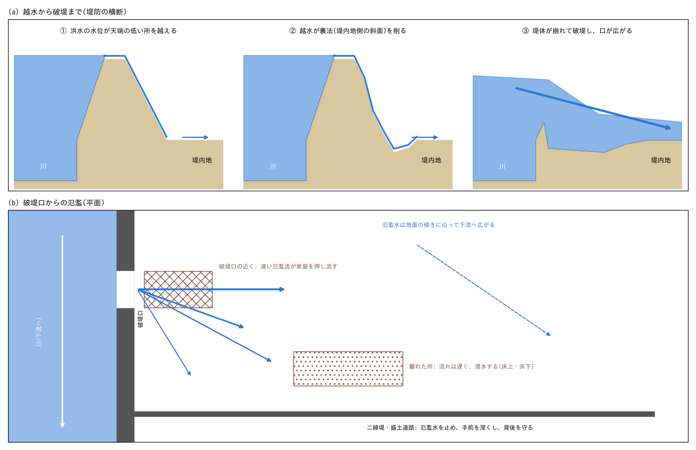
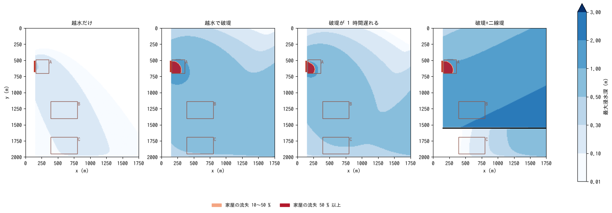
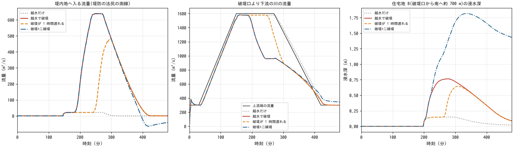
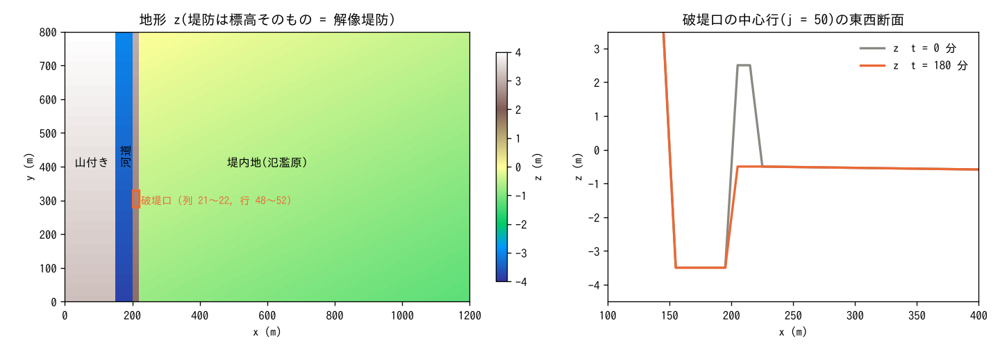
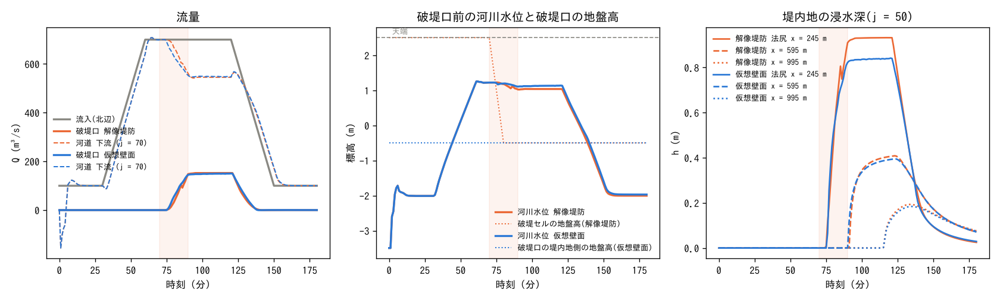
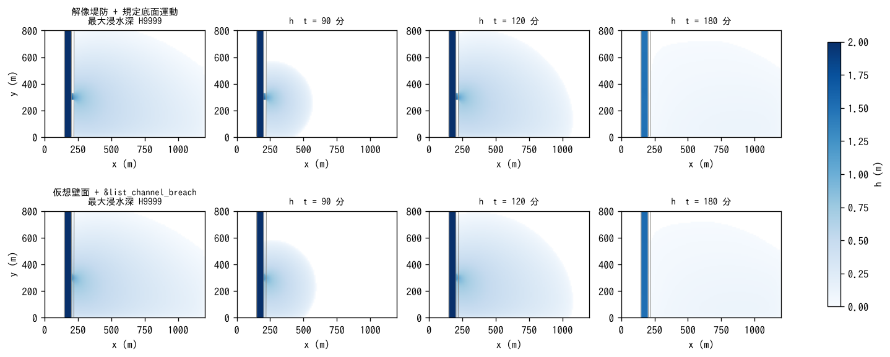

# levee_breach — 越水による破堤の氾濫と、破堤口近くの家屋の流失

[English](en/README.md)

大きな洪水で川の水位が堤防の天端を越えると(越水)、流れ落ちる水が堤防を削り、やがて
堤防が壊れて(破堤)、川の水が堤内地へ一気に流れ込みます。この例題は、天端が周りより
低い区間から越水が始まり、その区間が破堤して口が広がり、氾濫水が堤内地に広がって
破堤口近くの家屋を押し流すまでを一つの計算で解きます。堤防が持ちこたえた場合、破堤が
1 時間遅れた場合、堤内地に二線堤がある場合と比べます。値は現象を見やすくするための
模式値で、特定の破堤の再現ではありません。

## 実際の破堤で起きていること

- **決壊の多くは越水から**: 令和元年東日本台風(2019 年)では全国 142 か所で堤防が
  決壊し、そのうち 122 か所(86 %)は越水が主な原因とされています(国土交通省 2020)。
  越水は、天端が周りより低い所や整備が済んでいない区間から始まります。
- **越水が堤防を削って破堤する**: 天端を越えた水は、堤内地側の斜面(裏法)を速く流れ
  落ちて削り、斜面の下(法尻)から堤体を崩していきます。越水が始まってから破堤する
  までには時間がかかり、その間に避難が進みます。国は「越水した場合でも決壊までの時間を
  少しでも長くする」粘り強い河川堤防の整備を進めています(国土交通省 2022)。
- **破堤口は広がる**: 2015 年の関東・東北豪雨では、鬼怒川の左岸(茨城県常総市)の
  堤防が幅約 200 m にわたって決壊しました(鬼怒川堤防調査委員会 2016)。
- **破堤口の近くでは家屋が押し流される**: 破堤口から出る氾濫流は速く、近くの家屋を
  倒し、押し流します。国は、木造家屋が倒壊・流失するおそれのある範囲を、浸水深と流速
  から「家屋倒壊等氾濫想定区域(氾濫流)」として示しています(国土交通省 2015)。離れた
  所では流れが遅くなり、家屋は浸水(床上・床下)の被害になります。
- **氾濫水は地面の傾きに沿って広がり、盛土で止まる**: 堤内地に入った水は低い方へ
  広がります。二線堤や道路・鉄道の盛土は氾濫水を止め、手前を深くし、背後を守ります。
- **下流の川の流量は減る**: 破堤口から出た分だけ、破堤口より下流の川の流量が減ります。

## 再現に必要な機構



| 実際の現象 | ENCflow での表し方 | 設定 |
|---|---|---|
| 洪水が川を流れ、水位が上がる | 浅水流(河道を地形で表し、上流端に洪水の流量、下流端に等流水深の水位を与える) | `&list_bound_inflow`、`&list_bound_stage` |
| 天端の低い区間から越水する | 堤防を地盤高そのもの(解像堤防)で表し、天端の低い区間を地形に入れる | `fn_z`(make_terrain.py) |
| 越水が堤防を削って破堤し、口が広がる | 破堤口のセルの地盤高を、与えた時刻・幅・深さで下げる(規定底面運動。堤体の侵食は計算しない) | `fn_bedmotion`(make_breach.py が作る) |
| 氾濫水が堤内地に広がる | 浅水流(乾いた地面へ広がる先端の扱い)。氾濫原は下流へ続く(南の辺は自由流出) | `f_exflux_reduction = 1`、`f_bc_s = 1` |
| 家屋が流れを妨げる | 建物の空隙率(住宅地は建物が 3 割を占める) | `fn_gv` |
| 速い氾濫流が家屋を押し流す | 流体力 hV²(浸水深 × 流速²)が閾値を超えると家屋が壊れて瓦礫になり、壊れた分だけ空隙率が上がる | `fn_bldgdebris`、`f_bdcrit = 2` |
| 二線堤が氾濫水を止める | 地形の段(高さ 2 m の盛土) | `fn_z`(z_dike.txt) |

## 幾何と設定


左: 地形(等高線 0.5 m)、天端の低い区間(赤 = 破堤口)、住宅地 A〜C、二線堤(破堤+
二線堤のケースだけ)。右上: 破堤口の中央の横断。右下: 洪水の流量と、越水・破堤の時刻。

1,750 m × 2,000 m、dx = dy = 10 m(175 × 200 セル)。北から南へ 1/1000 で下る谷底平野で、
西から順に山付き、河道(幅 100 m、河床 = 堤内地 − 2 m、粗度 0.03)、堤防(幅 20 m、
高さ 4 m)、堤内地(幅 1.6 km。東へ 1/2000 で下る。粗度 0.05)です。東の辺は台地で
閉じ、南の辺は自由流出(氾濫原が下流へ続く)です。

- **洪水**: 上流端に 300 m³/s(平水)から 150 分で 1,600 m³/s に増え、270 分まで続いて
  420 分で 300 m³/s に戻る流量を与え、下流端に同じ流量の等流水深の水位を与えます。
  河道には平水の水深(1.87 m)を初めから入れておきます。
- **天端の低い区間**: 破堤口の位置の 150 m(行 53〜67)だけ天端が 1 m 低く、洪水の
  ピークの水位がその天端を 0.1〜0.2 m 越えます(ほかの区間には 0.8 m 以上の余裕がある)。
  越水は 147 分ごろから始まります。
- **破堤**: 低い区間の中央の行が 180 分から 20 分で堤内地の地盤高まで下がり、破堤口は
  両側へ広がって 240 分に低い区間の全長(150 m)になります(make_breach.py)。
- **住宅地**: 木造家屋の住宅地 3 か所(A 破堤口のすぐ裏、B 破堤口から南へ約 700 m、
  C さらに南、二線堤の背後)。建物が 3 割を占め(空隙率 0.7)、家屋ストックは
  0.2 m³/m²(壊れると瓦礫になる量)。家屋は流体力 hV² が 2 m³/s² を超えると壊れ始め、
  6 m³/s² 以上で最も速く(7 分弱で全壊)壊れます(家屋破壊の既定の閾値。校正値)。
- **二線堤**: 破堤口から南へ約 950 m の行 155〜156 に、堤防から東の台地まで高さ 2 m の
  盛土(破堤+二線堤のケースだけ)。
- 計算は 8 時間、dt = 0.5 s。

| ケース | 設定ファイル | 破堤 | 二線堤 |
|---|---|---|---|
| 越水だけ | param_overtop.txt | なし(堤防が持ちこたえる) | なし |
| 越水で破堤 | param.txt | 180 分から、240 分に 150 m | なし |
| 破堤が 1 時間遅れる | param_delay.txt | 240 分から、300 分に 150 m(越水しても壊れにくい堤防) | なし |
| 破堤+二線堤 | param_dike.txt | 180 分から、240 分に 150 m | あり |

## 実行方法

```
cd examples/levee_breach
make                    # リンクと入力(make_terrain.py・make_breach.py が data/ に作る)
make run                # 4 ケースを順に計算(1 ケース 4 スレッドで 6〜8 分)
python3 plot_results.py # figs/*.png と数表(引数 en で英語版を en/figs/ に)
```

## 結果



4 ケースの最大浸水深(色)と、家屋の流失(赤。終了時の破壊率)。赤い線 = 破堤口(天端の
低い区間)、四角 = 住宅地、黒い線 = 二線堤。



左: 堤内地へ入る流量(堤防の法尻に沿う測線)。中: 破堤口より下流の川の流量。右: 住宅地 B
の浸水深。

| ケース | 堤内地へ入った水 | 最大流量 | 下流の川の最小流量 | 浸水 0.5 m 以上 | 最大浸水深 | 家屋の流失 A / B / C | 最大浸水深 B / C | B が 0.5 m に達した時刻 |
|---|---:|---:|---:|---:|---:|---:|---:|---:|
| 越水だけ | 18 万 m³ | 22 m³/s | 1,136 m³/s | 0 ha | 0.34 m | 0 / 0 / 0 % | 0.16 / 0.13 m | — |
| 越水で破堤 | 483 万 m³ | 638 m³/s | 796 m³/s | 252 ha | 1.88 m | 51 / 0 / 0 % | 0.82 / 0.66 m | 222 分 |
| 破堤が 1 時間遅れる | 262 万 m³ | 484 m³/s | 796 m³/s | 179 ha | 1.80 m | 34 / 0 / 0 % | 0.70 / 0.55 m | 282 分 |
| 破堤+二線堤 | 445 万 m³ | 640 m³/s | 802 m³/s | 268 ha | 2.63 m | 51 / 0 / 0 % | 2.03 / 0.26 m | 222 分 |

上流端の流量は最大 1,600 m³/s です。家屋の流失は、住宅地の家屋ストックのうち壊れて瓦礫に
なった割合です。

- **越水だけなら被害は小さい**: 天端の低い区間を 0.1〜0.2 m の深さで越える水は最大
  22 m³/s で、堤内地に入るのは 18 万 m³ です。浸水は 0.3 m 程度までで、家屋は壊れません。
- **破堤すると氾濫は 27 倍になる**: 破堤口が広がると、堤内地へ入る流量は最大 638 m³/s
  (川の流量の 4 割)になり、483 万 m³ が入ります。破堤口より下流の川の流量は 1,600 から
  796 m³/s に減ります。0.5 m 以上の浸水が 252 ha に広がり、住宅地 B・C も 0.6〜0.8 m
  浸水します。
- **家屋が流されるのは破堤口のすぐ裏だけ**: 破堤口から出る氾濫流は速く(流速は最大
  4.8 m/s)、住宅地 A の家屋の半分が流失します。家屋が壊れ始める流体力 hV² = 2 m³/s² を
  超える範囲は破堤口から 200 m ほどまでで、B・C は浸水しても壊れません。国が
  「家屋倒壊等氾濫想定区域(氾濫流)」を堤防沿いの帯として示すのと同じ形です。
- **破堤が 1 時間遅れると、氾濫は半分になり、避難の時間が延びる**: 破堤が始まる 240 分
  には洪水のピークが終わりかけていて、堤内地へ入る水は 483 → 262 万 m³(46 % 減)、
  住宅地 A の流失は 51 → 34 % になります。住宅地 B が避難の難しくなる 0.5 m に達するのは
  222 → 282 分と、ちょうど 1 時間遅れます。越水しても決壊までの時間を長くする堤防の効果
  です。
- **二線堤は手前を深くし、背後を守る**: 二線堤の手前の住宅地 B は 0.82 → 2.03 m と深く
  なり、背後の住宅地 C は 0.66 → 0.26 m に浅くなります。南の辺から下流へ出ていく水は
  459 → 173 万 m³ に減ります。二線堤の手前にたまった水は、川の水位が下がると破堤口から
  川へ戻ります(左の図の 420 分以降の負の流量)。

## このモデルで表せないこと(実際の現象との違い)

- **破堤の進み方は与える**: 越水による裏法の侵食、破堤口の拡幅の速さ、破堤口の底が
  洗掘されて深くなること(落堀)は計算しません。破堤口の幅・深さの時間変化は入力
  (実績や経験式)で与えます。堤体の土砂が堤内地へ運ばれて積もることも表しません。
- **家屋の破壊は面的な概算**: 家屋はセルの中の建物の割合(空隙率)と、壊れて瓦礫に
  なる量(家屋ストック)で表します。個々の家屋の構造や、流された家屋がほかの家屋に
  ぶつかることは表しません。壊れる閾値は校正値です。
- **浸水の深さによる家屋の被害は数えない**: 床上・床下浸水の被害は、流失とは別に浸水深
  から読み取ります(この例題は流失だけを数える)。
- **規模**: 河道は 2 km で、上流端と下流端の境界の影響を受けます。下流端の水位は上流端の
  流量に合わせた等流水深で与えているので、破堤で下流の流量が減ったときの水位の低下は
  小さめに出ます。値は模式値です。

## 注意

- **天端の余裕**: 解像堤防では、河道の水位が天端に 0.1〜0.2 m まで近づくと、天端の
  セルに水が乗って越流が始まります(流速 3 m/s 程度の河道)。越水させたくない区間には、
  洪水のピークの水位より十分高い天端を与えてください(この例題は 0.8 m 以上)。
- **初期条件**: 河道の平水の水深は `&list_initial` の `fn_hinit` で与えています。
  `&list_initial` は `&list_sysparam` の `fn_initial = '-'` がないと読まれません。
- **氾濫量の測り方**: 堤内地へ入った水は、堤防の法尻に沿う測線 1 の流量(堤内地向きが
  正)を時間で積分した量です。二線堤のケースでは、破堤口から川へ戻る分(負の流量)を
  差し引いています。

## 感度実験の入口

- `make_breach.py` の `--t0`・`--t1`・`--tdeep`(Makefile の破堤の時刻): 破堤の始まりと
  広がる速さ。
- `--rows`(破堤口の行の範囲)と make_terrain.py の `J_LOW1`・`J_LOW2`(天端の低い区間):
  破堤口の幅。
- `bd_fcrit`・`bd_fcrit2`(家屋が壊れる流体力): 流失する範囲が変わります。
- make_terrain.py の `J_DIKE`・`H_DIKE`(二線堤の位置と高さ): 高さが足りないと二線堤を
  越えます。
- `S_EW`・`S_NS`(堤内地の勾配): 氾濫水の広がる向きと速さ。

## make_breach.py の使い方(自分のケースへ)

```
python3 make_breach.py --z <地盤高> --cols I1 I2 --rows J1 J2 \
    (--floor Z | --floor-col C | --floor-row R) --t0 T0 --t1 T1 [--tdeep TD] [--center K] [--out DIR]
```

- `--cols`・`--rows`: 破堤口のセル矩形(1 スタート。堤防の幅が 2 セルなら
  2 列とも)。長辺が堤防に沿う方向になり、`--center`(既定は中央)の
  セルから外側へ遅れて始まる。
- 堤底: `--floor` は一定値、`--floor-col C` は各行で列 C の地盤高(南北の
  堤防。堤内地側の法尻の列)、`--floor-row R` は各列で行 R の地盤高
  (東西の堤防)。
- `--t0`・`--t1`(分): 開始と、全幅・全深に達する時刻。`--tdeep`(分): 1 セルが
  堤底に達するまでの時間(既定 t1 − t0 = 全セル同時)。
- 出力: `DIR/bmlist.txt`(時刻は秒。各行に窓 `i1 j1 ni nj`)と
  `DIR/breach_NN.txt`(窓だけの累積変位。折れ点の時刻ごと)。ファイル名は
  dir_data 起点なので、dir_data の中で実行します。本体は
  `fn_bedmotion = '-'` と `&list_bedmotion fn_bmlist = 'DIR/bmlist.txt'` だけ。
- 変位ファイルはテキスト行列。GeoTIFF / bil の地盤高(f_input_mode)を
  使う計算では同じ形式に変換してから使う(変換は前処理)。

## 補足: 仮想壁面の破堤との比較

高解像度の地盤高データでは、堤防が標高そのものとして入っています(解像堤防)。この
堤防には[河道の章](../../docs/users_guide/channel.md)の仮想壁面がないので、破堤は
本題と同じく[規定底面運動](../../docs/users_guide/bedmotion.md)で与えます。格子が粗く
堤防をセルで表せない場合は、堤防を仮想壁面(セルの境界に立てる壁)として立て、破堤を
`&list_channel_breach` の天端の時系列で与えます。補足では、同じ破堤を両方の方法で与えて
流量と浸水を比べます。

```
make supp                # 入力(make_supp.py・make_breach.py が data_supp/ に作る)と 2 ケースの計算(1 ケース 30 秒前後)
python3 plot_supp.py     # figs/supp_*.png と数表
```



左: 地形と破堤口。右: 破堤口の中心行(j = 50)の東西断面(計算開始時と破堤後)。

1,200 m × 800 m、dx = dy = 10 m(120 × 80 セル)。北から南へ 1/1000 で下る。西から順に:

| x (m) | セル番号 i | 地形 | 役割 |
|---|---|---|---|
| 0〜150 | 1〜15 | 堤内地 + 4 m | 山付き(西岸。氾濫しない) |
| 150〜200 | 16〜20 | 堤内地 − 3 m | 河道(幅 50 m、粗度 0.03) |
| 200〜220 | 21〜22 | 堤内地 + 3 m | **解像堤防**(幅 20 m) |
| 220〜1,200 | 23〜120 | 東へ 1/2000 で下る | 堤内地(氾濫原。粗度 0.05) |

- 流入: 北辺の河道セル 5 つに流量波形(100 m³/s → 60 分で 700 m³/s、120 分まで維持、
  150 分で 100 m³/s)。下流端(南辺の河道出口 5 セル)は等流水深の水位を波形に同期して
  規定(Q 700 で 4.7 m。天端の 1.3 m 下)。堤内地の南辺・東辺は自由流出。
- 破堤: 列 21〜22 × 行 48〜52(幅 50 m)。堤底は各行で法尻(列 23)の地盤高。70 分に
  中央の行から始まり、各行 10 分で堤底、両側の行は 75 分・80 分から(90 分で全幅・全深)。

| ケース | 設定ファイル | 堤防 | 破堤 | 地形 |
|---|---|---|---|---|
| 解像堤防 | param_supp.txt | z の標高(列 21〜22 が + 3 m) | 規定底面運動(bm/bmlist.txt) | z.txt |
| 仮想壁面 | param_supp_vwall.txt | &list_channel の bank0 = 3 m(堤内地セル標高基準) | &list_channel_breach(5 サイト。同じ時刻。f_br_diag = 1 で斜めエッジも連動) | z_vwall.txt(列 21〜22 を堤内地の地盤高に置換) |



左: 流入波形、破堤口を通る流量(列 23 の測線)、河道下流(j = 70)の流量。中: 破堤口前の
河川水位と破堤セルの地盤高(解像堤防ではプローブ 3 の z 列がそのまま堤防の下がりを示す)。
右: 堤内地の浸水深(法尻・中央・遠方)。帯は破堤の進行中(70〜90 分)。



| ケース | 破堤口の最大流量 (m³/s) / 時刻 (分) | 氾濫量 (万 m³) | 浸水面積 (ha; h > 0.01 m) | 最大浸水深 (m) | 法尻の浸水開始 (分) |
|---|---:|---:|---:|---:|---:|
| 解像堤防 + 規定底面運動 | 152 / 120 | 40.2 | 71.8 | 1.10 | 76 |
| 仮想壁面 + &list_channel_breach(f_br_diag = 1) | 150 / 120 | 41.4 | 71.0 | 0.98 | 76 |

- 解像堤防では、堤防セルが堤底まで下がると破堤口は普通のセルになり、浅水方程式がそのまま
  流れを解きます(8 近傍の全リンクが開く)。河道下流の流量は 700 から 550 m³/s に落ち、
  破堤口で 150 m³/s が堤内地へ出ます。終了時に表示される適用変位の最小 −3.00 m が
  「天端 − 堤底」に一致します。
- 仮想壁面では、サイトにしたエッジが本間公式で通水します。`f_br_diag = 1` でサイトに
  触れる斜めエッジも同じ天端で下がるので、破堤セル 1 つあたりの通過幅はセル幅(法線
  0.414 + 斜め 2 × 0.293)になり、幅 5 セルでは解像堤防の 0.98 倍の流量になります。
  サイトの法線エッジだけを下げる `f_br_diag = 0` では、隣り合うサイトの間の斜めリンクが
  壁のまま残るため流量は 0.44 倍にとどまります(下の表)。セル幅より狭い決壊や粗い格子
  では仮想壁面の破堤、堤防をセルで表した計算では規定底面運動、という使い分けになります。

**破堤幅と流量の関係**(同じ地形で破堤幅を変え、70〜80 分で同時に全壊、100 分の定常
流量を比較):

| 幅(セル数 / サイト数) | 解像堤防 Q (m³/s) | 広頂堰 1.7·B·H^1.5 (m³/s) | 仮想壁面 f_br_diag = 0 Q / 解像比 | f_br_diag = 1 Q / 解像比 |
|---:|---:|---:|---:|---:|
| 1 | 36.5 | 37 | 15.1 / 0.41 | 60.8 / 1.66 |
| 2 | 73.7 | 70 | 29.5 / 0.40 | 86.1 / 1.17 |
| 3 | 105.1 | 102 | 43.1 / 0.41 | 108.5 / 1.03 |
| 5 | 152.3 | 162 | 67.5 / 0.44 | 149.2 / 0.98 |

解像堤防は広頂堰の目安(B = セル数 × dx、H = 河川水位 − 堤底 ≈ 1.5〜1.7 m)に合い、
広いほど堤内地側の水位上昇で堰公式を下回ります(幅 5 セルで 152 対 162)。
f_br_diag = 0 の仮想壁面はサイト 1 本あたり 0.38 dx(法線エッジの通過幅シェア 0.414)の
実効幅でサイト数に比例し、f_br_diag = 1 は幅 3〜5 セルで解像堤防とほぼ同じ(1.03・
0.98 倍)、幅 1 セルでは両端の斜め 2 本(0.59 セル幅)の分だけ過大(1.66 倍)になります。
f_br_diag = 1 の結果は、斜めの対を明示的にサイトに加えた計算と一致します(最大差
0.35 m³/s。斜めサイト自身の基準地盤高が 1 cm 違うため)。検討して採らなかった案は
[河道の解説](../../docs/users_guide/channel_models.md) §4。

補足の注意:

- 下流端を自由流出にすると水面が出口へ向かって下がり(背水曲線の長さ ≈ h/S = 4.7 km)、
  破堤口の水位が天端から 2 m 離れて越流が弱くなります。短い理想化河道では下流端の水位の
  規定が要ります。
- 仮想壁面の天端の基準は `f_bank_datum = 1`(堤内地セル標高基準。既定)を明示して
  います。河床基準(0)にすると、掘り込み 3 m・堤防 3 m のこの地形では天端が堤内地の
  地盤高と同じになり、全長で越流します。

## 参考文献

- 鬼怒川堤防調査委員会(2016): 鬼怒川堤防調査委員会 報告書. 国土交通省関東地方整備局.
- 国土交通省(2015): 洪水浸水想定区域図作成マニュアル(第 4 版). 家屋倒壊等氾濫想定区域.
  https://www.mlit.go.jp/river/shishin_guideline/pdf/manual_kouzuishinsui_1710.pdf
- 国土交通省(2020): 令和元年台風第 19 号の被災を踏まえた河川堤防に関する技術検討会
  資料(堤防決壊 142 か所、うち越水が主要因 122 か所).
  https://www.mlit.go.jp/river/shinngikai_blog/teibou_kentoukai/dai01kai/pdf/sankou1.pdf
- 国土交通省(2022): 河川堤防の強化に関する技術検討会(粘り強い河川堤防).
