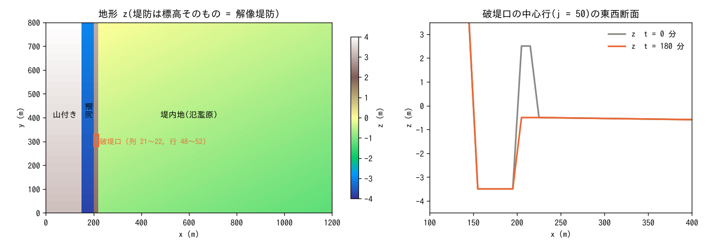
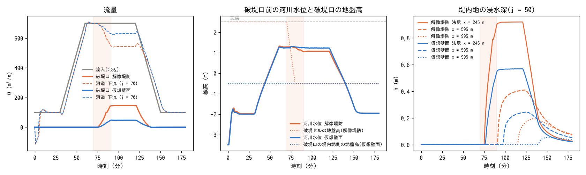
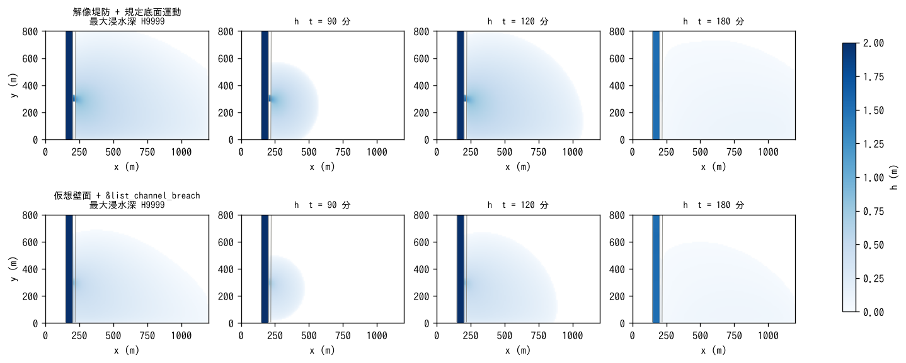

# levee_breach — 解像堤防の破堤を規定底面運動で与える(fn_bedmotion)

高解像度 DEM では堤防が**標高そのもの**として入っている(本書では
**解像堤防**と呼ぶ。解像河道と同じ言い方)。この堤防には
[河道の章](../../docs/users_guide/channel.md)の仮想壁面がないので、
破堤を `&list_channel_breach` では与えられない。代わりに
[規定底面運動](../../docs/users_guide/bedmotion.md) §5 で、破堤口のセルの
地盤高を決めた時刻・幅・深さで下げる。この例題は直線河道 + 幅 20 m・
高さ 3 m の解像堤防 + 堤内地の理想化地形で、洪水のピークに 5 行 × 2 列の
堤防セルを 20 分かけて堤内地の地盤高まで下げる(中央の行が 10 分で
堤底に達し、両側へ拡幅)。破堤のスケジュールは前処理スクリプト
[make_breach.py](make_breach.py) が fn_bedmotion の入力(窓付きの累積変位
ファイルとスナップショット表)に変換する。同じスケジュールを仮想壁面の
`&list_channel_breach` で与えた比較ケース付き。コード変更なし(設定のみ)。

## 幾何と設定



左: 地形と破堤口。右: 破堤口の中心行(j = 50)の東西断面(計算開始時と
破堤後)。

1,200 m × 800 m、dx = dy = 10 m(120 × 80 セル)。北から南へ 1/1000 で
下る。西から順に:

| x (m) | セル番号 i | 地形 | 役割 |
|---|---|---|---|
| 0〜150 | 1〜15 | 堤内地 + 4 m | 山付き(西岸。氾濫しない) |
| 150〜200 | 16〜20 | 堤内地 − 3 m | 河道(幅 50 m、粗度 0.03) |
| 200〜220 | 21〜22 | 堤内地 + 3 m | **解像堤防**(幅 20 m) |
| 220〜1,200 | 23〜120 | 東へ 1/2000 で下る | 堤内地(氾濫原。粗度 0.05) |

- 流入: 北辺の河道セル 5 つに流量波形(100 m³/s → 60 分で 700 m³/s、
  120 分まで維持、150 分で 100 m³/s)。下流端(南辺の河道出口 5 セル)は
  等流水深の水位を波形に同期して規定(2 次元計算なので側壁摩擦なし
  R = h: Q 700 で 4.7 m。天端の 1.3 m 下)。堤内地の南辺・東辺は自由流出。
- 破堤: 列 21〜22 × 行 48〜52(幅 50 m)。堤底は各行で法尻(列 23)の
  地盤高(`--floor-col 23`)。70 分に中央の行から始まり、各行 10 分で
  堤底、両側の行は 75 分・80 分から(90 分で全幅・全深)。
  `make bm/bmlist.txt` が次を実行する:

```
python3 make_breach.py --z z.txt --cols 21 22 --rows 48 52 --floor-col 23 \
    --t0 70 --t1 90 --tdeep 10 --out bm
```

| ケース | 設定ファイル | 堤防 | 破堤 | 地形 |
|---|---|---|---|---|
| 解像堤防 | param.txt | z の標高(列 21〜22 が + 3 m) | 規定底面運動(bm/bmlist.txt) | z.txt |
| 仮想壁面 | param_vwall.txt | &list_channel の bank0 = 3 m(堤内地セル標高基準) | &list_channel_breach(5 サイト。同じ時刻) | z_vwall.txt(列 21〜22 を堤内地の地盤高に置換) |

dt = 0.5 s、3 時間。計算時間は 1 ケース 30 秒前後(gfortran、4 スレッド)。

## make_breach.py の使い方(自分のケースへ)

```
python3 make_breach.py --z <地盤高> --cols I1 I2 --rows J1 J2 \
    (--floor Z | --floor-col C | --floor-row R) --t0 T0 --t1 T1 [--tdeep TD] [--center K] [--out DIR]
```

- `--cols`・`--rows`: 破堤口のセル矩形(1 スタート。堤防の幅が 2 セルなら
  2 列とも)。長辺が堤防に沿う方向になり、`--center`(既定は中央)の
  セルから外側へ遅れて始まる。
- 堤底: `--floor` は一定値、`--floor-col C` は各行で列 C の地盤高(南北の
  堤防。堤内地側の法尻の列)、`--floor-row R` は各列で行 R の地盤高
  (東西の堤防)。
- `--t0`・`--t1`(分): 開始と、全幅・全深に達する時刻。`--tdeep`(分): 1 セルが
  堤底に達するまでの時間(既定 t1 − t0 = 全セル同時)。
- 出力: `DIR/bmlist.txt`(時刻は秒。各行に窓 `i1 j1 ni nj`)と
  `DIR/breach_NN.txt`(窓だけの累積変位。折れ点の時刻ごと)。本体は
  `fn_bedmotion = '-'` と `&list_bedmotion fn_bmlist = 'DIR/bmlist.txt'` だけ。
- 変位ファイルはテキスト行列。GeoTIFF / bil の地盤高(f_input_mode)を
  使う計算では同じ形式に変換してから使う(変換は前処理)。

## 実行方法

```
cd examples/levee_breach
make                                   # リンク、z.txt 等、bm/(make_breach.py)
./encflow param.txt                    # 解像堤防 + 規定底面運動
./encflow param_vwall.txt              # 仮想壁面 + &list_channel_breach
python3 plot_results.py                # figs/*.png と数表
```

## 結果



左: 流入波形、破堤口を通る流量(列 23 の測線)、河道下流(j = 70)の
流量。中: 破堤口前の河川水位と破堤セルの地盤高(解像堤防ではプローブ
3 の z 列がそのまま堤防の下がりを示す)。右: 堤内地の浸水深(法尻・
中央・遠方)。帯は破堤の進行中(70〜90 分)。



| ケース | 破堤口の最大流量 (m³/s) / 時刻 (分) | 氾濫量 (万 m³) | 浸水面積 (ha; h > 0.01 m) | 最大浸水深 (m) | 法尻の浸水開始 (分) |
|---|---:|---:|---:|---:|---:|
| 解像堤防 + 規定底面運動 | 146 / 96 | 38.8 | 71.6 | 1.15 | 76 |
| 仮想壁面 + &list_channel_breach | 48 / 91 | 12.6 | 53.5 | 0.67 | 77 |

- 解像堤防では、堤防セルが堤底まで下がると破堤口は普通のセルになり、
  浅水方程式がそのまま流れを解く(8 近傍の全リンクが開く)。河道下流の
  流量は 700 から 550 m³/s に落ち、破堤口で 146 m³/s が堤内地へ出る。
  終了時に表示される適用変位の最小 −3.00 m が「天端 − 堤底」に一致する。
- 仮想壁面では、サイトにした法線エッジ 1 本ずつが本間公式で通水し、
  堤内地セルの斜めリンクは壁のまま残る。同じ 5 セル幅・同じ堤底でも
  流量は 1/3 で、dt を半分にしても変わらない(数値的な上限ではなく
  通水幅の違い)。セル幅より狭い決壊や粗い格子では仮想壁面の破堤、
  堤防をセルで解像した計算では規定底面運動、という使い分けになる。

## 注意

- 規定底面運動は規定の形状変化で、堤体の侵食による自然な拡幅や堤体
  材料の堆積は表さない(土層厚 sd は変えない)。破堤口の幅・深さの進行は
  入力(実績の破堤形状や経験式)で与える。
- 下流端を自由流出にすると水面が出口へ向かって下がり(背水曲線の
  長さ ≈ h/S = 4.7 km)、破堤口の水位が天端から 2 m 離れて越流が弱い。
  短い理想化河道では下流端の水位規定が要る。
- 既定の移流スキーム 3(MUSCL)はこの深い直線河道で 5 分周期・±6 % の
  流量振動を自励する(dt・流入配分・下流端の与え方によらない)ので、
  両ケースとも `f_advection_scheme = 1` にしている。
- 仮想壁面の天端の基準は `f_bank_datum = 1`(堤内地セル標高基準)を明示
  する。省略するとコードの既定(0 = 河床基準)になり、この例題では天端が
  堤内地の地盤高と一致して全長で越流する(docs/handoff.md 00a)。
