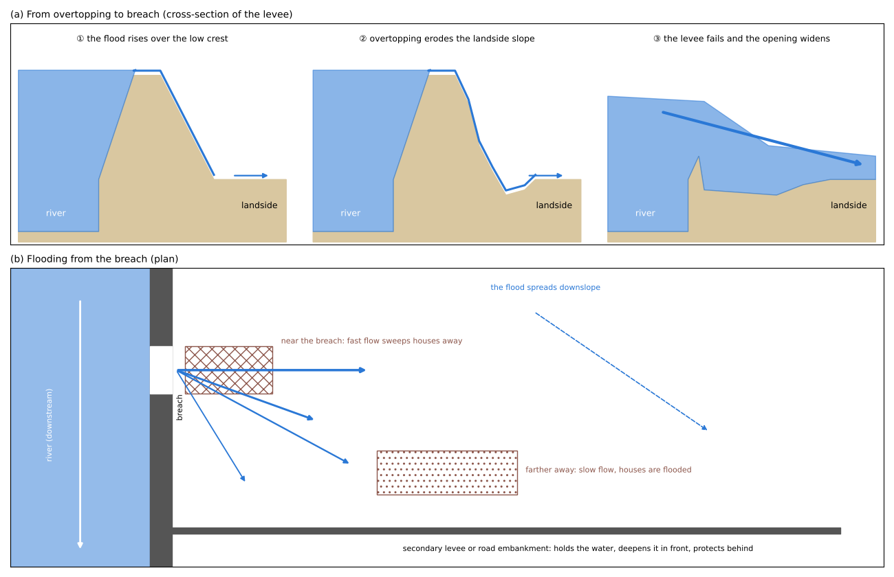
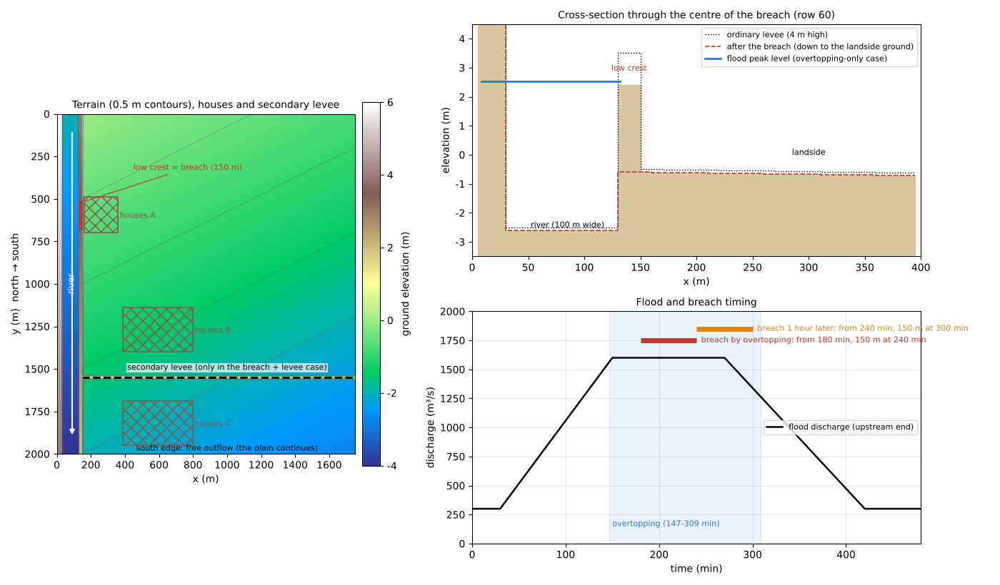
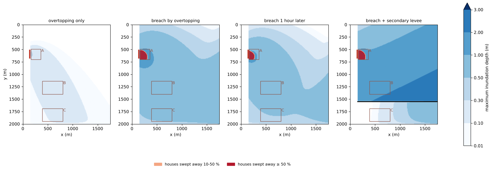
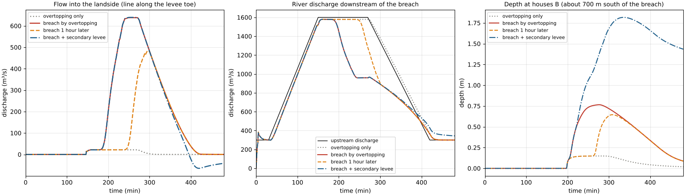
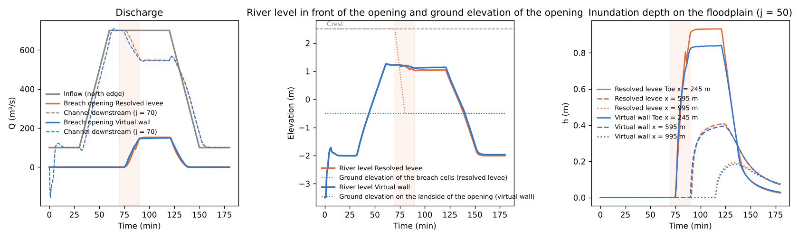
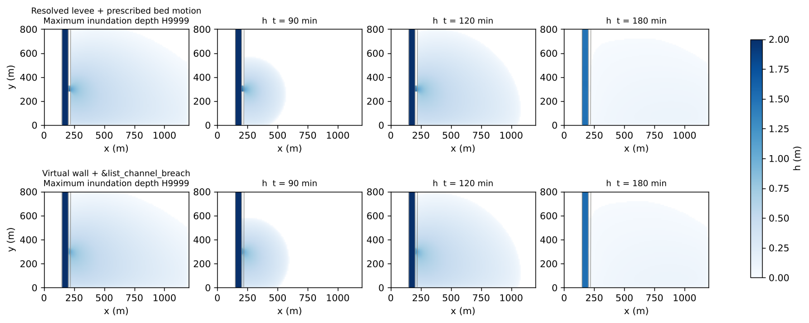

# levee_breach — flooding from a levee breach caused by overtopping, and houses swept away near the breach

> English mirror of examples/levee_breach/README.md. The Japanese file is the master copy.

[日本語](../README.md)

When a large flood raises the river above the crest of a levee (overtopping), the water
pouring over erodes the levee until it fails (a breach), and the river rushes into the
landside. This example follows, in a single run, overtopping that starts at a section whose
crest is lower than its surroundings, the breach of that section and the widening of the
opening, and the spread of the flood over the landside until it sweeps away the houses
near the breach. It compares this with the levee holding, with the breach coming one hour
later, and with a secondary levee on the landside. The values are schematic, chosen to make
the phenomena easy to see; the example does not reproduce any particular breach.

## What happens in a real levee breach

- **Most failures start from overtopping**: in Typhoon Hagibis (2019), levees failed at 142
  places across Japan, and overtopping was the main cause at 122 of them (86 %) (MLIT 2020).
  Overtopping starts where the crest is lower than its surroundings or where the levee has
  not yet been completed.
- **Overtopping erodes the levee until it breaches**: water flowing over the crest runs fast
  down the landside slope, erodes it and undermines the levee from the toe. It takes time
  from the start of overtopping to the breach, and evacuation proceeds in the meantime. The
  Japanese government is building "resilient" levees that make the time to failure as long
  as possible even when they are overtopped (MLIT 2022).
- **The opening widens**: in the Kanto-Tohoku heavy rain of 2015, the left-bank levee of the
  Kinu River (Joso City, Ibaraki) failed over a width of about 200 m (Kinu River Levee
  Investigation Committee 2016).
- **Houses near the breach are swept away**: the flow out of a breach is fast, and it knocks
  down and carries away nearby houses. The government maps the area where wooden houses may
  collapse or be swept away, from the inundation depth and flow velocity, as the "zone of
  house collapse by flood flow" (MLIT 2015). Farther away the flow slows, and houses suffer
  inundation (above or below the floor) instead.
- **The flood spreads down the slope of the ground and stops at embankments**: water that
  enters the landside spreads toward lower ground. Secondary levees and road or railway
  embankments stop the flood, deepen it in front, and protect what is behind.
- **The river discharge downstream falls**: the river downstream of the breach loses as
  much water as leaves through the opening.

## Mechanisms needed for the reproduction



| Real phenomenon | How ENCflow represents it | Settings |
|---|---|---|
| A flood flows down the river and the water level rises | Shallow-water flow (the channel is represented by the terrain; the flood discharge at the upstream end and the normal-depth water level at the downstream end) | `&list_bound_inflow`, `&list_bound_stage` |
| Overtopping starts at a section with a low crest | The levee is the ground elevation itself (a resolved levee), and the low section of the crest is in the terrain | `fn_z` (make_terrain.py) |
| Overtopping erodes the levee, it breaches and the opening widens | The ground elevation of the breach cells is lowered with a given time, width and depth (prescribed bed motion; erosion of the levee body is not computed) | `fn_bedmotion` (made by make_breach.py) |
| The flood spreads over the landside | Shallow-water flow (treatment of the front spreading onto dry ground). The plain continues downstream (the south edge is a free outflow) | `f_exflux_reduction = 1`, `f_bc_s = 1` |
| Houses obstruct the flow | Building porosity (buildings occupy 30 % of the residential areas) | `fn_gv` |
| Fast flood flow sweeps houses away | When the load hV² (depth × velocity²) exceeds a threshold, houses break into debris, and the porosity rises by the destroyed fraction | `fn_bldgdebris`, `f_bdcrit = 2` |
| A secondary levee holds back the flood | A step in the terrain (a 2 m high embankment) | `fn_z` (z_dike.txt) |

## Geometry and settings



Left: terrain (0.5 m contours), the section with a low crest (red = breach), houses A-C and
the secondary levee (only in the breach + secondary levee case). Top right: cross-section
through the centre of the breach. Bottom right: flood discharge, and the timing of
overtopping and the breach.

1,750 m × 2,000 m, dx = dy = 10 m (175 × 200 cells). A valley plain falling from north to
south at 1/1000. From west to east: hills, the channel (100 m wide, bed = landside − 2 m,
roughness 0.03), the levee (20 m wide, 4 m high) and the landside (1.6 km wide, falling east
at 1/2000, roughness 0.05). The east edge is closed by a terrace, and the south edge is a
free outflow (the plain continues downstream).

- **Flood**: the upstream end receives a discharge that rises from 300 m³/s (normal flow)
  to 1,600 m³/s at 150 minutes, stays until 270 minutes and returns to 300 m³/s at
  420 minutes; the downstream end receives the normal-depth water level for the same
  discharge. The channel starts with the normal-flow depth (1.87 m).
- **Section with a low crest**: only the 150 m at the breach (rows 53-67) has a crest 1 m
  lower, and the peak flood level rises 0.1-0.2 m above it (the other sections keep a
  margin of 0.8 m or more). Overtopping starts at about 147 minutes.
- **Breach**: the central row of the low section drops to the landside ground level in
  20 minutes from 180 minutes, and the opening widens to both sides until it covers the
  whole low section (150 m) at 240 minutes (make_breach.py).
- **Houses**: three areas of wooden houses (A right behind the breach, B about 700 m south
  of the breach, C farther south, behind the secondary levee). Buildings occupy 30 % of the
  area (porosity 0.7), and the house stock is 0.2 m³/m² (the amount that becomes debris when
  destroyed). Houses start to break when the load hV² exceeds 2 m³/s² and break fastest (fully
  in a little under 7 minutes) above 6 m³/s² (the default thresholds of building damage;
  calibration values).
- **Secondary levee**: a 2 m high embankment on rows 155-156, about 950 m south of the
  breach, from the levee to the terrace on the east (only in the breach + secondary levee
  case).
- The run is 8 hours, dt = 0.5 s.

| Case | Settings file | Breach | Secondary levee |
|---|---|---|---|
| Overtopping only | param_overtop.txt | none (the levee holds) | none |
| Breach by overtopping | param.txt | from 180 minutes, 150 m at 240 minutes | none |
| Breach 1 hour later | param_delay.txt | from 240 minutes, 150 m at 300 minutes (a levee that resists overtopping) | none |
| Breach + secondary levee | param_dike.txt | from 180 minutes, 150 m at 240 minutes | yes |

## How to run

```
cd examples/levee_breach
make                    # links and inputs (make_terrain.py and make_breach.py write data/)
make run                # run the 4 cases in turn (6-8 minutes per case on 4 threads)
python3 plot_results.py # figs/*.png and the table (with the argument en, the English version goes to en/figs/)
```

## Results



Maximum inundation depth (colour) and houses swept away (red; destroyed fraction at the end)
in the 4 cases. Red line = breach (the section with a low crest), boxes = houses, black line
= secondary levee.



Left: flow into the landside (transect along the levee toe). Centre: river discharge
downstream of the breach. Right: inundation depth at houses B.

| Case | Water into the landside | Peak flow | Minimum river discharge downstream | Inundated ≥ 0.5 m | Maximum depth | Houses swept away A / B / C | Maximum depth B / C | B reaches 0.5 m |
|---|---:|---:|---:|---:|---:|---:|---:|---:|
| Overtopping only | 0.18 million m³ | 22 m³/s | 1,136 m³/s | 0 ha | 0.34 m | 0 / 0 / 0 % | 0.16 / 0.13 m | — |
| Breach by overtopping | 4.83 million m³ | 638 m³/s | 796 m³/s | 252 ha | 1.88 m | 51 / 0 / 0 % | 0.82 / 0.66 m | 222 min |
| Breach 1 hour later | 2.62 million m³ | 484 m³/s | 796 m³/s | 179 ha | 1.80 m | 34 / 0 / 0 % | 0.70 / 0.55 m | 282 min |
| Breach + secondary levee | 4.45 million m³ | 640 m³/s | 802 m³/s | 268 ha | 2.63 m | 51 / 0 / 0 % | 2.03 / 0.26 m | 222 min |

The upstream discharge peaks at 1,600 m³/s. "Houses swept away" is the fraction of the house
stock of each area destroyed into debris.

- **Overtopping alone does little damage**: water flowing over the low section 0.1-0.2 m
  deep peaks at 22 m³/s, and 0.18 million m³ enters the landside. The inundation stays
  below about 0.3 m, and no houses break.
- **A breach makes the flood 27 times larger**: as the opening widens, the flow into the
  landside peaks at 638 m³/s (40 % of the river discharge) and 4.83 million m³ enters. The
  river discharge downstream of the breach falls from 1,600 to 796 m³/s. Inundation of
  0.5 m or more spreads over 252 ha, and houses B and C are flooded 0.6-0.8 m deep.
- **Houses are swept away only right behind the breach**: the flow out of the breach is
  fast (up to 4.8 m/s), and half of the houses in area A are swept away. The load hV² at
  which houses start to break (2 m³/s²) is exceeded only within about 200 m of the breach,
  and B and C are flooded without breaking. This matches the way the government maps the
  "zone of house collapse by flood flow" as a strip along the levee.
- **A breach one hour later halves the flood and gives more time to evacuate**: when the
  breach starts at 240 minutes, the flood peak is nearly over; the water entering the
  landside falls from 4.83 to 2.62 million m³ (46 % less), and the houses swept away in A
  from 51 to 34 %. Houses B reach 0.5 m, the depth at which evacuation becomes difficult,
  at 282 instead of 222 minutes, exactly one hour later. This is the effect of a levee that
  lengthens the time to failure even when overtopped.
- **The secondary levee deepens the flood in front and protects what is behind**: houses B
  in front of the secondary levee are flooded deeper, from 0.82 to 2.03 m, and houses C
  behind it shallower, from 0.66 to 0.26 m. The water leaving downstream through the south
  edge falls from 4.59 to 1.73 million m³. Water held in front of the secondary levee flows
  back into the river through the breach when the river falls (the negative flow after
  420 minutes in the left panel).

## What this model cannot represent (differences from real phenomena)

- **The progress of the breach is given**: erosion of the landside slope by overtopping, the
  speed at which the opening widens, and the scour that deepens the bottom of the opening
  (the scour pond behind a breach) are not computed. The time course of the width and depth
  of the opening is an input (from records or empirical formulas). Transport and
  deposition of the levee material on the landside are not represented either.
- **Building damage is an areal estimate**: houses are represented by the share of buildings
  in a cell (porosity) and the amount that becomes debris (house stock). The structure of
  individual houses and houses carried away hitting other houses are not represented. The
  breaking thresholds are calibration values.
- **Damage from inundation depth is not counted**: damage from inundation above or below the
  floor is read separately from the inundation depth (this example counts only houses swept
  away).
- **Scale**: the channel is 2 km long and is affected by the upstream and downstream
  boundaries. The downstream water level is the normal depth for the upstream discharge, so
  the fall of the water level when the breach reduces the downstream discharge comes out
  small. The values are schematic.

## Notes

- **Margin of the crest**: with a resolved levee, water rides onto the crest cells and
  starts to flow over once the river level comes within 0.1-0.2 m of the crest (in a channel
  flowing at about 3 m/s). Give sections that should not be overtopped a crest well above
  the peak flood level (0.8 m or more in this example).
- **Initial condition**: the normal-flow depth in the channel is given with `fn_hinit` in
  `&list_initial`. `&list_initial` is read only when `&list_sysparam` has `fn_initial = '-'`.
- **How the flood volume is measured**: the water entering the landside is the time integral
  of the flow through transect 1 along the levee toe (positive toward the landside). In the
  secondary levee case, the water returning to the river through the breach (negative flow)
  is subtracted.

## Starting points for sensitivity tests

- `--t0`, `--t1` and `--tdeep` of `make_breach.py` (the breach times in the Makefile): the
  start of the breach and how fast it widens.
- `--rows` (the rows of the breach) and `J_LOW1`, `J_LOW2` in make_terrain.py (the section
  with a low crest): the width of the breach.
- `bd_fcrit` and `bd_fcrit2` (the load at which houses break): the area swept away changes.
- `J_DIKE` and `H_DIKE` in make_terrain.py (position and height of the secondary levee): if it
  is too low, the flood overtops it.
- `S_EW` and `S_NS` (slopes of the landside): the direction and speed of the spreading flood.

## Using make_breach.py (for your own case)

```
python3 make_breach.py --z <ground elevation> --cols I1 I2 --rows J1 J2 \
    (--floor Z | --floor-col C | --floor-row R) --t0 T0 --t1 T1 [--tdeep TD] [--center K] [--out DIR]
```

- `--cols`, `--rows`: the cell rectangle of the opening (1-based; both columns if the levee
  is 2 cells wide). The long side is the direction along the levee, and the cells start
  later outward from `--center` (default: the middle).
- Floor: `--floor` is a constant, `--floor-col C` takes the ground elevation of column C in
  each row (a north-south levee; the column of the landside toe), and `--floor-row R` takes
  that of row R in each column (an east-west levee).
- `--t0`, `--t1` (minutes): the start, and the time of full width at full depth. `--tdeep`
  (minutes): the time for one cell to reach the floor (default t1 − t0 = all cells at once).
- Output: `DIR/bmlist.txt` (times in seconds; each line ends with the window `i1 j1 ni nj`)
  and `DIR/breach_NN.txt` (cumulative displacement in the window only; one per break-point
  time). File names are relative to dir_data, so run it inside dir_data. The main program
  needs only `fn_bedmotion = '-'` and `&list_bedmotion fn_bmlist = 'DIR/bmlist.txt'`.
- The displacement files are text matrices. For runs that use GeoTIFF / bil ground
  elevation (f_input_mode), convert them to the same format first (conversion is
  preprocessing).

## Supplement: comparison with a breach on a virtual wall

In high-resolution ground elevation data, the levee is present as elevation itself (a
resolved levee). Such a levee has no virtual wall of the
[Channels](../../../docs/en/users_guide/channel.md) chapter, so its breach is given by
[prescribed bed motion](../../../docs/en/users_guide/bedmotion.md), as in the main example.
When the grid is too coarse to represent the levee with cells, the levee is set up as a
virtual wall (a wall on cell boundaries) and the breach is given by the crest time series of
`&list_channel_breach`. The supplement gives the same breach in both ways and compares the
discharge and the inundation.

```
make supp                # inputs (make_supp.py and make_breach.py write data_supp/) and the 2 runs (about 30 seconds per case)
python3 plot_supp.py     # figs/supp_*.png and the table
```


Left: terrain and the opening. Right: east-west profile along the central row of the
opening (j = 50) at the start and after the breach.

1,200 m × 800 m, dx = dy = 10 m (120 × 80 cells), falling from north to south at 1/1000.
From west to east:

| x (m) | Cell index i | Terrain | Role |
|---|---|---|---|
| 0-150 | 1-15 | landside + 4 m | hills (west bank; not flooded) |
| 150-200 | 16-20 | landside − 3 m | channel (50 m wide, roughness 0.03) |
| 200-220 | 21-22 | landside + 3 m | **resolved levee** (20 m wide) |
| 220-1,200 | 23-120 | falling east at 1/2000 | landside (floodplain; roughness 0.05) |

- Inflow: a discharge hydrograph into the 5 channel cells on the north edge (100 m³/s → 700 m³/s
  at 60 minutes, held until 120 minutes, 100 m³/s at 150 minutes). The downstream end (the 5
  channel outlet cells on the south edge) has the normal-depth water level in step with the
  hydrograph (4.7 m for Q 700; 1.3 m below the crest). The south and east edges of the
  landside are free outflows.
- Breach: columns 21-22 × rows 48-52 (50 m wide). The floor in each row is the ground
  elevation of the toe (column 23). It starts at the central row at 70 minutes, each row
  reaches the floor in 10 minutes, and the rows on either side start at 75 and 80 minutes
  (full width and depth at 90 minutes).

| Case | Settings file | Levee | Breach | Terrain |
|---|---|---|---|---|
| Resolved levee | param_supp.txt | elevation of z (columns 21-22 are + 3 m) | prescribed bed motion (bm/bmlist.txt) | z.txt |
| Virtual wall | param_supp_vwall.txt | bank0 = 3 m of &list_channel (above the landside cell) | &list_channel_breach (5 sites, same times; with f_br_diag = 1 the diagonal edges follow) | z_vwall.txt (columns 21-22 replaced by the landside ground) |



Left: inflow hydrograph, discharge through the opening (transect on column 23) and in the
channel downstream (j = 70). Centre: river level in front of the opening and ground
elevation of the breach cells (for the resolved levee, the z column of probe 3 shows the
levee going down directly). Right: inundation depth on the landside (toe, middle, far). The
band marks the breach in progress (70-90 minutes).



| Case | Peak discharge through the opening (m³/s) / time (min) | Flood volume (10⁴ m³) | Inundated area (ha; h > 0.01 m) | Maximum inundation depth (m) | Start of inundation at the toe (min) |
|---|---:|---:|---:|---:|---:|
| Resolved levee + prescribed bed motion | 152 / 120 | 40.2 | 71.8 | 1.10 | 76 |
| Virtual wall + &list_channel_breach (f_br_diag = 1) | 150 / 120 | 41.4 | 71.0 | 0.98 | 76 |

- With the resolved levee, once the levee cells drop to the floor the opening becomes
  ordinary cells and the shallow-water equations solve the flow directly (all links of the
  8 neighbours open). The channel discharge downstream falls from 700 to 550 m³/s, and
  150 m³/s leaves through the opening onto the landside. The minimum applied displacement
  printed at the end, −3.00 m, matches "crest − floor".
- With the virtual wall, the edges made into sites pass water by the Homma formula. With
  `f_br_diag = 1` the diagonal edges touching the sites drop to the same crest, so the
  passing width per breached cell is one cell width (normal 0.414 + diagonals 2 × 0.293), and
  with 5 cells the discharge is 0.98 times that of the resolved levee. With `f_br_diag = 0`,
  which lowers only the normal edges of the sites, the diagonal links between neighbouring
  sites remain walls and the discharge stays at 0.44 times (table below). Use the
  virtual-wall breach for openings narrower than a cell or on coarse grids, and prescribed
  bed motion when the levee is represented with cells.

**Breach width and discharge** (same terrain with different breach widths, failing all at
once at 70-80 minutes; steady discharge at 100 minutes compared):

| Width (cells / sites) | Resolved levee Q (m³/s) | Broad-crested weir 1.7·B·H^1.5 (m³/s) | Virtual wall f_br_diag = 0 Q / ratio to resolved | f_br_diag = 1 Q / ratio to resolved |
|---:|---:|---:|---:|---:|
| 1 | 36.5 | 37 | 15.1 / 0.41 | 60.8 / 1.66 |
| 2 | 73.7 | 70 | 29.5 / 0.40 | 86.1 / 1.17 |
| 3 | 105.1 | 102 | 43.1 / 0.41 | 108.5 / 1.03 |
| 5 | 152.3 | 162 | 67.5 / 0.44 | 149.2 / 0.98 |

The resolved levee follows the broad-crested weir estimate (B = cells × dx, H = river level
− floor ≈ 1.5-1.7 m), falling below the weir formula as the opening widens because the
landside water level rises (152 against 162 for 5 cells). The virtual wall with
f_br_diag = 0 is proportional to the number of sites, with an effective width of 0.38 dx per
site (the passing-width share of the normal edge is 0.414); f_br_diag = 1 is nearly the same
as the resolved levee for 3-5 cells (1.03 and 0.98 times), and too large for one cell (1.66
times) by the two diagonals at both ends (0.59 cell widths). The f_br_diag = 1 result agrees
with a run that adds the diagonal pairs explicitly as sites (largest difference 0.35 m³/s,
because the reference ground of the diagonal sites themselves differs by 1 cm). Options
considered and not adopted are in
[Channel models](../../../docs/en/users_guide/channel_models.md) §4.

Notes on the supplement:

- With a free outflow at the downstream end, the water surface falls toward the outlet (the
  backwater curve is about h/S = 4.7 km long), the river level at the opening is 2 m below
  the crest and the overflow is weak. A short idealised channel needs the downstream water
  level to be prescribed.
- The crest datum of the virtual wall is stated explicitly as `f_bank_datum = 1` (above the
  landside cell; the default). With the bed datum (0), the crest in this terrain (3 m
  channel, 3 m levee) would equal the landside ground and the river would overflow along
  the whole length.

## References

- Kinu River Levee Investigation Committee (2016): Report of the Kinu River Levee
  Investigation Committee. Kanto Regional Development Bureau, MLIT (in Japanese).
- MLIT (2015): Manual for preparing maps of areas expected to be flooded (4th edition).
  Zones of house collapse by flooding (in Japanese).
  https://www.mlit.go.jp/river/shishin_guideline/pdf/manual_kouzuishinsui_1710.pdf
- MLIT (2020): Materials of the technical study group on river levees after Typhoon No. 19 of
  2019 (142 levee failures, 122 mainly due to overtopping) (in Japanese).
  https://www.mlit.go.jp/river/shinngikai_blog/teibou_kentoukai/dai01kai/pdf/sankou1.pdf
- MLIT (2022): Technical study group on strengthening river levees (resilient river levees)
  (in Japanese).
