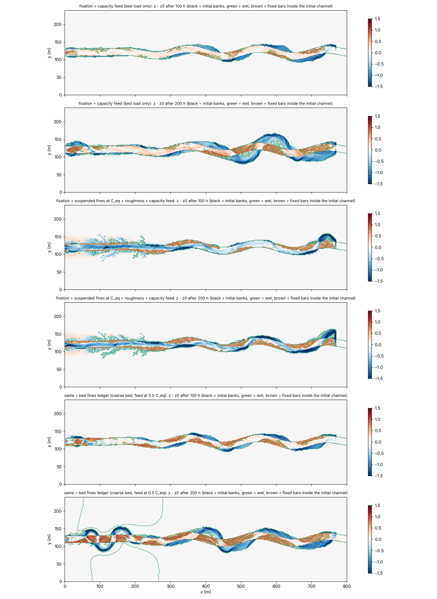

# meander — 正弦波状の初期河道の変形(蛇行発達の例題。段 3〜4)

[English](en/README.md)

氾濫原の中に置いた正弦波状の河道が、固定格子上の掃流砂 Exner・流砂方向
補正(河床勾配項+平衡二次流項)・安息角崩落(と側岸侵食則)・定着でどう
変形するかを見る例題です(docs/meander_plan.md 段 3〜4、developer.md
§84.5〜§84.6)。河道中心線や格子の再生成は使わず、地形と乾湿処理だけで
河道の形を追います。一定流量では外岸の後退と内岸の砂州で**河道が広がる**
だけですが、出水と低水を繰り返す流入に定着 `f_fixation` を組み合わせると、
低水期に露出した内岸の砂州が定着して出水時の再侵食に抵抗し、**内岸が陸地と
して前進して拡幅が抑えられます**(下の「結果」と「所見」)。ただし 200 h の
地形時間では蛇行振幅の成長と呼べる段階には至りません。短絡はこの例題では
起きません(examples/meander_cutoff)。コード変更なし(設定のみ)。

## 共通の幾何

800 m × 240 m、dx = dy = 2 m。幅 20 m(10 セル)の河道。上流 100 m は直線、
以後 x = 100〜700 m は振幅 10 m・波長 200 m の正弦波(立ち上がりと末端は
1 波長で滑らかに 0 へ)、最後の 100 m は直線で東辺の自由流出へ。河床勾配
0.001(路長に沿う)、両岸は河床 +1 m の乾いた氾濫原(砂床の安息角 32° に
対して 1 m / 2 m = 26.6° で安定)。土層厚は両端 30 m が 0(非侵食)、
上流端から 300 m はランプ(0 → 5 m。上流端のナックポイント穴を岩盤で止める)、
他は 5 m。西端の河道 10 セルに区間流入(一定 Q = 15 m³/s = 水深 ≈ 0.8 m の
等流、または出水 15 m³/s と低水 1.5 m³/s の繰り返し)。入力は `make_init.py`
が生成します(`make`)。

## 10 の構成

| ケース | 設定ファイル | 流入 | 河岸・定着 |
|---|---|---|---|
| 非粘着性 | param.txt | 一定 15 m³/s | 安息角崩落のみ(`f_repose = 1`、φ_r = 32°)。外岸脚部の洗掘で河岸面が安息角を超えると崩落して後退 |
| 粘着性 | param_cohesive.txt | 一定 15 m³/s | 側岸侵食則+崩落(`f_berode = 1`、K_b = 3e-5 m/s、τ*c,b = 0.5、φ_r = 35°)。河道平均より速い流れに接する河岸だけが侵食則で後退 |
| 粘着性+崩落土塊 | param_cohesive_slump.txt | 一定 15 m³/s | 粘着性 + 崩落と崖錐の河岸モード(`f_rockfall = 1`、`rf_bank = 1`、H_c = 1.5 m、崖錐 35°)+ 側岸侵食の遮蔽(`berode_hcover = 0.2 m`)。淵の洗掘で河岸面が H_c を超えると塊で崩れ、土塊が脚部を覆って側岸侵食を止め、掃流砂が運び去るまで休む(Asahi ら 2013 の slump block。§84.17) |
| 流量変動のみ | param_varq.txt | 出水 15 m³/s(20 分)と低水 1.5 m³/s(18 分)の繰り返し(周期 42 分 = 地形 35 h) | 非粘着性と同じ。定着なし(比較用) |
| 流量変動+定着 | param_fix.txt | 同上 | 非粘着性 + `f_fixation = 1`(T_fix = 10 h、c_τ = 10、dz_reset = 0.1 m)。低水期に露出した砂州が定着し、出水時の τ*c が最大 11 倍 |
| 流量変動+定着+浮遊砂 | param_fixsusp.txt | 同上。出水時に細粒分(0.2 mm)を濃度 0.004 で給砂 | 上 + `f_suspend = 1` + 定着セルの粗度 `fix_cn = 2`(植生が流れを遅くして細粒分を捕まえる。§84.8) |
| 非粘着性+容量給砂 | param_feed.txt | 一定 15 m³/s | 非粘着性と同じ。上流端まで可動(sd_feed.txt)にして `fluv_bcfeed = 1`(流入面の供給 = 流入セルの正味流出 → 入口の河床が固定。§84.9)。無給砂の河床低下波がない基準 |
| 流量変動+定着+容量給砂 | param_fixfeed.txt | 出水・低水の繰り返し | 流量変動+定着 + 上流端まで可動 + `fluv_bcfeed = 1`。河道の河床が低下しない状態で内岸の定着が進むか |
| 流量変動+定着+浮遊砂+給砂 | param_fixsuspfeed.txt | 同上。細粒分は流入セルの平衡濃度で給砂(`inflow_cs_eq = 1`、倍率 1.0) | 流量変動+定着+浮遊砂 + 容量給砂。掃流砂・浮遊砂とも平衡給砂にして砂州が出水位より上へ育つかを見る試行(dt = 0.1 s) |
| 同上+河床の細粒分の帳簿 | param_fixsuspfines.txt | 同上。細粒分の給砂倍率 0.5 | 上 + `f_bedfines = 1`(河床は粗粒だけ `fines_frac0 = 0`、L_a = 0.05 m。§84.10)。細粒分は堆積した分しか再浮上しないので、給砂濃度の調整なしに砂州が氾濫原の高さまで育つかを見る |

共通: 芦田・道上式(d50 = 1 mm)、河床勾配項 `fluv_slope = 1`(μs = 1.0、
μk = 0.45)、平衡二次流項 `f_secflow = 1`(N* = 7)— 係数は文献照合待ちの
値を明示指定(developer.md §84.3)。移流項は既定の運動量保存形
(`f_advection_scheme = 3`。§68.36 の副格子結合の修正後は市松が出ない。
2026-10-17 以前の版はスキーム 1 を使っていた)。塞がれた開口の動的振り替えは
全エッジ(`f_opening_dynamic = 2`。河道マスクのない掘り込み河道では既定の 1 は
無効で、河岸脚部の行の流量が 2 割不足する。§84.7、test/uniflow)。区間流入の
外縁セルに接するエッジは `f_inflow_edge = 2`(区間の内側へ向かうエッジだけ移流項を
0 にし、その流速を流入セルのエネルギー水頭で頭打ち。既定の 0 では容量給砂の構成が
流入口の横の掘れと噴流の正帰還で止まる。developer.md §68.40)。地形更新
1 s ごと、morfac = 50(水理 4 h = 地形時間 200 h)。

## 実行方法

```
cd examples/meander
make                          # ../../bin/encflow へのリンクと入力(z.txt, h.txt, sd.txt)
./encflow param.txt           # 約 25 分(gfortran、2 スレッド)。出力は result/
./encflow param_cohesive.txt  # 同上。result_cohesive/
./encflow param_varq.txt      # 流量変動のみ。result_varq/
./encflow param_fix.txt       # 流量変動+定着。result_fix/(定着度 Fx0001… も出力)
./encflow param_fixrec.txt    # 同上、緩い減水期の変種。result_fixrec/(図には含めない)
./encflow param_fixsusp.txt   # 流量変動+定着+浮遊砂+粗度。result_fixsusp/
./encflow param_feed.txt      # 非粘着性+容量給砂(入口固定)。result_feed/
./encflow param_fixfeed.txt   # 流量変動+定着+容量給砂。result_fixfeed/(figs/feed.png)
./encflow param_fixsuspfeed.txt # 流量変動+定着+浮遊砂+給砂。約 50 分(dt = 0.1 s)。result_fixsuspfeed/
./encflow param_fixsuspfines.txt # 同上+河床の細粒分の帳簿。result_fixsuspfines/(Sf0001… も出力)
python3 plot_results.py       # figs/*.png と数表
```

## 結果(2026-10-30 に再計算。gfortran 13.3、-Ofast、1 スレッド。移流は既定のスキーム 3、f_opening_dynamic = 2、f_inflow_edge = 2(developer.md §68.40)。2026-10-19 の再計算の値は developer.md §68.40、2026-10-17〜18 の初回の値は §84 に履歴として残る)


上: 初期の河道。下 7 段: 地形時間 200 h 後の河床変化 z − z0(青 = 洗掘、
赤 = 堆積)。黒線が初期の河岸、色線が終了時の河岸(水深 0.05 m の等値線。
流量変動の 2 構成は終了時が低水期で、露出した砂州の分だけ等値線が内側に
入る)。`f_opening_dynamic = 2`(§84.7)で河岸脚部の流れが実体を持つように
なった(25 h の外岸脚部の流速は河道中央の 0.82 倍。以前は 0.56 倍)ため、
外岸の後退は以前の版よりはるかに速い。一定流量の 2 構成では下流側の湾曲
(x > 450 m)の外岸が 20〜30 m 後退してループが膨らみ、内岸の砂州(+0.5〜
+0.9 m)は水面下に残るので**ループの拡張と拡幅が同時に進む**(非粘着性で
幅 20 → 37 m、安息角崩落 5,760 m³。粘着性は 31 m、側岸侵食則で 660 m³ +
崩落 3,120 m³)。上流側の
湾曲(x < 450 m)は無給砂の河床低下波で河床が下がり、河岸が相対的に高く
なって動きが小さい。


流量変動+定着の構成の定着度 a(上)と終了時(低水期)の水深(下)。氾濫原は
乾いたままなので a = 1。初期河道の内側では、各湾曲の内岸側に出水時の水面
まで育った砂州が低水期に露出して定着し(a > 0.5 が 492 セル = 1968 m²)、
**内岸が陸地として前進**した。外岸は下流側の湾曲で 10〜20 m 後退し、低水期の
流れは外岸沿いの淵に集まる。4 構成の中では最も「幅を保った横移動」に近い。


頂点 x = 350 m(外岸 = 北側)と 450 m(外岸 = 南側)の横断面の時間発展
(非粘着性・一定 Q)。外岸側が深くなり、河岸面が安息角(32°)に張り付いた
まま後退し、内岸側に砂州が育つ。


| ケース | 100 h: 河幅 / 中心の最大移動 / 湿潤帯の最大振幅 (m) | 150 h(出水時) | 200 h | 最深の洗掘 (m) | 定着した砂州セル(初期河道内、200 h) |
|---|---|---|---|---|---|
| 非粘着性(一定 Q) | 30.8 / 15.0 / 35 | 34.6 / 23.1 / 41 | 36.9 / 26.1 / 47 | -2.32 | — |
| 粘着性(一定 Q) | 27.8 / 13.9 / 25 | 29.2 / 13.0 / 25 | 30.5 / 18.6 / 29 | -2.39 | — |
| 粘着性+崩落土塊 | 30.0 / 16.0 / 31 | 32.7 / 17.0 / 35 | 34.7 / 23.2 / 39 | -2.22 | — |
| 流量変動のみ | 22.7 / 7.7 / 23 | 26.7 / 9.0 / 27 | 26.8 / 21.0 / 33 | -2.11 | — |
| 流量変動+定着 | 22.4 / 12.7 / 27 | 24.6 / 15.2 / 31 | 25.4 / 19.0 / 35 | -2.31 | 492(1968 m²) |
| 非粘着性+容量給砂 | 33.9 / 17.0 / 39 | 39.8 / 37.9 / 55 | 54.3 / 38.9 / 69 | -1.84 | — |

(x = 150〜650 m。河幅は湿潤セル(h > 0.1 m)の列平均、中心の移動は湿潤
セルの重心の初期からのずれの最大値、湿潤帯の最大振幅は湿潤セルの外縁の
中心軸からの距離の最大値(初期 19 m)、最深の洗掘は同じ範囲の z − z0 の最小値。
流量変動の 2 構成では 100 h と 200 h の出力が低水期に当たるため、出水期の
150 h も示す。)

### 給砂を入れた流量変動+定着の構成(2026-10-18)



地形時間 100 h と 200 h の河床変化 z − z0(いずれも低水期の出力)。緑線が
湿潤域(水深 0.05 m)、茶線が初期河道内の定着砂州(a > 0.5)。

| 構成 | 200 h の定着セル(初期河道内) | うち z − z0 > 1.0 m(氾濫原高さ) | 砂州天端の最大 z − z0 | 河道の河床変化 x = 50〜150 / 150〜300 / 300〜500 m | 氾濫原の堆積 > 0.1 m | 給砂(掃流砂、固体) |
|---|---|---|---|---|---|---|
| 流量変動+定着(無給砂) | 492 | 0 | 0.87 m | −0.87 / −0.58 / −0.42 m | 0 | — |
| 流量変動+定着+浮遊砂(無給砂、param_fixsusp.txt) | 907 | 0 | 0.81 m | −0.49 / −0.53 / −0.66 m | 165 | — |
| 流量変動+定着+容量給砂 | 788 | 8 | 1.04 m | −0.24 / −0.08 / −0.26 m | 0 | 3,870 m³ |
| 流量変動+定着+浮遊砂+給砂(倍率 1.0) | 1,135 | 0 | 0.87 m | −0.62 / −0.59 / −0.54 m | 558 | 2,480 m³ |
| 同、浮遊砂の給砂倍率 0.5(2026-10-19 の版の試行) | 466 | 0 | 0.71 m | −2.02 / −1.54 / −1.26 m | 97 | 130 m³ |
| 同上(倍率 0.5)+河床の細粒分の帳簿(param_fixsuspfines.txt) | 1,474 | 296 | 1.25 m | −0.10 / −0.04 / −0.39 m | 154 | 2,600 m³ |

(河道の河床変化は湿潤セル(h > 0.05 m)の平均。浮遊砂(無給砂)と倍率 0.5 の行は
図にない。結果の数値だけ記録する。倍率 0.5 の行は設定ファイルのない試行で、
回し直していない。)

## 所見

- **外岸の後退の連鎖が動いている**: 平衡二次流項が土砂を内岸へ運び、河床勾配項が
  横断斜面を緩め、外岸の淵と内岸の砂州ができる(test/bendsed と同じ向き)。淵が
  深くなると外岸の河岸面が安息角を超えて崩落し、崩落土砂が脚部の流れで運ばれて
  後退が続く。河岸脚部の流れは `f_opening_dynamic = 2` で初めて実体を持つ
  (§84.7。既定の 1 は河道マスクのない本例題では無効で、脚部の行は内部の 8 割
  しか流れず、崩落土砂が運び去られずに後退が止まっていた)。粘着性の設定
  (側岸侵食則が脚部の τ* を駆動力にする)も同じ理由で後退量が大きくなった。
- **一定流量では横移動が拡幅とループの拡張になる**: 外岸は後退するが、内岸の
  砂州は供給セルの水面までしか堆積せず(§84.2)陸地にならないため、河道は
  幅を増しながら外側へ膨らむ(湿潤帯の振幅 19 → 47 m、幅 37 m)。
- **流量変動+定着で内岸が陸地になる**: 低水期に露出した砂州が定着して出水時に
  削られず、初期河道内の 492 セル(1968 m²)が a > 0.5 の陸地として残る。
  定着のない流量変動構成では同じ砂州が次の出水で削られる。外岸の後退は下流側の
  湾曲で 10〜20 m(湿潤帯の振幅 35 m)。蛇行の横移動の機構は揃ったが、
  上流側の湾曲が無給砂の河床低下で動かないこと、定着時間・c_τ が文献照合待ち
  であることから、振幅成長の速さの定量評価は段 5(給砂)の後に行う。
- **崩落土塊(param_cohesive_slump.txt。2026-10-23)は後退の主役を側岸侵食則から
  限界高さの崩落に移す**: 淵の洗掘で河岸面が H_c = 1.5 m(初期の河岸 1.0 m + 洗掘
  0.5 m)を超えると塊で崩れ(崩落 1,440 m³)、土塊が脚部を覆う。今の版では土塊の
  ない粘着性の構成でも側岸侵食則の寄与が小さく(660 m³)、土塊ありでも 680 m³ と
  同程度で、遮蔽の効果は見えない(2026-10-23 の版では 3,120 → 690 m³ に落ちた)。
  200 h の幅 35 m・振幅 39 m は粘着性(31 m・29 m)より大きく、崩落そのものが
  外岸を後退させる。安息角崩落は 3,120 → 1,960 m³ に減る(崖錐を崩落側が先に
  処理する)。K_b の校正に頼らず、河岸材料の限界高さ H_c と土塊の大きさ h_cover
  という構造的な量で後退速度が決まるのが利点で、代わりに H_c の与え方(河岸高 +
  淵の洗掘深)が結果を支配する。
- **定着の冠水減衰(main の §84.13。fix_tdec = 10 h、fix_ctau_bank = 0.5 の試行。
  図・設定ファイルは無し。数値は 2026-10-21 の試行時の版のもの)**: 流量変動+定着で
  200 h の定着セルは 629 → 291、出水時に水没する定着セルは 0(枯れる)、河幅・振幅はほぼ同じ(26 m・33 m 対
  26 m・35 m)、安息角崩落は 9,230 → 3,730 m³。定着砂州の「自己固定」が解け、
  出水で削られる砂州と残る砂州が分かれる。細粒分の帳簿の構成に同じ減衰を入れると
  200 h の定着セルは 1,249 → 685 だが +1.0 m 超は 303 → 267 と砂州の氾濫原化は
  保たれ、給砂は 2,230 → 3,000 m³ に増える(解けた砂州の再侵食で容量が増える)。
  本例題の既定には入れていない(減衰時間の文献値がなく、出水 1 回の継続時間との
  比で選ぶ量。§84.13)。
- 外岸の後退は湾曲の頂点ではなくその下流側で起き、淵も頂点の下流側に寄る
  (主流が湾曲を横切って次の湾曲の外岸に当たる位置)。頂点の列で測る指標
  (figs/metrics.png)は小さく出る。
- **浮遊砂+粗度(param_fixsusp.txt)は内岸の前進を速めるが、砂州は出水位を
  超えない**: 定着セルは 200 h で 907(掃流砂のみの定着構成 492)に増え、低水時の
  河幅は 17 m に狭まる(細粒分が定着砂州の縁に積もって砂州を広げる)。しかし
  砂州の天端は最大 0.81 m で掃流砂のみ(0.87 m)と同じ高さに留まり、出水時にも
  大半の砂州が乾いている(出水時の 150 h の出力で 855 セル中 202 セル、200 h で
  907 セル中 102 セルだけ水没)。河道本体が懸濁で余計に低下して出水位が下がる
  ためで(100 h の河道の河床変化 −0.49 m 対 掃流砂のみ −0.31 m。x = 150〜650 m)、
  細粒分は砂州の上に届かず、外岸の後退も止まる(湿潤帯の振幅 21 m 対 35 m。外岸の
  淵に細粒分が沈む)。給砂濃度 0.001 ではさらに河道が低下する(−0.9 m。2026-10-18 の版での
  試行)。砂州を出水位より上へ育てるには
  河道の河床が安定していること = 掃流砂・浮遊砂とも平衡給砂(段 5)が要る。
  定着の植生効果そのものは [test/fixation](../../test/fixation/) の susp・rough
  構成で検定している。
- **容量給砂で無給砂の河床低下波が消える**(param_feed.txt): 上流端まで可動に
  して `fluv_bcfeed = 1`(供給 = 流入セルの正味流出)にすると、入口の河床が
  固定され、上流区間 x = 50〜150 m の河床変化は 200 h で −0.92 m → −0.06 m
  (給砂 6,210 m³)。河道全体が −0.1〜−0.2 m のほぼ平衡で、幅は 54 m まで
  広がる(無給砂 37 m)。外岸の淵・内岸の砂州・外岸後退の機構は同じで、
  上流側の湾曲も動く。河床が下がらないぶん流入が区間の外へ広がりやすく
  (区間流入の内側エッジは移流項を持たない。developer.md §68.40)、2026-10-19 の
  版(幅 40 m)より広い。2026-10-18 以前の容量給砂(流入セル自身の τ* で評価)は
  この例題で過給砂になり河道が氾濫原へ溢れた(§84.9)。
- **容量給砂を流量変動+定着に入れると内岸の陸地化が速くなる**
  (param_fixfeed.txt): 河道の河床が −0.4〜−0.9 m の低下から −0.1〜−0.3 m に
  緩み、上流側の湾曲も動く。200 h の定着セルは 788(無給砂 492)、湿潤帯
  の振幅 47 m(35 m)、砂州の天端は最大 1.04 m で氾濫原の高さ(+1.0 m)に
  わずかに届く(8 セル)。掃流砂だけでは砂州は供給セルの水面(出水位)まで
  しか積もらないので、天端の上限は出水位で決まる。
- **浮遊砂と平衡濃度給砂(倍率 1.0)を加えても、今の版では砂州は出水位を超えない**
  (param_fixsuspfeed.txt): 200 h の定着セルは 1,135、砂州の天端は最大 0.87 m で
  掃流砂のみの定着構成と同じ高さに留まり、氾濫原の高さを超えるセルはない。河道は
  −0.5〜−0.6 m 低下して出水位が下がり、最初の出水で流入口に近い河岸沿いの
  氾濫原の縁に細粒分が積もる(25 h の出力までに 585 セル、200 h で 558 セル。
  氾濫原へ広く溢れることはない)。容量給砂は 2,480 m³。2026-10-19 の版(区間流入の
  内側エッジの流速の上限の前)では、細粒分が定着砂州と河岸沿いの滞水域に積もって
  200 h に初期河道内の 832 セルが氾濫原の高さを超え(天端 1.94 m)、同時に 50 h までに
  氾濫原へ広く溢れて(湿潤セル 18,400、氾濫原の堆積 3,030 セル)、200 h には河道の
  脇を回る新しい流路(避難 avulsion)ができていた(容量給砂 4,420 m³)。流入セルの
  τ* で評価する給砂(容量給砂と平衡濃度)が入口の狭い断面の流れに敏感で、過給砂に
  なるかどうかが流入口の扱いの細部で変わる、というのがこの構成の今の評価である。
  給砂倍率 0.5(帳簿なし。2026-10-19 の版の試行)では河道が −1.3〜−2 m 低下して
  砂州は育たなかった(浮遊砂の浸食は河床の土層 sd を細粒分として巻き上げる —
  河床の粒径組成を持たないため、掃流砂の河床(1 mm)が 0.2 mm の細粒分の速さで
  削られる)。これを受けて河床の細粒分の帳簿 `f_bedfines`(§84.10)を実装した
  (次項)。
- **河床の細粒分の帳簿を入れると、給砂倍率 0.5 のまま河道は平衡を保ち、砂州が
  氾濫原の高さまで育つ**(param_fixsuspfines.txt。figs/feed.png の下 2 段):
  河床を粗粒だけ(`fines_frac0 = 0`)にすると、細粒分は堆積した分しか再浮上
  しないので、倍率 0.5 でも河道は 0〜−0.4 m の緩い低下に留まる(帳簿なし・倍率 0.5
  では −1.3〜−2 m)。細粒分は定着砂州の上に積もり、100 h で両岸の内岸に沿って
  砂州が +1.0 m を超え(128 セル)、200 h には 296 セル(天端 1.25 m)・定着
  1,474 セル。狙った過程(出水時の堆積 → 露出 → 定着 → 氾濫原に同化)が給砂濃度の
  調整なしに出る。150〜200 h には上流の湾曲(x = 50〜200 m)で外岸が深く掘れて
  (最深 −2.5 m)ループが広がり、200 h の低水期の出力では、砂州が氾濫原の高さに
  達して低水路が狭まった上流区間から氾濫原に薄い水膜が溢れて残る(湿潤セル
  13,976、氾濫原の堆積 154 セル)。2026-10-18 の初回の版でも 125 h 以降に同じように
  溢れた(湿潤セル 14,519)が、2026-10-19 の版(§68.39 の両側条件)では溢れなかった
  (5,072)。溢れるかどうかが移流や流入口の扱いの細部で変わる程度の際どさだと
  いうことで、砂州が氾濫原に同化した後の流路の移動(避難)の評価は次の段の課題。
  帳簿ありで給砂倍率を 1.0 に戻すと(図にない。2026-10-18 の版での試行)、河道は
  +0.2〜0.9 m の過給砂になり 50 h から氾濫原に広く溢れる(200 h で湿潤セル
  25,119、氾濫原堆積 661 セル、+1.0 m 超 506 セル)。入口の狭い断面で評価した
  平衡濃度が下流の広がった河道の容量を超える、という過給砂の原因は帳簿では
  変わらない。
- **緩い減水期では砂州は高くならない**(param_fixrec.txt: 2 分で 15 m³/s に
  立ち上げ、10 分維持、20 分かけて 1.5 m³/s へ線形に減水、低水 10 分。周期は
  同じ 42 分): 200 h で定着セル 457(矩形波 492)、定着砂州の天端 z − z0 の最大
  0.78 m(0.87 m)、河幅 25 m(25 m)。掃流砂の堆積は供給セルの水面で頭打ちに
  なるので、最も高い堆積は最高水位の間に起き、減水期の堆積はそれより低い水位で
  河道の縁を埋めるだけ。減水期を長くした分だけピークの継続時間と掃流の仕事量が
  減り、全体に遅くなる。実河川で減水期に砂州の上へ積もるのは滞水域に沈む
  浮遊砂(細粒分)で、掃流砂だけの本例題にはその経路がない(次の課題)。

## この例題で分かった限界(次の段の課題)

1. **河岸脚部セルの流速が低い**: 階段状の乾いた河岸に接するセルの流速は河道中央の
   0.5〜0.8 倍。乾いた高いセルへの斜めリンクが流束を運ばず、河岸に接する行の
   通過幅が失われるため(developer.md §84.7、test/uniflow: 直線水路でも河岸行は
   内部行の 0.80、1 セル幅の水路は Manning の通水能の 64 %)。流砂の τ* は
   この値を使うので脚部の掃流力は過小で、側岸侵食則(粘着性)の後退量が小さい
   のはこのため。本例題は `f_opening_dynamic = 2`(塞がれた開口の動的振り替えを
   全エッジに適用)で解消している(河道マスクがないため既定の 1 では無効。
   2 にすると外岸脚部の流速比は 0.56 → 0.82 になり、外岸の後退が数倍速くなった)。
2. **一定流量では横移動が拡幅とループの拡張になる**: 堆積は供給セルの水面までで
   止まる(§84.2)ので、内岸の砂州は水面下に留まり、外岸の後退がそのまま河幅の
   増加になる。流量変動+定着(param_fix.txt)で内岸が陸地化するが、定着時間と
   c_τ は文献照合待ちの値。
3. **河岸の局所洗掘**: 階段状の河岸の凸角セルに流れが当たって局所的に深い穴が
   できる(ラスタ表現固有)。`sec_rmax` で二次流の偏角を抑えると穴は浅くなる。
4. **無給砂**: 上流端の非侵食帯から下流へ河床低下波が出る(基準・粘着性・
   流量変動の構成)。容量給砂(限界 6)で消せる。
5. (解消済み)運動量保存形移流の斜め副格子モード §68.36 は 2026-10-17 の
   副格子結合で消え、本例題は既定のスキーム 3 に戻した。
6. (処方あり)無給砂の河床低下波は容量給砂 `fluv_bcfeed = 1`(param_feed.txt、
   param_fixfeed.txt)で消える。
7. (処方あり)**河床の粒径組成がない**: 浮遊砂(細粒分)の浸食は河床の土層 sd
   をそのまま細粒分として巻き上げ、掃流砂の河床が細粒分の速さで削られる。平衡
   濃度給砂の倍率を少し下げただけで河道が −1.3〜−2 m 低下するのはこのため
   (param_fixsuspfeed.txt の倍率 0.5)。河床の細粒分の帳簿 `f_bedfines`
   (§84.10。細粒分の厚さ sf を 1 枚で帳簿づけ、巻き上げは在庫の範囲、細粒分は
   掃流砂に同伴)で解消する(param_fixsuspfines.txt)。鉛直の層序は持たない
   (埋没した細粒分も利用可能として扱う)。
8. **砂州が氾濫原に同化した後の流路の移動**: 低水路が狭まった上流区間から出水が
   氾濫原に溢れ、薄い水膜が残る(param_fixsuspfines.txt の 200 h。2026-10-18 の
   初回の版も 125 h 以降に溢れ、2026-10-19 の版では溢れなかった)。氾濫原上の
   流れが新しい流路を刻む過程(避難)の評価は次の段の課題。

## 関連文書

- docs/meander_plan.md(設計の正本)、developer.md §84(実装と検証の記録)
- [docs/users_guide/geomorph.md](../../docs/users_guide/geomorph.md) — 流砂方向補正・側岸侵食・安息角崩落・定着の設定
- [test/bendsed](../../test/bendsed/)、[test/berode](../../test/berode/)、[test/repose](../../test/repose/)、[test/fixation](../../test/fixation/) — 各機構の検定
