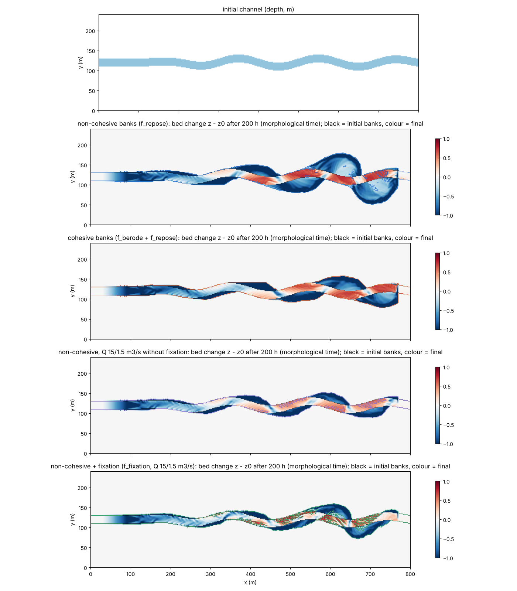
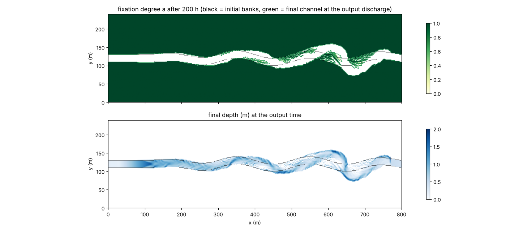
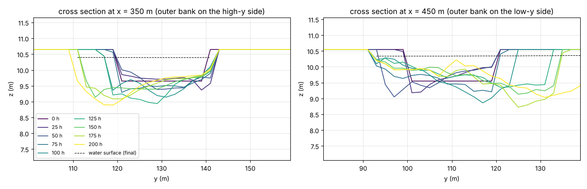
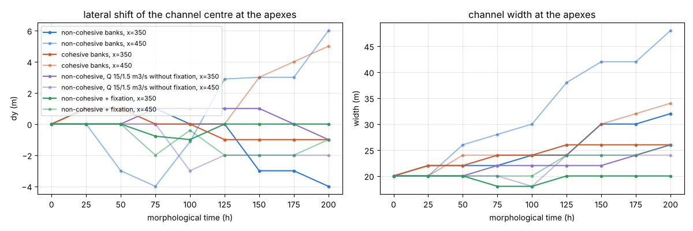

# meander — 正弦波状の初期河道の変形(蛇行発達の例題。段 3〜4)

氾濫原の中に置いた正弦波状の河道が、固定格子上の掃流砂 Exner・流砂方向
補正(河床勾配項+平衡二次流項)・安息角崩落(と側岸侵食則)・定着でどう
変形するかを見る例題です(docs/meander_plan.md 段 3〜4、developer.md
§84.5〜§84.6)。河道中心線や格子の再生成は使わず、地形と乾湿処理だけで
河道の形を追います。一定流量では外岸の後退と内岸の砂州で**河道が広がる**
だけですが、出水と低水を繰り返す流入に定着 `f_fixation` を組み合わせると、
低水期に露出した内岸の砂州が定着して出水時の再侵食に抵抗し、**内岸が陸地と
して前進して拡幅が抑えられます**(下の「結果」と「所見」)。ただし 200 h の
地形時間では蛇行振幅の成長と呼べる段階には至りません。短絡はこの例題では
起きません(examples/meander_cutoff)。コード変更なし(設定のみ)。

## 共通の幾何

800 m × 240 m、dx = dy = 2 m。幅 20 m(10 セル)の河道。上流 100 m は直線、
以後 x = 100〜700 m は振幅 10 m・波長 200 m の正弦波(立ち上がりと末端は
1 波長で滑らかに 0 へ)、最後の 100 m は直線で東辺の自由流出へ。河床勾配
0.001(路長に沿う)、両岸は河床 +1 m の乾いた氾濫原(砂床の安息角 32° に
対して 1 m / 2 m = 26.6° で安定)。土層厚は両端 30 m が 0(非侵食)、
上流端から 300 m はランプ(0 → 5 m。上流端のナックポイント穴を岩盤で止める)、
他は 5 m。西端の河道 10 セルに区間流入(一定 Q = 15 m³/s = 水深 ≈ 0.8 m の
等流、または出水 15 m³/s と低水 1.5 m³/s の繰り返し)。入力は `make_init.py`
が生成します(`make`)。

## 4 つの構成

| ケース | 設定ファイル | 流入 | 河岸・定着 |
|---|---|---|---|
| 非粘着性 | param.txt | 一定 15 m³/s | 安息角崩落のみ(`f_repose = 1`、φ_r = 32°)。外岸脚部の洗掘で河岸面が安息角を超えると崩落して後退 |
| 粘着性 | param_cohesive.txt | 一定 15 m³/s | 側岸侵食則+崩落(`f_berode = 1`、K_b = 3e-5 m/s、τ*c,b = 0.5、φ_r = 35°)。河道平均より速い流れに接する河岸だけが侵食則で後退 |
| 流量変動のみ | param_varq.txt | 出水 15 m³/s(20 分)と低水 1.5 m³/s(18 分)の繰り返し(周期 42 分 = 地形 35 h) | 非粘着性と同じ。定着なし(比較用) |
| 流量変動+定着 | param_fix.txt | 同上 | 非粘着性 + `f_fixation = 1`(T_fix = 10 h、c_τ = 10、dz_reset = 0.1 m)。低水期に露出した砂州が定着し、出水時の τ*c が最大 11 倍 |

共通: 芦田・道上式(d50 = 1 mm)、河床勾配項 `fluv_slope = 1`(μs = 1.0、
μk = 0.45)、平衡二次流項 `f_secflow = 1`(N* = 7)— 係数は文献照合待ちの
値を明示指定(developer.md §84.3)。移流項は既定の運動量保存形
(`f_advection_scheme = 3`。§68.36 の副格子結合の修正後は市松が出ない。
2026-10-17 以前の版はスキーム 1 を使っていた)。塞がれた開口の動的振り替えは
全エッジ(`f_opening_dynamic = 2`。河道マスクのない掘り込み河道では既定の 1 は
無効で、河岸脚部の行の流量が 2 割不足する。§84.7、test/uniflow)。地形更新
1 s ごと、morfac = 50(水理 4 h = 地形時間 200 h)。

## 実行方法

```
cd examples/meander
make                          # ../../bin/encflow へのリンクと入力(z.txt, h.txt, sd.txt)
./encflow param.txt           # 約 25 分(gfortran、2 スレッド)。出力は result/
./encflow param_cohesive.txt  # 同上。result_cohesive/
./encflow param_varq.txt      # 流量変動のみ。result_varq/
./encflow param_fix.txt       # 流量変動+定着。result_fix/(定着度 Fx0001… も出力)
python3 plot_results.py       # figs/*.png と数表
```

## 結果(2026-10-17。gfortran 13.3、-Ofast、2 スレッド。移流は既定のスキーム 3、f_opening_dynamic = 2)



上: 初期の河道。下 4 段: 地形時間 200 h 後の河床変化 z − z0(青 = 洗掘、
赤 = 堆積)。黒線が初期の河岸、色線が終了時の河岸(水深 0.05 m の等値線。
流量変動の 2 構成は終了時が低水期で、露出した砂州の分だけ等値線が内側に
入る)。`f_opening_dynamic = 2`(§84.7)で河岸脚部の流れが実体を持つように
なった(25 h の外岸脚部の流速は河道中央の 0.82 倍。以前は 0.56 倍)ため、
外岸の後退は以前の版よりはるかに速い。一定流量の 2 構成では下流側の湾曲
(x > 450 m)の外岸が 20〜40 m 後退してループが膨らみ、内岸の砂州(+0.5〜
+0.9 m)は水面下に残るので**ループの拡張と拡幅が同時に進む**(非粘着性で
幅 20 → 40 m、崩落土砂 13,100 m³。粘着性は 32 m、側岸侵食則で 3,090 m³ +
崩落 26,700 m³)。上流側の
湾曲(x < 450 m)は無給砂の河床低下波で河床が下がり、河岸が相対的に高く
なって動きが小さい。



流量変動+定着の構成の定着度 a(上)と終了時(低水期)の水深(下)。氾濫原は
乾いたままなので a = 1。初期河道の内側では、各湾曲の内岸側に出水時の水面
まで育った砂州が低水期に露出して定着し(a > 0.5 が 555 セル = 2220 m²)、
**内岸が陸地として前進**した。外岸は下流側の湾曲で 10〜20 m 後退し、低水期の
流れは外岸沿いの淵に集まる。4 構成の中では最も「幅を保った横移動」に近い。



頂点 x = 350 m(外岸 = 北側)と 450 m(外岸 = 南側)の横断面の時間発展
(非粘着性・一定 Q)。外岸側が深くなり、河岸面が安息角(32°)に張り付いた
まま後退し、内岸側に砂州が育つ。



| ケース | 100 h: 河幅 / 中心の最大移動 / 湿潤帯の最大振幅 (m) | 150 h(出水時) | 200 h | 最深の洗掘 (m) | 定着した砂州セル(初期河道内、200 h) |
|---|---|---|---|---|---|
| 非粘着性(一定 Q) | 32.4 / 16.8 / 37 | 38.3 / 26.1 / 51 | 40.5 / 31.5 / 59 | -1.53 | — |
| 粘着性(一定 Q) | 28.4 / 12.0 / 25 | 30.7 / 21.1 / 35 | 32.4 / 22.4 / 37 | -2.62 | — |
| 流量変動のみ | 22.5 / 11.0 / 23 | 27.1 / 8.0 / 27 | 26.8 / 19.0 / 31 | -2.31 | — |
| 流量変動+定着 | 22.8 / 13.4 / 27 | 25.6 / 16.2 / 35 | 26.9 / 21.5 / 39 | -1.85 | 555(2220 m²) |

(x = 150〜650 m。河幅は湿潤セル(h > 0.1 m)の列平均、中心の移動は湿潤
セルの重心の初期からのずれの最大値、湿潤帯の最大振幅は湿潤セルの外縁の
中心軸からの距離の最大値(初期 19 m)。流量変動の 2 構成では 100 h と 200 h
の出力が低水期に当たるため、出水期の 150 h も示す。)

## 所見

- **外岸の後退の連鎖が動いている**: 平衡二次流項が土砂を内岸へ運び、河床勾配項が
  横断斜面を緩め、外岸の淵と内岸の砂州ができる(test/bendsed と同じ向き)。淵が
  深くなると外岸の河岸面が安息角を超えて崩落し、崩落土砂が脚部の流れで運ばれて
  後退が続く。河岸脚部の流れは `f_opening_dynamic = 2` で初めて実体を持つ
  (§84.7。既定の 1 は河道マスクのない本例題では無効で、脚部の行は内部の 8 割
  しか流れず、崩落土砂が運び去られずに後退が止まっていた)。粘着性の設定
  (側岸侵食則が脚部の τ* を駆動力にする)も同じ理由で後退量が大きくなった。
- **一定流量では横移動が拡幅とループの拡張になる**: 外岸は後退するが、内岸の
  砂州は供給セルの水面までしか堆積せず(§84.2)陸地にならないため、河道は
  幅を増しながら外側へ膨らむ(湿潤帯の振幅 19 → 59 m、幅 40 m)。
- **流量変動+定着で内岸が陸地になる**: 低水期に露出した砂州が定着して出水時に
  削られず、初期河道内の 555 セル(2220 m²)が a > 0.5 の陸地として残る。
  定着のない流量変動構成では同じ砂州が次の出水で削られる。外岸の後退は下流側の
  湾曲で 10〜20 m(湿潤帯の振幅 39 m)。蛇行の横移動の機構は揃ったが、
  上流側の湾曲が無給砂の河床低下で動かないこと、定着時間・c_τ が文献照合待ち
  であることから、振幅成長の速さの定量評価は段 5(給砂)の後に行う。
- 外岸の後退は湾曲の頂点ではなくその下流側で起き、淵も頂点の下流側に寄る
  (主流が湾曲を横切って次の湾曲の外岸に当たる位置)。頂点の列で測る指標
  (figs/metrics.png)は小さく出る。

## この例題で分かった限界(次の段の課題)

1. **河岸脚部セルの流速が低い**: 階段状の乾いた河岸に接するセルの流速は河道中央の
   0.5〜0.8 倍。乾いた高いセルへの斜めリンクが流束を運ばず、河岸に接する行の
   通過幅が失われるため(developer.md §84.7、test/uniflow: 直線水路でも河岸行は
   内部行の 0.80、1 セル幅の水路は Manning の通水能の 64 %)。流砂の τ* は
   この値を使うので脚部の掃流力は過小で、側岸侵食則(粘着性)の後退量が小さい
   のはこのため。本例題は `f_opening_dynamic = 2`(塞がれた開口の動的振り替えを
   全エッジに適用)で解消している(河道マスクがないため既定の 1 では無効。
   2 にすると外岸脚部の流速比は 0.56 → 0.82 になり、外岸の後退が数倍速くなった)。
2. **一定流量では横移動が拡幅とループの拡張になる**: 堆積は供給セルの水面までで
   止まる(§84.2)ので、内岸の砂州は水面下に留まり、外岸の後退がそのまま河幅の
   増加になる。流量変動+定着(param_fix.txt)で内岸が陸地化するが、定着時間と
   c_τ は文献照合待ちの値。
3. **河岸の局所洗掘**: 階段状の河岸の凸角セルに流れが当たって局所的に深い穴が
   できる(ラスタ表現固有)。`sec_rmax` で二次流の偏角を抑えると穴は浅くなる。
4. **無給砂**: 上流端の非侵食帯から下流へ河床低下波が出る。掃流砂の給砂
   (段 5 の給砂時系列)があれば平衡河床から始められる。
5. (解消済み)運動量保存形移流の斜め副格子モード §68.36 は 2026-10-17 の
   副格子結合で消え、本例題は既定のスキーム 3 に戻した。

## 関連文書

- docs/meander_plan.md(設計の正本)、developer.md §84(実装と検証の記録)
- [docs/users_guide/geomorph.md](../../docs/users_guide/geomorph.md) — 流砂方向補正・側岸侵食・安息角崩落・定着の設定
- [test/bendsed](../../test/bendsed/)、[test/berode](../../test/berode/)、[test/repose](../../test/repose/)、[test/fixation](../../test/fixation/) — 各機構の検定
