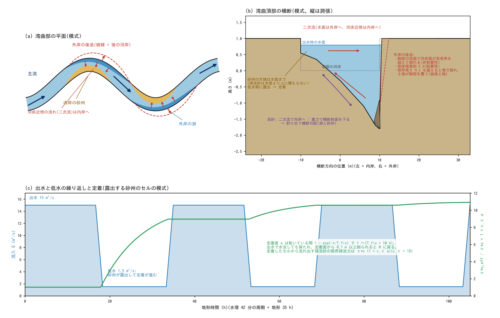
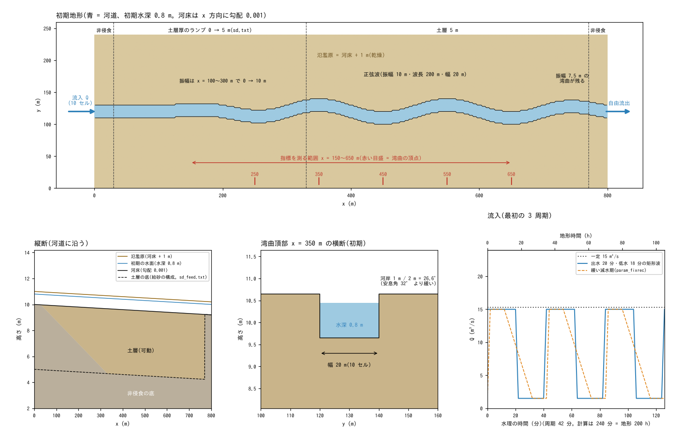
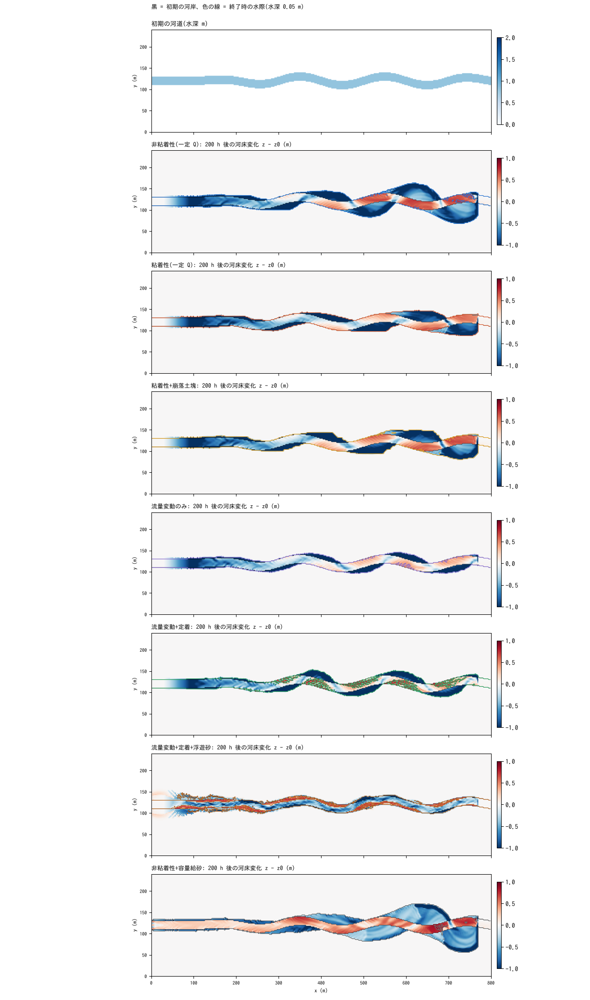
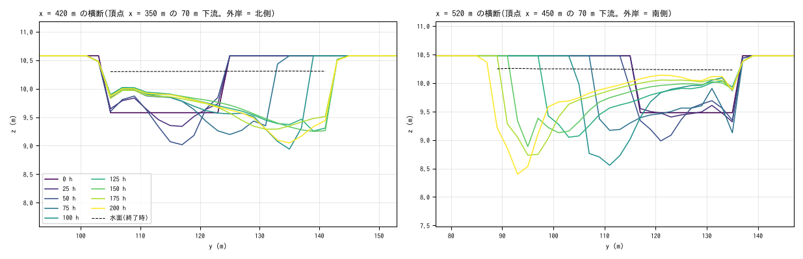
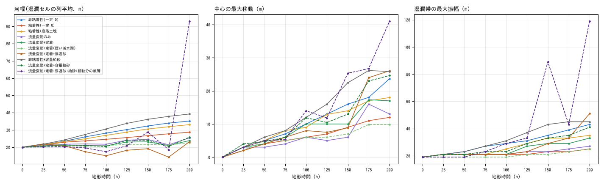
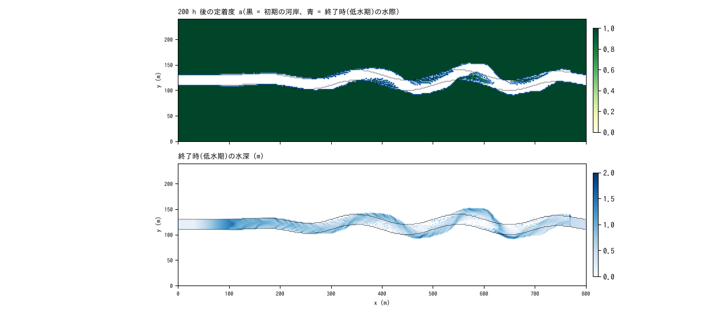
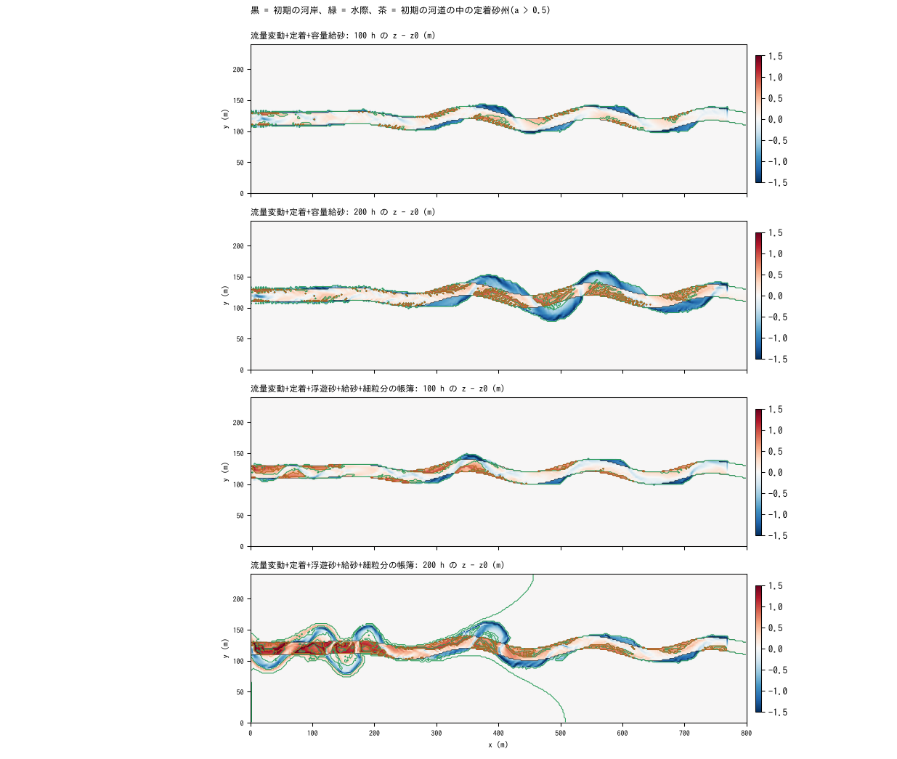

# meander — 正弦波状の河道の変形(外岸の後退・内岸の砂州・定着)

[English](en/README.md)

氾濫原の中に置いた正弦波状の河道が、掃流砂による河床変動・流砂の向きの補正(横断勾配と
二次流)・河岸の崩れ・内岸の砂州の定着で、どう形を変えるかを追う例題です。河道の中心線や
格子を作り直す処理は使わず、固定した格子の上の地形と乾湿の判定だけで河道の形を表します。
10 の構成で、河岸の性質(非粘着性・粘着性・崩落土塊)、流量の与え方(一定・出水と低水の
繰り返し)と定着、上流からの土砂の供給(無給砂・容量給砂・浮遊砂の平衡濃度給砂・河床の
細粒分の帳簿)を比べます。値は現象を見やすくするための模式値で、特定の河川の再現では
ありません。蛇行ループの短絡は [meander_cutoff](../meander_cutoff/README.md) で扱います。

流砂の向きの補正の係数(μs・μk・N*)は文献の値です。定着(`f_fixation`)は、Asahi ら
(2013) の「乾いた状態が続いたセルを氾濫原に編入する」扱いを、定着度 a に応じて限界掃流力を
連続的に上げる形に置き換えた ENCflow の**独自の簡略化**で、定着時間 T_fix と増分比 c_τ の
標準値は文献にありません。河床の細粒分の帳簿(`f_bedfines`)も、粒径階を持たない 2 成分の
最小の帳簿として ENCflow で組み立てたものです(developer.md §84.6・§84.10)。

## 実際の蛇行河川で起きていること

- **湾曲部の二次流と横断形状**: 湾曲部では、水面近くの流れが外岸へ、河床近くの流れが
  内岸へ向かう二次流(らせん流)が生じ、外岸に淵、内岸に砂州(寄州。point bar)が
  できます。横断方向の河床勾配は、二次流で内岸へ運ばれる流砂と、重力で横断斜面を下る
  流砂の釣り合いで決まります(Engelund 1974、Hasegawa 1989)。
- **外岸の後退**: 淵の洗掘で河岸の脚部が削られると、河岸が崩れて後退します。砂の河岸は
  安息角を超えた分が崩れ、粘着性の河岸は流水で少しずつ削られるほか、高さが限界を超えると
  塊で崩れます。崩れた土塊は脚部を覆い、流れが運び去るまで河岸の侵食を止めます
  (Parker ら 2011、Asahi ら 2013)。
- **内岸の前進と植生**: 内岸の砂州は出水で育ち、低水期に露出した砂州に植生が定着すると、
  次の出水で削られにくくなって氾濫原に加わります。外岸の後退と内岸の前進が釣り合うと、
  河道は幅を保ったまま横へ移動します。実験水路では、植生が定着する時間と河道が移動する
  時間の比で、単一の蛇行河道が保たれるか網状になるかが分かれます(Tal and Paola 2007)。
- **土砂の供給**: 実験水路で、横へ移動し短絡を繰り返す蛇行を一定流量で維持できた条件は、
  河床より強い河岸(植生)と、砂州の背後の窪みを埋める浮遊の細粒土砂でした(Braudrick ら
  2009)。上流から土砂が来なければ、河床は全体に下がります(河床低下)。

## 再現に必要な機構



模式図。(a) 湾曲部の平面: 河床近くの流れ(二次流)は内岸へ向き、外岸の淵は頂部のやや
下流に寄る。外岸は後退し(破線)、内岸に砂州が育つ。(b) 湾曲頂部の横断: 流砂は二次流で
内岸へ、重力で横断斜面を下り、その釣り合いで横断勾配が決まる。外岸は 3 通りの崩れ方で
後退し、砂州の天端は水面までしか上がらない。(c) 出水と低水の繰り返しと定着: 低水期に
露出する砂州のセルの定着度 a と、そのセルから流れ出す掃流砂の限界掃流力の倍率 1 + c_τ a
(模式。砂州は流量 5 m³/s 未満で乾くと仮定)。

この例題で働いている機構と、それを担う設定:

| 実際の現象 | モデルの機構 | 設定 |
|---|---|---|
| 河床の侵食と堆積 | [掃流砂](../../docs/users_guide/geomorph.md#掃流砂f_fluvial)の流砂量式(芦田・道上。d50 = 1 mm)と Exner 式 | `f_fluvial = 1`、`f_qbform = 1`、`fluv_d50 = 0.001` |
| 横断斜面を下る流砂 | 河床勾配項 $`\vec q = q_b(\hat t - \gamma\nabla z)`$、$`\gamma = \sqrt{\tau_{*c}/(\mu_s\mu_k\tau_*)}`$(長谷川型) | `fluv_slope = 1`、`fluv_mus = 1.0`、`fluv_muk = 0.45` |
| 二次流で内岸へ向かう流砂 | 平衡二次流項(河床近くの横断流速の比 $`r = N_* h\kappa`$。κ は流線の曲率) | `f_secflow = 1`、`sec_nstar = 7` |
| 砂の河岸の崩落 | 安息角崩落(隣のセルとの勾配が tanφ を超えた分を低い側へ移す) | `f_repose = 1`、`repose_phi = 32`(粘着性の構成は 35) |
| 粘着性の河岸の流水侵食 | 側岸侵食則 $`E_b = K_b(\tau_*/\tau_{*c,b} - 1)^m`$(河岸に接する脚部セルの τ* で評価し、削った土砂は脚部へ移す) | `f_berode = 1`、`berode_kb = 3e-5`、`berode_tausc = 0.5` |
| 塊状の崩落と、土塊による脚部の保護 | [崩落と崖錐](../../docs/users_guide/geomorph.md#崩落と崖錐f_rockfall)の河岸モード(河岸面が限界高さ H_c を超えた分が崩れて脚部の崖錐になる)と、崖錐の厚さによる側岸侵食の遮蔽 | `f_rockfall = 1`、`rf_bank = 1`、`rf_hc = 1.5`、`berode_hcover = 0.2` |
| 砂州は出水時の水面より上に積もらない | 掃流砂は水面より高い隣のセル(河岸面)へは運ばれない | `f_fluvial = 1` の動作 |
| 露出した砂州への植生の定着 | 定着度 a(乾いている間 1 − exp(−t/T_fix) で 1 へ)。そのセルから流れ出す掃流砂と、そのセルを河岸とする側岸侵食の限界掃流力を τ*c (1 + c_τ a) に上げる。定着面から 0.1 m 削られると 0 に戻る | `f_fixation = 1`、`fix_tfix = 10`、`fix_ctau = 10`、`fix_dzreset = 0.1` |
| 植生が流れを遅くして細粒分を捕まえる | 定着したセルの粗度を n (1 + c_n a) に上げる | `fix_cn = 2` |
| 出水時の細粒分の運搬と堆積 | [浮遊砂](../../docs/users_guide/geomorph.md#浮遊砂f_suspend)(0.2 mm)の移流・巻き上げ・沈降 | `f_suspend = 1`、`inflow_cs` または `inflow_cs_eq` |
| 上流からの土砂の供給 | 容量給砂(流入面からの供給 = 流入セルの正味の流出。入口の河床が固定される) | `fluv_bcfeed = 1` |
| 河床の粗い砂と細粒分の区別 | [河床の細粒分の帳簿](../../docs/users_guide/geomorph.md#河床の細粒分の帳簿f_bedfines)(細粒分の厚さ sf。巻き上げは在庫の範囲で、掃流砂と一緒にも動く) | `f_bedfines = 1`、`fines_frac0 = 0`、`fines_la = 0.05` |
| 長い時間の地形変化 | 地形の変化だけを morfac 倍に加速する(水理 4 h = 地形時間 200 h) | `dt_geomorph = 1`、`morfac = 50` |

流砂量式は芦田・道上 (1972) です。河床勾配項は Hasegawa (1989) の式 (6) と同じ形で、
μs = 1.0・μk = 0.45 は Asahi ら (2013) の式 (22) が Hasegawa (1984) に拠って用いる値です。
平衡二次流の係数 N* = 7 は Asahi ら (2013) の式 (18) が Engelund (1974) から引く値です
(式と係数の照合は developer.md §84.12、[解説](../../docs/users_guide/sediment.md#3-掃流砂f_fluvial))。
側岸侵食則は超過掃流力のべき乗の形で、河岸面に働く掃流力を脚部セルの値で代用する簡略化
です。K_b は校正値で、標準値はありません。崩落土塊は、Asahi ら (2013) と Parker ら (2011)
の slump block(崩れた土塊が脚部を覆い、運び去られるまで河岸の侵食を止める)を、崩落と
崖錐の枠組みで格子に置いたものです(遮蔽の係数 (1 − ht/h_cover)⁺ は Asahi ら式 (27)〜(28)
の格子版)。定着の T_fix・c_τ は模式値です。Asahi ら (2013) は陸地化に要する乾いた時間と
出水の回帰時間の比 T_Land/T_return が 0.025〜0.5 で蛇行が発達することを示しており、この
例題の T_fix / 出水の周期 = 10 h / 35 h ≈ 0.29 はその範囲に入ります。

## 幾何と設定



上: 初期地形(青 = 河道。氾濫原は河床 + 1 m で乾いている)。赤い目盛は湾曲の頂点、赤い
矢印は指標を測る範囲。下左: 河道に沿う縦断(土層の底の実線 = sd.txt、破線 = 給砂の構成の
sd_feed.txt)。下中: 湾曲頂部 x = 350 m の初期の横断。下右: 流入(最初の 3 周期)。計算は
水理 240 分 = 地形時間 200 h で、出力は 30 分(地形 25 h)ごと。流量変動の構成では 100 h と
200 h の出力が低水期、150 h が出水期に当たります。

800 m × 240 m、Δx = 2 m(400 × 120 セル)。幅 20 m(10 セル)の河道を、乾いた氾濫原
(河床 + 1 m)の中に置きます。入力は `make_init.py` が作ります(`make`)。

- **河道**: 中心線は x = 0〜100 m が直線、x = 100 m から波長 200 m の正弦波です。振幅は
  x = 100〜300 m で 0 から 10 m に立ち上がり、x = 300〜700 m は 10 m(湾曲の頂点は
  x = 350・450・550・650 m)。x = 700 m から振幅が下がり始め、東辺の手前に振幅 7.5 m の
  湾曲が一つ残って、河道は東辺に約 9° の角度で達します。
- **河床と河岸**: 河床は x 方向に勾配 0.001(蛇行度 1.02 なので、路長に沿う勾配は約
  0.00098)、初期水深 0.8 m。河岸の段差 1 m / 2 m = 26.6° は安息角 32° より緩く、
  初期には崩れません。
- **土層**: 侵食できる土層は 5 m。下流端の 30 m は 0(非侵食)です。無給砂の構成
  (sd.txt)では上流端の 30 m も 0 にし、その下流 300 m(x = 30〜330 m)を 0 → 5 m の
  ランプにして、上流端の河床低下が深い穴になるのを岩盤で止めます。給砂の構成(sd_feed.txt)は
  上流端まで 5 m です(容量給砂が入口の河床を固定するので、ランプは要りません)。
- **流入**: 西辺の河道 10 セルに区間流入。一定 15 m³/s(水深 ≈ 0.8 m の等流)、または
  出水 15 m³/s(20 分)と低水 1.5 m³/s(18 分)を 2 分の遷移でつないだ周期 42 分
  (地形時間 35 h)の繰り返しです。東辺は自由流出。
- **時間**: dt = 0.2 s(浮遊砂を使う 2 構成は 0.1 s)、地形の更新は 1 s ごと、地形の
  変化を morfac = 50 倍に加速し、水理 4 h が地形時間 200 h です。粗度 n = 0.03。
- **流れの数値設定**: 移流は既定の運動量保存形(スキーム 3)、塞がれた開口の動的振り替えは
  既定の `f_opening_dynamic = 3`、区間流入の外縁に接するエッジは `f_inflow_edge = 2` です
  (注意を参照)。

| ケース | 設定ファイル | 流入 | 河岸・定着・給砂 | 計算時間の目安 |
|---|---|---|---|---|
| 非粘着性 | param.txt | 一定 15 m³/s | 安息角崩落(32°) | 約 20 分 |
| 粘着性 | param_cohesive.txt | 一定 | 側岸侵食則(K_b = 3×10⁻⁵ m/s、τ*c,b = 0.5)+ 安息角崩落(35°) | 約 20 分 |
| 粘着性+崩落土塊 | param_cohesive_slump.txt | 一定 | 粘着性 + 崩落土塊(H_c = 1.5 m、崖錐 35°)+ 土塊による遮蔽(h_cover = 0.2 m) | 約 20 分 |
| 非粘着性+容量給砂 | param_feed.txt | 一定 | 非粘着性 + 容量給砂(sd_feed.txt) | 約 20 分 |
| 流量変動のみ | param_varq.txt | 出水と低水の繰り返し | 非粘着性(定着なし。比較用) | 約 20 分 |
| 流量変動+定着 | param_fix.txt | 同上 | 非粘着性 + 定着(T_fix = 10 h、c_τ = 10) | 約 20 分 |
| 同、緩い減水期 | param_fixrec.txt | 2 分で 15 m³/s に上げて 10 分保ち、20 分かけて 1.5 m³/s へ下げ、低水 10 分(周期 42 分) | 流量変動+定着と同じ | 約 20 分 |
| 流量変動+定着+浮遊砂 | param_fixsusp.txt | 出水と低水。出水時に細粒分(0.2 mm)を体積濃度 0.004 で給砂 | 定着 + 浮遊砂 + 定着セルの粗度(c_n = 2) | 約 1 時間 15 分 |
| 流量変動+定着+容量給砂 | param_fixfeed.txt | 出水と低水 | 定着 + 容量給砂 | 約 25 分 |
| 流量変動+定着+浮遊砂+給砂+細粒分の帳簿 | param_fixsuspfines.txt | 出水と低水。細粒分(0.2 mm)は流入セルの平衡濃度の 0.5 倍で給砂 | 定着 + 浮遊砂 + 粗度 + 容量給砂 + 細粒分の帳簿(初期の河床は粗い砂だけ) | 約 1 時間 5 分 |

計算時間は gfortran 13.3(-Ofast -march=native)・1 スレッドで、Intel Xeon(2.3 GHz)の上で他のケースと
同時に計算したとき(1 ケースが 1 コアを使う)の値です。

**指標**(plot_results.py。x = 150〜650 m の列で測る): **河幅**は湿潤セル(水深 > 0.1 m)の
幅の列平均、**中心の最大移動**は列ごとの湿潤セルの重心の初期からのずれの最大、**湿潤帯の
最大振幅**は谷の中心線 y = 120 m から湿潤セルまでの距離の最大(初期 19 m)、**最深の洗掘**は
z − z0 の最小です。**定着セル**は初期の河道の中で定着度 a > 0.5 のセルです。流量変動の構成の
100 h・200 h の出力は低水期に当たるので、その河幅は低水期の水際で測ったものです。

## 実行方法

```
cd examples/meander
make                     # 実行ファイルへのリンクと入力(make_init.py が z.txt・h.txt・sd.txt・sd_feed.txt を作る)
make run                 # 一定流量の 4 構成(非粘着性・粘着性・粘着性+崩落土塊・容量給砂)
make varq                # 出水と低水の 4 構成(流量変動のみ・定着・緩い減水期・定着+浮遊砂)
make feed                # 給砂と定着の 2 構成(容量給砂、浮遊砂の平衡濃度給砂+細粒分の帳簿)
python3 plot_setup.py    # figs/mechanism.png・setup.png(計算結果は使わない)
python3 plot_results.py  # figs/planform.png・fixation.png・sections.png・metrics.png・feed.png と数表
```

引数 `en` を付けると英語ラベルの図を en/figs/ に描きます(`python3 plot_setup.py en`、
`python3 plot_results.py en`)。plot_results.py は画面出力(Screen.log・Screen_<構成>.log)
から崩落・侵食・給砂の台帳を読みます(`make` のターゲットが `2>&1 | tee` で残す)。図化には
Python 3・NumPy・matplotlib が要ります。

## 結果

数表と図は gfortran 13.3(-Ofast -march=native、1 スレッド)で全構成を計算した値です。数表は
plot_results.py の出力の抜粋です。

### 一定流量: 外岸の後退と拡幅



初期の河道(上)と、7 構成の地形時間 200 h 後の河床変化 z − z0(青 = 洗掘、赤 = 堆積)。黒線 = 初期の
河岸、色の線 = 終了時の水際(水深 0.05 m)。流量変動の構成は終了時が低水期で、露出した砂州の分だけ
水際が内側に入ります。



非粘着性・一定流量の、湾曲の頂点の 70 m 下流の横断の時間発展(左: 北へ張り出す湾曲の外岸 = 北側、
右: 南へ張り出す湾曲の外岸 = 南側)。破線は終了時の水面。



x = 150〜650 m の河幅・中心の最大移動・湿潤帯の最大振幅の時間発展(全構成。破線は流量変動+定着の
緩い減水期・容量給砂・浮遊砂+給砂+細粒分の帳簿の 3 構成で、非粘着性+容量給砂は実線)。

河幅 / 中心の最大移動 / 湿潤帯の最大振幅(m。初期 20 / 0 / 19)、最深の洗掘、定着セル:

| ケース | 100 h | 150 h(出水期) | 200 h | 最深の洗掘 (m、200 h) | 定着した砂州セル(初期の河道の中、200 h) |
|---|---|---|---|---|---|
| 非粘着性(一定 Q) | 28.1 / 10.0 / 29 | 32.3 / 16.0 / 35 | 35.1 / 23.7 / 43 | −2.31 | – |
| 粘着性(一定 Q) | 24.6 / 6.0 / 21 | 26.6 / 9.0 / 23 | 28.7 / 12.0 / 25 | −2.26 | – |
| 粘着性+崩落土塊 | 26.9 / 9.0 / 25 | 30.6 / 14.0 / 33 | 33.1 / 18.0 / 35 | −2.28 | – |
| 非粘着性+容量給砂 | 30.5 / 12.0 / 31 | 36.1 / 22.5 / 43 | 39.2 / 25.9 / 45 | −2.18 | – |
| 流量変動のみ | 21.7 / 6.0 / 21 | 24.5 / 6.0 / 23 | 25.4 / 13.0 / 27 | −1.97 | – |
| 流量変動+定着 | 20.8 / 10.0 / 21 | 23.1 / 10.0 / 29 | 23.8 / 17.0 / 33 | −2.24 | 483(1,932 m²) |
| 同、緩い減水期 | 21.0 / 6.0 / 19 | 21.7 / 7.0 / 21 | 22.6 / 9.9 / 25 | −2.06 | 191(764 m²) |
| 流量変動+定着+浮遊砂 | 15.0 / 8.0 / 21 | 19.1 / 8.8 / 29 | 23.2 / 26.1 / 51 | −2.77 | 1,040(4,160 m²) |
| 流量変動+定着+容量給砂 | 20.4 / 11.9 / 23 | 24.1 / 13.0 / 33 | 25.9 / 24.6 / 41 | −2.08 | 851(3,404 m²) |
| 流量変動+定着+浮遊砂+給砂+細粒分の帳簿 | 17.4 / 14.0 / 29 | 28.8 / 25.3 / 89 | 93.1 / 41.1 / 119 | −2.00 | 1,340(5,360 m²) |

(150 h は一定流量の構成ではただの中間の出力、流量変動の構成では出水期の出力です。細粒分の帳簿の構成の
150 h・200 h の値は、氾濫原にあふれた水を含みます。)

- **外岸の後退の連鎖が動く**: 平衡二次流項が流砂を内岸へ運び、河床勾配項が横断斜面を緩めて、外岸に
  淵、内岸に砂州ができます。淵が深くなると外岸の河岸面が崩れ、崩れた土砂が脚部の流れで運ばれて
  後退が続きます(横断の図: 外岸は 200 h に 18 m(x = 420 m)・28 m(x = 520 m)後退し、内岸の砂州は
  初期の河床より 0.4〜0.6 m 高いが水面の下に留まる)。後退が最も大きいのは湾曲の頂点ではなく、その
  70〜90 m 下流で(主流が湾曲を横切って外岸に当たる位置)、下流側の湾曲ほど大きくなります(頂点
  x = 350・450・550・650 m の湾曲で 22・30・40・46 m。plot_results.py の表 4)。
- **一定流量では横移動が拡幅とループの拡張になる**: 内岸の砂州は水面より上に積もらず陸にならないので、
  外岸の後退がそのまま河幅の増加になります(非粘着性: 河幅 20 → 35.1 m、湿潤帯の振幅 19 → 43 m、
  安息角崩落 3,958 m³)。上流側の湾曲は、無給砂の河床低下(x = 50〜150 m で −0.93 m)で河岸が
  相対的に高くなって動きが小さい。
- **粘着性の河岸は後退が遅い**: 側岸侵食則(423 m³)と安息角 35° の崩落(1,507 m³)で、200 h の
  河幅 28.7 m・振幅 25 m(非粘着性 35.1 m・43 m)。崩落土塊を加えると、限界高さ H_c = 1.5 m を
  超えた河岸が塊で崩れて(1,279 m³)河幅 33.1 m・振幅 35 m とやや大きくなり、側岸侵食則の寄与は
  423 → 458 m³ と減りません(土塊による遮蔽の効果は小さい)。
- **容量給砂で河床低下が止まる**(非粘着性+容量給砂): 河道の河床変化は −0.04〜−0.12 m(無給砂は
  −0.48〜−0.93 m)で、上流側の湾曲も動き、200 h の河幅 39.2 m・振幅 45 m と一定流量の構成で最も
  大きく広がります(容量給砂 5,884 m³)。

### 流量変動と定着: 内岸が陸になる



流量変動+定着(param_fix.txt)の 200 h の定着度 a(上)と、終了時(低水期)の水深(下)。氾濫原は乾いた
ままなので a = 1。

200 h の定着セル・砂州の高さ・河道の河床変化(湿潤セルの平均)・氾濫原の堆積:

| ケース | 定着セル(初期の河道の中) | うち z − z0 > 1.0 m | 定着砂州の最大 z − z0 (m) | 河床変化 x = 50〜150 / 150〜300 / 300〜500 m | 氾濫原の堆積 > 0.1 m(セル) |
|---|---|---|---|---|---|
| 非粘着性(一定 Q) | – | – | – | −0.93 / −0.72 / −0.48 | 0 |
| 非粘着性+容量給砂 | – | – | – | −0.04 / −0.04 / −0.12 | 0 |
| 流量変動のみ | – | – | – | −0.87 / −0.57 / −0.37 | 0 |
| 流量変動+定着 | 483 | 0 | 0.87 | −0.85 / −0.56 / −0.51 | 0 |
| 同、緩い減水期 | 191 | 0 | 0.77 | −0.82 / −0.54 / −0.39 | 0 |
| 流量変動+定着+浮遊砂 | 1,040 | 115 | 1.17 | −0.35 / −0.57 / −0.69 | 196 |
| 流量変動+定着+容量給砂 | 851 | 72 | 1.07 | −0.14 / −0.08 / −0.39 | 0 |
| 流量変動+定着+浮遊砂+給砂+細粒分の帳簿 | 1,340 | 550 | 1.64 | −0.00 / −0.00 / −0.04 | 694 |

(氾濫原の高さは初期の河床 + 1.0 m。粘着性の 2 構成は非粘着性とほぼ同じ河床変化で、表から省いた。細粒分の
帳簿の構成は 200 h に氾濫原にも水が残っていて、河床変化はその湿潤セル(変化はほぼ 0)を含む平均。)

- **流量変動だけでは内岸は陸にならない**: 低水期に露出した砂州は次の出水で削られます(200 h の河幅
  25.4 m・振幅 27 m。出水が周期の半分ほどなので、一定流量より変化は小さい)。
- **定着を加えると内岸が陸として残る**: 低水期に露出した砂州が定着し(200 h に初期の河道の中で a > 0.5
  が 483 セル = 1,932 m²)、次の出水で削られずに残ります。外岸は後退を続け(振幅 33 m)、低水期の
  流れは外岸沿いの淵に集まります。出水期(150 h)に水没する定着セルは 324 のうち 99 で、定着砂州の
  天端(最大 +0.87 m)は出水時の水面で止まり、氾濫原の高さには届きません。
- **緩い減水期では定着が減る**(param_fixrec.txt): 定着セル 191(矩形波は 483)、天端 0.77 m、河幅
  22.6 m。掃流砂の堆積は供給セルの水面で頭打ちになるので、最も高い堆積はピークの間に起き、減水期を
  長くするとピークの継続時間が短くなって全体に遅くなります。
- **浮遊砂を加えると、初期の河道が砂州で埋まり、流れが新しい湾曲を刻む**(param_fixsusp.txt): 出水時に
  細粒分を給砂すると、細粒分が定着砂州の上と縁に積もって砂州が育ち、定着セルは 1,040 に増え、うち
  115 セルが氾濫原の高さを超えます(天端 1.17 m)。低水期の河幅は 100 h に 15.0 m まで狭まります。
  初期の河道が埋まると、流れは 150 h ごろから初期の河道を横切る新しい湾曲を氾濫原に刻み(x ≈ 180〜
  470 m。波長は初期の半分以下の 70〜90 m)、200 h の湿潤帯の振幅は 51 m に広がります。流入口の近くの
  氾濫原に細粒分が積もります(196 セル)。この構成は流れの数値設定に敏感で、開口の扱いを
  f_opening_dynamic = 2 にすると、砂州の天端は 0.8 m ほどで止まり、外岸の後退もほぼ止まります。

### 給砂: 河床低下を止め、砂州を氾濫原の高さへ



給砂を入れた流量変動+定着の 2 構成の 100 h・200 h(いずれも低水期)の河床変化。黒 = 初期の河岸、
緑 = 水際、茶 = 初期の河道の中の定着砂州(a > 0.5)。

- **容量給砂を入れると、定着砂州が氾濫原の高さに届き始める**(param_fixfeed.txt): 河道の河床低下は
  −0.08〜−0.39 m に緩み(無給砂は −0.51〜−0.85 m)、200 h の定着セルは 851(無給砂は 483)、
  うち 72 セルが氾濫原の高さ(+1.0 m)を超えます(天端 1.07 m。容量給砂 3,557 m³)。
- **河床の細粒分の帳簿を入れると、給砂倍率 0.5 で砂州が氾濫原の高さを超えて育ち、出水が氾濫原にあふれる**
  (param_fixsuspfines.txt): 初期の河床を粗い砂だけにすると(`fines_frac0 = 0`)、細粒分は堆積した
  分しか再浮上しないので河道は下がらず、初期の河道は砂州で埋まります(200 h の初期の河道の中の河床変化は
  x = 50〜150 / 150〜300 / 300〜500 m で +0.95 / +0.64 / +0.49 m)。200 h の定着セル 1,340 のうち 550 セルが
  氾濫原の高さを超えます(天端 1.64 m)。出水時の堆積 → 低水期の露出 → 定着 → 氾濫原の高さ、という狙った
  過程が給砂濃度を合わせ込まずに出て、氾濫原より高くまで進みます。砂州で埋まった所では、流入口から
  x ≈ 220 m までと x ≈ 350〜480 m で流れが氾濫原へ回り込んで新しい湾曲を刻みます。125 h ごろからは出水が
  氾濫原へあふれ、その水は低水期にも引ききらず、200 h には x ≈ 0〜450 m の氾濫原の全幅に浅い水が残ります
  (図の緑の線。湿潤セル 26,359)。氾濫原の堆積は 694 セル、容量給砂は 4,151 m³、帳簿が掃流砂に同伴させた
  細粒分の累計は 7.9 × 10⁵ m³ です。

### 台帳

| ケース | 安息角崩落 | 側岸侵食則 | 崩落土塊 | 容量給砂 | 掃流砂に同伴した細粒分 | fluv_dzmax の発動(エッジ) |
|---|---|---|---|---|---|---|
| 非粘着性(一定 Q) | 3,958 | – | – | – | – | 41,274 |
| 粘着性(一定 Q) | 1,507 | 423 | – | – | – | 7,406 |
| 粘着性+崩落土塊 | 1,197 | 458 | 1,279 | – | – | 22,669 |
| 非粘着性+容量給砂 | 4,306 | – | – | 5,884 | – | 126,155 |
| 流量変動のみ | 1,792 | – | – | – | – | 852 |
| 流量変動+定着 | 3,190 | – | – | – | – | 406 |
| 同、緩い減水期 | 2,181 | – | – | – | – | 144 |
| 流量変動+定着+浮遊砂 | 15,216 | – | – | – | – | 292,347 |
| 流量変動+定着+容量給砂 | 5,626 | – | – | 3,557 | – | 10,102 |
| 流量変動+定着+浮遊砂+給砂+細粒分の帳簿 | 8,623 | – | – | 4,151 | 790,965 | 48,947 |

(m³。崩落・侵食はかさ、給砂・細粒分は固体の体積。画面出力の台帳から plot_results.py が読む。)

## このモデルで表せないこと(実際の現象との違い)

- **河道は格子の上の地形で表す**: 河岸は 2 m の階段で、河岸の後退は 1 セル単位で進みます。
  流れが階段の凸角に当たると局所的に深い穴ができます(ラスタ表現に固有。`sec_rmax` で
  二次流の偏角を抑えると浅くなる)。
- **一定流量では内岸が陸にならない**: 掃流砂は供給セルの水面より上に積もらないので、砂州は
  水面下に留まり、外岸の後退がそのまま河幅の増加になります。内岸の前進には、低水期の露出と
  定着、または細粒分の堆積が要ります。
- **定着は模式**: 植生の種類・成長・枯死を区別せず、定着度 a だけで表します。T_fix・c_τ の
  標準値は文献になく、この例題の値(10 h・10)は模式値です。冠水中の枯死(`fix_tdec`)は
  使っていません。
- **二次流は平衡型**: 二次流は流線の曲率に即座に応じ、湾曲に入ってから二次流が発達する
  までの遅れ(非平衡の適応長。Struiksma ら 1985 の形で、シェジー係数 C = 50 m^1/2/s なら水深の
  10〜20 倍)を持ちません。
- **河床の粒径は 2 成分**: 掃流砂も浮遊砂も 1 粒径ずつで、混合粒径の交換層や鉛直の層序は
  持ちません(細粒分の帳簿は、埋もれた細粒分も巻き上げに使えるものとして扱う)。
- **蛇行の発達の速さは実際の河川と比べていない**: 200 h で湿潤帯の振幅は 19 m から 25〜51 m に
  広がり(氾濫原に水が残る細粒分の帳簿の構成を除く)、外岸の後退・内岸の前進・河道の横移動の機構は揃いますが、一定流量では拡幅とループの拡張が
  主で、ループの成長や移動の速さを実際の河川と比べる段階には至りません。

## 注意

- **区間流入の外縁のエッジ**: 全構成で `f_inflow_edge = 2`(区間流入の内側へ向かうエッジの移流項を
  0 にし、その流速をエネルギー水頭で抑える)を指定しています。既定の 0 では、容量給砂の構成が流入口の
  横の掘れと噴流の正帰還で止まります(developer.md §68.40)。流入口の近くの結果はこの規則に依ります。
- **塞がれた開口の動的振り替え**: 全構成で既定の `f_opening_dynamic = 3` を明記しています。河道マスクの
  ない掘り込み河道で、河岸に接する行の通水能を保つには 2 以上が要ります(1 では効かない。developer.md
  §84.7、test/uniflow)。
- **時間刻み**: dt = 0.2 s、浮遊砂を使う 2 構成は 0.1 s です(浮遊砂 + 定着の構成は 0.2 s では CFL を
  超えます)。
- **1 更新の河床変化の上限**: `fluv_dzmax`(0.05 m)の発動は 144〜292,347 エッジで(台帳の表)、
  流量変動+定着+浮遊砂の構成と非粘着性+容量給砂の構成で多くなります。morfac = 50 は大きいので、
  下げると減ります。
- **再現性**: 同じ実行ファイルならスレッド数によらず結果はビット一致しますが、コンパイラ・最適化・
  CPU(この README は gfortran 13.3 の -Ofast -march=native。-march=native はビルドした CPU の命令を
  使う)が違うと丸めが変わり、河岸の崩れと流れの正帰還で増幅されて数値が変わります。比べるときは、
  河幅や振幅の数値の一致より、構成の間の違いの向きと大きさを見てください。

## 感度実験の入口

- `fix_tfix`・`fix_ctau`: 定着の速さと強さ。出水の周期との比 T_fix/T_return で選びます
  (Asahi ら 2013 では 0.025〜0.5 で蛇行が発達し、1 では発達しない)。
- `fix_tdec`・`fix_ctau_bank`: 冠水中の定着の減衰と、河岸の侵食に効かせる増分比
  (developer.md §84.13)。定着した砂州が水没したまま削られずに残る場合の処方です。
- `berode_kb`、`rf_hc`・`berode_hcover`: 粘着性の河岸の後退の速さ。崩落土塊の構成では限界
  高さ H_c(初期の河岸高 + 淵の洗掘深で超える値)が後退の時期を決めます。
- `inflow_cs_fac`・`fines_la`: 浮遊砂の平衡濃度給砂の倍率と、河床の細粒分の交換層の厚さ。
- `sec_rmax`・`repose_phi`: 外岸の淵の深さと河岸の崩れやすさ。
- `fluv_bcfeed_fac`: 容量給砂の倍率(0 = 無給砂、1 = 入口の河床を固定)。

## 参考文献

- 芦田和男・道上正規 (1972): 移動床流れの抵抗と掃流砂量に関する基礎的研究. 土木学会論文
  報告集, 206, 59–69.
- Asahi, K., Shimizu, Y., Nelson, J. and Parker, G. (2013): Numerical simulation of river
  meandering with self-evolving banks. *J. Geophys. Res. Earth Surf.*, 118(4), 2208–2229.
- Braudrick, C. A., Dietrich, W. E., Leverich, G. T. and Sklar, L. S. (2009): Experimental
  evidence for the conditions necessary to sustain meandering in coarse-bedded rivers.
  *Proc. Natl. Acad. Sci. USA*, 106(40), 16936–16941. doi:10.1073/pnas.0909417106(要旨で確認)
- Engelund, F. (1974): Flow and bed topography in channel bends. *J. Hydraul. Div. ASCE*,
  100(HY11), 1631–1648.(N* = 7 の出典として Asahi ら (2013) が引く。本文は未照合)
- Hasegawa, K. (1989): Universal bank erosion coefficient for meandering rivers. *J. Hydraul.
  Eng.*, 115(6), 744–765.
- Parker, G., Shimizu, Y., Wilkerson, G. V., Eke, E. C., Abad, J. D., Lauer, J. W., Paola, C.,
  Dietrich, W. E. and Voller, V. R. (2011): A new framework for modeling the migration of
  meandering rivers. *Earth Surf. Process. Landforms*, 36(1), 70–86.(要旨で確認)
- Struiksma, N., Olesen, K. W., Flokstra, C. and de Vriend, H. J. (1985): Bed deformation in
  curved alluvial channels. *J. Hydraul. Res.*, 23(1), 57–79. doi:10.1080/00221688509499377
- Tal, M. and Paola, C. (2007): Dynamic single-thread channels maintained by the interaction of
  flow and vegetation. *Geology*, 35(4), 347–350. doi:10.1130/G23260A.1(要旨で確認)

## 関連文書

- [docs/users_guide/geomorph.md](../../docs/users_guide/geomorph.md) — 流砂の向きの補正・
  側岸侵食・安息角崩落・崩落土塊・定着・浮遊砂・細粒分の帳簿の設定
- docs/meander_plan.md(設計の正本)、developer.md §84(実装と検証の記録)
- 検証: [test/bendsed](../../test/bendsed/)(湾曲部の横断形状)、[test/berode](../../test/berode/)
  (側岸侵食と崩落土塊)、[test/repose](../../test/repose/)(安息角崩落)、
  [test/fixation](../../test/fixation/)(定着)、[test/uniflow](../../test/uniflow/)(河岸に接する行の通水能)
- [examples/meander_cutoff](../meander_cutoff/README.md) — 同じ機構での蛇行ループの短絡
