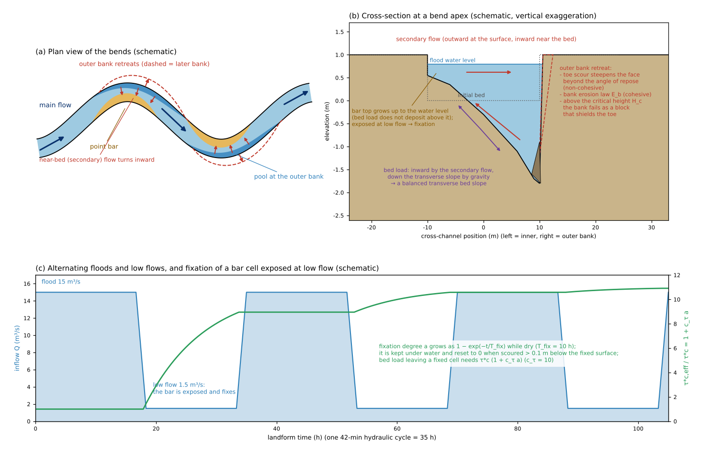
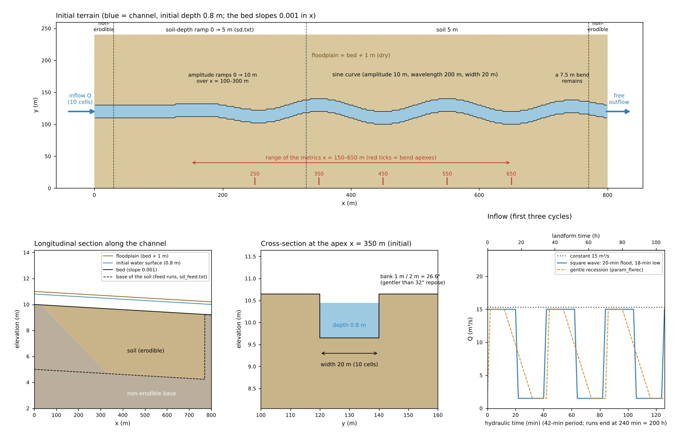
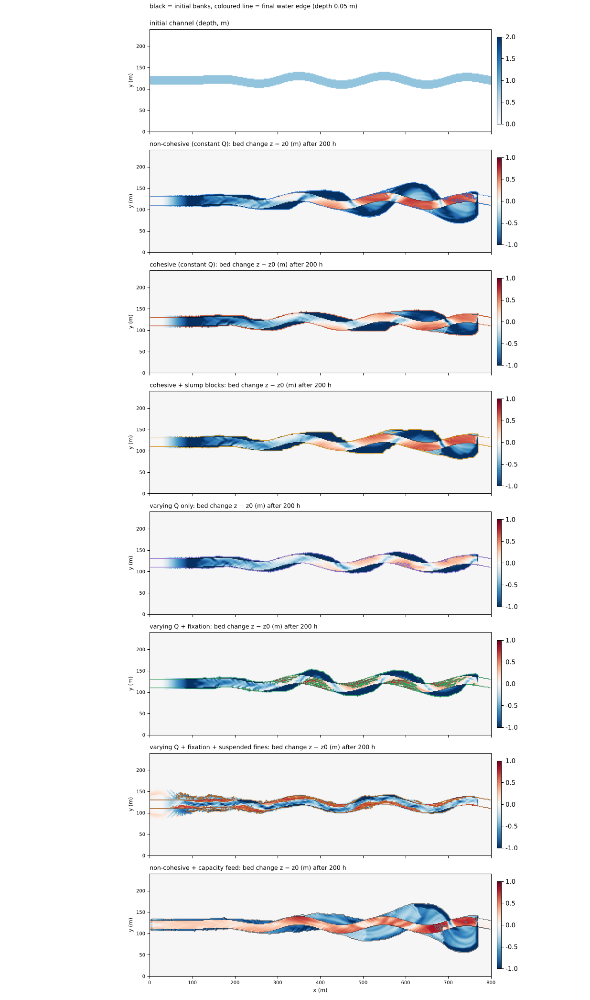
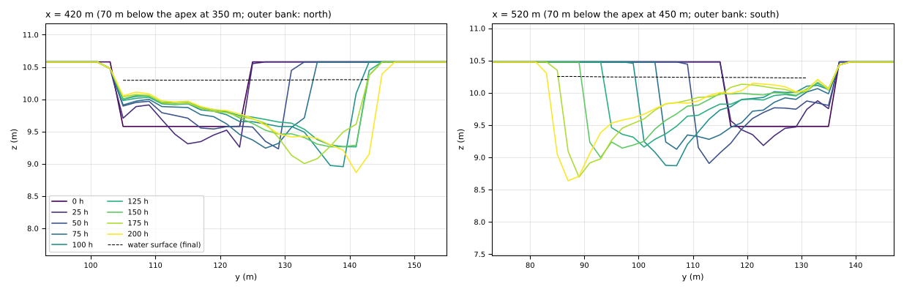
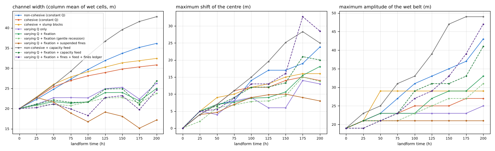
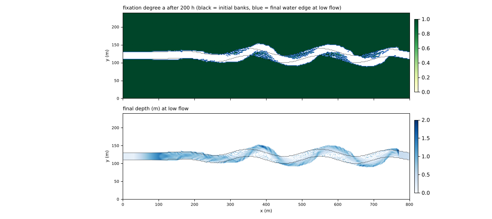
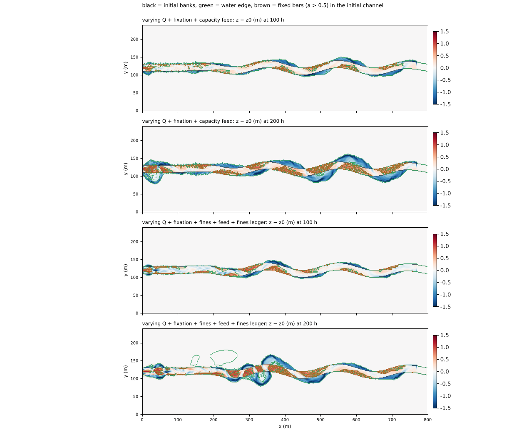

# meander — deformation of a sinusoidal channel (outer-bank retreat, inner-bank bars and fixation)

> English mirror of examples/meander/README.md. The Japanese file is the master copy.

[日本語](../README.md)

This example follows how a sinusoidal channel placed in a floodplain changes its shape under
bedload bed evolution, corrections of the bedload direction (transverse bed slope and secondary
flow), bank collapse and fixation of the inner-bank bars. No processing that rebuilds the
channel centreline or the grid is used: the shape of the channel is represented only by the
terrain on a fixed grid and the wet/dry judgement. Eleven configurations compare the nature of
the banks (non-cohesive, cohesive, slump blocks), the way the discharge is given (constant, or
alternating floods and low flows) together with fixation, and the sediment supply from upstream
(no feed, capacity feed, equilibrium-concentration feed of suspended sediment, the ledger of
fines in the bed). The values are schematic values chosen to make the phenomena easy to see; the
example does not reproduce a particular river. Cutoffs of meander loops are treated in
[meander_cutoff](../../meander_cutoff/en/README.md).

The coefficients of the bedload-direction corrections (μs, μk, N*) are literature values.
Fixation (`f_fixation`) is **ENCflow's own simplification** that replaces the treatment of Asahi
et al. (2013), in which cells that stay dry long enough are added to the floodplain, with a
continuous rise of the critical Shields stress according to a degree of fixation a; there are no
standard values in the literature for the fixation time T_fix or the increment ratio c_τ. The
ledger of fines in the bed (`f_bedfines`) is also a minimal two-component ledger without grain
size classes assembled in ENCflow (developer.md §84.6, §84.10).

## What happens in real meandering rivers

- **Secondary flow and the cross-section of a bend**: in a bend a secondary (helical) flow
  arises in which the flow near the surface goes towards the outer bank and the flow near the
  bed towards the inner bank; a pool forms at the outer bank and a bar (point bar) at the inner
  bank. The transverse bed slope is set by the balance between the bedload carried inward by
  the secondary flow and the bedload going down the transverse slope by gravity (Engelund
  1974, Hasegawa 1989).
- **Retreat of the outer bank**: when scour in the pool erodes the toe of the bank, the bank
  collapses and retreats. A sandy bank collapses by the part that exceeds the angle of repose; a
  cohesive bank is eroded little by little by the flow and also fails as a block when its
  height exceeds a limit. The fallen blocks cover the toe and stop bank erosion until the flow
  carries them away (Parker et al. 2011, Asahi et al. 2013).
- **Advance of the inner bank and vegetation**: the inner-bank bar grows during floods; once
  vegetation is established on a bar exposed during low flow, the bar is hard to erode in the
  next flood and joins the floodplain. When the retreat of the outer bank and the advance of
  the inner bank balance, the channel moves sideways while keeping its width. In laboratory
  flumes, the ratio of the time for vegetation to establish to the time for the channel to
  migrate decides whether a single meandering channel persists or the river becomes braided
  (Tal and Paola 2007).
- **Sediment supply**: the conditions under which a meander that migrates sideways and repeats
  cutoffs was sustained at constant discharge in a flume were banks stronger than the bed
  (vegetation) and suspended fine sediment that fills the hollows behind the bars (Braudrick et
  al. 2009). Without sediment coming from upstream, the bed lowers as a whole (degradation).

## Mechanisms needed to reproduce it



Schematic. (a) Plan view of the bends: the flow near the bed (secondary flow) turns inward, and
the pool at the outer bank lies slightly downstream of the apex. The outer bank retreats (dashed)
and a bar grows at the inner bank. (b) Cross-section at a bend apex: bedload goes inward by the
secondary flow and down the transverse slope by gravity, and their balance sets the transverse
slope. The outer bank retreats in three ways of collapse, and the bar top rises only up to the
water level. (c) Alternating floods and low flows, and fixation: the degree of fixation a of a
bar cell exposed during low flow and the factor 1 + c_τ a on the critical Shields stress of the
bedload leaving that cell (schematic; the bar is assumed to be dry below 5 m³/s).

The mechanisms at work in this example and the settings that carry them:

| Real phenomenon | Mechanism in the model | Settings |
|---|---|---|
| Erosion and deposition of the bed | the transport formula of [bedload](../../../docs/en/users_guide/geomorph.md#bedload-f_fluvial) (Ashida–Michiue, d50 = 1 mm) and the Exner equation | `f_fluvial = 1`, `f_qbform = 1`, `fluv_d50 = 0.001` |
| Bedload going down a transverse slope | bed-slope term $`\vec q = q_b(\hat t - \gamma\nabla z)`$, $`\gamma = \sqrt{\tau_{*c}/(\mu_s\mu_k\tau_*)}`$ (Hasegawa type) | `fluv_slope = 1`, `fluv_mus = 1.0`, `fluv_muk = 0.45` |
| Bedload carried inward by the secondary flow | equilibrium secondary-flow term (ratio of the near-bed transverse velocity $`r = N_* h\kappa`$; κ is the streamline curvature) | `f_secflow = 1`, `sec_nstar = 7` |
| Collapse of sandy banks | angle-of-repose avalanching (the part of the slope to a neighbouring cell beyond tanφ is moved to the lower side) | `f_repose = 1`, `repose_phi = 32` (35 in the cohesive configurations) |
| Erosion of cohesive banks by the flow | bank-erosion law $`E_b = K_b(\tau_*/\tau_{*c,b} - 1)^m`$ (evaluated with τ* of the toe cell next to the bank; the eroded soil is moved to the toe) | `f_berode = 1`, `berode_kb = 3e-5`, `berode_tausc = 0.5` |
| Block failure and protection of the toe by the blocks | bank mode of [rockfall and talus](../../../docs/en/users_guide/geomorph.md#rockfall-and-talus-f_rockfall) (the part of a bank face above the critical height H_c fails and becomes talus at the toe) and shielding of bank erosion by the talus thickness | `f_rockfall = 1`, `rf_bank = 1`, `rf_hc = 1.5`, `berode_hcover = 0.2` |
| Bars do not grow above the flood water level | bedload is not carried into a neighbouring cell higher than the water surface (a bank face) | behaviour of `f_fluvial = 1` |
| Vegetation establishing on exposed bars | degree of fixation a (grows towards 1 as 1 − exp(−t/T_fix) while dry). The critical Shields stress of the bedload leaving the cell, and of bank erosion with the cell as the bank, rises to τ*c (1 + c_τ a). Reset to 0 when scoured 0.1 m below the fixed surface | `f_fixation = 1`, `fix_tfix = 10`, `fix_ctau = 10`, `fix_dzreset = 0.1` |
| Vegetation slows the flow and traps fines | roughness of fixed cells raised to n (1 + c_n a) | `fix_cn = 2` |
| Transport and deposition of fines in floods | advection, entrainment and settling of [suspended sediment](../../../docs/en/users_guide/geomorph.md#suspended-sediment-f_suspend) (0.2 mm) | `f_suspend = 1`, `inflow_cs` or `inflow_cs_eq` |
| Sediment supply from upstream | capacity feed (supply through the inflow face = net outflow of the inflow cells; the bed at the inlet is held fixed) | `fluv_bcfeed = 1` |
| Distinguishing coarse sand and fines in the bed | [ledger of fines in the bed](../../../docs/en/users_guide/geomorph.md#ledger-of-fines-in-the-bed-f_bedfines) (thickness of fines sf; entrainment within the stock, and fines also move with the bedload) | `f_bedfines = 1`, `fines_frac0 = 0`, `fines_la = 0.05` |
| Landform change over a long time | only the landform change is accelerated by the factor morfac (4 h of hydraulics = 200 h of landform time) | `dt_geomorph = 1`, `morfac = 50` |

The transport formula is Ashida and Michiue (1972). The bed-slope term has the same form as
equation (6) of Hasegawa (1989), and μs = 1.0, μk = 0.45 are the values used by equation (22)
of Asahi et al. (2013) after Hasegawa (1984). The secondary-flow coefficient N* = 7 is the value
equation (18) of Asahi et al. (2013) takes from Engelund (1974) (check of the equations and
coefficients: developer.md §84.12, and the
[explanation](../../../docs/en/users_guide/sediment.md#3-bedload-f_fluvial)). The bank-erosion law
is a power of the excess Shields stress, with the simplification that the toe cell's value
stands for the stress acting on the bank face. K_b is a calibration value with no standard
value. Slump blocks place the slump blocks of Asahi et al. (2013) and Parker et al. (2011) (the
fallen blocks cover the toe and stop bank erosion until they are carried away) on the grid
within the rockfall-and-talus framework (the shielding factor (1 − ht/h_cover)⁺ is the grid
version of equations (27)–(28) of Asahi et al.). The fixation values T_fix and c_τ are
schematic. Asahi et al. (2013) showed that meanders develop when the ratio T_Land/T_return of
the dry time needed to become land to the return period of floods is 0.025–0.5; in this example
T_fix / flood period = 10 h / 35 h ≈ 0.29 lies in that range.

## Geometry and settings



Top: the initial terrain (blue = channel; the floodplain is bed + 1 m and dry). The red ticks
are the bend apexes and the red arrow the range of the metrics. Bottom left: longitudinal section
along the channel (base of the soil: solid = sd.txt, dashed = sd_feed.txt of the feed
configurations). Bottom middle: initial cross-section at the apex x = 350 m. Bottom right:
inflow (the first three cycles). The runs last 240 min of hydraulics = 200 h of landform time
with output every 30 min (25 h); in the varying-discharge configurations the 100 h and 200 h
outputs fall in low flow and 150 h in a flood.

800 m × 240 m, Δx = 2 m (400 × 120 cells). A channel 20 m (10 cells) wide is placed in a dry
floodplain (bed + 1 m). The inputs are made by `make_init.py` (`make`).

- **Channel**: the centreline is straight for x = 0–100 m and a sine wave of wavelength 200 m
  from x = 100 m. The amplitude rises from 0 to 10 m over x = 100–300 m and is 10 m over
  x = 300–700 m (bend apexes at x = 350, 450, 550, 650 m). From x = 700 m the amplitude starts
  to decrease; one bend of amplitude 7.5 m remains before the east edge, and the channel reaches
  the east edge at an angle of about 9°.
- **Bed and banks**: the bed slopes 0.001 in x (the sinuosity is 1.02, so the slope along the
  channel is about 0.00098); initial depth 0.8 m. The bank step 1 m / 2 m = 26.6° is gentler
  than the 32° angle of repose and does not collapse initially.
- **Soil**: the erodible soil is 5 m. The 30 m at the downstream end are 0 (non-erodible). In
  the no-feed configurations (sd.txt) the 30 m at the upstream end are also 0 and the next
  300 m (x = 30–330 m) are a ramp 0 → 5 m, so that bedrock stops the degradation at the
  upstream end from becoming a deep hole. The feed configurations (sd_feed.txt) have 5 m up to
  the upstream end (capacity feed holds the bed at the inlet, so no ramp is needed).
- **Inflow**: a segment inflow into the 10 channel cells at the west edge. Either a constant
  15 m³/s (uniform flow of depth ≈ 0.8 m), or alternating floods of 15 m³/s (20 min) and low
  flows of 1.5 m³/s (18 min) joined by 2-min transitions, with a period of 42 min (35 h of
  landform time). The east edge is a free outflow.
- **Time**: dt = 0.2 s (0.1 s in the three configurations with suspended sediment), the
  landform is updated every 1 s, the landform change is accelerated by morfac = 50, and 4 h of
  hydraulics is 200 h of landform time. Roughness n = 0.03.
- **Numerical settings of the flow**: the advection is the default momentum-conservative form
  (scheme 3), dynamic reassignment of blocked openings on all edges (`f_opening_dynamic = 2`),
  and `f_inflow_edge = 2` for the edges touching the outer cells of the segment inflow (see the
  notes).

| Case | Parameter file | Inflow | Banks, fixation, feed | Run time (guide) |
|---|---|---|---|---|
| Non-cohesive | param.txt | constant 15 m³/s | angle-of-repose avalanching (32°) | about 25 min |
| Cohesive | param_cohesive.txt | constant | bank-erosion law (K_b = 3×10⁻⁵ m/s, τ*c,b = 0.5) + avalanching (35°) | about 25 min |
| Cohesive + slump blocks | param_cohesive_slump.txt | constant | cohesive + slump blocks (H_c = 1.5 m, talus 35°) + shielding by the blocks (h_cover = 0.2 m) | about 25 min |
| Non-cohesive + capacity feed | param_feed.txt | constant | non-cohesive + capacity feed (sd_feed.txt) | about 25 min |
| Varying discharge only | param_varq.txt | alternating floods and low flows | non-cohesive (no fixation; for comparison) | about 20 min |
| Varying discharge + fixation | param_fix.txt | same | non-cohesive + fixation (T_fix = 10 h, c_τ = 10) | about 20 min |
| Same, gentle recession | param_fixrec.txt | raised to 15 m³/s in 2 min, held 10 min, lowered to 1.5 m³/s over 20 min, low flow 10 min (period 42 min) | same as varying discharge + fixation | about 20 min |
| Varying discharge + fixation + suspended sediment | param_fixsusp.txt | floods and low flows; fines (0.2 mm) fed at a volume concentration of 0.004 during floods | fixation + suspended sediment + roughness of fixed cells (c_n = 2) | about 80 min |
| Varying discharge + fixation + capacity feed | param_fixfeed.txt | floods and low flows | fixation + capacity feed | about 30 min |
| Varying discharge + fixation + suspended sediment + feed | param_fixsuspfeed.txt | floods and low flows; fines fed at the equilibrium concentration of the inflow cells (factor 1.0) | fixation + suspended sediment + roughness + capacity feed | stops at 35 h of landform time (see the results) |
| Same + ledger of fines in the bed | param_fixsuspfines.txt | same; 0.5 × the equilibrium concentration | above + ledger of fines (the initial bed is coarse sand only) | about 65 min |

The run times are for gfortran 13.3 (-Ofast) on 1 thread with 4 cases running at the same time.

**Metrics** (plot_results.py; measured over the columns x = 150–650 m): the **channel width** is
the column mean of the width of the wet cells (depth > 0.1 m), the **maximum shift of the centre**
is the largest shift of the column centroid of the wet cells from the initial one, the **maximum
amplitude of the wet belt** is the largest distance of a wet cell from the valley axis y = 120 m
(19 m initially), and the **deepest scour** is the minimum of z − z0. **Fixed cells** are cells
in the initial channel with fixation degree a > 0.5. In the varying-flow configurations the
outputs at 100 h and 200 h fall in a low-flow period, so their width is measured at the low-flow
water edge.

## How to run

```
cd examples/meander
make                     # link to the executable and inputs (make_init.py makes z.txt, h.txt, sd.txt, sd_feed.txt)
make run                 # the 4 constant-discharge configurations (non-cohesive, cohesive, cohesive + slump blocks, capacity feed)
make varq                # the 4 flood/low-flow configurations (varying discharge only, fixation, gentle recession, fixation + suspended sediment)
make feed                # the 3 feed + fixation configurations (capacity feed, equilibrium feed of suspended sediment, ledger of fines; the second stops partway)
python3 plot_setup.py    # figs/mechanism.png, setup.png (does not use the results)
python3 plot_results.py  # figs/planform.png, fixation.png, sections.png, metrics.png, feed.png and the tables
```

With the argument `en` the figures are drawn with English labels into en/figs/
(`python3 plot_setup.py en`, `python3 plot_results.py en`). plot_results.py reads the ledgers of collapse, erosion and feed from the screen output
(Screen.log, Screen_<configuration>.log, kept by the `make` targets with `2>&1 | tee`). Plotting
needs Python 3, NumPy and matplotlib.

## Results

Values from recomputing all configurations on 2026-11-02 with the version after main's fix of
the lateral faces of the momentum-conservative advection (developer.md §68.42, §68.43) (gfortran
13.3, -Ofast, 1 thread). The tables are excerpts from the output of plot_results.py.

### Constant discharge: outer-bank retreat and widening



The initial channel (top) and the bed change z − z0 after 200 h of landform time in 7
configurations (blue = scour, red = deposition). Black lines = initial banks, coloured lines =
final water edge (depth 0.05 m). The varying-flow configurations end in a low-flow period, so
their water edge lies inside by the width of the exposed bars.



Time evolution of the cross-sections 70 m downstream of the bend apexes in the non-cohesive,
constant-discharge run (left: a bend bulging north, outer bank on the north; right: a bend
bulging south, outer bank on the south). The dashed line is the final water surface.



Time evolution of the channel width, the maximum shift of the centre and the maximum amplitude
of the wet belt over x = 150–650 m (all configurations; dashed = gentle recession and the feed
configurations).

Width / maximum shift of the centre / maximum amplitude of the wet belt (m; initially 20 / 0 /
19), deepest scour and fixed cells:

| Case | 100 h | 150 h (flood period) | 200 h | Deepest scour (m, 200 h) | Fixed bar cells (inside the initial channel, 200 h) |
|---|---|---|---|---|---|
| Non-cohesive (constant Q) | 29.7 / 14.0 / 31 | 33.7 / 17.0 / 35 | 36.1 / 23.8 / 43 | −2.10 | – |
| Cohesive (constant Q) | 28.1 / 12.0 / 25 | 29.8 / 14.0 / 25 | 30.8 / 14.0 / 27 | −2.14 | – |
| Cohesive + slump blocks | 29.2 / 12.0 / 29 | 31.3 / 15.0 / 29 | 32.4 / 16.0 / 29 | −2.12 | – |
| Non-cohesive + capacity feed | 33.1 / 15.0 / 33 | 39.6 / 25.1 / 47 | 42.8 / 25.0 / 49 | −2.24 | – |
| Varying Q only | 22.6 / 9.0 / 23 | 25.3 / 6.0 / 23 | 26.3 / 13.0 / 25 | −2.02 | – |
| Varying Q + fixation | 21.7 / 8.8 / 23 | 24.0 / 10.6 / 29 | 25.0 / 18.1 / 33 | −2.32 | 615 (2,460 m²) |
| Same, gentle recession | 21.6 / 7.8 / 23 | 22.7 / 9.5 / 27 | 23.7 / 13.8 / 31 | −2.15 | 385 (1,540 m²) |
| Varying Q + fixation + suspended fines | 16.7 / 9.0 / 21 | 18.1 / 10.0 / 21 | 17.2 / 8.0 / 21 | −2.03 | 897 (3,588 m²) |
| Varying Q + fixation + capacity feed | 21.6 / 12.0 / 29 | 24.9 / 13.3 / 31 | 26.9 / 20.0 / 41 | −2.15 | 1,111 (4,444 m²) |
| Varying Q + fixation + fines + feed + ledger of fines | 18.3 / 13.0 / 27 | 23.2 / 16.1 / 33 | 24.6 / 28.5 / 47 | −2.03 | 979 (3,916 m²) |

(150 h is just an intermediate output for the constant-discharge configurations and a
flood-period output for the varying-flow configurations.)

- **The chain of outer-bank retreat works**: the equilibrium secondary-flow term carries sediment
  towards the inner bank and the bed-slope term eases the transverse slope, forming pools on the
  outer banks and bars on the inner banks. As a pool deepens the outer bank face collapses, and
  the toe flow carries the collapsed sediment away so that the retreat continues (cross-section
  figure: the outer bank retreats by about 20 m (x = 420 m) and about 30 m (x = 520 m) in 200 h,
  and the inner bar rises 0.5–0.6 m above the initial bed but stays below the water surface). The
  retreat is largest not at the apex of a bend but 50–90 m downstream of it (where the main flow
  crosses the bend and strikes the outer bank), and it grows towards the downstream bends:
  48 m at x = 720 m.
- **Under a constant discharge lateral migration becomes widening and loop extension**: the inner
  bars do not build above the water surface and do not become land, so outer-bank retreat turns
  directly into widening (non-cohesive: width 20 → 36 m, amplitude of the wet belt 19 → 43 m,
  angle-of-repose avalanching 4,992 m³). The upstream bends move little because the bed
  degradation without feed (−0.93 m at x = 50–150 m) leaves their banks relatively high.
- **Cohesive banks retreat more slowly**: with the bank-erosion law (824 m³) and collapse at a
  repose angle of 35° (2,666 m³), the width at 200 h is 30.8 m and the amplitude 27 m (36.1 m and
  43 m non-cohesive). Adding slump blocks, banks taller than the critical height H_c = 1.5 m
  collapse in blocks (1,132 m³), giving a slightly larger width of 32.4 m and amplitude of 29 m;
  the contribution of the bank-erosion law hardly changes (824 → 732 m³: the shielding by the
  blocks has little effect).
- **Capacity feed stops the bed degradation** (non-cohesive + capacity feed): the bed change of
  the channel is −0.04 to −0.12 m (−0.49 to −0.93 m without feed), the upstream bends move too,
  and the channel spreads the most, to a width of 42.8 m and an amplitude of 49 m at 200 h
  (capacity feed 6,637 m³).

### Varying discharge and fixation: the inner bank becomes land



Fixation degree a after 200 h (top) and the final depth at low flow (bottom) for varying Q +
fixation (param_fix.txt). The floodplain stays dry, so a = 1 there.

Fixed cells, bar height, bed change of the channel (mean over wet cells) and floodplain
deposition at 200 h:

| Case | Fixed cells (inside the initial channel) | of which z − z0 > 1.0 m | Maximum z − z0 of fixed bars (m) | Bed change x = 50–150 / 150–300 / 300–500 m | Floodplain deposition > 0.1 m (cells) |
|---|---|---|---|---|---|
| Non-cohesive (constant Q) | – | – | – | −0.93 / −0.73 / −0.49 | 0 |
| Non-cohesive + capacity feed | – | – | – | −0.04 / −0.04 / −0.12 | 0 |
| Varying Q only | – | – | – | −0.88 / −0.60 / −0.38 | 0 |
| Varying Q + fixation | 615 | 0 | 0.86 | −0.84 / −0.60 / −0.60 | 0 |
| Same, gentle recession | 385 | 0 | 0.82 | −0.81 / −0.56 / −0.46 | 0 |
| Varying Q + fixation + suspended fines | 897 | 0 | 0.80 | −0.56 / −0.59 / −0.53 | 151 |
| Varying Q + fixation + capacity feed | 1,111 | 96 | 1.10 | −0.30 / −0.26 / −0.39 | 0 |
| Varying Q + fixation + fines + feed + ledger of fines | 979 | 256 | 1.18 | −0.16 / −0.16 / −0.51 | 121 |

(The floodplain is at the initial bed + 1.0 m. The two cohesive configurations have almost the
same bed change as the non-cohesive one and are left out of the table.)

- **Varying discharge alone does not turn the inner bank into land**: bars exposed at low flow are
  eroded by the next flood (width 26.3 m and amplitude 25 m at 200 h; the flood lasts about half
  of the period, so the change is smaller than under a constant discharge).
- **With fixation the inner bank stays as land**: bars exposed at low flow become fixed (615 cells
  = 2,460 m² with a > 0.5 inside the initial channel at 200 h) and survive the next flood. The
  outer banks keep retreating (amplitude 33 m), and at low flow the water gathers in the pools
  along the outer banks. In the flood period (150 h) 83 of 440 fixed cells are submerged; the top
  of the fixed bars (at most +0.86 m) stops at the flood water surface and does not reach
  floodplain level.
- **A gentle recession gives less fixation** (param_fixrec.txt): 385 fixed cells (615 with the
  rectangular wave), bar top 0.82 m, width 23.7 m. Bed-load deposition is capped by the water
  surface of the supplying cell, so the highest deposition happens during the peak; a longer
  recession shortens the peak and slows everything down.
- **Suspended fines widen the bars but do not raise them above the flood level**
  (param_fixsusp.txt): feeding fines during the floods increases the fixed cells to 897 and
  narrows the low-flow channel to 17.2 m (fines settle at the edges of the fixed bars and extend
  them). The bar top, however, stays at 0.80 m at most, as with bed load alone, and the outer
  banks almost stop retreating (amplitude of the wet belt 21 m). Fines settle on the floodplain
  near the inlet (151 cells).

### Sediment feed: stopping degradation and raising bars to floodplain level



Bed change at 100 h and 200 h (both low-flow periods) of the two varying Q + fixation
configurations with sediment feed. Black = initial banks, green = water edge, brown = fixed bars
(a > 0.5) inside the initial channel.

- **With capacity feed the fixed bars begin to reach floodplain level** (param_fixfeed.txt): the
  degradation of the channel eases to −0.26 to −0.39 m (−0.60 to −0.84 m without feed), and of
  the 1,111 fixed cells at 200 h (615 without feed) 96 rise above floodplain level (+1.0 m; bar
  top 1.10 m; capacity feed 3,419 m³). The feed configurations have 5 m of soil up to the
  upstream end (sd_feed.txt), so the south bank near the inlet (x < 100 m) is scoured and widens
  (409 cells outside the initial channel lowered by 0.3 m or more, deepest −2.3 m).
- **With the ledger of fines in the bed, bars grow to floodplain level at a feed factor of 0.5**
  (param_fixsuspfines.txt): with an initial bed of coarse sand only (`fines_frac0 = 0`), only
  fines that have been deposited are re-entrained, so the channel degrades only gently (−0.16 to
  −0.51 m), and 256 of the 979 fixed cells at 200 h rise above floodplain level (bar top 1.18 m).
  The intended sequence (deposition during floods → exposure at low flow → fixation →
  floodplain level) appears without tuning the feed concentration. At 200 h water that spilled
  over is left on the northern floodplain of the upstream reach (x = 130–260 m; closed green
  lines in the figure), and floodplain deposition covers 121 cells. Capacity feed is 2,415 m³,
  and the fines carried along with the bed load by the ledger add up to 5.4 × 10⁵ m³.
- **The configuration with equilibrium-concentration feed (factor 1.0) and no ledger stops
  partway with the present version** (param_fixsuspfeed.txt): it is over-supplied from the first
  flood; by the 25 h output the channel bed has risen by +1.0 m (x < 10 m), +0.6 m
  (x = 50–150 m) and +0.25 m (x = 300–500 m) from upstream and spills onto the floodplain (6,434
  wet cells outside the initial channel, 984 cells of floodplain deposition), and at 35 h of
  landform time (42 min of flow time) the cell next to the inflow cells is scoured by 4.4 m, the
  speed reaches 18 m/s and the run stops when the Courant number exceeds 1 (the per-update limit
  of bed change fired on a million edges). The 2026-10-30 version ran to the end. As the comment
  in the parameter file says, a factor of 1.0 has always been a borderline setting on the
  over-supplied side; it is left out of the tables and figures. The ledger configuration above
  (factor 0.5) achieves the same aim.

### Ledgers

| Case | Angle-of-repose avalanching | Bank-erosion law | Slump blocks | Capacity feed | Fines carried with bed load | Firings of fluv_dzmax (edges) |
|---|---|---|---|---|---|---|
| Non-cohesive (constant Q) | 4,992 | – | – | – | – | 64,475 |
| Cohesive (constant Q) | 2,666 | 824 | – | – | – | 26,609 |
| Cohesive + slump blocks | 1,807 | 732 | 1,132 | – | – | 36,306 |
| Non-cohesive + capacity feed | 3,993 | – | – | 6,637 | – | 152,795 |
| Varying Q only | 1,782 | – | – | – | – | 2,716 |
| Varying Q + fixation | 4,478 | – | – | – | – | 3,055 |
| Same, gentle recession | 3,563 | – | – | – | – | 358 |
| Varying Q + fixation + suspended fines | 8,642 | – | – | – | – | 466,946 |
| Varying Q + fixation + capacity feed | 8,847 | – | – | 3,419 | – | 29,867 |
| Varying Q + fixation + fines + feed + ledger of fines | 8,050 | – | – | 2,415 | 538,161 | 10,448 |

(m³. Collapse and erosion are bulk volumes, feed and fines are solid volumes. plot_results.py
reads them from the ledgers in the screen output.)

## What this model cannot represent (differences from the real phenomena)

- **The channel is terrain on a grid**: the banks are 2 m steps and bank retreat proceeds one
  cell at a time. Where the flow hits a convex corner of a step, a locally deep hole forms
  (inherent in the raster representation; limiting the deviation angle of the secondary flow
  with `sec_rmax` makes it shallower).
- **Under constant discharge the inner bank does not become land**: bedload does not deposit
  above the water level of the supplying cell, so the bars stay under water and the retreat of
  the outer bank becomes an increase of the width as it is. The advance of the inner bank needs
  exposure in low flow with fixation, or deposition of fines.
- **Fixation is schematic**: species, growth and dieback of vegetation are not distinguished;
  only the degree of fixation a represents it. There are no standard values of T_fix and c_τ in
  the literature, and the values of this example (10 h, 10) are schematic. Dieback under water
  (`fix_tdec`) is not used.
- **The secondary flow is of the equilibrium type**: the secondary flow responds instantly to
  the streamline curvature, without the lag with which it develops after entering a bend (the
  non-equilibrium adaptation length; in the form of Struiksma et al. 1985, about 10–20 times the
  depth for a Chézy coefficient C = 50 m^1/2/s).
- **Two grain components in the bed**: bedload and suspended sediment have one grain size each,
  with no mixed-size exchange layer and no vertical stratigraphy (the ledger of fines treats
  buried fines as available for entrainment too).
- **The speed of meander development is not compared with real rivers**: in 200 h the amplitude of
  the wet belt grows from 19 m to 21–49 m and the mechanisms of outer-bank retreat, inner-bank
  advance and lateral migration of the channel are in place, but under a constant discharge the
  change is mainly widening and loop extension, and the stage at which the growth of the loops or
  the speed of migration could be compared with real rivers is not reached.

## Notes

- **Edges at the rim of the inflow section**: all configurations set `f_inflow_edge = 2` (zero
  advection term on the edges into the inflow section, with their speed capped by the energy
  head). With the default 0, the capacity-feed configurations stop through a positive feedback
  between scour beside the inlet and the jet (developer.md §68.40). Results near the inlet depend
  on this rule.
- **Dynamic reassignment of blocked openings**: all configurations set `f_opening_dynamic = 2` (the
  default from 2026-10-18 to 31). It keeps the conveyance of the rows next to the banks in an
  incised channel without a channel mask (the default 1 used up to 2026-10-18 has no effect there;
  developer.md §84.7, test/uniflow). Running the non-cohesive configuration (param.txt) to 50 h of
  landform time with the default 3 used since 2026-10-31 (a trial; no parameter file is provided)
  gives a width of 23.5 m against 24.8 m, a maximum shift of the centre of 6 m against 7 m, the
  same maximum amplitude of 23 m, deepest scour −1.85 m against −1.75 m, and 328 against 2,081
  firings of the per-update limit of bed change; the beds differ by 0.15 m rms over the initial
  channel (1.6 m at most locally). The tendencies are the same but the numbers do not match, so
  reproducing the numbers of this README needs 2.
- **Time step**: dt = 0.2 s, and 0.1 s for the three configurations with suspended sediment (the
  configuration with suspended sediment and fixation exceeded the CFL limit at 0.2 s; 2026-10-19).
- **Limit of the bed change per update**: `fluv_dzmax` (0.05 m) fires on 358–466,946 edges (ledger
  table), more often in the configurations with suspended sediment and with capacity feed. morfac =
  50 is large; lowering it reduces this.
- **Reproducibility**: the same executable gives bit-identical results for any number of threads,
  but a different compiler or optimisation (this README uses gfortran 13.3 with -Ofast) changes
  the rounding, which the feedback between bank collapse and flow amplifies into different numbers.
  When comparing, look at the direction and size of the differences between configurations rather
  than at matching values of width or amplitude.

## Starting points for sensitivity experiments

- `fix_tfix`, `fix_ctau`: speed and strength of fixation. Choose them by the ratio
  T_fix/T_return to the flood period (in Asahi et al. 2013 meanders develop at 0.025–0.5 and do
  not at 1).
- `fix_tdec`, `fix_ctau_bank`: decay of fixation under water and the increment ratio applied to
  bank erosion (developer.md §84.13). The remedy when fixed bars stay submerged without being
  eroded.
- `berode_kb`, `rf_hc`, `berode_hcover`: speed of retreat of cohesive banks. In the slump-block
  configuration the critical height H_c (a value exceeded by the initial bank height + the scour
  depth of the pool) decides when the retreat starts.
- `inflow_cs_fac`, `fines_la`: the factor of the equilibrium-concentration feed of suspended
  sediment and the thickness of the exchange layer for fines in the bed.
- `sec_rmax`, `repose_phi`: depth of the pools at the outer banks and how easily the banks
  collapse.
- `fluv_bcfeed_fac`: factor of the capacity feed (0 = no feed, 1 = the bed at the inlet held
  fixed).

## References

- Ashida, K. and Michiue, M. (1972): Study on hydraulic resistance and bed-load transport rate in
  alluvial streams. *Proc. JSCE*, 206, 59–69 (in Japanese).
- Asahi, K., Shimizu, Y., Nelson, J. and Parker, G. (2013): Numerical simulation of river
  meandering with self-evolving banks. *J. Geophys. Res. Earth Surf.*, 118(4), 2208–2229.
- Braudrick, C. A., Dietrich, W. E., Leverich, G. T. and Sklar, L. S. (2009): Experimental
  evidence for the conditions necessary to sustain meandering in coarse-bedded rivers.
  *Proc. Natl. Acad. Sci. USA*, 106(40), 16936–16941. doi:10.1073/pnas.0909417106 (checked
  against the abstract)
- Engelund, F. (1974): Flow and bed topography in channel bends. *J. Hydraul. Div. ASCE*,
  100(HY11), 1631–1648. (Cited by Asahi et al. (2013) as the source of N* = 7; the text itself
  has not been checked)
- Hasegawa, K. (1989): Universal bank erosion coefficient for meandering rivers. *J. Hydraul.
  Eng.*, 115(6), 744–765.
- Parker, G., Shimizu, Y., Wilkerson, G. V., Eke, E. C., Abad, J. D., Lauer, J. W., Paola, C.,
  Dietrich, W. E. and Voller, V. R. (2011): A new framework for modeling the migration of
  meandering rivers. *Earth Surf. Process. Landforms*, 36(1), 70–86. (checked against the
  abstract)
- Struiksma, N., Olesen, K. W., Flokstra, C. and de Vriend, H. J. (1985): Bed deformation in
  curved alluvial channels. *J. Hydraul. Res.*, 23(1), 57–79. doi:10.1080/00221688509499377
- Tal, M. and Paola, C. (2007): Dynamic single-thread channels maintained by the interaction of
  flow and vegetation. *Geology*, 35(4), 347–350. doi:10.1130/G23260A.1 (checked against the
  abstract)

## Related documents

- [docs/users_guide/geomorph.md](../../../docs/en/users_guide/geomorph.md) — settings of the
  bedload-direction corrections, bank erosion, angle-of-repose avalanching, slump blocks,
  fixation, suspended sediment and the ledger of fines
- docs/meander_plan.md (master design document), developer.md §84 (record of implementation and
  verification)
- Verification: [test/bendsed](../../../test/bendsed/) (cross-section of a bend),
  [test/berode](../../../test/berode/) (bank erosion and slump blocks),
  [test/repose](../../../test/repose/) (angle-of-repose avalanching),
  [test/fixation](../../../test/fixation/) (fixation), [test/uniflow](../../../test/uniflow/)
  (conveyance of rows next to the banks)
- [examples/meander_cutoff](../../meander_cutoff/en/README.md) — cutoff of meander loops by the
  same mechanisms
