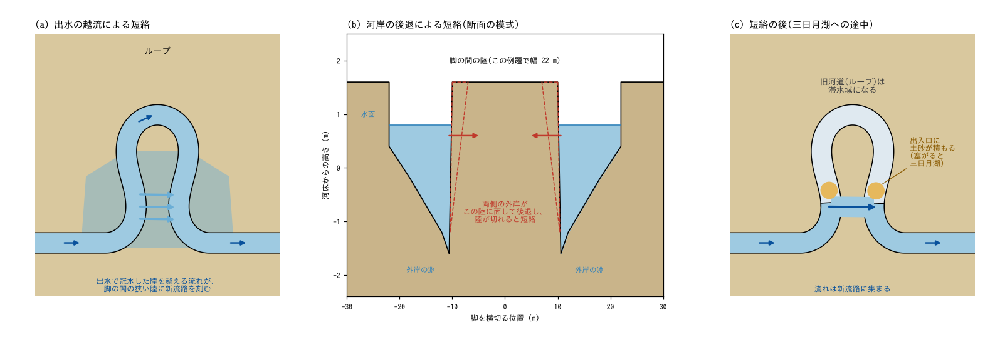
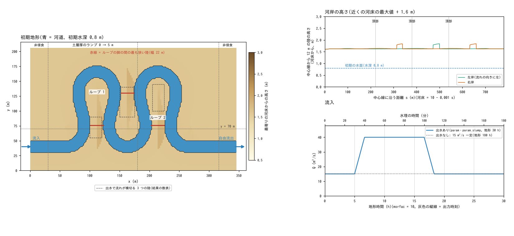
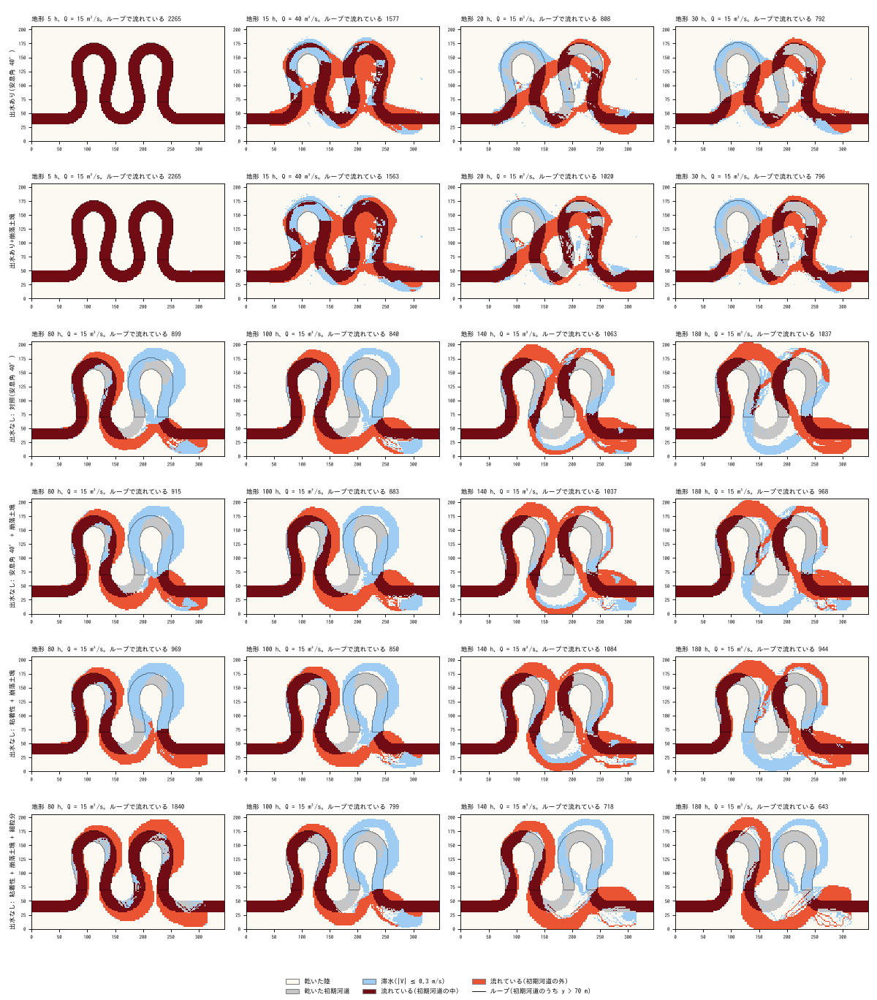
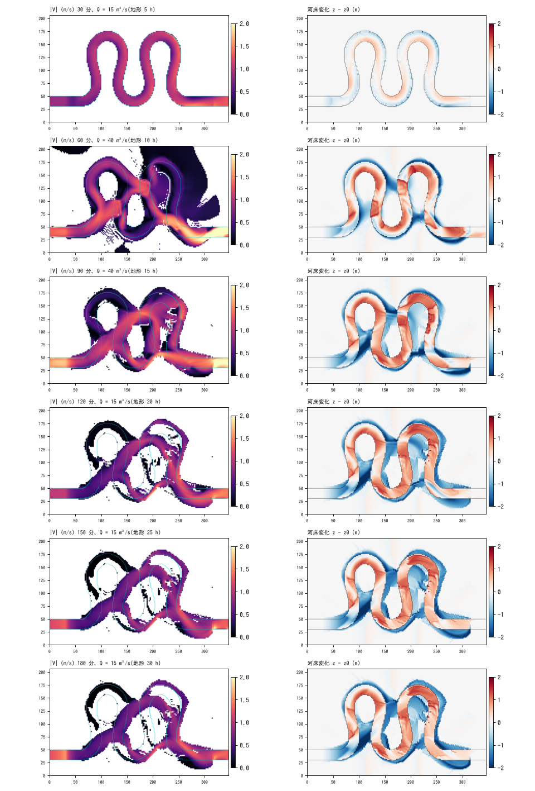
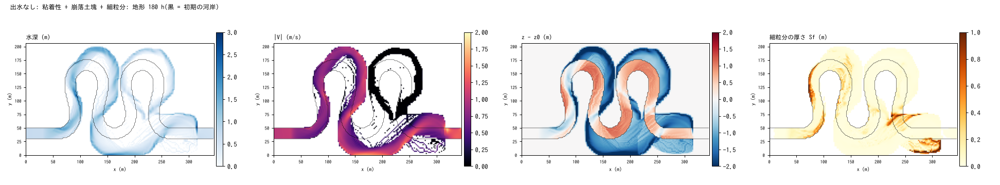

# meander_cutoff — 蛇行ループの短絡(出水の越流と河岸の後退)と旧河道の滞水化

[English](en/README.md)

蛇行度の高い河道(正弦波生成曲線)のループが、出水で陸を越える流れや河岸の後退で短絡し、
旧河道(ループ)の流れが止まって滞水域になる過程を、固定した格子の上の地形変化と乾湿の
判定だけで追う例題です。河道の中心線をつなぎ替える処理や、三日月湖を作るための特別な処理は
使いません。出水の有無、河岸の性質(安息角・崩落土塊・粘着性)、細粒分の有無で 6 構成を
比べます。河床変動の機構は [meander](../meander/README.md) と同じで、定着は使いません。値は
現象を見やすくするための模式値で、特定の河川の再現ではありません。

## 実際の蛇行河川で起きていること

- **頸部の短絡(neck cutoff)**: 蛇行のループが育つと、ループの付け根(頸部)で上流側と
  下流側の河道が近づき、その間の陸が切れて流れが近道に移ります。頸部の陸は、両側の外岸の
  後退で細るほか、出水で陸を越える流れが溝(ガリー)を刻むことで切れます。米国モンタナ州の
  Powder River の観察では、切れるまでに数回の出水を要することが多く、1 回の出水で始まって
  完了した例は 5 例中 1 例でした(Gay ら 1998)。
- **旧河道の閉塞と三日月湖**: 短絡の後、流れは新しい短い流路に集まり、旧河道は流れの弱い
  水域になります。旧河道の出入口に土砂が積もって塞がると三日月湖になります。出入口の
  埋まる速さは、本流から旧河道へ分かれる角度に左右されます(Constantine ら 2010)。
- **蛇行の平面形**: 自然の蛇行河道の平面形は、流れの方向角が路長の正弦関数になる曲線
  (正弦波生成曲線。sine-generated curve)でよく近似されます(Langbein and Leopold 1966)。

## 再現に必要な機構



模式図。(a) 出水の越流による短絡: 出水で冠水した陸を越える流れが、ループの脚の間の狭い陸に
新流路を刻む。(b) 河岸の後退による短絡: ループの両脚の外岸が脚の間の陸に面して後退し、陸が
切れると短絡する。(c) 短絡の後: 流れは新流路に集まり、旧河道は滞水域になり、出入口に土砂が
積もる(塞がると三日月湖。この例題の計算時間ではそこまで至らない)。

この例題で働いている機構と、それを担う設定:

| 実際の現象 | モデルの機構 | 設定 |
|---|---|---|
| 湾曲部の淵と砂州、外岸の後退 | meander と同じ掃流砂・河床勾配項・平衡二次流項。鋭い湾曲で淵が際限なく深くならないよう二次流の偏角に上限を置く | `f_fluvial = 1`、`fluv_slope = 1`、`f_secflow = 1`、`sec_rmax = 0.3` |
| 砂の河岸の崩落 | 安息角崩落(40°。初期の河岸 1.6 m / 2 m = 38.7° は崩れない。上流側の河床で高さが決まる高い河岸の 42 セル(最大 42.6°)だけが初めに少し崩れる) | `f_repose = 1`、`repose_phi = 40` |
| 粘着性の河岸の塊状の崩落と、土塊による脚部の保護 | [崩落と崖錐](../../docs/users_guide/geomorph.md#崩落と崖錐f_rockfall)の河岸モード(河岸面が限界高さ H_c = 1.8 m を超えた分が崩れて脚部の崖錐になり、掃流砂がそれを運び去る)。粘着性の構成は安息角を 60° にして、崩落土塊だけで後退させる | `f_rockfall = 1`、`rf_bank = 1`、`rf_hc = 1.8`、`repose_phi = 60` |
| 出水で陸を越える流れと、新流路の下刻 | 乾湿の判定と浅水流(冠水した氾濫原の流れも地形どおりに解く)と、氾濫原の土層の侵食 | 流入の時系列 `inflow_val`、土層厚 `sd.txt` |
| 旧河道の流れが止まる・短絡 | 特別な処理はなく、地形の変化と乾湿の判定の帰結として現れる | — |
| 旧河道を埋める細粒分 | [浮遊砂](../../docs/users_guide/geomorph.md#浮遊砂f_suspend)(0.2 mm。流入セルの平衡濃度の 0.5 倍で給砂)と[河床の細粒分の帳簿](../../docs/users_guide/geomorph.md#河床の細粒分の帳簿f_bedfines) | `f_suspend = 1`、`inflow_cs_eq(1) = 1`、`inflow_cs_fac(1) = 0.5`、`f_bedfines = 1` |
| 長い時間の地形変化 | 地形の変化だけを morfac 倍に加速する | `dt_geomorph = 1`、`morfac = 10` |

流砂量式・流砂の向きの補正・崩落土塊の出典と係数は [meander の「再現に必要な機構」](../meander/README.md#再現に必要な機構)
を参照してください(芦田・道上 1972、Hasegawa 1989、Asahi ら 2013、Parker ら 2011)。

## 幾何と設定



左: 初期地形(色 = 最寄りの中心線の河床からの高さ。青 = 河道)。点線 y = 70 m より上の河道が
ループ 1・ループ 2(下の「指標」)。赤線はループの脚の間の最も狭い陸、破線の四角は出水で流れが
横切る 3 つの陸(結果の数表で使う)。右上: 中心線から 12 m 離れた両岸の陸の高さ(河床から)。
右下: 流入(出水なしの構成は 15 m³/s のまま地形時間 180 h まで続ける)。

346 m × 206 m、Δx = 2 m(173 × 103 セル)。入力は `make_init.py` が作ります(`make`。
各セルから中心線への最近接距離を総当たりで求めるので 10 秒ほどかかる)。

- **河道**: 中心線は方向角 θ(s) = ω sin(2πs/Λ) の正弦波生成曲線(ω = 105°、Λ = 320 m、
  2 波長 = 路長 640 m)で、前後に入口 60 m・出口 80 m の直線をつなぎます(全路長 780 m)。
  ω が 90° を超えるので、上に張り出す 2 つのループは付け根より頂部の方が幅広い Ω 形に
  なり、ループの脚の間の陸は最も狭い所で幅 22 m(中心線の間隔 42 m)です。幅 20 m、
  河床は路長 s に沿って 10 − 0.001 s(m)、初期水深 0.8 m。
- **河岸**: 氾濫原の高さは、どこも「半径 24 m 以内の河床の最大値 + 1.6 m」です(どの隣接
  区間の水面よりも上にするため。路長や谷勾配で決めると、蛇行度の高い所で下流側の氾濫原が
  上流側の水面より低くなり、出水の前から溢れる)。ループの脚の間の陸(頸部)も特別に低くは
  しません。河道に接する陸は河床から 1.60〜1.84 m(中央値 1.62 m)で、高い方は脚の間の陸
  など、上流側の河床で高さが決まる所です(右上の図の段)。
- **土層**: 侵食できる土層は 5 m。上流端と下流端の 30 m は 0(非侵食)、x = 30〜180 m は
  0 → 5 m のランプです。
- **流入**: 西辺の河道 10 セルに区間流入。出水ありの構成は、15 m³/s を 30 分保ち、40 分で
  40 m³/s に上げて 100 分まで保ち、110 分で 15 m³/s に戻して 180 分まで続けます(地形時間
  30 h)。出水なしの構成は 15 m³/s のまま 1080 分(地形時間 180 h)です。東辺は自由流出。
- **時間**: dt = 0.1 s(淵の深い流れの CFL)、地形の更新は 1 s ごと、morfac = 10、出力は
  30 分(地形時間 5 h)ごとです。粗度 n = 0.03。
- **流れの数値設定**: meander と同じく、移流はスキーム 3、`f_opening_dynamic = 3`(既定)、
  `f_inflow_edge = 2` です(注意を参照)。

| ケース | 設定ファイル | 流入 | 河岸 | 地形時間 | 計算時間の目安 |
|---|---|---|---|---|---|
| 出水あり | param.txt | 15 → 40 → 15 m³/s | 安息角崩落 40° | 30 h | 約 50 分 |
| 出水あり+崩落土塊 | param_slump.txt | 同上 | 安息角 40° + 崩落土塊(H_c = 1.8 m、崖錐 35°) | 30 h | 約 50 分 |
| 出水なし: 対照 | param_noflood.txt | 15 m³/s 一定 | 安息角崩落 40° | 180 h | 約 3 時間 |
| 出水なし: 崩落土塊 | param_slump_noflood.txt | 同上 | 安息角 40° + 崩落土塊 | 180 h | 約 3 時間 |
| 出水なし: 粘着性 | param_slump_cohesive.txt | 同上 | **粘着性**: 安息角 60°(崩れない)+ 崩落土塊だけで後退 | 180 h | 約 3 時間 |
| 出水なし: 粘着性+細粒分 | param_slump_fines.txt | 同上。細粒分(0.2 mm)を平衡濃度の 0.5 倍で給砂 | 粘着性 + 浮遊砂 + 河床の細粒分の帳簿(初期の河床は粗い砂だけ) | 180 h | 約 3.5 時間 |

計算時間は gfortran 13.3(-Ofast -march=native)・1 スレッドで、Intel Xeon(2.8 GHz)の上で 4 ケースを
同時に計算したときの値です。

**指標**(plot_results.py): **ループ**は初期の河道のうち y > 70 m の部分(2 つのループの
脚と頂部。2,265 セル)で、x = 160 m より西をループ 1(上流側。1,133 セル)、東をループ 2
(下流側。1,132 セル)とします。**流れているセル**は水深 > 0.05 m かつ流速 > 0.3 m/s の
セルです。ループで流れているセルがループのセル数の半分(1,132)を初めて下回った出力を
短絡の時期、その後にループで流れているセルが 1 出力で 100 以上増えた出力を流れがループに
戻った時期とします。**下の湾曲**は、ループ 1 の下流側の脚から南へ回ってループ 2 の上流側の
脚へつなぐ湾曲(初期の河道のうち y ≤ 70 m・x = 115〜210 m。469 セル)です。**頂部を回る
流量の目安**は、ループの頂点(中心線の向きが東になる点。ループ 1 は x = 111 m、ループ 2 は
x = 214 m)を南北に切る線(y ≥ 140 m)に沿う h|V| Δx の和です。出力は流速の大きさだけで
向きを持たないので、流れが線に斜めな所や渦があると大きめに出ます(流量 15 m³/s に対して、
初めは 15〜16、ループが広がると 23 まで)。

## 実行方法

```
cd examples/meander_cutoff
make                     # 実行ファイルへのリンクと入力(z.txt・h.txt・sd.txt。約 10 秒)
make run                 # 出水ありの 2 構成(param・param_slump)
make noflood             # 出水なしの 4 構成(noflood・slump_noflood・slump_cohesive・slump_fines)
python3 plot_setup.py    # figs/mechanism.png・setup.png(計算結果は使わない)
python3 plot_results.py  # figs/sequence.png・states.png・final_slump_fines.png と数表
```

引数 `en` を付けると英語ラベルの図を en/figs/ に描きます(`python3 plot_setup.py en`、
`python3 plot_results.py en`)。plot_results.py は画面出力(Screen.log・Screen_<構成>.log)
から崩落と細粒分の台帳を読みます(`make` のターゲットが `2>&1 | tee` で残す)。図化には
Python 3・NumPy・matplotlib が要ります。

## 結果

数表と図は gfortran 13.3(-Ofast -march=native、1 スレッド)で全構成を計算した値です。数表は
plot_results.py の出力の抜粋です。



各構成の流れの状態。上 2 段 = 出水あり(地形 5 h = 出水前、15 h = 出水中、20 h = 出水が引いた直後、
30 h = 終了)、下 4 段 = 出水なし(80・100・140・180 h)。濃い赤 = 初期の河道の中で流れている、明るい
赤 = 初期の河道の外で流れている、水色 = 滞水(水深 > 0.05 m、流速 ≤ 0.3 m/s)、灰色 = 乾いた初期の
河道。黒線 = ループ。

### 出水あり: 陸を越える流れが近道を刻む



出水あり(param.txt)の 30 分(地形 5 h)ごとの経過。左: 流速、右: 河床変化(青 = 洗掘、赤 = 堆積。
線 = 初期の河岸)。

| t (分) | 地形時間 (h) | Q (m³/s) | ループで流れているセル | 頂部を回る流量の目安 ループ 1 / 2 (m³/s) | 3 つの陸で流れているセル / 陸の河床変化の平均 (m) | 下の湾曲で流れているセル | 初期の河道の外で湿潤 |
|---|---|---|---|---|---|---|---|
| 30 | 5 | 15 | 2,265 | 15.2 / 15.0 | 0 / −0.01 | 469 | 12 |
| 60 | 10 | 40 | 1,601 | 21.9 / 12.5 | 590 / −0.51 | 276 | 5,269 |
| 90 | 15 | 40 | 1,577 | 5.4 / 14.0 | 587 / −0.86 | 345 | 2,640 |
| 120 | 20 | 15 | 808 | 0.6 / 6.0 | 484 / −1.03 | 177 | 2,083 |
| 150 | 25 | 15 | 800 | 0.2 / 9.4 | 479 / −1.08 | 180 | 2,008 |
| 180 | 30 | 15 | 792 | 0.1 / 8.2 | 467 / −1.10 | 188 | 1,972 |

3 つの陸は設定の図の破線の範囲の初期の陸(ループ 1 の脚の間 180、2 つのループの間 303、ループ 2 の
脚の間 253、計 736 セル)。下の湾曲は 469 セル。

- **出水前は湾曲の発達だけ**(5 h): 外岸に淵、内岸に砂州ができ始め(最深の洗掘 1.9 m)、陸を越える
  流れはありません。
- **出水(40 m³/s)で陸を越える流れが近道を刻む**(10〜15 h): 氾濫原が広く冠水し(初期の河道の外の
  湿潤 5,269 セル)、ループ 1 の脚の間の陸、2 つのループの間の陸、ループ 2 の脚の間の陸を越えて東へ
  向かう流れが陸を下刻します(3 つの陸で流れているセル 587〜590、河床変化の平均 −0.5〜−0.9 m)。
  ループ 1 の頂部を回る流量は出水中に 22 → 5 m³/s へ減ります(10 h の 22 は、頂点を切る線の上の冠水
  した氾濫原の流れを含む)。外岸の淵は出水中に 4.1 m まで深くなります。
- **出水が引くと流れは近道に移り、ループ 1 が旧河道になる**(20 h〜): 流れはループ 1 の上流側の脚
  から、ループ 1 の脚の間と 2 つのループの間の陸を斜めに抜けて、ループ 2 の上流側の脚へ入ります。
  ループで流れているセルは 2,265 → 808 → 792、ループ 1 の頂部を回る流量は 0.1〜0.6 m³/s です(終了時、
  ループ 1 の初期の河道 1,133 セルのうち滞水 394・乾いた 426)。下の湾曲の流れも減ります(流れている
  セル 469 → 177〜188)。ループ 2 は流れ続け、頂部を回る流量は 6〜9 m³/s(流量 15 m³/s の 4〜6 割)で、
  残りはループ 2 の脚の間の陸を抜けます。近道の陸は終了時に平均 0.9〜1.7 m 下刻されています(ループ 1
  の脚の間 −1.72 m、2 つのループの間 −0.92 m、ループ 2 の脚の間 −0.88 m)。
- **崩落土塊は越流による短絡に関わらない**: 出水あり+崩落土塊でも短絡の時期(15〜20 h)と流れの
  移り方は同じで(終了時のループで流れているセル 796 対 792、頂部を回る流量の目安 0.2 / 6.6 対
  0.1 / 8.2)、崩落土塊は 585 m³ と小さい(安息角崩落 1,035 m³。崩落土塊なしの構成の安息角崩落は
  1,451 m³)。
- **旧河道は埋まり始める**: 終了時の初期の河道の河床は、ループ 1 で平均 +0.44 m、下の湾曲で +0.67 m、
  ループ 2 で +0.77 m 上がります。30 h では出入口は塞がらず、三日月湖には至りません。
- **出水の規模が短絡を決める**(試行。設定ファイルは置かない): 出水のピークを 25 m³/s にすると、ループ 1
  の脚の間の陸の 180 セルのうち出水中に流れるのは 13〜28 セル(40 m³/s では 160〜164)で、近道は刻まれず、
  ループは流れ続けます(30 h のループで流れているセル 1,952、頂部を回る流量の目安 15.9 / 15.8 m³/s)。

### 出水なし: 河岸の後退だけで切れる

ループで流れているセル / ループ 2 の頂部を回る流量の目安(m³/s)/ 下の湾曲で流れているセル
(469 セル中)。太字は短絡の後の最初の行。

| 地形時間 (h) | 対照(安息角 40°) | 安息角 40° + 崩落土塊 | 粘着性 + 崩落土塊 | 粘着性 + 崩落土塊 + 細粒分 |
|---|---|---|---|---|
| 20 | 2,209 / 15.4 / 463 | 2,231 / 15.5 / 465 | 2,219 / 15.7 / 460 | 2,206 / 15.7 / 458 |
| 40 | 2,136 / 16.1 / 464 | 2,151 / 15.8 / 455 | 2,123 / 15.9 / 462 | 2,118 / 15.9 / 442 |
| 60 | 2,102 / 15.7 / 429 | 2,137 / 15.8 / 458 | 2,088 / 16.4 / 421 | 2,033 / 16.0 / 407 |
| 80 | **899 / 0.2 / 229** | **915 / 0.1 / 250** | **969 / 2.4 / 232** | 1,840 / 17.1 / 387 |
| 100 | 840 / 0.2 / 240 | 883 / 0.2 / 254 | 850 / 0.2 / 244 | **799 / 0.2 / 224** |
| 120 | 1,126 / 2.7 / 116 | 1,001 / 2.8 / 125 | 847 / 0.0 / 244 | 770 / 0.1 / 220 |
| 140 | 1,063 / 1.9 / 70 | 1,037 / 2.6 / 79 | 1,084 / 3.1 / 62 | 718 / 0.0 / 173 |
| 160 | 1,074 / 2.0 / 44 | 1,009 / 2.1 / 44 | 992 / 2.2 / 29 | 689 / 0.0 / 174 |
| 180 | 1,037 / 1.7 / 0 | 968 / 1.9 / 0 | 944 / 1.6 / 0 | 643 / 0.0 / 149 |
| 短絡の時期 | 70〜75 h | 65〜70 h | 75〜80 h | 85〜90 h |
| 流れがループに戻った時期 | 105〜110 h | 115〜120 h | 125〜130 h | なし(180 h まで) |

- **越流がなくても、外岸の後退だけでループ 2 の頸部が切れる**(頸部の短絡の本来の形): ループ 2 の
  2 本の脚は、付け根の近くでどちらも外岸がループの内側(頸部)を向く湾曲です。両側から後退した外岸が
  脚の間の最も狭い陸(設定の図の赤線の少し南、y ≈ 55〜75 m)で出会うと、流れは下の湾曲からループ 2 の
  下流側の脚へ直接抜けます(図の 80・100 h)。4 構成とも、ループで流れているセルは短絡の前に 2,200 から
  1,840〜2,100 へゆっくり減り(外岸の後退と内岸の堆積で、流れが初期の河道の外へずれる)、短絡で
  800〜1,000 へ落ちて、ループ 2 の頂部を回る流量がほぼ 0 になります(0.0〜0.4 m³/s。粘着性 + 崩落土塊は
  短絡の直後の 15 h ほど 2 m³/s 余りが残る)。ループ 1 は 180 h まで切れません。
- **次に 2 つのループの間の陸が切れ、流れがループ 2 に戻る**: 2 つのループの間の陸は、ループ 1 の
  下流側の脚とループ 2 の上流側の脚(どちらも頂部を回る湾曲の外岸)に両側から削られます。この陸が
  切れると、流れはループ 1 からループ 2 の上流側の脚へ直接入り、脚を下って頸部の短絡路へ抜けます。
  流れの一部はループ 2 の頂部も回ります(1.6〜3.3 m³/s。流量 15 m³/s の 1〜2 割)。代わりに下の湾曲の
  流れが止まり、180 h に下の湾曲で流れているセルは 0、湾曲の初期の河道の河床は平均 +0.66〜+0.68 m
  上がります。下の湾曲が次の旧河道になる、短絡の連鎖です(図の 140・180 h)。細粒分ありの構成では
  180 h までにこの陸は切れず(ループ 1 の下流側の脚が陸の側へ広がるが、ループ 2 には抜けない)、
  下の湾曲は流れ続けます(180 h に 149 セル)。
- **粘着性の河岸では崩落土塊が後退の唯一の経路**: 安息角崩落 0 m³、崩落土塊 11,014 m³。非粘着性の
  対照では安息角崩落(11,183 m³)が同じ役を担い、崩落土塊を重ねても配分が変わるだけです(安息角
  崩落 4,706 m³ + 崩落土塊 7,250 m³)。短絡の時期は 3 構成で 65〜80 h に収まり、違いは出力 1〜2 個分
  (5〜10 h)と、計算の丸めの違いでも前後しうる幅です(注意を参照)。流れが戻るのは、崩落土塊を入れた
  2 構成が対照より 10〜20 h 遅れます(対照の 105〜110 h に対して 115〜120 h・125〜130 h)。
- **細粒分を加えると、短絡は約 10 h 遅れ、180 h までに流れはループ 2 に戻らない**(粘着性 + 崩落土塊の
  75〜80 h・125〜130 h に対して 85〜90 h・なし)。河道の広がりがやや遅く、初期の河道の外の湿潤セルは
  60〜100 h で細粒分なしより 3〜5 % 少ないです(1,858・2,406・2,633 対 1,950・2,471・2,708)。
- **旧河道は埋まり始めるが、塞がらない**: 180 h に、ループ 2 の初期の河道(1,132 セル)のうち乾いて
  いるのは 535〜727、滞水は 150〜405 セルで、河床は平均 +0.37〜+0.62 m 上がります(ループ 1 は −0.06〜
  +0.38 m)。180 h では出入口は塞がりません。
- **細粒分は旧河道の中より、流れている河道の縁と滞水域、旧河道の出口に積もる**(図の最下段・下の図):
  細粒分の厚さ Sf の平均は、ループ 2 の初期の河道で 0.06 m、流れているループ 1 で 0.15 m(最大
  1.32 m)です。流れの止まった旧河道の中には細粒分が運ばれにくく、ループ 2 で厚いのは、下流側の脚の
  出口(頸部の短絡路に接する y ≈ 73 m・x = 225〜245 m)の 0.6〜1.1 m だけで、一部は水面から出て
  います。最も厚いのは、出口の直線の手前で外岸が広がった滞水域(x = 315 m・y = 27 m)の 2.0 m です。
  帳簿が掃流砂に同伴させた細粒分の累計は 9.2 × 10⁵ m³ で、河道の中の細粒分は掃流砂と一緒に動き
  続けます。
- 河道は大きく広がります(180 h の初期の河道の外の湿潤セル 2,969〜3,062。初期の河道は 3,904 セル)。
  安息角 40°・限界高さ 1.8 m の河岸は一定流量で広く後退するので、短絡の時期は河岸の強度の設定
  (φ・H_c)に強く依存します。



出水なし・粘着性 + 崩落土塊 + 細粒分の 180 h。左から水深、流速、河床変化、細粒分の厚さ Sf。
黒線 = 初期の河岸。

## このモデルで表せないこと(実際の現象との違い)

- **三日月湖の完成までは追わない**: 旧河道の出入口が完全に塞がるには、この例題の計算時間
  (地形時間 30 h・180 h)より長い時間と、細粒分の繰り返しの供給が要ります。
- **短絡の時期は河岸の強度と出水の規模の設定に強く依存する**: 出水なしの構成では安息角 φ と
  限界高さ H_c が外岸の後退の速さと短絡の時期を決め、出水ありの構成では出水のピーク流量が陸を
  越える流れの有無を決めます。値は模式値で、実際の河岸材料や流況から決めたものではありません。
- **出水は 1 回**: 実際の頸部の短絡は数回の出水でガリーが育って完了することが多い(Gay ら
  1998)のに対し、この例題の出水ありの構成は 1 回の出水(morfac で加速)だけを与えます。
- 河道は格子の上の地形で表し、湾曲は 2 m の階段です。meander の「このモデルで表せないこと」
  (二次流は平衡型、粒径は 2 成分など)も同様に当てはまります。

## 注意

- **流れの数値設定**: `f_inflow_edge = 2`(区間流入の内側へ向かうエッジの移流項を 0 にし、その
  流速をエネルギー水頭で抑える。developer.md §68.40)を指定しています。`f_opening_dynamic` は既定の
  3 を明記しています(河道マスクのない掘り込み河道で河岸に接する行の通水能を保つには 2 以上が要る。
  [meander の注意](../meander/README.md#注意))。
- **dt = 0.1 s**: 出水時の鋭い湾曲の深い淵(3〜4 m)の速い流れで CFL を満たすための値です(0.2 s
  では計算が止まります)。
- **1 更新の河床変化の上限**: `fluv_dzmax`(0.05 m)の発動は、出水ありで 10,467〜12,368 エッジ、
  出水なしで 2〜44 エッジです(台帳)。morfac を下げると減ります。
- **再現性**: 同じ実行ファイルならスレッド数によらず結果はビット一致しますが、コンパイラ・最適化・
  CPU(この README は gfortran 13.3 の -Ofast -march=native。-march=native はビルドした CPU の命令を
  使う)が違うと丸めが変わり、河岸の崩れと流れの正帰還で増幅されて、短絡の時期は出力 1〜2 個分
  (5〜10 h)前後しえます。比べるときは数値の一致より、短絡の起き方と順序を見てください。

## 感度実験の入口

- 出水のピーク流量(`inflow_val`): 40 m³/s では陸を越える流れが近道を刻み、25 m³/s では短絡しません
  (結果を参照)。
- 河岸の高さ(make_init.py の `BANK`): 出水で陸を越える流れの量を決めます。
- `repose_phi`・`rf_hc`: 河岸の強度。短絡の時期を決めます。
- `sec_rmax`: 鋭い湾曲の淵の深さ。
- `morfac`: 地形変化の加速。下げると 1 更新の変動上限 `fluv_dzmax` の発動は減ります。

## 参考文献

- Constantine, J. A., Dunne, T., Piégay, H. and Kondolf, G. M. (2010): Controls on the
  alluviation of oxbow lakes by bed-material load along the Sacramento River, California.
  *Sedimentology*, 57(2), 389–407. doi:10.1111/j.1365-3091.2009.01084.x(要旨で確認)
- Gay, G. R., Gay, H. H., Gay, W. H., Martinson, H. A., Meade, R. H. and Moody, J. A. (1998):
  Evolution of cutoffs across meander necks in Powder River, Montana, USA. *Earth Surf.
  Process. Landforms*, 23(7), 651–662.(要旨で確認)
- Langbein, W. B. and Leopold, L. B. (1966): River meanders — Theory of minimum variance.
  *U.S. Geol. Surv. Prof. Pap.*, 422-H. doi:10.3133/pp422H(要旨で確認)
- 流砂量式・流砂の向きの補正・崩落土塊の文献は [meander](../meander/README.md#参考文献) を参照。

## 関連文書

- [examples/meander](../meander/README.md) — 同じ機構での蛇行河道の変形(外岸の後退・内岸の砂州・定着)
- [docs/users_guide/geomorph.md](../../docs/users_guide/geomorph.md)
- docs/meander_plan.md §3.5、developer.md §84.5・§84.17
