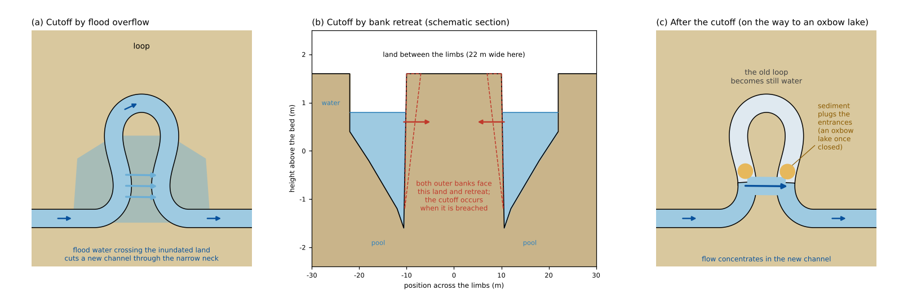
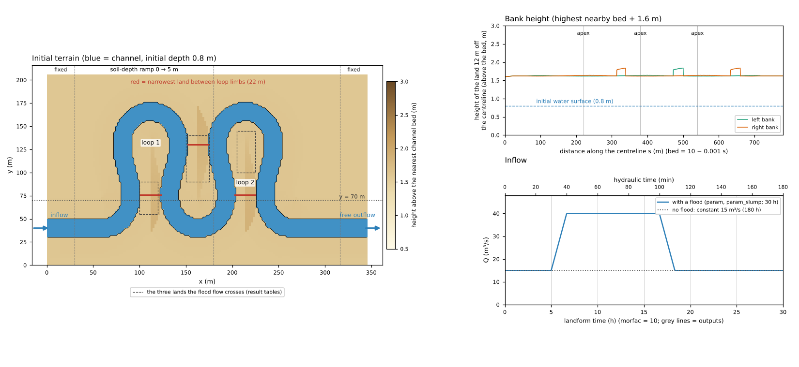
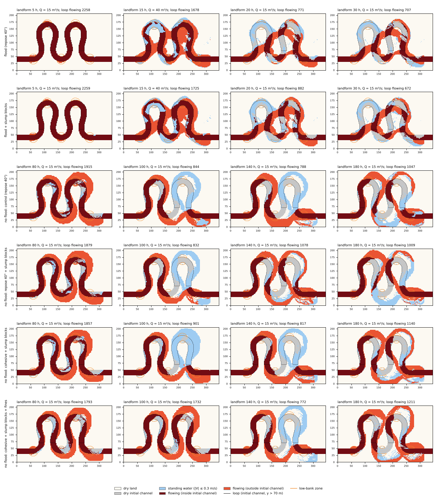
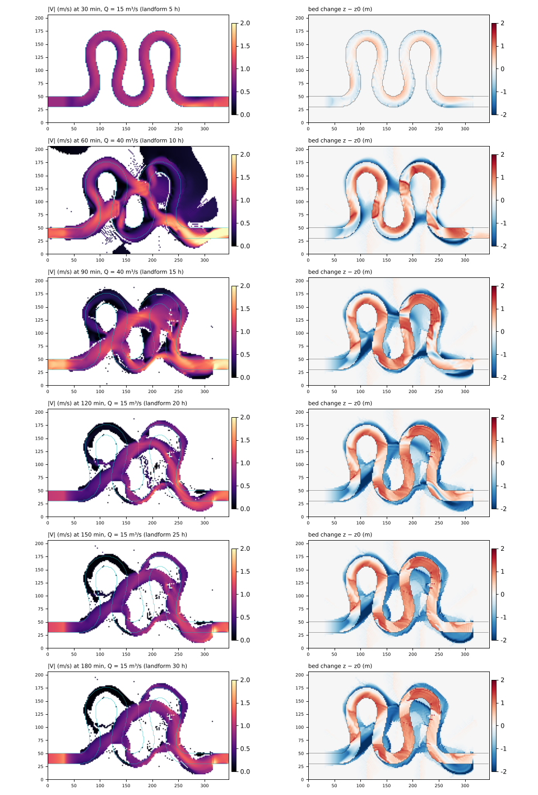
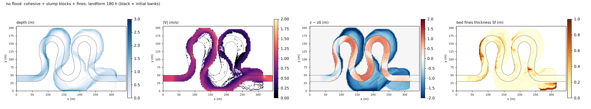

# meander_cutoff — cutoff of meander loops (by flood overflow and bank retreat) and the old channel turning into still water

> English mirror of examples/meander_cutoff/README.md. The Japanese file is the master copy.

[日本語](../README.md)

This example follows how the loops of a highly sinuous channel (a sine-generated curve) are cut
off by flood water crossing the land or by bank retreat, and how the flow in the old channel
(the loop) stops and it becomes still water, using only landform change on a fixed grid and the
wet/dry judgement. No processing that reconnects the channel centreline or that creates an oxbow
lake is used. Six configurations compare the presence of a flood, the nature of the banks (angle
of repose, slump blocks, cohesive) and the presence of fines. The bed-evolution mechanisms are
the same as in [meander](../../meander/en/README.md), without fixation. The values are
schematic values chosen to make the phenomena easy to see; the example does not reproduce a
particular river.

## What happens in real meandering rivers

- **Neck cutoff**: as a meander loop grows, the upstream and downstream channels approach each
  other at the root of the loop (the neck), the land between them is breached, and the flow
  moves to the short path. The land of the neck narrows by the retreat of the outer banks on
  both sides, and it is also breached when flood water crossing the land cuts a gully. In
  observations on the Powder River in Montana, USA, a cutoff often needed several floods to
  complete; in only one of five cases was it started and completed in a single flood (Gay et
  al. 1998).
- **Closure of the old channel and oxbow lakes**: after the cutoff the flow concentrates in the
  new short channel and the old channel becomes a water body with weak flow. When sediment
  settles at the entrances of the old channel and closes them, it becomes an oxbow lake. How
  fast the entrances fill depends on the angle at which the old channel branches off the main
  channel (Constantine et al. 2010).
- **Planform of meanders**: the planform of natural meandering channels is well approximated by
  a curve whose flow direction angle is a sine function of the distance along the channel (the
  sine-generated curve; Langbein and Leopold 1966).

## Mechanisms needed to reproduce it



Schematic. (a) Cutoff by flood overflow: flood water crossing the inundated land cuts a new
channel through the narrow land between the limbs of the loop. (b) Cutoff by bank retreat: the
outer banks of both limbs face the land between the limbs and retreat, and the cutoff occurs
when that land is breached. (c) After the cutoff: the flow concentrates in the new channel, the
old channel becomes still water, and sediment settles at the entrances (an oxbow lake once they
are closed; the run times of this example do not get that far).

The mechanisms at work in this example and the settings that carry them:

| Real phenomenon | Mechanism in the model | Settings |
|---|---|---|
| Pools and bars in bends, retreat of the outer banks | bedload, bed-slope term and equilibrium secondary-flow term as in meander, with an upper limit on the deviation angle of the secondary flow so that the pools in the sharp bends do not deepen without bound | `f_fluvial = 1`, `fluv_slope = 1`, `f_secflow = 1`, `sec_rmax = 0.3` |
| Collapse of sandy banks | angle-of-repose avalanching (40°; the initial bank 1.6 m / 2 m = 38.7° does not collapse) | `f_repose = 1`, `repose_phi = 40` |
| Block failure of cohesive banks and protection of the toe by the blocks | bank mode of [rockfall and talus](../../../docs/en/users_guide/geomorph.md#rockfall-and-talus-f_rockfall) (the part of a bank face above the critical height H_c = 1.8 m fails into talus at the toe, which the bedload carries away). In the cohesive configurations the angle of repose is set to 60° so that the banks retreat by slump blocks only | `f_rockfall = 1`, `rf_bank = 1`, `rf_hc = 1.8`, `repose_phi = 60` |
| Flood water crossing the land and incision of a new channel | wet/dry judgement and shallow-water flow (flow over the inundated floodplain is solved along the terrain), with erosion of the floodplain soil | inflow time series `inflow_val`, soil depth `sd.txt` |
| The flow in the old channel stops; the cutoff | no special processing; they emerge from landform change and the wet/dry judgement | — |
| Fines filling the old channel | [suspended sediment](../../../docs/en/users_guide/geomorph.md#suspended-sediment-f_suspend) (0.2 mm, fed at 0.5 × the equilibrium concentration of the inflow cells) and the [ledger of fines in the bed](../../../docs/en/users_guide/geomorph.md#ledger-of-fines-in-the-bed-f_bedfines) | `f_suspend = 1`, `inflow_cs_eq(1) = 1`, `inflow_cs_fac(1) = 0.5`, `f_bedfines = 1` |
| Landform change over a long time | only the landform change is accelerated by the factor morfac | `dt_geomorph = 1`, `morfac = 10` |

For the sources and coefficients of the transport formula, the bedload-direction corrections
and the slump blocks, see ["Mechanisms needed to reproduce it" in
meander](../../meander/en/README.md#mechanisms-needed-to-reproduce-it) (Ashida and Michiue 1972,
Hasegawa 1989, Asahi et al. 2013, Parker et al. 2011).

## Geometry and settings



Left: the initial terrain (colour = height above the bed of the nearest centreline point;
blue = channel). The orange outline is the low-bank zone, and the channel above the dotted line
y = 70 m is loop 1 and loop 2 (see "Metrics" below). The red lines are the narrowest land between
the limbs of the loops, and the dashed boxes are the three lands the flood flow crosses (used in
the result tables). Top right: height of the land 12 m off the centreline on both banks (above
the bed). Bottom right: inflow (in the no-flood configurations 15 m³/s continues up to 180 h of
landform time).

346 m × 206 m, Δx = 2 m (173 × 103 cells). The inputs are made by `make_init.py` (`make`; it
takes about 10 s because the nearest distance from every cell to the centreline is found by
brute force).

- **Channel**: the centreline is a sine-generated curve with direction angle
  θ(s) = ω sin(2πs/Λ) (ω = 105°, Λ = 320 m, 2 wavelengths = 640 m along the channel), joined
  to straight reaches of 60 m at the inlet and 80 m at the outlet (780 m in total). Because ω
  exceeds 90°, the two loops bulging upward are Ω-shaped, wider at the top than at the root, and
  the land between the limbs of a loop is 22 m wide at its narrowest (centreline spacing 42 m).
  Width 20 m, bed 10 − 0.001 s (m) along the distance s, initial depth 0.8 m.
- **Banks**: the floodplain height is "the maximum bed elevation within a radius of 24 m +
  1.6 m" (so that it is above the water surface of every nearby reach; set from the distance
  along the channel or the valley slope, the downstream floodplain would lie below the upstream
  water surface where the sinuosity is high and would be flooded before any flood). make_init.py
  lowers the land close to two different half-wave reaches to bed + 0.95 m as the "neck", but the
  boundaries of the reaches lie at the bend apexes and at both ends of the curved reach, so the
  land that is lowered is around them (10 places, 409 cells in total; orange outline; called
  the **low-bank zone** in this README), while the narrowest land between the limbs of the
  loops is + 1.6 m like the floodplain (see the notes).
- **Soil**: the erodible soil is 5 m. The 30 m at the upstream and downstream ends are 0
  (non-erodible), and x = 30–180 m is a ramp 0 → 5 m.
- **Inflow**: a segment inflow into the 10 channel cells at the west edge. With a flood, 15 m³/s
  is held for 30 min, raised to 40 m³/s by 40 min and held until 100 min, returned to 15 m³/s
  by 110 min and continued until 180 min (30 h of landform time). Without a flood, 15 m³/s for
  1080 min (180 h of landform time). The east edge is a free outflow.
- **Time**: dt = 0.1 s (CFL of the deep flow in the pools), the landform is updated every 1 s,
  morfac = 10, output every 30 min (5 h of landform time). Roughness n = 0.03.
- **Numerical settings of the flow**: as in meander, advection scheme 3,
  `f_opening_dynamic = 2`, `f_inflow_edge = 2` (see the notes).

| Case | Parameter file | Inflow | Banks | Landform time | Run time (guide) |
|---|---|---|---|---|---|
| Flood | param.txt | 15 → 40 → 15 m³/s | angle-of-repose avalanching 40° | 30 h | about 30 min |
| Flood + slump blocks | param_slump.txt | same | repose 40° + slump blocks (H_c = 1.8 m, talus 35°) | 30 h | about 30 min |
| No flood: control | param_noflood.txt | constant 15 m³/s | angle-of-repose avalanching 40° | 180 h | about 2 h |
| No flood: slump blocks | param_slump_noflood.txt | same | repose 40° + slump blocks | 180 h | about 2 h |
| No flood: cohesive | param_slump_cohesive.txt | same | **cohesive**: repose 60° (no collapse) + retreat by slump blocks only | 180 h | about 2 h |
| No flood: cohesive + fines | param_slump_fines.txt | same; fines (0.2 mm) fed at 0.5 × the equilibrium concentration | cohesive + suspended sediment + ledger of fines in the bed (the initial bed is coarse sand only) | 180 h | about 2.5 h |

The run times are for gfortran 13.3 (-Ofast) on 1 thread with 4 cases running at the same time.

**Metrics** (plot_results.py): the **loops** are the part of the initial channel with y > 70 m
(the limbs and tops of the two loops; 2,265 cells); the part west of x = 160 m is loop 1
(upstream; 1,133 cells) and the part east of it is loop 2 (downstream; 1,132 cells). **Flowing
cells** are cells with depth > 0.05 m and speed > 0.3 m/s. The time of the cutoff is the first
output at which the flowing cells in the loops fall below half the number of loop cells (1,132).
The **discharge round the top (estimate)** is the sum of h|V| Δx along a north–south line
(y ≥ 140 m) through the apex of the loop (where the centreline heads east: x = 111 m for loop 1
and x = 214 m for loop 2). The output holds only the speed, not its direction, so the estimate
is too large where the flow crosses the line obliquely or eddies form (against a discharge of
15 m³/s it is 15–16 at first and up to 21 once the loop has widened).

## How to run

```
cd examples/meander_cutoff
make                     # link to the executable and inputs (z.txt, h.txt, sd.txt; about 10 s)
make run                 # the 2 flood configurations (param, param_slump)
make noflood             # the 4 no-flood configurations (noflood, slump_noflood, slump_cohesive, slump_fines)
python3 plot_setup.py    # figs/mechanism.png, setup.png (does not use the results)
python3 plot_results.py  # figs/sequence.png, states.png, final_slump_fines.png and the tables
```

With the argument `en` the figures are drawn with English labels into en/figs/
(`python3 plot_setup.py en`, `python3 plot_results.py en`). plot_results.py reads the ledgers of
collapse and fines from the screen output (Screen.log, Screen_<configuration>.log, kept by the
`make` targets with `2>&1 | tee`). Plotting needs Python 3, NumPy and matplotlib.

## Results

Values from recomputing all configurations on 2026-11-02 with the version after main's fix of
the lateral faces of the momentum-conservative advection (developer.md §68.42, §68.43) (gfortran
13.3, -Ofast, 1 thread). The tables are excerpts from the output of plot_results.py.



Flow state in each configuration. Top two rows: with the flood (landform 5 h = before the flood,
15 h = during the flood, 20 h = just after the flood has receded, 30 h = end). Bottom four rows:
no flood (80, 100, 140 and 180 h). Dark red = flowing inside the initial channel, light red =
flowing outside the initial channel, light blue = standing water (depth > 0.05 m, speed
≤ 0.3 m/s), grey = dry initial channel. Black lines = loops, orange = low-bank zone.

### With a flood: overbank flow cuts shortcuts



The flood run (param.txt) every 30 min (5 h of landform time). Left: speed; right: bed change
(blue = scour, red = deposition; lines = initial banks).

| t (min) | Landform time (h) | Q (m³/s) | Flowing cells in the loops | Discharge round the top (estimate), loop 1 / 2 (m³/s) | Flowing cells on the three lands / mean bed change of the lands (m) | Wet outside the initial channel |
|---|---|---|---|---|---|---|
| 30 | 5 | 15 | 2,258 | 15.1 / 15.1 | 1 / −0.02 | 103 |
| 60 | 10 | 40 | 1,609 | 13.3 / 19.6 | 527 / −0.64 | 2,901 |
| 90 | 15 | 40 | 1,678 | 5.8 / 12.8 | 597 / −0.93 | 2,944 |
| 120 | 20 | 15 | 771 | 0.6 / 2.6 | 509 / −1.08 | 2,185 |
| 150 | 25 | 15 | 690 | 0.2 / 4.3 | 497 / −1.15 | 2,068 |
| 180 | 30 | 15 | 707 | 0.2 / 5.9 | 487 / −1.19 | 2,035 |

The three lands are the initial land inside the dashed boxes of the settings figure (between the
limbs of loop 1: 180, between the two loops: 303, between the limbs of loop 2: 253; 736 cells in
all).

- **Before the flood only the bends develop** (5 h): pools on the outer banks and bars on the
  inner banks begin to form (deepest scour 1.8 m), and no flow crosses the land.
- **The flood (40 m³/s) makes overbank flow cut shortcuts** (10–15 h): the floodplain is widely
  inundated (2,900 wet cells outside the initial channel), and flow heading east over the land
  between the limbs of loop 1, the land between the two loops and the land between the limbs of
  loop 2 incises the land (527–597 flowing cells on the three lands, mean bed change −0.6 to
  −0.9 m). The discharge round the top of loop 1 falls from 13 to 6 m³/s during the flood. The
  pools on the outer banks deepen to 4 m during the flood.
- **When the flood recedes the flow moves to the shortcuts** (from 20 h): the flowing cells in the
  loops go 2,258 → 771 → 707, the discharge round the top of loop 1 is 0.2–0.6 m³/s, and loop 1
  becomes an old channel (at the end, of the 1,133 cells of its initial channel 412 hold standing
  water and 441 are dry). Loop 2 keeps flowing because its downstream limb connects to the
  shortcuts, and part of the flow still goes round its top (2.6–5.9 m³/s). By the end the land of
  the shortcuts has been incised by 1.0–1.7 m on average (−1.72 m between the limbs of loop 1,
  −0.99 m between the two loops, −1.06 m between the limbs of loop 2).
- **Slump blocks play no part in the cutoff by overbank flow**: with flood + slump blocks the time
  of the cutoff (15–20 h) and the shift of the flow are the same (672 against 707 flowing cells in
  the loops at the end), and the slump blocks are small, 541 m³ (angle-of-repose avalanching
  1,136 m³). The flowing cells on the land between the limbs of loop 2 are 81 (157 without slump
  blocks): the shape of the shortcuts changes in detail.
- **The old channel begins to fill**: at the end the bed of the initial channel has risen by
  +0.39 m on average in loop 1 and +0.79 m in loop 2. By 30 h the entrances are not closed and no
  oxbow lake forms.
- **The size of the flood decides the cutoff** (a trial; no parameter file is provided): with a
  flood peak of 25 m³/s, only 23–35 of the 180 cells of the land between the limbs of loop 1 flow
  during the flood (155 at 40 m³/s), no shortcut is cut and the loops keep flowing (1,926 flowing
  cells in the loops at 30 h; discharge round the tops 16.0 / 16.0 m³/s).

### No flood: cut off by bank retreat alone

Flowing cells in the loops / discharge round the top of loop 2 (estimate, m³/s). Bold marks the
first output after the cutoff.

| Landform time (h) | Control (repose 40°) | Repose 40° + slump blocks | Cohesive + slump blocks | Cohesive + slump blocks + fines |
|---|---|---|---|---|
| 20 | 2,202 / 15.4 | 2,206 / 15.1 | 2,192 / 15.7 | 2,186 / 15.7 |
| 40 | 2,150 / 15.5 | 2,140 / 16.2 | 2,105 / 16.0 | 2,069 / 16.1 |
| 60 | 2,042 / 16.1 | 2,012 / 16.2 | 2,048 / 16.4 | 1,912 / 17.1 |
| 80 | 1,915 / 16.6 | 1,879 / 16.2 | 1,857 / 16.7 | 1,793 / 16.8 |
| 100 | **844 / 0.1** | **832 / 0.1** | **901 / 1.3** | 1,732 / 17.6 |
| 120 | 816 / 0.0 | 794 / 0.0 | 810 / 0.1 | **819 / 0.8** |
| 140 | 788 / 0.3 | 1,078 / 3.3 | 817 / 0.0 | 772 / 0.4 |
| 160 | 1,124 / 3.4 | 1,023 / 2.0 | 790 / 0.0 | 774 / 0.0 |
| 180 | 1,047 / 2.4 | 1,009 / 1.6 | 1,140 / 3.5 | 1,211 / 5.4 |
| Time of the cutoff | 90–95 h | 85–90 h | 95–100 h | 115–120 h |

- **Without overbank flow, outer-bank retreat alone cuts off loop 2** (the original form of a neck
  cutoff). In all four configurations the flowing cells in the loops fall slowly from 2,200 to
  1,800–1,900 by 80 h (outer-bank retreat and inner-bank deposition shift the flow out of the
  initial channel), then drop to about 800 at the cutoff, when the discharge round the top of
  loop 2 falls to almost zero. Loop 1 is not cut off by 180 h.
- **The cut is at the base of loop 2**: the outer (south) bank of the bend between the two loops
  (x ≈ 150–200 m) and the outer bank of the bend from loop 2 into the outlet straight retreat
  towards each other, the land between them is cut, and the flow moves to a diagonal shortcut
  from x ≈ 190 m, y ≈ 20 m to x ≈ 225 m, y ≈ 45 m (the 100 h panels). This is south of the
  narrowest land between the limbs (the red line in the settings figure, y ≈ 76 m) and not in the
  low-bank zone.
- **In the cohesive banks, slump blocks are the only route of retreat**: angle-of-repose
  avalanching 0 m³, slump blocks 11,434 m³. In the non-cohesive control, angle-of-repose
  avalanching (11,862 m³) plays the same role, and adding slump blocks only changes the split
  (4,721 m³ by avalanching + 6,852 m³ by slump blocks). The times of the cutoff of the three
  configurations differ by 5–10 h, one or two output intervals (5 h); differences in rounding
  alone can shift them by that much (see the notes).
- **Adding fines delays the cutoff by about 20 h** (115–120 h against 95–100 h for cohesive +
  slump blocks). The channel widens a little more slowly: the wet cells outside the initial
  channel at 60–100 h are 4–7 % fewer than without fines (1,901, 2,360, 2,819 against 2,032,
  2,526, 2,958).
- **After the cutoff part of the flow returns to the loop**: 45–70 h after the cutoff (145 h in the
  control, 135 h with slump blocks, 165 h cohesive, 175 h with fines) the flow comes back along the
  outer edge of the widened loop 2 (discharge round the top 1.6–5.4 m³/s as an estimate, 10–40 % of
  the 15 m³/s). The
  shortcut stays open, and at 180 h 479–540 of the 1,132 cells of the initial channel of loop 2 are
  dry and 167–232 hold standing water. The bed of the initial channel of loop 2 rises by
  +0.40 to +0.58 m on average (loop 1: −0.12 to +0.27 m): the old channel begins to fill but is not
  closed by 180 h.
- **Fines settle at the margins of the flowing channel rather than in the old channel** (bottom row
  of the figure; the figure below): the mean thickness of fines Sf is 0.06 m (at most 0.83 m) in the
  initial channel of loop 2 and 0.16 m (at most 1.23 m) in the flowing loop 1. Little fine sediment
  reaches the old channel through its weak flow; it settles where the widened channel is shallow
  and slow at its margins. The fines carried along with the bed load add up to 1.07 × 10⁶ m³: in
  the channel the fines keep moving with the bed load.
- The channel widens a lot (3,186–3,345 wet cells outside the initial channel at 180 h; the initial
  channel has 3,904 cells). Banks with a repose angle of 40° and a critical height of 1.8 m retreat
  widely under a constant discharge, so the time of the cutoff depends strongly on the bank
  strength settings (φ, H_c).



No flood, cohesive + slump blocks + fines at 180 h. From the left: depth, speed, bed change and
thickness of fines Sf. Black = initial banks, orange = low-bank zone.

## What this model cannot represent (differences from the real phenomena)

- **The completion of an oxbow lake is not followed**: closing the entrances of the old channel
  completely needs a longer time than the run times of this example (30 h and 180 h of
  landform time) and a repeated supply of fines.
- **The timing of the cutoff depends strongly on the settings of bank strength and flood size**:
  without a flood, the angle of repose φ and the critical height H_c set the speed of outer-bank
  retreat and the time of the cutoff; with a flood, the peak discharge decides whether overbank
  flow crosses the land. The values are schematic, not derived from real bank materials or flow
  regimes.
- **A single flood**: a real neck cutoff often completes as a gully grows over several floods
  (Gay et al. 1998), whereas the flood configurations of this example give a single flood
  (accelerated by morfac).
- The channel is terrain on the grid and the bends are 2 m steps. The items of "What this model
  cannot represent" in meander (equilibrium-type secondary flow, two grain components, etc.)
  apply as well.

## Notes

- **The low-bank zone is not the neck**: make_init.py takes land within 8 m of the banks of two
  half-wavelength segments as a neck and lowers it to bed + 0.95 m (`BANKNECK`, `NECKW`). Adjacent
  half-wavelength segments meet at the apexes of the bends and at both ends of the curve, so the
  test picks the land around those points (10 places); the 22 m wide land between the limbs of the
  loops (the actual necks) is not picked and stays at + 1.6 m like the floodplain. The results in
  this README are for this terrain. A proposal for fixing the test is in docs/handoff.md (fixing it
  changes the results).
- **The strip along the east edge is at bed + 2.4 m**: when make_init.py computes the floodplain
  height (the highest bed within 24 m + 1.6 m), the array shift (`np.roll`) wraps round between the
  east and west edges, so the height of 196 land cells at x = 325–345 m, y = 9–71 m on the east
  edge is set by the bed at the west edge (about 0.8 m higher than at the east edge), giving bed
  + 2.4 m (settings figure). They lie in the non-erodible reach with zero soil depth, so the terrain
  does not change there. During the flood the water flowing over the southern floodplain is held
  back in front of the strip (x ≈ 300–325 m) and leaves through the east edge by way of the
  channel (the strip stays dry).
- **Flow settings**: the parameter files set `f_inflow_edge = 2` (zero advection term on the edges
  into the inflow section, with their speed capped by the energy head; developer.md §68.40) and
  `f_opening_dynamic = 2` (the default from 2026-10-18 to 31). For the difference from the default 3
  used since 2026-10-31, see the [meander notes](../../meander/en/README.md#notes).
- **dt = 0.1 s** keeps the CFL condition in the fast flow over the deep pools (3–4 m) of the sharp
  bends during the flood (0.2 s stopped in the trials when the example was made).
- **Limit of the bed change per update**: `fluv_dzmax` (0.05 m) fires on 4,551–4,643 edges with
  the flood and on 43–348 edges without it (ledger). Lowering morfac reduces it.
- **Reproducibility**: the same executable gives bit-identical results for any number of threads,
  but a different compiler or optimisation (this README uses gfortran 13.3 with -Ofast) changes
  the rounding, which the feedback between bank collapse and flow amplifies; the time of the
  cutoff can shift by one or two outputs (5–10 h). When comparing, look at how and in what order
  the cutoff happens rather than at matching numbers.

## Starting points for sensitivity experiments

- The peak discharge of the flood (`inflow_val`): at 40 m³/s overbank flow cuts shortcuts, at
  25 m³/s there is no cutoff (see the results). The height of the low-bank zone (`BANKNECK` in
  make_init.py) acts, with the present test, around the apexes of the bends rather than at the
  necks (see the notes).
- `repose_phi`, `rf_hc`: bank strength. They decide when the cutoff occurs.
- `sec_rmax`: depth of the pools in the sharp bends.
- `morfac`: acceleration of the landform change. Lowering it makes the per-update limit
  `fluv_dzmax` fire less often.

## References

- Constantine, J. A., Dunne, T., Piégay, H. and Kondolf, G. M. (2010): Controls on the
  alluviation of oxbow lakes by bed-material load along the Sacramento River, California.
  *Sedimentology*, 57(2), 389–407. doi:10.1111/j.1365-3091.2009.01084.x (checked against the
  abstract)
- Gay, G. R., Gay, H. H., Gay, W. H., Martinson, H. A., Meade, R. H. and Moody, J. A. (1998):
  Evolution of cutoffs across meander necks in Powder River, Montana, USA. *Earth Surf.
  Process. Landforms*, 23(7), 651–662. (checked against the abstract)
- Langbein, W. B. and Leopold, L. B. (1966): River meanders — Theory of minimum variance.
  *U.S. Geol. Surv. Prof. Pap.*, 422-H. doi:10.3133/pp422H (checked against the abstract)
- For the references of the transport formula, the bedload-direction corrections and the slump
  blocks, see [meander](../../meander/en/README.md#references).

## Related documents

- [examples/meander](../../meander/en/README.md) — deformation of a meandering channel by the
  same mechanisms (outer-bank retreat, inner-bank bars, fixation)
- [docs/users_guide/geomorph.md](../../../docs/en/users_guide/geomorph.md)
- docs/meander_plan.md §3.5, developer.md §84.5, §84.17, §84.18
