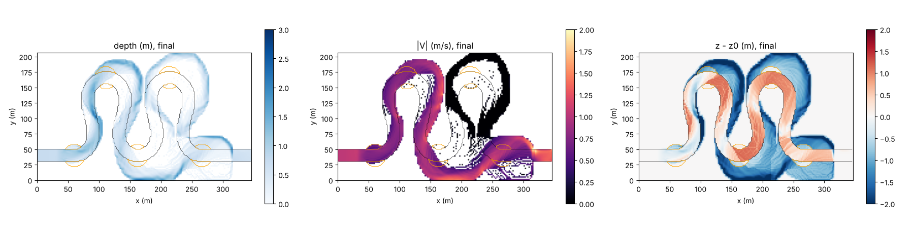

# meander_cutoff — cutoff of a meander loop with a narrow neck and plugging of the old channel (stage 4)

> English mirror of examples/meander_cutoff/README.md. The Japanese file is the master copy.

[日本語](../README.md)

This example follows, using only landform evolution on a fixed grid and the
wet/dry treatment, the process by which the narrow strip of land between
adjacent loops (the neck) of a highly sinuous channel (a sine-generated curve)
is overtopped by a flood and cut off, and the old channel (the loop) turns into
slack water (docs/meander_plan.md stage 4 and §3.5; developer.md §84.5). No
reconnection of the channel centreline and no special treatment to "make an
oxbow lake" are used. No code changes (settings only).

## Geometry and settings

- 346 m × 206 m, dx = dy = 2 m. The centreline is a sine-generated curve with
  direction angle θ(s) = ω sin(2πs/Λ) (ω = 105°, Λ = 320 m, 2 wavelengths); the
  inlet and outlet are straight (inflow cells on the west edge → free outflow on
  the east edge). Width 20 m, bed slope 0.001 (along the channel length),
  initial depth 0.8 m.
- The floodplain height is "the maximum bed elevation within a radius of 24 m
  + 1.6 m" (above the water surface of every adjacent reach; if it were set by
  channel length or valley slope, the floodplain of the highly sinuous downstream
  part would lie below the upstream water surface and overflow before the flood).
  Only the land close to both of two channel reaches = the neck is +0.95 m
  (orange outline in the figures). The soil thickness is 0 within 30 m of both
  ends and ramps over 150 m from the upstream end.
- Inflow Q = 15 m³/s (30 min) → 40 m³/s (flood at 40–100 min) → 15 m³/s (until
  180 min). morfac = 10 (3 h hydraulic = 30 h morphological time).
- Landform evolution: Ashida–Michiue formula (d50 = 1 mm), bed-slope term,
  equilibrium secondary-flow term (deviation-angle cap `sec_rmax = 0.3`; in the
  sharp bends with R/W = 3, r = N* h κ grows with the depth, and the cap keeps
  the pools from deepening without limit), angle-of-repose avalanching at 40°
  (the banks at 1.6 m / 2 m = 38.7° are stable). Neither the bank-erosion law
  nor suspended sediment is used (combining 0.2 mm suspended sediment without
  sediment feed lowers the bed rapidly by suspension). Advection uses the default
  scheme 3, dynamic reassignment of blocked openings on all edges
  (`f_opening_dynamic = 2`; §84.7), the edges touching the outer cells of the
  segment inflow use `f_inflow_edge = 2` as in examples/meander (developer.md
  §68.40), dt = 0.1 s.

## Running

```
cd examples/meander_cutoff
make                      # generates the inputs (10 s) and links the executable
./encflow param.txt       # about 10 min (gfortran, 2–4 threads)
python3 plot_results.py   # figs/*.png and tables
```

## Results (recomputed 2026-10-30: gfortran 13.3, -Ofast, 1 thread; advection is the default scheme 3, f_opening_dynamic = 2, f_inflow_edge = 2 (developer.md §68.40); the values of the recomputation of 2026-10-19 remain in developer.md §68.40 as history)


Left: velocity; right: bed change (blue = scour, red = deposition; black line =
initial banks). Before the flood (30 min) pools form at the outer bank and bars
at the inner bank of each loop (the same mechanism as examples/meander). During
the flood (40–100 min) the floodplain is widely inundated, and the flow crossing
the neck carves a new channel joining the roots of the loop. After the flood
(from 120 min) the flow concentrates in the new channel, the loop becomes slack
water with velocity below 0.3 m/s, and deposition proceeds at its ends and
inside the loop.


| t (min) | Morphological time (h) | Q (m³/s) | Flowing cells in the loop (\|V\| > 0.3 m/s) | Flowing cells in the neck zone | Wet outside the initial channel | Deepest scour (m) |
|---|---|---|---|---|---|---|
| 30 | 5 | 15 | 2262 | 78 | 96 | −1.88 |
| 60 | 10 | 40 | 1683 | 338 | 4341 | −2.56 |
| 90 | 15 | 40 | 1721 | 247 | 3353 | −4.14 |
| 120 | 20 | 15 | 981 | 149 | 2554 | −3.31 |
| 150 | 25 | 15 | 878 | 151 | 2404 | −3.75 |
| 180 | 30 | 15 | 827 | 155 | 2354 | −3.60 |

## Findings

- **The cutoff emerges as a consequence of the wet/dry treatment and landform
  evolution** (the policy of plan §3.5). Even without overtopping during a flood,
  bank retreat alone (angle-of-repose avalanching, or slump blocks of a cohesive
  bank) cuts the neck at 100–120 h ("Slump blocks and cutoff without a flood"
  below). Before the flood almost no flow crosses
  the neck (78 flowing cells in the neck zone); the flow overtopping it during
  the flood (338 cells) carves a channel through the neck, and the new channel
  remains after the flood (155 cells). The flowing cells in the loop decrease
  from 2262 to 827, and most of the old channel has become slack water.
- **The opening of the new channel and the plugging of the old channel are
  separate stages** (plan §3.5). After 30 h of morphological time, deposition
  has only begun at the ends of the loop, and complete separation (an oxbow
  lake) is not reached. Transporting the fines that fill the old channel
  requires suspended sediment (f_suspend) and sediment-feed conditions (§84.5).
- A flood of Q = 25 m³/s does not overtop the neck (+0.95 m) and no cutoff
  occurs. The flood magnitude and the neck height (= the degree of bar fixation
  and floodplain formation) set the condition for a cutoff.
- The outer-bank pools of the sharp bends (R/W = 3) deepen to more than 3 m
  (initial depth 0.8 m). The depth changes with `sec_rmax` and the repose angle.
  During the flood the flow in these pools is fast, hence dt = 0.1 s (dt = 0.2
  stops with a CFL violation).
- The per-update change limit `fluv_dzmax` (0.05 m) is triggered often (rapid
  incision of the new channel during the flood). Lowering morfac reduces the
  triggering, but the storyline of the results is the same.

## Slump blocks and cutoff without a flood (2026-10-23)

With the bank mode of the rockfall-and-talus model `f_rockfall` from main
(`rf_bank = 1`; developer.md §84.17) added, four configurations with and
without a flood were compared (`./encflow param_<name>.txt`; figures with
`python3 plot_results.py result_<name> 7`). The numbers of param_slump.txt
(with a flood) are from the recomputation of 2026-10-30 (the same version as
"Results" above); the numbers and figures of the three configurations without
a flood and of the fines configuration below are still those of 2026-10-23 and
24 (before the two revisions of developer.md §68.40; the rerun is suspended,
docs/handoff.md).

| Parameter file | Inflow | Banks | Morphological time |
|---|---|---|---|
| param_slump.txt | With flood (as above) | Repose angle 40° + slump blocks (H_c = 1.8 m, talus 35°) | 30 h |
| param_noflood.txt | Constant Q = 15 m³/s (the neck is not overtopped) | Repose angle 40° (control) | 180 h |
| param_slump_noflood.txt | Same as above | Repose angle 40° + slump blocks | 180 h |
| param_slump_cohesive.txt | Same as above | **Cohesive**: repose angle 60° (a bank of 1.6 m / 2 m = 38.7° does not avalanche) + retreat by slump blocks only | 180 h |

With a flood the cutoff is hardly changed by the slump blocks (flowing cells
in the loop at 30 h 702 vs 827, new channel 140 vs 155, collapse 500 m³):
slump blocks play no part in a cutoff carved by overtopping. In the three
configurations without a flood, the flowing cells in the loop and in the
neck zone evolved as follows (every 20 h of morphological time).

| Morphological time (h) | 20 | 40 | 60 | 80 | 100 | 120 | 140 | 160 | 180 |
|---|---|---|---|---|---|---|---|---|---|
| Control (repose angle 40°) loop / neck | 2220 / 231 | 2151 / 237 | 2068 / 235 | 1940 / 230 | **833** / 154 | 811 / 171 | 793 / 163 | 1208 / 140 | 1124 / 161 |
| Repose angle 40° + slump blocks | 2232 / 240 | 2133 / 250 | 2092 / 228 | 1914 / 243 | **821** / 154 | 794 / 196 | 777 / 204 | 1090 / 159 | 1005 / 154 |
| Cohesive + slump blocks | 2231 / 229 | 2140 / 238 | 2079 / 251 | 1889 / 241 | 1817 / 249 | **787** / 172 | 795 / 177 | 784 / 175 | 1095 / 147 |


- **Even without overtopping, bank retreat alone cuts the neck** (the proper
  form of a neck cutoff). In the control (non-cohesive = angle-of-repose
  avalanching) and with slump blocks added, the flowing cells in the loop
  drop from 1,900 to 800 between 80 and 100 h, and in the cohesive case
  (slump blocks only) between 100 and 120 h, as the flow moves to the new
  channel through the neck. Of the 409 cells of the neck zone, about 230 have
  been lowered by 0.2 m or more at 60 h (all three configurations), and about
  220 remain wet after the cutoff.
- **In a cohesive bank the slump blocks are the only path of retreat**
  (angle-of-repose avalanching 0 m³, collapse 11,300 m³). The cutoff is 20 h
  later than in the non-cohesive case, and its timing is set by the critical
  height H_c (= the depth at which scour of the pool starts the collapse). In
  the non-cohesive control the angle-of-repose avalanching (11,600 m³) plays
  the same role, and adding slump blocks does not change the timing (only the
  split changes, to collapse 6,900 + avalanching 4,900 m³).
- It is the downstream (second) loop that is cut; the upstream loop remains
  even at 180 h (120–150 h in the figure: the right loop is a stagnant zone =
  black). The flowing cells in the loop returning to about 1,100 from 160 h on
  is because the widened new channel reconnects with the loop's entrance and
  exit and part of the flow returns to the loop (180 h). Plugging of the old
  channel (deposition at its entrance and exit) remains at the initial stage,
  as with the flood.
- The wet cells outside the initial channel increase to about 3,400 at 180 h.
  A bank with repose angle 40° / critical height 1.8 m retreats widely
  (widening) under 180 h of constant discharge, so the timing of the neck
  cutoff depends strongly on the strength settings of the bank material
  (φ_r, H_c).

### Plugging of the old channel and fines (param_slump_fines.txt; 2026-10-24)

To the cohesive + slump-block configuration we added suspended fines (0.2 mm,
fed at 0.5 times the equilibrium concentration of the inflow cells,
`inflow_cs_eq = 1`) and the ledger of fines in the bed `f_bedfines = 1` (the
initial bed is coarse only), to see whether the ends of the old channel, slack
water after the cutoff, are plugged by settling fines.

| Morphological time (h) | 20 | 40 | 60 | 80 | 100 | 120 | 140 | 160 | 180 |
|---|---|---|---|---|---|---|---|---|---|
| cohesive + slump blocks + fines: loop / neck | 2213 / 265 | 2100 / 266 | 1988 / 272 | 1846 / 266 | 1708 / 254 | 1592 / 229 | **767** / 179 | 739 / 181 | 748 / 199 |



- The cutoff comes at 120 to 140 h, 20 h later than without fines (100 to
  120 h): the fines settle in the pools at the neck, reduce the scour, and the
  bank face reaches H_c later.
- After the cutoff **the abandonment of the old channel persists**: at 180 h the
  flowing cells in the loop are 748 (without fines the widened new channel
  reconnects with the loop and they return to 1,095) and the wet cells 1,278
  (1,409). Of the 482 cells of the entrance zone, 315 are dry (270), the bed
  change at the entrances averages +0.66 m (+0.45 m), and the fines ledger Sf
  averages 0.06 m at the entrances and 0.10 m over the loop (maximum 1.3 m).
  The fines accumulate in the old channel and advance the plugging of its ends,
  but an oxbow lake (complete separation) is not reached within 180 h.
- The fines carried along with the bed load by the ledger total 1.0 × 10⁶ m³,
  a large amount: inside the channel the fines keep moving with the bed load,
  and only what enters slack water remains. The next trial to speed up the
  plugging is to combine alternating floods and low flows (fines enter the old
  channel during floods and settle at low flow) with fixation (§84.6).

## Related documents

- docs/meander_plan.md §3.5, developer.md §84.5, §84.17 (in Japanese)
- [examples/meander](../../meander/en/README.md) — deformation of a meandering channel by the same mechanism (widening and cross-section shape)
- [docs/users_guide/geomorph.md](../../../docs/en/users_guide/geomorph.md)
