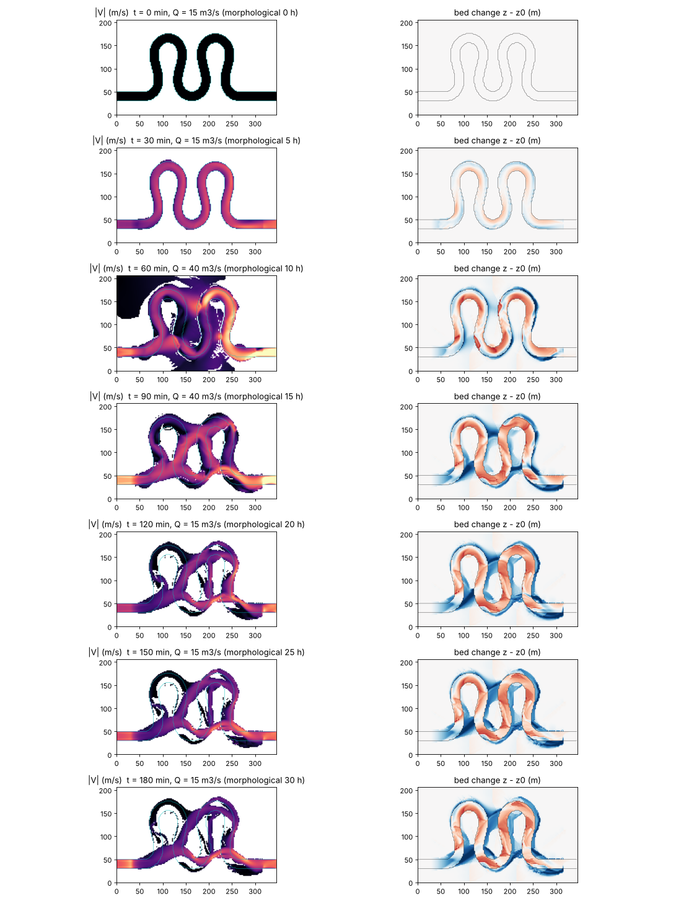
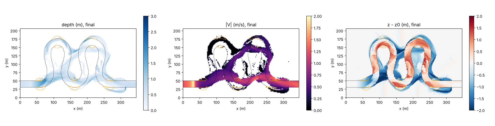

# meander_cutoff — cutoff of a meander loop with a narrow neck and plugging of the old channel (stage 4)

> English mirror of examples/meander_cutoff/README.md. The Japanese file is the master copy.

[日本語](../README.md)

This example follows, using only landform evolution on a fixed grid and the
wet/dry treatment, the process by which the narrow strip of land between
adjacent loops (the neck) of a highly sinuous channel (a sine-generated curve)
is overtopped by a flood and cut off, and the old channel (the loop) turns into
slack water (docs/meander_plan.md stage 4 and §3.5; developer.md §84.5). No
reconnection of the channel centreline and no special treatment to "make an
oxbow lake" are used. No code changes (settings only).

## Geometry and settings

- 346 m × 206 m, dx = dy = 2 m. The centreline is a sine-generated curve with
  direction angle θ(s) = ω sin(2πs/Λ) (ω = 105°, Λ = 320 m, 2 wavelengths); the
  inlet and outlet are straight (inflow cells on the west edge → free outflow on
  the east edge). Width 20 m, bed slope 0.001 (along the channel length),
  initial depth 0.8 m.
- The floodplain height is "the maximum bed elevation within a radius of 24 m
  + 1.6 m" (above the water surface of every adjacent reach; if it were set by
  channel length or valley slope, the floodplain of the highly sinuous downstream
  part would lie below the upstream water surface and overflow before the flood).
  Only the land close to both of two channel reaches = the neck is +0.95 m
  (orange outline in the figures). The soil thickness is 0 within 30 m of both
  ends and ramps over 150 m from the upstream end.
- Inflow Q = 15 m³/s (30 min) → 40 m³/s (flood at 40–100 min) → 15 m³/s (until
  180 min). morfac = 10 (3 h hydraulic = 30 h morphological time).
- Landform evolution: Ashida–Michiue formula (d50 = 1 mm), bed-slope term,
  equilibrium secondary-flow term (deviation-angle cap `sec_rmax = 0.3`; in the
  sharp bends with R/W = 3, r = N* h κ grows with the depth, and the cap keeps
  the pools from deepening without limit), angle-of-repose avalanching at 40°
  (the banks at 1.6 m / 2 m = 38.7° are stable). Neither the bank-erosion law
  nor suspended sediment is used (combining 0.2 mm suspended sediment without
  sediment feed lowers the bed rapidly by suspension). Advection uses the default
  scheme 3, dynamic reassignment of blocked openings on all edges
  (`f_opening_dynamic = 2`; §84.7), dt = 0.1 s.

## Running

```
cd examples/meander_cutoff
make                      # generates the inputs (10 s) and links the executable
./encflow param.txt       # about 10 min (gfortran, 2–4 threads)
python3 plot_results.py   # figs/*.png and tables
```

## Results (recomputed on 2026-10-19; gfortran 13.3, -Ofast; advection with the default scheme 3 (after the §68.36 fix, including the two-sided condition of a one-sided face of §68.39), f_opening_dynamic = 2)



Left: velocity; right: bed change (blue = scour, red = deposition; black line =
initial banks). Before the flood (30 min) pools form at the outer bank and bars
at the inner bank of each loop (the same mechanism as examples/meander). During
the flood (40–100 min) the floodplain is widely inundated, and the flow crossing
the neck carves a new channel joining the roots of the loop. After the flood
(from 120 min) the flow concentrates in the new channel, the loop becomes slack
water with velocity below 0.3 m/s, and deposition proceeds at its ends and
inside the loop.



| t (min) | Morphological time (h) | Q (m³/s) | Flowing cells in the loop (\|V\| > 0.3 m/s) | Flowing cells in the neck zone | Wet outside the initial channel | Deepest scour (m) |
|---|---|---|---|---|---|---|
| 30 | 5 | 15 | 2262 | 76 | 95 | −1.88 |
| 60 | 10 | 40 | 1659 | 323 | 4369 | −2.48 |
| 90 | 15 | 40 | 1686 | 234 | 3400 | −4.13 |
| 120 | 20 | 15 | 965 | 148 | 2582 | −3.63 |
| 150 | 25 | 15 | 868 | 163 | 2478 | −3.61 |
| 180 | 30 | 15 | 774 | 153 | 2437 | −3.66 |

## Findings

- **The cutoff emerges as a consequence of the wet/dry treatment and landform
  evolution** (the policy of plan §3.5). Before the flood almost no flow crosses
  the neck (76 flowing cells in the neck zone); the flow overtopping it during
  the flood (323 cells) carves a channel through the neck, and the new channel
  remains after the flood (153 cells). The flowing cells in the loop decrease
  from 2262 to 774, and most of the old channel has become slack water.
- **The opening of the new channel and the plugging of the old channel are
  separate stages** (plan §3.5). After 30 h of morphological time, deposition
  has only begun at the ends of the loop, and complete separation (an oxbow
  lake) is not reached. Transporting the fines that fill the old channel
  requires suspended sediment (f_suspend) and sediment-feed conditions (§84.5).
- A flood of Q = 25 m³/s does not overtop the neck (+0.95 m) and no cutoff
  occurs. The flood magnitude and the neck height (= the degree of bar fixation
  and floodplain formation) set the condition for a cutoff.
- The outer-bank pools of the sharp bends (R/W = 3) deepen to more than 3 m
  (initial depth 0.8 m). The depth changes with `sec_rmax` and the repose angle.
  During the flood the flow in these pools is fast, hence dt = 0.1 s (dt = 0.2
  stops with a CFL violation).
- The per-update change limit `fluv_dzmax` (0.05 m) is triggered often (rapid
  incision of the new channel during the flood). Lowering morfac reduces the
  triggering, but the storyline of the results is the same.

## Related documents

- docs/meander_plan.md §3.5, developer.md §84.5 (in Japanese)
- [examples/meander](../../meander/en/README.md) — deformation of a meandering channel by the same mechanism (widening and cross-section shape)
- [docs/users_guide/geomorph.md](../../../docs/en/users_guide/geomorph.md)
