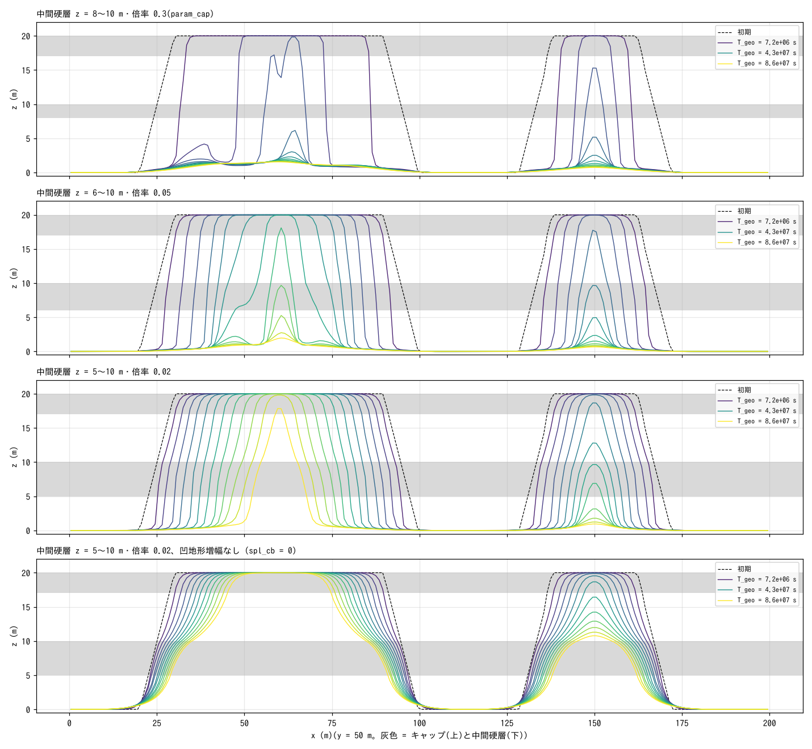
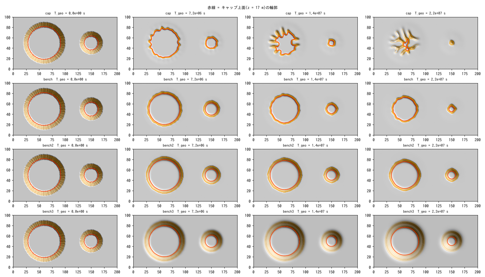

# examples/mesa — メサ・ビュートの形成実験(キャップロック = spl_strata)

平地(z = 0 = 侵食基準面)に高さ 20 m の台地 2 つ(半径 30 m / 12 m、縁 63°)を置き、
上 3 m をキャップロック(倍率 0.05)、z = 8〜10 m を中間硬層(倍率 0.3)とした
ケース(param_cap.txt)と、層理なしの対照(param_nocap.txt)。降雨 10 mm/h 全量浸透、
f_splash(examples/badland_round と同じ係数)+ 弱いクリープ D = 3e-7。
48 h = T_geo 8.6e7 s、4 h 毎(7.2e6 s)に Z。

```
make                                   # ../../bin/encflow へのリンク
python3 make_terrain.py                # z.txt
./encflow param_cap.txt > Screen_cap.log; ./encflow param_nocap.txt > Screen_nocap.log   # 各 8 分
python3 plot_results.py | tee analysis.txt   # figs/maps.png, sections.png, series.png + 数表
for c in bench bench2 bench3; do ./encflow param_$c.txt > Screen_$c.log; done   # 中間硬層の対照
python3 plot_results.py bench | tee analysis_bench.txt   # figs/*_bench.png
```

## 結果(analysis.txt、figs/)

検算: 表面流ゼロ、地下貯留 0.48 m = 降雨累計、体積減少 = 排出 ÷ 0.6(両ケース)。

| 時刻 T_geo (s) | 0 | 7.2e6 | 1.4e7 | 2.2e7 | 2.9e7 |
|---|---|---|---|---|---|
| キャップあり R₀ = 30 m: 台地面(z ≥ 17 m)の等価半径 (m) / 頂高 (m) | 31.5 / 20 | 27.2 / 20 | 18.4 / 20 | 5.6 / 20 | 0 / 9.8 |
| キャップあり R₀ = 12 m | 13.6 / 20 | 10.1 / 20 | 5.2 / 20 | 0 / 15.5 | 0 / 5.2 |
| 層理なし R₀ = 30 m | 31.5 / 20 | 18.1 / 20 | 0 / 11.7 | 0 / 4.6 | 0 / 3.3 |
| 層理なし R₀ = 12 m | 13.6 / 20 | 5.8 / 20 | 0 / 6.2 | 0 / 2.9 | 0 / 2.2 |

- キャップあり: 台地面は 20 m のまま平らに保たれ、縁がほぼ垂直の崖として後退する
  (メサ)。小さい台地は 1.4e7 s で半径 5 m の孤立丘(ビュート)になり、2.2e7 s で
  キャップを失って尖塔 → 消失。大きい台地は 1.4e7 s 以降、縁が凹地形フィードバックで
  円形劇場状に刻まれ、2.2e7 s にはキャップの残片が指状の尾根に解体される。
  初期の後退速度は 4〜5 m / 7.2e6 s(≈ 6e-7 m/s。縁のセルの S^1.5 侵食 × 倍率 0.05)。
- 層理なし: 7.2e6 s で既に縁が星形に深く刻まれ、平らな頂と垂直の崖は保たれない。
  1.4e7 s で台地面は消え、放射状の尾根に解体される。

## 限界

- 崖の後退は「縁のセルが急勾配(S ≈ 崖高/Δx)で削れる」ことで表しており、
  実際のキャップの崩落(軟層の掘り込みによるオーバーハングの落下)の力学ではない。
  後退速度は倍率と Δx に依存する(較正量)。
- 崖錐はクリープの堆積だけで、崖錐が軟層を保護する効果はない。
- 中間硬層(8〜10 m)はベンチにならなかった(軟層が基準面まで一気に下がるため、
  2 m 厚・倍率 0.3 では崖の中に残らない)。厚く・硬くした対照は次の節。
- 凹地形フィードバック(spl_cb)が縁を刻むため、メサの段階は短い。縁の平滑な後退を
  長く見るには spl_cb を下げる。

## 中間硬層を厚く・硬くするとベンチは出るか

| ケース | 中間硬層 | spl_cb | 24 m の台地(R₀ = 30 m)の後退速度 (m/s) | 大きい台地の最終頂高 (m) |
|---|---|---|---|---|
| param_cap | z = 8〜10 m、倍率 0.3 | 32 | 1.2e-6(加速。2.2e7 s で解体) | 2.5 |
| param_bench | z = 6〜10 m、倍率 0.05 | 32 | 5.3e-7(直線) | 20(8.6e7 s でも残る) |
| param_bench2 | z = 5〜10 m、倍率 0.02 | 32 | 3.5e-7(直線) | 20 |
| param_bench3 | z = 5〜10 m、倍率 0.02 | 0 | 1.9e-7(直線) | 20 |





方位平均断面(大きい台地)で各標高帯が占める半径方向の幅 (m)(T_geo = 4.3e7 s):

| ケース | キャップ 17〜20 | 軟層 10.5〜17 | 硬層上面 9.5〜10.5 | 硬層 5〜9.5 | 裾 1〜5 |
|---|---|---|---|---|---|
| param_bench | 9 | 2 | 0 | 2 | 4 |
| param_bench2 | 18 | 2 | 0 | 1 | 2 |
| param_bench3 | 22 | 7 | 1 | 4 | 5 |

- **厚く硬い中間硬層だけでは幅のあるベンチは出ません**(bench・bench2)。硬層の
  上面は 1 セル幅の段差(肩)として現れるだけで、崖は 20 m から 0 m まで水平距離
  4〜5 m の一枚の急崖のままです。原因は凹地形フィードバック(spl_cb = 32):
  上の崖の基部 = 硬層の上面は凹部(κ > 0)なので、硬層の縁が増幅(κ ≈ S/ℓ で
  1 + c_b κ が 100 倍超)で削られ、段ができたそばから消えます。凸なキャップの縁は
  増幅されないので、上下の崖がほぼ同じ速さで後退し、段の幅が育ちません。
- ただし中間硬層は**メサを長持ちさせます**。軟層がキャップの直下から硬層の上面
  までしか下がらないので、キャップ縁の落差が 20 m → 10 m に減り、縁のセルの
  S^1.5 侵食が落ちて後退が直線的かつ 2〜3 倍遅くなり、縁の円形劇場状の切れ込み
  (cap の 1.4e7 s)も起きません。大きい台地は 8.6e7 s まで平らな頂(20 m)を保ち、
  小さい台地は 4.3e7 s 以降にビュートから尖塔になります。
- **凹地形増幅を切る(bench3、spl_cb = 0)とベンチが出ます**。硬層の上面 z ≈ 10 m に
  幅数 m の肩(硬層 5〜9.5 m の帯が 4 m、軟層 10.5〜17 m が 7 m)が全周に回り、
  平面では等高線が 2 束に分かれた二段のメサ(上の崖 + 肩 + 下の斜面)になります。
  代わりに崖は 45° 前後の斜面に緩み(増幅がないと急崖は S^1.5 で均される)、垂直の
  壁ではなくなります。「垂直な崖」と「幅のあるベンチ」は、この侵食則では
  spl_cb の両側にあって両立しません。両立させるには、凹部の増幅を硬層では
  効かせない(倍率を増幅項にも掛けるのでなく、増幅を κ の上限で飽和させる等)
  定式化の検討が要ります(docs/splash_plan.md §8 の Φ_B の飽和形)。

## 関連

- [examples/badland_round](../badland_round/)(spl_strata の硬軟互層の縞・段)、
  [examples/badland](../badland/)(鋭い稜線の深い谷)
- [docs/users_guide/geomorph.md](../../docs/users_guide/geomorph.md) — `f_splash`・`spl_strata`、
  developer.md §48.5
