# mesa — 帽岩のあるメサ・ビュートの形成(崖の平行後退・段・崩落と崖錐)

[English](en/README.md)

硬い帽岩(キャップロック)が軟らかい層を覆う台地が、崖の後退で縮み、メサ → ビュート →
尖塔になって消えるまでを、[乾式斜面侵食](../../docs/users_guide/geomorph.md#乾式斜面侵食f_splash)
(f_splash)と水平層理の侵食性の倍率(`spl_strata`)で再現する例題です。帽岩のある台地と
層理のない台地を比べ、補足では、崖の途中の硬い層が段(ベンチ)を作るか、凹地形増幅の
飽和(`spl_ksat`)、崩落と崖錐([f_rockfall](../../docs/users_guide/geomorph.md#崩落と崖錐f_rockfall))
の規則で崖の形と後退がどう変わるかを比べます。値は現象を見やすくするための模式値で、
特定の地形の再現ではありません。

乾式斜面侵食の侵食則は ENCflow の開発者による**独自の定式化**で、論文としては未発表です
([badland](../badland/README.md) の「再現に必要な機構」を参照)。

## 実際のメサ・ビュートで起きていること

- **帽岩が平らな頂を守る**: 水平な地層のうち硬い層(砂岩・礫岩・溶岩など)が軟らかい層
  (泥岩・頁岩など)を覆う台地では、硬い層が侵食から頂を守り、平らな頂と急な崖ができます
  (米国コロラド高原のモニュメント・バレーのメサやビュートが典型)。
- **崖は急なまま後退する**: 崖の下の軟らかい層が速く削れて帽岩の下が掘り込まれ、支えを
  失った帽岩が割れて落ちます。崖はこれを繰り返して、急な形を保ったまま後退します
  (平行後退)。
- **台地 → メサ → ビュート → 尖塔**: 台地は崖の後退で縮み、幅が高さより大きいメサ、幅が
  高さより小さいビュート、細い尖塔になり、帽岩を失うと消えます。
- **崖錐が脚部を守る**: 崩れ落ちた岩屑は崖の脚部に崖錐を作り、下の軟らかい斜面を覆います。
  帽岩から落ちたブロックは斜面の形と、その地形がどれだけ長く残るかを左右します
  (Glade et al. 2017)。
- **段(ベンチ)**: 崖の途中に硬い層があると、その上面に平らな段ができ、崖が二段になります。

## 再現に必要な機構

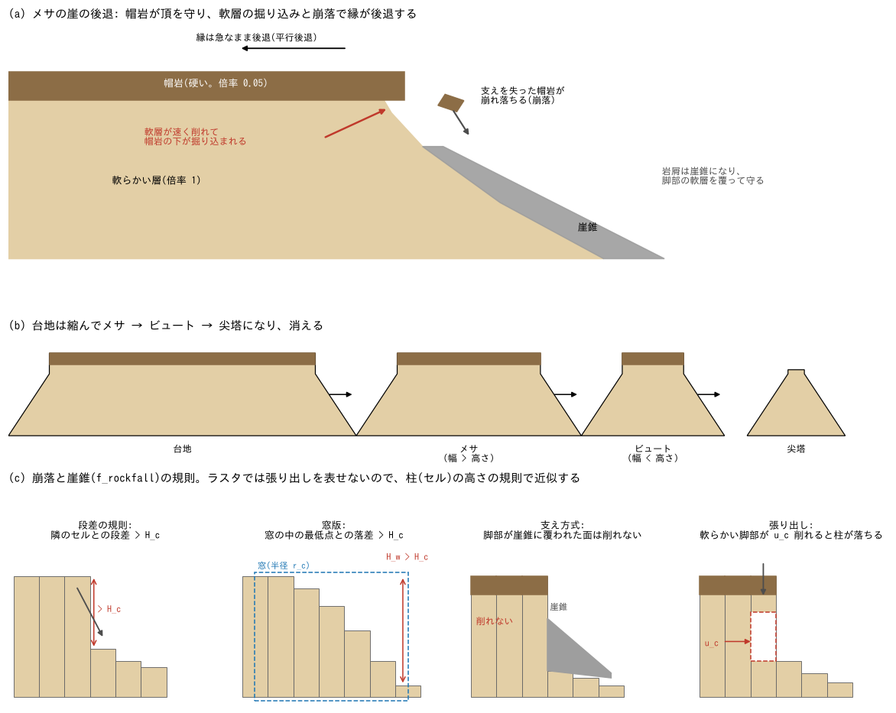

模式図。(a) メサの崖の後退: 帽岩が平らな頂を守り、軟らかい層が速く削れて帽岩の下が
掘り込まれ、支えを失った帽岩が崩れ落ちる。岩屑は崖錐になって脚部を覆う。(b) 台地は
縮んでメサ → ビュート → 尖塔になり、消える。(c) 崩落と崖錐の規則: ラスタ(格子)では
張り出しを表せないので、柱(セル)の高さの規則で崩落を近似する(左から、隣のセルとの
段差、窓の中の最低点との落差、崖錐に脚部を覆われた面の保護、軟らかい脚部の削り込み)。

| 実際の現象 | モデルの機構 | 設定 |
|---|---|---|
| 硬い帽岩が軟らかい層を覆う | 水平層理の侵食性の倍率(帽岩 0.05、軟層 1)。標高で層が決まり、削れて下の層が出る | `spl_strata` |
| 崖の縁が削れて後退する | 乾式斜面侵食。縁のセルは急な崖に面して勾配 S が大きく、倍率 0.05 でも削れる | `f_splash`、`spl_*` |
| 崖の基部(凹部)が速く削れる | 凹地形増幅 $`1 + c_b\kappa`$。上限を付けるなら有効曲率で飽和させる | `spl_cb`、`spl_ksat` |
| 崖の途中の硬い層が段を作る | 中間の硬い層の倍率 | `spl_strata` |
| 帽岩が崩れ落ち、岩屑が崖錐になって脚部を守る | 崩落と崖錐: 限界高さ H_c を超えた落差を崩し、崖錐(厚さ ht)として積む。崖錐に覆われたセルの乾式侵食は rf_ftalus 倍 | `f_rockfall`、`rf_hc`・`rf_rc`・`rf_phi`・`rf_ftalus` |
| 崖錐に脚部を覆われた面は削れない | 支え方式 | `rf_fface` |
| 軟らかい脚部が掘り込まれて帽岩が落ちる | 張り出しによる崩落: 柱より軟らかい脚部が u_c 削れると柱が落ちる | `rf_uc` |
| 裾の土の移動 | 弱いクリープ(線形拡散) | `f_creep`、`creep_d = 3×10⁻⁷` |
| 表面流は生じない | 全量浸透(Green-Ampt 36 mm/h > 雨 10 mm/h) | `f_gwvertical = 2` |

ラスタは張り出し(オーバーハング)を持てないので、主ケースの崖の後退は「縁のセルが
急な勾配(S ≈ 崖高 / Δx)で削れる」ことで表され、帽岩の崩落の力学ではありません。崩落と
崖錐を重ねた補足 3 では、崩落を柱(セル)の高さの規則で近似し、崖の形と後退の律速が規則で
どう変わるかを比べます。

## 幾何と設定

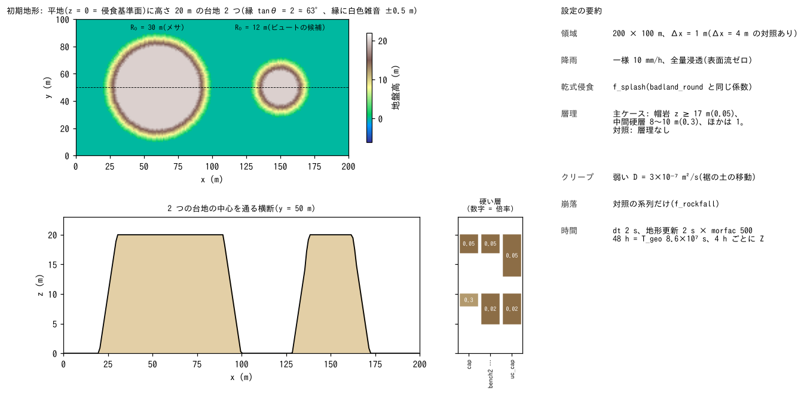

左上: 初期地形(破線 = 横断の位置)。左下: 2 つの台地の中心を通る横断。中: 硬い層の位置と
倍率(主ケース cap、補足の多くが使う bench2、uc_cap)。右: 設定の要約。

200 m × 100 m、Δx = 1 m(200 × 100 セル)。平地(z = 0 = 侵食基準面)の上に、高さ 20 m の
台地を 2 つ置きます(半径 30 m のメサと、半径 12 m のビュートの候補。縁は tanθ = 2 ≈ 63°、
縁の位置に白色雑音 ±0.5 m、シード固定)。

- **層理(主ケース)**: 上 3 m(z ≥ 17 m)が帽岩(倍率 0.05)、z = 8〜10 m に中間の硬い層
  (倍率 0.3)、ほかは軟層(倍率 1)。対照は層理なし。土層は台地全体で 100 m(岩としての
  硬さは層理の倍率で与える)。
- **降雨と浸透**: 一様 10 mm/h、全量浸透(表面流ゼロ)。
- **乾式斜面侵食**: badland_round と同じ係数($`k_r`$ = 2×10⁻⁴、$`k_t`$ = 0.05、$`h`$ = 1.5、
  $`c_b`$ = 32 m、ℓ = 2 m)。弱いクリープ D = 3×10⁻⁷ m²/s を重ねます(裾の土の移動)。
- **時間**: dt = 2 s、地形の更新は 2 s ごとで morfac = 500。48 時間 = T_geo 8.6×10⁷ s。
  4 時間(T_geo 7.2×10⁶ s)ごとに Z を出力します。1 ケース約 8 分(Δx = 4 m は約 30 秒)。

| 系列 | ケース(param_<名前>.txt) | 内容 |
|---|---|---|
| 主ケース | cap / nocap | 帽岩あり(上 3 m 倍率 0.05、z = 8〜10 m 倍率 0.3)/ 層理なし |
| 補足 1: 中間の硬い層 | bench / bench2 / bench3 | 中間の硬い層を z = 6〜10 m・倍率 0.05 / z = 5〜10 m・倍率 0.02 / bench2 で凹地形増幅なし(spl_cb = 0) |
| 補足 2: 増幅の飽和 | sat2 / sat | bench2 に spl_ksat = 0.2 / 0.05(増幅の上限 7.4 倍 / 2.6 倍) |
| 補足 3: 崩落(段差の規則) | rock2 / rock4 / rock3 / rock5、rock | bench2 に崩落(隣のセルとの段差 > H_c = 4 m)。崖錐の侵食性 0.1 / 0.02 / 0.02 + κ_s 0.2 / 0.005 + κ_s 0.2。rock は 0.3 |
| 補足 3: Δx = 4 m | dx4 / dx4_rock / dx4_rock2 | bench2 の地形を Δx = 4 m で。崩落なし / H_c = 6 m、崖錐 0.1 / 0.01 |
| 補足 3: 窓版 | rc / rc2、dx4_rc / dx4_rc2 | 窓(半径 r_c = 8 m)の中の最低点との落差 > H_c = 15 m。崖錐 0.1 / 0.01 + κ_s 0.2(Δx = 1 m / 4 m) |
| 補足 3: 支え方式 | face / face2 / face3、face4 / face5 | rc2 に支え方式(rf_fface = 0)。崖錐 0.01 / 0.1 / 0.3。face4・5 は H_c = 8 m、崖錐 0.01 / 0.1 |
| 補足 3: 張り出し | uc / uc2 / uc3 | face に張り出し u_c = 0.5 m。崖錐 0.1 / 0.3 / 1 |
| 補足 3: 両立の案 | uc_cap / uc_slow | uc2 の帽岩を 7 m(z ≥ 13 m)に / uc の崖錐を 0.03 倍にして計算を 2 倍(T_geo 1.7×10⁸ s) |

## 実行方法

```
cd examples/mesa
make                                         # 実行ファイルへのリンクと入力(make_terrain.py が z.txt を作る)
make run                                     # 主ケース cap・nocap(各 8 分)
python3 plot_setup.py                        # figs/mechanism.png・setup.png(計算結果は使わない)
python3 plot_results.py | tee analysis.txt   # figs/maps.png・sections.png・series.png と数表
make bench                                   # 補足 1(bench・bench2・bench3)
python3 plot_results.py bench                # figs/*_bench.png(cap も使う)
make sat                                     # 補足 2(sat・sat2。bench2・bench3 も使う)
python3 plot_results.py sat                  # figs/*_sat.png
make rock                                    # 補足 3 の段差の規則(rock〜rock5)
python3 plot_results.py rock                 # figs/*_rock.png(rock4 の図は python3 plot_results.py rock4)
make dx4                                     # 補足 3 の Δx = 4 m(z_dx4.txt を使う 5 ケース。各 30 秒)
python3 plot_results.py dx4                  # figs/*_dx4.png(窓版は python3 plot_results.py dx4rc)
make rc                                      # 補足 3 の窓版(rc・rc2)
python3 plot_results.py rc                   # figs/*_rc.png
make face                                    # 補足 3 の支え方式(face〜face5)
python3 plot_results.py face                 # figs/*_face.png(H_c = 8 m は python3 plot_results.py face8)
make uc                                      # 補足 3 の張り出しと両立の案(uc〜uc3、uc_cap、uc_slow は約 16 分)
python3 plot_results.py uc                   # figs/*_uc.png(両立の案は python3 plot_results.py ucx)
```

図の比較の相手(bench2・rc2・face など)は、その系列より前のターゲットで計算されます。
引数 `en` を付けると英語ラベルの図を en/figs/ に描きます(`python3 plot_setup.py en`、
`python3 plot_results.py [系列] en`)。

## 結果

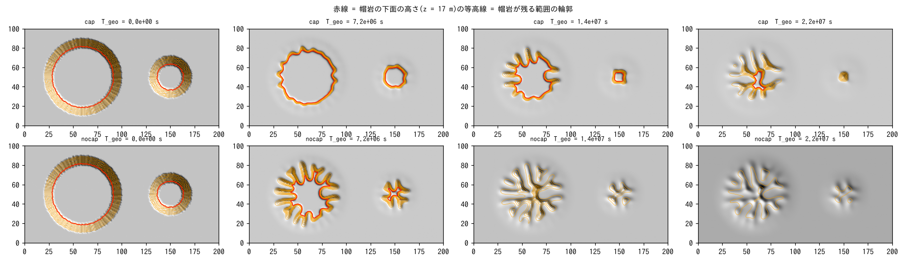

上: 帽岩あり、下: 層理なし。T_geo = 0、7.2×10⁶、1.4×10⁷、2.2×10⁷ s の陰影図(赤線 = 帽岩の
下面の高さ z = 17 m の等高線 = 帽岩が残る範囲の輪郭)。

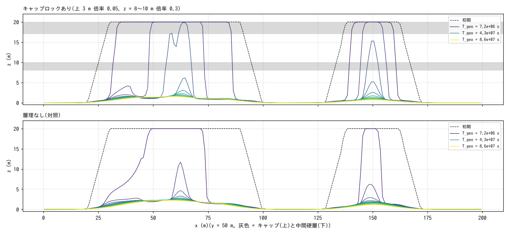

2 つの台地の中心を通る横断(y = 50 m)の時間発展(灰色の帯 = 帽岩と中間の硬い層)。

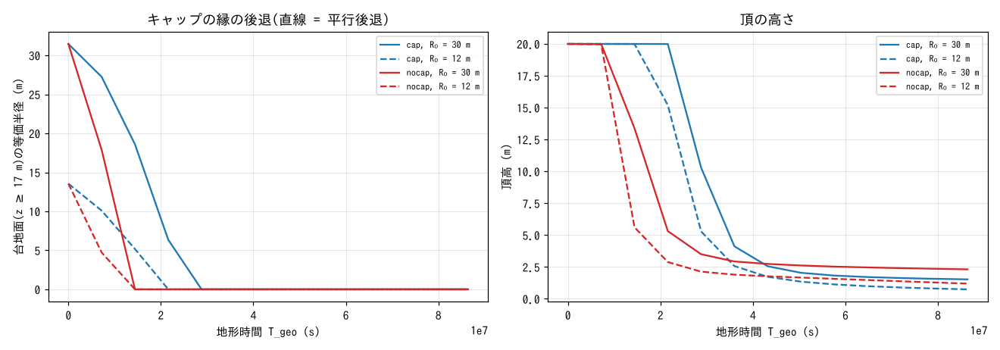

左: 台地面(z ≥ 17 m)の等価半径 √(A/π)(直線なら平行後退)。右: 頂の高さ。

収支の確認: 表面流ゼロ、地下貯留 0.48 m = 降雨の累計、地表の体積の減少 = 系外へ出た土砂
÷ 0.6(両ケース)。

| 時刻 T_geo (s) | 0 | 7.2×10⁶ | 1.4×10⁷ | 2.2×10⁷ | 2.9×10⁷ |
|---|---|---|---|---|---|
| 帽岩あり R₀ = 30 m: 台地面(z ≥ 17 m)の等価半径 (m) / 頂の高さ (m) | 31.5 / 20 | 27.2 / 20 | 18.4 / 20 | 5.6 / 20 | 0 / 9.8 |
| 帽岩あり R₀ = 12 m | 13.6 / 20 | 10.1 / 20 | 5.2 / 20 | 0 / 15.5 | 0 / 5.2 |
| 層理なし R₀ = 30 m | 31.5 / 20 | 18.1 / 20 | 0 / 11.7 | 0 / 4.6 | 0 / 3.3 |
| 層理なし R₀ = 12 m | 13.6 / 20 | 5.8 / 20 | 0 / 6.2 | 0 / 2.9 | 0 / 2.2 |

- **帽岩あり**: 台地面は 20 m のまま平らに保たれ、縁がほぼ垂直の崖として後退します(メサ)。
  小さい台地は 1.4×10⁷ s で半径 5 m の孤立丘(ビュート)になり、2.2×10⁷ s で帽岩を失って
  尖塔になり、消えます。大きい台地は 1.4×10⁷ s 以降、縁が凹地形フィードバックで円形劇場状に
  刻まれ、2.2×10⁷ s には帽岩の残りが指状の尾根に解体されます。初めの後退の速さは
  4〜5 m / 7.2×10⁶ s(≈ 6×10⁻⁷ m/s。縁のセルの S^1.5 の侵食 × 倍率 0.05)です。
- **層理なし**: 7.2×10⁶ s で既に縁が星形に深く刻まれ、平らな頂と垂直の崖は保たれません。
  1.4×10⁷ s で台地面は消え、放射状の尾根に解体されます。
- 中間の硬い層(z = 8〜10 m、倍率 0.3)は段になりません(軟層が基準面まで一気に下がる
  ため、厚さ 2 m・倍率 0.3 では崖の中に残らない)。厚く・硬くした対照が補足 1 です。

## 補足 1: 中間の硬い層を厚く・硬くするとベンチは出るか

| ケース | 中間の硬い層 | spl_cb | 大きい台地(R₀ = 30 m)の後退の速さ (m/s) | 大きい台地の頂の高さ (m)(T_geo 4.3×10⁷ s) |
|---|---|---|---|---|
| cap | z = 8〜10 m、倍率 0.3 | 32 | 1.2×10⁻⁶(加速。2.2×10⁷ s で解体) | 2.5 |
| bench | z = 6〜10 m、倍率 0.05 | 32 | 5.3×10⁻⁷(直線) | 20 |
| bench2 | z = 5〜10 m、倍率 0.02 | 32 | 3.5×10⁻⁷(直線) | 20 |
| bench3 | z = 5〜10 m、倍率 0.02 | 0 | 1.9×10⁻⁷(直線) | 20 |

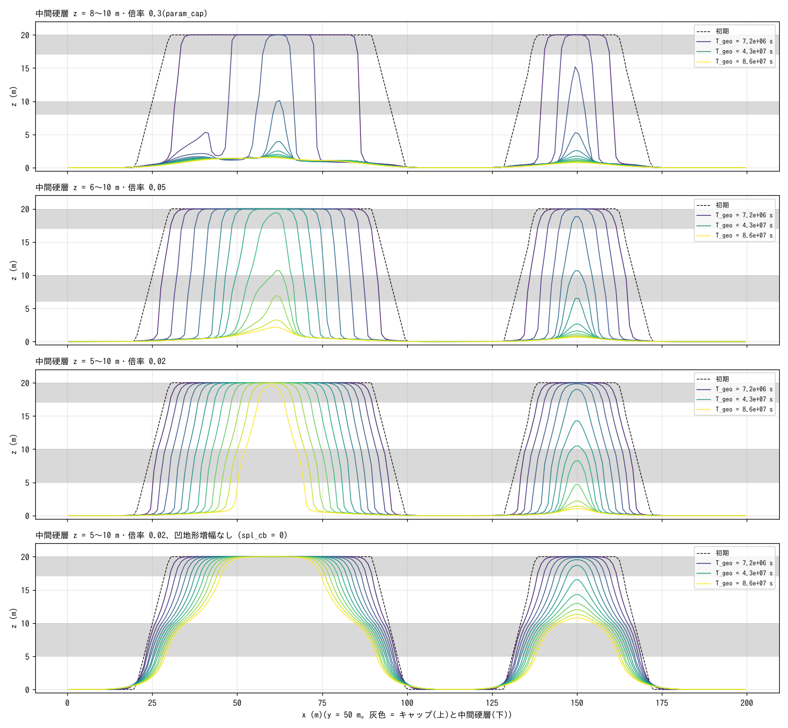

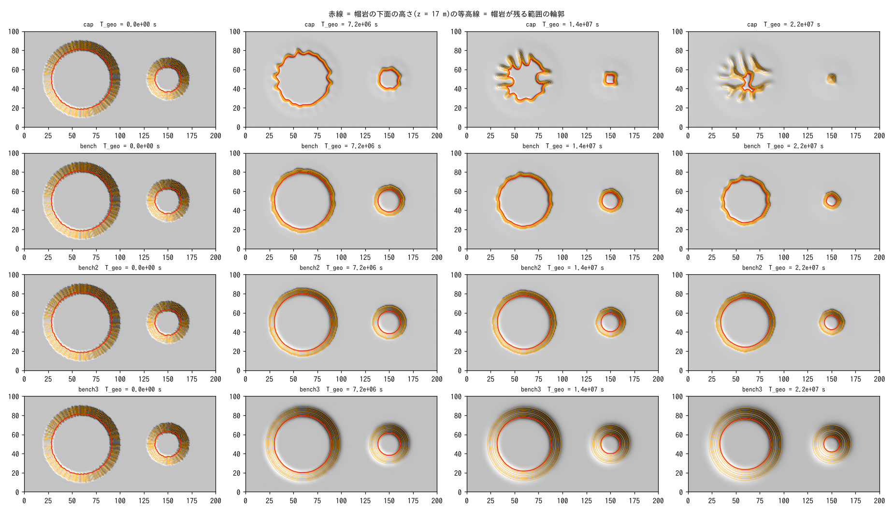

方位平均した断面(大きい台地)で各標高帯が占める半径方向の幅 (m)(T_geo = 4.3×10⁷ s):

| ケース | 帽岩 17〜20 | 軟層 10.5〜17 | 硬い層の上面 9.5〜10.5 | 硬い層 5〜9.5 | 裾 1〜5 |
|---|---|---|---|---|---|
| bench | 9 | 2 | 0 | 2 | 4 |
| bench2 | 18 | 2 | 0 | 1 | 2 |
| bench3 | 22 | 7 | 1 | 4 | 5 |

- **厚く硬い中間の層だけでは幅のあるベンチは出ません**(bench・bench2)。硬い層の上面は
  1 セル幅の段差(肩)として現れるだけで、崖は 20 m から 0 m まで水平距離 4〜5 m の一枚の急崖の
  ままです。原因は凹地形増幅(spl_cb = 32)です: 上の崖の基部 = 硬い層の上面は凹部(κ > 0)
  なので、硬い層の縁が増幅(κ ≈ S/ℓ で 1 + c_b κ が 100 倍を超える)で削られ、段ができた
  そばから消えます。凸な帽岩の縁は増幅されないので、上下の崖がほぼ同じ速さで後退し、段の
  幅が育ちません。
- ただし中間の硬い層は**メサを長持ちさせます**。軟層が帽岩の直下から硬い層の上面までしか
  下がらないので、帽岩の縁の落差が 20 m → 10 m に減り、縁のセルの S^1.5 の侵食が落ちて後退が
  直線的かつ 2〜3 倍遅くなり、縁の円形劇場状の切れ込み(cap の 1.4×10⁷ s)も起きません。大きい
  台地は 4.3×10⁷ s でも平らな頂(20 m)を保ち(cap は 2.5 m)、小さい台地はそれまでにビュートから
  尖塔になります。
- **凹地形増幅を切る(bench3、spl_cb = 0)とベンチが出ます**。硬い層の上面 z ≈ 10 m に幅数 m の
  肩(硬い層 5〜9.5 m の帯が 4 m、軟層 10.5〜17 m が 7 m)が全周に回り、平面では等高線が 2 束に
  分かれた二段のメサ(上の崖 + 肩 + 下の斜面)になります。代わりに崖は 45° 前後の斜面に緩み
  (増幅がないと急崖は S^1.5 でならされる)、垂直の壁ではなくなります。「垂直な崖」と「幅の
  あるベンチ」は、増幅の有無(spl_cb)だけでは両立しません。

## 補足 2: 増幅の飽和(spl_ksat)で垂直な崖とベンチは両立するか

凹地形増幅 $`1 + c_b\kappa`$ の κ を有効曲率 $`\tilde\kappa = \kappa/(1 + \kappa/\kappa_s)`$ に
置き換える `spl_ksat` を bench2 の構成に重ね、増幅の上限を 2.6 倍(κ_s = 0.05)と 7.4 倍
(κ_s = 0.2)にします(飽和なしは 100 倍超、増幅なし = bench3)。

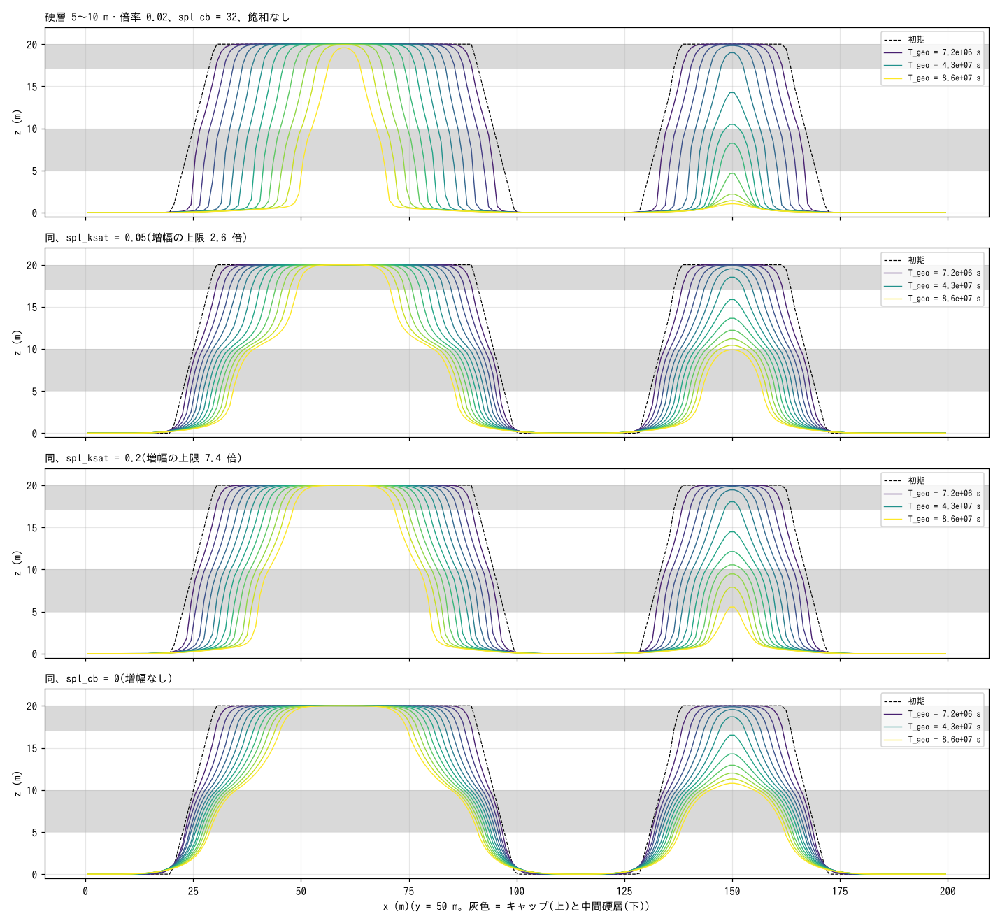

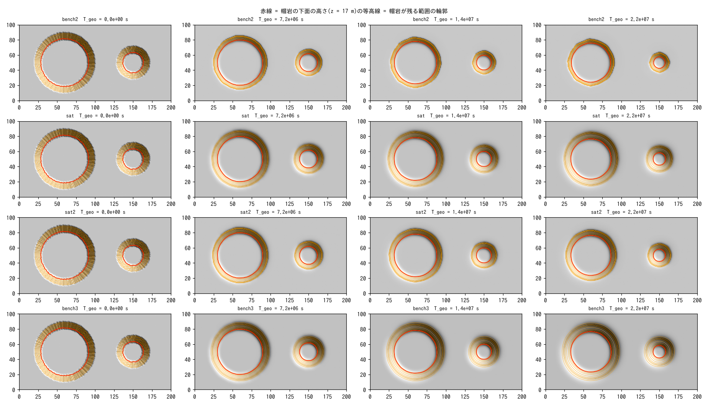

| ケース | 増幅の上限 | 硬い層の上面 ±0.5 m の面積 (m²)(T_geo 4.3×10⁷ / 8.6×10⁷ s) | 上の崖の平均の角度(1.4×10⁷ / 4.3×10⁷ / 6.5×10⁷ s) | 大きい台地の後退の速さ (m/s) |
|---|---|---|---|---|
| bench2(飽和なし) | 161 | 66 / 23 | 73° / 73° / 73° | 3.5×10⁻⁷ |
| sat2(κ_s = 0.2) | 7.4 | 148 / 114 | 58° / 58° / 52° | 2.3×10⁻⁷ |
| sat(κ_s = 0.05) | 2.6 | 269 / 351 | 58° / 52° / 43° | 2.3×10⁻⁷ |
| bench3(増幅なし) | 1 | 312 / 415 | 58° / 43° / 43° | 1.9×10⁻⁷ |

(上の崖の角度 = 軟層 10.5〜17 m の落差 6.5 m ÷ 方位平均した断面での水平の幅。)

- **飽和を入れると段が残ります**。κ_s = 0.05 では硬い層の上面 z ≈ 10 m に幅 2〜4 m の肩が全周に
  回る二段のメサになり(段の面積は増幅なしの 8 割)、κ_s = 0.2 では幅 1〜2 m の狭い肩になります。
  段の幅は上限の倍率で連続に制御できます。
- **崖の角度はその分だけ緩みます**。飽和なしの 73° に対し、κ_s = 0.2 で 58°(後半 52°)、
  κ_s = 0.05 で 58° → 43°、増幅なしで 43°。この侵食則では、崖の基部(凹部)の増幅が崖を急に
  保つ機構(基部の侵食 = 掘り込みの代わり)でもあるため、増幅を抑えると段が残る代わりに崖が
  緩みます。
- **両立の程度**: κ_s = 0.2 で「60° 前後の崖 + 1〜2 m の段」、κ_s = 0.05 で「50° 前後の崖 +
  2〜4 m の段」が同時に得られ、飽和なし(73°、段なし)と増幅なし(43°、広い段)の間を κ_s が
  連続につなぎます。実際のメサの垂直な崖は軟層の掘り込みと帽岩の崩落(岩屑の供給と崖錐の
  保護)で保たれるので、「垂直な崖 + 広いベンチ」には、増幅とは別に崖の崩落の機構が要ります
  (補足 3)。

## 補足 3: 崩落と崖錐(f_rockfall)を入れる

帽岩の崩落と崖錐の保護を `f_rockfall` で入れます。限界高さ H_c を超えた落差の分を高い側から
低い側へ移し(体積を保存)、移った分を崖錐の厚さ ht(出力 Ht)として積み、崖錐に覆われた
セルの乾式侵食を rf_ftalus 倍(以下「崖錐の侵食性」)に抑えます。崖錐は安息角 35° で広がります。

### 段差の規則(Δx = 1 m。崖が 4〜5 セル幅の斜面)

bench2 の構成(硬い層 5〜10 m、倍率 0.02、spl_cb = 32)に、隣のセルとの段差が H_c = 4 m を
超えた分を崩す規則を重ねた 4 ケースです(縁の段 3〜4 m が対象。H_c = 18 m や 6 m では段差が
届かず崩落しない)。

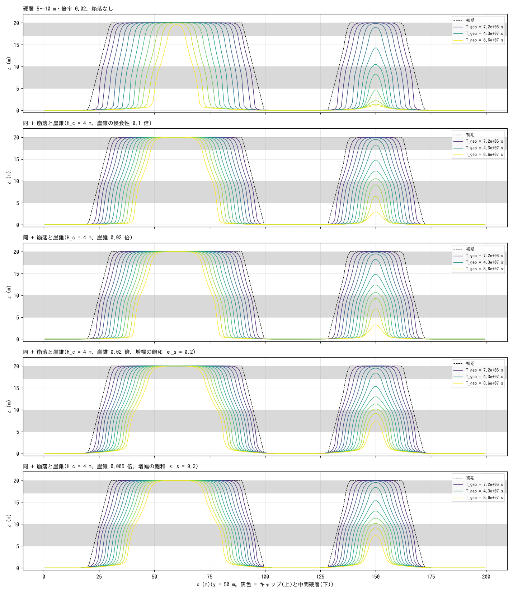

| ケース | 崖錐の侵食性 | κ_s | 崩落で移した体積(累計 m³) | 崖錐の総量 (m³) | 上の崖の角度(1.4×10⁷ / 4.3×10⁷ / 6.5×10⁷ s) | 大きい台地の後退の速さ (m/s) |
|---|---|---|---|---|---|---|
| bench2(崩落なし) | – | – | – | – | 73° / 73° / 73° | 3.5×10⁻⁷ |
| rock2 | 0.1 | – | 1314 | 2 | 58° / 58° / 52° | 2.2×10⁻⁷ |
| rock4 | 0.02 | – | 1285 | 4 | 58° / 58° / 52° | 2.2×10⁻⁷ |
| rock3 | 0.02 | 0.2 | 184 | 5 | 58° / 52° / 47° | 2.1×10⁻⁷ |
| rock5 | 0.005 | 0.2 | 99 | 6 | 58° / 52° / 47° | 2.2×10⁻⁷ |

- **Δx = 1 m では崩落はほとんど効きません。** 20 m の崖はラスタでは 4〜5 セル幅の 58〜73° の
  斜面で、崩落(段差 > H_c)が起きるのは最も急な 1〜2 セルだけ、崖錐は着地した脚部の 1 セルを
  守るだけです。崖の後退は崖錐に覆われない面のセルの乾式侵食(S^1.5)が担い続けるので、崖錐の
  侵食性を 0.1 → 0.005 に下げても後退の速さは変わらず(2.2×10⁻⁷ m/s)、崖錐の総量は常に数 m³ に
  とどまります。形は増幅の飽和のケース(sat2)とほぼ同じ(58° の崖 + 1〜2 m の段)で、崩落が
  加わる分だけ bench2 より崖が緩く、台地は長持ちします。
- 崖錐の侵食性 0.3 の rock は、rock2 と並べた図だけを描きます(`python3 plot_results.py rock4`)。

### 格子を粗くする(Δx = 4 m。崖が 1〜2 セルの段)

同じ地形を Δx = 4 m で(縁の段 8 m)、H_c = 6 m、崖錐の侵食性 0.1 / 0.01 で計算します。

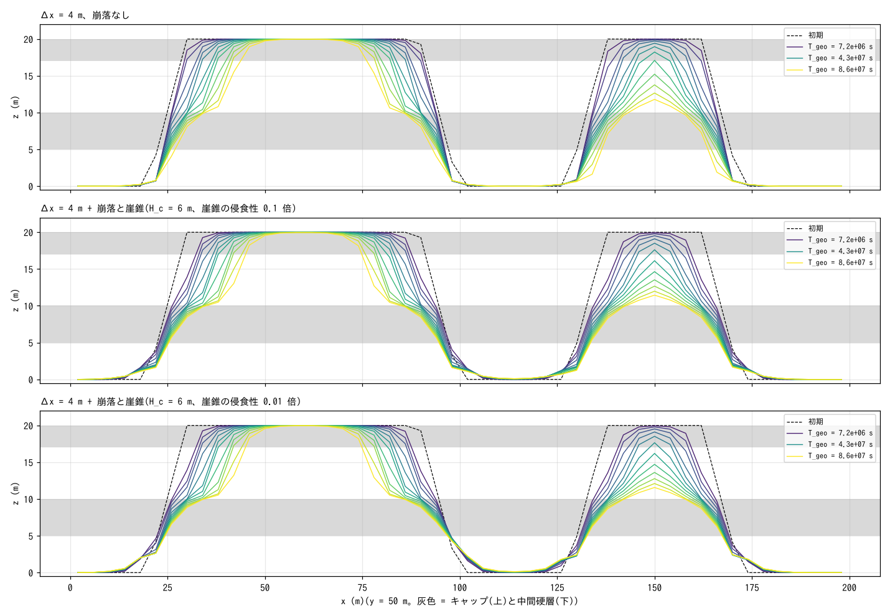

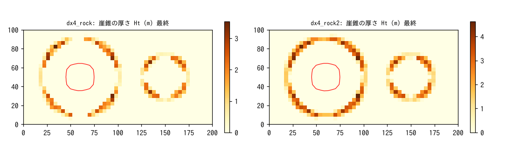

| ケース | 崖錐の侵食性 | 崩落で移した体積 (m³) | 崖錐の総量 (m³)(1.4×10⁷ → 8.6×10⁷ s) | 下の崖の角度(1.4×10⁷ / 4.3×10⁷ / 6.5×10⁷ s) | 後退の速さ (m/s) |
|---|---|---|---|---|---|
| dx4(崩落なし) | – | – | – | 65° / 60° / 47° | 1.8×10⁻⁷ |
| dx4_rock | 0.1 | 14469 | 5645 → 3373 | 38° / 33° / 30° | 1.7×10⁻⁷ |
| dx4_rock2 | 0.01 | 14487 | 6577 → 6286 | 38° / 31° / 30° | 1.7×10⁻⁷ |

- **崖が格子の段になると、崩落と崖錐が形を変えます。** 縁の段が崩れて落ちた岩屑が両方の
  台地の周りに厚さ 2〜4 m の崖錐のリングを作り、下の斜面は安息角(30〜38°)の崖錐斜面に置き
  換わります。崖錐の侵食性 0.01 では崖錐がほとんど減らず(6577 → 6286 m³)、崖錐に律速される
  状態になります。上の崖(帽岩の縁)の後退の速さは崩落なしと同じ(1.7×10⁻⁷ m/s)で、後退は
  依然として縁の乾式侵食が担います。
- 二つの格子幅を合わせると、段差の規則は「隣のセルとの段差 > H_c」というセル間の規則なので、
  崖が何セルにもまたがる細かい格子では効かず、崖が 1〜2 セルの段になる粗い格子
  (Δx ≳ 崖高 / 4)で初めて崖錐が積もります。H_c が Δx に依存する校正量になってしまうので、
  この格子依存を外したのが次の窓版です。

### 限界高さを格子幅に依らない形にする(窓版 rf_rc)

自由面の高さを「半径 r_c の窓の中の最低点との落差 H_w」で測り(`rf_rc`)、崖錐の安息角より
急なエッジで H_w > H_c の超過分を移す規則です。H_c = 15 m、r_c = 8 m を Δx = 1 m と 4 m の両方に
与え、崖錐の侵食性 0.1 と 0.01(+ κ_s = 0.2)で比べます。

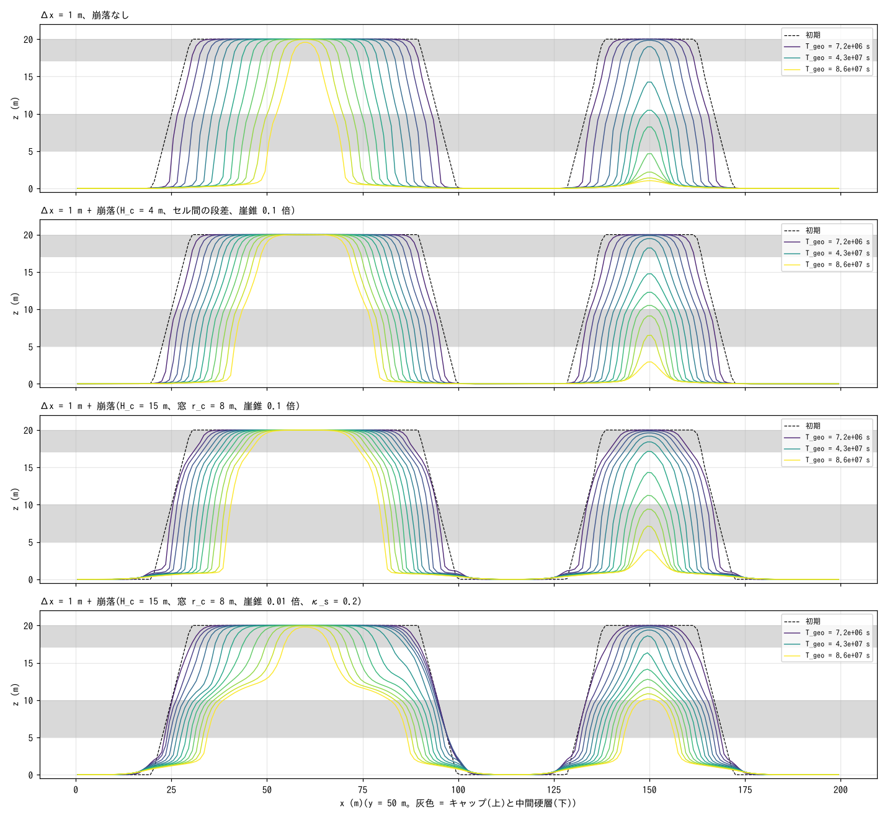

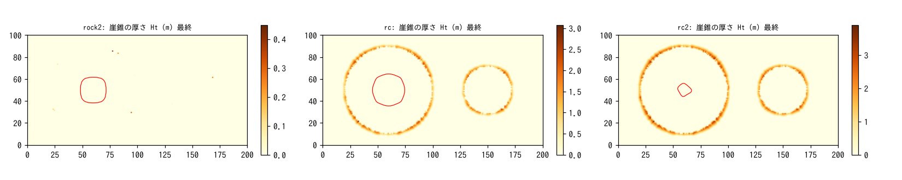

| 格子 | ケース | 崩落の規則 | 崖錐の侵食性 | 崩落で移した体積 (m³) | 崖錐の総量 (m³、最終) | 下の崖の角度(1.4×10⁷ / 4.3×10⁷ / 6.5×10⁷ s) | 後退の速さ (m/s) |
|---|---|---|---|---|---|---|---|
| Δx = 1 m | bench2 | なし | – | – | – | 77° / 71° / 65° | 3.5×10⁻⁷ |
| Δx = 1 m | rock2 | 段差 > 4 m | 0.1 | 1314 | 2 | 71° / 65° / 60° | 2.2×10⁻⁷ |
| Δx = 1 m | rc | 窓 8 m、H_w > 15 m | 0.1 | 47120 | 1309 | 47° / 43° / 71°* | 1.9×10⁻⁷ |
| Δx = 1 m | rc2 | 同 | 0.01、κ_s 0.2 | 24123 | 2143 | 47° / 38° / 31° | 3.2×10⁻⁷ |
| Δx = 4 m | dx4 | なし | – | – | – | 65° / 60° / 47° | 1.8×10⁻⁷ |
| Δx = 4 m | dx4_rc | 窓 8 m、H_w > 15 m | 0.1 | 7151 | 626 | 43° / 38° / 31° | 1.8×10⁻⁷ |
| Δx = 4 m | dx4_rc2 | 同 | 0.01、κ_s 0.2 | 6812 | 2240 | 43° / 35° / 30° | 1.7×10⁻⁷ |

(* rc の 6.5×10⁷ s は、崖錐の帯が方位平均の区間から外れた値。)

- **窓版では Δx = 1 m でも崩落と崖錐が効きます。** 崖の面全体(安息角より急で、窓の中の落差が
  15 m を超えるセル)が崩落の対象になり、崖錐は台地の周りに厚さ 1〜3 m のリングとして積もります
  (1300〜2100 m³。段差の規則では 2 m³)。下の斜面は 30〜40° の崖錐斜面に置き換わり、Δx = 4 m の
  結果と同じ型になります(両方の格子で下の崖 30〜38°、帽岩の縁の後退 1.7〜1.9×10⁻⁷ m/s)。崖錐の
  総量も両方の格子で同じ程度です(崖錐の侵食性 0.1 / 0.01 で Δx = 4 m は 626 / 2240 m³、Δx = 1 m は
  1309 / 2143 m³)が、粗い格子では崖錐の帯が 1〜2 セルでしか解像されていません。
- 崖錐の保護を強くする(rc2: 0.01 倍 + κ_s)と崖錐の総量は増えますが、崩落が面を安息角まで
  緩め続けるので、台地は上の崖まで 27〜31° の崖錐に覆われた円錐に近づき、帽岩の面はむしろ速く
  縮みます(3.2×10⁻⁷ m/s)。「安息角より急な面は崩れる」という規則である以上、崩落と保護の組
  だけでは垂直な崖は得られません。垂直な崖を保ったまま崖錐で律速するには、崖の面の侵食を
  崖錐の除去に律速させる別の規則が要ります(次の支え方式)。

### 崖の面の侵食を崖錐の除去に律速させる(支え方式 rf_fface)

rc2 の構成(H_c = 15 m、r_c = 8 m、κ_s = 0.2)に支え方式 `rf_fface = 0` を重ねます: 安息角より
急な落差の先(脚部)が崖錐に覆われたセルは乾式侵食で削れず、崩落は「面の頂の柱が、低い隣の
高さまで落ちる」柱の崩落になります(崩落中の柱を脚にする柱は待つので、面は 1 柱ずつ後退する)。
崖錐の侵食性 0.01 / 0.1 / 0.3(face / face2 / face3)で、後退の速さが崖錐の除去に律速されるかを
見ます。さらに H_c = 8 m(face4 / face5。段の上の上の崖 10 m も柱の崩落の対象)と比べます。

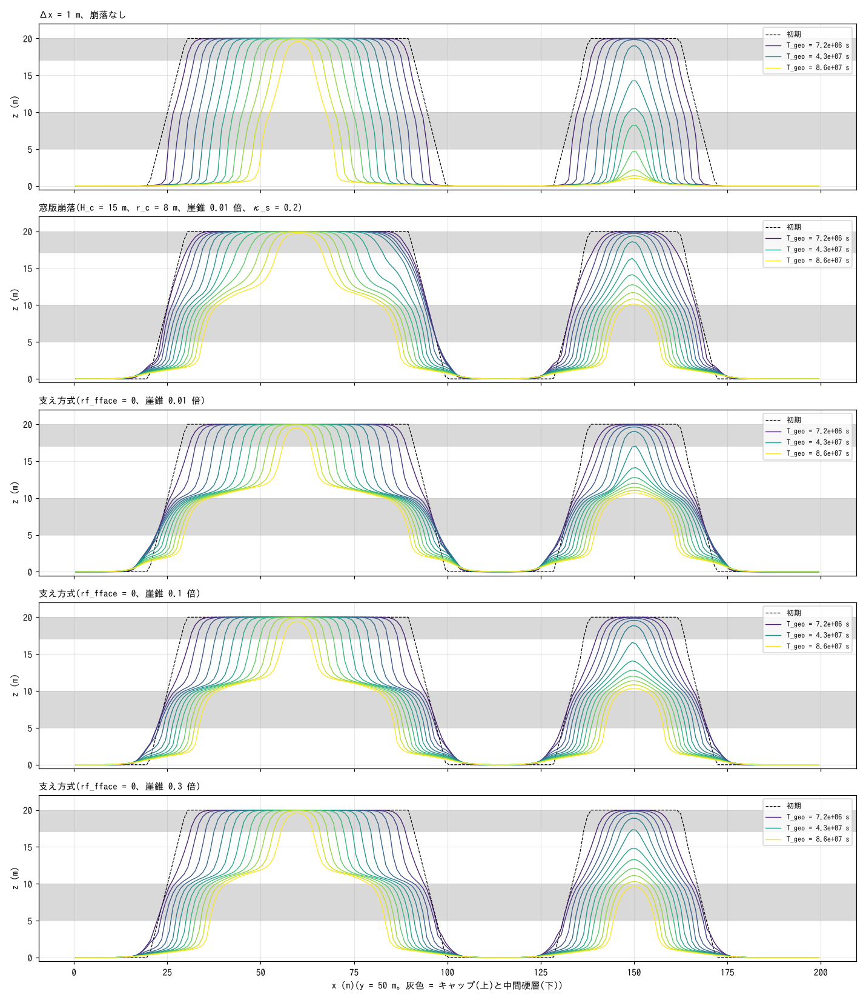

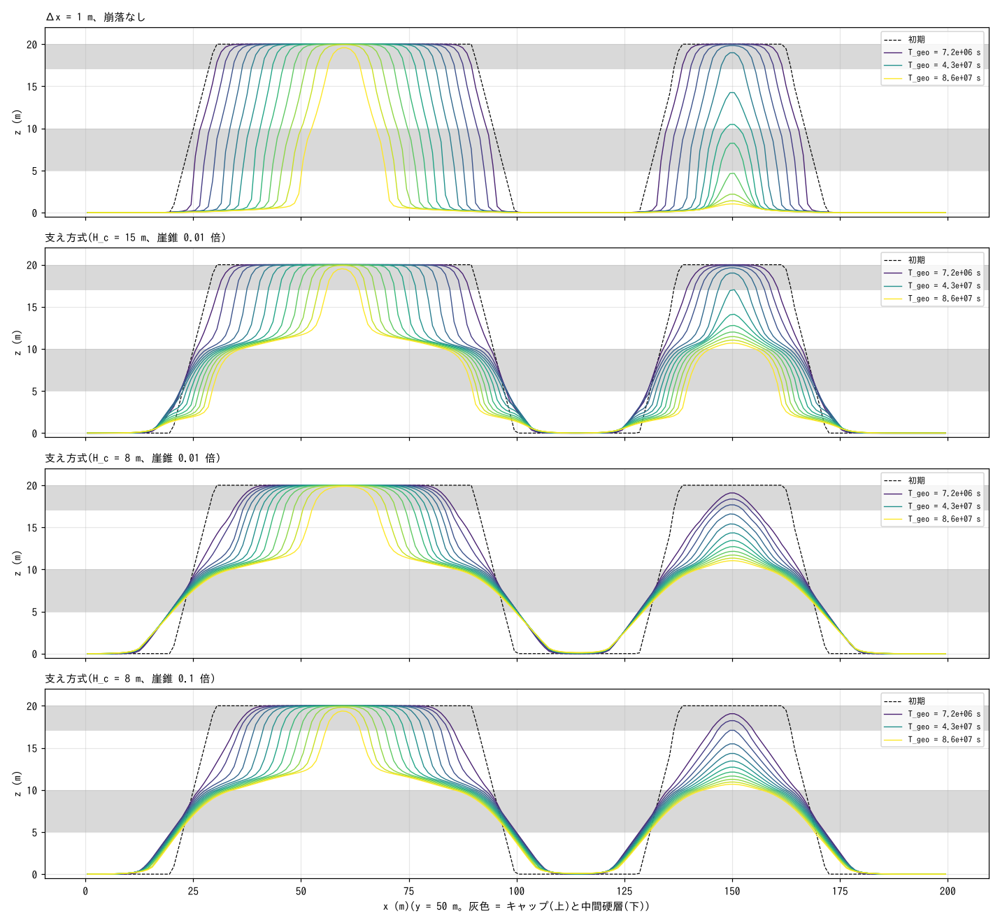

| ケース | H_c | 崖錐の侵食性 | 崩落で移した体積 (m³) | 崖錐の総量 (m³、最終) | 段(硬い層の上面 ±0.5 m)の面積 (m²、4.3×10⁷ / 8.6×10⁷ s) | 縁の後退の速さ (m/s) |
|---|---|---|---|---|---|---|
| bench2(崩落なし) | – | – | – | – | 66 / 23 | 3.5×10⁻⁷ |
| rc2(窓版) | 15 | 0.01 | 24123 | 2143 | 454 / 448 | 3.2×10⁻⁷ |
| face | 15 | 0.01 | 33388 | 2846 | 961 / 948 | 3.2×10⁻⁷ |
| face2 | 15 | 0.1 | 33063 | 1041 | 894 / 683 | 3.1×10⁻⁷ |
| face3 | 15 | 0.3 | 32433 | 97 | 605 / 372 | 3.1×10⁻⁷ |
| face4 | 8 | 0.01 | 152774 | 12261 | 657 / 1029 | 2.5×10⁻⁷ |
| face5 | 8 | 0.1 | 153263 | 7413 | 754 / 942 | 2.9×10⁻⁷ |

- **垂直な上の崖と幅のある段が両立します(H_c = 15 m)。** 断面(y = 50 m)では、帽岩から硬い
  層の上面(z ≈ 11〜12 m)への 8〜9 m の落差が水平 2〜4 m に収まり(rc2 では 14 m の緩い斜面)、
  平行に後退します。段の面積は rc2 の 2 倍、崩落なしの 15〜40 倍(4.3×10⁷ / 8.6×10⁷ s)で、
  硬い層の上面に乗った岩屑の面として台地を取り巻きます(方位平均の「上の崖の角度」は段と縁を
  平均するので 30〜50° と出ますが、断面では段の縁は垂直)。下の崖(硬い層の下)は窓版と同じ
  30〜35° の崖錐斜面です。
- **ただし縁の後退は崖錐に律速されていません。** 崖錐の侵食性を 0.01 → 0.3 にしても縁の後退の
  速さは 3.1〜3.2×10⁻⁷ m/s で変わらず(崩落なしの 3.5×10⁻⁷ とほぼ同じ)、崖錐の総量だけが
  2846 → 97 m³ と減ります。上の崖(10 m)が H_c = 15 m 未満なので、柱の崩落は窓が下の斜面に届く
  初め(台地の外周の崖錐のリング)にしか働かず、その後の縁は乾式侵食(帽岩の倍率 0.05)で後退
  します。縁の直下(段の面)に岩屑が残らない(断面の Ht = 0)ので、縁のセルは「支えられた面」に
  ならず守られません。
- **H_c = 8 m では面が埋もれます(face4 / face5)。** 初めの 20 m の面が最初の 7×10⁶ s で柱ごとに
  崩れて 1.2 万 m³ の崖錐になり、台地は上の崖まで 30° の崖錐に覆われた円錐になります(段は硬い
  層の上面と崖錐の境に残る)。崖錐の侵食性 0.01 → 0.1 で縁の後退は 2.5 → 2.9×10⁻⁷ m/s と、弱く
  崖錐に依存します(崖錐律速の兆し)が、垂直な面は見えません。
- まとめ: 支え方式は「垂直な崖 + 段」を与え、窓版の「崖錐の円錐に近づく」結果を覆します。
  「崖錐の除去が後退を律する」状態は、露出した面が H_c を超えつつ崖錐が薄い状態を保つときに
  だけ現れ、この構成(面 10 m と H_c 15 m / 8 m)ではどちらの側にも外れます。

### 張り出しによる崩落(rf_uc)で後退を崖錐に律速させる

face の構成(H_c = 15 m、支え方式、κ_s = 0.2)に限界の張り出し量 `rf_uc = 0.5 m` を重ねます: 面の
頂の柱は、柱より軟らかい脚部(層理の倍率が大きい)の岩盤が、前回岩屑に埋まってから乾式侵食で
0.5 m 削られると落ちます(H_c によらない)。帽岩(0.05)の下の軟層(1)と、中間の硬い層(0.02)の
下の軟層(1)が対象で、軟層どうしの段は対象になりません。崖錐の侵食性 0.1 / 0.3 / 1(uc / uc2 /
uc3)で、後退の速さが崖錐の除去に律速されるかを見ます。

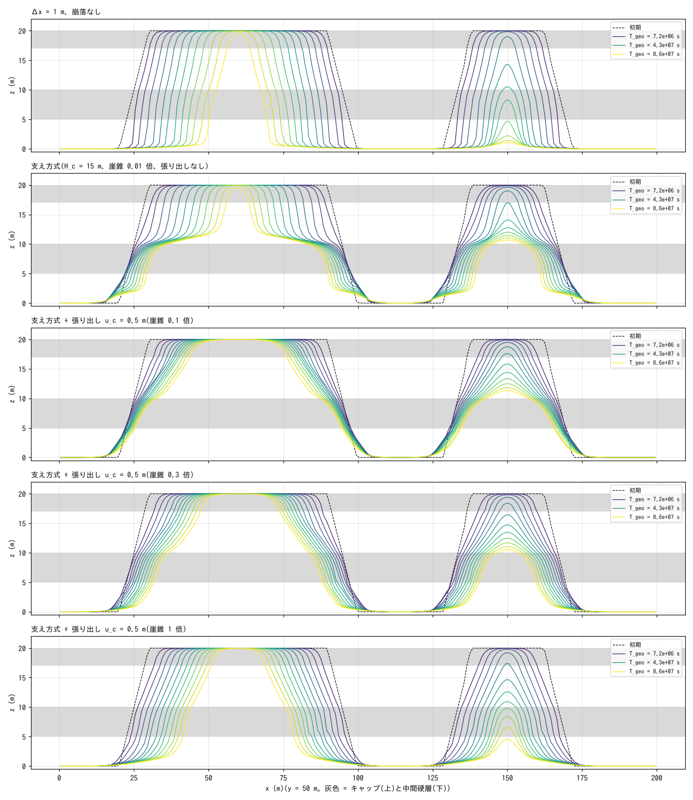

| ケース | 崖錐の侵食性 | 張り出しで落ちた柱 | 崩落で移した体積 (m³) | 崖錐の総量 (m³、最終) | 段の面積 (m²、4.3×10⁷ / 8.6×10⁷ s) | 縁の後退の速さ (m/s、R₀ = 30 / 12 m) |
|---|---|---|---|---|---|---|
| bench2(崩落なし) | – | – | – | – | 66 / 23 | 3.5×10⁻⁷ / 3.2×10⁻⁷ |
| face(張り出しなし) | 0.01 | – | 33388 | 2846 | 961 / 948 | 3.2×10⁻⁷ / 2.6×10⁻⁷ |
| uc | 0.1 | 8038 | 50051 | 846 | 310 / 628 | 1.6×10⁻⁷ / 2.5×10⁻⁷ |
| uc2 | 0.3 | 14222 | 65931 | 110 | 280 / 307 | 1.8×10⁻⁷ / 2.8×10⁻⁷ |
| uc3 | 1 | 17125 | 93083 | 17 | 160 / 122 | 2.4×10⁻⁷ / 3.2×10⁻⁷ |

- **縁の後退の速さが崖錐の侵食性に依存するようになります(崖錐律速)。** 大きい台地の縁は
  1.6 → 1.8 → 2.4×10⁻⁷ m/s(侵食性 0.1 → 0.3 → 1)で、崩落なし・張り出しなしの 3.2〜3.5×10⁻⁷
  より遅く、張り出しで落ちた柱の数(8000 → 17000)も崖錐の除去の速さで決まります。依存は比例
  より弱い(侵食性 10 倍で 1.5 倍)です。1 サイクルが「崖錐の除去 → 脚部の岩盤が u_c 削られる →
  柱が落ちる(約 150 更新)」の直列で、脚部の削り込みの時間(約 3000 更新)が崖錐の除去と並ぶ
  ためです。
- **ただし崖は垂直になりません。** 1 柱分の岩屑(約 17 m³/m)は帽岩の下の 45° の軟層の斜面に
  留まらず(安息角 35° より急)、段か平地まで流れ下るので、軟層の面は崖錐に支えられず、乾式侵食
  で 45° 前後に保たれます。断面は「帽岩の短い段 + 45° の軟層の斜面 + 硬い層の段 + 下の崖錐斜面」
  で、face(張り出しなし。上の崖が垂直)より緩く、段の面積も face の 1/3 です。張り出し量の帳簿は
  脚部の 1 セルで持つので、落ちるのは常に 1 柱で、面を覆うだけの岩屑が一度に出ないことが原因です。
- まとめ: 支え方式は「垂直な崖 + 段」、張り出しは「崖錐律速の後退」をそれぞれ与えますが、両方を
  同時には満たしません。

### 両立の案 1・2(設定だけで試す): 厚い帽岩、遅い崖錐の除去

案 1(uc_cap)は uc2(崖錐 0.3 倍)の層理を帽岩 7 m(z ≥ 13 m、倍率 0.05)+ 軟層 3 m に変え、
「垂直なのは帽岩の崖で、その下の軟層は岩屑の斜面」という実際のメサの形を狙います。案 2
(uc_slow)は uc(0.1 倍)の崖錐の侵食性を 0.03 倍に下げて計算を 2 倍(T_geo 1.7×10⁸ s)にし、
岩屑が脚部に溜まって軟層の面が支えられる状態が現れるかを見ます。

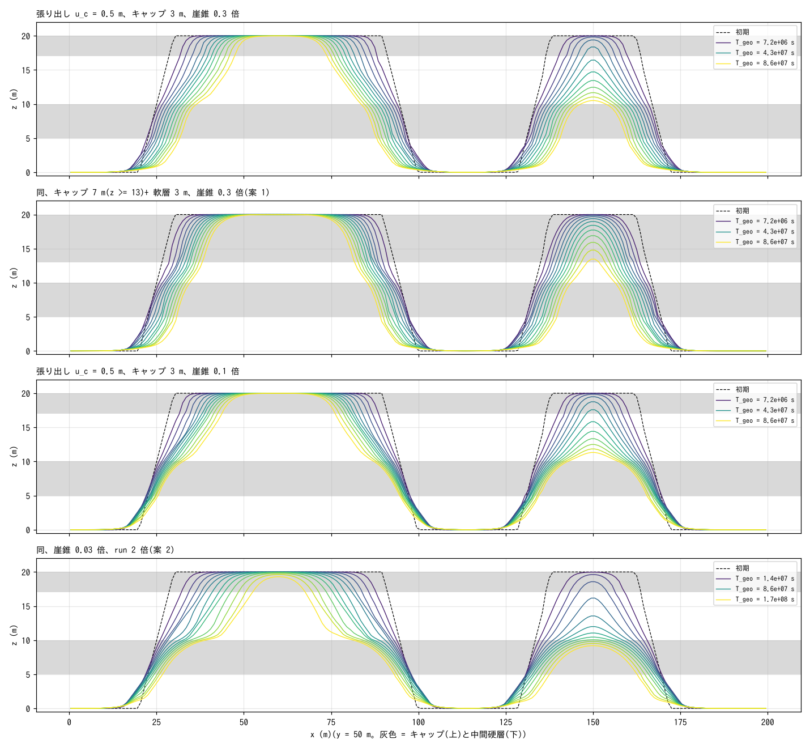

| ケース | 帽岩の厚さ | 崖錐の侵食性 | 張り出しで落ちた柱 | 崖錐の総量 (m³、最終) | 段の面積 (m²、最終) | 縁の後退の速さ (m/s、R₀ = 30 m) |
|---|---|---|---|---|---|---|
| uc2 | 3 m | 0.3 | 14222 | 110 | 307 | 1.8×10⁻⁷ |
| uc_cap(案 1) | 7 m | 0.3 | 15340 | 153 | 220 | 1.3×10⁻⁷ |
| uc | 3 m | 0.1 | 8038 | 846 | 628 | 1.6×10⁻⁷ |
| uc_slow(案 2) | 3 m | 0.03(計算 2 倍) | 8034 | 2035 | 899 | 1.3×10⁻⁷ |

- **どちらも崖は垂直になりません。** 案 1 では帽岩の崖(13 → 20 m)も水平 6〜7 m に広がった
  45° 前後の斜面で、張り出しで落ちた柱の残り(低い隣と同じ高さまで落ちる)が段々の斜路を作り、
  その上を帽岩の倍率 0.05 の乾式侵食が丸めます。縁の後退は 1.3×10⁻⁷ m/s と遅く(崖錐律速は
  保たれる)、段は 220 m² に減ります。
- 案 2 では崖錐が 2000 m³ 残りますが、台地の外周(平地)のリングに溜まるだけで、帽岩の直下の
  軟層の斜面(45°。安息角より急)には留まりません。軟層の面は支えられず、断面は uc と同じ
  35〜45° の斜面です。段の面積は 900 m² と face 並みに広がります(崖錐の除去が遅いぶん硬い層の
  上面の岩屑が残る)。
- 原因は規則の 2 点に帰着します。(i) 柱の崩落は「低い隣と同じ高さまで落ちる」ので、脚部が
  斜面の途中なら残りの岩盤が斜路の一段になる。(ii) 岩屑は安息角より急な面に留まれないので、
  1 柱分の岩屑では面を覆えず脚部まで流れ下る。設定だけでは解けません。

## このモデルで表せないこと(実際の現象との違い)

- **張り出し(オーバーハング)を持てない**: ラスタは各セルに標高を一つしか持たないので、帽岩の
  下の掘り込みや、張り出した帽岩そのものは表せません。主ケースの崖の後退は縁のセルの急な
  勾配による侵食で、後退の速さは層理の倍率と Δx に依存する校正量です。崩落は柱の高さの規則
  (補足 3)で近似します。
- **崩落の規則は近似**: 4 つの規則(段差・窓版・支え方式・張り出し)のどれも、「垂直な崖」と
  「崖錐律速の後退」を同時には満たしません(補足 3 のまとめ)。崖錐が急な面に付着して面を覆う
  ことや、面の高さ分の岩屑が一度に落ちることは表しません。
- **崖錐は主ケースでは裾のクリープの堆積だけ**: 主ケース(崩落なし)の崖錐は弱いクリープで裾に
  運ばれた土で、軟層を守る効果はありません。
- **凹地形増幅は段と崖の形を左右する**: 崖の基部(凹部)の増幅が崖を急に保つ一方で段を消すので、
  メサの段階は短く、「垂直な崖」と「幅のあるベンチ」は増幅の設定だけでは両立しません(補足 1・2)。
- **層理は水平だけ**: 傾いた層や断層・節理(ブロックの大きさ)は表せません。
- **係数と時間**: 乾式斜面侵食の係数・層理の倍率・崩落のパラメータは校正値ではありません。
  時間は相対比較に使ってください(深い段階の速さの格子依存は [badland](../badland/README.md) と
  同じ)。

## 注意

- **土層と基岩の扱い**: 台地全体を土層 100 m にして、岩の硬さは `spl_strata` の倍率で与えます
  (崩落 `f_rockfall` の既定 `rf_bedrock = 0` では、土層のない基岩は崩れない)。
- **H_c は格子に依存しうる**: 段差の規則の H_c はセル間の段差に対する閾値なので Δx に依存します
  (補足 3)。格子によらない形で使うには窓版(`rf_rc`)にします。
- **支え方式と張り出しの前提**: 支え方式(`rf_fface`)は窓版(`rf_rc > 0`)が前提で、張り出し
  (`rf_uc`)は支え方式と `spl_strata` が前提です。
- 収支: 表面流ゼロ、地下貯留 = 降雨の累計、地表の体積の減少 = 系外へ出た土砂 ÷ (1 − 0.4) は
  主ケースの両方で確かめられます(analysis.txt)。崩落は体積を保存します。
- 検証: [test/splashstrata](../../test/splashstrata/README.md)(層理の倍率)、
  [test/splashsat](../../test/splashsat/README.md)(増幅の飽和)、
  [test/rockfall](../../test/rockfall/README.md)(崩落と崖錐)。

## 感度実験の入口

- `spl_strata`: 帽岩の厚さと倍率(後退の速さ)、中間の硬い層の位置・厚さ・倍率(段)。
- `spl_cb`・`spl_ksat`: 崖の基部の増幅(崖の角度と段の幅のかね合い)。spl_cb を下げると縁の
  平滑な後退が長く見られます。
- `rf_hc`・`rf_rc`・`rf_ftalus`・`rf_fface`・`rf_uc`: 崩落の規則と崖錐の保護。
- make_terrain.py の `PLATEAUS`(台地の位置と半径)・`HP`(高さ)・`TANB`(縁の勾配)。

## 参考文献

- Glade, R. C., Anderson, R. S. and Tucker, G. E. (2017): Block-controlled hillslope form and
  persistence of topography in rocky landscapes. *Geology*, 45(4), 311–314.
  doi:10.1130/G38665.1(要旨で確認)
