# mesa — formation of mesas and buttes with a cap rock (parallel retreat of cliffs, benches, rockfall and talus)

> English mirror of examples/mesa/README.md. The Japanese file is the master copy.

[日本語](../README.md)

This example reproduces how a plateau in which a hard cap rock covers soft layers shrinks by
cliff retreat into a mesa → butte → pinnacle and disappears, with
[dry-slope erosion](../../../docs/en/users_guide/geomorph.md#dry-slope-erosion-f_splash)
(f_splash) and erodibility factors of horizontal strata (`spl_strata`). A plateau with a cap rock
is compared with a plateau without strata; the supplements compare whether a hard bed partway
down the cliff makes a step (bench), the saturation of the hollow amplification (`spl_ksat`), and
how the rules of rockfall and talus
([f_rockfall](../../../docs/en/users_guide/geomorph.md#rockfall-and-talus-f_rockfall)) change the
shape and retreat of the cliffs. The values are schematic, chosen to make the phenomena visible,
and do not reproduce a particular landform. The figures of the results have Japanese labels
(shared with the Japanese version).

The erosion law of dry-slope erosion is an **original formulation** by the ENCflow developer and
has not been published as a paper (see "Mechanisms needed for the reproduction" in
[badland](../../badland/en/README.md)).

## What happens in real mesas and buttes

- **The cap rock protects a flat top**: on a plateau where a hard bed among horizontal strata
  (sandstone, conglomerate, lava and the like) covers soft beds (mudstone, shale and the like),
  the hard bed protects the top from erosion, and a flat top with steep cliffs forms (the mesas
  and buttes of Monument Valley on the Colorado Plateau, USA, are typical).
- **The cliffs retreat while staying steep**: the soft bed below the cliff erodes faster and
  undercuts the cap rock, and the cap rock, having lost its support, cracks and falls. Repeating
  this, the cliff retreats while keeping its steep form (parallel retreat).
- **Plateau → mesa → butte → pinnacle**: the plateau shrinks by cliff retreat into a mesa (wider
  than tall), a butte (narrower than tall) and a thin pinnacle, and disappears once it loses its
  cap rock.
- **Talus protects the foot**: the fallen debris forms talus at the foot of the cliff and covers
  the soft slope below. Blocks fallen from the cap rock govern the form of the slope and how long
  the landform survives (Glade et al. 2017).
- **Steps (benches)**: a hard bed partway down the cliff makes a flat step on its top, and the cliff
  becomes two-tiered.

## Mechanisms needed for the reproduction

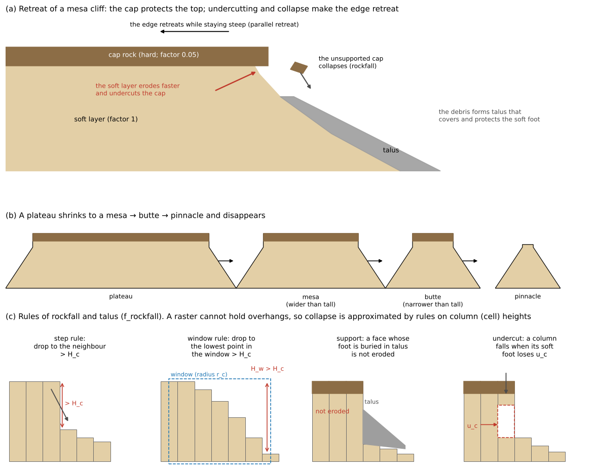

Schematic. (a) Retreat of a mesa cliff: the cap rock protects the flat top, the soft bed erodes
faster and undercuts the cap rock, and the cap rock, having lost its support, falls. The debris
forms talus that covers the foot. (b) A plateau shrinks to a mesa → butte → pinnacle and
disappears. (c) Rules of rockfall and talus: a raster (grid) cannot hold overhangs, so collapse is
approximated by rules on the heights of columns (cells) (from the left: drop to the neighbouring
cell, drop to the lowest point within a window, protection of a face whose foot is covered by
talus, undercutting of a soft foot).

| Real phenomenon | Mechanism in the model | Setting |
|---|---|---|
| A hard cap rock covers soft beds | Erodibility factors of horizontal strata (cap 0.05, soft beds 1). The bed is set by the elevation, and the bed below is exposed as the surface erodes | `spl_strata` |
| The cliff edge erodes and retreats | Dry-slope erosion. The edge cells face a steep cliff, so the slope S is large and they erode even with a factor of 0.05 | `f_splash`, `spl_*` |
| The foot of the cliff (a hollow) erodes faster | Hollow amplification $`1 + c_b\kappa`$; to bound it, saturate it with an effective curvature | `spl_cb`, `spl_ksat` |
| A hard bed partway down the cliff makes a step | Factor of the intermediate hard bed | `spl_strata` |
| The cap rock falls and the debris becomes talus protecting the foot | Rockfall and talus: drops exceeding the critical height H_c collapse and accumulate as talus (thickness ht). Dry erosion on cells covered by talus is multiplied by rf_ftalus | `f_rockfall`, `rf_hc`, `rf_rc`, `rf_phi`, `rf_ftalus` |
| A face whose foot is covered by talus is not eroded | Support scheme | `rf_fface` |
| A soft foot is undercut and the cap rock falls | Collapse by undercutting: a column falls when its foot, softer than the column, loses u_c | `rf_uc` |
| Soil movement at the foot | Weak creep (linear diffusion) | `f_creep`, `creep_d = 3×10⁻⁷` |
| No overland flow occurs | All infiltrates (Green-Ampt 36 mm/h > rain 10 mm/h) | `f_gwvertical = 2` |

A raster cannot hold overhangs, so in the main case the cliff retreat is represented by "edge cells
eroding with a steep slope (S ≈ cliff height / Δx)", not by the mechanics of a collapsing cap rock.
Supplement 3, which adds rockfall and talus, approximates collapse by rules on the heights of
columns (cells) and compares how the rules change the shape of the cliffs and what controls their
retreat.

## Geometry and settings

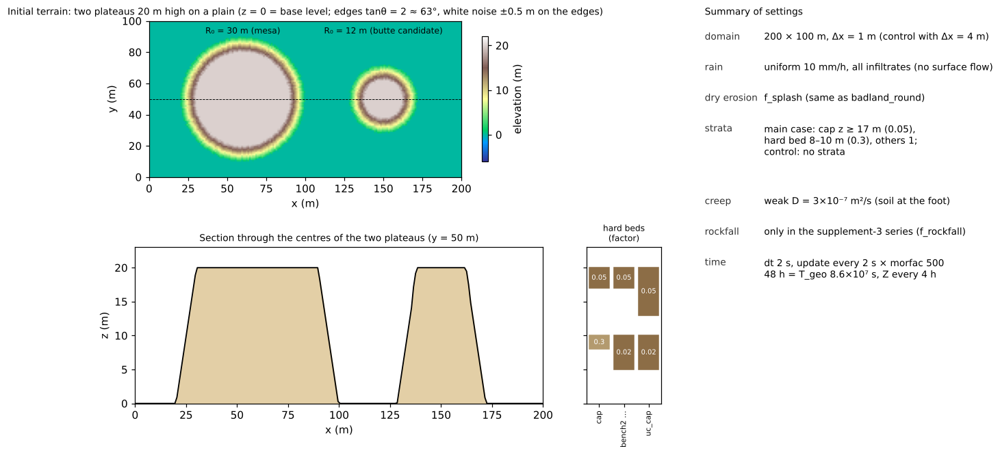

Upper left: initial terrain (dashed = position of the section). Lower left: section through the
centres of the two plateaus. Middle: positions and factors of the hard beds (main case cap,
bench2 used by most supplements, uc_cap). Right: summary of the settings.

200 m × 100 m, Δx = 1 m (200 × 100 cells). Two plateaus 20 m high stand on a plain (z = 0 = base
level of erosion): a mesa of radius 30 m and a butte candidate of radius 12 m (edges tanθ = 2 ≈ 63°,
white noise ±0.5 m on the edge positions, fixed seed).

- **Strata (main case)**: the top 3 m (z ≥ 17 m) is the cap rock (factor 0.05), an intermediate
  hard bed lies at z = 8 to 10 m (factor 0.3), and the rest is soft (factor 1). The control has no
  strata. The soil is 100 m thick over the whole plateau (the hardness of the rock is given by the
  strata factors).
- **Rain and infiltration**: uniform 10 mm/h, all infiltrates (no surface flow).
- **Dry-slope erosion**: the same coefficients as badland_round ($`k_r`$ = 2×10⁻⁴, $`k_t`$ = 0.05,
  $`h`$ = 1.5, $`c_b`$ = 32 m, ℓ = 2 m). Weak creep D = 3×10⁻⁷ m²/s is added (soil movement at the
  foot).
- **Time**: dt = 2 s; the landform is updated every 2 s with morfac = 500. 48 hours = T_geo
  8.6×10⁷ s. Z is written every 4 hours (T_geo 7.2×10⁶ s). About 8 minutes per case (about 30
  seconds for Δx = 4 m).

| Series | Cases (param_<name>.txt) | Content |
|---|---|---|
| Main case | cap / nocap | with cap rock (top 3 m factor 0.05, z = 8–10 m factor 0.3) / no strata |
| Supplement 1: intermediate hard bed | bench / bench2 / bench3 | intermediate hard bed z = 6–10 m, factor 0.05 / z = 5–10 m, factor 0.02 / bench2 without hollow amplification (spl_cb = 0) |
| Supplement 2: saturation of amplification | sat2 / sat | bench2 with spl_ksat = 0.2 / 0.05 (amplification capped at 7.4× / 2.6×) |
| Supplement 3: collapse (step rule) | rock2 / rock4 / rock3 / rock5, rock | bench2 with collapse (drop to the neighbouring cell > H_c = 4 m). Talus erodibility 0.1 / 0.02 / 0.02 + κ_s 0.2 / 0.005 + κ_s 0.2; rock is 0.3 |
| Supplement 3: Δx = 4 m | dx4 / dx4_rock / dx4_rock2 | the terrain of bench2 with Δx = 4 m. No collapse / H_c = 6 m, talus 0.1 / 0.01 |
| Supplement 3: window version | rc / rc2, dx4_rc / dx4_rc2 | drop to the lowest point within a window (radius r_c = 8 m) > H_c = 15 m. Talus 0.1 / 0.01 + κ_s 0.2 (Δx = 1 m / 4 m) |
| Supplement 3: support scheme | face / face2 / face3, face4 / face5 | rc2 with the support scheme (rf_fface = 0). Talus 0.01 / 0.1 / 0.3; face4 and face5 have H_c = 8 m, talus 0.01 / 0.1 |
| Supplement 3: undercutting | uc / uc2 / uc3 | face with undercutting u_c = 0.5 m. Talus 0.1 / 0.3 / 1 |
| Supplement 3: options for both | uc_cap / uc_slow | cap rock of uc2 made 7 m (z ≥ 13 m) / talus of uc at 0.03× and the run doubled (T_geo 1.7×10⁸ s) |

## How to run

```
cd examples/mesa
make                                         # link to the executable and inputs (make_terrain.py writes z.txt)
make run                                     # main cases cap and nocap (8 min each)
python3 plot_setup.py                        # figs/mechanism.png, setup.png (does not use the results)
python3 plot_results.py | tee analysis.txt   # figs/maps.png, sections.png, series.png and the tables
make bench                                   # supplement 1 (bench, bench2, bench3)
python3 plot_results.py bench                # figs/*_bench.png (also uses cap)
make sat                                     # supplement 2 (sat, sat2; also uses bench2 and bench3)
python3 plot_results.py sat                  # figs/*_sat.png
make rock                                    # supplement 3, step rule (rock to rock5)
python3 plot_results.py rock                 # figs/*_rock.png (the rock4 figures: python3 plot_results.py rock4)
make dx4                                     # supplement 3, Δx = 4 m (5 cases using z_dx4.txt; 30 s each)
python3 plot_results.py dx4                  # figs/*_dx4.png (window version: python3 plot_results.py dx4rc)
make rc                                      # supplement 3, window version (rc, rc2)
python3 plot_results.py rc                   # figs/*_rc.png
make face                                    # supplement 3, support scheme (face to face5)
python3 plot_results.py face                 # figs/*_face.png (H_c = 8 m: python3 plot_results.py face8)
make uc                                      # supplement 3, undercutting and the options (uc to uc3, uc_cap; uc_slow about 16 min)
python3 plot_results.py uc                   # figs/*_uc.png (the options: python3 plot_results.py ucx)
```

The cases used for comparison in the figures (bench2, rc2, face and so on) are computed by the
targets before each series. With the argument `en` the figures are drawn with English labels into
en/figs/ (`python3 plot_setup.py en`, `python3 plot_results.py [series] en`).

## Results

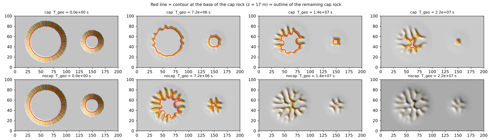

Top: with cap rock, bottom: no strata. Shaded relief at T_geo = 0, 7.2×10⁶, 1.4×10⁷, 2.2×10⁷ s
(red line = contour z = 17 m at the base of the cap rock = outline of where the cap rock remains).

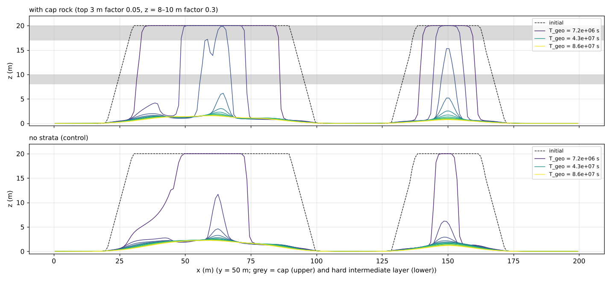

Evolution of the section through the centres of the two plateaus (y = 50 m) (grey bands = cap rock
and intermediate hard bed).

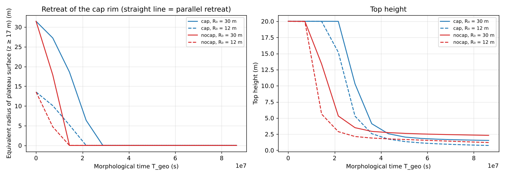

Left: equivalent radius √(A/π) of the plateau surface (z ≥ 17 m) (a straight line = parallel
retreat). Right: height of the top.

Budget check: no surface flow, groundwater storage 0.48 m = cumulative rain, loss of surface
volume = sediment that left the domain ÷ 0.6 (both cases).

| Time T_geo (s) | 0 | 7.2×10⁶ | 1.4×10⁷ | 2.2×10⁷ | 2.9×10⁷ |
|---|---|---|---|---|---|
| With cap R₀ = 30 m: equivalent radius of the plateau surface (z ≥ 17 m) (m) / height of the top (m) | 31.5 / 20 | 27.2 / 20 | 18.4 / 20 | 5.6 / 20 | 0 / 9.8 |
| With cap R₀ = 12 m | 13.6 / 20 | 10.1 / 20 | 5.2 / 20 | 0 / 15.5 | 0 / 5.2 |
| No strata R₀ = 30 m | 31.5 / 20 | 18.1 / 20 | 0 / 11.7 | 0 / 4.6 | 0 / 3.3 |
| No strata R₀ = 12 m | 13.6 / 20 | 5.8 / 20 | 0 / 6.2 | 0 / 2.9 | 0 / 2.2 |

- **With cap rock**: the plateau surface stays flat at 20 m, and the edge retreats as a nearly
  vertical cliff (a mesa). The small plateau becomes an isolated hill (butte) of radius 5 m at
  1.4×10⁷ s, loses its cap rock at 2.2×10⁷ s, becomes a pinnacle and disappears. On the large
  plateau, after 1.4×10⁷ s the edge is cut into amphitheatres by the hollow feedback, and by
  2.2×10⁷ s the remnant of the cap rock is dissected into finger-like ridges. The initial rate of
  retreat is 4 to 5 m / 7.2×10⁶ s (≈ 6×10⁻⁷ m/s; S^1.5 erosion of the edge cells × factor 0.05).
- **No strata**: by 7.2×10⁶ s the edge is already deeply cut into a star shape, and neither a flat
  top nor vertical cliffs are kept. By 1.4×10⁷ s the plateau surface has disappeared, dissected
  into radial ridges.
- The intermediate hard bed (z = 8 to 10 m, factor 0.3) does not become a step (the soft beds go
  down to the base level at once, so a bed 2 m thick with a factor of 0.3 does not remain within
  the cliff). Supplement 1 is the contrast with a thicker, harder bed.

## Supplement 1: does a bench appear with a thicker, harder intermediate bed?

| Case | Intermediate hard bed | spl_cb | Retreat rate of the large plateau (R₀ = 30 m) (m/s) | Height of the top of the large plateau (m) (T_geo 4.3×10⁷ s) |
|---|---|---|---|---|
| cap | z = 8–10 m, factor 0.3 | 32 | 1.2×10⁻⁶ (accelerating; dissected at 2.2×10⁷ s) | 2.5 |
| bench | z = 6–10 m, factor 0.05 | 32 | 5.3×10⁻⁷ (linear) | 20 |
| bench2 | z = 5–10 m, factor 0.02 | 32 | 3.5×10⁻⁷ (linear) | 20 |
| bench3 | z = 5–10 m, factor 0.02 | 0 | 1.9×10⁻⁷ (linear) | 20 |

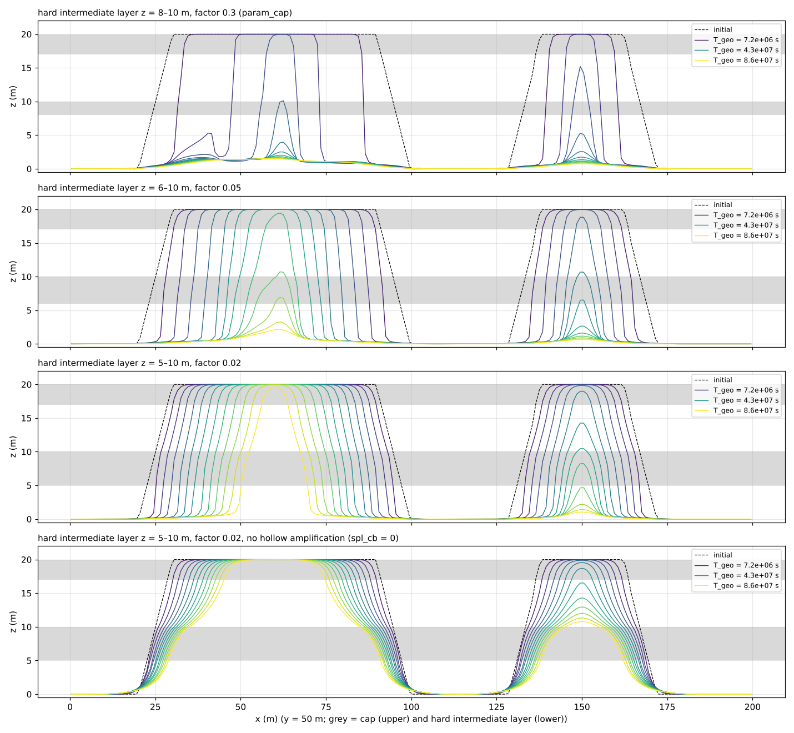

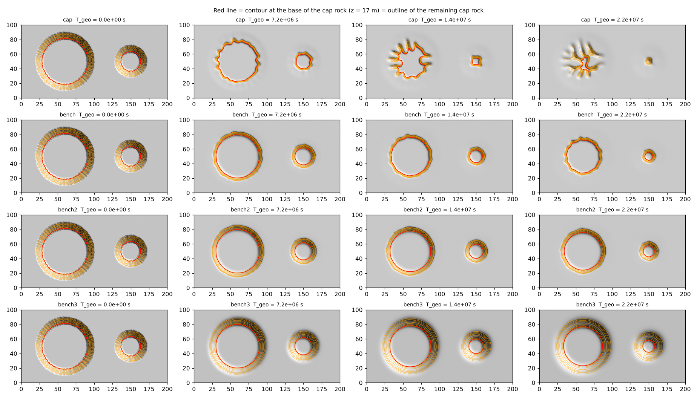

Radial width (m) occupied by each elevation band on the azimuthally averaged profile (large
plateau) (T_geo = 4.3×10⁷ s):

| Case | Cap 17–20 | Soft 10.5–17 | Top of hard bed 9.5–10.5 | Hard bed 5–9.5 | Foot 1–5 |
|---|---|---|---|---|---|
| bench | 9 | 2 | 0 | 2 | 4 |
| bench2 | 18 | 2 | 0 | 1 | 2 |
| bench3 | 22 | 7 | 1 | 4 | 5 |

- **A thick, hard intermediate bed alone does not give a wide bench** (bench, bench2). The top of
  the hard bed appears only as a one-cell step (shoulder), and the cliff remains a single steep
  scarp from 20 m to 0 m over a horizontal distance of 4 to 5 m. The cause is the hollow
  amplification (spl_cb = 32): the foot of the upper cliff = the top of the hard bed is a hollow
  (κ > 0), so the edge of the hard bed is eroded by the amplification (κ ≈ S/ℓ makes 1 + c_b κ
  exceed 100), and the step disappears as soon as it forms. The convex edge of the cap rock is not
  amplified, so the upper and lower cliffs retreat at almost the same rate and the width of the
  step does not grow.
- However, the intermediate hard bed **makes the mesa last longer**. The soft bed goes down only
  from just below the cap rock to the top of the hard bed, so the drop at the edge of the cap rock
  falls from 20 m to 10 m, the S^1.5 erosion of the edge cells decreases, and the retreat becomes
  linear and 2 to 3 times slower; the amphitheatre-like notches of the edge (cap at 1.4×10⁷ s) do
  not occur either. At 4.3×10⁷ s the large plateau still keeps a flat top (20 m; cap: 2.5 m), and by
  then the small plateau has gone from a butte to a pinnacle.
- **Switching off the hollow amplification (bench3, spl_cb = 0) gives a bench**. A shoulder several
  metres wide runs all around at the top of the hard bed, z ≈ 10 m (the band of the hard bed 5 to
  9.5 m is 4 m wide, the soft band 10.5 to 17 m is 7 m), and in plan view the contours split into two
  bundles: a two-tiered mesa (upper cliff + shoulder + lower slope). In exchange, the cliff relaxes
  to a slope of about 45° (without amplification a steep scarp is smoothed by S^1.5) and is no longer
  a vertical wall. "Vertical cliffs" and "a wide bench" cannot both be had just by switching the
  amplification (spl_cb) on or off.

## Supplement 2: do vertical cliffs and a bench coexist with saturated amplification (spl_ksat)?

`spl_ksat`, which replaces κ in the hollow amplification $`1 + c_b\kappa`$ by the effective curvature
$`\tilde\kappa = \kappa/(1 + \kappa/\kappa_s)`$, is added to the bench2 set-up, capping the
amplification at 2.6 times (κ_s = 0.05) and 7.4 times (κ_s = 0.2) (over 100 times without
saturation; no amplification = bench3).

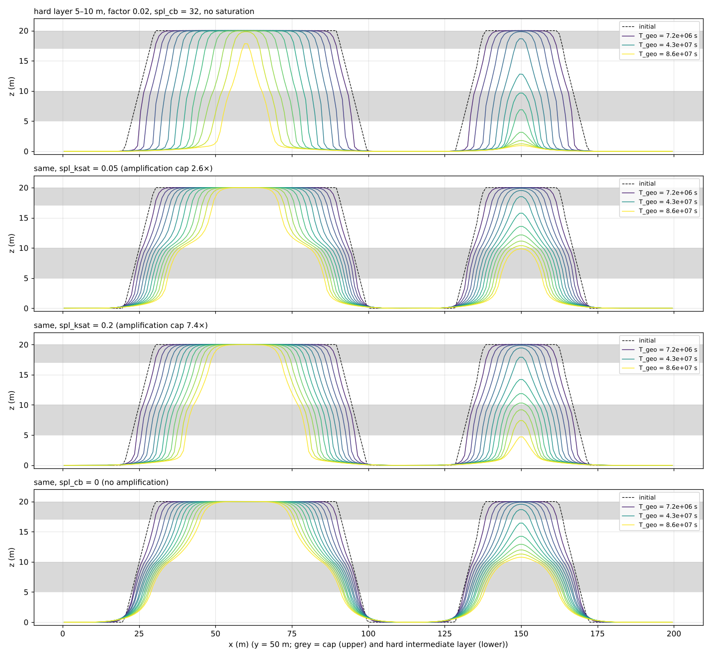

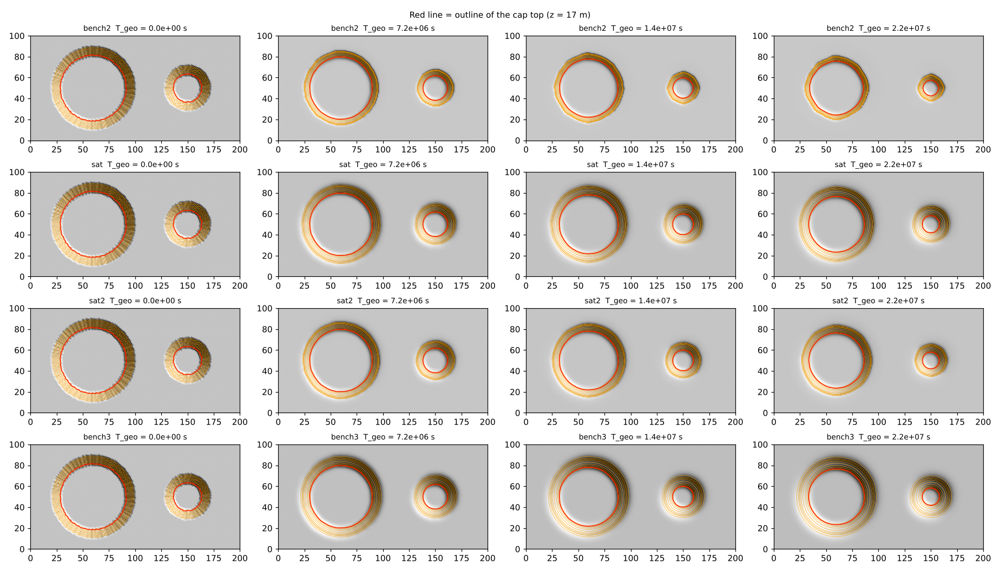

| Case | Cap on amplification | Area within ±0.5 m of the top of the hard bed (m²) (T_geo 4.3×10⁷ / 8.6×10⁷ s) | Mean angle of the upper cliff (1.4×10⁷ / 4.3×10⁷ / 6.5×10⁷ s) | Retreat rate of the large plateau (m/s) |
|---|---|---|---|---|
| bench2 (no saturation) | 161 | 66 / 23 | 73° / 73° / 73° | 3.5×10⁻⁷ |
| sat2 (κ_s = 0.2) | 7.4 | 148 / 114 | 58° / 58° / 52° | 2.3×10⁻⁷ |
| sat (κ_s = 0.05) | 2.6 | 269 / 351 | 58° / 52° / 43° | 2.3×10⁻⁷ |
| bench3 (no amplification) | 1 | 312 / 415 | 58° / 43° / 43° | 1.9×10⁻⁷ |

(Angle of the upper cliff = drop of 6.5 m of the soft bed 10.5 to 17 m ÷ horizontal width on the
azimuthally averaged profile.)

- **With saturation a step remains**. With κ_s = 0.05 a shoulder 2 to 4 m wide runs all around at the
  top of the hard bed, z ≈ 10 m, making a two-tiered mesa (the step area is 80 % of that without
  amplification); with κ_s = 0.2 the shoulder is narrow, 1 to 2 m. The width of the step can be
  controlled continuously by the cap on the factor.
- **The cliff angle eases by that much**. Against 73° without saturation, the angle is 58° (52°
  later) for κ_s = 0.2, 58° → 43° for κ_s = 0.05 and 43° without amplification. In this erosion law,
  the amplification at the foot of the cliff (a hollow) is also the mechanism that keeps the cliff
  steep (erosion of the foot = in place of undercutting), so suppressing the amplification leaves a
  step but relaxes the cliff.
- **How far they coexist**: κ_s = 0.2 gives "a cliff of about 60° + a step of 1 to 2 m" and κ_s =
  0.05 gives "a cliff of about 50° + a step of 2 to 4 m" at the same time; κ_s connects continuously
  between no saturation (73°, no step) and no amplification (43°, a wide step). The vertical cliffs
  of real mesas are kept by undercutting of the soft bed and collapse of the cap rock (supply of
  debris and protection by talus), so "vertical cliffs + a wide bench" need a mechanism of cliff
  collapse besides the amplification (supplement 3).

## Supplement 3: adding rockfall and talus (f_rockfall)

Collapse of the cap rock and protection by talus are added with `f_rockfall`. The part of a drop
exceeding the critical height H_c is moved from the higher to the lower side (volume conserved),
the moved part is stacked as talus of thickness ht (output Ht), and dry erosion on cells covered by
talus is reduced to rf_ftalus times ("talus erodibility" below). Talus spreads at an angle of repose
of 35°.

### Step rule (Δx = 1 m; the cliff is a slope 4 to 5 cells wide)

Four cases adding to the bench2 set-up (hard bed 5 to 10 m, factor 0.02, spl_cb = 32) a rule that
collapses the part of the step to the neighbouring cell exceeding H_c = 4 m (the 3 to 4 m steps at
the edge are the target; with H_c = 18 m or 6 m the steps do not reach it and nothing collapses).

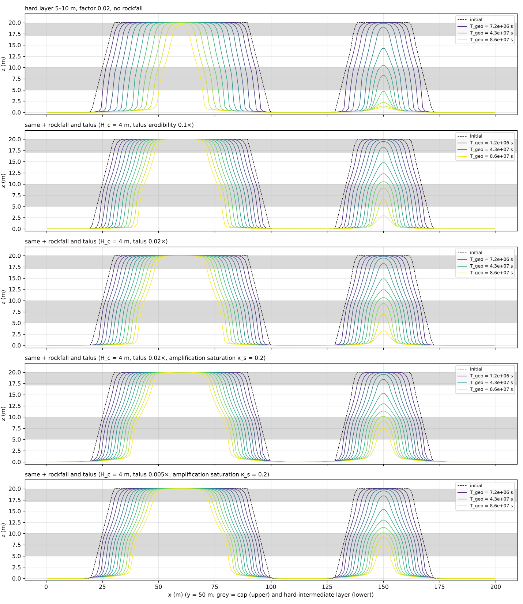

| Case | Talus erodibility | κ_s | Volume moved by collapse (cumulative m³) | Total talus (m³) | Angle of the upper cliff (1.4×10⁷ / 4.3×10⁷ / 6.5×10⁷ s) | Retreat rate of the large plateau (m/s) |
|---|---|---|---|---|---|---|
| bench2 (no collapse) | – | – | – | – | 73° / 73° / 73° | 3.5×10⁻⁷ |
| rock2 | 0.1 | – | 1314 | 2 | 58° / 58° / 52° | 2.2×10⁻⁷ |
| rock4 | 0.02 | – | 1285 | 4 | 58° / 58° / 52° | 2.2×10⁻⁷ |
| rock3 | 0.02 | 0.2 | 184 | 5 | 58° / 52° / 47° | 2.1×10⁻⁷ |
| rock5 | 0.005 | 0.2 | 99 | 6 | 58° / 52° / 47° | 2.2×10⁻⁷ |

- **With Δx = 1 m collapse has almost no effect.** On a raster the 20 m cliff is a slope 4 to 5 cells
  wide at 58 to 73°; collapse (step > H_c) occurs only at the steepest 1 or 2 cells, and the talus
  protects only the one cell of the foot where it lands. The retreat of the cliff continues to be
  carried by dry erosion (S^1.5) of the face cells not covered by talus, so lowering the talus
  erodibility from 0.1 to 0.005 does not change the retreat rate (2.2×10⁻⁷ m/s), and the total talus
  always stays at a few m³. The form is almost the same as the saturated-amplification case (sat2)
  (58° cliff + 1 to 2 m step); collapse makes the cliff gentler than bench2 and the plateau lasts
  longer.
- rock, with talus erodibility 0.3, is only drawn in figures side by side with rock2
  (`python3 plot_results.py rock4`).

### Coarsening the grid (Δx = 4 m; the cliff is a step of 1 or 2 cells)

The same terrain with Δx = 4 m (8 m steps at the edge), H_c = 6 m and talus erodibility 0.1 / 0.01.

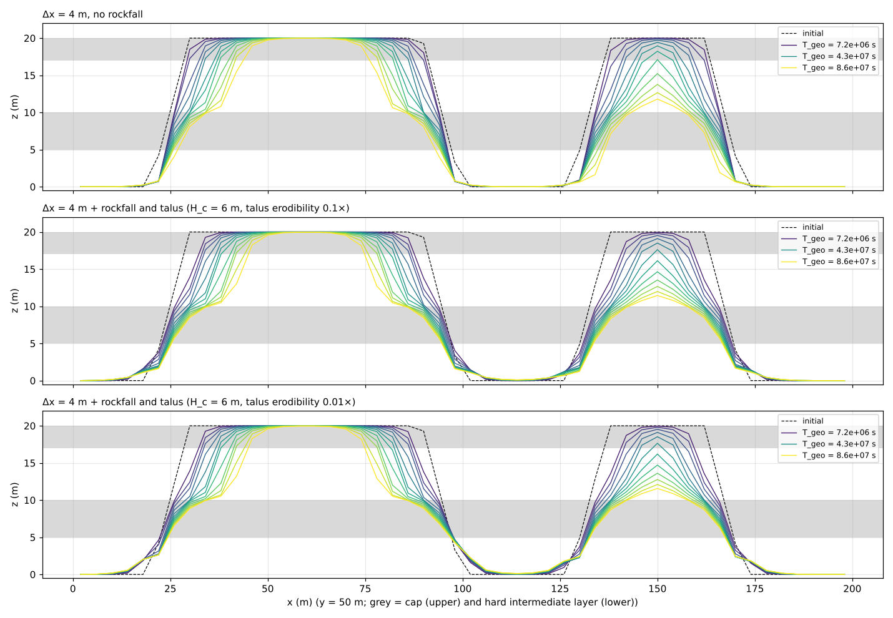

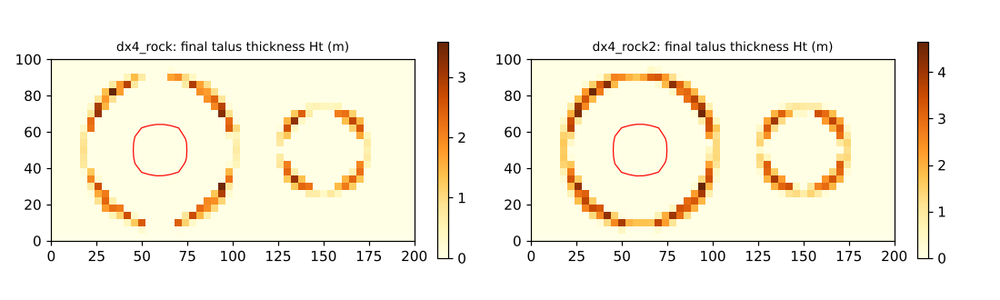

| Case | Talus erodibility | Volume moved by collapse (m³) | Total talus (m³) (1.4×10⁷ → 8.6×10⁷ s) | Angle of the lower cliff (1.4×10⁷ / 4.3×10⁷ / 6.5×10⁷ s) | Retreat rate (m/s) |
|---|---|---|---|---|---|
| dx4 (no collapse) | – | – | – | 65° / 60° / 47° | 1.8×10⁻⁷ |
| dx4_rock | 0.1 | 14469 | 5645 → 3373 | 38° / 33° / 30° | 1.7×10⁻⁷ |
| dx4_rock2 | 0.01 | 14487 | 6577 → 6286 | 38° / 31° / 30° | 1.7×10⁻⁷ |

- **When the cliff becomes a step of the grid, collapse and talus change the form.** The debris
  falling as the edge steps collapse forms a ring of talus 2 to 4 m thick around both plateaus, and
  the lower slope is replaced by a talus slope at the angle of repose (30 to 38°). With a talus
  erodibility of 0.01 the talus hardly decreases (6577 → 6286 m³), a state limited by the talus. The
  retreat rate of the upper cliff (edge of the cap rock) is the same as without collapse
  (1.7×10⁻⁷ m/s), and the retreat is still carried by dry erosion of the edge.
- Putting the two grid spacings together: the step rule, "step to the neighbouring cell > H_c", is a
  rule between cells, so it does not act on a fine grid where the cliff spans many cells, and talus
  accumulates only on a coarse grid where the cliff is a step of 1 or 2 cells (Δx ≳ cliff height /
  4). H_c becomes a calibration quantity depending on Δx, and the window version below removes this
  grid dependence.

### Making the critical height independent of the grid spacing (window version rf_rc)

A rule that measures the height of a free face as "the drop H_w to the lowest point within a window
of radius r_c" (`rf_rc`) and moves the excess of H_w > H_c across edges steeper than the angle of
repose of talus. H_c = 15 m and r_c = 8 m are given for both Δx = 1 m and 4 m, with talus
erodibility 0.1 and 0.01 (+ κ_s = 0.2).

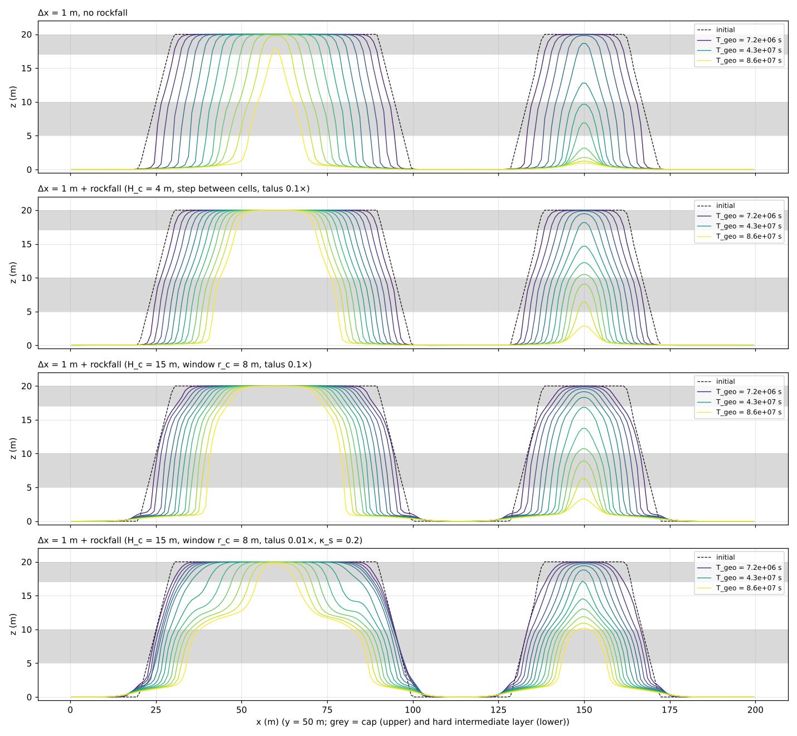

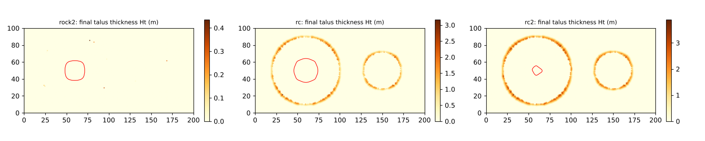

| Grid | Case | Collapse rule | Talus erodibility | Volume moved by collapse (m³) | Total talus (m³, final) | Angle of the lower cliff (1.4×10⁷ / 4.3×10⁷ / 6.5×10⁷ s) | Retreat rate (m/s) |
|---|---|---|---|---|---|---|---|
| Δx = 1 m | bench2 | none | – | – | – | 77° / 71° / 65° | 3.5×10⁻⁷ |
| Δx = 1 m | rock2 | step > 4 m | 0.1 | 1314 | 2 | 71° / 65° / 60° | 2.2×10⁻⁷ |
| Δx = 1 m | rc | window 8 m, H_w > 15 m | 0.1 | 47120 | 1309 | 47° / 43° / 71°* | 1.9×10⁻⁷ |
| Δx = 1 m | rc2 | same | 0.01, κ_s 0.2 | 24123 | 2143 | 47° / 38° / 31° | 3.2×10⁻⁷ |
| Δx = 4 m | dx4 | none | – | – | – | 65° / 60° / 47° | 1.8×10⁻⁷ |
| Δx = 4 m | dx4_rc | window 8 m, H_w > 15 m | 0.1 | 7151 | 626 | 43° / 38° / 31° | 1.8×10⁻⁷ |
| Δx = 4 m | dx4_rc2 | same | 0.01, κ_s 0.2 | 6812 | 2240 | 43° / 35° / 30° | 1.7×10⁻⁷ |

(* The value of rc at 6.5×10⁷ s is taken where the talus band has left the averaging interval.)

- **With the window version, collapse and talus act even with Δx = 1 m.** The whole cliff face
  (cells steeper than the angle of repose whose drop within the window exceeds 15 m) becomes a target
  of collapse, and talus accumulates as a ring 1 to 3 m thick around the plateaus (1300 to 2100 m³;
  2 m³ with the step rule). The lower slope is replaced by a talus slope of 30 to 40°, the same type as
  the result with Δx = 4 m (lower cliff 30 to 38° on both grids, retreat of the cap edge 1.7 to
  1.9×10⁻⁷ m/s). The total talus is also of the same size on both grids (with talus erodibility 0.1 /
  0.01: 626 / 2240 m³ for Δx = 4 m and 1309 / 2143 m³ for Δx = 1 m), but on the coarse grid the talus
  band is resolved by only 1 or 2 cells.
- Strengthening the protection by talus (rc2: 0.01 times + κ_s) increases the total talus, but
  collapse keeps relaxing the face to the angle of repose, so the plateau approaches a cone covered by
  talus of 27 to 31° up to the upper cliff, and the cap surface shrinks rather faster (3.2×10⁻⁷ m/s).
  As long as the rule is "faces steeper than the angle of repose collapse", collapse plus protection
  alone cannot give vertical cliffs. Keeping vertical cliffs while the talus controls the retreat
  needs another rule that makes the erosion of the cliff face wait for the removal of talus (the
  support scheme below).

### Making the erosion of the cliff face wait for the removal of talus (support scheme rf_fface)

The support scheme `rf_fface = 0` is added to the rc2 set-up (H_c = 15 m, r_c = 8 m, κ_s = 0.2): cells
whose drop steeper than the angle of repose ends at a foot covered by talus are not eroded by dry
erosion, and collapse becomes column collapse, "the column at the top of the face falls to the height
of its lower neighbour" (a column whose foot is a collapsing column waits, so the face retreats one
column at a time). Talus erodibility 0.01 / 0.1 / 0.3 (face / face2 / face3) shows whether the retreat
rate is controlled by the removal of talus. In addition, H_c = 8 m (face4 / face5; the 10 m upper cliff
above the step is also a target of column collapse) is compared.

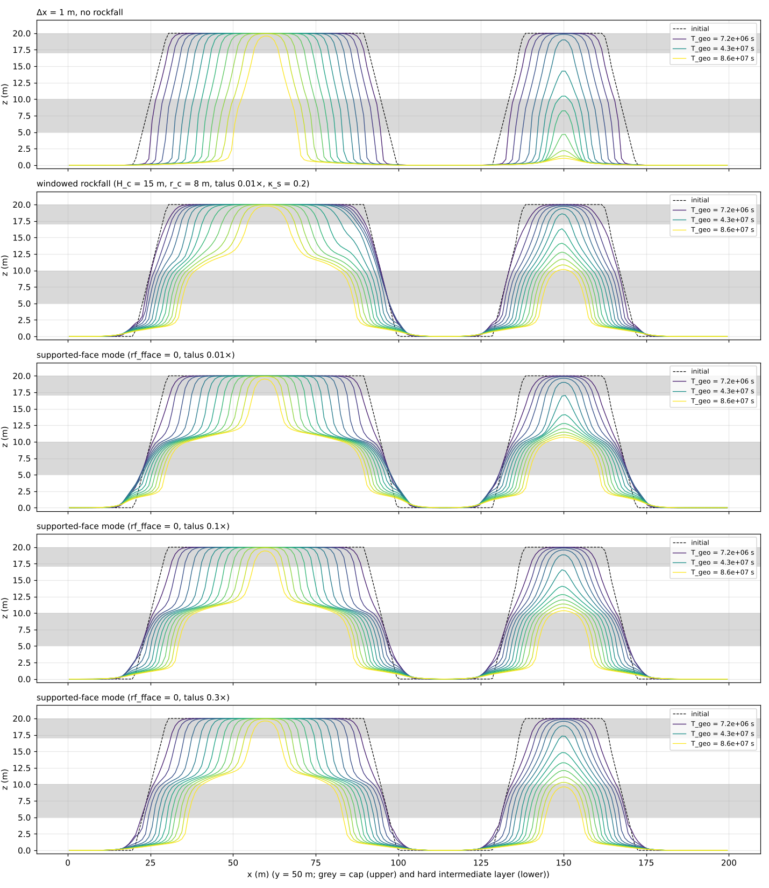

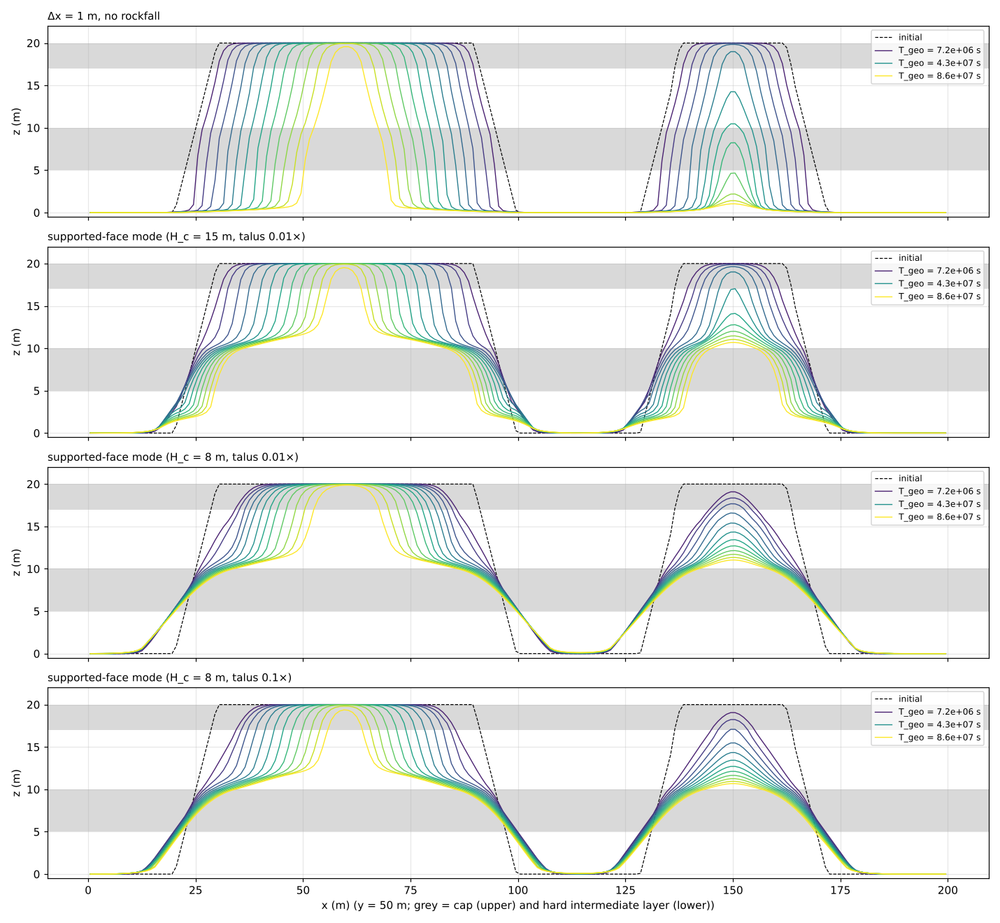

| Case | H_c | Talus erodibility | Volume moved by collapse (m³) | Total talus (m³, final) | Area of the step (top of hard bed ±0.5 m) (m², 4.3×10⁷ / 8.6×10⁷ s) | Retreat rate of the edge (m/s) |
|---|---|---|---|---|---|---|
| bench2 (no collapse) | – | – | – | – | 66 / 23 | 3.5×10⁻⁷ |
| rc2 (window version) | 15 | 0.01 | 24123 | 2143 | 454 / 448 | 3.2×10⁻⁷ |
| face | 15 | 0.01 | 33388 | 2846 | 961 / 948 | 3.2×10⁻⁷ |
| face2 | 15 | 0.1 | 33063 | 1041 | 894 / 683 | 3.1×10⁻⁷ |
| face3 | 15 | 0.3 | 32433 | 97 | 605 / 372 | 3.1×10⁻⁷ |
| face4 | 8 | 0.01 | 152774 | 12261 | 657 / 1029 | 2.5×10⁻⁷ |
| face5 | 8 | 0.1 | 153263 | 7413 | 754 / 942 | 2.9×10⁻⁷ |

- **A vertical upper cliff and a wide step coexist (H_c = 15 m).** In the section (y = 50 m), the drop
  of 8 to 9 m from the cap rock to the top of the hard bed (z ≈ 11 to 12 m) fits within a horizontal
  2 to 4 m (a gentle slope of 14 m in rc2) and retreats in parallel. The step area is twice that of
  rc2 and 15 to 40 times that without collapse (4.3×10⁷ / 8.6×10⁷ s), surrounding the plateau as a
  surface of debris on the top of the hard bed (the azimuthally averaged "angle of the upper cliff"
  averages the step and the edge and comes out at 30 to 50°, but in the section the edge of the step
  is vertical). The lower cliff (below the hard bed) is a talus slope of 30 to 35°, the same as with
  the window version.
- **However, the retreat of the edge is not controlled by the talus.** Raising the talus erodibility
  from 0.01 to 0.3 leaves the retreat rate of the edge at 3.1 to 3.2×10⁻⁷ m/s (almost the same as
  3.5×10⁻⁷ without collapse); only the total talus falls, 2846 → 97 m³. The upper cliff (10 m) is below
  H_c = 15 m, so column collapse acts only at first, while the window reaches the lower slope (the ring
  of talus around the plateau), and afterwards the edge retreats by dry erosion (cap factor 0.05). No
  debris remains just below the edge (on the face of the step; Ht = 0 in the section), so the edge cells
  do not become "supported faces" and are not protected.
- **With H_c = 8 m the face is buried (face4 / face5).** The initial 20 m face collapses column by
  column in the first 7×10⁶ s into 12,000 m³ of talus, and the plateau becomes a cone covered by talus
  of 30° up to the upper cliff (a step remains at the boundary between the top of the hard bed and the
  talus). With talus erodibility 0.01 → 0.1 the retreat of the edge goes from 2.5 to 2.9×10⁻⁷ m/s, a
  weak dependence on the talus (a sign of talus control), but no vertical face is seen.
- Summary: the support scheme gives "vertical cliffs + a step" and overturns the window version's
  "approach to a cone of talus". The state in which "the removal of talus controls the retreat" appears
  only while the exposed face exceeds H_c and the talus stays thin, and this set-up (face 10 m with
  H_c 15 m / 8 m) falls off on one side or the other.

### Letting the talus control the retreat by collapse after undercutting (rf_uc)

A critical undercut `rf_uc = 0.5 m` is added to the face set-up (H_c = 15 m, support scheme,
κ_s = 0.2): the column at the top of a face falls when the bedrock of its foot, softer than the column
(larger strata factor), has lost 0.5 m to dry erosion since it was last buried by debris (independent
of H_c). The targets are the soft bed (1) below the cap rock (0.05) and the soft bed (1) below the
intermediate hard bed (0.02); steps between soft beds are not targets. Talus erodibility 0.1 / 0.3 / 1
(uc / uc2 / uc3) shows whether the retreat rate is controlled by the removal of talus.

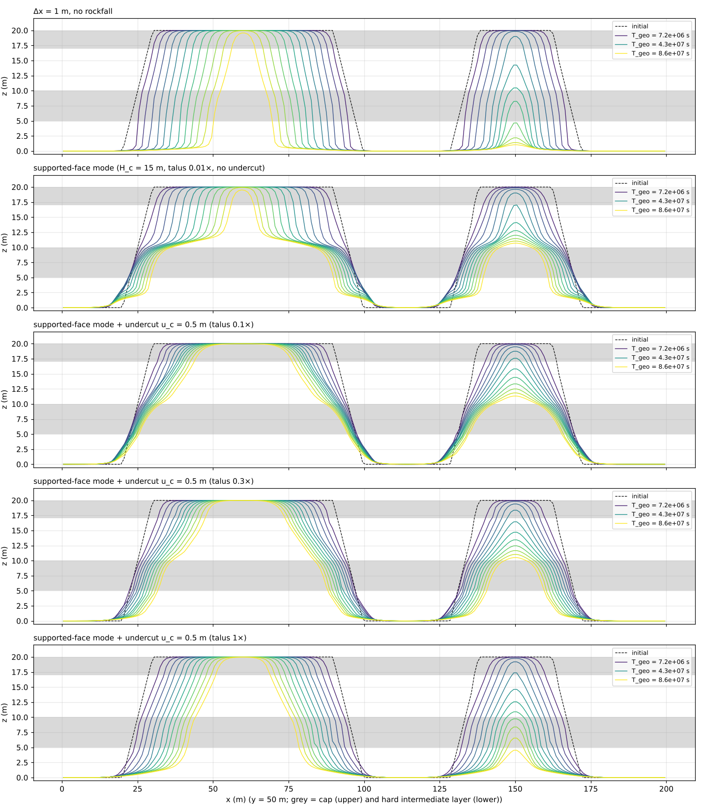

| Case | Talus erodibility | Columns fallen by undercutting | Volume moved by collapse (m³) | Total talus (m³, final) | Area of the step (m², 4.3×10⁷ / 8.6×10⁷ s) | Retreat rate of the edge (m/s, R₀ = 30 / 12 m) |
|---|---|---|---|---|---|---|
| bench2 (no collapse) | – | – | – | – | 66 / 23 | 3.5×10⁻⁷ / 3.2×10⁻⁷ |
| face (no undercutting) | 0.01 | – | 33388 | 2846 | 961 / 948 | 3.2×10⁻⁷ / 2.6×10⁻⁷ |
| uc | 0.1 | 8038 | 50051 | 846 | 310 / 628 | 1.6×10⁻⁷ / 2.5×10⁻⁷ |
| uc2 | 0.3 | 14222 | 65931 | 110 | 280 / 307 | 1.8×10⁻⁷ / 2.8×10⁻⁷ |
| uc3 | 1 | 17125 | 93083 | 17 | 160 / 122 | 2.4×10⁻⁷ / 3.2×10⁻⁷ |

- **The retreat rate of the edge now depends on the talus erodibility (talus control).** The edge of
  the large plateau retreats at 1.6 → 1.8 → 2.4×10⁻⁷ m/s (erodibility 0.1 → 0.3 → 1), slower than the
  3.2 to 3.5×10⁻⁷ without collapse or undercutting, and the number of columns fallen by undercutting
  (8000 → 17000) is also set by the rate of talus removal. The dependence is weaker than proportional
  (10 times the erodibility gives 1.5 times). One cycle is a series of "removal of talus → the bedrock
  of the foot loses u_c → the column falls (about 150 updates)", and the time to undercut the foot
  (about 3000 updates) is comparable to the removal of talus.
- **However, the cliff does not become vertical.** The debris of one column (about 17 m³/m) does not
  stay on the 45° slope of the soft bed below the cap rock (steeper than the angle of repose of 35°)
  and flows down to the step or the plain, so the face of the soft bed is not supported by talus and is
  kept at about 45° by dry erosion. The section is "a short step of the cap rock + a 45° slope of the
  soft bed + the step of the hard bed + the lower talus slope", gentler than face (no undercutting;
  vertical upper cliff), and the step area is a third of face. The ledger of undercutting is held by
  the one cell at the foot, so only one column falls at a time, and not enough debris to cover the face
  is released at once.
- Summary: the support scheme gives "vertical cliffs + a step" and undercutting gives "retreat
  controlled by talus", but neither satisfies both at the same time.

### Options 1 and 2 for both (tried by settings only): a thicker cap rock, slower removal of talus

Option 1 (uc_cap) changes the strata of uc2 (talus 0.3 times) to a cap rock 7 m thick (z ≥ 13 m,
factor 0.05) + a soft bed 3 m thick, aiming at the form of real mesas: "the cliff of the cap rock is
vertical and the soft bed below is a debris slope". Option 2 (uc_slow) lowers the talus erodibility of
uc (0.1 times) to 0.03 times and doubles the run (T_geo 1.7×10⁸ s) to see whether a state appears in
which debris accumulates at the foot and supports the face of the soft bed.

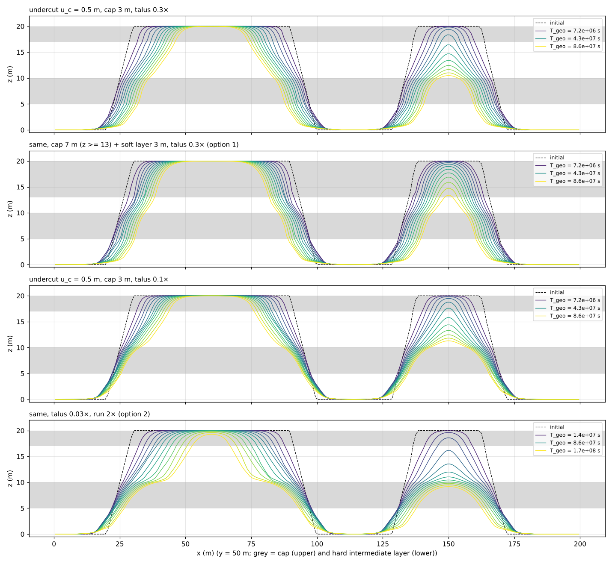

| Case | Cap thickness | Talus erodibility | Columns fallen by undercutting | Total talus (m³, final) | Area of the step (m², final) | Retreat rate of the edge (m/s, R₀ = 30 m) |
|---|---|---|---|---|---|---|
| uc2 | 3 m | 0.3 | 14222 | 110 | 307 | 1.8×10⁻⁷ |
| uc_cap (option 1) | 7 m | 0.3 | 15340 | 153 | 220 | 1.3×10⁻⁷ |
| uc | 3 m | 0.1 | 8038 | 846 | 628 | 1.6×10⁻⁷ |
| uc_slow (option 2) | 3 m | 0.03 (run doubled) | 8034 | 2035 | 899 | 1.3×10⁻⁷ |

- **The cliff does not become vertical in either.** In option 1 the cliff of the cap rock (13 → 20 m) is
  also a slope of about 45° spread over a horizontal 6 to 7 m: the remains of columns fallen by
  undercutting (they fall to the height of the lower neighbour) make a stepped ramp, which dry erosion
  with the cap factor 0.05 rounds. The retreat of the edge is slow at 1.3×10⁻⁷ m/s (talus control is
  kept), and the step shrinks to 220 m².
- In option 2, 2000 m³ of talus remains, but it accumulates only in a ring around the plateau (on the
  plain) and does not stay on the slope of the soft bed just below the cap rock (45°, steeper than the
  angle of repose). The face of the soft bed is not supported, and the section is a slope of 35 to 45°,
  the same as uc. The step area spreads to 900 m², about as much as face (the debris on the top of the
  hard bed remains because the talus is removed slowly).
- The cause comes down to two points of the rules. (i) Column collapse lets a column fall only "to the
  height of its lower neighbour", so if the foot is partway down a slope, the remaining bedrock becomes
  a step of a ramp. (ii) Debris cannot stay on faces steeper than the angle of repose, so the debris of
  one column cannot cover the face and flows down to the foot. Settings alone cannot solve this.

## What this model cannot represent (differences from the real phenomenon)

- **No overhangs**: a raster holds only one elevation per cell, so the undercut below the cap rock and
  the overhanging cap rock itself cannot be represented. The cliff retreat in the main case is erosion
  of edge cells with a steep slope, and its rate is a calibration quantity depending on the strata
  factor and Δx. Collapse is approximated by rules on column heights (supplement 3).
- **The collapse rules are approximations**: none of the four rules (step, window, support,
  undercutting) satisfies "vertical cliffs" and "retreat controlled by talus" at the same time
  (summary of supplement 3). Talus sticking to a steep face and covering it, or debris as high as the
  face falling at once, are not represented.
- **In the main case talus is only creep deposits at the foot**: the "talus" of the main case (no
  collapse) is soil carried to the foot by weak creep and does not protect the soft bed.
- **The hollow amplification governs steps and the shape of the cliff**: the amplification at the foot
  of the cliff (a hollow) keeps the cliff steep but erases steps, so the mesa stage is short, and
  "vertical cliffs" and "a wide bench" cannot coexist by the settings of the amplification alone
  (supplements 1 and 2).
- **Strata are horizontal only**: tilted beds and faults or joints (block size) cannot be represented.
- **Coefficients and time**: the coefficients of dry-slope erosion, the strata factors and the collapse
  parameters are not calibrated. Use the times for relative comparisons (the grid dependence of the
  rate in the deep stage is the same as in [badland](../../badland/en/README.md)).

## Notes

- **Soil and bedrock**: the whole plateau is given a 100 m soil, and the hardness of the rock is given
  by the factors of `spl_strata` (with the default `rf_bedrock = 0` of `f_rockfall`, bedrock without
  soil does not collapse).
- **H_c may depend on the grid**: H_c of the step rule is a threshold on the step between cells, so it
  depends on Δx (supplement 3). To use it independently of the grid, use the window version
  (`rf_rc`).
- **Prerequisites of the support scheme and undercutting**: the support scheme (`rf_fface`) requires
  the window version (`rf_rc > 0`), and undercutting (`rf_uc`) requires the support scheme and
  `spl_strata`.
- Budget: no surface flow, groundwater storage = cumulative rain, loss of surface volume = sediment that
  left the domain ÷ (1 − 0.4) can be checked for both main cases (analysis.txt). Collapse conserves
  volume.
- Verification: [test/splashstrata](../../../test/splashstrata/en/README.md) (strata factors),
  [test/splashsat](../../../test/splashsat/en/README.md) (saturated amplification),
  [test/rockfall](../../../test/rockfall/en/README.md) (rockfall and talus).

## Starting points for sensitivity experiments

- `spl_strata`: thickness and factor of the cap rock (retreat rate); position, thickness and factor of
  the intermediate hard bed (steps).
- `spl_cb`, `spl_ksat`: the amplification at the foot of the cliff (trade-off between the cliff angle and
  the step width). Lowering spl_cb lets the smooth retreat of the edge be seen for longer.
- `rf_hc`, `rf_rc`, `rf_ftalus`, `rf_fface`, `rf_uc`: the collapse rules and the protection by talus.
- `PLATEAUS` (positions and radii of the plateaus), `HP` (height) and `TANB` (slope of the edges) in
  make_terrain.py.

## References

- Glade, R. C., Anderson, R. S. and Tucker, G. E. (2017): Block-controlled hillslope form and
  persistence of topography in rocky landscapes. *Geology*, 45(4), 311–314. doi:10.1130/G38665.1
  (checked against the abstract)
