# examples/mesa — mesa and butte formation experiment (cap rock = spl_strata)

> English mirror of examples/mesa/README.md. The Japanese file is the master copy.

[日本語](../README.md)

Two 20 m high plateaus (radii 30 m / 12 m, rim slope 63°) are placed on a plain
(z = 0 = erosion base level). One case gives the top 3 m a cap rock (factor 0.05) and
z = 8–10 m a hard intermediate layer (factor 0.3) (param_cap.txt); the contrast has no
strata (param_nocap.txt). Rainfall 10 mm/h, fully infiltrated; f_splash (same
coefficients as examples/badland_round) + weak creep D = 3e-7.
48 h = T_geo 8.6e7 s; Z output every 4 h (7.2e6 s).

```
make                                   # link to ../../bin/encflow
python3 make_terrain.py                # z.txt
./encflow param_cap.txt > Screen_cap.log; ./encflow param_nocap.txt > Screen_nocap.log   # 8 min each
python3 plot_results.py | tee analysis.txt   # figs/maps.png, sections.png, series.png + tables
for c in bench bench2 bench3; do ./encflow param_$c.txt > Screen_$c.log; done   # contrasts with a hard intermediate layer
python3 plot_results.py bench | tee analysis_bench.txt   # figs/*_bench.png
for c in sat sat2; do ./encflow param_$c.txt > Screen_$c.log; done   # saturation of the amplification (spl_ksat)
python3 plot_results.py sat | tee analysis_sat.txt       # figs/*_sat.png
for c in rock2 rock3 rock4 rock5; do ./encflow param_$c.txt > Screen_$c.log; done   # rockfall and talus (Δx = 1 m)
python3 plot_results.py rock | tee analysis_rock.txt     # figs/*_rock.png, talus_rock.png
python3 make_terrain.py --dx 4                           # z_dx4.txt (Δx = 4 m)
for c in dx4 dx4_rock dx4_rock2; do ./encflow param_$c.txt > Screen_$c.log; done   # 30 s each
python3 plot_results.py dx4 | tee analysis_dx4.txt       # figs/*_dx4.png, talus_dx4.png
for c in rc rc2; do ./encflow param_$c.txt > Screen_$c.log; done                    # windowed H_c (Δx = 1 m)
python3 plot_results.py rc | tee analysis_rc.txt         # figs/*_rc.png, talus_rc.png
for c in dx4_rc dx4_rc2; do ./encflow param_$c.txt > Screen_$c.log; done            # windowed H_c (Δx = 4 m)
python3 plot_results.py dx4rc | tee analysis_dx4rc.txt   # figs/*_dx4rc.png
for c in face face2 face3; do ./encflow param_$c.txt > Screen_$c.log; done         # supported-face mode (vertical cliff + talus-limited)
python3 plot_results.py face | tee analysis_face.txt     # figs/*_face.png, talus_face.png
for c in face4 face5; do ./encflow param_$c.txt > Screen_$c.log; done               # same, H_c = 8 m
python3 plot_results.py face8 | tee analysis_face8.txt   # figs/*_face8.png
for c in uc uc2 uc3; do ./encflow param_$c.txt > Screen_$c.log; done               # undercut collapse (rf_uc)
python3 plot_results.py uc | tee analysis_uc.txt         # figs/*_uc.png, talus_uc.png
./encflow param_uc_cap.txt > Screen_uc_cap.log; ./encflow param_uc_slow.txt > Screen_uc_slow.log   # options 1 and 2 for achieving both (8 min + 16 min)
python3 plot_results.py ucx | tee analysis_ucx.txt       # figs/*_ucx.png
```

## Results (analysis.txt, figs/)

Checks: zero surface flow; groundwater storage 0.48 m = cumulative rainfall; volume loss = export ÷ 0.6 (both cases).

| Time T_geo (s) | 0 | 7.2e6 | 1.4e7 | 2.2e7 | 2.9e7 |
|---|---|---|---|---|---|
| With cap, R₀ = 30 m: equivalent radius of the plateau surface (z ≥ 17 m) (m) / top height (m) | 31.5 / 20 | 27.2 / 20 | 18.4 / 20 | 5.6 / 20 | 0 / 9.8 |
| With cap, R₀ = 12 m | 13.6 / 20 | 10.1 / 20 | 5.2 / 20 | 0 / 15.5 | 0 / 5.2 |
| No strata, R₀ = 30 m | 31.5 / 20 | 18.1 / 20 | 0 / 11.7 | 0 / 4.6 | 0 / 3.3 |
| No strata, R₀ = 12 m | 13.6 / 20 | 5.8 / 20 | 0 / 6.2 | 0 / 2.9 | 0 / 2.2 |

- With cap: the plateau surface stays flat at 20 m and the rim retreats as a nearly
  vertical cliff (mesa). The small plateau becomes an isolated hill (butte) of radius
  5 m at 1.4e7 s, loses its cap at 2.2e7 s and becomes a pinnacle → disappears. From
  1.4e7 s on, the rim of the large plateau is cut into amphitheatres by the hollow
  feedback, and at 2.2e7 s the remnants of the cap break up into finger-like ridges.
  Initial retreat rate 4–5 m per 7.2e6 s (≈ 6e-7 m/s: S^1.5 erosion of the rim cells × factor 0.05).
- No strata: by 7.2e6 s the rim is already deeply cut into a star shape, and neither the
  flat top nor the vertical cliff is kept. At 1.4e7 s the plateau surface is gone and
  breaks up into radial ridges.

## Adding rockfall and talus (f_rockfall)

Cap collapse and talus protection were added with `f_rockfall` ([geomorph.md](../../../docs/en/users_guide/geomorph.md),
developer.md §48.7): the part of the step between neighbouring cells that exceeds the critical
height H_c is moved from the high to the low cell (conservative), the moved amount is booked
as talus thickness ht (output Ht), and the dry erosion of talus-covered cells is reduced by a
factor rf_ftalus. The talus spreads at a repose angle of 35°.

### Δx = 1 m (the cliff is a slope 4–5 cells wide)

Four cases that add H_c = 4 m (targeting the 3–4 m steps at the rim; with 18 m or 6 m the
steps never reach the threshold and no collapse occurs) to the bench2 configuration (hard layer
5–10 m, factor 0.02, spl_cb = 32).

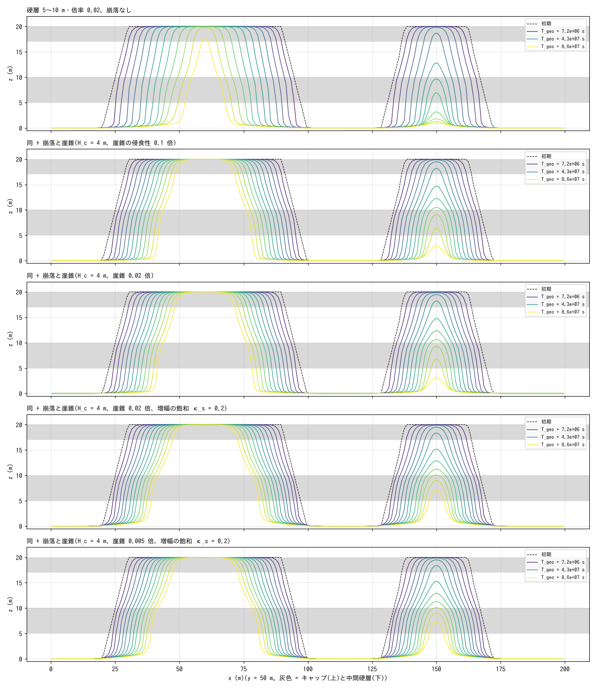

| Case | Talus erodibility | κ_s | Volume moved by rockfall (cumulative m³) | Total talus (m³) | Angle of the upper cliff (1.4e7 / 4.3e7 / 6.5e7 s) | Retreat rate of the large plateau (m/s) |
|---|---|---|---|---|---|---|
| bench2 (no rockfall) | – | – | – | – | 73° / 73° / 73° | 3.5e-7 |
| rock2 | 0.1 | – | 1314 | 2 | 58° / 58° / 52° | 2.2e-7 |
| rock4 | 0.02 | – | 1285 | 5 | 58° / 58° / 52° | 2.2e-7 |
| rock3 | 0.02 | 0.2 | 184 | 5 | 58° / 52° / 47° | 2.1e-7 |
| rock5 | 0.005 | 0.2 | 99 | 6 | 58° / 52° / 47° | 2.2e-7 |

- **At Δx = 1 m rockfall has almost no effect.** On the raster the 20 m cliff is a
  58–73° slope 4–5 cells wide; collapse (step > H_c) occurs only at the steepest 1–2
  cells, and the talus protects only the single cell at the foot where it lands. Cliff
  retreat continues to be carried by the dry erosion (S^1.5) of the face cells not covered
  by talus, so lowering the talus erodibility from 0.1 to 0.005 leaves the retreat rate
  unchanged (2.2e-7 m/s) and the total talus always stays at a few m³. The shape is nearly
  the same as in the saturated-amplification case (sat2) (58° cliff + 1–2 m bench); with
  rockfall added the cliff is gentler than in bench2 and the plateau lasts longer.

### Δx = 4 m (the cliff is a step of 1–2 cells)

The same terrain at Δx = 4 m (rim step 8 m), H_c = 6 m, talus erodibility 0.1 / 0.01.

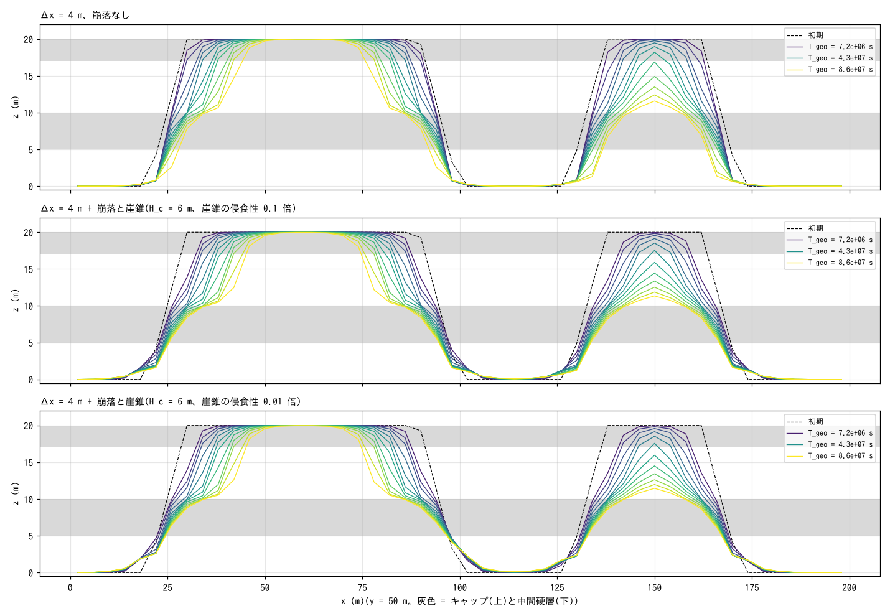

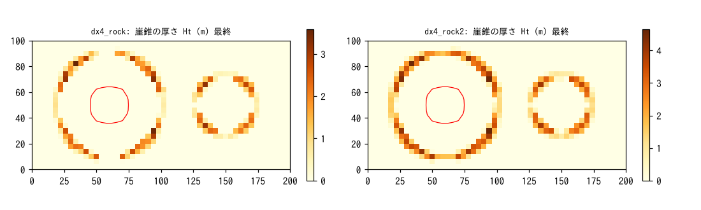

| Case | Talus erodibility | Volume moved by rockfall (m³) | Total talus (m³) (1.4e7 → 8.6e7 s) | Angle of the lower cliff (1.4e7 / 4.3e7 / 6.5e7 s) | Retreat rate (m/s) |
|---|---|---|---|---|---|
| dx4 (no rockfall) | – | – | – | 65° / 60° / 47° | 1.8e-7 |
| dx4_rock | 0.1 | 14469 | 353 → 211 | 38° / 33° / 30° | 1.7e-7 |
| dx4_rock2 | 0.01 | 14487 | 411 → 393 | 38° / 31° / 30° | 1.7e-7 |

- **Once the cliff is a grid step, rockfall and talus change the shape.** The debris from
  the collapsing rim step forms a 2–4 m thick ring of talus around both plateaus
  (talus_dx4.png), and the lower slope is replaced by a talus slope at the repose angle
  (30–38°). With talus erodibility 0.01 the talus hardly decreases (411 → 393 m³) and the
  system becomes talus-limited. The retreat rate of the upper cliff (cap rim) is the same
  as without rockfall (1.7e-7 m/s); the retreat is still carried by the dry erosion of the rim.
- Taking the two grid spacings together: because the collapse rule "step > H_c" is a rule
  between neighbouring cells, it is ineffective on a fine grid where the cliff spans many
  cells, and talus accumulates only on a coarse grid (Δx ≳ cliff height/4) where the cliff
  is a step of 1–2 cells. H_c is a calibration quantity that depends on Δx.
  The windowed version of the next section removes this grid dependence.

### Making the critical height independent of the grid spacing (windowed rf_rc)

The free-face height is now measured as the drop H_w to the lowest point within a window of
radius r_c (`rf_rc`), and the excess of H_w over H_c is moved on edges steeper than the talus
repose angle. H_c = 15 m and r_c = 8 m are given to both Δx = 1 m and 4 m, comparing talus
erodibility 0.1 and 0.01 (+ κ_s = 0.2).

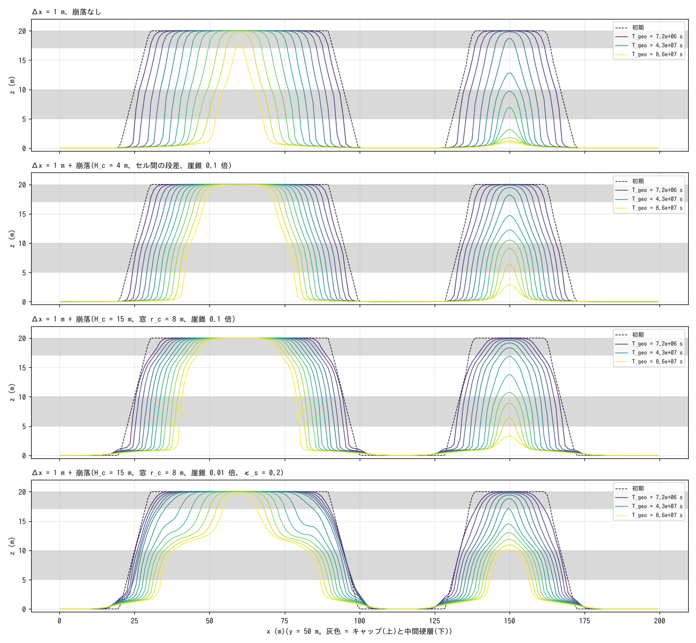

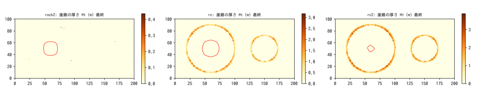

| Grid | Case | Collapse rule | Talus erodibility | Volume moved by rockfall (m³) | Total talus (m³, final) | Angle of the lower cliff (1.4e7 / 4.3e7 / 6.5e7 s) | Retreat rate (m/s) |
|---|---|---|---|---|---|---|---|
| Δx = 1 m | bench2 | none | – | – | – | 77° / 71° / 65° | 3.5e-7 |
| Δx = 1 m | rock2 | step > 4 m | 0.1 | 1314 | 2 | 71° / 65° / 60° | 2.2e-7 |
| Δx = 1 m | rc | window 8 m, H_w > 15 m | 0.1 | 47120 | 1309 | 47° / 43° / 71°* | 1.9e-7 |
| Δx = 1 m | rc2 | same | 0.01, κ_s 0.2 | 24123 | 2143 | 47° / 38° / 31° | 3.2e-7 |
| Δx = 4 m | dx4 | none | – | – | – | 65° / 60° / 47° | 1.8e-7 |
| Δx = 4 m | dx4_rc | window 8 m, H_w > 15 m | 0.1 | 7151 | 39 | 43° / 38° / 31° | 1.8e-7 |
| Δx = 4 m | dx4_rc2 | same | 0.01, κ_s 0.2 | 6812 | 140 | 43° / 35° / 30° | 1.7e-7 |

(* The 6.5e7 s value for rc is where the talus band has moved out of the interval of the azimuthal average.)

- **With the windowed version, rockfall and talus act even at Δx = 1 m.** The whole cliff
  face (cells steeper than the repose angle whose drop within the window exceeds 15 m)
  becomes subject to collapse, and the talus accumulates as a 1–3 m thick ring around the
  plateaus (1300–2100 m³, versus 2 m³ with the rule based on the step between cells). The
  lower slope is replaced by a 30–40° talus slope, the same pattern as the Δx = 4 m result
  (lower cliff 30–38° on both grids, cap-rim retreat rate 1.7–1.9e-7 m/s). The total talus
  differs between the grids (40–140 m³ at Δx = 4 m); on the coarse grid the talus band is
  resolved by only 1–2 cells.
- Strengthening the talus protection (rc2: factor 0.01 + κ_s) increases the total talus, but
  since collapse keeps relaxing the face to the repose angle, the plateau approaches a cone
  covered by 27–31° talus up to the upper cliff, and the cap surface actually shrinks faster
  (3.2e-7 m/s). A "vertical cliff" is not obtained from collapse + protection; this is the
  natural consequence of a collapse rule that says "faces steeper than the repose angle
  fail". To keep a vertical cliff while the retreat is talus-limited, a different rule is
  needed that makes the erosion of the cliff face (the cap and the soft layer directly
  below it) limited by talus removal (→ the supported-face mode of the next section).

### Limiting the erosion of the cliff face by talus removal (supported-face mode rf_fface)

The supported-face mode `rf_fface = 0` (developer.md §48.7) is added to the rc2 configuration
(H_c = 15 m, r_c = 8 m, κ_s = 0.2): a cell whose foot (the cell beyond a drop steeper than
the repose angle) is covered by talus is not removed by dry erosion, and the collapse becomes
a column collapse in which "the column at the top of the face drops to the height of its
lower neighbour" (a column whose foot is a collapsing column waits, so the face retreats one
column at a time). With talus erodibility 0.01 / 0.1 / 0.3 (face / face2 / face3) we check
whether the retreat rate is limited by talus removal. H_c = 8 m is also compared (face4 /
face5; the 10 m upper cliff above the bench is then also subject to column collapse).

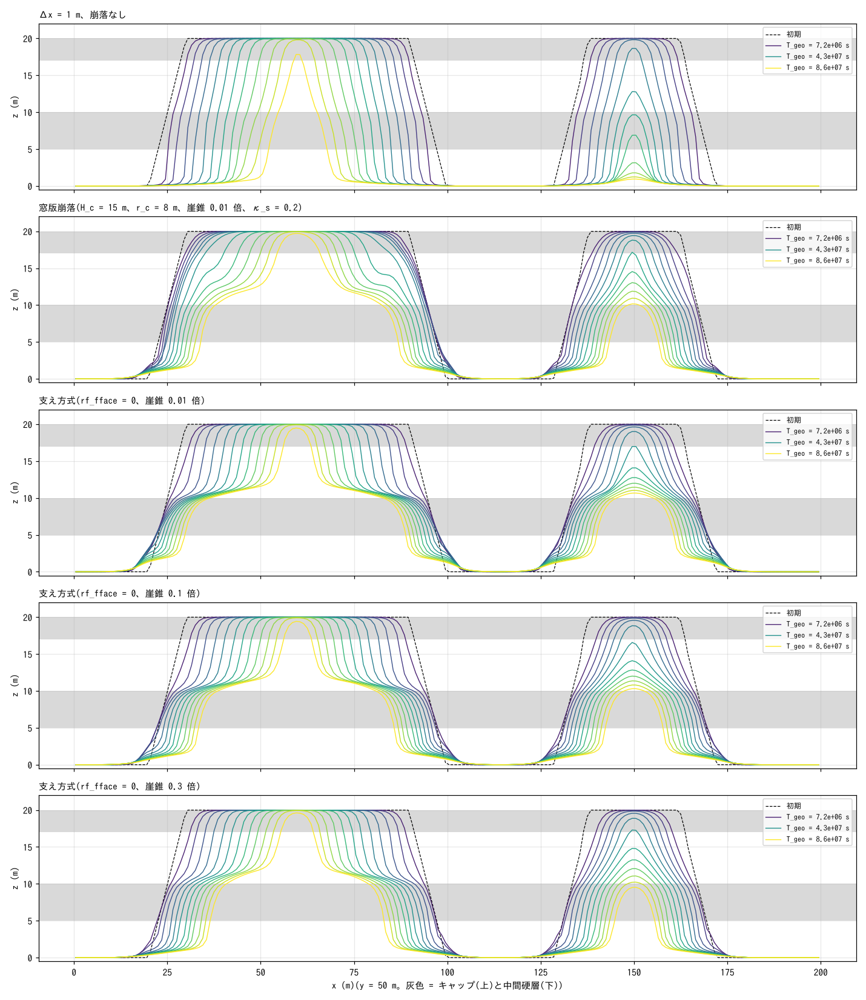

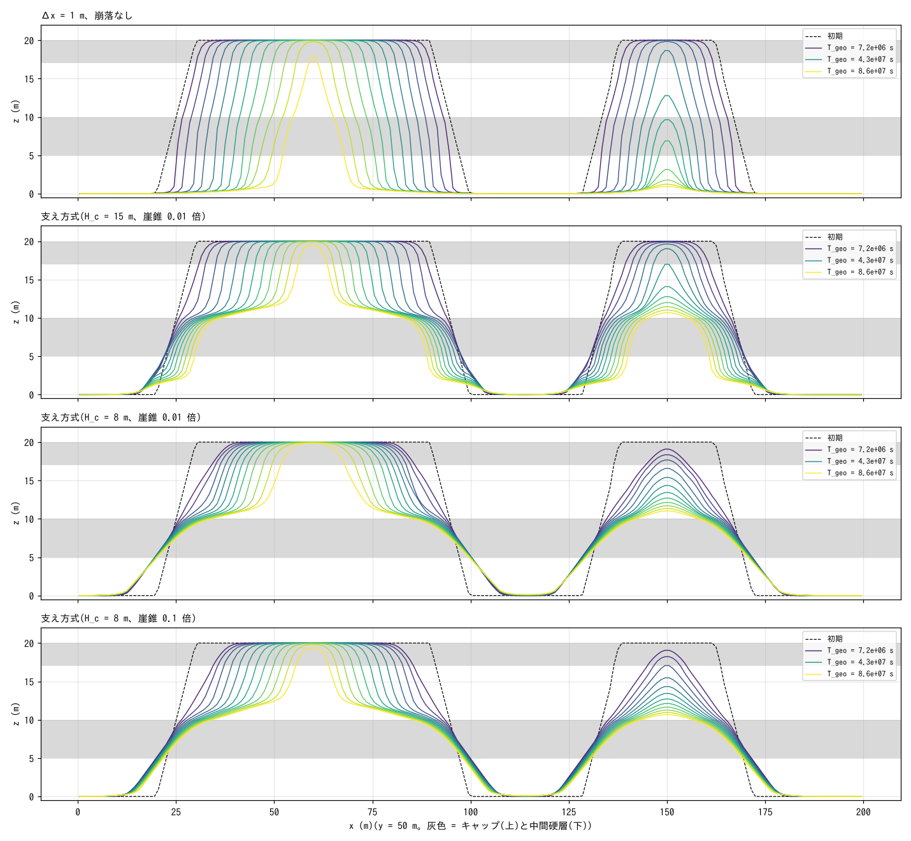

| Case | H_c | Talus erodibility | Volume moved by rockfall (m³) | Total talus (m³, final) | Area of the bench (hard-layer top ±0.5 m) (m², 4.3e7 / 8.6e7 s) | Rim retreat rate (m/s) |
|---|---|---|---|---|---|---|
| bench2 (no rockfall) | – | – | – | – | 72 / 23 | 3.5e-7 |
| rc2 (windowed) | 15 | 0.01 | 24123 | 2143 | 454 / 448 | 3.2e-7 |
| face | 15 | 0.01 | 33388 | 2846 | 961 / 948 | 3.2e-7 |
| face2 | 15 | 0.1 | 33063 | 1041 | 894 / 683 | 3.1e-7 |
| face3 | 15 | 0.3 | 32433 | 97 | 605 / 372 | 3.1e-7 |
| face4 | 8 | 0.01 | 152774 | 12261 | 657 / 1029 | 2.5e-7 |
| face5 | 8 | 0.1 | 153263 | 7413 | 754 / 942 | 2.9e-7 |

- **A vertical upper cliff and a wide bench coexist (H_c = 15 m).** In the cross-section
  (y = 50 m) the 8–9 m drop from the cap to the top of the hard layer (z ≈ 11–12 m) fits
  within 2–4 m horizontally (a gentle 14 m slope in rc2) and retreats in parallel. The
  bench area is twice that of rc2 and 20–40 times that without rockfall, and surrounds the
  plateau as a surface of debris resting on the top of the hard layer (the azimuthally
  averaged "upper cliff angle" averages the bench and the rim and so comes out at 30–50°,
  but in the cross-section the edge of the bench is vertical). The lower cliff (below the
  hard layer) is a 30–35° talus slope as in the windowed version.
- **However, the rim retreat is not talus-limited.** Raising the talus erodibility from
  0.01 to 0.3 leaves the rim retreat rate at 3.1–3.2e-7 m/s (almost the same as the
  3.5e-7 without rockfall); only the total talus decreases from 2846 to 97 m³. The upper
  cliff (10 m) is below H_c = 15 m, so column collapse acts only in the initial stage when
  the window reaches the lower slope (the talus ring around the plateau), and afterwards the
  rim retreats by dry erosion (cap factor 0.05). No debris remains directly below the rim
  (on the bench surface) (Ht = 0 in the cross-section), so the rim cells never become a
  "supported face" and are not protected.
- **At H_c = 8 m the face is buried (face4 / face5).** The initial 20 m face collapses
  column by column during the first 7e6 s into 12,000 m³ of talus, and the plateau becomes
  a cone covered by 30° talus up to the upper cliff (the bench remains at the boundary
  between the hard-layer top and the talus). With talus erodibility 0.01 → 0.1 the rim
  retreat changes from 2.5 to 2.9e-7 m/s, a weak dependence on the talus (a sign of talus
  limitation), but no vertical face appears.
- Summary: the supported-face mode gives a "vertical cliff + bench" and overturns the
  windowed version's result of "approaching a talus cone". The steady state in which
  "talus removal governs the retreat" appears only while the exposed face exceeds H_c and
  the talus stays thin; the configuration of this example (face 10 m with H_c 15 m / 8 m)
  falls off on either side. The next task is to match H_c to the face height (e.g. 9–10 m)
  or to express the undercutting of the cap (the cap overhangs as the soft layer below it
  retreats) as a reduction of H_c (→ next section).

### Making the retreat talus-limited through undercut collapse (rf_uc)

The critical undercut `rf_uc = 0.5 m` is added to the face configuration (H_c = 15 m,
supported-face mode, κ_s = 0.2): the column at the top of the face falls once the bedrock of
a foot that is weaker than the column (larger strata factor) has been cut back by 0.5 m by dry
erosion since the last burial (independent of H_c). The soft layer (1) below the cap (0.05)
and the soft layer (1) below the hard intermediate layer (0.02) are affected; steps between
soft layers are not. With talus erodibility 0.1 / 0.3 / 1 (uc / uc2 / uc3) we check whether
the retreat rate is limited by talus removal.

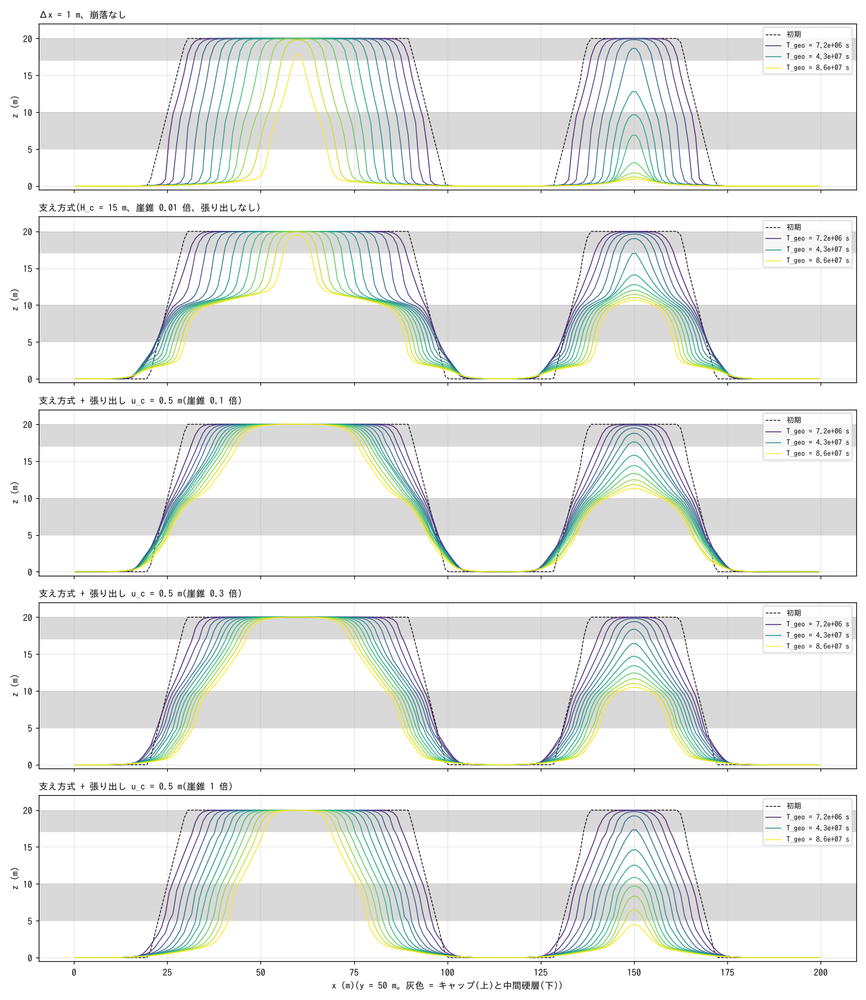

| Case | Talus erodibility | Columns dropped by undercut | Volume moved by rockfall (m³) | Total talus (m³, final) | Bench area (m², 4.3e7 / 8.6e7 s) | Rim retreat rate (m/s, R₀ = 30 / 12 m) |
|---|---|---|---|---|---|---|
| bench2 (no rockfall) | – | – | – | – | 72 / 23 | 3.5e-7 / 3.2e-7 |
| face (no undercut) | 0.01 | – | 33388 | 2846 | 961 / 948 | 3.2e-7 / 2.6e-7 |
| uc | 0.1 | 8038 | 50051 | 846 | 310 / 628 | 1.6e-7 / 2.5e-7 |
| uc2 | 0.3 | 14222 | 65931 | 110 | 280 / 307 | 1.8e-7 / 2.8e-7 |
| uc3 | 1 | 17125 | 93083 | 17 | 160 / 122 | 2.4e-7 / 3.2e-7 |

- **The rim retreat rate now depends on the talus erodibility (talus-limited).** The rim of
  the large plateau retreats at 1.6 → 1.8 → 2.4e-7 m/s (erodibility 0.1 → 0.3 → 1), slower
  than the 3.2–3.5e-7 without rockfall or undercut, and the number of columns dropped by
  undercut (8000 → 17000) is also set by the talus removal rate. The dependence is weaker
  than proportional (10× the erodibility gives 1.5×). This is because one cycle is the
  series "talus removal → foot bedrock cut back by u_c → column falls (about 150 updates)",
  and the time to cut back the foot (about 3000 updates) is comparable to the talus removal.
- **However, the cliff does not become vertical.** The debris of one column (about 17 m³/m)
  does not stay on the 45° soft-layer slope below the cap (steeper than the 35° repose
  angle) but flows down to the bench or the plain, so the soft-layer face is not supported
  by talus and is kept at around 45° by dry erosion. The cross-section is "short cap step +
  45° soft-layer slope + hard-layer step + lower talus slope", gentler than face (no
  undercut; vertical upper cliff), and the bench area is 1/3 of face. The cause is that the
  undercut is booked in the single foot cell, so only one column ever falls at a time and
  enough debris to cover the face is never released at once.
- Summary: the supported-face mode (previous section) gives "vertical cliff + bench" and the
  undercut (this section) gives "talus-limited retreat", but the two are not satisfied at
  the same time. Achieving both requires a mechanism that keeps the debris on the soft-layer
  face (adhesion of talus along the face), or a rule that books the undercut over several
  cells and drops a face height of debris at once.

### Options 1 and 2 for achieving both (settings only): thick cap, slow talus removal

We tried two options that need no code change. Option 1 (uc_cap) changes the strata of uc2
(talus 0.3×) to a 7 m cap (z ≥ 13, factor 0.05) + 3 m soft layer, aiming at the shape of a
real mesa: "the vertical part is the cap cliff, and the soft layer below it is a debris
slope". Option 2 (uc_slow) lowers the talus erodibility of uc (0.1×) to 0.03× and doubles the
run (T_geo 1.7e8 s), to see whether a region appears where the debris accumulates at the foot
and supports the soft-layer face.

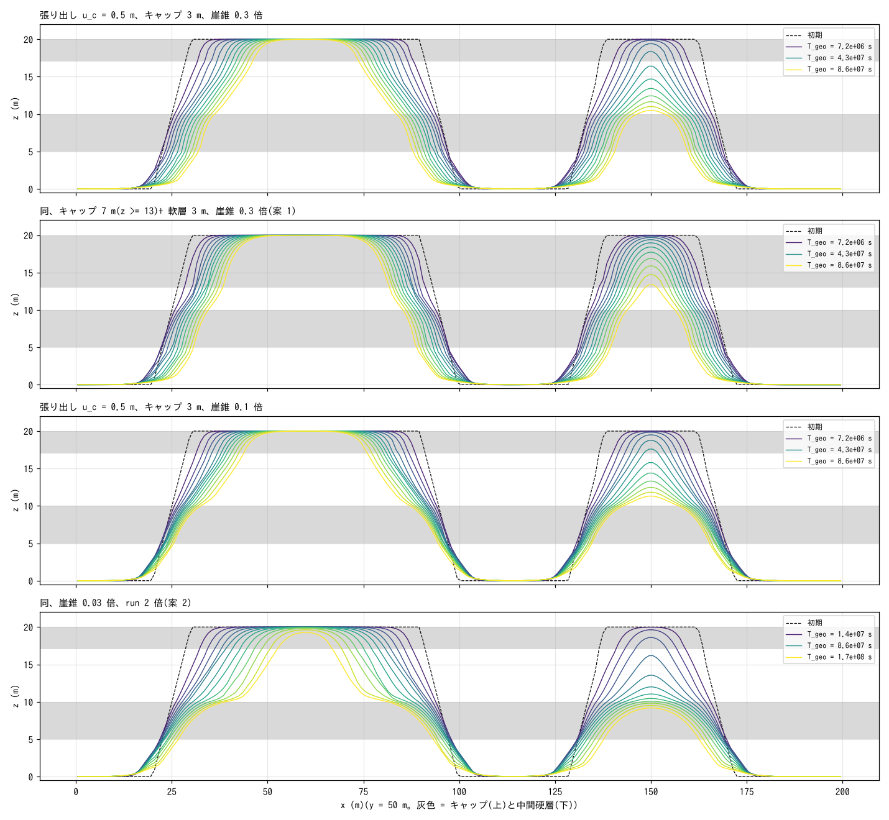

| Case | Cap thickness | Talus erodibility | Columns dropped by undercut | Total talus (m³, final) | Bench area (m², final) | Rim retreat rate (m/s, R₀ = 30 m) |
|---|---|---|---|---|---|---|
| uc2 | 3 m | 0.3 | 14222 | 110 | 307 | 1.8e-7 |
| uc_cap (option 1) | 7 m | 0.3 | 15340 | 153 | 220 | 1.3e-7 |
| uc | 3 m | 0.1 | 8038 | 846 | 628 | 1.6e-7 |
| uc_slow (option 2) | 3 m | 0.03 (run 2×) | 8034 | 2035 | 899 | 1.3e-7 |

- **Neither makes the cliff vertical.** In option 1 the cap cliff (13 → 20 m) is also a slope
  of about 45° spread over 6–7 m horizontally: the remains of the columns dropped by undercut
  (they fall only to the height of the lower neighbour) form a stepped ramp, which the dry
  erosion of the cap (factor 0.05) then rounds. The rim retreat is slow at 1.3e-7 m/s (the
  retreat stays talus-limited), and the bench shrinks to 220 m².
- In option 2, 2000 m³ of talus remain, but they only accumulate in a ring on the plain around
  the plateau and do not stay on the soft-layer slope just below the cap (45°, steeper than the
  repose angle). The soft-layer face is not supported, and the cross-section is the same
  35–45° slope as uc. The bench area widens to 900 m², as wide as face (with the slower talus
  removal, the debris on top of the hard layer remains).
- The cause comes down to two points of the rules. (i) A column collapses "down to the height
  of the lower neighbour", so when the foot is partway down a slope the remaining bedrock
  becomes one step of the ramp. (ii) Debris cannot stay on a face steeper than the repose
  angle, so the debris of one column cannot cover the face and flows down to the foot. This
  cannot be solved by settings; a rule that leaves a thin talus on the face (option 3:
  adhesion of talus) is the next candidate.

## Limitations

- Cliff retreat is represented by "rim cells eroding at a steep gradient (S ≈ cliff
  height/Δx)", not by the mechanics of actual cap collapse (the fall of an overhang created
  by undercutting of the soft layer). The retreat rate depends on the factor and Δx (a
  calibration quantity).
- The talus is only creep deposition; there is no effect of the talus protecting the soft layer.
- The hard intermediate layer (8–10 m) did not form a bench (the soft layer drops to the
  base level at once, so a 2 m thick layer with factor 0.3 does not survive inside the
  cliff). Thicker and harder contrasts are in later sections.
- Because the hollow feedback (spl_cb) incises the rim, the mesa stage is short. To see a
  long, smooth retreat of the rim, lower spl_cb.

## Does a thicker, harder intermediate layer produce a bench?

| Case | Intermediate hard layer | spl_cb | Retreat rate of the 20 m plateau (R₀ = 30 m) (m/s) | Final top height of the large plateau (m) |
|---|---|---|---|---|
| param_cap | z = 8–10 m, factor 0.3 | 32 | 1.2e-6 (accelerating; disintegrates at 2.2e7 s) | 2.5 |
| param_bench | z = 6–10 m, factor 0.05 | 32 | 5.3e-7 (linear) | 20 (still present at 8.6e7 s) |
| param_bench2 | z = 5–10 m, factor 0.02 | 32 | 3.5e-7 (linear) | 20 |
| param_bench3 | z = 5–10 m, factor 0.02 | 0 | 1.9e-7 (linear) | 20 |


Radial width (m) occupied by each elevation band in the azimuthally averaged cross-section (large plateau) (T_geo = 4.3e7 s):

| Case | Cap 17–20 | Soft layer 10.5–17 | Hard-layer top 9.5–10.5 | Hard layer 5–9.5 | Foot 1–5 |
|---|---|---|---|---|---|
| param_bench | 9 | 2 | 0 | 2 | 4 |
| param_bench2 | 18 | 2 | 0 | 1 | 2 |
| param_bench3 | 22 | 7 | 1 | 4 | 5 |

- **A thick, hard intermediate layer alone does not produce a wide bench** (bench, bench2).
  The top of the hard layer appears only as a one-cell-wide step (shoulder), and the cliff
  remains a single steep face from 20 m down to 0 m over a horizontal distance of 4–5 m.
  The cause is the hollow feedback (spl_cb = 32): the base of the upper cliff = the top of
  the hard layer is a hollow (κ > 0), so the edge of the hard layer is eroded with
  amplification (with κ ≈ S/ℓ, 1 + c_b κ exceeds 100) and the bench is erased as soon as it
  forms. The convex rim of the cap is not amplified, so the upper and lower cliffs retreat
  at nearly the same speed and the bench width does not grow.
- The intermediate hard layer does, however, **make the mesa last longer**. Because the
  soft layer only drops from directly below the cap to the top of the hard layer, the drop
  at the cap rim decreases from 20 m to 10 m, the S^1.5 erosion of the rim cells falls, and
  the retreat becomes linear and 2–3 times slower; the amphitheatre-shaped incision of the
  rim (1.4e7 s in cap) does not occur either. The large plateau keeps a flat top (20 m)
  until 8.6e7 s, and the small plateau turns from a butte into a pinnacle after 4.3e7 s.
- **Switching off the hollow amplification (bench3, spl_cb = 0) produces a bench.** A
  shoulder a few m wide at the top of the hard layer, z ≈ 10 m (4 m for the hard-layer
  band 5–9.5 m, 7 m for the soft layer 10.5–17 m), runs all the way round, and in plan
  view the contours separate into two bundles: a two-tier mesa (upper cliff + shoulder +
  lower slope). In exchange the cliff relaxes to a slope of around 45° (without
  amplification a steep cliff is smoothed by S^1.5) and is no longer a vertical wall.
  "Vertical cliff" and "wide bench" cannot both be had from the presence or absence of the
  amplification (spl_cb) alone. The contrast with a bounded amplification follows in the
  next section.

## Can saturation of the amplification (spl_ksat) give both a vertical cliff and a bench?

`spl_ksat` (developer.md §48.6), which replaces κ in the hollow amplification 1 + c_b κ by
the effective curvature κ̃ = κ/(1 + κ/κ_s), is added to the bench2 configuration with
amplification caps of 2.6× (κ_s = 0.05) and 7.4× (κ_s = 0.2) (over 100× without
saturation; no amplification = bench3).

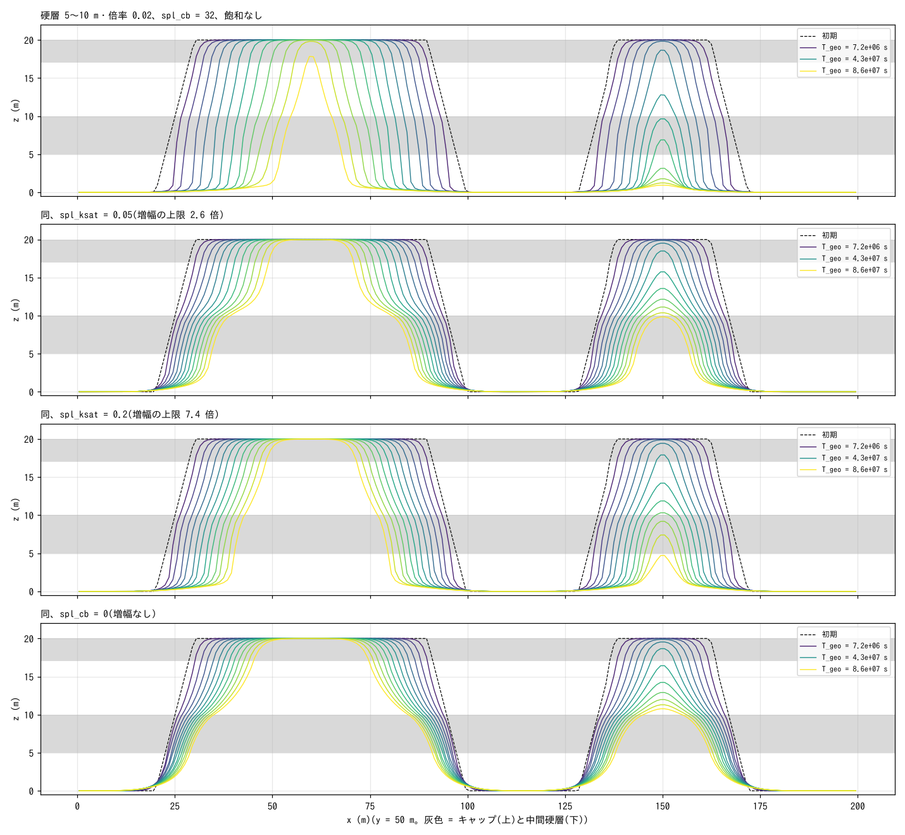

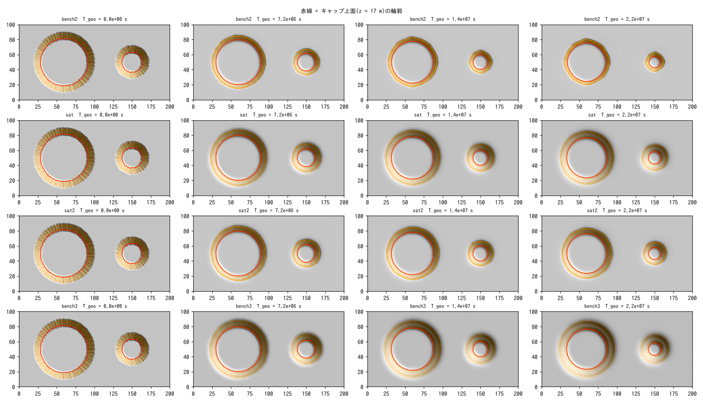

| Case | Amplification cap | Area of the hard-layer top ±0.5 m (m²) (T_geo 4.3e7 / 8.6e7 s) | Mean angle of the upper cliff (1.4e7 / 4.3e7 / 6.5e7 s) | Retreat rate of the large plateau (m/s) |
|---|---|---|---|---|
| bench2 (no saturation) | 161 | 66 / 23 | 73° / 73° / 73° | 3.5e-7 |
| sat2 (κ_s = 0.2) | 7.4 | 148 / 114 | 58° / 58° / 52° | 2.3e-7 |
| sat (κ_s = 0.05) | 2.6 | 269 / 351 | 58° / 52° / 43° | 2.3e-7 |
| bench3 (no amplification) | 1 | 312 / 415 | 58° / 43° / 43° | 1.9e-7 |

(Upper cliff angle = the 6.5 m drop of the soft layer 10.5–17 m ÷ its horizontal width in the azimuthally averaged cross-section.)

- **With saturation the bench survives.** At κ_s = 0.05 a 2–4 m wide shoulder at the
  hard-layer top z ≈ 10 m runs all the way round, giving a two-tier mesa (bench area 80% of
  that without amplification); at κ_s = 0.2 the shoulder is narrow, 1–2 m. The bench width
  can be controlled continuously by the amplification cap.
- **The cliff angle relaxes correspondingly.** Against 73° without saturation, it is 58°
  (52° later on) at κ_s = 0.2, 58° → 43° at κ_s = 0.05 and 43° without amplification. In
  this erosion law the amplification at the base of the cliff (the hollow) is also the
  mechanism that keeps the cliff steep (basal erosion standing in for undercutting), so
  suppressing the amplification relaxes the cliff in exchange for keeping the bench.
- **Degree of coexistence**: κ_s = 0.2 gives "a cliff of about 60° + a 1–2 m bench" and
  κ_s = 0.05 "a cliff of about 50° + a 2–4 m bench" at the same time, with κ_s bridging
  continuously between no saturation (73°, no bench) and no amplification (43°, wide
  bench). The vertical cliffs of real mesas are maintained by undercutting of the soft
  layer and collapse of the cap (supply of debris and protection by talus), so fully
  reproducing "vertical cliff + wide bench" requires a mechanism of cliff retreat
  (collapse) separate from the amplification.

## Related

- [examples/badland_round](../../badland_round/en/README.md) (bands and steps of hard/soft strata with spl_strata),
  [examples/badland](../../badland/en/README.md) (deep valleys with sharp ridges)
- [docs/users_guide/geomorph.md](../../../docs/en/users_guide/geomorph.md) — `f_splash`, `spl_strata`;
  developer.md §48.5
