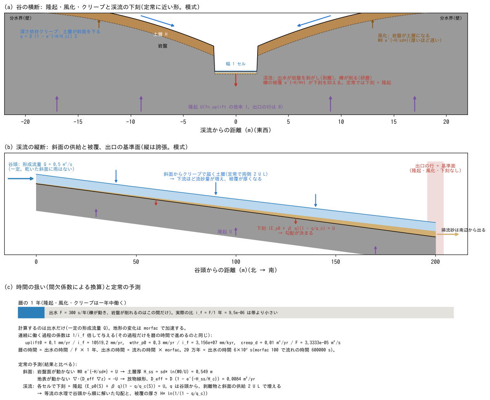
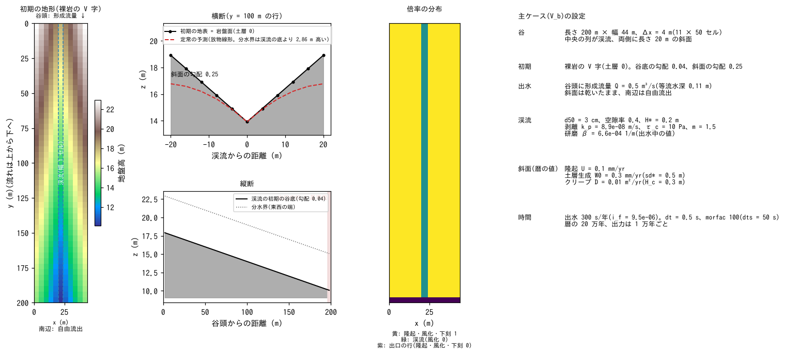
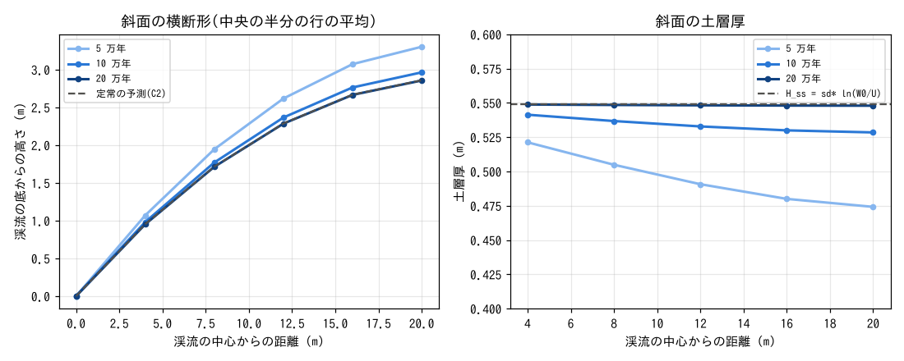
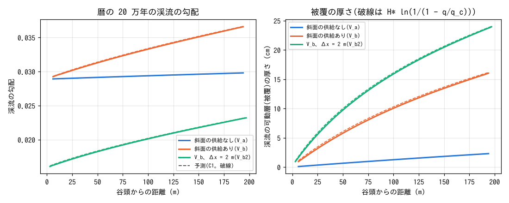
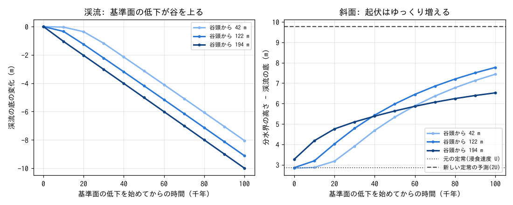
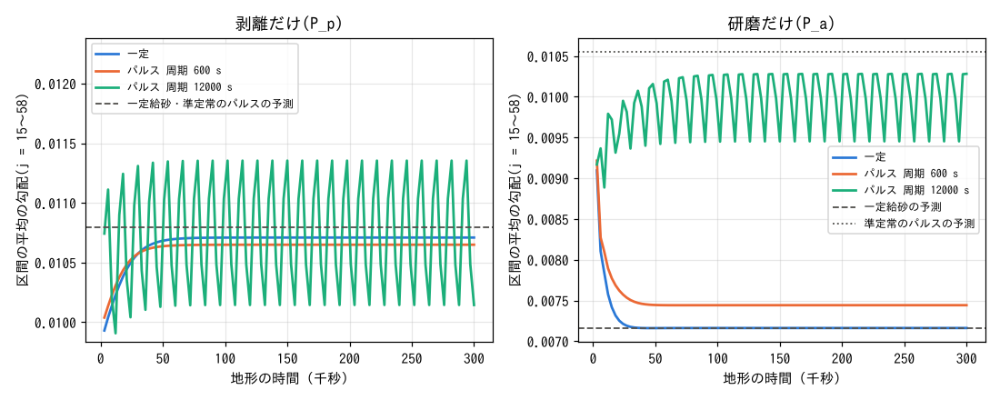

# mountain_valley — 山地の V 字谷: 斜面の土層と渓流の岩盤下刻の連成

[English](en/README.md)

隆起する山地の小さな V 字谷で、斜面(風化による土層の生成 `f_wthr` と深さ依存クリープ
`creep_hstar`)と渓流(流水による岩盤下刻 `f_rockinc` と掃流砂 `f_fluvial`)を同時に動かし、
斜面から届く土砂が渓流の定常勾配と下刻の担い手をどう変えるか、基準面の低下に谷がどう応じるかを
一つの計算で見ます([ユーザーガイド](../../docs/users_guide/geomorph.md)、式と出典は
[解説](../../docs/users_guide/sediment.md))。斜面だけ・渓流だけの定常の予測と比べ、補足として
急勾配礫床の抵抗分割を入れた場合と、同じ平均の給砂を一定とパルスで与えた場合の渓流の定常勾配を
比べます。値は現象を見やすくするための模式値で、特定の流域の再現ではありません。

## 実際の山地の谷で起きていること

- **土層の生成**: 斜面の岩盤は風化して土層になります。土層の生成速度は土層が厚いほど遅く
  (宇宙線生成核種で測った土層生成関数。Heimsath ら 1997)、侵食(隆起)と釣り合う厚さに
  落ち着きます。
- **斜面のクリープ**: 土層は、凍結融解や生物のかく乱などで少しずつ斜面を下ります(拡散型の
  過程。Culling 1960)。輸送量は勾配と土層の厚さの両方に依存し(Johnstone & Hilley 2015)、斜面が
  新しい侵食速度に調整される時間は、斜面の長さの 2 乗を拡散係数で割った程度です
  (Fernandes & Dietrich 1997)。
- **渓流への供給が被覆と道具になる**: 斜面から渓流に届いた土砂は、渓流の岩盤を削る道具にも、
  岩盤を覆って守る被覆にもなります(Sklar & Dietrich 2004。
  [examples/bedrock_cover](../bedrock_cover/README.md))。隆起に釣り合う渓流の定常の勾配は、
  礫が動き出す勾配に給砂を運ぶ増分と下刻の増分を足したもので、最も効くのは礫径、次が給砂です
  (Sklar & Dietrich 2006)。
- **削れるのは出水のときだけ**: 渓流が土砂を運び岩盤を削るのは出水の間だけで、斜面の風化・
  クリープ・隆起は一年中働きます。長期の平均は、河道を形成する代表の出水が年に流れる時間の
  割合(間欠係数)で換算します(Paola ら 1992。Sklar & Dietrich 2006 の基準地点では年 16 日)。
- **基準面の低下への応答**: 本流の下刻や隆起の加速で渓流の出口(基準面)が下がると、渓流は
  下刻して応じ、低下は渓流を上流へ伝わります。斜面はその後、脚部が下がって急になり、土層が
  薄くなることで応じます。斜面の調整は渓流よりずっと遅れます。
- **急勾配礫床の流砂量**: 急な渓流では、巨礫や段の形状抵抗のために、全抵抗の掃流力をそのまま
  流砂量式に入れると流砂量を桁で過大に見積もります(Rickenmann & Recking 2011、
  Nitsche ら 2011)。この例題は全抵抗の掃流力で計算し、補足で相対水深による抵抗分割を入れた
  場合と比べます。

## 再現に必要な機構



模式図。(a) 谷の横断: 隆起した岩盤が風化で土層になり、土層は深さ依存クリープで渓流へ下る。
渓流では出水が岩盤を剥がし、礫が削り、礫の被覆が下刻を抑える。(b) 渓流の縦断: 斜面から届く
土砂で下流ほど流砂量が増えて被覆が厚くなり、出口の行は隆起も下刻もしない基準面。(c) 時間の
扱い(暦の 1 年のうち出水だけを計算し、連続に働く過程の係数を換算する)と定常の予測の式。

| 実際の現象 | ENCflow での表し方 | 設定 |
|---|---|---|
| 山が隆起する | 一様な隆起速度 U。出口の行は倍率 0(基準面) | `f_uplift = 1`、`uplift0`、`fn_uplift` |
| 岩盤が風化して土層になる(厚いほど遅い) | 土層生成 W0 e^{−H/sd*}(Heimsath 型)。渓流と出口の行は倍率 0 | `f_wthr = 1`、`wthr_p0`・`wthr_sdstar`、`fn_wthr` |
| 土層が斜面を下る | 深さ依存クリープ q = D (1 − e^{−H/H_c}) S。東西の端は壁(分水界) | `f_creep = 1`、`creep_d`・`creep_hstar` |
| 出水が渓流を流れる | 浅水流。谷頭の渓流のセルに一定の形成流量、南辺は自由流出。斜面は乾いたまま(雨なし) | `&list_bound_inflow`、`f_bc_s = 1` |
| 礫が運ばれる | 掃流砂(芦田・道上の式)。土層と礫は同じ粒径の一つの可動層 | `f_fluvial = 1`、`fluv_d50` |
| 出水が岩盤を剥がし、礫が削り、被覆が守る | 流水による岩盤下刻(剥離 + 研磨)× 露出率 e^{−H/H*}。出口の行は倍率 0 | `f_rockinc = 1`、`rock_kp`・`rock_tauc`・`rock_m`・`rock_beta`・`rock_hstar`、`fn_rock` |
| 出水は年の一部だけ | 代表出水だけを計算し、連続に働く過程の係数を 1/i_f 倍して与える。地形の変化は morfac 倍 | `uplift0`・`wthr_p0`・`creep_d` の換算、`morfac` |
| 基準面の低下 | 出口の行の隆起の倍率を −1 にする(隆起の速さで下げる) | `fn_uplift`(up_drop.txt) |
| (補足)急勾配礫床の抵抗分割 | 流砂量式に渡す τ* に相対水深 h/D84 の係数を掛ける | `f_taupart = 1` |

**時間の扱い(間欠係数による換算)**: 代表出水(一定の形成流量)だけを計算し、出水は暦の 1 年の
うち F = 300 s(5 分。間欠係数 i_f = F / 1 年 = 9.5×10⁻⁶)だけ流れるとみなします(河道を形成する
代表の流れが時間の割合 I だけ起こるとし、長期平均の流砂量を I × 出水中の流砂量とする Paola ら
1992 の間欠係数の考え。粗い土砂はすべて代表の出水が運ぶとする Sklar & Dietrich 2006 の F_t も
同じ)。連続に働く過程の係数は 1/i_f 倍して与えます(隆起 `uplift0`・土層生成 `wthr_p0`・
クリープ `creep_d`。係数に線形な過程なので、その過程だけを暦の時間で進めることと同じに
なります)。暦の時間 = 出水の時間 / F × 1 年です。出水ごとの順序(無出水期に斜面の脚部へ溜まった
土砂を出水の始めに流す)は同時進行に置き換わります。

**定常の予測**(結果と比べる):

- 斜面: 岩盤面が動かない(土層生成 = 隆起: W0 e^{−H/sd*} = U)ので土層厚は
  H_ss = sd* ln(W0/U) = 0.549 m、地表面が動かない(クリープの発散 = 隆起)ので横断の曲率は
  ∇²z = −U/D_eff(D_eff = D (1 − e^{−H_ss/H_c}))。分水界の流束 0 と合わせ、渓流から k セル目の
  高さは (U/D_eff) Δx² (k L − k(k−1)/2)(L = 5 セル)で、分水界は渓流の底より 2.86 m 高くなります。
- 渓流: 定常では各セルで下刻速度 = 隆起速度、(E_p0(S) + β q)(1 − q/q_c(S)) = U(第 1 項が剥離、
  第 2 項が研磨。q は掃流砂の流砂量、q_c は容量)。q は谷頭から、剥離物(1:1 で可動層に入る)と
  斜面から届く土層(定常で片側 U × 20 m)を足して増えます(研磨の細粒分は系外へ出る)。等流の
  水理で谷頭から順に解いた勾配と、被覆の厚さ H* ln(1/(1 − q/q_c)) を比べます。

## 幾何と設定



左: 初期の地形(裸岩の V 字)。中上: 横断(初期と、定常の予測の放物線形)。中下: 縦断。右中:
倍率の分布(出口の行は隆起・風化・下刻なし、渓流は風化なし)。右: 主ケースの設定。

長さ 200 m(南北)× 幅 44 m、Δx = 4 m(11 × 50 セル)。中央の列が幅 1 セル(4 m)の渓流、両側に
長さ 20 m(5 セル)の斜面で、東西の端は分水界(壁)です。初期は裸岩(土層 0)の V 字で、谷底の
勾配 0.04、斜面の勾配 0.25 です。

- **水文**: 谷頭(北端)の渓流のセルに一定の形成流量 Q = 0.5 m³/s(等流水深 0.11 m)。斜面は
  乾いたまま(雨なし)。南辺は自由流出。
- **基準面**: 出口の行(j = 50)は隆起・風化・岩盤下刻のない基準面(`fn_uplift`・`fn_wthr`・
  `fn_rock` の倍率 0)。
- **渓流**: d50 = 3 cm、空隙率 0.4、被覆の長さ H* = 0.2 m。剥離 k_p = 8.9×10⁻⁸ m/s、τ_c = 10 Pa、
  m = 1.5、研磨 β = 6.6×10⁻⁴ 1/m(出水中の値)。渓流のセルは風化しません(`fn_wthr` の倍率 0)。
- **斜面(暦の値)**: 隆起 U = 0.1 mm/yr、裸岩の土層生成 W0 = 0.3 mm/yr(減衰深 sd* = 0.5 m。
  Heimsath 型)、クリープ D = 0.01 m²/yr(減衰厚 H_c = 0.3 m)。入力の値は暦の値を i_f で割った
  `uplift0` = 10519.2 mm/yr、`wthr_p0` = 3.15576×10⁷ mm/kyr、`creep_d` = 3.3333×10⁻⁵ m²/s です。
- **時間**: dt = 0.5 s、毎ステップの地形更新 × morfac 100(dts = 50 s。終了時の「max thin-layer
  drainage rate x dts」は 0.20)。暦の 20 万年(流れの時間 6×10⁵ s)、出力は 1 万年ごと。

| 構成 | 設定ファイル | 内容 |
|---|---|---|
| 斜面の供給なし | param_V_a.txt | 斜面の風化・クリープなし。渓流は自分の剥離物だけを運ぶ(斜面は裸岩のまま隆起する) |
| 完全連成(主ケース) | param_V_b.txt | 斜面の風化・深さ依存クリープあり |
| 基準面の低下 | param_V_c.txt | V_b の続き(暦の 20〜30 万年)。出口の行を隆起の速さ U で下げる(`up_drop.txt` の倍率 −1) |
| 解像度の確認 | param_V_b2.txt | V_b を Δx = 2 m で(21 × 100 セル。渓流の幅も 2 m) |
| 補足: 抵抗分割 | param_V_a_tp.txt | V_a に急勾配礫床の抵抗分割(f_taupart = 1、D84 = 2.2 d50)を足し、初期の谷底の勾配を 0.15 にする(`z_init_tp.txt`) |
| 補足: 給砂の時期 | param_P_p.txt・P_a | 幅 1 セルの水路 3 本に同じ平均の給砂を一定とパルスで与える(剥離だけ・研磨だけ。下の補足) |

## 実行方法

```
cd examples/mountain_valley
make                     # リンクと入力(make_init.py が地形・初期水深・土層厚・倍率の分布・給砂の時系列と param_*.txt を作る)
make run                 # V_a・V_b・V_c を順に計算(V_c は V_b の save から再開。合わせて約 15 分)
make run-2m              # V_b2(Δx = 2 m。mpirun -np 4 で約 30 分)
make run-supp            # 補足の V_a_tp(約 10 分)と P_p・P_a(各約 2 分)
python3 plot_setup.py    # figs/mechanism.png・setup.png(計算結果は使わない)
python3 plot_results.py  # figs/*.png と数表(引数 en で英語版を en/figs/ に)
```

V_b2 と補足の構成がなくても、ほかの図と数表は描けます。引数 `en` を付けると英語ラベルの図を
en/figs/ に描きます(`python3 plot_setup.py en`、`python3 plot_results.py en`)。図化には
Python 3・NumPy・matplotlib が要ります。

## 結果

(数表と図は 2026-10-28 以降の計算のもの。2026-11-02 に現行の既定(f_opening_dynamic = 3 と、運動量
保存形移流の側方面の修正後)で V_a・V_b・V_c を再計算し、出力が同一であることを確かめた。
developer.md §68.41〜§68.43)

### 斜面: 定常の土層と放物線形



- V 字の裸岩から、風化でできた土層がクリープで渓流へ運ばれ、斜面は放物線形に近づきます。
  20 万年(斜面の調整時間 L²/D_eff ≈ 4.8 万年の約 4 倍)で、谷の中央の半分の行の平均の高さは
  予測と 0.14 % 以内(0.951・1.713・2.284・2.665・2.856 m、予測 0.953〜2.858 m)、土層厚は
  0.548〜0.549 m(H_ss = 0.549 m)。初期の V 字は尾根が予測より高いので、斜面は上から予測に
  近づきます(5 万年で尾根 3.29 m、10 万年で 2.96 m)。

### 渓流: 斜面の供給が勾配と下刻の担い手を変える



| 構成 | 渓流の勾配(谷頭の行を除く) | 予測 | 被覆の厚さ | 研磨の割合 |
|---|---|---|---|---|
| V_a 斜面の供給なし | 0.0289〜0.0298 | 0.0289〜0.0298(差 0.01 % 以内) | 0.1〜2.3 cm | 4 % |
| V_b 斜面の供給あり | 0.0292〜0.0366 | 0.0293〜0.0367(差 0.4 % 以内) | 1.0〜16.1 cm | 24 % |
| V_b2 同上、Δx = 2 m(渓流の幅 2 m) | 0.0161〜0.0232 | 0.0162〜0.0233(差 0.7 % 以内) | 0.9〜24.0 cm | 34 % |

- 斜面の供給がないと、渓流の土砂は自分の剥離物だけで被覆は薄く、勾配はほぼ一様(0.029)。
  下刻はほとんど剥離です。
- 斜面の供給があると、下流ほど流砂量が増えて被覆が厚くなり(出口の近くで q/q_c ≈ 0.55)、
  露出した岩盤が減るぶん勾配が急になります(出口の近くで 0.037。供給なしの 1.23 倍)。
  同時に、運ばれる礫が道具になって研磨の割合が 4 % から 24 % に増えます。
- どちらも、渓流の定常の式に斜面の定常の供給を入れた予測に谷頭の直下から 0.4 % 以内で
  一致します。

### 解像度(Δx = 2 m)

V_b2 は格子幅を半分にした V_b で、幅 1 セルの渓流の幅も 2 m になります。同じ流量が狭い水路に
集まって単位幅の流量と掃流力が上がるので、渓流の勾配は 0.016〜0.023 と Δx = 4 m より緩くなり
ますが、それぞれの格子の予測と 0.7 % 以内で一致します(研磨の割合 34 %、出口の掃流砂の岩盤起源
3 %)。斜面は予測と高さ 0.06 %、土層厚は H_ss と 0.4 % 以内です(分水界の高さ 2.62 m。Δx = 4 m
の 2.86 m との差は斜面のセルの中心の位置の違いで、どちらも離散の予測どおり)。釣り合いの式は
格子によらず成り立ちますが、幅 1 セルの渓流では格子幅が渓流の幅を決めるので、勾配の値そのものは
格子に依存します。終了時の「max thin-layer drainage rate x dts」は 0.84 でしたが、過渡期の値で、
終了時の渓流のセルでは 0.10 以下です。

### 基準面の低下: 渓流はすぐ、斜面はゆっくり



- 出口の行を隆起の速さで下げ始めると(渓流から見た基準面の低下は 2U)、低下は渓流を上り、
  谷頭から 42 m の地点では 1〜2 万年後に下がり始め、3〜4 万年で出口と同じ速さ(U)になります。
  以後は渓流全体が新しい勾配(0.046〜0.049)で一様に下がります。
- 斜面の起伏(分水界 − 渓流の底)はずっと遅く、10 万年後も 6.5〜7.8 m で、新しい定常の予測
  9.77 m(浸食速度 2U では H_ss = 0.20 m、D_eff = 0.49 D)に向かって増え続けています。土層は
  脚部から薄くなり(谷の中央の平均 0.548 → 0.255 m)、クリープが遅くなる(D_eff が下がる)ぶん
  斜面は急になります。
- 出口に近い行(194 m)は起伏の増え方が早く頭打ちも早いのに対し、谷頭寄りの行は遅れて
  追いつきます。基準面の低下への応答は、渓流で数万年、斜面で 10 万年を超えます。

### 土砂の起源

V_b の 20 万年の台帳では、出口から出た掃流砂 1.79×10⁵ m³(かさ体積)のうち、岩盤から剥離した
ものは 1.22×10⁴ m³(7 %)で、残りは斜面の風化に由来します(研磨の細粒分 3.8×10³ m³ は掃流砂に
入らず系外へ)。定常では斜面と渓流の面積比(10:1)でほぼ決まる比です。風化起源の土砂が大半を
占めるので、岩盤から剥がれた礫と土層の粒径の違い(膨張係数を含む)は、渓流の被覆の扱いに直接
効きます(この例題では入れていません)。

## 補足: 急勾配礫床の抵抗分割を入れると(V_a_tp)

V_a_tp は V_a に `f_taupart = 1`(流砂量式に渡す τ* に相対水深 h/D84 の係数を掛ける抵抗分割。
D84 = 2.2 d50 = 6.6 cm。[解説](../../docs/users_guide/sediment.md) §3)を足した補足構成で、初期の
谷底の勾配だけを渓流の定常の式の予測(0.13〜0.18)に近い 0.15 にしています(`z_init_tp.txt`)。
この渓流の出水(単位幅 0.125 m²/s、等流水深 7〜11 cm)は h/D84 ≈ 1.1〜1.7 で、係数は 0.24〜0.36
です。

| 構成 | 渓流の勾配(谷頭の行を除く) | 予測 | 被覆の厚さ | 剥離(20 万年) | 出口の掃流砂 |
|---|---|---|---|---|---|
| V_a_tp 分割あり、初期勾配 0.15 | 0.124〜2.70(出口の行の手前に段) | 0.134〜0.178 | 1.2〜1.8 m | 1,853 m³(V_a の 12 %) | 9 m³(V_a の 0.1 %) |

- 分割を入れると、この渓流は剥離物を運べません。係数を掛けた τ* は勾配 0.15 で 0.054 と閾値
  (0.05)の付近にとどまり、勾配を上げてもほとんど増えないためです(等流では τ* ∝ S^0.7 ですが、
  浅くなるほど係数が下がり、h < D84 では φ τ* ∝ S^0.33)。被覆が 1 m 以上に厚くなって剥離が止まり、
  隆起で持ち上がる谷底と固定した出口の行の間に段ができます。V_a の地形(勾配 0.04)から始めても
  同じで(被覆 1.0〜1.4 m、剥離 828 m³)、定常の式の根(0.13〜0.18)には達しません(被覆が厚い
  状態からは戻れない)。
- つまり、この例題の定常の勾配 0.029 と「下刻は剥離が主」という結果は、全抵抗の τ* で流砂量を
  評価する仮定に依っています。分割を使うなら、出水の流量・粒径・勾配の組合せを見直す必要が
  あります(図には入れていません)。

## 補足: 給砂の時期(同じ平均の一定給砂とパルス)

斜面から渓流への供給は、崩壊のように間欠的なことがあります。平均が同じでも、一度に来る供給と
少しずつ来る供給で渓流の定常勾配は変わるかを、斜面を入れずに谷頭からの給砂で代えた幅 1 セルの
水路で比べます(隆起の下の定常。[examples/bedrock_cover](../bedrock_cover/README.md) の給砂の
時期の比較を隆起の下で行うもの)。

| 項目 | 値 |
|---|---|
| 水路 | 幅 1 セル(Δx = 1 m)、長さ 60 m、勾配 0.01 から、n = 0.04、Q = 0.336 m³/s(等流水深 0.3 m)。両岸は +2 m の乾いた地盤で、水路を東西に 3 本並べる(互いに影響しない) |
| 隆起と基準面 | U = 10⁻⁵ m/s(出水中の値)の一様隆起、出口の行は隆起も侵食もしない |
| 礫と被覆 | d50 = 1 cm、空隙率 0.4、H* = 5 cm。裸岩から |
| 下刻 | `P_p` は剥離だけ(k_p = 6×10⁻⁶ m/s、τ_c = 10 Pa、m = 1.5)、`P_a` は研磨だけ(β = 0.05 1/m) |
| 給砂 | 平均の給砂比 0.4(q_m = 0.4 × 1.81×10⁻³ m²/s)。水路ごとに、一定、半分の時間だけ 0.8 で給砂するパルス(周期 600 s・12000 s。地形の時間)。パルスは時系列ファイル `p_qb_short.txt`・`p_qb_long.txt`(`fn_inflow_qb`)。同じ時間の総量は同じ |
| 時間 | dt = 0.1 s、morfac 10(dts = 1 s)。地形の時間 3×10⁵ s、出力は 3000 s ごと。統計は最後の 32 区間(長周期の 8 周期) |



| モデル | 一定 | パルス 周期 600 s | パルス 周期 12000 s(振れ幅) | 予測 |
|---|---|---|---|---|
| 剥離だけ | 0.01071 | 0.01065 | 0.01075(0.01014〜0.01135) | 0.01080(一定・準定常のパルスとも) |
| 研磨だけ | 0.00716 | 0.00744 | 0.01000(0.00945〜0.01028) | 一定 0.00716、準定常のパルス 0.01055 |

- **剥離だけ**: 給砂の時期は平均の勾配をほとんど変えません(1 % 以内)。露出率 1 − q/q_c が
  流砂量 q に線形なので、準定常では時間平均の下刻速度が平均の給砂だけで決まります。長周期の
  パルスでは、勾配が給砂に合わせて ±6 % 振れます。
- **研磨だけ**: 長周期のパルスでは平均の勾配が 1.40 倍になります。給砂のない間は道具がなくて
  削れず、給砂の間は被覆が厚く露出が少ないので、同じ平均の給砂でも下刻の効率が落ち、隆起に
  見合う下刻には急な勾配が要ります(準定常の予測 0.01055 よりやや緩いのは、被覆の厚さが給砂の
  切り替えに遅れる分)。短周期のパルスは水路を流れる間にならされて一定給砂に近づきます(4 % 急)。
- **被覆の期間と出口の流出**: 長周期のパルスでは、区間の中央で被覆が H* を超える時間が半分
  (一定給砂では剥離だけで 0、研磨だけで常に)。出口の流出は 3000 s ごとに変動係数 0.39(剥離
  だけ)・0.63(研磨だけ)で振れ、短周期のパルスはその間隔ではならされます(変動係数 0)。
- 給砂の時期の効果は研磨(道具)が効く岩盤ほど大きく、パルスの周期が被覆の応答時間より長いときに
  現れる、という examples/bedrock_cover(隆起なし)の答えが、隆起の下の定常勾配でも成り立ちます。

## このモデルで表せないこと(実際の現象との違い)

- **渓流の幅**: 渓流は幅 1 セルの水路で、谷底の幅(氾濫原)、側岸の後退、川幅の変化は表しません。
  幅 1 セルの渓流では格子幅が川幅を決めるので、勾配の値そのものは格子に依存します(解像度の
  結果)。
- **斜面の過程**: 斜面は乾いたまま(雨なし)で、斜面の面状流・崩壊・土石流は入れていません。
  土層の生成とクリープは係数の式(Heimsath 型・拡散型)で、凍結融解や生物のかく乱などの個々の
  過程は解きません。
- **時間**: 間欠係数による換算で、出水ごとの土砂の溜まり方と流れ方の順序は表れません。出水は
  一定の形成流量で、出水の大きさの分布はありません。係数は模式値で、実際の年代に合わせて
  いません。
- **粒径**: 礫と土層は同じ粒径(d50 = 3 cm)の一つの可動層として扱います(風化でできた土層が
  そのまま渓流の礫になる)。岩盤から剥がれた岩塊と土層の粒径の違い(膨張係数を含む)、運ばれる
  間の摩耗は表しません。
- **急勾配の流れの抵抗**: 流れの抵抗は一定の Manning n で、浅い流れで相対水深とともに増える
  抵抗は表しません。補足の抵抗分割は流砂量に渡す掃流力だけを縮めます。

## 注意

- **更新間隔**: 1 回の地形更新の地形の時間 dts = dt × morfac は、薄い被覆の排出の目安(終了時の
  「max thin-layer drainage rate x dts」が 0.5 を十分下回る)に合わせます(主ケースは dts = 50 s で
  0.20)。補足の給砂の時期の水路を dts = 5 s(morfac 50)で回すと、研磨だけの水路でこの値が 1.8
  になり、短周期のパルスの勾配が一定給砂より緩く出ました(0.00689)。dts = 1 s と 0.5 s の勾配の
  差は 0.7 % 以内です。
- **基準面の低下の再開**: V_c は V_b の save から再開します(`cp -r save_V_b save_V_c`。
  `f_state_restore = 1` で t0 は保存した計算と同じ 0、tt は通しの終了時刻)。make run はこの手順を
  含みます。
- **急勾配の底面せん断**: Δx = 4 m の 1 セル幅の渓流は等流に一致しますが(V/V_Manning は谷頭の
  直下から 1 ± 0.001)、急勾配で幅のある流れでは底面せん断が格子に依存して大きめに出ます
  (developer.md §89.4)。
- 検証は [test/hillsoil](../../test/hillsoil/README.md)(斜面だけの定常)と
  [test/rockinc](../../test/rockinc/README.md)(谷頭の給砂の下の渓流の定常勾配)。設計の経緯は
  docs/mountain_stream_plan.md。

## 感度実験の入口

make_init.py の定数を変えて `python3 make_init.py` を実行すると、入力と param_*.txt が書き直されます。

- `U_CAL`・`W0_CAL`・`SDSTAR`(隆起と土層生成): 定常の土層厚 H_ss = sd* ln(W0/U) が変わります
  (W0 ≤ U では土層が残らない)。`D_CAL`・`HC`(クリープ): 斜面の起伏と調整時間 L²/D_eff。
- `QF`・`S0`(形成流量と初期の谷底の勾配)、`D50`・`HSTAR`(礫径と被覆の長さ)、`KP`・`BETA`
  (剥離と研磨の比): 渓流の定常の勾配と被覆の厚さ。
- `F_FLOOD`(出水の時間 = 間欠係数): 出水 1 回あたりに渓流へ届く土砂(= 被覆の効き方)を
  決めます。`T_DROP`(基準面の低下の期間)。
- `GRIDS`(Δx = 4 m・2 m)、`CASE_S0`(補足の初期勾配)、`P_RM`・`P_SHORT`・`P_LONG`(補足の
  パルスの平均の給砂比と周期)。

## 参考文献

- Culling, W. E. H. (1960): Analytical theory of erosion. *J. Geol.*, 68, 336–344.(斜面の線形拡散モデル)
- Fernandes, N. F. and Dietrich, W. E. (1997): Hillslope evolution by diffusive processes: The timescale
  for equilibrium adjustments. *Water Resour. Res.*, 33, 1307–1318.
- Heimsath, A. M., Dietrich, W. E., Nishiizumi, K. and Finkel, R. C. (1997): The soil production function
  and landscape equilibrium. *Nature*, 388, 358–361.
- Johnstone, S. A. and Hilley, G. E. (2015): Lithologic control on the form of soil-mantled hillslopes.
  *Geology*, 43(1), 83–86. doi:10.1130/G36052.1(要旨で確認)
- Nitsche, M., Rickenmann, D., Turowski, J. M., Badoux, A. and Kirchner, J. W. (2011): Evaluation of
  bedload transport predictions using flow resistance equations to account for macro-roughness in steep
  mountain streams. *Water Resour. Res.*, 47, W08513. doi:10.1029/2011WR010645
- Paola, C., Heller, P. L. and Angevine, C. L. (1992): The large-scale dynamics of grain-size variation in
  alluvial basins, 1: Theory. *Basin Res.*, 4, 73–90.(間欠係数)
- Rickenmann, D. and Recking, A. (2011): Evaluation of flow resistance in gravel-bed rivers through a large
  field data set. *Water Resour. Res.*, 47, W07538. doi:10.1029/2010WR009793
- Sklar, L. S. and Dietrich, W. E. (2004): A mechanistic model for river incision into bedrock by saltating
  bed load. *Water Resour. Res.*, 40, W06301. doi:10.1029/2003WR002496
- Sklar, L. S. and Dietrich, W. E. (2006): The role of sediment in controlling steady-state bedrock channel
  slope: Implications of the saltation–abrasion incision model. *Geomorphology*, 82, 58–83.
  doi:10.1016/j.geomorph.2005.08.019
