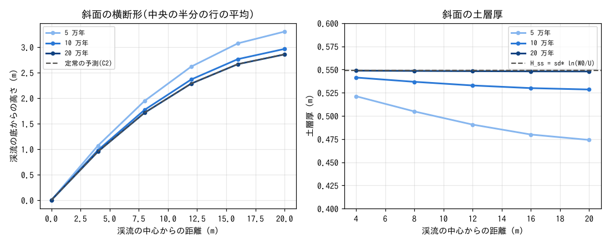
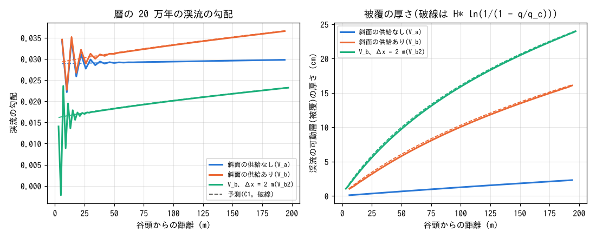
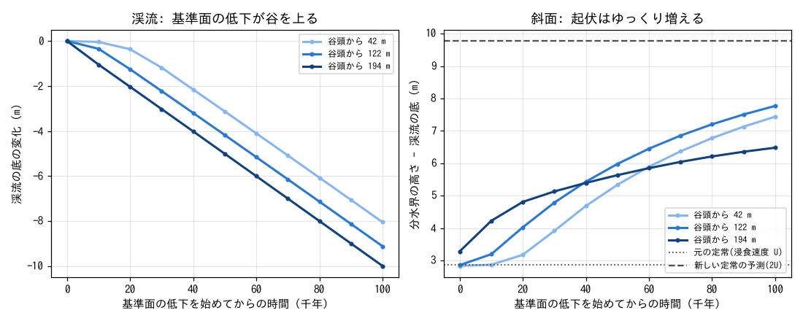
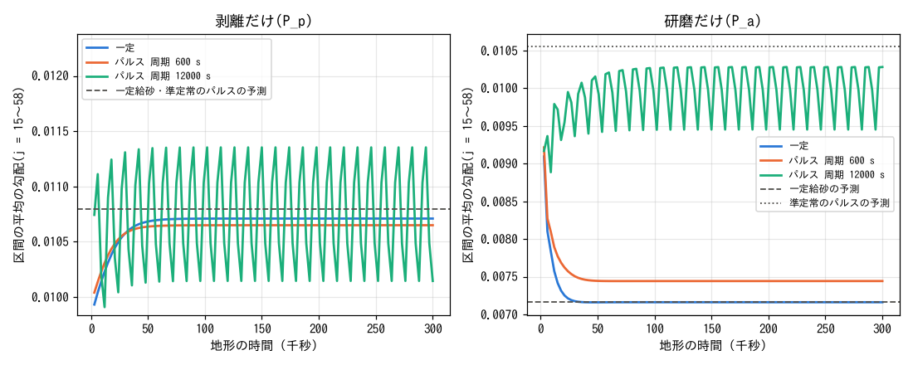

# examples/mountain_valley — 山地の V 字谷: 斜面の土層と渓流の岩盤下刻の連成

[English](en/README.md)

隆起する山地の小さな V 字谷で、斜面(風化による土層の生成 `f_wthr` と深さ依存クリープ
`creep_hstar`)と渓流(流水による岩盤下刻 `f_rockinc` と掃流砂 `f_fluvial`)を同時に動かし、
斜面から届く土砂が渓流の定常勾配と下刻の担い手をどう変えるか、基準面の低下に谷がどう応じるかを
見ます([ユーザーガイド](../../docs/users_guide/geomorph.md)、式と出典は
[解説](../../docs/users_guide/sediment.md))。docs/mountain_stream_plan.md §11 の C3(完全連成)
です。斜面だけの検定は [test/hillsoil](../../test/hillsoil/) の C2、渓流だけの検定は
[test/rockinc](../../test/rockinc/) の T11(C1)にあり、この例題はその 2 つの予測を組み合わせた
ものと比べます。後半の C4 では、同じ平均の給砂を一定とパルスで与えたときの渓流の定常勾配を
比べます。値は説明用で、特定の流域の校正値ではありません。

## 時間の扱い(間欠係数による換算)

渓流が土砂を運び岩盤を削るのは出水のときだけで、斜面の風化・クリープ・隆起は一年中働きます。
ここでは代表出水(一定の形成流量)だけを計算し、出水は暦の 1 年のうち F = 300 s(5 分。
間欠係数 i_f = F / 1 年 = 9.5e-6)だけ流れるとみなします(河道を形成する代表の流れが
時間の割合 I だけ起こるとし、長期平均の流砂量を I × 出水中の流砂量とする Paola ら 1992 の
間欠係数の考え。粗い土砂はすべて代表の出水が運ぶとする Sklar & Dietrich 2006 の F_t も同じで、
同論文の参照地点では F_t = 0.0437 = 年 16 日)。連続に働く過程の係数は 1/i_f 倍して
与えます(隆起 `uplift0`・土層生成 `wthr_p0`・クリープ `creep_d`。係数に線形な過程なので、
その過程だけを暦の時間で進めることと同じになります。developer.md §89.11 の 2)。暦の時間 =
出水の時間 / F × 1 年です。出水ごとの順序(無出水期に斜面の脚部へ溜まった土砂を出水の始めに
流す)は同時進行に置き換わります。

## 設定

| 項目 | 値 |
|---|---|
| 谷 | 長さ 200 m(南北)× 幅 44 m。Δx = 4 m(11 × 50 セル)。中央の列が幅 1 セル(4 m)の渓流、両側に長さ 20 m(5 セル)の斜面。東西の端は分水界(壁) |
| 初期の地形 | 裸岩(土層 0)の V 字。谷底の勾配 0.04、斜面の勾配 0.25 |
| 水文 | 谷頭(北端)の渓流のセルに一定の形成流量 Q = 0.5 m³/s(等流水深 0.11 m)。斜面は乾いたまま(雨なし)。南辺は自由流出。塞がれた開口の動的振り替えは `f_opening_dynamic = 3`(塞がりを局所の平面から測る。[浅水流の章](../../docs/users_guide/swflow.md)、developer.md §68.41)。両側が斜面の 1 セル幅の渓流なので、結果は既定の 2 とバイト一致する(2026-10-29 に V_a・V_b・V_b2・V_c で確認) |
| 基準面 | 出口の行(j = 50)は隆起・風化・岩盤下刻のない基準面(`fn_uplift`・`fn_wthr`・`fn_rock` の倍率 0) |
| 渓流 | d50 = 3 cm、空隙率 0.4、被覆の長さ H* = 0.2 m。剥離 k_p = 8.9e-8 m/s、τ_c = 10 Pa、m = 1.5、研磨 β = 6.6e-4 1/m(出水中の値)。渓流のセルは風化しない(`fn_wthr` の倍率 0。developer.md §89.13) |
| 斜面(暦の値) | 隆起 U = 0.1 mm/yr、裸岩の土層生成 W0 = 0.3 mm/yr(減衰深 sd* = 0.5 m。Heimsath 型)、クリープ D = 0.01 m²/yr(減衰厚 H_c = 0.3 m) |
| 入力の値 | `uplift0` = 10519.2 mm/yr、`wthr_p0` = 3.15576e7 mm/kyr、`creep_d` = 3.3333e-5 m²/s(暦の値 / i_f) |
| 時間 | dt = 0.5 s、毎ステップの地形更新 × morfac 100(dts = 50 s。終了時の「max thin-layer drainage rate x dts」は 0.20)。暦の 20 万年(流れの時間 6e5 s)、出力は 1 万年ごと |

| 構成 | 内容 |
|---|---|
| `param_V_a.txt` | 斜面の風化・クリープなし。渓流は自分の剥離物だけを運ぶ(斜面は裸岩のまま隆起する) |
| `param_V_b.txt` | 斜面の風化・深さ依存クリープあり(完全連成) |
| `param_V_c.txt` | V_b の続き(暦の 20〜30 万年)。出口の行を隆起の速さ U で下げる(基準面の低下。`up_drop.txt` の倍率 −1) |
| `param_V_b2.txt` | V_b を Δx = 2 m で(21 × 100 セル。渓流の幅も 2 m。解像度の確認) |

| ファイル | 内容 |
|---|---|
| `make_init.py` | 地形・初期水深・土層厚・倍率の分布・給砂の時系列と `param_*.txt` を書く(定数は `plot_results.py` と対) |
| `plot_results.py` | 図 `figs/*.png`(`en` で `en/figs/`)と数表(標準出力。予測との比較と台帳) |

## 実行

```bash
make                                   # ../../bin/ の実行ファイルへのリンク
python3 make_init.py                   # 入力と param_*.txt(同梱のものと同じ)を書く
./encflow param_V_a.txt > Screen_V_a.log      # 約 6 分
./encflow param_V_b.txt > Screen_V_b.log      # 約 7 分
cp -r save_V_b save_V_c                       # V_c は V_b の save から再開する
./encflow param_V_c.txt > Screen_V_c.log      # 約 3 分
mpirun -np 4 ./encflow_mpi param_V_b2.txt > Screen_V_b2.log   # Δx = 2 m(4 ランクで約 30 分)
python3 plot_results.py | tee analysis.txt    # 図と数表(python3 plot_results.py en で英語版の図)
```

V_b2 がなくても、ほかの図と数表は描けます。

## 予測(C1・C2)

**斜面(C2)**: 定常では岩盤面が動かない(土層生成 = 隆起: W0 e^{−H/sd*} = U)ので土層厚は
H_ss = sd* ln(W0/U) = 0.549 m、地表面が動かない(クリープの発散 = 隆起)ので横断の曲率は
∇²z = −U/D_eff(D_eff = D (1 − e^{−H_ss/H_c}))。分水界の流束 0 と合わせ、渓流から k セル目の
高さは (U/D_eff) Δx² (k L − k(k−1)/2)(L = 5 セル)で、分水界は渓流の底より 2.86 m 高くなります。

**渓流(C1)**: 定常では各セルで下刻速度 = 隆起速度
(E_p0(S) + β q)(1 − q/q_c(S)) = U(第 1 項が剥離、第 2 項が研磨。q は掃流砂の流砂量、q_c は容量)。
q は谷頭から、剥離物(1:1 で可動層に入る)と斜面から届く土層(定常で片側 U × 20 m)を
足して増えます(研磨の細粒分は系外へ出る)。等流の水理で谷頭から順に解いた勾配と、被覆の厚さ
H* ln(1/(1 − q/q_c))を比べます(test/rockinc の T11 の式に横からの供給を足したもの)。

## 結果

2026-10-28 に区間流入の流入面の水深の床(developer.md §89.25)を直した後に回し直した値です。

### 斜面: 定常の土層と放物線形



- V 字の裸岩から、風化でできた土層がクリープで渓流へ運ばれ、斜面は放物線形に近づきます。
  20 万年(斜面の調整時間 L²/D_eff ≈ 4.8 万年の約 4 倍)で、谷の中央の半分の行の平均の高さは
  予測と 0.14 % 以内(0.951・1.713・2.284・2.665・2.856 m、予測 0.953〜2.858 m)、土層厚は
  0.548〜0.549 m(H_ss = 0.549 m)。初期の V 字は尾根が予測より高いので、斜面は上から予測に
  近づきます(5 万年で尾根 3.29 m、10 万年で 2.96 m)。

### 渓流: 斜面の供給が勾配と下刻の担い手を変える



| 構成 | 渓流の勾配(谷頭の行を除く) | 予測(C1) | 被覆の厚さ | 研磨の割合 |
|---|---|---|---|---|
| V_a 斜面の供給なし | 0.0289〜0.0298 | 0.0289〜0.0298(差 0.01 % 以内) | 0.1〜2.3 cm | 4 % |
| V_b 斜面の供給あり | 0.0292〜0.0366 | 0.0293〜0.0367(差 0.4 % 以内) | 1.0〜16.1 cm | 24 % |
| V_b2 同上、Δx = 2 m(渓流の幅 2 m) | 0.0161〜0.0232 | 0.0162〜0.0233(差 0.7 % 以内) | 0.9〜24.0 cm | 34 % |

- 斜面の供給がないと、渓流の土砂は自分の剥離物だけで被覆は薄く、勾配はほぼ一様(0.029)。
  下刻はほとんど剥離です。
- 斜面の供給があると、下流ほど流砂量が増えて被覆が厚くなり(出口の近くで q/q_c ≈ 0.55)、
  露出した岩盤が減るぶん勾配が急になります(出口の近くで 0.037。供給なしの 1.23 倍)。
  同時に、運ばれる礫が道具になって研磨の割合が 4 % から 24 % に増えます。
- どちらも、C1 の式に斜面の定常の供給を入れた予測に谷頭の直下から 0.4 % 以内で一致します。
  2026-10-28 に区間流入の流入面の水深の床を直す前(developer.md §89.25)は、流入セルの効果で谷頭の
  直下に減衰する段差ができたので、比較は谷頭から約 40 m より下流にしていました(§89.6)。

### 解像度(Δx = 2 m)

V_b2 は格子幅を半分にした V_b で、幅 1 セルの渓流の幅も 2 m になります。同じ流量が狭い
水路に集まって単位幅の流量と掃流力が上がるので、渓流の勾配は 0.016〜0.023 と Δx = 4 m より
緩くなりますが、それぞれの格子の C1 の予測と 0.7 % 以内で一致します(研磨の割合 34 %、出口の
掃流砂の岩盤起源 3 %)。斜面は C2 の予測と高さ 0.06 %、土層厚は H_ss と 0.4 % 以内です
(分水界の高さ 2.62 m。Δx = 4 m の 2.86 m との差は斜面のセルの中心の位置の違いで、どちらも
離散の予測どおり)。釣り合いの式は格子によらず成り立ちますが、幅 1 セルの渓流では格子幅が
渓流の幅を決めるので、勾配の値そのものは格子に依存します。終了時の「max thin-layer drainage
rate x dts」は 0.84 でしたが、過渡期の値で、終了時の渓流のセルでは 0.10 以下です。

### 基準面の低下: 渓流はすぐ、斜面はゆっくり



- 出口の行を隆起の速さで下げ始めると(渓流から見た基準面の低下は 2U)、低下は渓流を上り、
  谷頭から 42 m の地点では 1〜2 万年後に下がり始め、3〜4 万年で出口と同じ速さ(U)になります。
  以後は渓流全体が新しい勾配(0.046〜0.049)で一様に下がります。
- 斜面の起伏(分水界 − 渓流の底)はずっと遅く、10 万年後も 6.5〜7.8 m で、新しい定常の予測
  9.77 m(浸食速度 2U では H_ss = 0.20 m、D_eff = 0.49 D)に向かって増え続けています。土層は
  脚部から薄くなり(谷の中央の平均 0.548 → 0.255 m)、クリープが遅くなる(D_eff が下がる)ぶん
  斜面は急になります。
- 出口に近い行(194 m)は起伏の増え方が早く頭打ちも早いのに対し、谷頭寄りの行は遅れて
  追いつきます。基準面の低下への応答は、渓流で数万年、斜面で 10 万年を超えます。

### 土砂の起源

V_b の 20 万年の台帳では、出口から出た掃流砂 1.79e5 m³(かさ体積)のうち、岩盤から剥離した
ものは 1.22e4 m³(7 %)で、残りは斜面の風化に由来します(研磨の細粒分 3.8e3 m³ は掃流砂に
入らず系外へ)。定常では斜面と渓流の面積比(10:1)でほぼ決まる比です。風化起源の土砂が
大半を占めるので、岩盤から剥がれた礫と土層の粒径の違い(膨張係数を含む)は、渓流の被覆の
扱いに直接効きます(docs/mountain_stream_plan.md §4.1。この段では入れていない)。

## 給砂の時期: 同じ平均の一定給砂とパルス(C4)

斜面から渓流への供給は、崩壊のように間欠的なことがあります。平均が同じでも、一度に来る
供給と少しずつ来る供給で渓流の定常勾配は変わるかを、test/rockinc の T11(C1)と同じ幅 1 セルの
水路で比べます(docs/mountain_stream_plan.md §11.3 の C4。斜面は入れず、谷頭からの給砂で代える)。

| 項目 | 値 |
|---|---|
| 水路 | 幅 1 セル(Δx = 1 m)、長さ 60 m、勾配 0.01 から、n = 0.04、Q = 0.336 m³/s(等流水深 0.3 m)。両岸は +2 m の乾いた地盤で、水路を東西に 3 本並べる(互いに影響しない)。動的振り替えは `f_opening_dynamic = 3`(上の谷と同じ)で、両岸が高い 1 セル幅の水路なので結果は 2 とバイト一致する(2026-10-29 に P_a・P_p で確認) |
| 隆起と基準面 | U = 1e-5 m/s(出水中の値)の一様隆起、出口の行は隆起も侵食もしない |
| 礫と被覆 | d50 = 1 cm、空隙率 0.4、H* = 5 cm。裸岩から |
| 下刻 | `P_p` は剥離だけ(k_p = 6e-6 m/s、τ_c = 10 Pa、m = 1.5)、`P_a` は研磨だけ(β = 0.05 1/m) |
| 給砂 | 平均の給砂比 0.4(q_m = 0.4 × 1.81e-3 m²/s)。水路ごとに、一定、半分の時間だけ 0.8 で給砂するパルス(周期 600 s・12000 s。地形の時間)。パルスは時系列ファイル `p_qb_short.txt`・`p_qb_long.txt`(`fn_inflow_qb`)。同じ時間の総量は同じ |
| 時間 | dt = 0.1 s、morfac 10(dts = 1 s)。地形の時間 3e5 s、出力は 3000 s ごと。統計は最後の 32 区間(長周期の 8 周期) |

```bash
./encflow param_P_p.txt > Screen_P_p.log   # 約 2 分
./encflow param_P_a.txt > Screen_P_a.log   # 約 2 分
```



| モデル | 一定 | パルス 周期 600 s | パルス 周期 12000 s(振れ幅) | 予測 |
|---|---|---|---|---|
| 剥離だけ | 0.01071 | 0.01065 | 0.01075(0.01014〜0.01135) | 0.01080(一定・準定常のパルスとも) |
| 研磨だけ | 0.00716 | 0.00744 | 0.01000(0.00945〜0.01028) | 一定 0.00716、準定常のパルス 0.01055 |

- **剥離だけ**: 給砂の時期は平均の勾配をほとんど変えません(1 % 以内)。露出率 1 − q/q_c が
  流砂量 q に線形なので、準定常では時間平均の下刻速度が平均の給砂だけで決まります。長周期の
  パルスでは、勾配が給砂に合わせて ±6 % 振れます。
- **研磨だけ**: 長周期のパルスでは平均の勾配が 1.40 倍になります。給砂のない間は道具がなくて
  削れず、給砂の間は被覆が厚く露出が少ないので、同じ平均の給砂でも下刻の効率が落ち、隆起に
  見合う下刻には急な勾配が要ります(準定常の予測 0.01055 よりやや緩いのは、被覆の厚さが給砂の
  切り替えに遅れる分)。短周期のパルスは水路を流れる間にならされて一定給砂に近づきます(4 % 急)。
- **被覆の期間と出口の流出**: 長周期のパルスでは、区間の中央で被覆が H* を超える時間が半分
  (一定給砂では剥離だけで 0、研磨だけで常に)。出口の流出は 3000 s ごとに変動係数 0.39(剥離だけ)・
  0.63(研磨だけ)で振れ、短周期のパルスはその間隔ではならされます(変動係数 0)。
- 給砂の時期の効果は研磨(道具)が効く岩盤ほど大きく、パルスの周期が被覆の応答時間より長いときに
  現れる、という examples/bedrock_cover の B(隆起なし)の答えが、隆起の下の定常勾配でも
  成り立ちます。
- **更新間隔**(2026-10-27 の確認): dts = 5 s(morfac 50)では研磨だけの水路で「薄層の排出率 × dts」の最大が 1.8 に
  なり、短周期のパルスの勾配が一定給砂より緩く出ました(0.00689)。dts = 1 s と 0.5 s の勾配の
  差は 0.7 % 以内です。

## 注意(この例題の範囲)

- 渓流は幅 1 セルの水路で、谷底の幅(氾濫原)や側岸の後退は表しません。斜面は乾いたまま
  (雨なし)で、斜面の面状流・崩壊・土石流は入れていません。
- 時間は間欠係数による換算です。出水ごとの土砂の溜まり方と流れ方の順序は表れません。
- 礫と土層は同じ粒径(d50 = 3 cm)の 1 つの可動層として扱います(風化でできた土層がそのまま
  渓流の礫になる)。
- Δx = 4 m の 1 セル幅の渓流は等流に一致しますが(V/V_Manning は谷頭の直下から 1 ± 0.001。
  流入面の床を直す前は谷頭から 42 m より下流で 1 ± 0.005)、
  急勾配で幅のある流れでは底面せん断が格子に依存して大きめに出ます(developer.md §89.4)。

## 関連文書

- [ユーザーガイド: 地形変化](../../docs/users_guide/geomorph.md)、[解説](../../docs/users_guide/sediment.md)
  (土層生成関数 Heimsath ら 1997、クリープの係数 Fernandes & Dietrich 1997、被覆と道具
  Sklar & Dietrich 2004、定常勾配 Sklar & Dietrich 2006、間欠係数 Paola ら 1992・
  Sklar & Dietrich 2006)
- [test/hillsoil](../../test/hillsoil/README.md)(C2: 斜面だけの定常)、
  [test/rockinc](../../test/rockinc/README.md)(T11 = C1: 谷頭の給砂の下の渓流の定常勾配)、
  [examples/bedrock_cover](../../examples/bedrock_cover/README.md)(岩盤河道の被覆効果)
- docs/mountain_stream_plan.md §11(連成実験の方針)、developer.md §89.11〜§89.17
