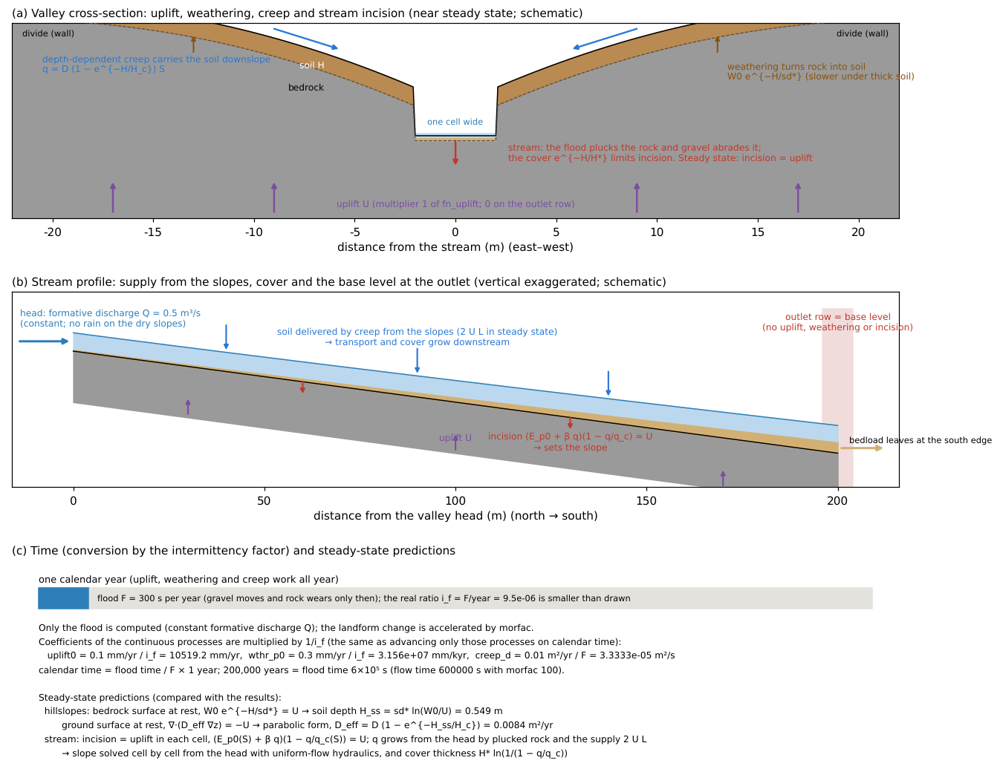
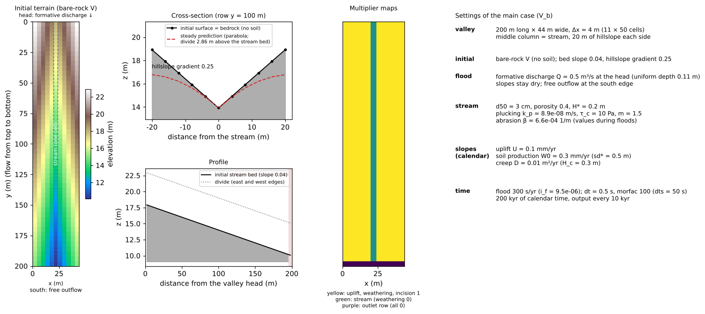
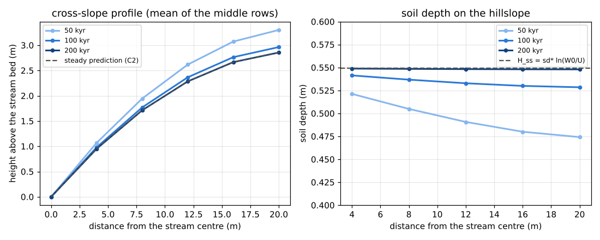
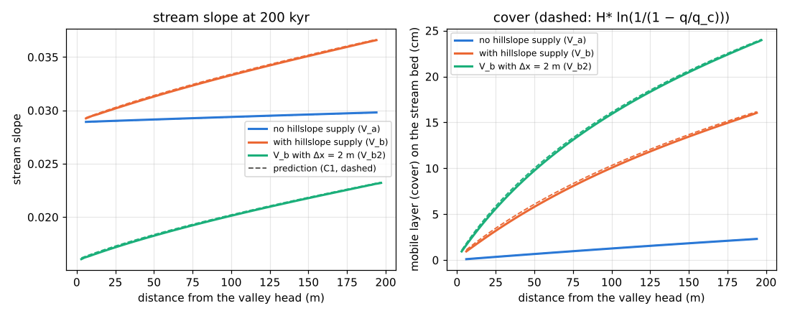
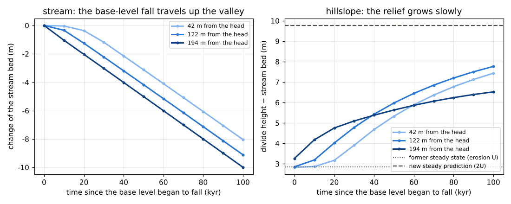
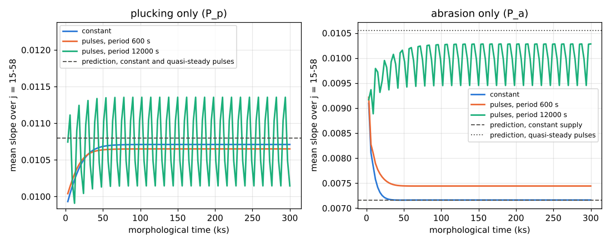

# mountain_valley — A V-shaped mountain valley: coupling hillslope soil and bedrock incision in the stream

> English mirror of examples/mountain_valley/README.md. The Japanese file is the master copy.

[日本語](../README.md)

In a small V-shaped valley in rising mountains, this example runs the hillslopes (soil
production by weathering, `f_wthr`, and depth-dependent creep, `creep_hstar`) and the stream
(bedrock incision by flowing water, `f_rockinc`, and bedload, `f_fluvial`) together in one
run, and looks at how the sediment delivered from the hillslopes changes the steady slope of
the stream and what does the incision, and how the valley responds to a fall of the base level
([users guide](../../../docs/en/users_guide/geomorph.md); equations and sources in the
[supplement](../../../docs/en/users_guide/sediment.md)). The results are compared with the
steady-state predictions for the hillslopes alone and for the stream alone, and two supplements
compare the steady slope of the stream with the resistance partitioning on steep gravel beds,
and under the same mean supply given constantly or in pulses. The values are illustrative,
chosen to make the phenomena easy to see, not a reproduction of any particular catchment.

## What happens in a real mountain valley

- **Soil production**: the bedrock of the hillslopes weathers into soil. Soil is produced more
  slowly the thicker it is (the soil production function measured with cosmogenic nuclides;
  Heimsath et al. 1997), and the soil settles at the thickness that balances erosion (uplift).
- **Hillslope creep**: the soil moves slowly downslope by freeze–thaw, bioturbation and the like
  (a diffusive process; Culling 1960). The flux depends on both the slope and the soil thickness
  (Johnstone & Hilley 2015), and the time for a hillslope to adjust to a new erosion rate is of
  the order of the slope length squared divided by the diffusivity (Fernandes & Dietrich 1997).
- **Supply to the stream becomes cover and tools**: the sediment delivered to the stream from the
  hillslopes is both the tool that wears the stream's bedrock and the cover that protects it
  (Sklar & Dietrich 2004; [examples/bedrock_cover](../../bedrock_cover/en/README.md)). The steady
  slope of the stream that balances uplift is the slope at which the gravel starts to move plus
  increments to carry the supply and for the incision; grain size matters most, supply next
  (Sklar & Dietrich 2006).
- **Erosion happens only during floods**: the stream carries sediment and wears the bedrock only
  during floods, while weathering, creep and uplift on the hillslopes work all year. The long-term
  mean is obtained with the fraction of the year in which the representative channel-forming flood
  flows (the intermittency factor; Paola et al. 1992; 16 days per year at the reference site of
  Sklar & Dietrich 2006).
- **Response to a base-level fall**: when the outlet of the stream (the base level) falls because
  the main river incises or uplift accelerates, the stream responds by incising and the fall
  travels upstream along the stream. The hillslopes respond afterwards: their feet are lowered,
  they steepen and their soil thins. The adjustment of the hillslopes lags far behind the stream.
- **Bedload in steep gravel-bed streams**: in steep streams the form resistance of boulders and
  steps means that putting the total-resistance shear stress straight into a transport formula
  overestimates the transport by orders of magnitude (Rickenmann & Recking 2011; Nitsche et al.
  2011). This example computes with the total-resistance stress, and a supplement compares it with
  the resistance partitioning by relative depth.

## Mechanisms needed for the reproduction



Schematic. (a) Valley cross-section: the uplifted bedrock weathers into soil, which creeps down to
the stream by depth-dependent creep. In the stream, the flood plucks the rock, the gravel abrades
it and the gravel cover limits the incision. (b) Stream profile: the sediment delivered from the
hillslopes raises the transport rate and thickens the cover downstream; the outlet row is a base
level with neither uplift nor incision. (c) Time (only the flood of each calendar year is computed
and the coefficients of the continuous processes are converted) and the steady-state equations.

| Real phenomenon | Representation in ENCflow | Settings |
|---|---|---|
| The mountains rise | Uniform uplift rate U. Multiplier 0 on the outlet row (base level) | `f_uplift = 1`, `uplift0`, `fn_uplift` |
| Bedrock weathers into soil (more slowly under thick soil) | Soil production W0 e^{−H/sd*} (Heimsath type). Multiplier 0 in the stream and on the outlet row | `f_wthr = 1`, `wthr_p0`, `wthr_sdstar`, `fn_wthr` |
| Soil moves downslope | Depth-dependent creep q = D (1 − e^{−H/H_c}) S. The east and west edges are walls (divides) | `f_creep = 1`, `creep_d`, `creep_hstar` |
| A flood flows down the stream | Shallow water. A constant formative discharge at the stream cell of the valley head, free outflow at the south edge. The hillslopes stay dry (no rain) | `&list_bound_inflow`, `f_bc_s = 1` |
| Gravel is carried | Bedload (Ashida–Michiue formula). Soil and gravel are one mobile layer of a single grain size | `f_fluvial = 1`, `fluv_d50` |
| The flood plucks the rock, gravel abrades it, cover protects it | Bedrock incision by flowing water (plucking + abrasion) × exposure e^{−H/H*}. Multiplier 0 on the outlet row | `f_rockinc = 1`, `rock_kp`, `rock_tauc`, `rock_m`, `rock_beta`, `rock_hstar`, `fn_rock` |
| Floods occupy only part of the year | Only the representative flood is computed, and the coefficients of the continuous processes are given multiplied by 1/i_f. The landform change is accelerated by morfac | conversion of `uplift0`, `wthr_p0`, `creep_d`; `morfac` |
| Base-level fall | Uplift multiplier −1 on the outlet row (lowered at the uplift rate) | `fn_uplift` (up_drop.txt) |
| (Supplement) resistance partitioning on steep gravel beds | The τ* passed to the transport formula is multiplied by a factor of the relative depth h/D84 | `f_taupart = 1` |

**Time (conversion by the intermittency factor)**: only a representative flood (a constant
formative discharge) is computed, and the flood is taken to flow for F = 300 s (5 minutes;
intermittency factor i_f = F / 1 year = 9.5×10⁻⁶) of each calendar year (the intermittency idea of
Paola et al. 1992, in which the representative channel-forming flow occurs a fraction I of the
time and the long-term sediment flux is I times the flux during the flood; the F_t of Sklar &
Dietrich 2006, in which all coarse sediment is carried by the representative flood, is the same
idea). The coefficients of the continuous processes are given multiplied by 1/i_f (uplift
`uplift0`, soil production `wthr_p0`, creep `creep_d`; these processes are linear in their
coefficients, so this is the same as running only those processes on calendar time). Calendar
time = flood time / F × 1 year, and flood time = flow time × morfac. The order within each flood
(sediment collected at the foot of the hillslopes between floods is flushed at the start of a
flood) is replaced by simultaneous progress.

**Steady-state predictions** (compared with the results):

- Hillslopes: the bedrock surface does not move (soil production = uplift: W0 e^{−H/sd*} = U),
  so the soil depth is H_ss = sd* ln(W0/U) = 0.549 m, and the ground surface does not move
  (divergence of creep = uplift), so the cross-slope curvature is ∇²z = −U/D_eff
  (D_eff = D (1 − e^{−H_ss/H_c})). With zero flux at the divide, the height of the k-th cell from
  the stream is (U/D_eff) Δx² (k L − k(k−1)/2) (L = 5 cells), and the divide is 2.86 m above the
  stream bed.
- Stream: in the steady state the incision rate equals the uplift rate in each cell,
  (E_p0(S) + β q)(1 − q/q_c(S)) = U (the first term is plucking, the second abrasion; q is the
  bedload transport rate and q_c the capacity). From the valley head, q grows by the plucked rock
  (added 1:1 to the mobile layer) and by the soil delivered from the hillslopes (U × 20 m per side
  in the steady state); the fines of abrasion leave the system. The slope solved cell by cell from
  the head with uniform-flow hydraulics, and the cover thickness H* ln(1/(1 − q/q_c)), are compared.

## Geometry and settings



Left: initial terrain (bare-rock V). Upper middle: cross-section (initial, and the parabola of the
steady prediction). Lower middle: profile. Middle right: multiplier maps (no uplift, weathering or
incision on the outlet row; no weathering in the stream). Right: settings of the main case.

200 m long (north–south) × 44 m wide, Δx = 4 m (11 × 50 cells). The middle column is a stream one
cell (4 m) wide, with 20 m (5 cells) of hillslope on each side, and the east and west edges are
divides (walls). The initial terrain is a V of bare rock (soil depth 0) with a valley-floor slope
of 0.04 and a hillslope gradient of 0.25.

- **Hydrology**: a constant formative discharge Q = 0.5 m³/s at the stream cell of the valley head
  (north end; uniform-flow depth 0.11 m). The hillslopes stay dry (no rain). Free outflow at the
  south edge.
- **Base level**: the outlet row (j = 50) is a base level without uplift, weathering or bedrock
  incision (multiplier 0 of `fn_uplift`, `fn_wthr` and `fn_rock`).
- **Stream**: d50 = 3 cm, porosity 0.4, cover length H* = 0.2 m. Plucking k_p = 8.9×10⁻⁸ m/s,
  τ_c = 10 Pa, m = 1.5, abrasion β = 6.6×10⁻⁴ 1/m (values during floods). The stream cells do not
  weather (multiplier 0 of `fn_wthr`).
- **Hillslopes (calendar values)**: uplift U = 0.1 mm/yr, soil production on bare rock
  W0 = 0.3 mm/yr (decay depth sd* = 0.5 m; Heimsath type), creep D = 0.01 m²/yr (decay depth
  H_c = 0.3 m). The input values are the calendar values divided by i_f: `uplift0` = 10519.2 mm/yr,
  `wthr_p0` = 3.15576×10⁷ mm/kyr, `creep_d` = 3.3333×10⁻⁵ m²/s.
- **Time**: dt = 0.5 s, landform update every step × morfac 100 (dts = 50 s; "max thin-layer
  drainage rate x dts" at the end is 0.20). 200,000 calendar years (flood time 6×10⁷ s, flow time
  6×10⁵ s), output every 10,000 years.

| Configuration | Parameter file | Contents |
|---|---|---|
| No hillslope supply | param_V_a.txt | No weathering or creep on the hillslopes. The stream carries only its own plucked rock (the hillslopes rise as bare rock) |
| Full coupling (main case) | param_V_b.txt | Weathering and depth-dependent creep on the hillslopes |
| Base-level fall | param_V_c.txt | Continuation of V_b (200,000 to 300,000 calendar years). The outlet row is lowered at the uplift rate U (multiplier −1 in `up_drop.txt`) |
| Resolution check | param_V_b2.txt | V_b with Δx = 2 m (21 × 100 cells; the stream is also 2 m wide) |
| Supplement: resistance partitioning | param_V_a_tp.txt | V_a plus the resistance partitioning on steep gravel beds (f_taupart = 1, D84 = 2.2 d50), starting from an initial valley-floor slope of 0.15 (`z_init_tp.txt`) |
| Supplement: timing of supply | param_P_p.txt, P_a | Three channels one cell wide with the same mean supply given constantly and in pulses (plucking only, abrasion only; supplement below) |

## How to run

```
cd examples/mountain_valley
make                     # links and inputs (make_init.py writes the terrain, initial depth, soil depth, multiplier maps, supply series and param_*.txt)
make run                 # V_a, V_b and V_c in turn (V_c restarts from the save of V_b; about 60 minutes in total)
make run-2m              # V_b2 (Δx = 2 m; mpirun -np 4; about 80 minutes as one process with 4 OpenMP threads)
make run-supp            # the supplements V_a_tp (about 20 minutes) and P_p, P_a (about 6 minutes each)
python3 plot_setup.py    # figs/mechanism.png and setup.png (no results needed)
python3 plot_results.py  # figs/*.png and the tables (argument en for the English figures in en/figs/)
```

The other figures and tables can be drawn without V_b2 and the supplements. With the argument
`en`, the figures are drawn with English labels into en/figs/ (`python3 plot_setup.py en`,
`python3 plot_results.py en`). Plotting needs Python 3, NumPy and matplotlib.

## Results

### Hillslopes: steady soil and a parabolic form



C2 in the legend is the steady-state prediction for the hillslopes (the hillslope equations under
"Steady-state predictions" above: the parabolic cross-slope form on the left, the soil depth H_ss
on the right).

- From the bare-rock V, the soil made by weathering is carried by creep to the stream, and the
  hillslopes approach a parabolic form. After 200,000 years (about 4 times the adjustment time of
  the hillslopes, L²/D_eff ≈ 48,000 years), the heights averaged over the middle half of the rows
  are within 0.15 % of the prediction (0.951, 1.713, 2.284, 2.665 and 2.855 m against 0.953 to
  2.858 m) and the soil depth is 0.548 to 0.549 m (H_ss = 0.549 m). The initial V has a higher
  ridge than the prediction, so the hillslopes approach the prediction from above (ridge 3.30 m at
  50,000 years and 2.96 m at 100,000 years).

### Stream: the supply from the hillslopes changes the slope and what does the incision



C1 in the legend is the steady-state prediction for the stream (the stream equation under
"Steady-state predictions" above solved from the head with uniform-flow hydraulics, giving the
slope and the cover thickness H* ln(1/(1 − q/q_c))); it is drawn as dashed lines in the colour of
each configuration.

| Configuration | Stream slope (excluding the head row) | Prediction | Cover thickness | Share of abrasion |
|---|---|---|---|---|
| V_a no hillslope supply | 0.0289 to 0.0298 | 0.0289 to 0.0298 (within 0.05 %) | 0.1 to 2.3 cm | 4 % |
| V_b with hillslope supply | 0.0293 to 0.0366 | 0.0293 to 0.0367 (within 0.4 %) | 0.9 to 16.0 cm | 24 % |
| V_b2 the same with Δx = 2 m (stream 2 m wide) | 0.0161 to 0.0232 | 0.0162 to 0.0233 (within 0.8 %) | 0.9 to 24.0 cm | 34 % |

- Without supply from the hillslopes, the sediment of the stream is only its own plucked rock, the
  cover is thin and the slope is nearly uniform (0.029). The incision is almost all plucking.
- With supply from the hillslopes, the transport rate and the cover grow downstream (q/q_c ≈ 0.55
  near the outlet), and the slope steepens as less bedrock is exposed (0.037 near the outlet;
  1.23 times that without supply). At the same time the transported gravel acts as tools, and the
  share of abrasion rises from 4 % to 24 %.
- Both agree within 0.4 % with the prediction of the steady-state equation of the stream with the
  steady supply of the hillslopes, from just below the valley head.

### Resolution (Δx = 2 m)

V_b2 is V_b with half the grid spacing, so the stream one cell wide is also 2 m wide. The same
discharge gathers in a narrower channel, raising the unit discharge and the transport capacity, so
the stream slope is gentler than with Δx = 4 m (0.016 to 0.023), but it agrees within 0.8 % with
the prediction for its own grid (share of abrasion 34 %, bedrock origin of the bedload at the
outlet 3 %). The hillslopes agree with the prediction within 0.06 % in height and the soil depth
within 0.4 % of H_ss (divide height 2.62 m; the difference from 2.86 m with Δx = 4 m comes from
the positions of the hillslope cell centres, and both follow the discrete prediction). The balance
equations hold whatever the grid, but in a stream one cell wide the grid spacing sets the width of
the stream, so the slope itself depends on the grid. "max thin-layer drainage rate x dts" printed at
the end (the maximum over the whole run) is 0.45, below the guide value of 0.5 (0.10 or less in the
stream cells at the end).

### Base-level fall: the stream responds quickly, the hillslopes slowly



- When the outlet row starts to be lowered at the uplift rate (a base-level fall of 2U seen from
  the stream), the fall travels up the stream: at 42 m from the head the bed starts to fall after
  10,000 to 20,000 years and reaches the rate of the outlet (U) after 30,000 to 40,000 years.
  After that the whole stream falls uniformly with a new slope (0.046 to 0.049).
- The relief of the hillslopes (divide − stream bed) responds much more slowly: after 100,000
  years it is 6.5 to 7.8 m and still growing toward the new steady prediction of 9.77 m (for an
  erosion rate of 2U, H_ss = 0.20 m and D_eff = 0.49 D). The soil thins from the foot (mean over
  the middle of the valley 0.548 → 0.255 m), and the hillslopes steepen as creep slows down (D_eff
  falls).
- The rows near the outlet (194 m) gain relief early and level off early, while the rows near the
  head catch up later. The response to a base-level fall takes tens of thousands of years in the
  stream and more than 100,000 years on the hillslopes.

### Origin of the sediment

In the ledgers of V_b over 200,000 years, of the 1.79×10⁵ m³ (bulk volume) of bedload that left
the outlet, 1.22×10⁴ m³ (7 %) was plucked from the bedrock and the rest came from weathering on
the hillslopes (the fines of abrasion, 3.8×10³ m³, do not join the bedload and leave the system).
In the steady state this ratio is set mostly by the areas of the hillslopes and the stream (10:1).
Since sediment from weathering dominates, differences between the grain sizes of the plucked
gravel and of the soil (including a bulking factor) would directly affect the cover of the stream
(not included in this example).

## Supplement: with the resistance partitioning on steep gravel beds (V_a_tp)

V_a_tp adds `f_taupart = 1` to V_a (the partitioning that multiplies the τ* passed to the
transport formula by the relative-depth factor of h/D84; D84 = 2.2 d50 = 6.6 cm;
[supplement](../../../docs/en/users_guide/sediment.md) §3), and only the initial slope of the
valley floor is set to 0.15, close to the prediction of the steady-state equation of the stream
(0.13–0.18) (`z_init_tp.txt`). The flood of this stream (0.125 m²/s per unit width, uniform depth
7–11 cm) has h/D84 ≈ 1.1–1.7, so the factor is 0.24–0.36.

| Configuration | Stream slope (excluding the head row) | Prediction | Cover | Plucking (200 kyr) | Bedload at the outlet |
|---|---|---|---|---|---|
| V_a_tp with partitioning, initial slope 0.15 | 0.11 to 0.16 (mean 0.13) | 0.134 to 0.178 | 0.7 to 3.1 m | 10,000 m³ (63 % of V_a) | 5,006 m³ (53 % of V_a) |

- With the partitioning, the τ* with the factor stays just above the threshold (0.054 against
  0.05) at a slope of 0.15 and hardly grows with the slope (in uniform flow τ* ∝ S^0.7, but the
  factor falls as the flow gets shallower, and for h < D84, φ τ* ∝ S^0.33). The stream takes a
  slope 4–5 times that with the total resistance (0.029) and barely carries its plucked rock under
  a thick cover. The slope and the cover swing with periods of tens of thousands of years (mean
  slope 0.13–0.17, mean cover 0.3–1.1 m) and are not steady after 200,000 years. The slope is near
  the steady root of the equation (the prediction in the table, without the factor of the
  slope-parallel sediment shear).
- Because the balance is just above the threshold, a few percent of τ* changes the behaviour.
  With the steep-slope gravity correction set to 1 (friction and sediment shear evaluated in
  horizontal coordinates; at this slope τ* is 2–3 % smaller than with the default 2), the cover
  grows thicker than 1 m and plucking stops (cover 1.1–1.8 m, plucking 1,849 m³, bedload at the
  outlet 9 m³), and a step (slope 2.7) forms between the valley floor lifted by the uplift and the
  fixed outlet row (there is no way back from a thick cover). With the default 2, starting from
  the terrain of V_a (slope 0.04), a steep reach (slope 0.12–0.14) climbs upstream from the outlet
  and nearly reaches the valley head by 200,000 years (plucking 6,705 m³; upstream of the steep
  reach the slope stays 0.04 under a cover about 1 m thick).
- So the steady slope of 0.029 and the result "incision is mostly plucking" of this example rest
  on evaluating the transport with the total-resistance τ*. With the partitioning, the combination
  of flood discharge, grain size and slope has to be reconsidered (not included in the figure).

## Supplement: timing of supply (constant supply versus pulses with the same mean)

Supply from the hillslopes to the stream can be intermittent, as with landslides. Whether the
steady slope of the stream changes when the same mean supply comes all at once or little by little
is compared in channels one cell wide, without hillslopes, with the supply given at the head
(steady state under uplift; the comparison of the timing of supply in
[examples/bedrock_cover](../../bedrock_cover/en/README.md) made under uplift).

| Item | Value |
|---|---|
| Channels | One cell wide (Δx = 1 m), 60 m long, slope 0.01 at the start, n = 0.04, Q = 0.336 m³/s (uniform-flow depth 0.3 m). Dry ground at +2 m on both banks; 3 channels side by side from west to east (they do not affect each other) |
| Uplift and base level | Uniform uplift U = 10⁻⁵ m/s (value during floods); the outlet row is neither uplifted nor eroded |
| Gravel and cover | d50 = 1 cm, porosity 0.4, H* = 5 cm. From bare rock |
| Incision | `P_p` plucking only (k_p = 6×10⁻⁶ m/s, τ_c = 10 Pa, m = 1.5); `P_a` abrasion only (β = 0.05 1/m) |
| Supply | Mean supply ratio 0.4 (q_m = 0.4 × 1.81×10⁻³ m²/s). Per channel: constant, and pulses supplying 0.8 half of the time (periods 600 s and 12000 s; morphological time). The pulses are the time-series files `p_qb_short.txt` and `p_qb_long.txt` (`fn_inflow_qb`). The total over the same time is the same |
| Time | dt = 0.1 s, morfac 10 (dts = 1 s). Morphological time 3×10⁵ s, output every 3000 s. Statistics over the last 32 intervals (8 periods of the long pulses) |



| Model | Constant | Pulses, period 600 s | Pulses, period 12000 s (range) | Prediction |
|---|---|---|---|---|
| Plucking only | 0.01071 | 0.01065 | 0.01075 (0.01014 to 0.01135) | 0.01080 (constant and quasi-steady pulses alike) |
| Abrasion only | 0.00716 | 0.00744 | 0.01000 (0.00945 to 0.01028) | constant 0.00716, quasi-steady pulses 0.01055 |

- **Plucking only**: the timing of supply hardly changes the mean slope (within 1 %). The exposed
  fraction 1 − q/q_c is linear in the transport rate q, so in the quasi-steady limit the time-mean
  incision rate depends only on the mean supply. With the long pulses the slope swings by ±6 % with
  the supply.
- **Abrasion only**: with the long pulses the mean slope becomes 1.40 times as steep. Without
  supply there are no tools and nothing is worn, and during supply the cover is thick and little
  rock is exposed, so the same mean supply wears less efficiently and the incision that balances
  uplift needs a steeper slope (somewhat gentler than the quasi-steady prediction of 0.01055
  because the cover thickness lags behind the switching of the supply). The short pulses are
  smoothed while travelling down the channel and approach the constant supply (4 % steeper).
- **Duration of cover and outflow at the outlet**: with the long pulses, the cover in the middle of
  the reach exceeds H* half of the time (never with plucking only and always with abrasion only
  under constant supply). The outflow at the outlet varies with a coefficient of variation of 0.39
  (plucking only) and 0.63 (abrasion only) at 3000 s intervals, while the short pulses are
  smoothed at that interval (coefficient of variation 0).
- The answer of examples/bedrock_cover (without uplift), that the effect of the timing of supply is
  larger where abrasion (tools) matters and appears when the pulse period is longer than the
  response time of the cover, also holds for the steady slope under uplift.

## What this model cannot represent (differences from real phenomena)

- **Width of the stream**: the stream is a channel one cell wide; the width of the valley floor
  (floodplain), the retreat of the banks and changes of channel width are not represented. In a
  stream one cell wide the grid spacing sets the channel width, so the slope itself depends on the
  grid (resolution results).
- **Hillslope processes**: the hillslopes stay dry (no rain); sheet flow, landslides and debris
  flows on the hillslopes are not included. Soil production and creep are coefficient equations
  (Heimsath type, diffusive), and the individual processes such as freeze–thaw or bioturbation are
  not solved.
- **Time**: the conversion by the intermittency factor does not represent the order in which
  sediment collects and is flushed in each flood. The flood has a constant formative discharge,
  with no distribution of flood sizes. The coefficients are illustrative and not tuned to real
  ages.
- **Grain size**: gravel and soil are treated as one mobile layer of a single grain size
  (d50 = 3 cm): the soil made by weathering becomes the gravel of the stream as it is. Differences
  between the blocks plucked from the bedrock and the soil (including a bulking factor), and wear
  during transport, are not represented.
- **Flow resistance on steep slopes**: the flow resistance is a constant Manning n, so the increase
  of resistance with decreasing relative depth in shallow flows is not represented. The resistance
  partitioning of the supplement only reduces the shear stress passed to the transport formula.

## Notes

- **Update interval**: the morphological time of one landform update, dts = dt × morfac, should
  satisfy the guide for the drainage of a thin cover ("max thin-layer drainage rate x dts" at the
  end of the run well below 0.5; 0.20 with dts = 50 s in the main case). Running the channels of
  the timing-of-supply supplement with dts = 5 s (morfac 50) raises this value to 1.8 in the
  abrasion-only channels, and the slope under the short pulses comes out gentler than under
  constant supply (0.00689). The slopes for dts = 1 s and 0.5 s differ by 0.7 % or less.
- **Restart for the base-level fall**: V_c restarts from the save of V_b (`cp -r save_V_b
  save_V_c`; with `f_state_restore = 1`, t0 is the same 0 as the saved run and tt is the end time
  of the whole run). make run includes this step.
- **Bed shear stress on steep slopes**: the stream one cell wide with Δx = 4 m agrees with uniform
  flow (V/V_Manning is 1 ± 0.001 from just below the head), but in wide flows on steep slopes the
  bed shear stress comes out larger depending on the grid (developer.md §89.4, in Japanese).
- The checks are in [test/hillsoil](../../../test/hillsoil/en/README.md) (the hillslopes alone in
  the steady state) and [test/rockinc](../../../test/rockinc/en/README.md) (the steady slope of a
  stream under a supply at the head). The design record is docs/mountain_stream_plan.md (in
  Japanese).

## Starting points for sensitivity tests

Change the constants in make_init.py and run `python3 make_init.py` to rewrite the inputs and
param_*.txt.

- `U_CAL`, `W0_CAL`, `SDSTAR` (uplift and soil production): the steady soil depth
  H_ss = sd* ln(W0/U) changes (no soil remains for W0 ≤ U). `D_CAL`, `HC` (creep): the relief of
  the hillslopes and the adjustment time L²/D_eff.
- `QF`, `S0` (formative discharge and initial valley-floor slope), `D50`, `HSTAR` (grain size and
  cover length), `KP`, `BETA` (share of plucking and abrasion): the steady slope and cover thickness
  of the stream.
- `F_FLOOD` (flood duration = intermittency factor): sets the sediment reaching the stream per
  flood (= how strongly the cover acts). `T_DROP` (duration of the base-level fall).
- `GRIDS` (Δx = 4 m and 2 m), `CASE_S0` (initial slope of the supplement), `P_RM`, `P_SHORT`,
  `P_LONG` (mean supply ratio and periods of the pulses of the supplement).

## References

- Culling, W. E. H. (1960): Analytical theory of erosion. *J. Geol.*, 68, 336–344. (linear
  diffusion model of hillslopes)
- Fernandes, N. F. and Dietrich, W. E. (1997): Hillslope evolution by diffusive processes: The timescale
  for equilibrium adjustments. *Water Resour. Res.*, 33, 1307–1318.
- Heimsath, A. M., Dietrich, W. E., Nishiizumi, K. and Finkel, R. C. (1997): The soil production function
  and landscape equilibrium. *Nature*, 388, 358–361.
- Johnstone, S. A. and Hilley, G. E. (2015): Lithologic control on the form of soil-mantled hillslopes.
  *Geology*, 43(1), 83–86. doi:10.1130/G36052.1 (checked from the abstract)
- Nitsche, M., Rickenmann, D., Turowski, J. M., Badoux, A. and Kirchner, J. W. (2011): Evaluation of
  bedload transport predictions using flow resistance equations to account for macro-roughness in steep
  mountain streams. *Water Resour. Res.*, 47, W08513. doi:10.1029/2011WR010645
- Paola, C., Heller, P. L. and Angevine, C. L. (1992): The large-scale dynamics of grain-size variation in
  alluvial basins, 1: Theory. *Basin Res.*, 4, 73–90. (intermittency factor)
- Rickenmann, D. and Recking, A. (2011): Evaluation of flow resistance in gravel-bed rivers through a large
  field data set. *Water Resour. Res.*, 47, W07538. doi:10.1029/2010WR009793
- Sklar, L. S. and Dietrich, W. E. (2004): A mechanistic model for river incision into bedrock by saltating
  bed load. *Water Resour. Res.*, 40, W06301. doi:10.1029/2003WR002496
- Sklar, L. S. and Dietrich, W. E. (2006): The role of sediment in controlling steady-state bedrock channel
  slope: Implications of the saltation–abrasion incision model. *Geomorphology*, 82, 58–83.
  doi:10.1016/j.geomorph.2005.08.019
