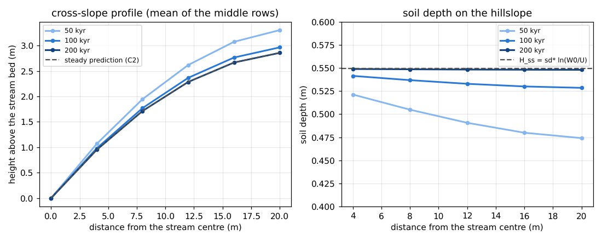
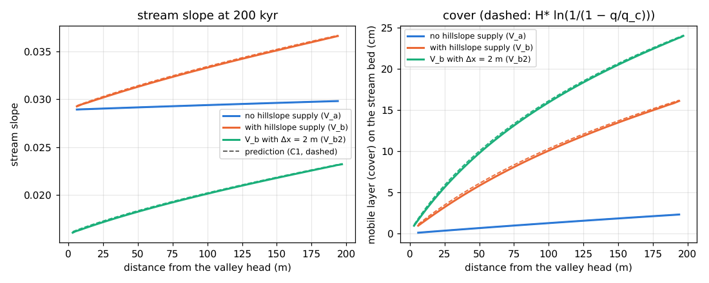
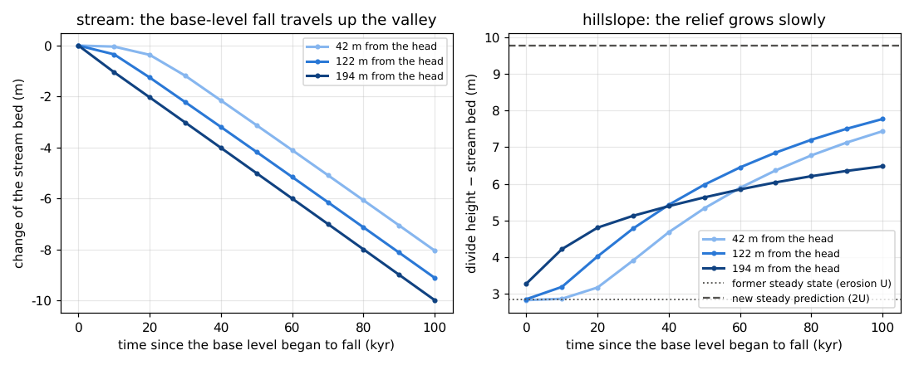
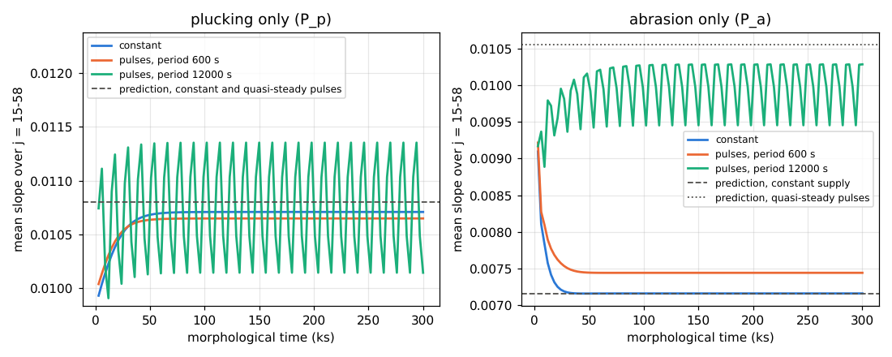

# examples/mountain_valley — A V-shaped mountain valley: coupling hillslope soil and bedrock incision in the stream

> English mirror of examples/mountain_valley/README.md. The Japanese file is the master copy.

[日本語](../README.md)

In a small V-shaped valley in rising mountains, this example runs the
hillslopes (soil production by weathering, `f_wthr`, and depth-dependent creep,
`creep_hstar`) and the stream (bedrock incision by flowing water, `f_rockinc`,
and bedload, `f_fluvial`) together, and looks at how the sediment delivered
from the hillslopes changes the steady slope of the stream and what does the
incision, and how the valley responds to a fall of the base level
([users guide](../../../docs/en/users_guide/geomorph.md); equations and sources
in the [supplement](../../../docs/en/users_guide/sediment.md)). It is C3 (full
coupling) of docs/mountain_stream_plan.md §11 (in Japanese). The check of the
hillslopes alone is C2 of [test/hillsoil](../../../test/hillsoil/en/README.md)
and the check of the stream alone is T11 (C1) of
[test/rockinc](../../../test/rockinc/en/README.md); this example is compared
with the two predictions combined. In the second part, C4, the steady slope of
a stream is compared under the same mean supply given constantly and in
pulses. The values are illustrative, not calibrated for a particular
catchment.

## Time (conversion by the intermittency factor)

The stream carries sediment and wears the bedrock only during floods, while
weathering, creep and uplift on the hillslopes work all year. Here only a
representative flood (a constant formative discharge) is computed, and the
flood is taken to flow for F = 300 s (5 minutes; intermittency factor
i_f = F / 1 year = 9.5e-6) of each calendar year. The coefficients of the
continuous processes are given multiplied by 1/i_f (uplift `uplift0`, soil
production `wthr_p0`, creep `creep_d`; these processes are linear in their
coefficients, so this is the same as running only those processes on the
calendar time; developer.md §89.11 item 2). Calendar time = flood time / F ×
1 year. The order within each flood (sediment collected at the foot of the
hillslopes between floods is flushed at the start of a flood) is replaced by
simultaneous progress.

## Setup

| Item | Value |
|---|---|
| Valley | 200 m long (north–south) × 44 m wide. Δx = 4 m (11 × 50 cells). The middle column is a stream one cell (4 m) wide, with 20 m (5 cells) of hillslope on each side. The east and west edges are divides (walls) |
| Initial terrain | A V of bare rock (soil depth 0). Valley-floor slope 0.04, hillslope gradient 0.25 |
| Hydrology | A constant formative discharge Q = 0.5 m³/s at the stream cell of the valley head (north end; uniform-flow depth 0.11 m). The hillslopes stay dry (no rain). Free outflow at the south edge |
| Base level | The outlet row (j = 50) is a base level without uplift, weathering or bedrock incision (multiplier 0 of `fn_uplift`, `fn_wthr` and `fn_rock`) |
| Stream | d50 = 3 cm, porosity 0.4, cover length H* = 0.2 m. Plucking k_p = 8.9e-8 m/s, τ_c = 10 Pa, m = 1.5, abrasion β = 6.6e-4 1/m (values during floods). The stream cells do not weather (multiplier 0 of `fn_wthr`; developer.md §89.13) |
| Hillslopes (calendar values) | Uplift U = 0.1 mm/yr, soil production on bare rock W0 = 0.3 mm/yr (decay depth sd* = 0.5 m; Heimsath type), creep D = 0.01 m²/yr (decay depth H_c = 0.3 m) |
| Input values | `uplift0` = 10519.2 mm/yr, `wthr_p0` = 3.15576e7 mm/kyr, `creep_d` = 3.3333e-5 m²/s (calendar value / i_f) |
| Time | dt = 0.5 s, landform update every step × morfac 100 (dts = 50 s; "max thin-layer drainage rate x dts" at the end is 0.20). 200,000 calendar years (flow time 6e5 s), output every 10,000 years |

| Configuration | Contents |
|---|---|
| `param_V_a.txt` | No weathering or creep on the hillslopes. The stream carries only its own plucked rock (the hillslopes rise as bare rock) |
| `param_V_b.txt` | Weathering and depth-dependent creep on the hillslopes (full coupling) |
| `param_V_c.txt` | Continuation of V_b (200,000 to 300,000 calendar years). The outlet row is lowered at the uplift rate U (base-level fall; multiplier −1 in `up_drop.txt`) |
| `param_V_b2.txt` | V_b with Δx = 2 m (21 × 100 cells; the stream is also 2 m wide; resolution check) |

| File | Contents |
|---|---|
| `make_init.py` | Writes the terrain, initial depth, soil depth, multiplier distributions, supply time series and `param_*.txt` (constants kept in pairs with `plot_results.py`) |
| `plot_results.py` | Figures `figs/*.png` (`en/figs/` with `en`) and tables (standard output; comparison with the predictions and the ledgers) |

## Running

```bash
make                                   # links to the executables in ../../bin/
python3 make_init.py                   # writes the inputs and param_*.txt (identical to the bundled ones)
./encflow param_V_a.txt > Screen_V_a.log      # about 6 minutes
./encflow param_V_b.txt > Screen_V_b.log      # about 7 minutes
cp -r save_V_b save_V_c                       # V_c restarts from the save of V_b
./encflow param_V_c.txt > Screen_V_c.log      # about 3 minutes
mpirun -np 4 ./encflow_mpi param_V_b2.txt > Screen_V_b2.log   # Δx = 2 m (about 30 minutes with 4 ranks)
python3 plot_results.py en | tee analysis.txt # figures and tables (python3 plot_results.py for the Japanese figures)
```

The other figures and tables can be drawn without V_b2.

## Predictions (C1 and C2)

**Hillslopes (C2)**: in the steady state the bedrock surface does not move
(soil production = uplift: W0 e^{−H/sd*} = U), so the soil depth is
H_ss = sd* ln(W0/U) = 0.549 m, and the ground surface does not move (divergence
of creep = uplift), so the cross-slope curvature is ∇²z = −U/D_eff
(D_eff = D (1 − e^{−H_ss/H_c})). With zero flux at the divide, the height of the
k-th cell from the stream is (U/D_eff) Δx² (k L − k(k−1)/2) (L = 5 cells), and
the divide is 2.86 m above the stream bed.

**Stream (C1)**: in the steady state the incision rate equals the uplift rate
in each cell, (E_p0(S) + β q)(1 − q/q_c(S)) = U (the first term is plucking,
the second abrasion; q is the bedload transport rate and q_c the capacity).
From the valley head, q grows by the plucked rock (added 1:1 to the mobile
layer) and by the soil delivered from the hillslopes (U × 20 m per side in the
steady state); the fines of abrasion leave the system. The slope solved cell
by cell from the head with uniform-flow hydraulics, and the cover thickness
H* ln(1/(1 − q/q_c)), are compared (the equation of T11 of test/rockinc with
the lateral supply added).

## Results

The values are from the rerun on 2026-10-28 after the fix of the depth floor of the
segment-inflow face (developer.md §89.25, in Japanese).

### Hillslopes: steady soil and a parabolic form



- From the bare-rock V, the soil made by weathering is carried by creep to the
  stream, and the hillslopes approach a parabolic form. After 200,000 years
  (about 4 times the adjustment time of the hillslopes, L²/D_eff ≈ 48,000
  years), the heights averaged over the middle half of the rows are within
  0.14 % of the prediction (0.951, 1.713, 2.284, 2.665 and 2.856 m against
  0.953 to 2.858 m) and the soil depth is 0.548 to 0.549 m (H_ss = 0.549 m).
  The initial V has a higher ridge than the prediction, so the hillslopes
  approach the prediction from above (ridge 3.29 m at 50,000 years and 2.96 m
  at 100,000 years).

### Stream: the supply from the hillslopes changes the slope and what does the incision



| Configuration | Stream slope (excluding the head row) | Prediction (C1) | Cover thickness | Share of abrasion |
|---|---|---|---|---|
| V_a no hillslope supply | 0.0289 to 0.0298 | 0.0289 to 0.0298 (within 0.01 %) | 0.1 to 2.3 cm | 4 % |
| V_b with hillslope supply | 0.0292 to 0.0366 | 0.0293 to 0.0367 (within 0.4 %) | 1.0 to 16.1 cm | 24 % |
| V_b2 the same with Δx = 2 m (stream 2 m wide) | 0.0161 to 0.0232 | 0.0162 to 0.0233 (within 0.7 %) | 0.9 to 24.0 cm | 34 % |

- Without supply from the hillslopes, the sediment of the stream is only its
  own plucked rock, the cover is thin and the slope is nearly uniform (0.029).
  The incision is almost all plucking.
- With supply from the hillslopes, the transport rate and the cover grow
  downstream (q/q_c ≈ 0.55 near the outlet), and the slope steepens as less
  bedrock is exposed (0.037 near the outlet; 1.23 times that without supply).
  At the same time the transported gravel acts as tools, and the share of
  abrasion rises from 4 % to 24 %.
- Both agree within 0.4 % with the prediction of the C1 equation with the
  steady supply of the hillslopes, from just below the valley head. Before the
  fix of the depth floor of the segment-inflow face on 2026-10-28
  (developer.md §89.25), a step pattern decaying downstream formed below the
  head through the effect of the inflow cell, and the comparison was made more
  than about 40 m below the head (§89.6).

### Resolution (Δx = 2 m)

V_b2 is V_b with half the grid spacing, so the stream one cell wide is also
2 m wide. The same discharge gathers in a narrower channel, raising the unit
discharge and the transport capacity, so the stream slope is gentler than with
Δx = 4 m (0.016 to 0.023), but it agrees within 0.7 % with the C1 prediction
for its own grid (share of abrasion 34 %, bedrock origin of the bedload at the
outlet 3 %). The hillslopes agree with the C2 prediction within 0.06 % in
height and the soil depth within 0.4 % of H_ss (divide height 2.62 m; the
difference from 2.86 m with Δx = 4 m comes from the positions of the hillslope
cell centres, and both follow the discrete prediction). The balance equations
hold whatever the grid, but in a stream one cell wide the grid spacing sets the
width of the stream, so the slope itself depends on the grid. "max thin-layer
drainage rate x dts" at the end was 0.84, but that was a transient value; in
the stream cells at the end it is 0.10 or less.

### Base-level fall: the stream responds quickly, the hillslopes slowly



- When the outlet row starts to be lowered at the uplift rate (a base-level
  fall of 2U seen from the stream), the fall travels up the stream: at 42 m from
  the head the bed starts to fall after 10,000 to 20,000 years and reaches the
  rate of the outlet (U) after 30,000 to 40,000 years. After that the whole
  stream falls uniformly with a new slope (0.046 to 0.049).
- The relief of the hillslopes (divide − stream bed) responds much more slowly:
  after 100,000 years it is 6.5 to 7.8 m and still growing toward the new
  steady prediction of 9.77 m (for an erosion rate of 2U, H_ss = 0.20 m and
  D_eff = 0.49 D). The soil thins from the foot (mean over the middle of the
  valley 0.548 → 0.255 m), and the hillslopes steepen as creep slows down
  (D_eff falls).
- The rows near the outlet (194 m) gain relief early and level off early,
  while the rows near the head catch up later. The response to a base-level
  fall takes tens of thousands of years in the stream and more than 100,000
  years on the hillslopes.

### Origin of the sediment

In the ledgers of V_b over 200,000 years, of the 1.79e5 m³ (bulk volume) of
bedload that left the outlet, 1.22e4 m³ (7 %) was plucked from the bedrock and
the rest came from weathering on the hillslopes (the fines of abrasion,
3.8e3 m³, do not join the bedload and leave the system). In the steady state
this ratio is set mostly by the areas of the hillslopes and the stream
(10:1). Since sediment from weathering dominates, differences between the
grain sizes of the plucked gravel and of the soil (including a bulking factor)
would directly affect the cover of the stream (docs/mountain_stream_plan.md
§4.1; not included at this stage).

## Timing of supply: constant supply versus pulses with the same mean (C4)

Supply from the hillslopes to the stream can be intermittent, as with
landslides. Whether the steady slope of the stream changes when the same mean
supply comes all at once or little by little is compared in channels one cell
wide like T11 (C1) of test/rockinc (C4 of docs/mountain_stream_plan.md §11.3,
in Japanese; no hillslopes, replaced by a supply at the head).

| Item | Value |
|---|---|
| Channels | One cell wide (Δx = 1 m), 60 m long, slope 0.01 at the start, n = 0.04, Q = 0.336 m³/s (uniform-flow depth 0.3 m). Dry ground at +2 m on both banks; 3 channels side by side from west to east (they do not affect each other) |
| Uplift and base level | Uniform uplift U = 1e-5 m/s (value during floods); the outlet row is neither uplifted nor eroded |
| Gravel and cover | d50 = 1 cm, porosity 0.4, H* = 5 cm. From bare rock |
| Incision | `P_p` plucking only (k_p = 6e-6 m/s, τ_c = 10 Pa, m = 1.5); `P_a` abrasion only (β = 0.05 1/m) |
| Supply | Mean supply ratio 0.4 (q_m = 0.4 × 1.81e-3 m²/s). Per channel: constant, and pulses supplying 0.8 half of the time (periods 600 s and 12000 s; morphological time). The pulses are the time-series files `p_qb_short.txt` and `p_qb_long.txt` (`fn_inflow_qb`). The total over the same time is the same |
| Time | dt = 0.1 s, morfac 10 (dts = 1 s). Morphological time 3e5 s, output every 3000 s. Statistics over the last 32 intervals (8 periods of the long pulses) |

```bash
./encflow param_P_p.txt > Screen_P_p.log   # about 2 minutes
./encflow param_P_a.txt > Screen_P_a.log   # about 2 minutes
```



| Model | Constant | Pulses, period 600 s | Pulses, period 12000 s (range) | Prediction |
|---|---|---|---|---|
| Plucking only | 0.01071 | 0.01065 | 0.01075 (0.01014 to 0.01135) | 0.01080 (constant and quasi-steady pulses alike) |
| Abrasion only | 0.00716 | 0.00744 | 0.01000 (0.00945 to 0.01028) | constant 0.00716, quasi-steady pulses 0.01055 |

- **Plucking only**: the timing of supply hardly changes the mean slope
  (within 1 %). The exposed fraction 1 − q/q_c is linear in the transport rate
  q, so in the quasi-steady limit the time-mean incision rate depends only on
  the mean supply. With the long pulses the slope swings by ±6 % with the
  supply.
- **Abrasion only**: with the long pulses the mean slope becomes 1.40 times as
  steep. Without supply there are no tools and nothing is worn, and during
  supply the cover is thick and little rock is exposed, so the same mean supply
  wears less efficiently and the incision that balances uplift needs a steeper
  slope (somewhat gentler than the quasi-steady prediction of 0.01055 because
  the cover thickness lags behind the switching of the supply). The short
  pulses are smoothed while travelling down the channel and approach the
  constant supply (4 % steeper).
- **Duration of cover and outflow at the outlet**: with the long pulses, the
  cover in the middle of the reach exceeds H* half of the time (never with
  plucking only and always with abrasion only under constant supply). The
  outflow at the outlet varies with a coefficient of variation of 0.39
  (plucking only) and 0.63 (abrasion only) at 3000 s intervals, while the short
  pulses are smoothed at that interval (coefficient of variation 0).
- The answer of B of examples/bedrock_cover (without uplift), that the effect
  of the timing of supply is larger where abrasion (tools) matters and appears
  when the pulse period is longer than the response time of the cover, also
  holds for the steady slope under uplift.
- **Update interval** (checked on 2026-10-27): with dts = 5 s (morfac 50), "thin-layer drainage rate x
  dts" reached 1.8 in the abrasion-only channels and the slope under the short
  pulses came out gentler than under constant supply (0.00689). The slopes for
  dts = 1 s and 0.5 s differ by 0.7 % or less.

## Caveats (scope of this example)

- The stream is a channel one cell wide; the width of the valley floor
  (floodplain) and the retreat of the banks are not represented. The
  hillslopes stay dry (no rain); sheet flow, landslides and debris flows on
  the hillslopes are not included.
- Time is converted by the intermittency factor. The order in which sediment
  collects and is flushed in each flood does not appear.
- Gravel and soil are treated as one mobile layer of a single grain size
  (d50 = 3 cm): the soil made by weathering becomes the gravel of the stream
  as it is.
- The stream one cell wide with Δx = 4 m agrees with uniform flow
  (V/V_Manning is 1 ± 0.001 from just below the head; before the fix of the
  inflow floor it was 1 ± 0.005 more than 42 m below the head), but in wide
  flows on steep slopes the bed shear stress comes
  out larger depending on the grid (developer.md §89.4).

## Related documents

- [Users guide: landform change](../../../docs/en/users_guide/geomorph.md),
  [supplement](../../../docs/en/users_guide/sediment.md) (the soil production
  function of Heimsath et al. 1997, the creep coefficient of Fernandes &
  Dietrich 1997, cover and tools of Sklar & Dietrich 2004)
- [test/hillsoil](../../../test/hillsoil/en/README.md) (C2: the hillslopes
  alone in the steady state),
  [test/rockinc](../../../test/rockinc/en/README.md) (T11 = C1: the steady slope
  of a stream under a supply at the head),
  [examples/bedrock_cover](../../bedrock_cover/en/README.md) (cover effect in
  bedrock channels)
- docs/mountain_stream_plan.md §11 (plan of the coupled experiments) and
  developer.md §89.11 to §89.17 (in Japanese)
