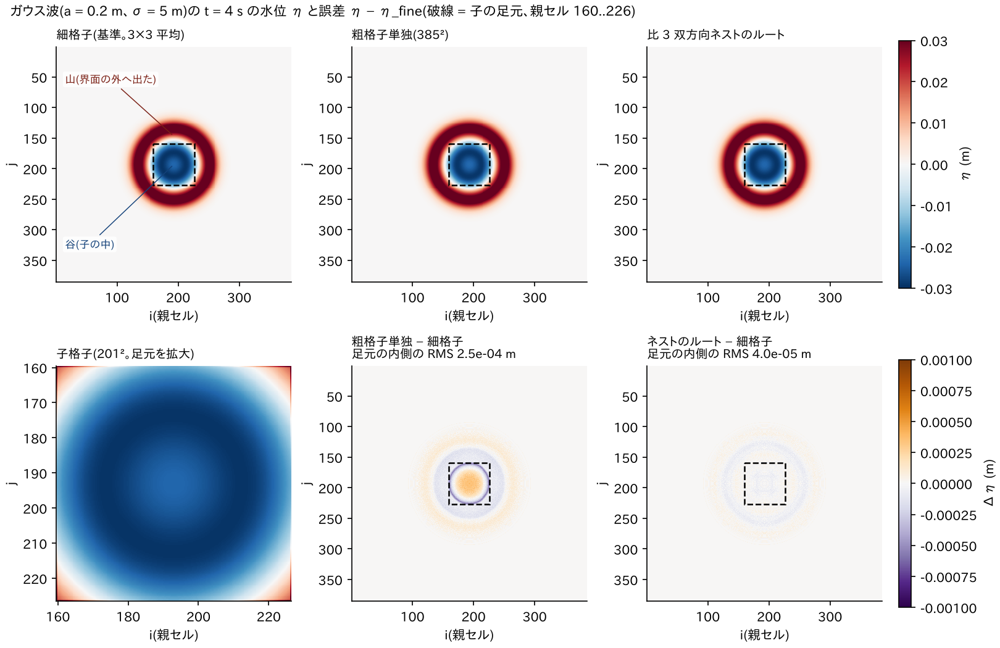
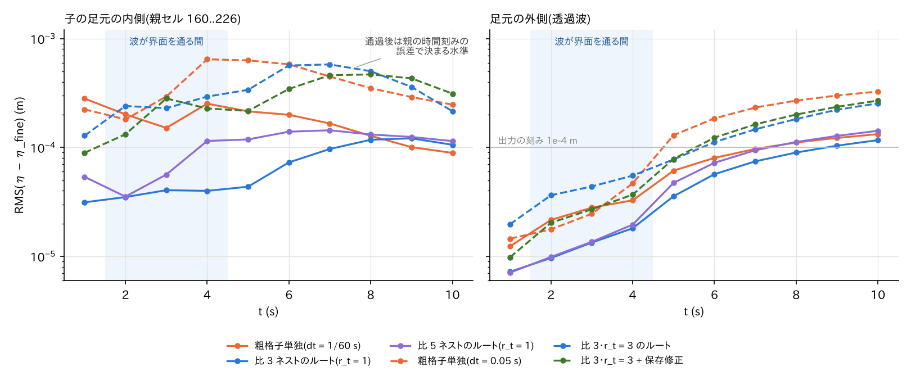
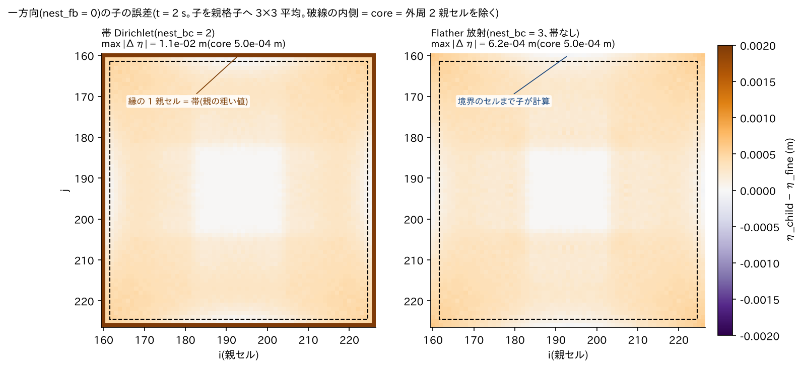
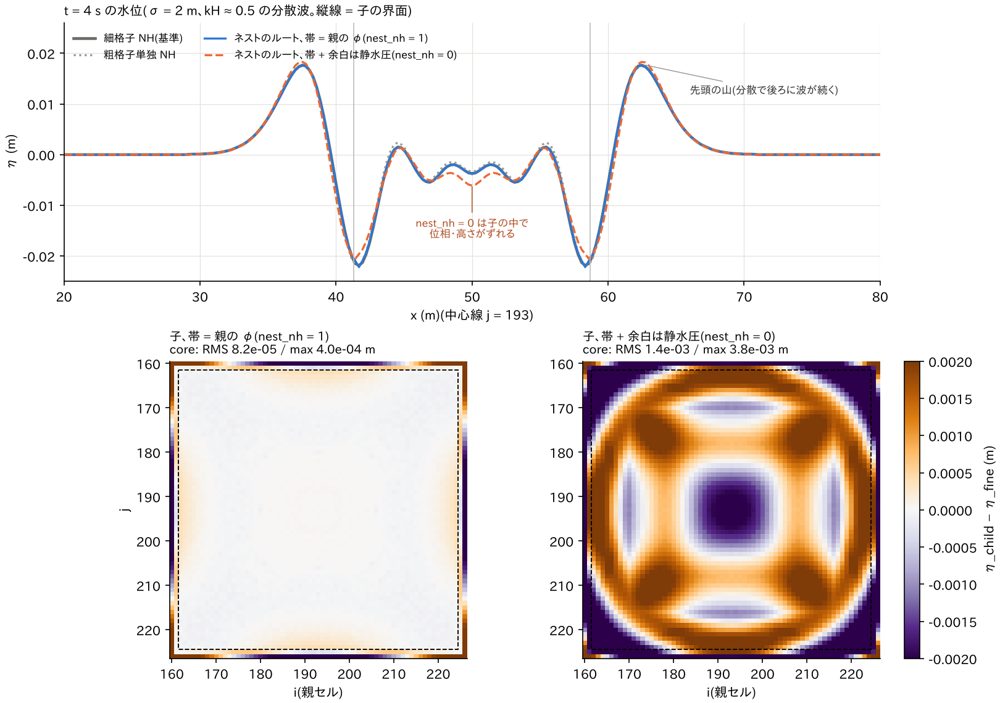

# nest_reflect — 比 3・5 の双方向ネストで界面を横切る波(一様細格子との比較)

[English](en/README.md)

多段ネスティング(docs/users_guide/nest.md、docs/nesting_plan.md)の空間比 r > 1
の検証例。一様水深 1 m の 100 m 四方の水域で、中央のガウス型初期水位
(a = 0.2 m、σ = 5 m)が広がり、親格子の中央に置いた子格子(親セル 67 個分)の
界面を横切る。一様細格子(比 3 の解像度で全域 1155×1155)を基準に、粗格子
単独(385×385)と双方向ネスト(比 3: 子 201×201、比 5: 子 335×335)のルート
の水位誤差を比べる。r_t = 1 のため dt は子の CFL で決める(比 3: 1/60 s、
比 5: 1/100 s。粗格子単独も 1/60 s)。

## 実行

```
python3 make_inputs.py            # 各格子のセル中心で評価した初期水位(data/)
./encflow param_coarse.txt        # 粗格子単独
./encflow param_root_r3.txt       # 比 3(nest_r3.txt → param_child_r3.txt)
./encflow param_root_r5.txt       # 比 5
./encflow param_fine.txt          # 一様細格子(基準。数分)
python3 analyze.py
```

## 図

各ランの後に `./Fig.py` で `figs/` に生成する(matplotlib。存在しないランは
飛ばす)。



t = 4 s(山が子の界面を越えて外へ出て、後ろの谷が子の中にある時刻)の水位。上段: 細格子(基準)・
粗格子単独・比 3 双方向ネストのルート。下段左は子格子そのもの、下段中・右は
細格子からの誤差。ネストのルートは子の足元(破線)の内側で子の解が置換で
戻っているため粗格子単独より誤差が小さく、界面に起因する模様は見えない。



子の足元の内側・外側の RMS 誤差の時間変化。実線は r_t = 1(親 dt = 1/60 s)、
破線は r_t = r(親 dt = 0.05 s、Cn ≈ 0.6)。r_t = 1 のネストのルートは、波が界面を通る間
(t = 2〜4 s)ずっと粗格子単独より良い。r_t = r のルートは t = 2 s だけ粗格子単独(dt = 0.05 s)
より大きく、t = 3・4 s では良い。通過後はどれも親の時間刻みの誤差で決まる水準に収束する
(§「時間比 r_t > 1」)。保存修正(fb3)は界面のリングを局所的に補正するので通過中に局所の
凹凸が出るが、RMS は r_t = 3 のルートと同程度で、体積が保存される(§「保存修正」)。



一方向(nest_fb = 0)の子の誤差分布(t = 2 s)。帯 Dirichlet は縁の 3 子セルが
親の粗い補間値になり足元全体の最大誤差が 1e-2 m になるのに対し、Flather 放射は
境界セルまで子が計算するので足元全体が core と同じ水準(最大 6e-4 m)で使える
(§「一方向」)。



非静水圧(σ = 2 m)の t = 4 s。上: 中心線の水位(縦線 = 子の界面)。下: 子の誤差
分布。帯を親の φ の既知セルにする既定(nest_nh = 1)は細格子に近く、帯 + 余白を
静水圧にする nest_nh = 0 は界面で非静水圧圧力が途切れて分散波の位相がずれ、
子の全域に同心の誤差模様が出る(§「非静水圧の帯の φ」)。

## 結果(gfortran、逐次 4 スレッド)

η − η_fine(細格子を親セルごとに 3×3 平均)の誤差 (m)。in = 子の足元
(親セル 160..226)の内側、out = 外側。出力は 1e-4 m 刻み(テキスト 4 桁)。

| t (s) | ラン | RMS in | MAX in | RMS out | MAX out |
|---|---|---|---|---|---|
| 2 | coarse | 2.0e-4 | 3.3e-4 | 2.2e-5 | 2.0e-4 |
| 2 | root_r3 | 3.5e-5 | 1.0e-4 | 9.7e-6 | 1.0e-4 |
| 2 | root_r5 | 3.5e-5 | 1.0e-4 | 9.9e-6 | 1.0e-4 |
| 4 | coarse | 2.5e-4 | 5.8e-4 | 3.3e-5 | 4.0e-4 |
| 4 | root_r3 | 4.0e-5 | 1.3e-4 | 1.8e-5 | 1.4e-4 |
| 4 | root_r5 | 1.1e-4 | 3.0e-4 | 2.0e-5 | 3.0e-4 |
| 6 | coarse | 2.0e-4 | 2.8e-4 | 8.0e-5 | 8.9e-4 |
| 6 | root_r3 | 7.3e-5 | 1.4e-4 | 5.7e-5 | 7.3e-4 |
| 6 | root_r5 | 1.4e-4 | 2.7e-4 | 7.2e-5 | 9.0e-4 |
| 8〜10 | 全ラン | ≈1e-4 | ≈2e-4 | ≈1e-4 | ≈1e-3 |

- 波が子の界面を通る間(t = 2〜4 s)、子の足元の内側の RMS 誤差は、比 3 のネストの
  ルートで粗格子単独の 1/6 程度(子の解が置換で親に戻っている)。比 5 は t = 2 s で
  同じく 1/6、t = 4 s では 1/2 にとどまる(基準の細格子は比 3 の解像度なので、比 5 の
  子との差は基準そのものの離散化誤差を含む)。外側(透過波)は粗格子単独と同等以上で、
  界面に起因する擾乱は見えない。
- 界面での入射振幅は 0.047 m。波が子を出た後(t ≥ 6 s)の子内部(帯を除く)の残差は
  最大 2.0e-4 m(比 3)・2.7e-4 m(比 5)で、入射振幅の 0.4〜0.6%、出力の刻み
  (1e-4 m = 0.2%)の 2〜3 倍。粗格子単独の同じ量も最大 2.8e-4 m(0.6%)と同程度なので、
  界面の反射はこの出力の精度では粗格子化の誤差と見分けられない水準にある
  (**反射率は 0.6% 未満**)。
- 子→親の置換(湿潤判定付き平均)による親の水柱体積の変化の累計は
  −8.4e-3 m³(比 3、600 回)/ −8.3e-3 m³(比 5、1000 回)で、初期の盛り上がり
  の体積 πσ²a ≈ 15.7 m³ の 0.05%。体積厳密が要るときは nest_fb = 1。
- 子格子そのものと細格子の差(analyze.py の child_r3・child_r5 の行)は t = 2 s で
  最大 1e-2 m と大きいが、これは初期水位の裾(η ≈ 0.01 m)が帯に掛かり、帯が親の
  粗い補間値で置き換わるため(帯の値は子の解ではない)。子の内部(core)に限れば
  上の root と同じ水準(t = 2 s の RMS 2e-5 m)。

## 時間比 r_t > 1・水位のみの帯・2 段ネスト

親の dt を自分の CFL(0.05 s、Cn ≈ 0.6)に戻し、子は dt/r_t で進める変種:
r3t3(比 3・r_t 3)、r5t5(比 5・r_t 5)、r3t3_bc1(帯に水位のみ)、r3t3_ow2 / r3t3_ow3(一方向。帯 / Flather 放射)、r3_nh1 / r3_nh0(非静水圧。帯の φ)、
2lv(ルート → 子 比 3 → 孫 比 3。dx/9・dt/9)。比較相手は同じ dt = 0.05 の
粗格子単独(coarse_dt05)。

```
./encflow param_coarse_dt05.txt; ./encflow param_root_r3t3.txt; ./encflow param_root_r5t5.txt
./encflow param_root_r3t3_bc1.txt; ./encflow param_root_2lv.txt; python3 analyze.py
```

| t (s) | ラン | RMS in | MAX in | RMS out | MAX out |
|---|---|---|---|---|---|
| 4 | coarse_dt05 | 6.5e-4 | 1.1e-3 | 4.7e-5 | 9.1e-4 |
| 4 | root_r3t3 | 2.9e-4 | 6.1e-4 | 5.5e-5 | 4.8e-4 |
| 4 | root_r5t5 | 4.2e-4 | 9.0e-4 | 6.3e-5 | 5.3e-4 |
| 4 | root_2lv | 3.7e-4 | 8.3e-4 | 6.4e-5 | 4.3e-4 |
| 8 | coarse_dt05 | 3.5e-4 | 4.8e-4 | 2.7e-4 | 1.8e-3 |
| 8 | root_r3t3 | 5.0e-4 | 6.7e-4 | 1.8e-4 | 1.4e-3 |
| 8 | root_r5t5 | 5.5e-4 | 7.3e-4 | 1.8e-4 | 1.3e-3 |
| 8 | root_2lv | 4.9e-4 | 6.4e-4 | 1.9e-4 | 1.4e-3 |

通過後の子内部(帯を除く)の残差 max|Δη| / 入射振幅(0.047 m):

| t (s) | coarse_dt05 | root_r3t3 | root_r5t5 | root_r3t3_bc1 | root_2lv |
|---|---|---|---|---|---|
| 6 | 1.5% | 2.8% | 3.2% | 2.0% | 2.8% |
| 8 | 0.9% | 1.4% | 1.6% | 2.3% | 1.4% |
| 10 | 0.6% | 1.0% | 0.9% | 1.5% | 1.1% |

- t = 4 s ではネストのルートが粗格子単独より良く(子の解が戻る)、外側の透過波は
  粗格子単独より良いか同等。ただし t = 2 s の足元の内側は粗格子単独(dt = 0.05 s)の方が
  小さい(RMS 1.8e-4 m 対 r3t3 2.4e-4 m。誤差の時間変化の図の破線)。r_t = r のまま
  親の dt を粗くした分、r_t = 1(親 dt = 1/60 s)の結果より誤差は大きい。
- 通過後の残差は粗格子単独(= 親の時間刻み誤差そのもの)の 1.3〜2 倍で、
  時間補間した帯が通過直後には入射振幅の 1〜1.5% 程度の擾乱を子内部に残す。親の Cn が
  0.6 と大きいことが効いており、精度を要する用途では親の dt を小さくするか
  r_t を r より小さく(例: 比 3 で r_t = 1〜2)取る。
- 比 3 と比 5 の差は小さく(残差はどちらも親の時間刻みと出力の刻みで決まる)、
  子の解像度に対する収束はこの設定では分離できない。より細かい基準格子と
  バイナリ出力による収束試験は残課題。
- 水位のみの帯(bc1)は後期(t = 8・10 s)の残差が最大で、置換による体積変化も
  1.23 m³(bc2 の約 50 倍)。既定の nest_bc = 2 を推奨。
- 2 段ネスト(2lv)は r3t3 と同じ誤差水準で完走した(孫は子の中の 81×81 セル
  分で、この波では精度に寄与しないが、再帰・時間補間・置換の 2 段動作の確認)。

## 保存修正(nest_fb = 3)とスポンジ(nest_bc = 4)

r3t3 を基に、子→親に保存修正を加えた r3t3_fb3 と、帯の内側 4 セルを親の値へ
緩和するスポンジ r3t3_sp。ルートの param に f_disp_debug = 1 を付け、Log の
S(平均水深)を全有効桁で出して閉領域の体積保存を見る(100 m 四方 × S)。

```
./encflow param_root_r3t3_fb3.txt; ./encflow param_root_r3t3_sp.txt; python3 analyze.py
```

| ラン | 体積のずれ max|ΔS|·A (m³) | 通過後の残差 / 入射振幅 (t = 6 / 8 / 10 s) | 置換による親の体積変化の累計 |
|---|---|---|---|
| coarse_dt05 | 0(閉領域で厳密) | 1.5% / 0.9% / 0.6% | — |
| root_r3t3(fb2) | 0.14 | 2.8% / 1.4% / 1.0% | 2.4e-2 m³ |
| root_r3t3_fb3 | **6.8e-4** | 1.6% / 1.7% / 1.1% | 1.5e-2 m³(+ 修正 |Δh|·A 累計 0.67 m³) |
| root_r3t3_sp | 0.20 | 2.1% / 1.3% / 1.3% | 2.0e-1 m³ |
| root_r3t3_bc1 | 1.23 | 2.0% / 2.3% / 1.5% | 1.23 m³ |

- 保存修正は系の体積のずれを fb2 の 1/200 に抑える(残る 6.8e-4 m³ は初期盛り
  上がり体積 15.7 m³ の 4e-5)。界面の外周リングのセルを個別に補正するため、
  波の通過中(t = 2〜4 s)はリングで局所的な凹凸(MAX_in 3〜6e-3 m)が出るが、
  通過直後(t = 6 s)の子内部の残差は fb2 より小さく(1.6% 対 2.8%)、その後は同程度
  (1.7・1.1% 対 1.4・1.0%)。体積厳密が要るとき(長時間・陸上の水収支)に使う。
- スポンジは通過直後(t = 6 s)の残差を fb2 の 2.8% → 2.1% に減らすが、内部を親
  の値へ引き寄せるぶん体積のずれは 1.5 倍、後期の残差は同程度。帯の反射が目立つ
  ケース向きの選択肢で、既定にはしない。
- 水位のみの帯(bc1)は体積のずれと後期(t = 8・10 s)の残差が最も大きい(既定 bc2 を
  推奨)。

## 非静水圧の帯の φ(nest_nh)

非静水圧(f_nonhydrostatic = 1。CG、全域解)の版。σ = 2 m のガウス波(kH ≈ 0.5 で
分散が効く。入力は make_inputs.py の `*_s2.txt`)。比 3 双方向(r3 の構成)で、子の
帯のセルを**親の φ の Dirichlet 既知セル**にする既定(root/child_r3_nh1)と、帯 + 余白
(nh_bc_margin。既定の 2H/Δx で 28 セル。帯と合わせて子の外周 31 セル = 親の約 10 セル分)を
静水圧にする nest_nh = 0(r3_nh0)を、一様細格子の
NH(fine_nh。1155²)を基準に比べる。粗格子単独の NH(coarse_nh)も併記。

```
python3 make_inputs.py
./encflow param_coarse_nh.txt; ./encflow param_root_r3_nh1.txt; ./encflow param_root_r3_nh0.txt
./encflow param_fine_nh.txt           # 基準(CG 107 回/ステップ。十数分)
python3 analyze_nh.py
```

| t (s) | ラン | RMS in | MAX in | RMS out | MAX out |
|---|---|---|---|---|---|
| 2 | coarse_nh | 3.7e-4 | 1.4e-3 | 7.0e-6 | 1.1e-4 |
| 2 | root_r3_nh1(親の φ) | 3.1e-5 | 1.0e-4 | 4.7e-6 | 7.8e-5 |
| 2 | root_r3_nh0(静水圧の帯) | 6.1e-4 | 1.7e-3 | 2.4e-5 | 3.2e-4 |
| 4 | coarse_nh | 6.6e-4 | 1.1e-3 | 7.5e-5 | 9.3e-4 |
| 4 | root_r3_nh1 | 1.2e-4 | 5.0e-4 | 1.6e-5 | 2.8e-4 |
| 4 | root_r3_nh0 | 1.5e-3 | 3.9e-3 | 2.7e-4 | 3.1e-3 |
| 6 | coarse_nh | 4.0e-4 | 1.1e-3 | 1.9e-4 | 1.3e-3 |
| 6 | root_r3_nh1 | 2.3e-4 | 9.6e-4 | 7.0e-5 | 5.0e-4 |
| 6 | root_r3_nh0 | 1.1e-3 | 3.8e-3 | 4.8e-4 | 4.0e-3 |
| 10 | coarse_nh | 1.5e-4 | 3.3e-4 | 3.3e-4 | 1.4e-3 |
| 10 | root_r3_nh1 | 2.4e-4 | 8.2e-4 | 2.0e-4 | 8.0e-4 |
| 10 | root_r3_nh0 | 5.2e-4 | 1.8e-3 | 6.3e-4 | 2.8e-3 |

子(親格子へ 3×3 平均。core = 外周 2 親セルを除く):

| t (s) | ラン | RMS core | MAX core |
|---|---|---|---|
| 2 | child_r3_nh1 | 8.6e-6 | 6.7e-5 |
| 2 | child_r3_nh0 | 6.4e-4 | 1.8e-3 |
| 4 | child_r3_nh1 | 8.2e-5 | 4.0e-4 |
| 4 | child_r3_nh0 | 1.4e-3 | 3.8e-3 |
| 6 | child_r3_nh1 | 1.9e-4 | 4.0e-4 |
| 6 | child_r3_nh0 | 9.2e-4 | 2.7e-3 |
| 10 | child_r3_nh1 | 2.2e-4 | 5.7e-4 |
| 10 | child_r3_nh0 | 4.9e-4 | 1.5e-3 |

- 親の φ を帯に与えると、波が子の中にある間(t = 2〜4 s)の子内部の誤差は細格子に
  近く(core RMS 9e-6〜8e-5 m)、ルートの足元内の誤差も粗格子単独の 1/5〜1/12。
- 静水圧の帯(nest_nh = 0)は界面で非静水圧圧力が途切れ、子の内部の誤差が親の φ 版の
  20〜70 倍(t = 2〜4 s)、粗格子単独より悪い(帯と余白で子の外周 31 セルが静水圧になり、
  そこで分散波の位相がずれる)。既定の nest_nh = 1 を使う。

## 一方向: 帯 Dirichlet(nest_bc = 2)と Flather 放射(nest_bc = 3)

r3t3 を一方向(nest_fb = 0)にした r3t3_ow2(帯)と r3t3_ow3(Flather。子の 4 辺を
`f_bc_* = 2` にし、親の水位と法線流速を境界面の放射条件に与える。帯なし)。
一方向ではルートは coarse_dt05 と同一なので、見るのは子の誤差(一様細格子を
基準に、子を親格子へ 3×3 平均して比較)。full = 子の足元全体(帯を含む)、
core = 外周 2 親セル(帯 3 子セル + 余裕)を除いた内部。

```
./encflow param_root_r3t3_ow2.txt; ./encflow param_root_r3t3_ow3.txt; python3 analyze.py
```

| t (s) | ラン | RMS full | MAX full | RMS core | MAX core |
|---|---|---|---|---|---|
| 2 | child_r3t3_ow2(帯) | 2.1e-3 | 1.1e-2 | 2.9e-4 | 5.0e-4 |
| 2 | child_r3t3_ow3(Flather) | 2.9e-4 | 6.2e-4 | 2.9e-4 | 5.0e-4 |
| 4 | ow2 | 6.6e-4 | 8.2e-3 | 3.6e-4 | 1.0e-3 |
| 4 | ow3 | 3.7e-4 | 8.1e-4 | 3.8e-4 | 8.1e-4 |
| 6 | ow2 | 8.2e-4 | 3.6e-3 | 6.1e-4 | 1.4e-3 |
| 6 | ow3 | 5.3e-4 | 1.3e-3 | 5.6e-4 | 1.3e-3 |
| 8 | ow2 | 5.0e-4 | 1.7e-3 | 4.6e-4 | 7.8e-4 |
| 8 | ow3 | 5.1e-4 | 7.3e-4 | 5.1e-4 | 7.3e-4 |
| 10 | ow2 | 2.4e-4 | 7.2e-4 | 1.9e-4 | 7.2e-4 |
| 10 | ow3 | 2.2e-4 | 5.0e-4 | 2.0e-4 | 5.0e-4 |

- 子の内部(core)の誤差は両者で同程度(RMS の差は 1 割程度、MAX は Flather が
  同じか小さい)。この例では入射波が一度通過して出て行くだけなので、
  帯が子の擾乱を反射する効果は小さい。
- 違いは**縁**にある。帯は親の粗い値(時間補間)を 3 子セル幅に置くので、波が
  界面にある間(t = 2〜4 s)の足元全体の MAX 誤差が 1e-2 m と大きく、その領域は
  結果として使えない。Flather は境界セルまで子が計算するので足元全体の誤差が
  core と同じ水準(MAX 6〜8e-4 m)になり、**子の全域が使える**。
- 一方向では Flather(nest_bc = 3)を推奨する。双方向(nest_fb ≥ 1)は帯の
  nest_bc = 2 のまま(置換が界面の整合を取る。Flather との併用も可だが未評価)。
- 退化の確認: 親が静水なら Flather の子は現行の放射境界(`f_bc_* = 2`)と
  同一ビット(test/nest_identity の flather ケース)。