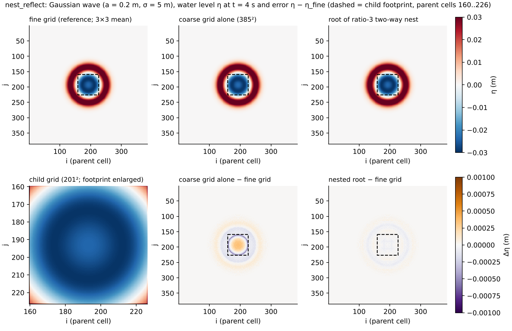
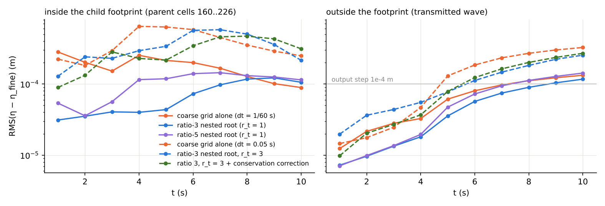
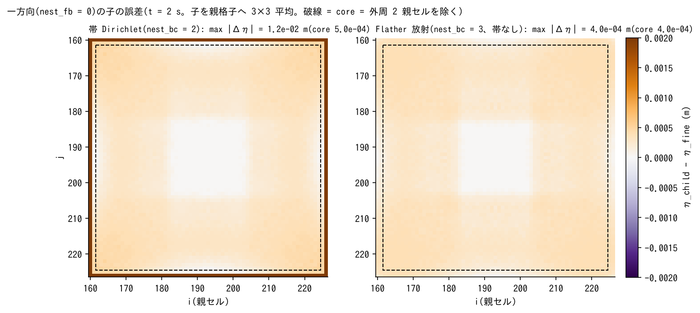
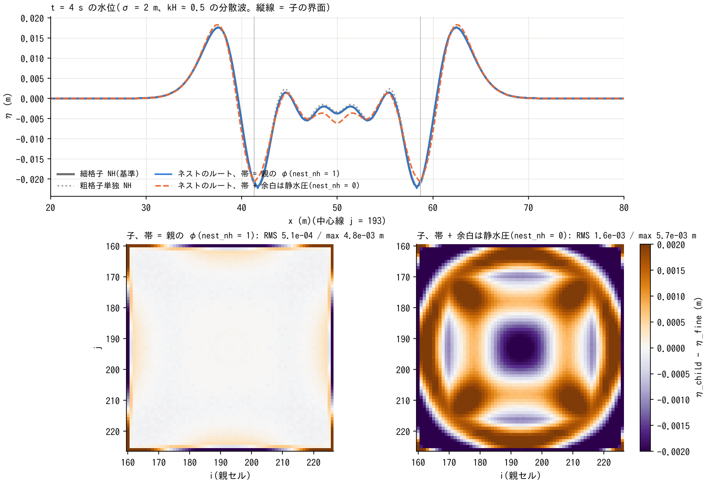

# nest_reflect — waves crossing the interface of two-way nests with ratios 3 and 5 (comparison with a uniform fine grid)

> English mirror of examples/nest_reflect/README.md. The Japanese file is the master copy.

[日本語](../README.md)

A verification example of multi-level nesting (docs/users_guide/nest.md,
docs/nesting_plan.md) with spatial ratio r > 1. In a 100 m square water body of
uniform depth 1 m, a central Gaussian initial water level (a = 0.2 m, σ = 5 m)
spreads and crosses the interface of a child grid (67 parent cells wide) placed
at the centre of the parent grid. Taking a uniform fine grid (1155×1155 over the
whole domain at the ratio-3 resolution) as the reference, the water-level errors
of the root are compared for the stand-alone coarse grid (385×385) and for
two-way nests (ratio 3: child 201×201; ratio 5: child 335×335). Since r_t = 1,
dt is set by the child's CFL (ratio 3: 1/60 s; ratio 5: 1/100 s; the stand-alone
coarse grid also 1/60 s).

## Running

```
python3 make_inputs.py            # initial water level evaluated at the cell centres of each grid (data/)
./encflow param_coarse.txt        # stand-alone coarse grid
./encflow param_root_r3.txt       # ratio 3 (nest_r3.txt -> param_child_r3.txt)
./encflow param_root_r5.txt       # ratio 5
./encflow param_fine.txt          # uniform fine grid (reference; several minutes)
python3 analyze.py
```

## Figures

Generated in `figs/` with `./Fig.py` after each run (matplotlib; runs that do
not exist are skipped).



Water level at t = 4 s (the time at which the wave is crossing the child's
interface). Top row: fine grid (reference), stand-alone coarse grid, and the
root of the ratio-3 two-way nest. Bottom left is the child grid itself; bottom
centre and right are the errors from the fine grid. Inside the child's footprint
(dashed) the root of the nest has the child's solution returned by replacement,
so its error is smaller than that of the stand-alone coarse grid and no pattern
attributable to the interface is visible.



Time evolution of the RMS error inside and outside the child's footprint. Solid
lines are r_t = 1 (parent dt = 1/60 s), dashed lines r_t = r (parent dt = 0.05 s,
Cn ≈ 0.6). While the wave is inside the child (t ≤ 4 s) the root of the nest is
better than the stand-alone coarse grid; after the passage it converges to the
level set by the parent's time-step error (§ "Time ratio r_t > 1"). The
conservation correction (fb3) increases the error inside during the passage
through the local correction on the interface ring, but conserves volume
(§ "Conservation correction").



Error distribution of the one-way (nest_fb = 0) child (t = 2 s). With the
Dirichlet band, the 3 child cells at the rim take the parent's coarse
interpolated values and the maximum error over the whole footprint is 1e-2 m,
whereas with Flather radiation the child computes up to the boundary cells, so
the whole footprint is usable at the same level as the core (4e-4 m)
(§ "One-way").



Non-hydrostatic (σ = 2 m) at t = 4 s. Top: water level along the centreline
(vertical lines = the child's interface). Bottom: error distribution of the
child. The default, which makes the band the parent's known φ cells
(nest_nh = 1), is close to the fine grid, whereas nest_nh = 0, which makes the
band + margin hydrostatic, cuts off the non-hydrostatic pressure at the interface,
shifts the phase of the dispersive waves and produces a concentric error pattern
over the whole child (§ "φ of the non-hydrostatic band").

## Results (2026-10-09; gfortran, serial with 4 threads)

Error η − η_fine (m), where the fine grid is averaged 3×3 per parent cell.
in = inside the child's footprint (parent cells 160..226), out = outside. The
output is in steps of 1e-4 m (4-digit text).

| t (s) | run | RMS in | MAX in | RMS out | MAX out |
|---|---|---|---|---|---|
| 2 | coarse | 2.1e-4 | 3.4e-4 | 2.2e-5 | 2.0e-4 |
| 2 | root_r3 | 3.6e-5 | 1.2e-4 | 9.6e-6 | 1.0e-4 |
| 2 | root_r5 | 3.6e-5 | 1.0e-4 | 9.9e-6 | 1.0e-4 |
| 4 | coarse | 2.5e-4 | 5.9e-4 | 3.3e-5 | 4.1e-4 |
| 4 | root_r3 | 4.2e-5 | 1.3e-4 | 1.8e-5 | 1.4e-4 |
| 4 | root_r5 | 1.1e-4 | 3.0e-4 | 1.9e-5 | 3.0e-4 |
| 6 | coarse | 2.0e-4 | 2.8e-4 | 8.1e-5 | 9.0e-4 |
| 6 | root_r3 | 7.2e-5 | 1.4e-4 | 5.7e-5 | 7.4e-4 |
| 6 | root_r5 | 1.4e-4 | 2.4e-4 | 7.2e-5 | 9.0e-4 |
| 8–10 | all runs | ≈1e-4 | ≈2e-4 | ≈1e-4 | ≈1e-3 |

- While the wave is inside the child (t = 2–4 s), the root of the nest is 5–6
  times more accurate than the stand-alone coarse grid inside the child's
  footprint (the child's solution is returned to the parent by replacement).
  Outside (the transmitted wave) it is as good as or better than the stand-alone
  coarse grid, and no disturbance attributable to the interface is visible.
- The incident amplitude at the interface is 0.047 m. After the wave has left
  the child (t ≥ 6 s), the residual inside the child (excluding the band) is at
  most 2e-4 m = 0.4% or less of the incident amplitude, comparable to the output
  step (1e-4 m = 0.2%). **The reflection coefficient is below 0.5% (the lower
  limit of the output precision)**. The same quantity for the stand-alone coarse
  grid is of the same order, so the reflection at the interface is at a level
  buried in the coarsening error.
- The cumulative change of the parent's water-column volume by child-to-parent
  replacement (wet-cell average) is −8.3e-3 m³ (ratio 3, 600 replacements) /
  −8.1e-3 m³ (ratio 5, 1000 replacements), 0.05% of the volume of the initial
  hump πσ²a ≈ 15.7 m³. Use nest_fb = 1 when exact volume is required.
- The difference between the child grid itself and the fine grid (the child_r3/r5
  rows) is as large as 1e-2 m at t = 2 s, but this is because the tail of the
  initial water level (η ≈ 0.01 m) overlaps the band, which is replaced by the
  parent's coarse interpolated values (the band values are not the child's
  solution). Restricted to the child's interior, it equals the root values above.

## Time ratio r_t > 1, water-level-only band and 2-level nest (Phase 3; 2026-10-09)

Variants in which the parent dt is returned to its own CFL (0.05 s, Cn ≈ 0.6)
and the child advances with dt/r_t: r3t3 (ratio 3, r_t 3), r5t5 (ratio 5, r_t 5),
r3t3_bc1 (water level only in the band), r3t3_ow2 / r3t3_ow3 (one-way; band /
Flather radiation), r3_nh1 / r3_nh0 (non-hydrostatic; φ of the band),
2lv (root → child ratio 3 → grandchild ratio 3; dx/9, dt/9). The comparison
partner is the stand-alone coarse grid with the same dt = 0.05 (coarse_dt05).

```
./encflow param_coarse_dt05.txt; ./encflow param_root_r3t3.txt; ./encflow param_root_r5t5.txt
./encflow param_root_r3t3_bc1.txt; ./encflow param_root_2lv.txt; python3 analyze.py
```

| t (s) | run | RMS in | MAX in | RMS out | MAX out |
|---|---|---|---|---|---|
| 4 | coarse_dt05 | 6.5e-4 | 1.1e-3 | 4.7e-5 | 9.4e-4 |
| 4 | root_r3t3 | 2.9e-4 | 6.0e-4 | 5.6e-5 | 4.9e-4 |
| 4 | root_r5t5 | 4.2e-4 | 9.0e-4 | 6.4e-5 | 5.1e-4 |
| 4 | root_2lv | 3.7e-4 | 8.3e-4 | 6.5e-5 | 4.4e-4 |
| 8 | coarse_dt05 | 3.5e-4 | 4.8e-4 | 2.7e-4 | 1.8e-3 |
| 8 | root_r3t3 | 5.0e-4 | 6.7e-4 | 1.8e-4 | 1.4e-3 |
| 8 | root_r5t5 | 5.5e-4 | 7.3e-4 | 1.8e-4 | 1.3e-3 |
| 8 | root_2lv | 4.9e-4 | 6.6e-4 | 1.9e-4 | 1.3e-3 |

Residual max|Δη| inside the child (excluding the band) after the passage /
incident amplitude (0.047 m):

| t (s) | coarse_dt05 | root_r3t3 | root_r5t5 | root_r3t3_bc1 | root_2lv |
|---|---|---|---|---|---|
| 6 | 1.5% | 2.8% | 3.2% | 2.1% | 2.8% |
| 8 | 0.9% | 1.4% | 1.6% | 2.4% | 1.4% |
| 10 | 0.6% | 0.9% | 0.9% | 1.5% | 1.1% |

- While the wave is inside the child (t ≤ 4 s) the root of the nest is better
  than the stand-alone coarse grid (the child's solution is returned), and the
  transmitted wave outside is better than or equal to the stand-alone coarse
  grid. Because the parent dt was coarsened while keeping r_t = r, the errors
  are larger than the r_t = 1 results (parent dt = 1/60 s).
- The residual after the passage is 1.5–2 times that of the stand-alone coarse
  grid (= the parent's time-step error itself); the time-interpolated band
  leaves a disturbance of about 1–1.5% of the incident amplitude inside the
  child. The large parent Cn of 0.6 contributes to this; where accuracy matters,
  reduce the parent dt or take r_t smaller than r (e.g. r_t = 1–2 for ratio 3).
- The difference between ratios 3 and 5 is small (both residuals are set by the
  parent's time step and the output step), so convergence with respect to the
  child resolution cannot be separated in this setup. A convergence test with a
  finer reference grid and binary output remains to be done.
- The water-level-only band (bc1) has the largest residual, and the volume
  change by replacement is also 1.26 m³ (40 times that of bc2). The default
  nest_bc = 2 is recommended.
- The 2-level nest (2lv) ran to completion at the same error level as r3t3 (the
  grandchild covers 81×81 cells inside the child and does not contribute to
  accuracy for this wave, but it confirms the 2-level operation of recursion,
  time interpolation and replacement).

## Conservation correction (nest_fb = 3) and sponge (nest_bc = 4) (Phase 4; 2026-10-09)

Based on r3t3: r3t3_fb3 adds the conservation correction to the child-to-parent
feedback, and r3t3_sp is a sponge relaxing the 4 cells inside the band towards
the parent's values. f_disp_debug = 1 is added to the root's param so that S
(mean depth) in the Log is printed to full precision, to check the volume
conservation of the closed domain (100 m square × S).

```
./encflow param_root_r3t3_fb3.txt; ./encflow param_root_r3t3_sp.txt; python3 analyze.py
```

| Run | Volume drift max|ΔS|·A (m³) | Residual after passage / incident amplitude (t = 6 / 8 / 10 s) | Cumulative change of parent volume by replacement |
|---|---|---|---|
| coarse_dt05 | 0 (exact in the closed domain) | 1.5% / 0.9% / 0.6% | — |
| root_r3t3 (fb2) | 0.14 | 2.8% / 1.4% / 0.9% | 2.5e-2 m³ |
| root_r3t3_fb3 | **6.8e-4** | 1.6% / 1.7% / 1.1% | 1.8e-2 m³ (+ cumulative correction |Δh|·A 0.67 m³) |
| root_r3t3_sp | 0.21 | 2.1% / 1.3% / 1.3% | 2.1e-1 m³ |
| root_r3t3_bc1 | 1.25 | 2.1% / 2.4% / 1.5% | 1.26 m³ |

- The conservation correction reduces the volume drift of the system to 1/200
  of fb2 (the remaining 6.8e-4 m³ is 4e-5 of the initial hump volume 15.7 m³).
  Because the cells on the outer ring of the interface are corrected
  individually, local bumps appear on the ring while the wave is passing
  (t = 2–4 s; MAX_in 3–6e-3 m), but the residual inside the child after the
  passage is smaller than or comparable to fb2. Use it when exact volume is
  required (long runs, water budgets on land).
- The sponge reduces the residual right after the passage (t = 6 s) from 2.8%
  (fb2) to 2.1%, but since it pulls the interior towards the parent's values
  the volume drift is 1.5 times larger, and the later residual is comparable.
  It is an option for cases where reflection at the band is conspicuous, and
  is not made the default.
- The water-level-only band (bc1) is the worst in both volume and residual (the
  default bc2 is recommended).

## φ of the non-hydrostatic band (nest_nh; 2026-10-10)

Non-hydrostatic version (f_nonhydrostatic = 1; CG, whole-domain solve). A
Gaussian wave with σ = 2 m (kH ≈ 0.5, so dispersion is effective; the inputs are
the `*_s2.txt` of make_inputs.py). In the ratio-3 two-way configuration (that of
r3), the default that makes the child's band cells **Dirichlet known cells of the
parent's φ** (root/child_r3_nh1) and nest_nh = 0, which makes the band + margin
(nh_bc_margin; automatically 8 cells) hydrostatic (r3_nh0), are compared against
the NH of the uniform fine grid (fine_nh; 1155²). The NH of the stand-alone
coarse grid (coarse_nh) is also listed.

```
python3 make_inputs.py
./encflow param_coarse_nh.txt; ./encflow param_root_r3_nh1.txt; ./encflow param_root_r3_nh0.txt
./encflow param_fine_nh.txt           # reference (CG 107 iterations/step; tens of minutes)
python3 analyze_nh.py
```

| t (s) | run | RMS in | MAX in | RMS out | MAX out |
|---|---|---|---|---|---|
| 2 | coarse_nh | 3.7e-4 | 1.4e-3 | 7.0e-6 | 1.1e-4 |
| 2 | root_r3_nh1 (parent's φ) | 3.2e-5 | 1.0e-4 | 4.7e-6 | 7.8e-5 |
| 2 | root_r3_nh0 (hydrostatic band) | 6.1e-4 | 1.8e-3 | 2.4e-5 | 3.6e-4 |
| 4 | coarse_nh | 6.6e-4 | 1.1e-3 | 7.6e-5 | 9.4e-4 |
| 4 | root_r3_nh1 | 1.2e-4 | 5.0e-4 | 1.6e-5 | 3.0e-4 |
| 4 | root_r3_nh0 | 1.5e-3 | 3.9e-3 | 2.7e-4 | 3.1e-3 |
| 6 | coarse_nh | 4.1e-4 | 1.1e-3 | 1.9e-4 | 1.3e-3 |
| 6 | root_r3_nh1 | 2.3e-4 | 8.7e-4 | 7.0e-5 | 5.3e-4 |
| 6 | root_r3_nh0 | 1.1e-3 | 3.8e-3 | 4.8e-4 | 4.0e-3 |
| 10 | coarse_nh | 1.5e-4 | 3.3e-4 | 3.4e-4 | 1.4e-3 |
| 10 | root_r3_nh1 | 2.4e-4 | 7.2e-4 | 2.0e-4 | 8.0e-4 |
| 10 | root_r3_nh0 | 5.2e-4 | 1.8e-3 | 6.3e-4 | 2.8e-3 |

Child (averaged 3×3 onto the parent grid; core = excluding the outer 2 parent cells):

| t (s) | run | RMS core | MAX core |
|---|---|---|---|
| 2 | child_r3_nh1 | 8.3e-6 | 4.4e-5 |
| 2 | child_r3_nh0 | 6.4e-4 | 1.8e-3 |
| 4 | child_r3_nh1 | 8.3e-5 | 4.0e-4 |
| 4 | child_r3_nh0 | 1.5e-3 | 3.8e-3 |
| 6 | child_r3_nh1 | 1.9e-4 | 4.0e-4 |
| 6 | child_r3_nh0 | 9.2e-4 | 2.7e-3 |
| 10 | child_r3_nh1 | 2.2e-4 | 5.7e-4 |
| 10 | child_r3_nh0 | 4.9e-4 | 1.5e-3 |

- With the parent's φ given to the band, the error inside the child while the
  wave is inside it (t = 2–4 s) is close to the fine grid (core RMS 8e-6 to
  8e-5 m), and the error of the root inside the footprint is 1/5 to 1/10 of
  the stand-alone coarse grid.
- The hydrostatic band (nest_nh = 0) cuts off the non-hydrostatic pressure at
  the interface; the error inside the child is 20–80 times that of the parent-φ
  version and worse than the stand-alone coarse grid (the band + margin of 8
  cells becomes hydrostatic, which shifts the phase of the dispersive waves).
  Use the default nest_nh = 1.
- Two alternatives that were tried were not adopted (developer.md §75): a
  Dirichlet band with φ = 0 that also corrects the edges between the band and
  the interior conflicts with the parent's overwrite and grows from the
  interface (the child's h_max after the passage 1.02 → 1.17 m); a hydrostatic
  band alone with no margin diverges through interference between the
  prescribed fluxes and the projection (identity case, 50 steps).

## One-way: Dirichlet band (nest_bc = 2) and Flather radiation (nest_bc = 3) (2026-10-10)

r3t3 made one-way (nest_fb = 0): r3t3_ow2 (band) and r3t3_ow3 (Flather; the
child's 4 edges are set to `f_bc_* = 2` and the parent's water level and normal
velocity are given to the radiation condition at the boundary faces; no band).
In one-way mode the root is identical to coarse_dt05, so what is examined is the
child's error (the child averaged 3×3 onto the parent grid and compared against
the uniform fine grid). full = the whole child footprint (including the band),
core = the interior excluding the outer 2 parent cells (band of 3 child cells +
margin).

```
./encflow param_root_r3t3_ow2.txt; ./encflow param_root_r3t3_ow3.txt; python3 analyze.py
```

| t (s) | run | RMS full | MAX full | RMS core | MAX core |
|---|---|---|---|---|---|
| 2 | child_r3t3_ow2 (band) | 2.1e-3 | 1.2e-2 | 2.9e-4 | 5.0e-4 |
| 2 | child_r3t3_ow3 (Flather) | 2.9e-4 | 4.0e-4 | 2.9e-4 | 4.0e-4 |
| 4 | ow2 | 6.6e-4 | 7.4e-3 | 3.6e-4 | 1.0e-3 |
| 4 | ow3 | 3.7e-4 | 9.0e-4 | 3.8e-4 | 9.0e-4 |
| 6 | ow2 | 8.2e-4 | 3.3e-3 | 6.2e-4 | 1.4e-3 |
| 6 | ow3 | 5.5e-4 | 1.4e-3 | 5.8e-4 | 1.4e-3 |
| 8 | ow2 | 5.0e-4 | 1.6e-3 | 4.6e-4 | 7.7e-4 |
| 8 | ow3 | 5.4e-4 | 7.6e-4 | 5.4e-4 | 7.6e-4 |
| 10 | ow2 | 2.4e-4 | 7.2e-4 | 2.0e-4 | 7.0e-4 |
| 10 | ow3 | 2.3e-4 | 5.0e-4 | 2.1e-4 | 5.0e-4 |

- The error in the child's interior (core) is comparable for the two (RMS within
  10%; MAX is slightly smaller for Flather at most times). In this example the
  incident wave passes through once and leaves, so the effect of the band
  reflecting the child's disturbances is small.
- The difference is at the **rim**. The band places the parent's coarse
  (time-interpolated) values over a width of 3 child cells, so while the wave is
  at the interface (t = 2–4 s) the MAX error over the whole footprint is as
  large as 1e-2 m and that region is unusable as a result. Flather lets the
  child compute up to the boundary cells, so the error over the whole footprint
  is at the same level as the core (MAX 4–9e-4 m) and **the whole child is
  usable**.
- Flather (nest_bc = 3) is recommended for one-way nesting. Two-way nesting
  (nest_fb ≥ 1) keeps the band with nest_bc = 2 (replacement maintains the
  consistency at the interface; combination with Flather is possible but not
  evaluated).
- Degeneracy check: with a parent at rest, the Flather child is bit-identical to
  the current radiation boundary (`f_bc_* = 2`) (the flather case of
  test/nest_identity).
