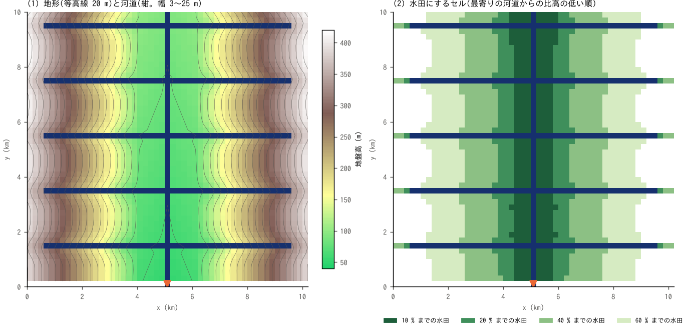
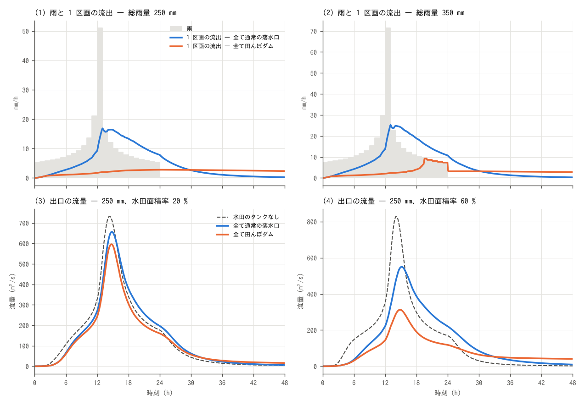
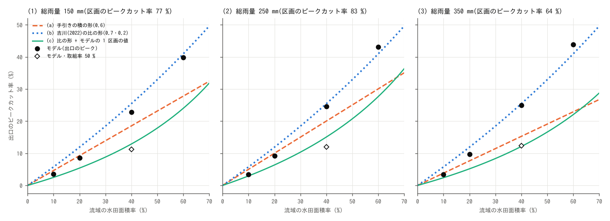

# paddy_basin — 傾斜地の流域の田んぼダムの効果を手引きの概算式と比べる

[English](en/README.md)

**田んぼダム**は、水田の落水口に流出量を絞る板を付け、豪雨の水を畦畔の中に一時的に貯めて、下流の河川のピークを
下げる取組です(農林水産省 2026)。田んぼダムの手引きは、流域のピーク流量がどれだけ下がるかを、水田面積率と
1 区画の計算から見積もる概算式を示しています。この例題は、背水の起きにくい傾斜地の流域(100 km²)を合成地形で作り、
ENCflow の表現 A(サブグリッドの水田タンク。Δx = 200 m)で出口のピーク流量を計算して、この概算式と、その元に
なった吉川(2022)の簡便法と比べます。

比べるのは、水田面積率(10・20・40・60 %)と雨(24 時間 150・250・350 mm)を変えたときの、出口のピークカット率
(全て通常の落水口の流域に対して、全て田んぼダムにするとピーク流量が何 % 下がるか)です。値は現象を見やすくする
ための模式値で、特定の流域の再現ではありません。

**分かったこと**

- 出口のピークカット率は、流域の水田面積率 10・20・40・60 % で 3〜4・9〜10・23〜25・40〜44 % でした(総雨量
  150〜350 mm)。取組率 50 % ではほぼ半分です。
- 手引きの積の形は、水田面積率 20 % 以下ではモデルに近く(差 2.3 ポイント以内)、40 % 以上では小さく出ます。元の
  比の形(吉川 2022)は 40〜60 % でモデルに近く(差 3 ポイント以内)、10〜20 % では 2〜3 ポイント大きく出ます。
- 概算式の係数 0.6・0.7 は、1 区画の値ではなく流域のピークで見た値です。1 区画の流出のピークは雨のピークの
  0.30〜0.35 倍ですが、出口のピークで見た水田の割合は 0.37〜0.60 でした。
- 区画のピークカット率は、出口のピークの時刻で見る必要があります。350 mm では田んぼダムの区画が出口のピークの後に
  満水になるので、区画のピーク同士の比(64 %)で見積もると、効果を小さく見積もります(出口のピークの時刻では 89 %)。

## 手引きの概算式と吉川(2022)の簡便法

**手引きの概算式**(農林水産省 2026 の本文 PDF p.59–60。矢部川の例)

  流域のピークカット率 ≈ ① 水田面積率 × ② 区画のピークカット率 × ③ 非水田に対する水田のピーク流出割合

- ② は 1 区画の水収支の計算(手引きの水田流出簡易計算プログラム)で、田んぼダムにすると区画のピーク流出が何 %
  下がるかです。計算プログラムは、水田の外からの流入がない・落水口以外から出ない(畦畔の越流を除く)・排水路の
  水位の影響を受けないことを前提にしています(参考資料 PDF p.13)。
- ③ は「水田は畦畔があり流出が抑制されることから、水田のピーク流出量を森林や都市の 60 % と仮定」した値です。
- 矢部川の船小屋地点(水田面積率 6.4 %、総雨量 357 mm で ② = 86 %)では、6.4 % × 86 % × 60 % で最大 3.3 % です。
  手引きは「背水の影響等、詳細な条件は考慮していない概算」で「流域全体でのポテンシャルを把握したい場合に有効」と
  しています。

**吉川(2022)の簡便法**(環境技術 51(4) p.198。手引きが引く元の式)

  PC = (A − B) / A、A = A_r Q_P + (1 − A_r)、B = A_r Q_P Q_PP + (1 − A_r)

- A_r は流域の水田面積率、Q_P は非水田(市街地・畑地・森林)に対する通常の水田の単位面積あたりのピーク流出率、
  Q_PP は通常の水田に対する田んぼダムの水田の流出率です。A・B は、水田があるとき・全ての水田を田んぼダムにした
  ときの流域のピーク流出率(非水田だけの流域を 1 とする)です。
- 100 年確率 24 時間雨量では Q_P ≈ 0.7、Q_PP ≈ 0.2 で、傾斜地の 4 流域(93〜165 km²、水田 19〜67 %)の氾濫解析と
  おおむね合います。大きい流域では洪水の到達時間を考える必要がある、と注記されています。
- 手引きの積の形は、水田面積率が小さいときのこの式の近似です(分母を 1 とみなす。水田 6.4 % では 3.3 % と 3.4 %、
  50 % では 26 % と 32 % と分かれます)。

この例題は、次の 3 つをモデルと比べます。

- (a) 手引きの積の形: PC = A_r × r × 0.6(r はモデルの 1 区画のピークカット率)
- (b) 吉川(2022)の比の形: Q_P = 0.7、Q_PP = 0.2
- (c) 比の形に、モデルの 1 区画の値を入れたもの: Q_P = 通常の落水口の区画の流出のピーク / 雨のピーク、Q_PP = 1 − r

## 流域



(1) 地形と河道、(2) 水田面積率ごとに水田にするセル。▼ は出口。

流域は `make_basin.py` が作ります(Δx = 200 m、51 列 × 50 行の格子で、流域は 2500 セル = 100 km²)。

- **地形**: 南端の中央の出口へ向かう幅 2 km の谷底(谷に沿って 1/250、主川へ向かって 1/100)と、その両側の勾配 8 % の
  山腹です。山腹には、2 km ごとに深さ 25 m の支川の谷を刻んでいます。標高は 48〜414 m です。
- **河道**: 主川と、各支川の谷の中心の行を河道のセル(`fn_rw`)にし、集水面積 A に応じた幅 W = max(3, 2.5 √A) m
  (A は km²。出口で 25 m)のサブグリッド幅(`fn_width`。堤防なし)を与え、地盤を 2 m 掘り下げています。
- **出口**: 南端の行は出口のセルだけを残し、出口は常に空にする水位規定です。出口の 1 行上を横切る測線で流量を
  測ります(水はここからだけ出ます)。
- **水田**: 河道でないセルを、最寄りの河道からの比高(落水線で最初に着く河道のセルからの高さ)の低い順に水田の
  セル(水田面積率 0.9。残りは畦畔・農道)にします。流域の水田面積率 10・20・40・60 % で、谷底から山腹へ
  広がります(60 % では河道から 230 m 高いセルまで)。
- **粗度**: 山地(森林)0.3、水田のセル 0.1(タンクの有無によらず同じ)、河道 0.035。山地は浸透させず、雨は全て
  流れます。

## 雨とケース

雨は流域に一様で、物部式(n = 0.5)の中央山型の 24 時間雨量です(1 時間ごとの段)。手引きの計算プログラムの計画
降雨波形と同じ作り方で、総雨量 150・250・350 mm(ピークの 1 時間に 31・51・71 mm)とします。計算は 48 時間です。

水田は表現 A の片方向(水田は自分の上の雨だけを受ける。概算式と同じ前提)で、装置などは既定のままです。

- 通常の落水口: 水位調整板(幅 0.30 m、天端 0.03 m)
- 田んぼダム: 機能分離型(穴 φ50 mm の流出量調整板)
- 代表区画面積 3000 m²、畦畔高 0.30 m、減水深 5 mm/d、事前の湛水深 0.03 m(落水口が流れ始める高さ)

| 名前の末尾 | 水田 |
|---|---|
| `_0` | 水田のタンクなし(同じ地表で、雨はそのまま流れる。概算式の「非水田」の基準) |
| `_N` | 全て通常の落水口(取組率 0) |
| `_D` | 全て田んぼダム(取組率 1) |
| `_H` | 半分が田んぼダム(取組率 0.5。水田面積率 40 % だけ) |

ケースの名前は `R<総雨量 mm>_A<水田面積率 %>_<末尾>` で、`make` が `runs/param_<名前>.txt` を作り、結果は
`runs/result_<名前>/` に出ます(全部で 39 ケース)。

## 実行方法

```
cd examples/paddy_basin
make            # リンクと入力(data/)・設定(runs/)を作る
make run        # 39 ケースを計算(1 ケース 1 スレッドで 4 ケースずつ。4 コアの計算機で約 50 分)
make figs       # figs/*.png・en/figs/*.png と 3 つの数表(標準出力)
```

## 結果

### 1 区画の流出



(1)(2) 雨と 1 区画の流出(水田面積率 40 % の計算の paddy.csv から。全ての水田の落水口の流出と畦畔の越流の合計を
水田の面積で割ったもの)、(3)(4) 総雨量 250 mm の出口の流量(水田面積率 20・60 %。破線はタンクなし)。

表 1(1 区画の流出。水田面積率 40 % の計算から)

| 総雨量 mm | 雨のピーク mm/h | 通常の落水口の流出のピーク mm/h | 田んぼダムの流出のピーク mm/h | 区画のピークカット率 r | Q_P(通常の落水口のピーク / 雨のピーク) | 田んぼダムの畦畔の越流 mm | 出口のピークの時刻の r_t |
|---:|---:|---:|---:|---:|---:|---:|---:|
| 150 | 30.6 | 9.2 | 2.1 | 77 % | 0.30 | 0 | 81 % |
| 250 | 51.0 | 16.9 | 2.8 | 83 % | 0.33 | 0 | 87 % |
| 350 | 71.4 | 25.2 | 9.2 | 64 % | 0.35 | 26 | 89 % |

- 通常の落水口でも、水位調整板が流出を絞ります。区画の流出のピークは雨のピークの 0.30〜0.35 倍で、雨のピークの
  1 時間(12〜13 h)の終わりに来ます。
- 田んぼダムは、150・250 mm では区画の流出を 2〜3 mm/h に抑えます(区画のピークカット率 77・83 %)。
- 350 mm では、田んぼダムの区画が満水になり、雨の後半(18〜24 h)に畦畔を越えます(26 mm)。区画のピーク同士の比は
  64 % まで下がります。
- ただし満水になるのは出口のピーク(14.7 h)の後です。出口のピークの時刻には、田んぼダムの区画の流出はまだ
  2.6 mm/h で、その時刻で見た区画のピークカット率 r_t は 89 % です。

### 出口のピークカット率と概算式



総雨量ごとの出口のピークカット率(黒丸がモデル、白抜きのひし形が取組率 50 %)と、3 つの概算式。(a)・(c) の線は、
水田面積率 40 % の計算の 1 区画の値(表 1 の r と Q_P)で描いています。

表 2(出口のピーク流量とピークカット率)

| 総雨量 mm | 水田面積率 | タンクなし m³/s | 通常の落水口 m³/s(時刻) | 田んぼダム m³/s(時刻) | ピークカット率(モデル) | (a) 積の形 | (b) 比の形 | (c) 比の形 + モデルの値 | 流域の Q_P |
|---:|---:|---:|---:|---:|---:|---:|---:|---:|---:|
| 150 | 10 % | 382 | 366(15.1 h) | 353(15.0 h) | 3.6 % | 4.6 % | 5.8 % | 2.4 % | 0.60 |
| 150 | 20 % | 403 | 359(15.0 h) | 329(14.9 h) | 8.6 % | 9.1 % | 11.9 % | 4.9 % | 0.45 |
| 150 | 40 % | 440 | 330(15.2 h) | 255(15.1 h) | 22.9 % | 18.5 % | 25.5 % | 12.9 % | 0.38 |
| 150 | 60 % | 476 | 295(15.6 h) | 178(15.3 h) | 39.8 % | 28.2 % | 41.0 % | 25.4 % | 0.37 |
| 250 | 10 % | 705 | 671(14.8 h) | 648(14.8 h) | 3.4 % | 5.0 % | 5.8 % | 2.9 % | 0.53 |
| 250 | 20 % | 733 | 657(14.8 h) | 596(14.8 h) | 9.2 % | 9.9 % | 11.9 % | 6.0 % | 0.48 |
| 250 | 40 % | 778 | 608(15.0 h) | 458(14.8 h) | 24.6 % | 20.0 % | 25.5 % | 15.1 % | 0.45 |
| 250 | 60 % | 829 | 550(15.2 h) | 312(14.8 h) | 43.2 % | 30.5 % | 41.0 % | 29.7 % | 0.44 |
| 350 | 10 % | 1049 | 990(14.7 h) | 957(14.7 h) | 3.4 % | 3.8 % | 5.8 % | 2.4 % | 0.43 |
| 350 | 20 % | 1085 | 966(14.7 h) | 873(14.6 h) | 9.7 % | 7.4 % | 11.9 % | 4.8 % | 0.45 |
| 350 | 40 % | 1136 | 893(14.8 h) | 670(14.7 h) | 24.9 % | 15.3 % | 25.5 % | 12.1 % | 0.46 |
| 350 | 60 % | 1203 | 812(15.0 h) | 455(14.7 h) | 43.9 % | 24.1 % | 41.0 % | 24.6 % | 0.46 |

表の (a)・(c) は、その水田面積率の計算の 1 区画の値で求めています。「流域の Q_P」は、モデルの出口のピークを比の形の
A に当てはめた値 (Q_N/Q_0 − (1 − A_r))/A_r です(Q_0 はタンクなしのピーク流量)。

- **手引きの積の形 (a)** は、水田面積率 20 % 以下ではモデルに近く(差 2.3 ポイント以内)、40 % 以上では小さく
  出ます(40 % で 4〜10 ポイント、60 % で 12〜20 ポイント)。
  - 積の形は分母を 1 とみなす近似なので、水田が多いほど小さく出ます。
  - 350 mm では、出口のピークの後に満水になる区画のピーク同士の比(r = 64 %)を使うので、さらに小さく出ます。
- **吉川(2022)の比の形 (b)** は、水田面積率 40〜60 % ではモデルに近く(差 3 ポイント以内)、10〜20 % では 2〜3
  ポイント大きく出ます。
- **比の形にモデルの 1 区画の値を入れた (c)** は、どの条件でもモデルより小さく出ます(水田面積率 40 % で 12〜15 %、
  モデルは 23〜25 %)。
  - 1 区画の通常の落水口のピーク流出は雨のピークの 0.30〜0.35 倍ですが、流域の Q_P は 0.37〜0.60 です。
  - 山地の流出は河道を流れる間に遅れて鈍るので、出口のピークで見ると、水田の流出の割合は 1 区画で見るより
    大きくなります。
  - 概算式の Q_P(手引きの 0.6、吉川 2022 の 0.7)は、1 区画の計算で決まる値ではなく、流域のピークで見た値です。
    この例題の流域では、150・250 mm では水田が少ないほど 0.6 に近く、多いほど小さくなり(0.60・0.53 → 0.37・0.44)、
    350 mm では 0.43〜0.46 でした。

### 取組率 50 %

表 3(取組率 50 %。水田面積率 40 %)

| 総雨量 mm | ピークカット率(取組率 50 %) | 取組率 100 % の半分 |
|---:|---:|---:|
| 150 | 11.2 % | 11.4 % |
| 250 | 12.0 % | 12.3 % |
| 350 | 12.4 % | 12.5 % |

- 取組率 50 % のピークカット率は、取組率 100 % のほぼ半分です(差 0.3 ポイント以内)。手引きの図 3-12(鈴木ら
  2024 のシミュレーション)でも、ピークカット率は水田面積率と取組率に比例しています。

## 使うときの目安

- **概算式は水田面積率で使い分ける**: 水田面積率が 20 % 程度までの流域では手引きの積の形で足ります。それより水田の
  多い流域では、分母を省かない比の形(吉川 2022)を使います。
- **区画のピークカット率は、評価地点のピークの時刻で見る**: 大きい雨・長い雨では、田んぼダムの区画が満水になる
  時刻が評価地点のピークの前か後かで効果が大きく変わります。区画のピーク同士の比だけで見積もると、満水が後なら
  小さく、前なら大きく見積もります。
- **係数は流域のピークの値**: 0.6・0.7 は 1 区画の計算からは決まらず、流域の大きさ・地形・雨で変わります
  (この例題では 0.37〜0.60)。判断が係数に左右される場合は、代表的な流域をモデルで解いて確かめます。

## できないこと・精度の限界

- 合成の流域の模式値で、特定の流域の再現ではありません。
- 山地は浸透させず、雨は全て流れます。実際の森林は浸透と土層の流出でピークを遅らせて鈍らせるので、流域の Q_P と
  概算式の当てはまりは変わります。雨は流域に一様です。
- 水田は表現 A の片方向です。区画の並びと排水路を表さず、排水路の背水は表しません(背水の強い低平地は例題
  [paddy_dam](../paddy_dam/README.md))。
- 全ての区画が同じ装置・同じ代表区画面積・同じ事前の湛水深で、田んぼダムの区画は同時に満水になります。実際は
  区画ごとにばらつき、満水になる時刻もばらつきます。
- 流域は 100 km² で、出口のピークは雨のピークの 1 時間の 2〜3 時間後です。到達時間が長い大きい流域では、概算式との
  関係が変わりえます(吉川 2022 の注記)。

## 参考文献

- 農林水産省 農村振興局 (2026):「田んぼダム」の手引き(改訂版)と参考資料(水田流出簡易計算プログラムの説明)。
  https://www.maff.go.jp/j/nousin/mizu/kurasi_agwater/attach/pdf/ryuuiki_tisui-207.pdf ・ ryuuiki_tisui-208.pdf
- 吉川夏樹 (2022): 田んぼダムは流域治水に貢献できるのか、環境技術 51(4), 195–199. doi:10.5956/jriet.51.4_195
- 鈴木友志・濱 武英・山口莉歩・中村公人 (2024): 水田貯留機能強化を考慮した複数支流河川流域における洪水緩和効果、
  水文・水資源学会誌 37(2), 142–154.
