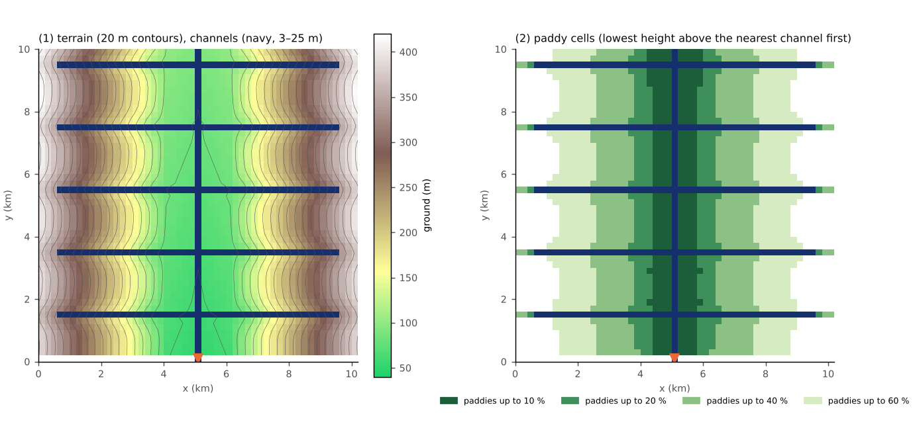
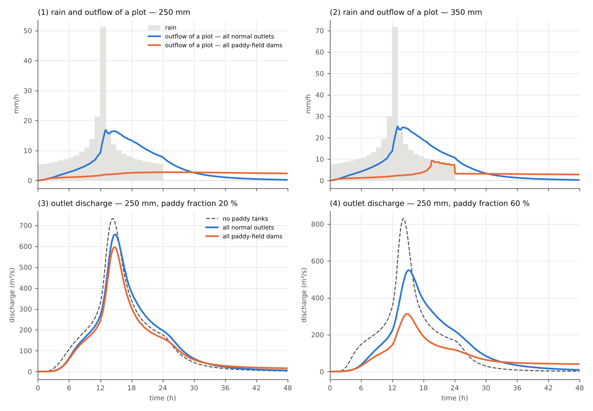
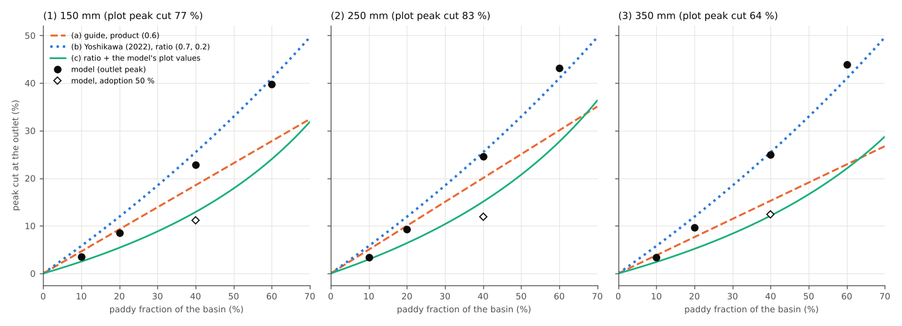

# paddy_basin — the effect of paddy-field dams in a sloping basin compared with the estimation formula of the guide

> English mirror of examples/paddy_basin/README.md. The Japanese file is the master copy.

[日本語](../README.md)

**Paddy-field dams** (田んぼダム) fit the outlets of rice paddies with plates that restrict the outflow, so that heavy
rain is held for a while inside the levees and the peaks of the rivers downstream are lowered (MAFF 2026). The guide to
paddy-field dams gives an estimation formula for how much the peak discharge of a basin falls, from the paddy fraction
and a calculation for a single plot. This example builds a synthetic sloping basin (100 km²) where backwater hardly
occurs, computes the outlet peak discharge with representation A of ENCflow (subgrid paddy tanks; Δx = 200 m), and
compares it with this formula and with the simplified method of Yoshikawa (2022) that it is based on.

The comparison is the peak cut at the outlet (how many % the peak discharge falls when all paddies become paddy-field
dams, relative to the basin with all normal outlets) for paddy fractions of 10, 20, 40 and 60 % and rain of 150, 250 and
350 mm in 24 hours. The values are schematic, chosen to make the phenomena easy to see, and do not reproduce any
particular basin.

**Findings**

- The peak cut at the outlet was 3–4, 9–10, 23–25 and 40–44 % for paddy fractions of the basin of 10, 20, 40 and 60 %
  (total rain 150–350 mm). With an adoption ratio of 50 % it is almost half.
- The product form of the guide is close to the model for paddy fractions of 20 % or less (within 2.3 points) and comes
  out small for 40 % or more. The original ratio form (Yoshikawa 2022) is close to the model for 40–60 % (within
  3 points) and comes out 2–3 points large for 10–20 %.
- The coefficients 0.6 and 0.7 of the formulas are values seen at the basin peak, not values of a single plot. The
  outflow peak of a plot is 0.30–0.35 times the rain peak, but the share of the paddies seen at the outlet peak was
  0.37–0.60.
- The peak cut of a plot has to be taken at the time of the outlet peak. With 350 mm, the plots with paddy-field dams
  fill up after the outlet peak, so estimating with the ratio of the plot peaks (64 %) underestimates the effect (89 %
  at the time of the outlet peak).

## The estimation formula of the guide and the simplified method of Yoshikawa (2022)

**Estimation formula of the guide** (MAFF 2026, main text PDF pp. 59–60; the example of the Yabe River)

  peak cut of the basin ≈ ① paddy fraction × ② peak cut of a plot × ③ ratio of the peak runoff of paddies to that of
  other land

- ② comes from the water balance of a single plot (the simple paddy runoff calculation program of the guide): how many
  % the peak outflow of a plot falls with a paddy-field dam. The program assumes that no water enters the plot from
  outside, that water leaves only through the outlet (apart from overflow over the levees), and that the drainage is not
  affected by the water level of the drains (reference material PDF p. 13).
- ③ is the value set by "assuming the peak runoff of paddies to be 60 % of that of forest and urban areas, because the
  levees of paddies restrain the runoff".
- At Funagoya on the Yabe River (paddy fraction 6.4 %, ② = 86 % for a total rain of 357 mm), 6.4 % × 86 % × 60 % gives
  up to 3.3 %. The guide calls this "a rough estimate that does not consider detailed conditions such as the influence
  of backwater" that is "useful when you want to grasp the potential over a whole basin".

**Simplified method of Yoshikawa (2022)** (Kankyo Gijutsu 51(4) p. 198; the original formula cited by the guide)

  PC = (A − B) / A, A = A_r Q_P + (1 − A_r), B = A_r Q_P Q_PP + (1 − A_r)

- A_r is the paddy fraction of the basin, Q_P the peak runoff per unit area of a normal paddy relative to other land
  (urban, upland fields, forest), and Q_PP the runoff of a paddy with a paddy-field dam relative to a normal paddy. A and
  B are the peak runoff ratios of the basin with paddies and with all paddies made paddy-field dams (a basin of other
  land only is 1).
- For a 100-year 24-hour rain, Q_P ≈ 0.7 and Q_PP ≈ 0.2, and the method roughly agrees with flood analyses of four sloping
  basins (93–165 km², paddies 19–67 %). It notes that large basins require the travel time of floods to be considered.
- The product form of the guide approximates this formula for small paddy fractions (taking the denominator as 1;
  3.3 % and 3.4 % for 6.4 % paddies, but 26 % and 32 % for 50 %).

This example compares three estimates with the model.

- (a) The product form of the guide: PC = A_r × r × 0.6 (r is the peak cut of a plot in the model)
- (b) The ratio form of Yoshikawa (2022): Q_P = 0.7, Q_PP = 0.2
- (c) The ratio form with the values of a single plot of the model: Q_P = outflow peak of a plot with normal outlets /
  rain peak, Q_PP = 1 − r

## The basin



(1) Terrain and channels, (2) the cells made paddy fields for each paddy fraction. ▼ marks the outlet.

`make_basin.py` builds the basin (Δx = 200 m; a grid of 51 columns × 50 rows, of which the basin is 2500 cells =
100 km²).

- **Terrain**: a valley floor 2 km wide leading to the outlet at the middle of the south edge (1/250 along the valley,
  1/100 towards the main river), with hillslopes of 8 % on both sides. Valleys of tributaries 25 m deep are cut into the
  hillslopes every 2 km. Elevations are 48–414 m.
- **Channels**: the main river and the central row of each tributary valley are channel cells (`fn_rw`) with a subgrid
  width W = max(3, 2.5 √A) m from the drainage area A (km²; 25 m at the outlet; `fn_width`, no levee), cut 2 m into the
  ground.
- **Outlet**: of the south edge row only the outlet cell is kept, and the outlet is a stage boundary that is always empty.
  The discharge is measured with a transect across the row just above the outlet (water leaves only there).
- **Paddies**: cells that are not channels become paddy cells (paddy fraction 0.9; the rest is levees and farm roads) in
  order of increasing height above the nearest channel (the height above the first channel cell reached along the flow
  path). For paddy fractions of the basin of 10, 20, 40 and 60 % they spread from the valley floor up the hillslopes (up
  to cells 230 m above the channel at 60 %).
- **Roughness**: hillslopes (forest) 0.3, paddy cells 0.1 (the same with or without tanks), channels 0.035. The
  hillslopes do not infiltrate, and all the rain runs off.

## Rain and cases

The rain is uniform over the basin: a 24-hour rain with a central peak by the Mononobe formula (n = 0.5) in hourly steps.
It is built the same way as the design storms of the calculation program of the guide, with totals of 150, 250 and
350 mm (31, 51 and 71 mm in the peak hour). The runs last 48 hours.

The paddies use representation A in the one-way mode (a paddy receives only the rain falling on it; the same assumption
as the formula), with the default devices and settings.

- Normal outlets: water-level board (0.30 m wide, crest 0.03 m)
- Paddy-field dams: separated type (outflow control plate with a hole of φ50 mm)
- Representative plot area 3000 m², levee height 0.30 m, decrease in depth 5 mm/d, ponding before the rain 0.03 m (the
  level at which the outlet starts to drain)

| Name ending | Paddies |
|---|---|
| `_0` | no paddy tanks (the same surface, and the rain runs off as it is; the "other land" basis of the formulas) |
| `_N` | all normal outlets (adoption ratio 0) |
| `_D` | all paddy-field dams (adoption ratio 1) |
| `_H` | half paddy-field dams (adoption ratio 0.5; paddy fraction 40 % only) |

The cases are named `R<total rain mm>_A<paddy fraction %>_<ending>`; `make` writes `runs/param_<name>.txt`, and the results
are written to `runs/result_<name>/` (39 cases in all).

## How to run

```
cd examples/paddy_basin
make            # links, inputs (data/) and settings (runs/)
make run        # computes the 39 cases (one thread per case, four at a time; about 50 min on a 4-core machine)
make figs       # figs/*.png, en/figs/*.png and the three tables (standard output)
```

## Results

### Outflow of a plot



(1)(2) Rain and the outflow of a plot (from paddy.csv of the runs with 40 % paddies: the outflow through all outlets plus
the overflow over the levees, divided by the paddy area), (3)(4) outlet discharge with a total rain of 250 mm (paddy
fractions 20 and 60 %; dashed: no tanks).

Table 1 (outflow of a plot; from the runs with 40 % paddies)

| Rain mm | rain peak mm/h | outflow peak, normal outlets mm/h | outflow peak, paddy-field dams mm/h | plot peak cut r | Q_P (normal outlet peak / rain peak) | overflow over the levees, paddy-field dams mm | r_t at the time of the outlet peak |
|---:|---:|---:|---:|---:|---:|---:|---:|
| 150 | 30.6 | 9.2 | 2.1 | 77 % | 0.30 | 0 | 81 % |
| 250 | 51.0 | 16.9 | 2.8 | 83 % | 0.33 | 0 | 87 % |
| 350 | 71.4 | 25.2 | 9.2 | 64 % | 0.35 | 26 | 89 % |

- Even normal outlets restrict the outflow through the water-level board. The outflow peak of a plot is 0.30–0.35 times
  the rain peak and comes at the end of the peak hour of the rain (12–13 h).
- With 150 and 250 mm, paddy-field dams hold the outflow of a plot at 2–3 mm/h (peak cut of a plot 77 and 83 %).
- With 350 mm, the plots with paddy-field dams fill up and overflow their levees in the latter half of the rain
  (18–24 h; 26 mm). The ratio of the plot peaks falls to 64 %.
- They fill up, however, after the outlet peak (14.7 h). At the time of the outlet peak, the outflow of a plot with a
  paddy-field dam is still 2.6 mm/h, and the peak cut of a plot taken at that time, r_t, is 89 %.

### Peak cut at the outlet and the formulas



Peak cut at the outlet for each total rain (black dots: model; open diamonds: adoption ratio 50 %) and the three
estimates. The lines (a) and (c) use the values of a single plot from the runs with 40 % paddies (r and Q_P of Table 1).

Table 2 (outlet peak discharge and peak cut)

| Rain mm | paddy fraction | no tanks m³/s | normal outlets m³/s (time) | paddy-field dams m³/s (time) | peak cut (model) | (a) product | (b) ratio | (c) ratio + model values | basin Q_P |
|---:|---:|---:|---:|---:|---:|---:|---:|---:|---:|
| 150 | 10 % | 382 | 366(15.1 h) | 353(15.0 h) | 3.6 % | 4.6 % | 5.8 % | 2.4 % | 0.60 |
| 150 | 20 % | 403 | 359(15.0 h) | 329(14.9 h) | 8.6 % | 9.1 % | 11.9 % | 4.9 % | 0.45 |
| 150 | 40 % | 440 | 330(15.2 h) | 255(15.1 h) | 22.9 % | 18.5 % | 25.5 % | 12.9 % | 0.38 |
| 150 | 60 % | 476 | 295(15.6 h) | 178(15.3 h) | 39.8 % | 28.2 % | 41.0 % | 25.4 % | 0.37 |
| 250 | 10 % | 705 | 671(14.8 h) | 648(14.8 h) | 3.4 % | 5.0 % | 5.8 % | 2.9 % | 0.53 |
| 250 | 20 % | 733 | 657(14.8 h) | 596(14.8 h) | 9.2 % | 9.9 % | 11.9 % | 6.0 % | 0.48 |
| 250 | 40 % | 778 | 608(15.0 h) | 458(14.8 h) | 24.6 % | 20.0 % | 25.5 % | 15.1 % | 0.45 |
| 250 | 60 % | 829 | 550(15.2 h) | 312(14.8 h) | 43.2 % | 30.5 % | 41.0 % | 29.7 % | 0.44 |
| 350 | 10 % | 1049 | 990(14.7 h) | 957(14.7 h) | 3.4 % | 3.8 % | 5.8 % | 2.4 % | 0.43 |
| 350 | 20 % | 1085 | 966(14.7 h) | 873(14.6 h) | 9.7 % | 7.4 % | 11.9 % | 4.8 % | 0.45 |
| 350 | 40 % | 1136 | 893(14.8 h) | 670(14.7 h) | 24.9 % | 15.3 % | 25.5 % | 12.1 % | 0.46 |
| 350 | 60 % | 1203 | 812(15.0 h) | 455(14.7 h) | 43.9 % | 24.1 % | 41.0 % | 24.6 % | 0.46 |

In the table, (a) and (c) use the values of a single plot from the runs with that paddy fraction. "Basin Q_P" is the
value that fits the model's outlet peak to A of the ratio form, (Q_N/Q_0 − (1 − A_r))/A_r (Q_0 is the peak discharge
without tanks).

- **The product form of the guide (a)** is close to the model for paddy fractions of 20 % or less (within 2.3 points) and
  comes out small for 40 % or more (by 4–10 points at 40 % and 12–20 points at 60 %).
  - The product form approximates the denominator by 1, so it comes out smaller the more paddies there are.
  - With 350 mm it uses the ratio of the plot peaks (r = 64 %) of plots that fill up after the outlet peak, so it comes
    out smaller still.
- **The ratio form of Yoshikawa (2022) (b)** is close to the model for paddy fractions of 40–60 % (within 3 points) and
  comes out 2–3 points large for 10–20 %.
- **The ratio form with the values of a single plot of the model (c)** comes out smaller than the model in every case
  (12–15 % for 40 % paddies, against 23–25 % in the model).
  - The peak outflow of a plot with normal outlets is 0.30–0.35 times the rain peak, but the basin Q_P is 0.37–0.60.
  - The runoff from the hillslopes is delayed and flattened while it flows down the channels, so at the outlet peak the
    share of the outflow from the paddies is larger than seen at a single plot.
  - Q_P of the formulas (0.6 in the guide, 0.7 in Yoshikawa 2022) is not a value set by a calculation for a single plot,
    but a value seen at the basin peak. In this basin it approached 0.6 with fewer paddies and fell with more paddies
    for 150 and 250 mm (0.60 and 0.53 → 0.37 and 0.44), and was 0.43–0.46 for 350 mm.

### Adoption ratio 50 %

Table 3 (adoption 50 %; 40 % paddies)

| Rain mm | peak cut (adoption 50 %) | half of adoption 100 % |
|---:|---:|---:|
| 150 | 11.2 % | 11.4 % |
| 250 | 12.0 % | 12.3 % |
| 350 | 12.4 % | 12.5 % |

- The peak cut with an adoption ratio of 50 % is almost half of that with 100 % (within 0.3 points). Figure 3-12 of the
  guide (simulations of Suzuki et al. 2024) also shows the peak cut proportional to the paddy fraction and the adoption
  ratio.

## Hints for use

- **Choose the formula by the paddy fraction**: for basins with paddy fractions up to about 20 %, the product form of the
  guide is enough. For basins with more paddies, use the ratio form (Yoshikawa 2022), which keeps the denominator.
- **Take the peak cut of a plot at the time of the peak at the point of evaluation**: with large or long rain, the effect
  changes a lot depending on whether the plots with paddy-field dams fill up before or after the peak at the point of
  evaluation. Estimating only with the ratio of the plot peaks underestimates the effect if they fill up afterwards, and
  overestimates it if they fill up before.
- **The coefficients are values at the basin peak**: 0.6 and 0.7 are not set by a calculation for a single plot, and
  change with the size of the basin, the terrain and the rain (0.37–0.60 in this example). If a decision depends on the
  coefficient, solve a representative basin with the model to check.

## Limitations and accuracy

- These are schematic values for a synthetic basin and do not reproduce any particular basin.
- The hillslopes do not infiltrate, and all the rain runs off. Real forests delay and flatten the peak through
  infiltration and subsurface runoff, which changes the basin Q_P and how well the formulas fit. The rain is uniform over
  the basin.
- The paddies use representation A in the one-way mode. It does not represent the layout of the plots and the drains, nor
  the backwater of the drains (for lowlands with strong backwater, see the example [paddy_dam](../../paddy_dam/en/README.md)).
- All plots have the same devices, the same representative plot area and the same ponding before the rain, so the plots
  with paddy-field dams fill up at the same time. In reality they vary from plot to plot, and so does the time they fill
  up.
- The basin is 100 km², and the outlet peak comes 2–3 hours after the peak hour of the rain. In large basins with long
  travel times, the relation to the formulas can change (as noted by Yoshikawa 2022).

## References

- Ministry of Agriculture, Forestry and Fisheries (MAFF), Rural Development Bureau (2026): Guide to paddy-field dams
  (revised edition) and its reference material on the simple paddy runoff calculation program (in Japanese).
  https://www.maff.go.jp/j/nousin/mizu/kurasi_agwater/attach/pdf/ryuuiki_tisui-207.pdf ・ ryuuiki_tisui-208.pdf
- Yoshikawa (2022): Kankyo Gijutsu, 51(4), 195–199. doi:10.5956/jriet.51.4_195 (in Japanese)
- Suzuki et al. (2024): Journal of Japan Society of Hydrology and Water Resources, 37(2), 142–154 (in Japanese)
