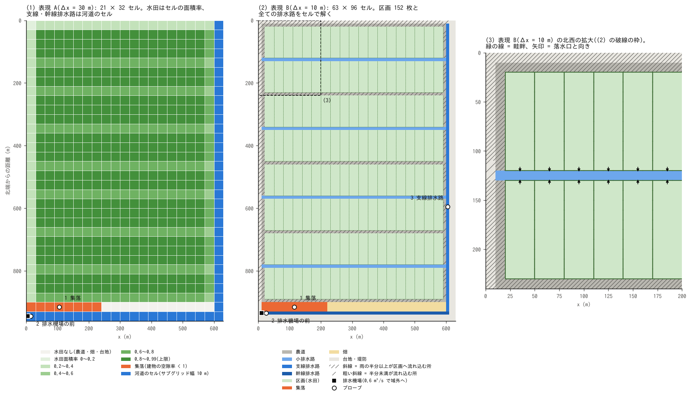

# paddy_dam — 低平地の排水区の内水と田んぼダム(同じ地区を表現 A と表現 B で解いて比べる)

[English](en/README.md)

**田んぼダム**は、水田の落水口(排水枡)に流出量を絞る板(穴・切欠き)を付け、豪雨の水を畦畔の中に一時的に
貯めて、下流の排水路・河川のピークを下げる取組です(農林水産省 2026)。この例題は、周りを堤防で囲まれ、外の川の
水位が高くて排水機場のポンプでしか水を出せない低平地の排水区(内水)を合成地形で作り、全ての水田が通常の落水口の
場合と、田んぼダムにした場合(全て、上流側の半分、下流側の半分)で、集落の浸水がどう変わるかを比べます。

**同じ地区・同じ雨・同じ排水機場を、ENCflow の田んぼダムの 2 つの表し方(表現)で計算します。**

- **表現 A(Δx = 30 m)**: 区画を解像しない表し方(粗い格子向け)。セルの中の水田を、水田面積率と取組率で決まる
  サブグリッドのタンクとして表します。
- **表現 B(Δx = 10 m)**: 区画を格子で解像する表し方(細かい格子向け)。152 枚の区画をそれぞれセルの集まりとして
  解き、畦畔を区画の境の壁、落水口を壁の切欠きとして、水田の水も浅水流で計算します。

[結果 1](#結果-1-田んぼダムの効果表現-bδx--10-m) は表現 B で田んぼダムの効果を調べ、[結果 2](#結果-2-同じ地区を表現-aδx--30-mで解くと)
は同じ地区を表現 A で解いて、粗い格子でどこまで同じ答えになるか、入力をどう与えると近づくかを確かめます。値は
現象を見やすくするための模式値で、特定の地区の再現ではありません。

## 実際の田んぼダムで起きていること

- **落水口で流出を絞る**: 通常の落水口は水位調整板(堰)で湛水深を決めるだけですが、田んぼダムは排水枡に穴の
  あいた流出量調整板を入れ(機能分離型)、雨の強い時間の流出を絞ります。区画の面積 30 a・畦畔 30 cm が標準の例で、
  穴の径は φ50 mm などです(農林水産省 2026)。
- **排水路の水位が越流の主な原因**: 新潟の亀田郷(水田 41 %)の計算では、越流した水田の 9 割超が排水路の高い
  水位によるもので、日雨量 200 mm では越流の 89 % が排水路からの逆流でした(佐藤ほか 2021)。低平地では、排水路の
  水位が上がると水田へ水が戻る(逆流・畦畔を越える流入)ことも表す必要があります。
- **効果には限界がある**: 長い雨で田んぼダムの水田が満水になると効果が消え、3 日で 450 mm を超える雨では製品の
  試験でもほとんど効かないことが報告されています(皆川・宮津 2022)。流域での効果は日雨量 268 mm の雨で最も
  大きく、それより強い雨では小さくなる例があります(宮津ほか 2020)。
- **区画を解像した計算の前例**: 10 m の 2 次元計算で、満水の水田が 0.3 m 高い地盤のようにふるまい、合流点の近くの
  浸水を深くした例があります(早崎ほか 2022)。

## 地区(2 つの表現で共通)

地区は `make_district.py` が 10 m のラスタとして作ります。表現 B はこのラスタをそのまま使い、表現 A は 3 × 3 セル
(30 m)ずつまとめて使います。

- **範囲と地形**: 630 m × 960 m。北から南へ 1/1000 で下る低平地で、周りは台地と堤防で閉じています(水が出るのは
  排水機場だけ)。
- **水田**: 30 m × 100 m(30 a)の区画を 4 組 × 2 列 × 19 枚 = 152 枚(45.6 ha、地区の約 75 %)。田面は区画の中で
  平らで、落水口は区画の小排水路側の短い辺の中央にあります。畦畔高は全区画 0.30 m。
- **排水路**: 区画の列の間の小排水路(東へ)→ 東端の支線排水路(南へ)→ 南端の幹線排水路(西へ)→ 南西の
  排水機場。排水路の底は田面より 0.5〜1.3 m 低く、農道は田面より 0.45 m 高い(畦畔の天端より高い)。
- **集落**: 幹線排水路の北の帯の西側(210 m × 30 m)。地区で最も低く(地盤 0.18 m)、幹線排水路があふれると最初に
  浸かります。建物の空隙率 0.7。
- **排水機場**: ポンプが吸水槽の水深 0.3 m で動き始め、0.6 m 以上で 0.6 m³/s を域外へ出します(比排水量 約
  1 m³/s/km²)。雨のピーク(25 mm/h = 地区全体で 4.2 m³/s)よりずっと小さく、排水路と水田にたまった水を雨の後に
  ゆっくり出します。
- **雨と事前の状態**: 一様な雨を 24 h で 207 mm(4 mm/h を 6 h、12 mm/h を 3 h、25 mm/h を 3 h、12 mm/h を 3 h、
  4 mm/h を 9 h)、48 h まで計算します。水田は流れ始める高さ(水位調整板の天端 0.03 m)まで湛水した状態から
  始め、減水深は 5 mm/d です。
- **落水口の 4 通り**: N(全て通常の落水口 = 水位調整板 0.03 m × 幅 0.30 m の堰)、D(全て田んぼダム = 機能分離型。
  水位調整板 + 穴 φ50)、Du(北の 2 組 = 上流側の半分 76 区画だけ田んぼダム)、Dd(南の 2 組 = 下流側の半分 76 区画
  だけ田んぼダム)。

## 2 つの表現



(1) 表現 A(Δx = 30 m)が解く地区。白い線は 30 m のセルの境で、緑の濃さは水田面積率、青は河道のセル(支線・幹線
排水路)、オレンジは集落です。小排水路と農道を含む行は水田面積率の低い帯として見えます。(2) 表現 B(Δx = 10 m)が
解く同じ地区。細い緑の線は区画の境(畦畔)、白丸はプローブ、黒い四角は排水機場、破線の枠は (3) の範囲です。
斜線は、雨が区画へ流れ込む農道・台地です(`make_district.py` が地形でたどったもの。結果 2 で使います)。
(3) 表現 B の北西の拡大。緑の線が畦畔、矢印が落水口とその向きです。

**表現 A(Δx = 30 m)**では、区画も小排水路も格子に現れません。30 m のセルごとに、水田面積率(3 × 3 セルの中の
区画のセルの割合。区画だけのセルは 1 になりますが、双方向で水田でない面積の割合を 0.01 以上残すため 0.99 で
頭打ち)と取組率から、通常の落水口の水田と
田んぼダムの水田のタンクを持ちます。タンクの落水は同じ落水口の装置則(代表区画面積 3000 m² ごとに 1 か所)で
決まり、そのセルの地表へ出て、地表を流れて河道のセル(支線・幹線排水路)へ集まります。地表の水と水田のやり取りは
2 通りから選べます。**片方向**は水田の上の雨だけをタンクに入れます(排水路の水は水田に戻りません)。**双方向**
(`f_pd_exchange = 1`)は、落水口からの逆流と、地表の水位が畦畔を越えたときの流入でも水田に水が入ります(利用者
ガイドの[田んぼダム](../../docs/users_guide/paddy.md)の「地表の水との関係」)。この例題では表現 A を両方で解きます。

**表現 B(Δx = 10 m)**では、区画の湛水は浅水流の水深そのものです。区画の水が出入りするのは、畦畔の天端
(田面 + 0.30 m)を越える越流と、落水口だけです。排水路の水位が区画の水位より高くなれば、落水口から区画へ逆流し、
天端を越えれば畦畔を越えて流れ込みます。小排水路・支線・幹線排水路は、どれも幅 10 m(1 セル)の掘り込みとして
地形に入っています。

| | 表現 A(Δx = 30 m) | 表現 B(Δx = 10 m) |
|---|---|---|
| 格子 | 21 × 32 セル(10 m の 3 × 3 を 1 セルに) | 63 × 96 セル |
| 水田 | セルの水田面積率と取組率で決まる種類ごとのタンク(水田 45.3 ha。面積率の頭打ちで表現 B より 0.3 ha 少ない) | 152 区画をそれぞれセルの集まりとして解く(区画番号・落水口・種類の分布。水田 45.6 ha) |
| 水田の水 | タンクの湛水深(セルの中の同じ種類の水田で同じ) | 浅水流の水深(区画の中の水面の傾きも解く) |
| 畦畔 | タンクの湛水深の上限。超えた分はすぐ地表へ | 区画の境のエッジの壁。天端を越えたら本間公式で越流 |
| 落水口 | 代表区画面積 3000 m² ごとに 1 か所の装置則。落水はセルの地表へ | 区画ごとに 1 か所、出口セルのエッジの装置則(両向き) |
| 排水路から水田へ戻る水 | 片方向: 戻らない。双方向: 落水口からの逆流と、畦畔を越えたときの瞬時の満水 | 落水口からの逆流と畦畔を越える流入を浅水流で解く |
| 小排水路 | 水路としては表さない(3 × 3 の平均の地盤高に均される) | 幅 10 m(1 セル)の掘り込み |
| 支線・幹線排水路 | 河道のセル(サブグリッド幅 10 m。河床はセルの中の排水路の底の最低) | 幅 10 m(1 セル)の掘り込み |
| 農道 | 3 × 3 の平均の地盤高に均される | 田面 + 0.45 m の高まり |
| 粗度 | 地表 0.045、河道のセル 0.03 | 排水路 0.03、区画 0.05、ほか 0.04 |
| 時間刻み・計算時間(4 コア) | 2 s、1 ケース 2〜3 分 | 1 s、1 ケース 10〜20 分 |

## ケース

| 落水口 | 表現 A(Δx = 30 m)・片方向 | 表現 A(Δx = 30 m)・双方向 | 表現 A(Δx = 30 m)・双方向・集水面積率 | 表現 B(Δx = 10 m) |
|---|---|---|---|---|
| N: 全て通常の落水口 | param_A30_N.txt | param_A30_N2.txt | param_A30_N2c.txt | param_B10_N.txt |
| D: 全て田んぼダム | param_A30_D.txt | param_A30_D2.txt | param_A30_D2c.txt | param_B10_D.txt |
| Du: 上流側の半分が田んぼダム | — | — | — | param_B10_Du.txt |
| Dd: 下流側の半分が田んぼダム | — | — | — | param_B10_Dd.txt |

設定ファイルの名前の A30 は表現 A(Δx = 30 m)、B10 は表現 B(Δx = 10 m)、末尾の 2 は双方向、2c は双方向で
集水面積率 `fn_pd_catch`(`data/catch30.txt`。結果 2)を与えたものです。結果は `result_<名前>/` に出ます。

## 実行方法

```
cd examples/paddy_dam
make            # リンクと入力(make_district.py が data/ に 10 m と 30 m の入力を作る)
make run        # 10 ケースを順に計算(4 コアの計算機で表現 B は 1 ケース 10〜20 分、表現 A は 2〜3 分)
make figs       # figs/*.png・en/figs/*.png と 3 つの数表(標準出力)
```

## 結果 1: 田んぼダムの効果(表現 B、Δx = 10 m)

この節は全て表現 B の計算です。


表現 B の最大水深。(1) は全て通常の落水口(N)、(2) は全て田んぼダム(D)。オレンジの線は集落です。


(1) 雨(2 つの表現で共通)、(2) 集落の浸水深(プローブ 1)、(3) 排水機場の前の幹線排水路の水位(プローブ 2。破線は
集落の地盤)、(4) 全 152 区画の平均水深。

表 1(表現 B、Δx = 10 m)

| 落水口 | 集落の最大浸水深 m(時刻) | 集落の浸水深 > 0.1 m の時間 h | 排水機場の前の最高水位 m | 区画の最大の平均水深 mm | 落水口からの逆流 m³ | 畦畔を越えた流入 m³ | 畦畔を越えた流出 m³ |
|---|---:|---:|---:|---:|---:|---:|---:|
| N: 全て通常の落水口 | 0.51(24.0 h) | 37 以上(48 h でも続く) | 0.70 | 135 | 11453 | 11921 | 2821 |
| D: 全て田んぼダム | 0.01(9.5 h) | 0 | -0.09 | 210 | 0 | 10707 | 578 |
| Du: 上流側の半分が田んぼダム | 0.33(24.0 h) | 25 | 0.51 | 155 | 1031 | 10521 | 367 |
| Dd: 下流側の半分が田んぼダム | 0.41(23.2 h) | 25 | 0.60 | 153 | 311 | 10586 | 267 |

逆流・流入・流出は 48 h までの累積です。畦畔を越えた流入の大部分は、区画より高い農道と台地(地区の図の斜線。
4.4 ha)に降った雨が隣の区画に流れ込んだ分です(D でも排水路の水位は区画より低いままでした)。集落(0.63 ha)は、浸かったケースでは全体が
0.1 m より深く浸かりました。

**通常の落水口(N)**: 通常の落水口は水位調整板(幅 0.30 m の堰)を越えた水をそのまま流すので、区画の水深は雨の
強い間だけ上がり(平均の最大 135 mm)、ほとんどの雨はすぐに小排水路へ出ます(24 h までの落水 6.8 万 m³)。ポンプ
(0.6 m³/s)より速く水が集まるので、排水機場の前の水位は 11 h に集落の地盤(0.18 m)を越え、集落は 24 h に 0.51 m
まで浸かり、48 h でも 0.23 m 残ります。水位が上がった排水路からは、主に南の組の区画へ落水口を通って 1.1 万 m³ が
逆流し(最大水深の図で南の組の区画が深い)、満ちた区画からは畦畔を越えて 2,800 m³ が流れ出しました。区画が
排水路の水の一時的な貯留にも使われています。

**田んぼダム(D)**: 区画は雨を貯め(平均水深の最大 210 mm。畦畔高 300 mm より下)、24 h までの落水は 2.0 万 m³ と
N の 3 割です。排水機場の前の水位は最高 −0.09 m で集落の地盤より 0.27 m 低く、集落は浸かりません(0.01 m は集落に
降った雨です)。代わりに区画の水は雨の後もゆっくりしか抜けず、48 h でも平均 147 mm が残ります(N は 45 mm)。
続けて雨が来たときの空き容量は小さくなります。

**半分の取組(Du・Dd)**: 集落の最大浸水深は 0.33 m(上流側の半分)と 0.41 m(下流側の半分)で、全て田んぼダムの
D(浸水なし)との差が大きく出ます。集落の浸水は排水路の水位が集落の地盤を越えたときだけ起こるので、効果は
取組率に比例しません。この地区では上流側の半分のほうが効きました。24 h の時点で、Du の通常の落水口の区画
(下流側)はまだ平均 93 mm を貯めていたのに対し、Dd の通常の落水口の区画(上流側)は 73 mm まで抜けていました。
下流側の区画は、排水路の水位が上がると落水口からの流出が下流の水位で自然に絞られ(Du では 1,000 m³ が逆流)、
田んぼダムを足す効果が小さくなります。上流側の区画は地盤が高く、排水路の水位によらず落水するので、田んぼダムで
止める効果が大きく出ます。この順位は、地区の勾配・排水路の配置・排水機場の能力で変わりえます。

## 結果 2: 同じ地区を表現 A(Δx = 30 m)で解くと

N と D を、表現 B(Δx = 10 m)と、表現 A(Δx = 30 m)の 3 つの与え方で比べます。地区・雨・排水機場・落水口の
装置は同じです。

- **片方向**・**双方向**: 上の「2 つの表現」の表のとおりの表現 A です。水田面積率は区画の面積の割合(0.99 で頭打ち)。
- **双方向・集水面積率**: 双方向で、雨が区画へ流れ込む農道・台地の面積(地区の図 (2) の斜線)を集水面積率
  `fn_pd_catch` で与えます。`make_district.py` が、区画でも排水路でもない 10 m のセルから最急の下り(区画のセルは
  畦畔の天端を高さとする)をたどり、区画に着く面積(4.4 ha)を、雨の降る 30 m のセルの集水面積率 `catch30.txt` に
  しました(全て水田のあるセルにあります)。水田のタンクの面積(45.3 ha)と落水口の数は、片方向・双方向と同じです。


(1)(2) 集落の浸水深(プローブ 1。表現 A では集落を含む 30 m のセル)、(3)(4) 水田の平均水深。左が N、右が D。
青が表現 B、オレンジが表現 A で、線の種類が表現 A の与え方です。

表 2(同じ条件の表現 B と表現 A)

| 落水口 | 表現 | 集落の最大浸水深 m(時刻) | 集落の浸水深 > 0.1 m の時間 h | 排水機場の前の最高水位 m | 水田の最大の平均水深 mm | 落水口からの逆流 m³ | 畦畔を越えた流入 m³ |
|---|---|---:|---:|---:|---:|---:|---:|
| N | 表現 B(Δx = 10 m) | 0.51(24.0 h) | 37 以上(48 h でも続く) | 0.70 | 135 | 11453 | 11921 |
| N | 表現 A(Δx = 30 m)・片方向 | 0.44(24.0 h) | 36 以上(48 h でも続く) | 0.62 | 118 | — | — |
| N | 表現 A(Δx = 30 m)・双方向 | 0.52(24.0 h) | 36 以上(48 h でも続く) | 0.71 | 148 | 12599 | 459 |
| N | 表現 A(Δx = 30 m)・双方向・集水面積率 | 0.52(24.0 h) | 36 以上(48 h でも続く) | 0.71 | 150 | 11846 | 445 |
| D | 表現 B(Δx = 10 m) | 0.01(9.5 h) | 0 | -0.09 | 210 | 0 | 10707 |
| D | 表現 A(Δx = 30 m)・片方向 | 0.01(15.0 h) | 0 | 0.18 | 191 | — | — |
| D | 表現 A(Δx = 30 m)・双方向 | 0.07(15.2 h) | 0 | 0.25 | 198 | 570 | 0 |
| D | 表現 A(Δx = 30 m)・双方向・集水面積率 | 0.00(15.0 h) | 0 | 0.10 | 206 | 229 | 0 |

表現 A の片方向は地表の水が水田に入らないので「—」です。表 3 の集水面積からの雨は、集水面積率を与えたケースだけです
(表現 B では、畦畔を越えた流入に含まれます)。

表 3(48 h までの水の行き先 m³。地区に降った雨 125,194 m³)

| 落水口 | 表現 | 水田の面積 ha | 水田の上に降った雨 | 集水面積からタンクへ入った雨 | ほかの所に降った雨 | 水田への流入(逆流 + 畦畔を越えた流入) | 水田に入った水の計 |
|---|---|---:|---:|---:|---:|---:|---:|
| N | 表現 B(Δx = 10 m) | 45.6 | 94422 | — | 30772 | 23374 | 117796 |
| N | 表現 A(Δx = 30 m)・片方向 | 45.3 | 93718 | — | 31476 | — | 93718 |
| N | 表現 A(Δx = 30 m)・双方向 | 45.3 | 93718 | — | 31476 | 13058 | 106776 |
| N | 表現 A(Δx = 30 m)・双方向・集水面積率 | 45.3 | 93718 | 9090 | 22386 | 12291 | 115099 |
| D | 表現 B(Δx = 10 m) | 45.6 | 94422 | — | 30772 | 10707 | 105129 |
| D | 表現 A(Δx = 30 m)・片方向 | 45.3 | 93718 | — | 31476 | — | 93718 |
| D | 表現 A(Δx = 30 m)・双方向 | 45.3 | 93718 | — | 31476 | 570 | 94287 |
| D | 表現 A(Δx = 30 m)・双方向・集水面積率 | 45.3 | 93718 | 9090 | 22386 | 229 | 103037 |

- **通常の落水口(N)**: 表現 A の双方向(集落 0.52 m)と、集水面積率を与えた双方向(0.52 m)が表現 B(0.51 m)に近く、
  片方向(0.44 m)は小さく出ました。片方向では、地表の水がセルの水田の部分の上にも広がって貯まるので、浸水の水位を
  低く見積もります(利用者ガイドの[田んぼダム](../../docs/users_guide/paddy.md)の「精度の限界」)。双方向は、畦畔より
  下の地表の水を水田でない面積だけに置き、排水路の水が落水口から水田へ戻る流れも表すので(逆流 1.3 万 m³。表現 B は
  1.1 万 m³)、表現 B に近くなります。
- **田んぼダム(D)**: 表現 B では集落が浸かりません(排水機場の前の最高水位 −0.09 m。集落の地盤 0.185 m より
  0.28 m 低い)。表現 A の双方向は 0.07 m 浸かりました(最高水位 0.25 m)。違いの主な原因は、水田に入る水の量です
  (表 3)。表現 B では、水田の上に降った雨に加えて、区画より高い農道と台地に降った雨(1.1 万 m³。地区の雨の 9 %)が
  畦畔を越えて区画に入り、田んぼダムに貯まりました。表現 A では、セルの水田でない部分に降った雨は地表の水になり、
  同じセルの水田のタンクへ入る道がありません。集水面積率を与えた双方向では、その雨(9,090 m³)がタンクに入り(水田に
  入った水 10.3 万 m³。表現 B は 10.5 万 m³)、水田の平均水深の最大は 206 mm(表現 B 210 mm)、最高水位 0.10 m で集落は
  浸かりませんでした。残る差(最高水位で 0.2 m)の要因には、水田に入る水が 0.2 万 m³ 少ないこと(頭打ちで水田が
  0.3 ha 小さいことと、たどった集水面積の雨 9,090 m³ が表現 B の畦畔を越えた流入 10,707 m³ より少ないこと)と、排水路の
  表し方(30 m の河道のセルと、10 m で解いた支線・幹線・小排水路)の違いが考えられます(どちらがどれだけ効くかは
  分けていません)。
- **片方向の D は打ち消し合いで浸からない**: 表現 A の片方向も D で浸かりませんでしたが(0.006 m)、最高水位は
  0.18 m で、集落の地盤までの余裕は 0.004 m しかありません。水田に入る水は 3 つの与え方で最も少ない(9.37 万 m³)
  のに浸からないのは、片方向が地表の水(落水口から出た水など)を水田のセル全面に薄く広げるためです(水田の部分の
  面積をタンクと地表で二重に使う)。15 h に水田のセルの上には 1.0 万 m³ がゆっくり流れながら留まり(双方向は水田
  でない部分に集まって速く流れ、0.35 万 m³)、排水路に届くのが遅れます。この留まりが、農道の雨が区画に入る経路が
  ない分を結果として埋めていますが、仕組みの違う誤差の打ち消し合いです。
- **判定はしきい値に近い**: D の集落の浸水は、排水路の水位が集落の地盤を越えるかで決まり、この地区の表現 A の
  最高水位は地盤の前後にあります。そのため、水田に入る水の数千 m³ の違いで浸水の有無が変わります。例えば
  `make_district.py` の水田面積率の頭打ちを 0.95 にすると(水田が 1.4 ha 減り、水田の上の雨が 0.3 万 m³ 減る)、
  双方向の集落の浸水深は 0.16 m、片方向は 0.08 m になります。

## 粗い格子で表現 A を使うときの目安

結果 2 から、高解像の土地利用・地形を粗視化して表現 A の入力を作るときの目安を挙げます。

- **双方向で、集水面積率を与える**: 雨が水田へ流れ込む農道・畦畔・台地の面積は、集水面積率 `fn_pd_catch` で与えます
  (水田のタンクの面積と落水口の数は変えずに、その雨をタンクへ入れます)。この例題では、この与え方が N・D とも表現 B
  に最も近くなりました。高解像の地形と区画図があれば、`make_district.py` の `catchment()` と同じ手順(区画でも排水路
  でもないセルから最急の下りをたどり、区画に着く面積を、雨の降る粗いセルで数える)で作れます。たどる手順は最急の
  下り 1 つだけを使う簡略なもので、浅水流の分流は表さず、集水面積の雨は流下の時間を持たずにタンクへ入ります。水田の
  ないセルにある集水面積は表せません(この例題では 0)。面積率を田面(畦畔を除く)で与えるなら畦畔の面積も集水面積率に
  入れ、浸透する集水面積(畑・台地)には流出率を掛けます。
- **片方向では効果が限られる**: 片方向に集水面積率を与えると、D の最高水位は −0.11 m と表現 B(−0.09 m)に近く
  なりますが、N の集落の浸水深は 0.44 m のまま(表現 B 0.51 m)です。片方向は地表の水を水田の部分の上にも広げて
  留めるので(結果 2)、浸水の評価には双方向を使います(`param_A30_N.txt`・`param_A30_D.txt` に
  `fn_pd_catch = 'catch30.txt'` を足すと確かめられます)。
- **水田面積率は田面の割合で与え、頭打ちは小さく**: 面積率は区画の田面(畦畔・水路を除く)の割合です。双方向は
  水田でない面積の割合を 0.01 以上残す必要があるので、区画だけのセルは 0.99 で頭打ちにします。浸水の判定が
  しきい値に近い地区では、面積率の数 % の違いで結果が変わります(結果 2)。
- **排水路の貯留を確かめる**: 表現 A は小排水路を表さないので、排水路が満ちる場面(この例題の N)では排水路の
  水位を高めに出しえます。粗視化の前に、小排水路の容量(長さ × 幅 × 深さ)を、雨の総量と排水機場の能力と比べて
  おきます。
- **代表的な一部を表現 B で解いて比べる**: 地区の一部を表現 B(5〜10 m)で解き、同じ所を表現 A で解いて、水田に
  入る水の量(`paddy.csv` の rain・inflow・levee_in)と排水路の水位を比べ、上の与え方を選びます。この例題がその
  手順の例です。

## できないこと・精度の限界

**2 つの表現に共通**

- 合成地形の模式値で、特定の地区の再現ではありません。比排水量・雨・区画の配置で結果は大きく変わります。
- 排水機場はポンプだけで、樋門の自然排水と外の川の水位(逆流)は表しません。
- 畦畔高は全区画で同じ 0.30 m で、畦畔の低い所からの越流・畦畔の漏水・崩れ、調整板の詰まりは表しません。
- 減水深は一定(5 mm/d)、雨は一様、事前の湛水深は全区画で同じです。

**表現 A(Δx = 30 m)**

- 小排水路と農道を表さず、水田の水は自分のセルの地表へ出てから河道のセルまで地表を流れます。セルの水田でない
  部分に降った雨は、そのままでは水田のタンクに入りません(農道から水田へ流れ込む道がありません)。A30_*2c は、
  流れ込む面積を集水面積率で与えます(集水面積の雨は流下の時間を持たず、たどり方は最急の下り 1 つ)。
- 水田面積率を 0.99 で頭打ちにしたので、水田の面積は表現 B より 0.3 ha 小さくなります。
- 片方向では排水路の水が水田に戻らず、双方向でも畦畔を越える流入は瞬時に扱います(越流の長さを持ちません)。

**表現 B(Δx = 10 m)**

- 小排水路(実際は幅 1〜2 m)がセルの幅 10 m の水路になり、貯留と通水が大きく出ます(田面より下の容量
  1.4 万 m³)。排水路が満ちる N では 24 h に小排水路に 1.4 万 m³ がたまり(実際の幅ならその 1/5〜1/10)、排水路の
  水位と集落の浸水を低めに出している可能性があります。排水路の水位が低い D では、小排水路の水は 15 h に 0.18 万 m³
  で、影響は小さいです。小排水路を実際の幅(サブグリッド幅の河道のセル)にした比べは、まだしていません。
- 区画の幅 3 セルは表現 B の下限で、区画の中の水面の傾きは粗くしか表せません。

## 参考文献

- 農林水産省 農村振興局 (2026):「田んぼダム」の手引き(改訂版)と参考資料。
  https://www.maff.go.jp/j/nousin/mizu/kurasi_agwater/attach/pdf/ryuuiki_tisui-207.pdf
- 佐藤ほか (2021): 土木学会論文集 B1(水工学), 77(2), I_439–I_444. doi:10.2208/jscejhe.77.2_I_439
- 皆川・宮津 (2022): 農業農村工学会論文集, 90(1), I_157–I_165. doi:10.11408/jsidre.90.I_157
- 宮津ほか (2020): 土木学会論文集 B1(水工学), 76(2), I_805–I_810. doi:10.2208/jscejhe.76.2_I_805
- 早崎ほか (2022): 土木学会論文集 B1(水工学), 78(2), I_547–I_552. doi:10.2208/jscejhe.78.2_I_547
