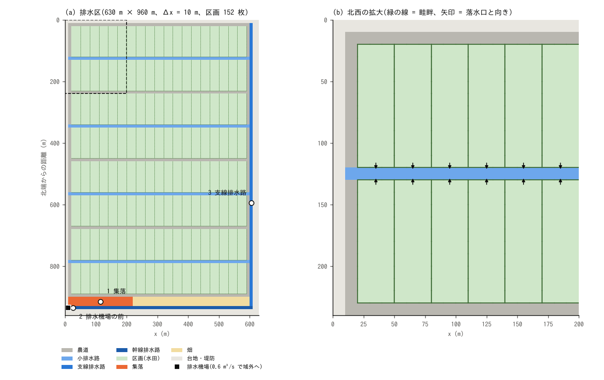
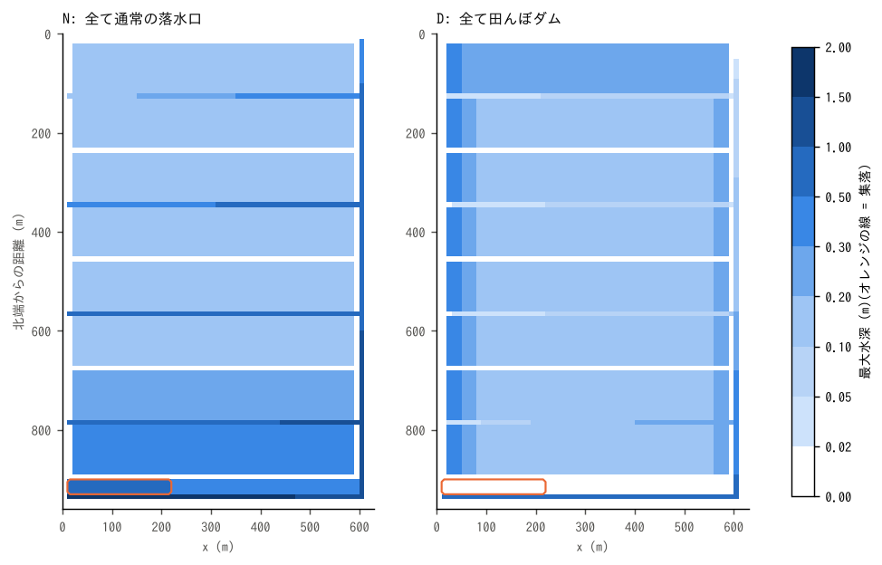
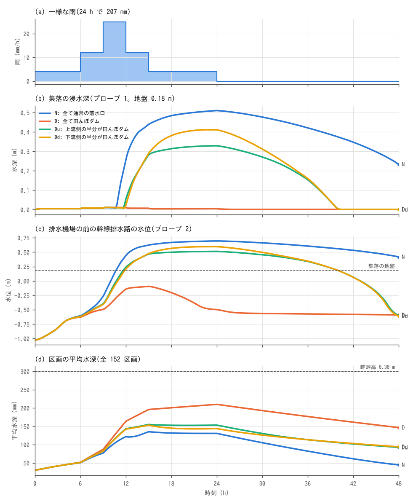
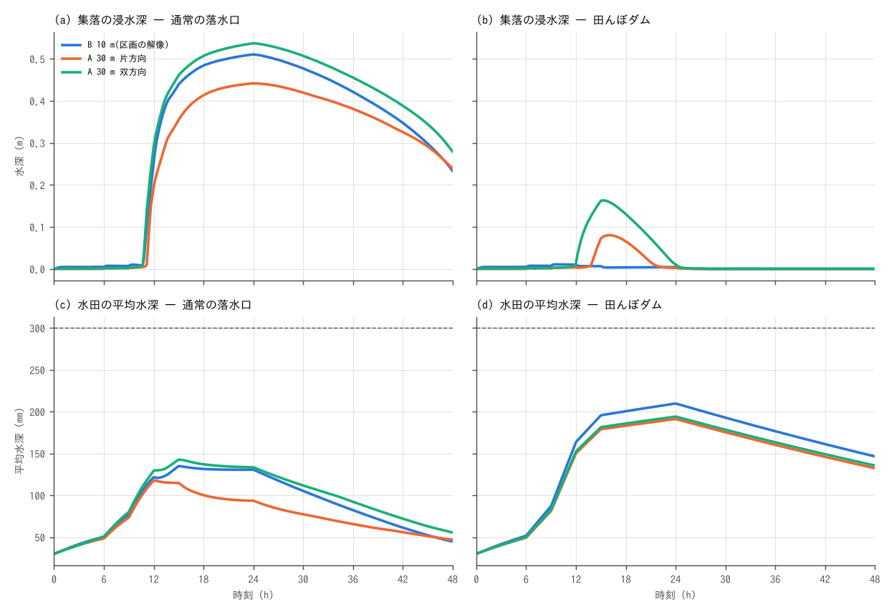

# paddy_dam — 低平地の排水区の内水と田んぼダム

[English](en/README.md)

**田んぼダム**は、水田の落水口(排水枡)に流出量を絞る板(穴・切欠き)を付け、豪雨の水を畦畔の中に一時的に
貯めて、下流の排水路・河川のピークを下げる取組です(農林水産省 2026)。この例題は、周りを堤防で囲まれ、外の川の
水位が高くて排水機場のポンプでしか水を出せない低平地の排水区(内水)を合成地形で作り、全ての水田が通常の落水口の
場合と、田んぼダムにした場合(全て、上流側の半分、下流側の半分)で、集落の浸水がどう変わるかを比べます。区画を
10 m の格子で解像する表現 B(畦畔 = 仮想壁面、落水口 = 壁の切欠き)で解き、同じ地区を 30 m の格子と
サブグリッドの水田タンク(表現 A)で解いた結果とも比べます。値は現象を見やすくするための模式値で、特定の地区の
再現ではありません。

## 実際の田んぼダムで起きていること

- **落水口で流出を絞る**: 通常の落水口は水位調整板(堰)で湛水深を決めるだけですが、田んぼダムは排水枡に穴の
  あいた流出量調整板を入れ(機能分離型)、雨の強い時間の流出を絞ります。区画の面積 30 a・畦畔 30 cm が標準の例で、
  穴の径は φ50 mm などです(農林水産省 2026)。
- **排水路の水位が越流の主な原因**: 新潟の亀田郷(水田 41 %)の計算では、越流した水田の 9 割超が排水路の高い
  水位によるもので、日雨量 200 mm では越流の 89 % が排水路からの逆流でした(佐藤ほか 2021)。低平地では、排水路の
  水位が上がると水田へ水が戻る(逆流・畦畔を越える流入)ことも表す必要があります。
- **効果には限界がある**: 長い雨で田んぼダムの水田が満水になると効果が消え、3 日で 450 mm を超える雨では製品の
  試験でもほとんど効かないことが報告されています(皆川・宮津 2022)。流域での効果は日雨量 268 mm の雨で最も
  大きく、それより強い雨では小さくなる例があります(宮津ほか 2020)。
- **区画を解像した計算の前例**: 10 m の 2 次元計算で、満水の水田が 0.3 m 高い地盤のようにふるまい、合流点の近くの
  浸水を深くした例があります(早崎ほか 2022)。

## 再現に必要な機構

| 実際の現象 | ENCflow での表し方 | 設定 |
|---|---|---|
| 水田の区画と畦畔 | 区画番号の分布。区画番号が違うセルの間の全てのエッジに畦畔の仮想壁面(天端 = 田面 + 0.30 m。越えたら本間公式で両向きに越流) | `fn_pd_plot`、`pd_hlev` |
| 落水口と田んぼダムの板 | 出口セルと向きの先のセルのエッジに落水口の装置則(通常 = 水位調整板 0.03 m × 幅 0.30 m の堰、田んぼダム = 機能分離型(水位調整板 + φ50 の穴))。水位の高い側から両向きに流れる | `fn_pd_outlet`、`fn_pd_class`(装置は既定) |
| 減水深 | 5 mm/d を系外へ | `pd_perc_mmd`(既定) |
| 小排水路・支線・幹線排水路 | 地形の掘り込み(セルの幅 10 m) | `fn_z`(make_district.py) |
| 排水機場(外の川の水位が高く自然排水できない) | ポンプで域外へ排水(吸水槽の水深 0.3 m で起動、0.6 m 以上で 0.6 m³/s) | `&list_struct_pump` |
| 集落 | 建物の空隙率 0.7、家屋の平均寸法 10 m | `fn_gv`、`fn_bb` |
| 雨 | 一様(24 h で 207 mm) | `&list_precip` |

区画の湛水は浅水流の水深そのもので、区画の水が出入りするのは畦畔の越流と落水口だけです。排水路の水位が区画の
水位より高くなれば、落水口から区画へ逆流し、天端を越えれば畦畔を越えて流れ込みます(利用者ガイドの
[田んぼダム](../../docs/users_guide/paddy.md)の「区画の解像(B)」)。

## 地区と設定



(a) 排水区の土地利用(緑の細い線 = 区画の境、白丸 = プローブ、黒い四角 = 排水機場)。(b) 北西の拡大(緑の線 = 畦畔、
矢印 = 落水口と向き)。

630 m × 960 m、Δx = 10 m(63 × 96 セル)。北から南へ 1/1000 で下る低平地で、周りは台地と堤防で閉じています
(水が出るのは排水機場だけ)。

- **区画**: 30 m × 100 m(3 × 10 セル。区画の幅 3 セルは表現 B の解像の下限)を 4 組 × 2 列 × 19 枚 = 152 枚
  (水田 45.6 ha、地区の約 75 %)。田面は区画の中で平ら。落水口は区画の小排水路側の短い辺の中央にあり、
  小排水路を向きます。
- **排水路**: 区画の列の間の小排水路(東へ流れる)→ 東端の支線排水路(南へ)→ 南端の幹線排水路(西へ)→
  南西の排水機場。排水路の底は田面より 0.5〜1.3 m 低く、農道は田面より 0.45 m 高い(畦畔の天端より高い)。
- **集落**: 幹線排水路の北の帯の西側(210 m × 30 m)。地区で最も低く(地盤 0.18 m)、幹線排水路があふれると
  最初に浸かります。
- **排水機場**: 比排水量 約 1 m³/s/km²(0.6 m³/s)。雨のピーク(25 mm/h = 地区全体で 4.2 m³/s)よりずっと小さく、
  排水路と区画にたまった水を雨の後にゆっくり出します。
- **雨と事前の状態**: 一様な雨を 24 h で 207 mm(4 mm/h を 6 h、12 mm/h を 3 h、25 mm/h を 3 h、12 mm/h を 3 h、
  4 mm/h を 9 h)、48 h まで計算します。区画は流れ始める高さ(水位調整板の天端 0.03 m)まで湛水した状態から
  始めます。
- 計算は dt = 1 s。

| ケース | 設定ファイル | 表し方 | 落水口 |
|---|---|---|---|
| N | param_N.txt | B 10 m | 全て通常 |
| D | param_D.txt | B 10 m | 全て田んぼダム |
| Du | param_Du.txt | B 10 m | 北の 2 組(上流側の半分、76 区画)だけ田んぼダム |
| Dd | param_Dd.txt | B 10 m | 南の 2 組(下流側の半分、76 区画)だけ田んぼダム |
| A30_N・A30_D | param_A30_N.txt・param_A30_D.txt | A 30 m 片方向 | 全て通常・全て田んぼダム |
| A30_N2・A30_D2 | param_A30_N2.txt・param_A30_D2.txt | A 30 m 双方向 | 全て通常・全て田んぼダム |

30 m の A は、10 m の値の 3 × 3 の平均の水田面積率(0.95 で頭打ち。区画だけのセルにも畦畔・小水路があるとして)と
地盤高を使い、支線・幹線排水路を河道のセル(サブグリッド幅 10 m)で、小排水路は表さずにセルの地表で流します
(水田は 43.9 ha)。片方向は水田の上の雨だけをタンクに入れ、双方向は排水路・地表の水も落水口と畦畔から水田に
入ります([田んぼダム](../../docs/users_guide/paddy.md)の「地表の水との関係」)。

## 実行方法

```
cd examples/paddy_dam
make            # リンクと入力(make_district.py が data/ に作る)
make run        # 8 ケースを順に計算(4 コアの計算機で B は 1 ケース 10〜20 分、A は 2 分前後)
make figs       # figs/*.png・en/figs/*.png と数表(標準出力)
```

## 結果



10 m の区画の解像(B)の最大水深。左は全て通常の落水口(N)、右は全て田んぼダム(D)。オレンジの線は集落です。



(a) 雨、(b) 集落の浸水深(プローブ 1)、(c) 排水機場の前の幹線排水路の水位(プローブ 2。破線は集落の地盤)、
(d) 全 152 区画の平均水深。B の 4 ケースです。



同じ排水区を 10 m の B と 30 m の A(片方向・双方向)で解いた比べ。上は集落の浸水深、下は水田の平均水深。

| ケース | 集落の最大浸水深 m(時刻) | 集落の浸水深 > 0.1 m の時間 h | 排水機場の前の最高水位 m | 区画・水田の最大の平均水深 mm | 落水口からの逆流 m³ | 畦畔を越えた流入 m³ | 畦畔を越えた流出 m³ |
|---|---:|---:|---:|---:|---:|---:|---:|
| N: 全て通常の落水口 | 0.51(24.0 h) | 37 以上(48 h でも続く) | 0.70 | 135 | 11453 | 11921 | 2821 |
| D: 全て田んぼダム | 0.01(9.5 h) | 0 | -0.09 | 210 | 0 | 10707 | 578 |
| Du: 上流側の半分が田んぼダム | 0.33(24.0 h) | 25 | 0.51 | 155 | 1031 | 10521 | 367 |
| Dd: 下流側の半分が田んぼダム | 0.41(23.2 h) | 25 | 0.60 | 153 | 311 | 10586 | 267 |
| A 30 m 片方向・通常 | 0.44(24.2 h) | 36 以上(48 h でも続く) | 0.63 | 118 | — | — | 0 |
| A 30 m 片方向・田んぼダム | 0.08(16.0 h) | 0 | 0.27 | 191 | — | — | 0 |
| A 30 m 双方向・通常 | 0.54(24.0 h) | 37 以上(48 h でも続く) | 0.72 | 143 | 13707 | 455 | 1781 |
| A 30 m 双方向・田んぼダム | 0.16(15.2 h) | 6 | 0.35 | 194 | 413 | 0 | 0 |

逆流・流入・流出は 48 h までの累積です。片方向の A は地表の水が水田に入らないので「—」です。B の畦畔を越えた
流入の大部分は、区画より高い農道と台地に降った雨が隣の区画に流れ込んだ分です(D でも排水路の水位は区画より
低いままでした)。集落(0.63 ha)は、浸かったケースでは全体が 0.1 m より深く浸かりました。

**通常の落水口(N)**: 通常の落水口は水位調整板(幅 0.30 m の堰)を越えた水をそのまま流すので、区画の水深は雨の
強い間だけ上がり(平均の最大 135 mm)、ほとんどの雨はすぐに小排水路へ出ます(24 h までの落水 6.8 万 m³)。ポンプ
(0.6 m³/s)より速く水が集まるので、排水機場の前の水位は 11 h に集落の地盤(0.18 m)を越え、集落は 24 h に 0.51 m
まで浸かり、48 h でも 0.23 m 残ります。水位が上がった排水路からは、主に南の組の区画へ落水口を通って 1.1 万 m³ が
逆流し(最大水深の図で南の組の区画が深い)、満ちた区画からは畦畔を越えて 2,800 m³ が流れ出しました。区画が
排水路の水の一時的な貯留にも使われています。

**田んぼダム(D)**: 区画は雨を貯め(平均水深の最大 210 mm。畦畔高 300 mm より下)、24 h までの落水は 2.0 万 m³ と
N の 3 割です。排水機場の前の水位は最高 −0.09 m で集落の地盤より 0.27 m 低く、集落は浸かりません(0.01 m は集落に
降った雨です)。代わりに区画の水は雨の後もゆっくりしか抜けず、48 h でも平均 147 mm が残ります(N は 45 mm)。
続けて雨が来たときの空き容量は小さくなります。

**半分の取組(Du・Dd)**: 集落の最大浸水深は 0.33 m(上流側の半分)と 0.41 m(下流側の半分)で、全て田んぼダムの
D(浸水なし)との差が大きく出ます。集落の浸水は排水路の水位が集落の地盤を越えたときだけ起こるので、効果は
取組率に比例しません。この地区では上流側の半分のほうが効きました。24 h の時点で、Du の通常の落水口の区画
(下流側)はまだ平均 93 mm を貯めていたのに対し、Dd の通常の落水口の区画(上流側)は 73 mm まで抜けていました。
下流側の区画は、排水路の水位が上がると落水口からの流出が下流の水位で自然に絞られ(Du では 1,000 m³ が逆流)、
田んぼダムを足す効果が小さくなります。上流側の区画は地盤が高く、排水路の水位によらず落水するので、田んぼダムで
止める効果が大きく出ます。この順位は、地区の勾配・排水路の配置・排水機場の能力で変わりえます。

**10 m の B と 30 m の A**:

- 通常の落水口では、双方向の A(集落 0.54 m)が B(0.51 m)に近く、片方向の A(0.44 m)は小さく出ました。
  片方向では地表の水がセルの水田の部分の上にも広がるので、浸水の水位を低く見積もります(利用者ガイドの
  [田んぼダム](../../docs/users_guide/paddy.md)の「精度の限界」)。双方向は排水路の水を落水口から水田へ戻し(逆流
  1.4 万 m³。B は 1.1 万 m³)、水田の平均水深も B に近く出ます(最大 143 mm と 135 mm。片方向は雨の後に早く下がり
  ます)。
- 田んぼダムでは、30 m の A はどちらのやり取りでも集落が浸かりました(片方向 0.08 m、双方向 0.16 m)。B との
  違いは、30 m では表さない 2 つの流れの経路によります。1 つは小排水路の貯留で、10 m の B は小排水路を幅 10 m の
  水路として持ち、田面より下に約 1.4 万 m³ を貯められます(実際の幅 1〜2 m の 5〜10 倍)。30 m の A は小排水路を
  持たず、水田の水はセルの地表を流れて支線・幹線排水路へ集まります。もう 1 つは農道・台地の雨の行き先で、B では
  その一部(約 1.1 万 m³)が隣の区画に入って田んぼダムに貯まり、A では排水路へ流れます。実際の地区はこの間に
  あり、田んぼダムで集落の浸水が防げるかどうかの判定は、排水路と道路の表し方に敏感です。

## できないこと・精度の限界

- 合成地形の模式値で、特定の地区の再現ではありません。比排水量・雨・区画の配置で結果は大きく変わります。
- 10 m の格子では、小排水路(実際は幅 1〜2 m)がセルの幅 10 m の水路になり、貯留と通水が大きく出ます(この地区で
  田面より下に約 1.4 万 m³)。全てのケースで排水路の水位を低めに出し、田んぼダムで集落の浸水を防げるかの判定は
  この貯留に敏感です(上の「10 m の B と 30 m の A」)。区画の幅 3 セルは表現 B の下限で、区画の中の水面の傾きは
  粗くしか表せません。
- 排水機場はポンプだけで、樋門の自然排水と外の川の水位(逆流)は表しません。
- 畦畔高は全区画で同じ 0.30 m で、畦畔の低い所からの越流・畦畔の漏水・崩れ、調整板の詰まりは表しません。
- 減水深は一定(5 mm/d)、雨は一様、事前の湛水深は全区画で同じです。
- 30 m の A は小排水路を表さず、区画の水は自分のセルの地表へ出てから河道のセルまで地表を流れます。水田面積率を
  0.95 で頭打ちにしたので、水田の面積は 10 m の B より 4 % 小さくなります。

## 参考文献

- 農林水産省 農村振興局 (2026):「田んぼダム」の手引き(改訂版)と参考資料。
  https://www.maff.go.jp/j/nousin/mizu/kurasi_agwater/attach/pdf/ryuuiki_tisui-207.pdf
- 佐藤ほか (2021): 土木学会論文集 B1(水工学), 77(2), I_439–I_444. doi:10.2208/jscejhe.77.2_I_439
- 皆川・宮津 (2022): 農業農村工学会論文集, 90(1), I_157–I_165. doi:10.11408/jsidre.90.I_157
- 宮津ほか (2020): 土木学会論文集 B1(水工学), 76(2), I_805–I_810. doi:10.2208/jscejhe.76.2_I_805
- 早崎ほか (2022): 土木学会論文集 B1(水工学), 78(2), I_547–I_552. doi:10.2208/jscejhe.78.2_I_547
