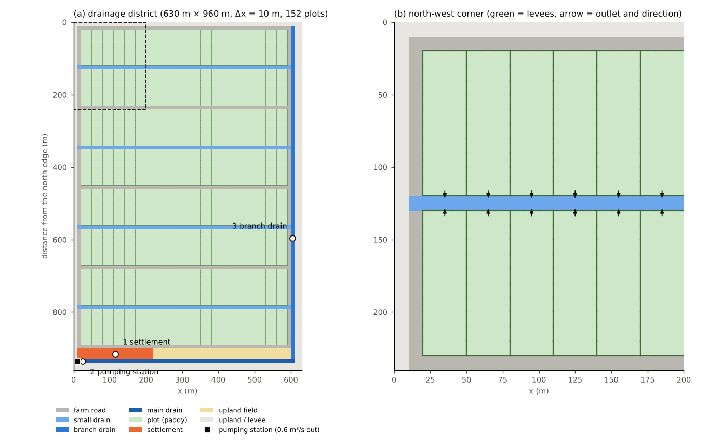
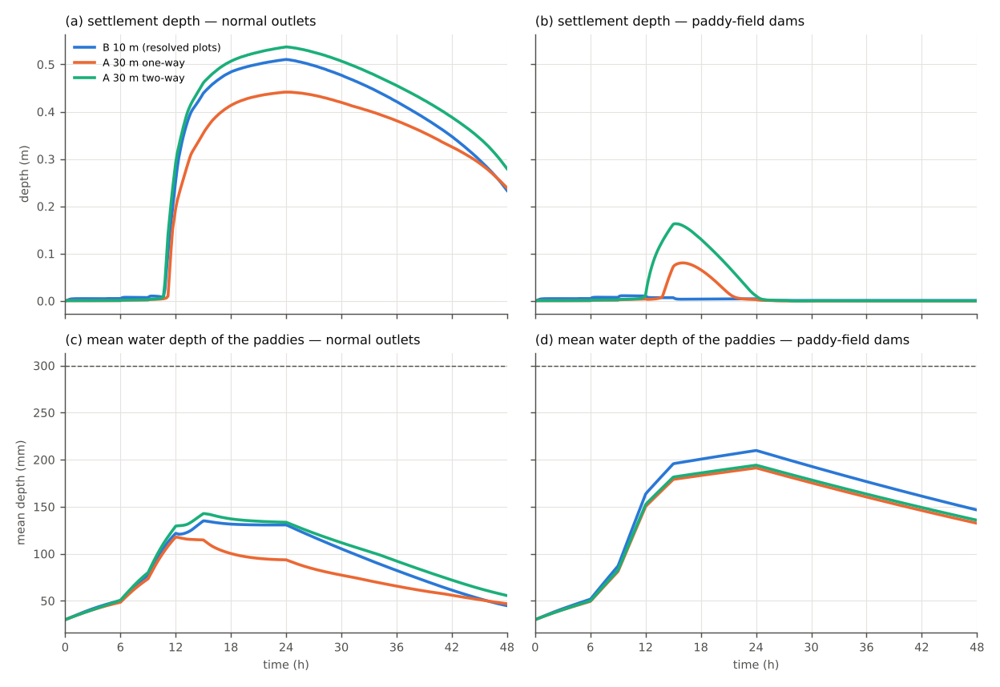

# paddy_dam — inland flooding of a lowland drainage district and paddy-field dams

> English mirror of examples/paddy_dam/README.md. The Japanese file is the master copy.

[日本語](../README.md)

A **paddy-field dam** (*tambo dam*) is a measure in which a plate that restricts the outflow (a hole or a notch) is fitted
to the outlet (drainage box) of a rice paddy, so that the water of a heavy rain is stored for a while inside the levees
and the peaks of the drains and rivers downstream are lowered (MAFF 2026). This example builds, on synthetic terrain, a
lowland drainage district that is surrounded by levees and can let water out only through the pumps of a pumping
station because the outer river is high (inland flooding), and compares how the inundation of a settlement changes when
all paddy fields have normal outlets and when they are made into paddy-field dams (all of them, the upstream half, the
downstream half). It solves the district with representation B, which resolves the plots on a 10 m grid (levees =
virtual walls, outlets = notches in them), and compares the result with the same district solved on a 30 m grid with
subgrid paddy tanks (representation A). The values are schematic, chosen to make the phenomena easy to see; they do
not reproduce a particular district.

## What happens with real paddy-field dams

- **Restricting the outflow at the outlet**: a normal outlet only sets the ponding depth with a water-level board (a
  weir), while a paddy-field dam puts an outflow control plate with a hole into the drainage box (separated type) and
  restricts the outflow during intense rain. Plots of 30 a with levees of 30 cm are the standard example, and holes of
  φ50 mm are used, among others (MAFF 2026).
- **The water level of the drains is the main cause of overflow**: in a computation for Kameda-gō in Niigata (41 %
  paddies), more than 90 % of the paddy fields that overflowed did so because of high water levels in the drains, and
  with a daily rain of 200 mm 89 % of the overflow was backflow from the drains (Sato et al. 2021). In lowlands, the
  return of water from the drains into the paddy fields (backflow, inflow over the levees) also has to be represented.
- **The effect has limits**: when a long rain fills the paddy-field dams, their effect is lost, and product tests report
  almost no effect for rain above 450 mm in 3 days (Minakawa and Miyazu 2022). In a basin, the effect was largest for a
  daily rain of 268 mm and smaller for heavier rain (Miyazu et al. 2020).
- **A precedent of resolving the plots**: in a 2D computation at 10 m, full paddy fields behaved like ground raised by
  0.3 m and deepened the inundation near a confluence (Hayazaki et al. 2022).

## Mechanisms needed

| Real phenomenon | Representation in ENCflow | Settings |
|---|---|---|
| Plots of paddy fields and their levees | map of plot numbers; virtual walls of levees on every edge between cells with different plot numbers (crest = field surface + 0.30 m; above it the levee overflows both ways by the Homma formula) | `fn_pd_plot`, `pd_hlev` |
| Outlets and the plates of paddy-field dams | device law of the outlet on the edge between the outlet cell and the cell in its direction (normal = weir of a water-level board 0.03 m high and 0.30 m wide; paddy-field dam = separated type (water-level board + hole φ50)); water flows both ways from the side with the higher level | `fn_pd_outlet`, `fn_pd_class` (default devices) |
| Decrease in depth | 5 mm/d leaves the system | `pd_perc_mmd` (default) |
| Small drains, branch drain, main drain | excavation in the terrain (cell width 10 m) | `fn_z` (make_district.py) |
| Pumping station (the outer river is high and no gravity drainage is possible) | pump out of the district (starts at a pit depth of 0.3 m, 0.6 m³/s at 0.6 m and above) | `&list_struct_pump` |
| Settlement | building porosity 0.7, mean house size 10 m | `fn_gv`, `fn_bb` |
| Rain | uniform (207 mm in 24 h) | `&list_precip` |

The ponding of a plot is the water depth of the shallow water flow itself, and water enters or leaves a plot only by the
overflow of its levees and through its outlet. When the level of a drain becomes higher than the level in a plot, the
water flows back into the plot through the outlet, and above the crest it flows in over the levees ("Resolved plots (B)"
in the user guide chapter [Paddy-field dams](../../../docs/en/users_guide/paddy.md)).

## District and settings



(a) Land use of the drainage district (thin green lines = plot boundaries, white circles = probes, black square =
pumping station). (b) North-west corner enlarged (green lines = levees, arrows = outlets and their directions).

630 m × 960 m, Δx = 10 m (63 × 96 cells). A lowland falling from north to south at 1/1000, closed by upland and levees
all around (water leaves only through the pumping station).

- **Plots**: 30 m × 100 m (3 × 10 cells; a plot width of 3 cells is the lower limit of resolution for representation B),
  4 groups × 2 rows × 19 = 152 plots (45.6 ha of paddies, about 75 % of the district). The field surface is flat within
  a plot. The outlet is at the middle of the short side of a plot facing the small drain, and points to the drain.
- **Drains**: small drains between the rows of plots (flowing east) → branch drain along the east edge (south) → main
  drain along the south edge (west) → pumping station in the south-west. The drain beds are 0.5–1.3 m below the field
  surfaces, and the farm roads are 0.45 m above them (higher than the levee crests).
- **Settlement**: the western part of the strip north of the main drain (210 m × 30 m). It is the lowest place in the
  district (ground 0.18 m) and is flooded first when the main drain overflows.
- **Pumping station**: a specific drainage capacity of about 1 m³/s/km² (0.6 m³/s). This is much smaller than the peak of
  the rain (25 mm/h = 4.2 m³/s over the district), and the water stored in the drains and plots is pumped out slowly
  after the rain.
- **Rain and the state before it**: uniform rain of 207 mm in 24 h (4 mm/h for 6 h, 12 mm/h for 3 h, 25 mm/h for 3 h,
  12 mm/h for 3 h, 4 mm/h for 9 h), computed to 48 h. The plots start ponded to the level at which the outlet starts to
  drain (the crest of the water-level board, 0.03 m).
- The computation uses dt = 1 s.

| Case | Settings file | Representation | Outlets |
|---|---|---|---|
| N | param_N.txt | B 10 m | all normal |
| D | param_D.txt | B 10 m | all paddy-field dams |
| Du | param_Du.txt | B 10 m | paddy-field dams only in the two northern groups (upstream half, 76 plots) |
| Dd | param_Dd.txt | B 10 m | paddy-field dams only in the two southern groups (downstream half, 76 plots) |
| A30_N, A30_D | param_A30_N.txt, param_A30_D.txt | A 30 m one-way | all normal, all paddy-field dams |
| A30_N2, A30_D2 | param_A30_N2.txt, param_A30_D2.txt | A 30 m two-way | all normal, all paddy-field dams |

A on 30 m uses the paddy area fraction (the mean over 3 × 3 cells of 10 m, capped at 0.95 since cells made only of
plots also have levees and small ditches) and the ground elevation from the 10 m values, gives the branch and main
drains as channel cells (subgrid width 10 m), and does not represent the small drains (the water flows over the surface
of the cells; 43.9 ha of paddies). The one-way mode puts only the rain on the paddy fields into the tanks, and the
two-way mode also lets the water of the drains and the surface enter the paddy fields through the outlets and over the
levees ("Relation to the surface water" in [Paddy-field dams](../../../docs/en/users_guide/paddy.md)).

## How to run

```
cd examples/paddy_dam
make            # links and inputs (make_district.py writes data/)
make run        # computes the 8 cases in turn (on a 4-core machine, B 10–20 min per case, A about 2 min)
make figs       # figs/*.png, en/figs/*.png and the table (standard output)
```

## Results


Maximum water depth of the resolved plots on 10 m (B). Left: all normal outlets (N); right: all paddy-field dams (D). The
orange line is the settlement.


(a) Rain, (b) inundation depth in the settlement (probe 1), (c) water level of the main drain at the pumping station
(probe 2; the dashed line is the ground of the settlement), (d) mean water depth of all 152 plots. The 4 cases of B.



The same district solved with B on 10 m and with A on 30 m (one-way and two-way). Top: inundation depth in the
settlement; bottom: mean water depth of the paddy fields.

| Case | max settlement depth m (time) | hours with settlement depth > 0.1 m | max level at the pumping station m | max mean depth of plots/paddies mm | backflow through outlets m³ | inflow over the levees m³ | outflow over the levees m³ |
|---|---:|---:|---:|---:|---:|---:|---:|
| N: all normal outlets | 0.51(24.0 h) | 37 or more (still at 48 h) | 0.70 | 135 | 11453 | 11921 | 2821 |
| D: all paddy-field dams | 0.01(9.5 h) | 0 | -0.09 | 210 | 0 | 10707 | 578 |
| Du: upstream half dams | 0.33(24.0 h) | 25 | 0.51 | 155 | 1031 | 10521 | 367 |
| Dd: downstream half dams | 0.41(23.2 h) | 25 | 0.60 | 153 | 311 | 10586 | 267 |
| A 30 m one-way, normal | 0.44(24.2 h) | 36 or more (still at 48 h) | 0.63 | 118 | — | — | 0 |
| A 30 m one-way, dams | 0.08(16.0 h) | 0 | 0.27 | 191 | — | — | 0 |
| A 30 m two-way, normal | 0.54(24.0 h) | 37 or more (still at 48 h) | 0.72 | 143 | 13707 | 455 | 1781 |
| A 30 m two-way, dams | 0.16(15.2 h) | 6 | 0.35 | 194 | 413 | 0 | 0 |

Backflow, inflow and outflow are accumulated up to 48 h. A in the one-way mode lets no surface water into the paddy
fields, hence "—". Most of the inflow over the levees in B is the rain on the farm roads and the upland, which are higher
than the plots, flowing into the neighbouring plots (in D, too, the water level of the drains stayed below the plots).
Where the settlement (0.63 ha) was flooded, all of it was flooded deeper than 0.1 m.

**Normal outlets (N)**: a normal outlet passes the water above the water-level board (a weir 0.30 m wide) as it comes, so
the water depth of the plots rises only while the rain is intense (mean maximum 135 mm), and most of the rain soon goes to
the small drains (outlet flow of 68,000 m³ up to 24 h). The water gathers faster than the pumps (0.6 m³/s) remove it, so
the water level at the pumping station rises above the ground of the settlement (0.18 m) at 11 h; the settlement is
flooded to 0.51 m at 24 h, and 0.23 m is still left at 48 h. From the risen drains, 11,000 m³ flowed back through the
outlets, mainly into the plots of the southern group (they are deep in the map of the maximum depth), and 2,800 m³ flowed
out over the levees of the filled plots. The plots also serve as temporary storage for the water of the drains.

**Paddy-field dams (D)**: the plots store the rain (mean maximum 210 mm, below the levee height of 300 mm), and the outlet
flow up to 24 h is 20,000 m³, 30 % of N. The water level at the pumping station reaches at most −0.09 m, 0.27 m below the
ground of the settlement, and the settlement is not flooded (the 0.01 m is the rain on the settlement itself). In turn,
the plots drain only slowly after the rain, and a mean of 147 mm is still left at 48 h (45 mm in N). Less free storage is
left when another rain follows.

**Half adoption (Du, Dd)**: the maximum depth in the settlement is 0.33 m (upstream half) and 0.41 m (downstream half),
far from D (no flooding) with all plots made into paddy-field dams. The settlement is flooded only when the water level of
the drains rises above its ground, so the effect is not proportional to the adoption ratio. In this district the upstream
half worked better. At 24 h, the plots with normal outlets of Du (downstream) still held a mean of 93 mm, while those of
Dd (upstream) had drained to 73 mm. In the downstream plots, the outflow through the outlets is held back by the downstream
water level once the drains rise (1,000 m³ flowed back in Du), so adding paddy-field dams there gains less. The upstream
plots are on higher ground and drain regardless of the water level of the drains, so stopping them with paddy-field dams
has a larger effect. This order can change with the slope of the district, the layout of the drains and the capacity of
the pumping station.

**B on 10 m and A on 30 m**:

- With normal outlets, A in the two-way mode (settlement 0.54 m) is close to B (0.51 m), and A in the one-way mode
  (0.44 m) comes out smaller. In the one-way mode the surface water also spreads over the paddy part of the cells, so the
  flood level is underestimated ("Limits of accuracy" in the user guide chapter
  [Paddy-field dams](../../../docs/en/users_guide/paddy.md)). The two-way mode returns the water of the drains into the
  paddy fields through the outlets (backflow 14,000 m³; 11,000 m³ in B), and the mean water depth of the paddy fields is
  also close to B (maximum 143 mm and 135 mm; in the one-way mode it falls soon after the rain).
- With paddy-field dams, the settlement was flooded by A on 30 m in both modes of exchange (one-way 0.08 m, two-way
  0.16 m). The difference from B comes from two flow paths that 30 m does not represent. One is the storage of the small
  drains: B on 10 m has the small drains as channels 10 m wide, which can store about 14,000 m³ below the field surfaces
  (5–10 times the actual width of 1–2 m), while A on 30 m has no small drains, and the paddy water flows over the surface
  of the cells to the branch and main drains. The other is where the rain on the farm roads and the upland goes: in B part
  of it (about 11,000 m³) enters the neighbouring plots and is stored behind the paddy-field dams, while in A it flows to
  the drains. A real district lies in between, and whether paddy-field dams prevent the flooding of the settlement is
  sensitive to how the drains and roads are represented.

## Limitations and accuracy

- The values are schematic on synthetic terrain and do not reproduce a particular district. The results change much with
  the specific drainage capacity, the rain and the arrangement of the plots.
- On a 10 m grid the small drains (actually 1–2 m wide) become channels as wide as a cell (10 m), so their storage and
  conveyance come out large (about 14,000 m³ below the field surfaces in this district). The water levels of the drains
  come out low in all cases, and whether paddy-field dams prevent the flooding of the settlement is sensitive to this
  storage ("B on 10 m and A on 30 m" above). A plot width of 3 cells is the lower limit for representation B, and the
  slope of the water surface within a plot is represented only coarsely.
- The pumping station is only pumps; gravity drainage through sluices and the level of the outer river (backflow) are not
  represented.
- The levee height is the same 0.30 m for all plots; overflow from low points of the levees, leakage or collapse of the
  levees and clogging of the plates are not represented.
- The decrease in depth is constant (5 mm/d), the rain is uniform and the ponding before the rain is the same in all
  plots.
- A on 30 m does not represent the small drains, and the water of the paddy fields goes to the surface of its own cell
  and flows over the surface to the channel cells. With the paddy area fraction capped at 0.95, the paddy area is 4 %
  smaller than in B on 10 m.

## References

- Ministry of Agriculture, Forestry and Fisheries (MAFF), Rural Development Bureau (2026): Guide to paddy-field dams
  (revised edition) and its reference material (in Japanese).
  https://www.maff.go.jp/j/nousin/mizu/kurasi_agwater/attach/pdf/ryuuiki_tisui-207.pdf
- Sato et al. (2021): Journal of JSCE, Ser. B1 (Hydraulic Engineering), 77(2), I_439–I_444. doi:10.2208/jscejhe.77.2_I_439 (in Japanese)
- Minakawa and Miyazu (2022): Transactions of the Japanese Society of Irrigation, Drainage and Rural Engineering, 90(1), I_157–I_165. doi:10.11408/jsidre.90.I_157 (in Japanese)
- Miyazu et al. (2020): Journal of JSCE, Ser. B1 (Hydraulic Engineering), 76(2), I_805–I_810. doi:10.2208/jscejhe.76.2_I_805 (in Japanese)
- Hayazaki et al. (2022): Journal of JSCE, Ser. B1 (Hydraulic Engineering), 78(2), I_547–I_552. doi:10.2208/jscejhe.78.2_I_547 (in Japanese)
