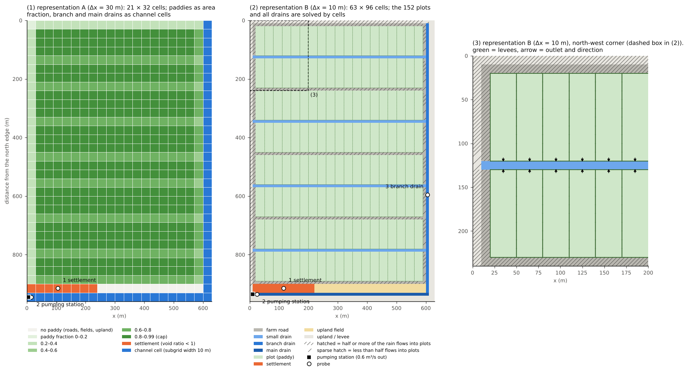
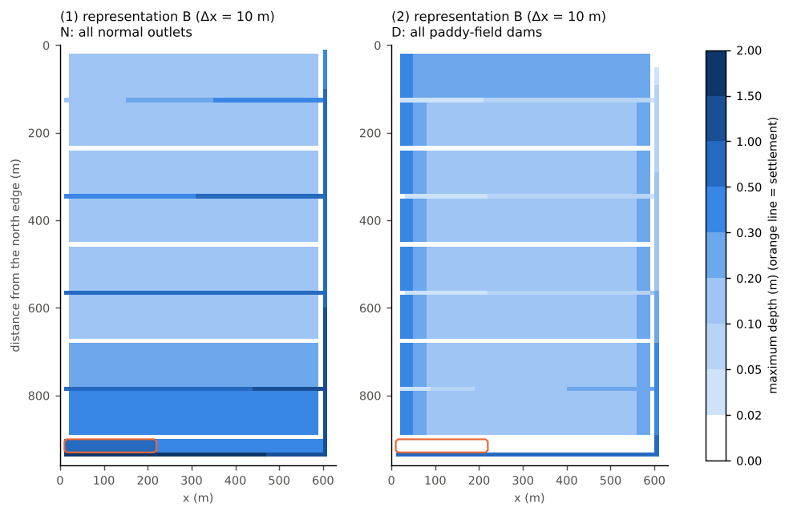
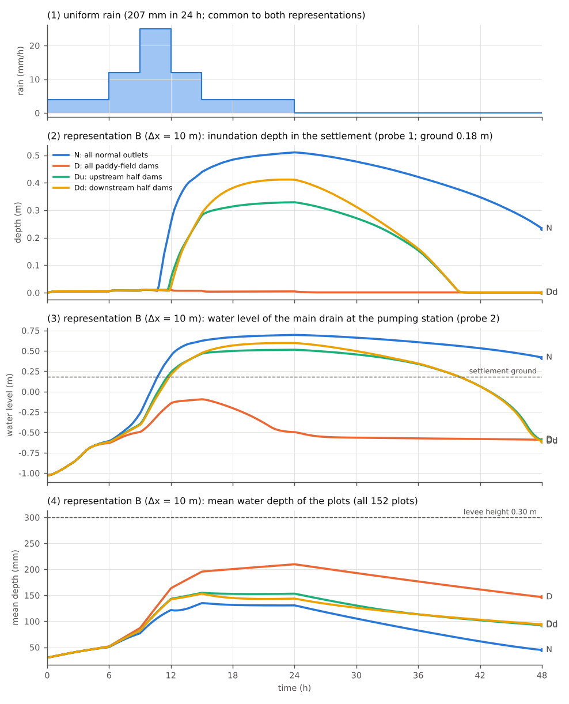
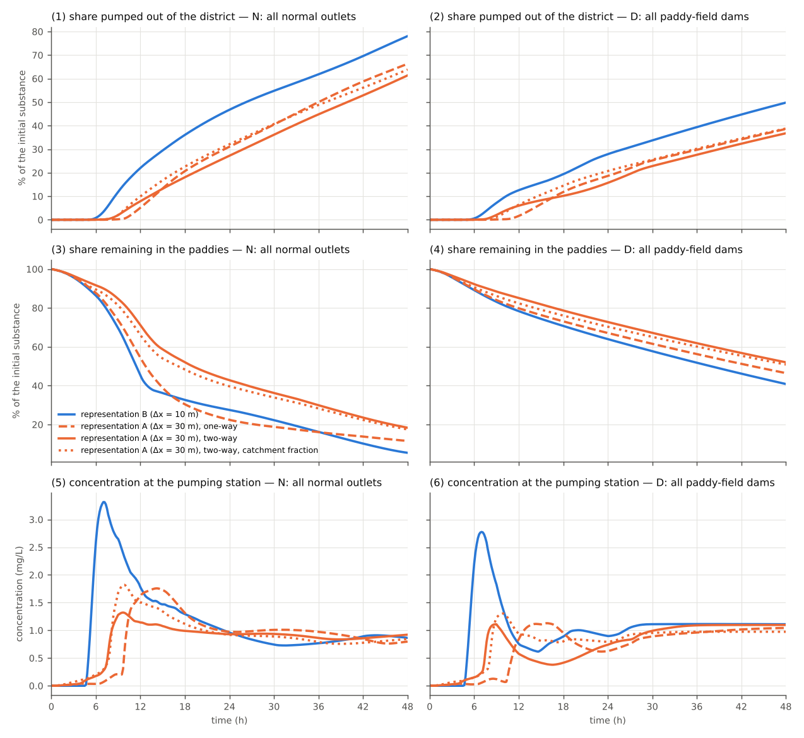

# paddy_dam — inland flooding of a lowland drainage district and paddy-field dams (the same district solved with representations A and B)

> English mirror of examples/paddy_dam/README.md. The Japanese file is the master copy.

[日本語](../README.md)

A **paddy-field dam** (*tambo dam*) is a measure in which a plate that restricts the outflow (a hole or a notch) is fitted
to the outlet (drainage box) of a rice paddy, so that the water of a heavy rain is stored for a while inside the levees
and the peaks of the drains and rivers downstream are lowered (MAFF 2026). This example builds, on synthetic terrain, a
lowland drainage district that is surrounded by levees and can let water out only through the pumps of a pumping
station because the outer river is high (inland flooding), and compares how the inundation of a settlement changes when
all paddy fields have normal outlets and when they are made into paddy-field dams (all of them, the upstream half, the
downstream half).

**The same district, the same rain and the same pumping station are computed with the two ways (representations) in
which ENCflow represents paddy-field dams.**

- **Representation A (Δx = 30 m)**: a representation that does not resolve the plots (for coarse grids). The paddy
  fields in a cell are represented as subgrid tanks set by the paddy area fraction and the adoption ratio.
- **Representation B (Δx = 10 m)**: a representation that resolves the plots with the grid (for fine grids). Each of the
  152 plots is solved as a group of cells, with the levees as walls on the plot boundaries and the outlets as notches in
  the walls, and the water of the paddy fields is also computed by the shallow water flow.

[Result 1](#result-1-effect-of-paddy-field-dams-representation-b-δx--10-m) studies the effect of paddy-field dams with
representation B, and [result 2](#result-2-the-same-district-solved-with-representation-a-δx--30-m) solves the same
district with representation A to see how far a coarse grid gives the same answer and how the inputs should be given to
come closer. [Result 3](#result-3-where-the-substance-dissolved-in-the-ponding-before-the-rain-goes) compares where the
substance dissolved in the ponding before the rain goes in the two representations. The values are schematic, chosen to
make the phenomena easy to see; they do not reproduce a particular district.

## What happens with real paddy-field dams

- **Restricting the outflow at the outlet**: a normal outlet only sets the ponding depth with a water-level board (a
  weir), while a paddy-field dam puts an outflow control plate with a hole into the drainage box (separated type) and
  restricts the outflow during intense rain. Plots of 30 a with levees of 30 cm are the standard example, and holes of
  φ50 mm are used, among others (MAFF 2026).
- **The water level of the drains is the main cause of overflow**: in a computation for Kameda-gō in Niigata (41 %
  paddies), more than 90 % of the paddy fields that overflowed did so because of high water levels in the drains, and
  with a daily rain of 200 mm 89 % of the overflow was backflow from the drains (Sato et al. 2021). In lowlands, the
  return of water from the drains into the paddy fields (backflow, inflow over the levees) also has to be represented.
- **The effect has limits**: when a long rain fills the paddy-field dams, their effect is lost, and product tests report
  almost no effect for rain above 450 mm in 3 days (Minakawa and Miyazu 2022). In a basin, the effect was largest for a
  daily rain of 268 mm and smaller for heavier rain (Miyazu et al. 2020).
- **A precedent of resolving the plots**: in a 2D computation at 10 m, full paddy fields behaved like ground raised by
  0.3 m and deepened the inundation near a confluence (Hayazaki et al. 2022).

## The district (common to both representations)

`make_district.py` builds the district as a 10 m raster. Representation B uses this raster as it is, and representation
A uses it aggregated by 3 × 3 cells (30 m).

- **Extent and terrain**: 630 m × 960 m. A lowland falling from north to south at 1/1000, closed by upland and levees all
  around (water leaves only through the pumping station).
- **Paddy fields**: plots of 30 m × 100 m (30 a), 4 groups × 2 rows × 19 = 152 plots (45.6 ha, about 75 % of the
  district). The field surface is flat within a plot, and the outlet is at the middle of the short side of a plot facing
  the small drain. The levee height is 0.30 m for all plots.
- **Drains**: small drains between the rows of plots (flowing east) → branch drain along the east edge (south) → main
  drain along the south edge (west) → pumping station in the south-west. The drain beds are 0.5–1.3 m below the field
  surfaces, and the farm roads are 0.45 m above them (higher than the levee crests).
- **Settlement**: the western part of the strip north of the main drain (210 m × 30 m). It is the lowest place in the
  district (ground 0.18 m) and is flooded first when the main drain overflows. Building void ratio 0.7.
- **Pumping station**: the pumps start at a pit depth of 0.3 m and remove 0.6 m³/s out of the district at 0.6 m and above
  (a specific drainage capacity of about 1 m³/s/km²). This is much smaller than the peak of the rain (25 mm/h =
  4.2 m³/s over the district), and the water stored in the drains and paddy fields is pumped out slowly after the rain.
- **Rain and the state before it**: uniform rain of 207 mm in 24 h (4 mm/h for 6 h, 12 mm/h for 3 h, 25 mm/h for 3 h,
  12 mm/h for 3 h, 4 mm/h for 9 h), computed to 48 h. The paddy fields start ponded to the level at which the outlet
  starts to drain (the crest of the water-level board, 0.03 m), and the decrease in depth is 5 mm/d. A substance that
  does not decay is dissolved at 10 mg/L in the ponding (result 3; the rain and the surface water carry 0 mg/L).
- **Four outlet scenarios**: N (all normal outlets = a weir of a water-level board 0.03 m high and 0.30 m wide), D (all
  paddy-field dams = separated type, water-level board + hole φ50), Du (paddy-field dams only in the two northern groups
  = the upstream half, 76 plots), Dd (only in the two southern groups = the downstream half, 76 plots).

## The two representations



(1) The district as solved by representation A (Δx = 30 m). The white lines are the boundaries of the 30 m cells; the
shade of green is the paddy area fraction, blue the channel cells (branch and main drains) and orange the settlement. The
rows that contain the small drains and farm roads appear as bands of lower paddy fraction. (2) The same district as
solved by representation B (Δx = 10 m). The thin green lines are the plot boundaries (levees), white circles are probes,
the black square is the pumping station and the dashed box is the extent of (3). Hatching marks the farm roads and upland
whose rain flows into the plots (traced on the terrain by `make_district.py`; dense hatching where half or more of the
rain flows into the plots, sparse hatching where less than half does; used in result 2). (3) The north-west corner
of representation B enlarged. Green lines are levees, arrows are outlets and their directions.

In **representation A (Δx = 30 m)**, neither the plots nor the small drains appear in the grid. Each 30 m cell holds a
tank of paddy fields with normal outlets and a tank of paddy-field dams, set by the paddy area fraction (the share of plot
cells within the 3 × 3 cells; cells made only of plots have 1, which is capped at 0.99 because the two-way mode needs a
non-paddy share of at least 0.01) and the adoption ratio. The outflow of a tank is set by the same device law of the outlet (one outlet per representative plot
area of 3000 m²), goes to the surface of that cell and flows over the surface to the channel cells (branch and main
drains). The exchange between the surface water and the paddy fields can be chosen in two ways. The **one-way** mode
puts only the rain on the paddy fields into the tanks (the water of the drains does not return to the paddy fields). The
**two-way** mode (`f_pd_exchange = 1`) also lets water enter the paddy fields by backflow through the outlets and when
the surface level rises above the levees ("Relation to the surface water" in the user guide chapter
[Paddy-field dams](../../../docs/en/users_guide/paddy.md)). This example solves representation A in both modes.

In **representation B (Δx = 10 m)**, the ponding of a plot is the water depth of the shallow water flow itself. Water
enters or leaves a plot only by overflow above the levee crest (field surface + 0.30 m) and through its outlet. When the
level of a drain becomes higher than the level in a plot, the water flows back into the plot through the outlet, and
above the crest it flows in over the levees. The small, branch and main drains are all in the terrain as excavations
10 m (one cell) wide.

| | Representation A (Δx = 30 m) | Representation B (Δx = 10 m) |
|---|---|---|
| Grid | 21 × 32 cells (3 × 3 cells of 10 m make one cell) | 63 × 96 cells |
| Paddy fields | tanks of each class set by the paddy area fraction and the adoption ratio of the cell (45.3 ha of paddies; 0.3 ha less than representation B because of the cap of the fraction) | each of the 152 plots solved as a group of cells (maps of plot numbers, outlets and classes; 45.6 ha of paddies) |
| Paddy water | ponding depth of the tank (the same for all paddy fields of a class in a cell) | water depth of the shallow water flow (the slope of the water surface within a plot is also solved) |
| Levees | upper limit of the ponding depth of the tank; the excess goes to the surface at once | walls on the edges of the plot boundaries; above the crest, overflow by the Homma formula |
| Outlets | one device law per representative plot area of 3000 m²; the outflow goes to the surface of the cell | one per plot, a device law on an edge of the outlet cell (both directions) |
| Water returning from the drains to the paddy fields | one-way: none; two-way: backflow through the outlets and instantaneous filling over the levees | backflow through the outlets and inflow over the levees, solved by the shallow water flow |
| Small drains | not represented as channels (smoothed into the mean ground elevation of the 3 × 3 cells) | excavations 10 m (one cell) wide |
| Branch and main drains | channel cells (subgrid width 10 m; the bed is the lowest drain bed within the cell) | excavations 10 m (one cell) wide |
| Farm roads | smoothed into the mean ground elevation of the 3 × 3 cells | ridges 0.45 m above the field surfaces |
| Roughness | surface 0.045, channel cells 0.03 | drains 0.03, plots 0.05, others 0.04 |
| Time step and run time (4 cores) | 2 s, 2–3 min per case | 1 s, 10–20 min per case |

## Cases

| Outlets | Representation A (Δx = 30 m), one-way | Representation A (Δx = 30 m), two-way | Representation A (Δx = 30 m), two-way, catchment fraction | Representation B (Δx = 10 m) |
|---|---|---|---|---|
| N: all normal outlets | param_A30_N.txt | param_A30_N2.txt | param_A30_N2c.txt | param_B10_N.txt |
| D: all paddy-field dams | param_A30_D.txt | param_A30_D2.txt | param_A30_D2c.txt | param_B10_D.txt |
| Du: upstream half dams | — | — | — | param_B10_Du.txt |
| Dd: downstream half dams | — | — | — | param_B10_Dd.txt |

In the names of the settings files, A30 stands for representation A (Δx = 30 m), B10 for representation B (Δx = 10 m),
a trailing 2 for the two-way mode, and 2c for the two-way mode with the catchment fraction `fn_pd_catch`
(`data/catch30.txt`; result 2). The results are written to `result_<name>/`. Every case also computes water quality
(`fn_wq`; result 3). Water quality does not affect the water, so the water values of results 1 and 2 are the same
without it.

## How to run

```
cd examples/paddy_dam
make            # links and inputs (make_district.py writes the 10 m and 30 m inputs to data/)
make run        # computes the 10 cases in turn (on a 4-core machine, representation A 2–3 min per case, B 10–20 min)
make figs       # figs/*.png, en/figs/*.png and the four tables (standard output)
```

## Result 1: effect of paddy-field dams (representation B, Δx = 10 m)

All of this section is computed with representation B.



Maximum water depth with representation B. (1) All normal outlets (N), (2) all paddy-field dams (D). The orange line is
the settlement.



(1) Rain (common to both representations), (2) inundation depth in the settlement (probe 1), (3) water level of the main
drain at the pumping station (probe 2; the dashed line is the ground of the settlement), (4) mean water depth of all 152
plots.

Table 1 (representation B, Δx = 10 m)

| Outlets | max settlement depth m (time) | hours with settlement depth > 0.1 m | max level at the pumping station m | max mean depth of the plots mm | backflow through outlets m³ | inflow over the levees m³ | outflow over the levees m³ |
|---|---:|---:|---:|---:|---:|---:|---:|
| N: all normal outlets | 0.51(24.0 h) | 37 or more (still at 48 h) | 0.70 | 135 | 11453 | 11921 | 2821 |
| D: all paddy-field dams | 0.01(9.5 h) | 0 | -0.09 | 210 | 0 | 10707 | 578 |
| Du: upstream half dams | 0.33(24.0 h) | 25 | 0.51 | 155 | 1031 | 10521 | 367 |
| Dd: downstream half dams | 0.41(23.2 h) | 25 | 0.60 | 153 | 311 | 10586 | 267 |

Backflow, inflow and outflow are accumulated up to 48 h. Most of the inflow over the levees is the rain on the farm roads
and the upland (hatched in the district figure; 5.1 ha by the traced shares), which are higher than the plots, flowing into the neighbouring
plots (in D, too, the water level of the drains stayed below the plots). Where the settlement (0.63 ha) was flooded, all of it was flooded deeper than 0.1 m.

**Normal outlets (N)**: a normal outlet passes the water above the water-level board (a weir 0.30 m wide) as it comes, so
the water depth of the plots rises only while the rain is intense (mean maximum 135 mm), and most of the rain soon goes to
the small drains (outlet flow of 68,000 m³ up to 24 h). The water gathers faster than the pumps (0.6 m³/s) remove it, so
the water level at the pumping station rises above the ground of the settlement (0.18 m) at 11 h; the settlement is
flooded to 0.51 m at 24 h, and 0.23 m is still left at 48 h. From the risen drains, 11,000 m³ flowed back through the
outlets, mainly into the plots of the southern group (they are deep in the map of the maximum depth), and 2,800 m³ flowed
out over the levees of the filled plots. The plots also serve as temporary storage for the water of the drains.

**Paddy-field dams (D)**: the plots store the rain (mean maximum 210 mm, below the levee height of 300 mm), and the outlet
flow up to 24 h is 20,000 m³, 30 % of N. The water level at the pumping station reaches at most −0.09 m, 0.27 m below the
ground of the settlement, and the settlement is not flooded (the 0.01 m is the rain on the settlement itself). In turn,
the plots drain only slowly after the rain, and a mean of 147 mm is still left at 48 h (45 mm in N). Less free storage is
left when another rain follows.

**Half adoption (Du, Dd)**: the maximum depth in the settlement is 0.33 m (upstream half) and 0.41 m (downstream half),
far from D (no flooding) with all plots made into paddy-field dams. The settlement is flooded only when the water level of
the drains rises above its ground, so the effect is not proportional to the adoption ratio. In this district the upstream
half worked better. At 24 h, the plots with normal outlets of Du (downstream) still held a mean of 93 mm, while those of
Dd (upstream) had drained to 73 mm. In the downstream plots, the outflow through the outlets is held back by the downstream
water level once the drains rise (1,000 m³ flowed back in Du), so adding paddy-field dams there gains less. The upstream
plots are on higher ground and drain regardless of the water level of the drains, so stopping them with paddy-field dams
has a larger effect. This order can change with the slope of the district, the layout of the drains and the capacity of
the pumping station.

## Result 2: the same district solved with representation A (Δx = 30 m)

N and D are compared between representation B (Δx = 10 m) and three ways of giving representation A (Δx = 30 m). The
district, the rain, the pumping station and the devices of the outlets are the same.

- **One-way** and **two-way**: representation A as in the table of "The two representations" above. The paddy area
  fraction is the share of the plot area (capped at 0.99).
- **Two-way, catchment fraction**: the two-way mode with the area of the farm roads and upland whose rain flows into the
  plots (hatched in panel (2) of the district figure) given as the catchment fraction `fn_pd_catch`. The area of the
  paddy tanks (45.3 ha) and the number of outlets are the same as in the one-way and two-way modes.
  - `make_district.py` traces the rain of each 10 m cell that is neither a plot nor a drain by dividing it equally among
    the lower neighbouring cells (a plot cell counts at the height of its levee crest), and aggregates the share that
    reaches a plot (5.1 ha) over the 30 m cell where the rain falls.
  - Adding the 0.01 of levees cut from the paddy area fraction by the cap (0.34 ha) gives the catchment fraction
    `catch30.txt` (5.5 ha).
  - The model shares the rain of the catchment among the paddy fields of the 3 × 3 cells centred on the cell where it
    falls, in proportion to their area.


(1)(2) Inundation depth in the settlement (probe 1; in representation A the 30 m cell containing the settlement), (3)(4)
mean water depth of the paddy fields. Left: N; right: D. Blue is representation B, orange is representation A, and the
line style shows how representation A is given.

Table 2 (representation B and representation A under the same conditions)

| Outlets | Representation | max settlement depth m (time) | hours with settlement depth > 0.1 m | max level at the pumping station m | max mean depth of the paddies mm | backflow through outlets m³ | inflow over the levees m³ |
|---|---|---:|---:|---:|---:|---:|---:|
| N | representation B (Δx = 10 m) | 0.51(24.0 h) | 37 or more (still at 48 h) | 0.70 | 135 | 11453 | 11921 |
| N | representation A (Δx = 30 m), one-way | 0.44(24.0 h) | 36 or more (still at 48 h) | 0.62 | 118 | — | — |
| N | representation A (Δx = 30 m), two-way | 0.52(24.0 h) | 36 or more (still at 48 h) | 0.71 | 148 | 12599 | 459 |
| N | representation A (Δx = 30 m), two-way, catchment fraction | 0.52(24.0 h) | 36 or more (still at 48 h) | 0.71 | 150 | 11119 | 440 |
| D | representation B (Δx = 10 m) | 0.01(9.5 h) | 0 | -0.09 | 210 | 0 | 10707 |
| D | representation A (Δx = 30 m), one-way | 0.01(15.0 h) | 0 | 0.18 | 191 | — | — |
| D | representation A (Δx = 30 m), two-way | 0.07(15.2 h) | 0 | 0.25 | 198 | 570 | 0 |
| D | representation A (Δx = 30 m), two-way, catchment fraction | 0.00(12.0 h) | 0 | -0.16 | 216 | 180 | 0 |

Representation A in the one-way mode lets no surface water into the paddy fields, hence "—". The rain of the catchment
in Table 3 applies only to the cases with the catchment fraction (in representation B it is part of the inflow over the
levees).

Table 3 (where the water went up to 48 h, m³; rain on the district 125,194 m³)

| Outlets | Representation | paddy area ha | rain on the paddy fields | rain of the catchment into the tanks | rain elsewhere | inflow into the paddy fields (backflow + over the levees) | total water into the paddy fields |
|---|---|---:|---:|---:|---:|---:|---:|
| N | representation B (Δx = 10 m) | 45.6 | 94422 | — | 30772 | 23374 | 117796 |
| N | representation A (Δx = 30 m), one-way | 45.3 | 93718 | — | 31476 | — | 93718 |
| N | representation A (Δx = 30 m), two-way | 45.3 | 93718 | — | 31476 | 13058 | 106776 |
| N | representation A (Δx = 30 m), two-way, catchment fraction | 45.3 | 93718 | 11328 | 20148 | 11560 | 116605 |
| D | representation B (Δx = 10 m) | 45.6 | 94422 | — | 30772 | 10707 | 105129 |
| D | representation A (Δx = 30 m), one-way | 45.3 | 93718 | — | 31476 | — | 93718 |
| D | representation A (Δx = 30 m), two-way | 45.3 | 93718 | — | 31476 | 570 | 94287 |
| D | representation A (Δx = 30 m), two-way, catchment fraction | 45.3 | 93718 | 11328 | 20148 | 180 | 105225 |

- **Normal outlets (N)**: the two-way mode (settlement 0.52 m) and the two-way mode with the catchment fraction (0.52 m)
  are close to representation B (0.51 m), and the one-way mode (0.44 m) comes out smaller.
  - In the one-way mode the surface water also spreads and is stored over the paddy part of the cells, so the flood level
    is underestimated ("Limits of accuracy" in the user guide chapter
    [Paddy-field dams](../../../docs/en/users_guide/paddy.md)).
  - The two-way mode keeps the surface water below the levee crest on the non-paddy area only and also represents the
    water of the drains returning into the paddy fields through the outlets (backflow 13,000 m³; 11,000 m³ in
    representation B).
- **Paddy-field dams (D)**: the settlement is not flooded with representation B (maximum level at the pumping station
  −0.09 m, 0.28 m below the ground of the settlement, 0.185 m). Representation A in the two-way mode flooded it by 0.07 m
  (maximum level 0.25 m).
  - **The main cause of the difference is the water entering the paddy fields** (Table 3). In representation B, the rain
    on the farm roads and the upland, which are higher than the plots (11,000 m³, 9 % of the rain on the district),
    enters the plots over the levees and is stored behind the paddy-field dams. In representation A, the rain on the
    non-paddy part of a cell becomes surface water and has no path into the paddy tanks.
  - **The catchment fraction brings representation A close to representation B.** That rain (11,000 m³) enters the tanks
    of the surrounding cells, the water entering the paddy fields becomes 105,000 m³ (also 105,000 m³ in representation
    B), the maximum mean depth of the paddy fields 216 mm (210 mm in representation B), and the settlement is not flooded.
    Even where a plot straddles the boundary of 30 m cells, the tanks hardly overflow (119 m³ of overflow by 15 h; 81 m³
    in representation B).
  - **The maximum level comes out 0.07 m lower than in representation B** (−0.16 m). In representation A, more of the
    water such as that released by the outlets stays on the surface of the paddy cells and reaches the drains later
    (water in the branch and main drains at 15 h 6,000 m³; 6,600 m³ in representation B; developer.md §127.14 and
    §127.15).
- **The one-way mode stays dry in D by cancellation**: the one-way mode did not flood the settlement in D either
  (0.006 m), but its maximum level is 0.18 m, leaving only 0.004 m to the ground of the settlement.
  - It lets the least water into the paddy fields of the three ways (93,700 m³) and still stays dry, because the one-way
    mode spreads the water such as that from the outlets thinly over the whole of the paddy cells (the area of the paddy
    part is used twice, by the tank and by the surface).
  - At 15 h, 10,000 m³ stays over the paddy cells, flowing slowly (in the two-way mode it flows fast over the non-paddy
    part: 3,500 m³), which delays its arrival at the drains. This retention makes up for the missing path of the rain
    from the farm roads into the plots, but it is a cancellation of errors of different origins.
- **The decision is near a threshold**: in D, the settlement floods only when the water level of the drains rises above
  its ground. The maximum levels of representation A in the one-way and two-way modes (without the catchment fraction)
  lie around that ground.
  - A difference of a few thousand m³ of water entering the paddy fields therefore decides whether it floods. For
    example, capping the paddy area fraction at 0.95 in `make_district.py` (1.4 ha less paddy, 3,000 m³ less rain on the
    paddy fields) gives a settlement depth of 0.16 m in the two-way mode and 0.08 m in the one-way mode.

## Result 3: where the substance dissolved in the ponding before the rain goes

Assume that a substance that does not decay is dissolved at 10 mg/L in the ponding before the rain (0.03 m). It is a
generic substance, thought of as the field water after fertilizing, for example; the rain and the surface water carry
0 mg/L. The two representations of the same district are compared for how much of this substance the pumping station
takes out of the district during and after the heavy rain, and how much stays in the paddy fields.



(1)(2) Share of the initial substance pumped out of the district. (3)(4) Share remaining in the paddy fields (the tanks
for representation A, the plot water for representation B). (5)(6) Concentration at the pumping station (probe 2). Blue
is representation B and orange representation A; the line style shows how representation A is given (dashed = one-way,
solid = two-way, dotted = two-way with the catchment fraction).

Table 4 (where the substance dissolved in the ponding before the rain (10 mg/L) went, % of the initial mass)

| Outlets | Representation | initial mass kg | pumped out 24 h / 48 h | in the paddies 24 h / 48 h | percolated 48 h | on the surface 48 h | max concentration at the pumping station mg/L (time) | max concentration of the settlement flooding mg/L |
|---|---|---:|---:|---:|---:|---:|---:|---:|
| N | representation B (Δx = 10 m) | 136.8 | 47 / 78 | 28 / 5 | 5 | 11 | 3.31(7.0 h) | 1.63 |
| N | representation A (Δx = 30 m), one-way | 135.8 | 31 / 66 | 22 / 12 | 6 | 16 | 1.76(14.2 h) | 1.53 |
| N | representation A (Δx = 30 m), two-way | 135.8 | 27 / 61 | 43 / 18 | 7 | 14 | 1.32(9.7 h) | 1.01 |
| N | representation A (Δx = 30 m), two-way, catchment fraction | 135.8 | 32 / 64 | 40 / 17 | 6 | 12 | 1.82(9.8 h) | 1.26 |
| D | representation B (Δx = 10 m) | 136.8 | 28 / 50 | 64 / 41 | 7 | 3 | 2.78(7.0 h) | — |
| D | representation A (Δx = 30 m), one-way | 135.8 | 19 / 39 | 67 / 46 | 7 | 8 | 1.13(15.8 h) | — |
| D | representation A (Δx = 30 m), two-way | 135.8 | 16 / 37 | 73 / 52 | 7 | 4 | 1.11(9.0 h) | 0.23 |
| D | representation A (Δx = 30 m), two-way, catchment fraction | 135.8 | 21 / 39 | 70 / 51 | 7 | 4 | 1.30(9.8 h) | — |

- **Paddy-field dams keep the substance in the fields longer**: the share pumped out by 48 h falls from 78 % for N to
  50 % for D in representation B. It also falls from 61–66 % to 37–39 % in representation A, and the drop (24–28
  points) is about the same in both representations.
- **Representation A gives a smaller and later export and concentration peak**: the share pumped out by 48 h is 11–17
  points smaller than in representation B, and the maximum concentration at the pumping station is 40–60 % of that of
  representation B (N 3.3 mg/L and D 2.8 mg/L at 7 h), arriving 2–9 h later.
  - In representation B, the plot water leaves through the outlets into the small drains and soon reaches the pumping
    station. The drains are dry at the start, so the first water to arrive is the concentrated plot water.
  - In representation A, the outflow of a tank goes to the surface of its cell, mixes with the rain on the non-paddy
    part, and flows over the surface of the 30 m cells to the channel cells (the small drains are not represented).
- **In representation B, water passing through the plots flushes them**: with normal outlets (N), the rain on the farm
  roads that enters a plot over the levees passes through it and leaves by the outlet. At 24 h the concentration of the
  plots ranges widely from 0.007 to 1.08 mg/L, and 5 % of the substance remains in the plots at 48 h (12–18 % in
  representation A).
  - Paddy-field dams (D) throttle the outflow, so less water passes through, and the concentration of the plots at 24 h is
    0.35 to 1.01 mg/L.
  - A tank of representation A has one concentration per cell and class and mixes at once with the water that enters it
    (fully mixed). The catchment fraction (A30_*2c) brings the maximum concentration at the pumping station a little
    closer to representation B, but most of the difference remains.
- **The flood water of the settlement also carries the substance of the paddy fields**: when the settlement is flooded in
  N, the concentration of the flood water reaches 1.63 mg/L in representation B and 1.01–1.53 mg/L in representation A,
  because the water overflowing the main drain contains the substance that left the paddy fields.

## Hints for using representation A on coarse grids

From result 2, here are hints for making inputs of representation A by coarsening high-resolution land use and terrain.

- **Use the two-way mode with the catchment fraction**: give the area of farm roads, levees and upland whose rain flows
  into the paddy fields as the catchment fraction `fn_pd_catch`. In this example this came closest to representation B
  in D (the water entering the paddy fields differs by 0.1 %) and gave the same result as the two-way mode in N.
  - **What it does**: the rain goes into the tanks of the surrounding 3 × 3 cells; the tank area and the number of
    outlets do not change.
  - **How to make it**: the same procedure as `catchment()` in `make_district.py` (it needs high-resolution terrain and a
    plot map). Trace the rain of each cell that is neither a plot nor a drain by dividing it equally among the lower
    neighbouring cells, and count the share that reaches a plot in the coarse cell where the rain falls.
  - **Why equal division**: the flow falling from farm roads and upland higher than the plots does not depend on how
    deep the receiving side is. Following the single steepest descent or dividing by the slope sends much of the rain on
    a farm road between paddy fields and a drain to the drain (90 % on the east farm road of this example; a catchment of
    4.6 ha). The 5.1 ha from the equal division is about the water that entered the plots over the levees in
    representation B (10,700 m³, 5.2 ha worth of the 207 mm of rain).
  - **Levees**: when the area fraction is given as the field surfaces (without the levees), include the levees as well.
    The 0.01 cut by the cap (0.99) is also levees (`catch30.txt` of this example includes it).
  - **Catchment that infiltrates** (fields, upland): multiply its area by a runoff coefficient.
  - **Limits**: the procedure is simple and does not solve shallow water flow, and the rain of the catchment enters the
    tanks without travel time. A catchment on cells without paddy fields cannot be represented (0.002 ha in this
    example).
- **The catchment fraction does not bring the one-way mode closer**: with the catchment fraction in the one-way mode, the
  maximum level in D drops to −0.40 m, far below representation B (−0.09 m), and the settlement depth in N stays 0.44 m
  (0.51 m in representation B).
  - The one-way mode spreads and retains the surface water over the paddy part as well (result 2), and putting the rain
    of the catchment into the tanks on top of that overestimates the effect of paddy-field dams. Use the two-way mode to
    evaluate flooding.
  - Add `fn_pd_catch = 'catch30.txt'` to `param_A30_N.txt` and `param_A30_D.txt` to check this.
- **Give the paddy area fraction as the share of field surfaces, with a small cap**: the fraction is the share of the
  field surfaces of the plots (without levees and ditches). The two-way mode needs a non-paddy share of at least 0.01, so
  cells made only of plots are capped at 0.99. Where the flood decision is near a threshold, a difference of a few
  percent in the fraction changes the result (result 2).
- **Check the storage of the drains**: representation A does not represent the small drains, so where the drains fill up
  (N in this example) it can give high water levels in the drains. Before coarsening, compare the capacity of the small
  drains (length × width × depth) with the total rain and the capacity of the pumping station.
- **Solve a representative part with representation B and compare**: solve part of the district with representation B
  (5–10 m) and the same part with representation A, compare the water entering the paddy fields (rain, inflow and
  levee_in of `paddy.csv`) and the water levels of the drains, and choose how to give the inputs above. This example is
  an instance of that procedure.
- **Check concentrations and loads with representation B**: as result 3 shows, representation A cannot represent the
  concentrated water that leaves first or the flushing by water passing through the plots, and gives a smaller and later
  export and concentration peak. The difference is larger than for the water, so when concentrations or loads are
  evaluated, solve a representative part with representation B and compare.

## Limitations and accuracy

**Common to both representations**

- The values are schematic on synthetic terrain and do not reproduce a particular district. The results change much with
  the specific drainage capacity, the rain and the arrangement of the plots.
- The pumping station is only pumps; gravity drainage through sluices and the level of the outer river (backflow) are not
  represented.
- The levee height is the same 0.30 m for all plots; overflow from low points of the levees, leakage or collapse of the
  levees and clogging of the plates are not represented.
- The decrease in depth is constant (5 mm/d), the rain is uniform and the ponding before the rain is the same in all
  plots.
- Water quality is the generic form that does not specify the substance, and only one substance dissolved in the ponding
  before the rain is followed. Decay, settling and the exchange of the substance with the soil of the field surface and
  the rice plants are not included.

**Representation A (Δx = 30 m)**

- The small drains and farm roads are not represented, and the paddy water goes to the surface of its own cell and flows
  over the surface to the channel cells. The rain on the non-paddy part of a cell does not enter the paddy tanks (there is
  no path from the farm roads into the paddy fields) unless given otherwise. A30_*2c gives the draining area as the
  catchment fraction (the rain of the catchment enters the paddy fields of the surrounding 3 × 3 cells without travel
  time, and the tracing is a simple equal division among the lower neighbours).
- With the paddy area fraction capped at 0.99, the paddy area is 0.3 ha smaller than in representation B.
- The channel cells of the branch and main drains (10 m wide in 30 m cells) have no land surface for the rest of the
  cell ([Channels](../../../docs/en/users_guide/channel.md#subgrid-channel-width) of the user's guide). In this district
  most of it is the edge of the terrace (about 70 % of the area of the drain cells); rain falling there goes straight
  into the drain, and water overflowing the drain goes straight into the next cell.
- In the one-way mode the water of the drains does not return to the paddy fields, and in the two-way mode the inflow over
  the levees is instantaneous (without an overflow length).
- The substance in a tank is fully mixed; the concentrated water that leaves a plot first and the flushing by water
  passing through the plots are not represented (result 3).

**Representation B (Δx = 10 m)**

- The small drains (actually 1–2 m wide) become channels as wide as a cell (10 m), so their storage and conveyance come
  out large (a capacity of 14,000 m³ below the field surfaces). In N, where the drains fill up, 14,000 m³ was in the small
  drains at 24 h (1/5 to 1/10 of that with the actual width), so the water levels of the drains and the inundation of the
  settlement may come out low. In D, where the water levels of the drains stay low, the small drains held 1,800 m³ at
  15 h and the influence is small. A comparison with the small drains at their actual width (channel cells with a
  subgrid width) has not been made.
- A plot width of 3 cells is the lower limit for representation B, and the slope of the water surface within a plot is
  represented only coarsely.

## References

- Ministry of Agriculture, Forestry and Fisheries (MAFF), Rural Development Bureau (2026): Guide to paddy-field dams
  (revised edition) and its reference material (in Japanese).
  https://www.maff.go.jp/j/nousin/mizu/kurasi_agwater/attach/pdf/ryuuiki_tisui-207.pdf
- Sato et al. (2021): Journal of JSCE, Ser. B1 (Hydraulic Engineering), 77(2), I_439–I_444. doi:10.2208/jscejhe.77.2_I_439 (in Japanese)
- Minakawa and Miyazu (2022): Transactions of the Japanese Society of Irrigation, Drainage and Rural Engineering, 90(1), I_157–I_165. doi:10.11408/jsidre.90.I_157 (in Japanese)
- Miyazu et al. (2020): Journal of JSCE, Ser. B1 (Hydraulic Engineering), 76(2), I_805–I_810. doi:10.2208/jscejhe.76.2_I_805 (in Japanese)
- Hayazaki et al. (2022): Journal of JSCE, Ser. B1 (Hydraulic Engineering), 78(2), I_547–I_552. doi:10.2208/jscejhe.78.2_I_547 (in Japanese)
