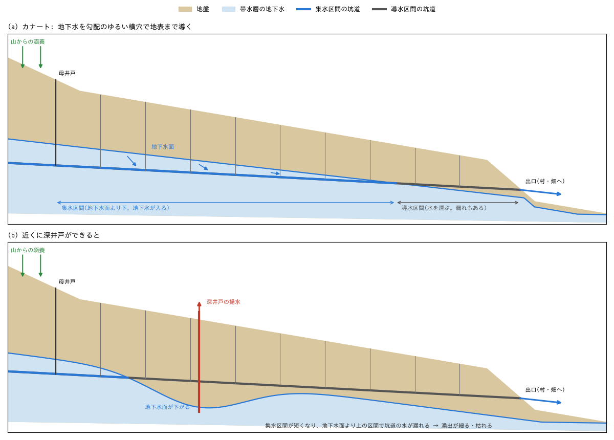
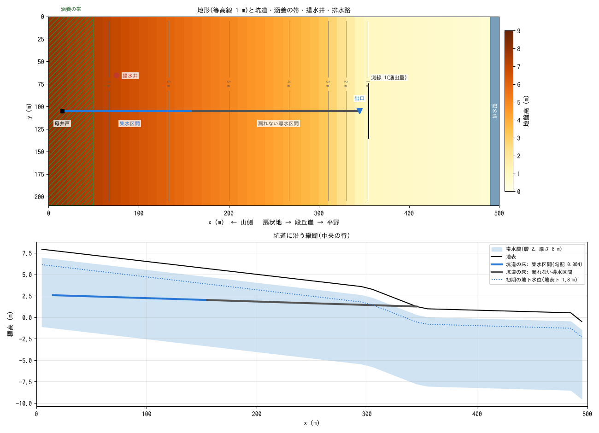
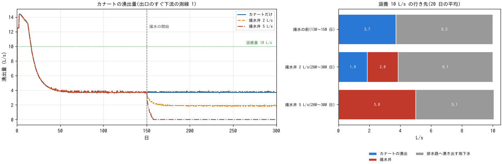
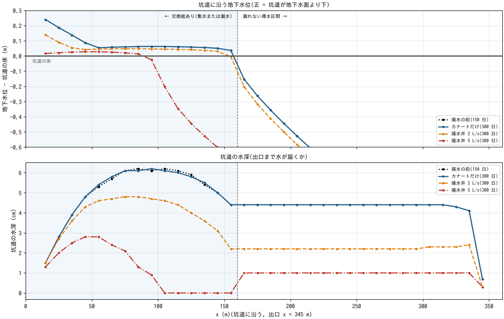
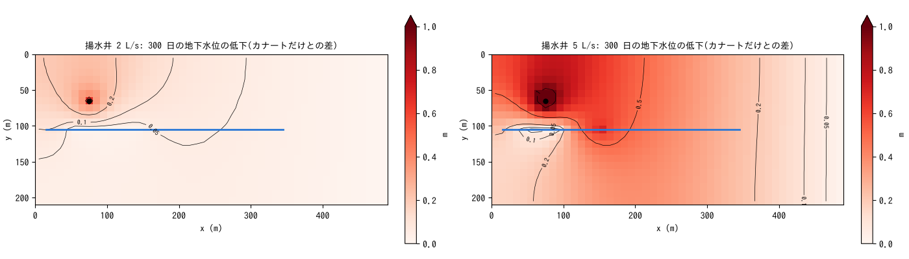

# qanat — カナート(カレーズ/フォガラ)と揚水井

[English](en/README.md)

カナートは、山麓の扇状地の地下水を、勾配のゆるい横穴で低い土地まで導いて地表に出す
地下水路です。動力を使わずに一年中水が出ますが、近くに深井戸ができて地下水位が下がると、
湧出が細り、やがて枯れます。この例題は、扇状地の帯水層とカナートの坑道を一つの計算で
解き、地下水位が釣り合って湧出が安定した後に揚水井を動かして、湧出がどう変わるかを
見ます。値は現象を見やすくするための模式値で、特定のカナートの再現ではありません。

## 実際のカナートで起きていること

- **カナートの仕組み**: カナート(イラン。北アフリカではフォガラ、中央アジアや中国では
  カレーズ)は、上端の母井戸を地下水面より下まで掘り、そこから下流へ地表より勾配の
  ゆるい横穴を掘り進めて、低い土地の出口で地表に出します。横穴のうち地下水面より下の
  区間で地下水が入り(集水区間)、残りの区間は水を出口まで運びます(導水区間)。掘った
  土砂の搬出と換気のために、横穴に沿って一定の間隔で縦坑を掘ります。イランのゴナバードの
  カサベのカナートは長さ 13 km 以上、縦坑 222 本、母井戸の深さ 200 m です(UNESCO 2016)。
- **湧出量は地下水位で決まる**: 地下水が入るのは集水区間だけなので、湧出量は地下水面より
  下にある横穴の長さに左右されます。地下水位が下がると集水区間が短くなり、水を運ぶだけの
  区間が長くなって湧出が減ります。地下水面より上の区間では、坑道の水が周りの地盤へ
  しみ出して失われます。
- **深井戸で枯れる**: 20 世紀に動力ポンプの深井戸が広まると、同じ帯水層の地下水が汲み
  上げられて地下水位が下がり、イランでは多くのカナートが枯れました。再生しない地下水の
  汲み上げは年に約 5.4 km³ にのぼり、地下水位は全国平均で年に約 49 cm 下がっています
  (Noori et al. 2021)。深井戸は地下水位が下がっても汲み続けられますが、浅いカナートは
  集水区間が地下水面より上に出ると枯れます。

## 再現に必要な機構



| 実際の現象 | ENCflow での表し方 | 設定 |
|---|---|---|
| 扇状地の帯水層を地下水が流れる | 層 2(厚さ・比湧水量・側方の透水係数を与える平面 2 次元の帯水層) | `f_gwlayer2 = 1`、`gw2_depth`・`gw2_sy`・`gw2_ksh_mmh` |
| 山から地下水が補給される | 扇状地の上端の帯に一定の涵養(その帯だけに雨を降らせ、浸透能を大きくして全量を地下へ) | `fn_prmap`(`prtype = 2`)、`fn_gw_ksv` |
| カナートの坑道 | 管路連続体層のセル列(貯留容量 = 断面積、床の標高 = 勾配、通水能) | `f_gwconduit = 1`、`fn_gwc_cap`・`fn_gwc_bot`・`fn_gwc_cnd` |
| 地下水面より下の坑道に地下水が入り、上の坑道から水が漏れる | 坑道と帯水層の水位を比べ、高い側から低い側へ一定の交換能で移す | `gwc_leak_layer = 2`、`fn_gwc_leak`(漏れない導水区間は 0) |
| 坑道の水は勾配で出口へ流れ、出口で地表に出る | 坑道内の通水(自由水面流の近似)と開放の吐口 | `f_gwc_fluxlaw = 2`、`fn_gwc_outfall` |
| 地下水の一部はカナートを素通りして下流へ流れる | 扇状地の末端の排水路(地盤高が地下水位の上限になる)で湧き出させる | 地形(東端の列を低くする) |
| 深井戸で地下水を汲み上げる | 帯水層からのセル単位の取水(汲める量はそのセルの貯留で頭打ち) | `f_gwpump = 1`、`gwp_*` |

## 幾何と設定



上: 地形(等高線 1 m)と坑道(青 = 集水区間、灰 = 漏れない導水区間)、涵養の帯(緑の
斜線)、揚水井(赤)、排水路、湧出量を測る測線 1。下: 坑道に沿う縦断。

500 m × 210 m、dx = dy = 10 m(50 × 21 セル)。西から東へ、扇状地面(勾配 0.015、
x < 300 m)、段丘崖(勾配 0.05、x = 300〜350 m)、平野(x = 350〜490 m)と続き、東端の
列は扇状地の末端の排水路(地盤高 −0.5 m)です。

- **帯水層**: 厚さ 1 m の土層の下の層 2(厚さ 8 m、比湧水量 0.2、側方の透水係数
  5e-4 m/s の砂礫層)。初期の地下水位は地表下 1.8 m。南北と西の辺は閉じています。
  カナートに集まらなかった地下水は排水路まで流れて湧き出し、東の辺から出ていきます。
- **涵養**: 扇状地の上端の帯(x < 50 m)に一定の 10 L/s(山から来る地下水の代わり。
  その帯だけに雨を降らせ、浸透能を大きくして全量を地下へしみ込ませる)。
- **坑道**: 中央の行の x = 15〜345 m(34 セル)、床の勾配 0.004、断面 1 m²、通水能
  0.5 m²/s。上流の 15 セル(x = 15〜155 m)が集水区間で、坑道と帯水層の水位を比べて
  高い側から低い側へ交換能 30 mm/h(坑道 10 m あたり 0.83 L/s)で水を移します。
  x = 165 m から出口までは漏れない導水区間です。出口(x = 345 m、段丘崖の中腹)は開放の
  吐口で、出た水は平野を流れて排水路へ向かいます。
- **揚水井**: x = 75 m、坑道から 40 m 北。150 日目から一定量を汲みます。
- 計算は 300 日、dt = 10 s(出口から平野を流れる水の Courant 数で決まる)。

| ケース | 設定ファイル | 揚水井 |
|---|---|---|
| カナートだけ | param.txt | なし |
| 揚水井 2 L/s | param_well2.txt | 150 日目から 2 L/s(カナートの湧出より少ない) |
| 揚水井 5 L/s | param_well5.txt | 150 日目から 5 L/s(カナートの湧出より多い) |

## 実行方法

```
cd examples/qanat
make                    # リンクと入力(gen_data.py)
make run                # 3 ケースを順に計算(1 ケース 1 スレッドで 25 分ほど)
python3 plot_results.py # figs/*.png と数表(引数 en で英語版を en/figs/ に)
```

## 結果



左: カナートの湧出量(出口のすぐ下流の測線 1)。右: 涵養 10 L/s の行き先(揚水の前と、
終了前 20 日の平均)。



上: 坑道に沿う地下水位(坑道の床からの高さ。正 = 坑道が地下水面より下で、地下水が
入る)。下: 坑道の水深。点線 = 揚水の前(150 日)、ほかは 300 日。破線より左が帯水層と
水をやり取りする区間です。



300 日の地下水位の低下(カナートだけのケースとの差)。青線 = 坑道、黒丸 = 揚水井。

| ケース(期間) | カナートの湧出 | 揚水 | 排水路へ湧き出す地下水 | 貯留の減少 | 地下水面より下の坑道 |
|---|---:|---:|---:|---:|---:|
| 揚水の前(130〜150 日) | 3.73 L/s | — | 6.27 L/s | 0.00 L/s | 150 m |
| 揚水井 2 L/s(280〜300 日) | 1.87 L/s | 2.00 L/s | 6.13 L/s | 0.00 L/s | 140 m |
| 揚水井 5 L/s(280〜300 日) | 0 | 5.00 L/s | 5.07 L/s | 0.07 L/s | 80 m |

20 日の平均です。カナートだけのケースは 300 日まで揚水の前と同じです。排水路へ湧き出す
地下水は、涵養から湧出と揚水を引き、貯留の減少を足した残りです(東の辺の測線の平均とは
0.3 L/s 以内で合います。平野の流れが脈動するので、測線の値は 20 日の平均で見ます)。

- **地下水位が釣り合うと、涵養の 4 割弱がカナートから出る**: 初期の地下水位が高いので、
  最初の数日は 14 L/s が出て、50 日ほどで 3.7 L/s に落ち着きます。残りの 6.3 L/s は
  坑道を素通りして、扇状地の末端の排水路に湧き出します。集水区間の大部分で、地下水位は
  坑道の床の 5〜6 cm 上の、坑道の水位とほぼ同じ高さに保たれます(坑道が周りの地下水位を自分の水位まで
  下げて集水する)。坑道の水深は集水区間で最大 6 cm、導水区間で 4.4 cm です。
- **揚水した水の大半はカナートの湧出から来る**: 2 L/s の揚水を始めると、湧出は 20 日
  ほどで 3.7 → 1.9 L/s に減ります。減った 1.86 L/s は揚水量の 93 % で、排水路へ出る
  地下水は 0.14 L/s しか減りません。坑道が地下水を集めている間は坑道の水位が周りの
  地下水位を押さえるので、地下水位の低下は井戸の側(北)に偏ります(南の端の 0.04 m に
  対して北の端で 0.18 m)。井戸は、坑道へ向かっていた地下水を途中で汲み上げます。揚水
  した水は、貯留の減少のほかは、その地下水がもともと出ていた先(湧水・川・カナート)の
  流出の減少でおもに賄われます(Theis 1940)。この例題では、その先が真っ先にカナートです。
- **揚水量が湧出量を超えるとカナートは枯れる**: 5 L/s では湧出が 8 日で止まります
  (157 日目)。揚水 5 L/s の内訳は、カナートの湧出 3.7 L/s、排水路へ出る地下水の減少
  1.2 L/s、貯留の減少 0.07 L/s です。集水区間の下流の部分で地下水位が 0.3〜0.7 m 下がり、
  坑道が地下水面より下にあるのは上流の 80 m だけになります。そこでは今も地下水が坑道に
  入りますが、その下流の x = 95〜155 m で坑道が地下水面より上に出ていて、集めた水は
  そこで地盤へ漏れ出し、導水区間まで届きません(坑道の水深の図)。地下水位が下がると
  集水区間が短くなり、残った集水も途中で失われて枯れる、という実際のカナートの枯れ方と
  同じ仕組みです。
- **深井戸は汲み続ける**: 井戸のセルの地下水位は 5 L/s で 2.1 m 下がりますが、帯水層の
  厚さが 8 m あるので、どちらのケースも要求どおり 100 % 汲めています(終了時の表示
  `demand / pumped`)。

## このモデルで表せないこと(実際の現象との違い)

- **集水は一定の交換能**: 実際の集水量は、地下水位と坑道の水位の差が大きいほど増えます。
  このモデルの交換は差の大きさによらず一定(地下水位が高ければ集水、低ければ漏水)で、
  湧出量はおもに集水区間の長さで決まります。坑道のすぐ周りの急な水位の落ち込みも
  表しません。
- **導水区間は漏れないとした**: 実際の導水区間は床が細かい土で目詰まりするなどして漏れ
  にくくなりますが、まったく漏れないわけではありません。この例題は漏れない区間を、
  揚水の前の地下水位が坑道を横切る位置(x = 165 m)より下流として与えています。
- **平面 2 次元の 1 層の帯水層**: 鉛直方向の流れ、井戸の深さやスクリーンの位置、坑道と
  井戸の上下の位置関係は表しません。井戸はセル単位の取水で、汲める量はそのセルの貯留で
  頭打ちになります(地下水位が下がると汲めなくなることは、これで表れます)。
- **涵養は一定**: 季節や年ごとの雨の変化、干ばつは与えていません。
- **規模と時間**: 坑道は 330 m で、実際のカナート(数 km〜数十 km)より短く、揚水井も
  坑道から 40 m しか離れていません。地下水位の変化が伝わる時間は距離の 2 乗に比例し
  (拡散係数 = 透水量係数 / 比湧水量。この例題で約 0.01 m²/s)、40 m なら 2 日ほど、
  2 km なら 10 年あまりです。この例題で湧出が数日〜20 日で変わるのはこのためで、実際の
  カナートは年の単位で細っていきます。値は模式値です。
- **維持管理**: 坑道の崩落・土砂の堆積と、その掘り直し(縦坑からの清掃)は表しません。

## 注意

- **地下水の出口**: ENCflow の地下水は海域セルとの間で水をやり取りしないので、下流へ
  流れる地下水の出口は、東端の列を低くした排水路(湧き出した水は東の辺から出ていく)で
  与えています。排水路の地盤高が地下水位の上限になります。
- **初期の地下水位**: 地表下 1.8 m から始めるので、最初の数十日はカナートと排水路が
  余分な地下水を抜きます(湧出量が涵養より多い)。揚水は、地下水位が釣り合った 150 日目
  から始めます。
- **時間刻み**: 出口から平野を流れる水の Courant 数で dt = 10 s が上限です。坑道の通水は
  安定条件に合わせて自動で細分されます(初期化時に subcycles を表示)。
- **湧出量の測り方**: 出口のすぐ下流で流れを横切るフラックス測線 1 の流量です。東の辺の
  測線 3 は、排水路から出ていく水の全量(出口から来た水 + 排水路で湧き出した地下水)です。
- **坑道に残る水**: 管路の貯留が乾燥判定の量 `gwc_eps`(既定 1e-3 m。この坑道では水深
  1 cm)以下のセルからは、出口へ水が出ません。5 L/s のケースで導水区間に残る水深 1 cm は、
  湧出が止まったときに残った水です。

## 感度実験の入口

- `gwc_leak.txt`(gen_data.py の交換能 30 mm/h): 集水区間 1 セルあたりの集水の上限を
  決めます。
- `I_LINED`(gen_data.py。漏れない区間の始まり): 上流へ寄せると集水区間が短くなり、下流へ
  寄せると地下水位より上を通る区間で漏れが出ます。
- `RECH_LS`(gen_data.py。涵養量)と `gw2_ksh_mmh`(透水係数): 地下水位の高さと勾配を
  決め、カナートと排水路の取り分を変えます。
- `gwp_val`(揚水量)と `gwp_cell`(井戸の位置): 揚水量がカナートの湧出量(3.7 L/s)より
  少ないか多いかで、湧出が減るだけか枯れるかが分かれます。坑道から離すと影響が遅れます。

## 参考文献

- Noori, R. et al. (2021): Anthropogenic depletion of Iran's aquifers. Proceedings of the
  National Academy of Sciences, 118(25), e2024221118.
- Theis, C. V. (1940): The source of water derived from wells: essential factors controlling
  the response of an aquifer to development. Civil Engineering, 10(5), 277–280.
- UNESCO World Heritage Centre (2016): The Persian Qanat (World Heritage List No. 1506).
  https://whc.unesco.org/en/list/1506
