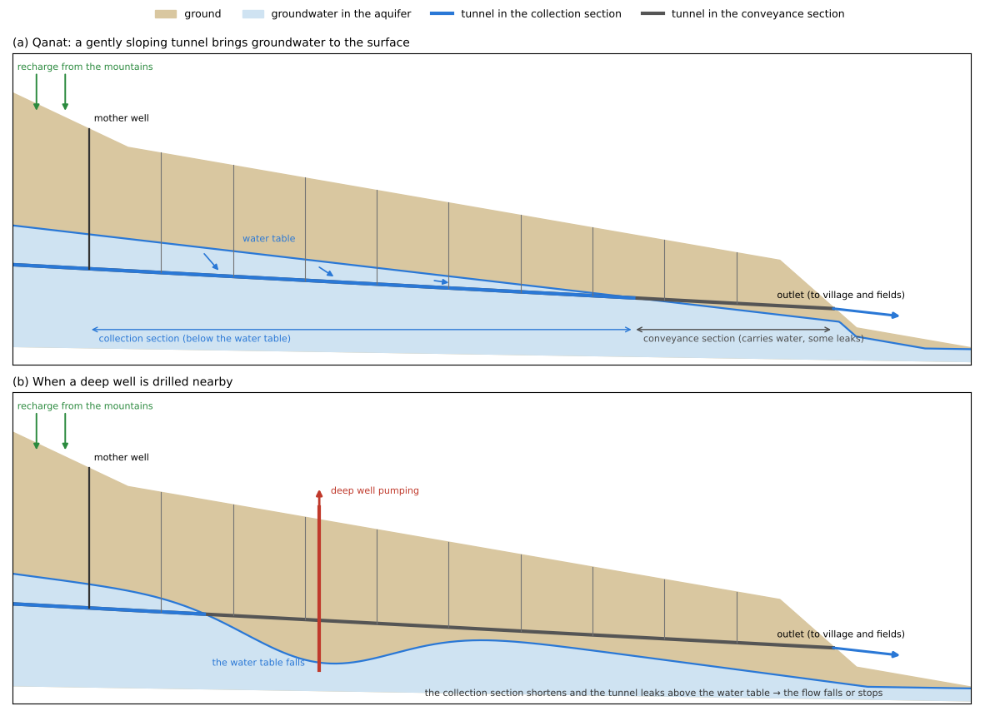
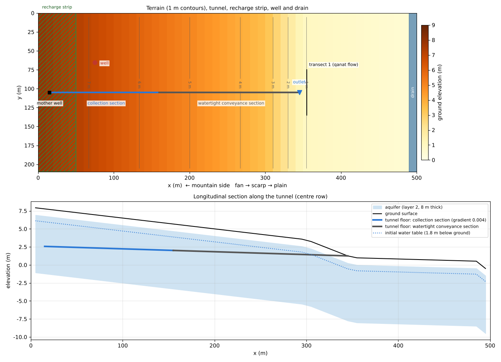
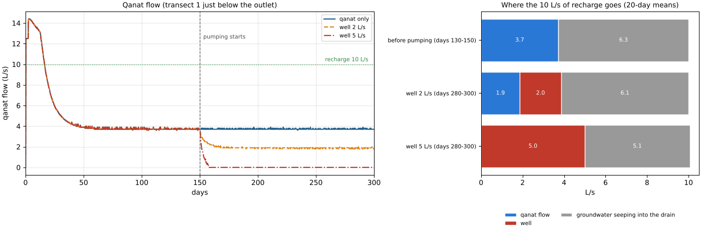
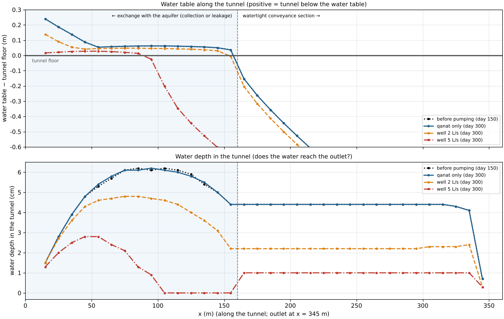
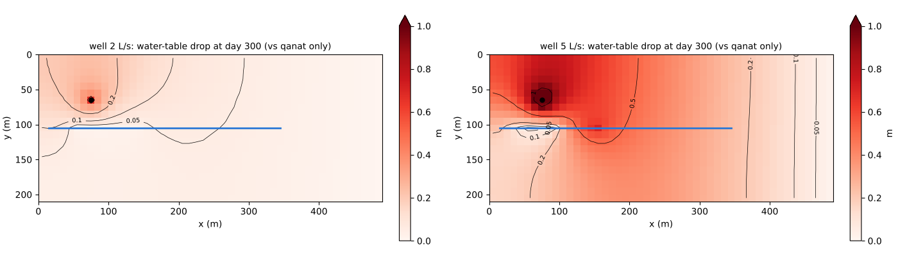

# qanat — a qanat (karez / foggara) and a pumping well

> English mirror of examples/qanat/README.md. The Japanese file is the master copy.

[日本語](../README.md)

A qanat is an underground channel that leads the groundwater of a mountain-foot fan to
lower land through a gently sloping tunnel and brings it out at the surface. It flows all
year without any power, but when a deep well is drilled nearby and the water table falls,
the flow dwindles and finally stops. This example solves the fan aquifer and the qanat
tunnel in a single run. After the water table has reached equilibrium and the qanat flow
has settled, it starts a pumping well and looks at how the qanat flow changes. The values
are schematic, chosen to make the phenomena easy to see; the example does not reproduce any
particular qanat.

## What happens in a real qanat

- **How a qanat works**: a qanat (Iran; called foggara in North Africa and karez in Central
  Asia and China) starts from a mother well dug below the water table at its upper end.
  From there a tunnel, sloping more gently than the ground surface, is dug downstream and
  comes out at the surface on lower land. Groundwater enters along the part of the tunnel
  below the water table (the collection section); the rest of the tunnel carries the water
  to the outlet (the conveyance section). Vertical shafts are dug at regular intervals along
  the tunnel to remove the spoil and to ventilate it. The Qasabeh qanat of Gonabad in Iran
  is more than 13 km long, with 222 shafts and a mother well 200 m deep (UNESCO 2016).
- **The flow depends on the water table**: groundwater enters only along the collection
  section, so the flow depends on how much of the tunnel lies below the water table. When
  the water table falls, the collection section becomes shorter, the section that only
  carries water becomes longer, and the flow falls. Along the part above the water table,
  water in the tunnel seeps out into the surrounding ground and is lost.
- **Deep wells dry qanats**: when deep wells with power pumps spread in the 20th century,
  they pumped groundwater from the same aquifers and lowered the water table, and many
  qanats in Iran dried up. Non-renewable groundwater withdrawal reaches about 5.4 km³ a
  year, and the water table is falling by about 49 cm a year on the national average
  (Noori et al. 2021). A deep well can keep pumping as the water table falls, but a shallow
  qanat dries up once its collection section rises above the water table.

## Mechanisms needed for the reproduction



| Real phenomenon | How ENCflow represents it | Settings |
|---|---|---|
| Groundwater flows through the fan aquifer | Layer 2 (a plane 2-D aquifer given a thickness, specific yield and lateral hydraulic conductivity) | `f_gwlayer2 = 1`, `gw2_depth`, `gw2_sy`, `gw2_ksh_mmh` |
| Groundwater is supplied from the mountains | Constant recharge on a strip at the top of the fan (rain falls only on that strip, and a large infiltration capacity sends all of it underground) | `fn_prmap` (`prtype = 2`), `fn_gw_ksv` |
| The qanat tunnel | A row of cells in the conduit continuum layer (storage capacity = cross-section, floor elevation = gradient, conveyance) | `f_gwconduit = 1`, `fn_gwc_cap`, `fn_gwc_bot`, `fn_gwc_cnd` |
| Groundwater enters the tunnel below the water table, and water leaks out of the tunnel above it | The heads of the tunnel and the aquifer are compared, and water moves from the higher to the lower side at a constant exchange capacity | `gwc_leak_layer = 2`, `fn_gwc_leak` (0 on the watertight conveyance section) |
| Water in the tunnel flows down its gradient to the outlet and comes out at the surface | Flow in the tunnel (an approximation of free-surface flow) and an open outfall | `f_gwc_fluxlaw = 2`, `fn_gwc_outfall` |
| Part of the groundwater bypasses the qanat and flows downstream | It seeps out into a drain at the foot of the fan (the ground level of the drain caps the water table) | Terrain (the eastmost column is lowered) |
| A deep well pumps groundwater | Withdrawal from the aquifer by cell (the amount that can be pumped is capped by the storage of the cell) | `f_gwpump = 1`, `gwp_*` |

## Geometry and settings



Top: terrain (1 m contours) with the tunnel (blue = collection section, grey = watertight
conveyance section), the recharge strip (green hatching), the pumping well (red), the drain,
and transect 1 that measures the qanat flow. Bottom: longitudinal section along the tunnel.

500 m × 210 m, dx = dy = 10 m (50 × 21 cells). From west to east come the fan surface
(gradient 0.015, x < 300 m), a terrace scarp (gradient 0.05, x = 300-350 m) and a plain
(x = 350-490 m); the eastmost column is the drain at the foot of the fan (ground level
−0.5 m).

- **Aquifer**: layer 2 under a 1 m soil layer (8 m thick, specific yield 0.2, a sand and
  gravel layer with a lateral hydraulic conductivity of 5e-4 m/s). The initial water table is
  1.8 m below the ground. The north, south and west edges are closed. Groundwater that the
  qanat does not collect flows to the drain, seeps out there and leaves through the east edge.
- **Recharge**: a constant 10 L/s on the strip at the top of the fan (x < 50 m), standing for
  the groundwater coming from the mountains (rain falls only on that strip, and a large
  infiltration capacity lets all of it soak underground).
- **Tunnel**: x = 15-345 m on the centre row (34 cells), floor gradient 0.004, cross-section
  1 m², conveyance 0.5 m²/s. The upper 15 cells (x = 15-155 m) are the collection section,
  where the heads of the tunnel and the aquifer are compared and water moves from the higher
  to the lower side at an exchange capacity of 30 mm/h (0.83 L/s per 10 m of tunnel). From
  x = 165 m to the outlet is the watertight conveyance section. The outlet (x = 345 m, halfway
  down the scarp) is an open outfall; the water that comes out flows over the plain to the
  drain.
- **Pumping well**: x = 75 m, 40 m north of the tunnel. It pumps a constant rate from day 150.
- The run is 300 days, dt = 10 s (set by the Courant number of the water flowing over the
  plain from the outlet).

| Case | Settings file | Pumping well |
|---|---|---|
| Qanat only | param.txt | none |
| Well 2 L/s | param_well2.txt | 2 L/s from day 150 (less than the qanat flow) |
| Well 5 L/s | param_well5.txt | 5 L/s from day 150 (more than the qanat flow) |

## How to run

```
cd examples/qanat
make                    # links and inputs (gen_data.py)
make run                # run the 3 cases in turn (about 25 minutes per case on one thread)
python3 plot_results.py # figs/*.png and the table (with the argument en, the English version goes to en/figs/)
```

## Results



Left: qanat flow (transect 1 just below the outlet). Right: where the 10 L/s of recharge goes
(before pumping, and the mean of the last 20 days).



Top: water table along the tunnel (height above the tunnel floor; positive = the tunnel lies
below the water table and groundwater enters). Bottom: water depth in the tunnel. Dotted =
before pumping (day 150), the others at day 300. Left of the dashed line is the section that
exchanges water with the aquifer.



Water-table drop at day 300 (difference from the qanat-only case). Blue line = tunnel, black
dot = pumping well.

| Case (period) | Qanat flow | Pumping | Groundwater seeping into the drain | Storage loss | Tunnel below the water table |
|---|---:|---:|---:|---:|---:|
| Before pumping (days 130-150) | 3.73 L/s | — | 6.27 L/s | 0.00 L/s | 150 m |
| Well 2 L/s (days 280-300) | 1.87 L/s | 2.00 L/s | 6.13 L/s | 0.00 L/s | 140 m |
| Well 5 L/s (days 280-300) | 0 | 5.00 L/s | 5.07 L/s | 0.07 L/s | 80 m |

The values are 20-day means. The qanat-only case stays the same as before pumping up to day
300. The groundwater seeping into the drain is what remains of the recharge after
subtracting the qanat flow and the pumping and adding the storage loss (it agrees within
0.3 L/s with the mean of the east-edge transect; the flow over the plain pulsates, so the
transect is read as a 20-day mean).

- **Once the water table is in equilibrium, a little under 40 % of the recharge comes out of
  the qanat**: because the initial water table is high, 14 L/s comes out in the first few
  days, settling to 3.7 L/s in about 50 days. The remaining 6.3 L/s bypasses the tunnel and
  seeps out into the drain at the foot of the fan. Over most of the collection section the
  water table is held 5-6 cm above the tunnel floor, at almost the same height as the water
  in the tunnel (the tunnel collects water by lowering the surrounding water table to its own
  level). The water in the tunnel is up to 6 cm deep in the collection section and 4.4 cm
  deep in the conveyance section.
- **Most of the pumped water comes out of the qanat flow**: when pumping at 2 L/s starts, the
  qanat flow falls from 3.7 to 1.9 L/s in about 20 days. The 1.86 L/s lost is 93 % of the
  pumping rate; the groundwater flowing to the drain falls by only 0.14 L/s. While the tunnel
  is collecting groundwater, the water in the tunnel holds up the surrounding water table, so
  the water table falls mainly on the well's (north) side (0.18 m at the north edge against
  0.04 m at the south edge). The well pumps groundwater that was on its way to the tunnel.
  Apart from storage depletion, pumped water is supplied mainly by a decrease of the outflow
  where that groundwater used to go (springs, rivers, qanats) (Theis 1940). In this example,
  that outflow is above all the qanat.
- **The qanat dries up once pumping exceeds its flow**: at 5 L/s the qanat stops flowing in
  8 days (day 157). The 5 L/s of pumping is made up of the qanat flow 3.7 L/s, a decrease of
  1.2 L/s in the groundwater flowing to the drain, and a storage loss of 0.07 L/s. The water
  table falls by 0.3-0.7 m over the lower part of the collection section, and only the upper
  80 m of the tunnel stays below the water table. Groundwater still enters the tunnel there,
  but further down, at x = 95-155 m, the tunnel lies above the water table; the collected
  water leaks out into the ground there and never reaches the conveyance section (the
  water-depth panel). This is the same mechanism by which real qanats dry up: as the water
  table falls, the collection section shortens, and what is still collected is lost on the
  way.
- **The deep well keeps pumping**: the water table at the well cell falls by 2.1 m at 5 L/s,
  but the aquifer is 8 m thick, so both cases pump 100 % of their demand (the
  `demand / pumped` summary at the end of the run).

## What this model cannot represent (differences from real phenomena)

- **Collection at a constant exchange capacity**: in reality, the collection rate grows with
  the difference between the water table and the water level in the tunnel. Here the
  exchange is constant regardless of that difference (collection if the water table is
  higher, leakage if it is lower), so the qanat flow is set mainly by the length of the
  collection section. The steep drawdown right around the tunnel is not represented either.
- **The conveyance section is taken as watertight**: a real conveyance section leaks less
  because, for example, its floor is clogged with fine soil, but it is not completely
  watertight. This example gives the watertight section as the part downstream of where the
  water table before pumping crosses the tunnel (x = 165 m).
- **A plane 2-D single-layer aquifer**: vertical flow, the depth and screen position of the
  well, and the vertical positions of the tunnel and the well relative to each other are not
  represented. The well is a withdrawal by cell, and the amount it can pump is capped by the
  storage of the cell (this is how a well running dry as the water table falls shows up).
- **Constant recharge**: seasonal and year-to-year changes in rainfall and droughts are not
  given.
- **Scale and time**: the tunnel is 330 m long, shorter than real qanats (several km to tens
  of km), and the pumping well is only 40 m from the tunnel. The time a change in the water
  table takes to travel grows with the square of the distance (diffusivity = transmissivity /
  specific yield, about 0.01 m²/s in this example): about 2 days for 40 m and a little over
  10 years for 2 km. This is why the qanat flow here changes within a few days to 20 days,
  while real qanats dwindle over years. The values are schematic.
- **Maintenance**: collapses of the tunnel, sediment build-up and re-excavation (cleaning from
  the shafts) are not represented.

## Notes

- **The groundwater outlet**: ENCflow groundwater does not exchange water with sea cells, so
  the outlet for groundwater flowing downstream is given by a drain made by lowering the
  eastmost column (the water that seeps out leaves through the east edge). The ground level
  of the drain caps the water table.
- **Initial water table**: the run starts with the water table 1.8 m below the ground, so for
  the first few tens of days the qanat and the drain draw off the extra groundwater (the
  qanat flow exceeds the recharge). Pumping starts on day 150, after the water table has
  reached equilibrium.
- **Time step**: the Courant number of the water flowing over the plain from the outlet caps
  dt at 10 s. Flow in the tunnel is subdivided automatically to meet its stability condition
  (subcycles are shown at initialisation).
- **How the qanat flow is measured**: it is the flow through flux transect 1, which crosses
  the flow just below the outlet. Transect 3 on the east edge is the total water leaving
  through the drain (water from the outlet + groundwater seeping out into the drain).
- **Water left in the tunnel**: no water flows to the outlet from cells whose conduit
  storage is at or below the drying threshold `gwc_eps` (default 1e-3 m; 1 cm of water depth
  in this tunnel). The 1 cm of water left in the conveyance section in the 5 L/s case is what
  remained when the flow stopped.

## Starting points for sensitivity tests

- `gwc_leak.txt` (the exchange capacity of 30 mm/h in gen_data.py): sets the upper limit of
  collection per cell of the collection section.
- `I_LINED` (gen_data.py; where the watertight section starts): moving it upstream shortens
  the collection section; moving it downstream makes the tunnel leak where it runs above the
  water table.
- `RECH_LS` (gen_data.py; recharge) and `gw2_ksh_mmh` (hydraulic conductivity): set the
  height and gradient of the water table and change the shares of the qanat and the drain.
- `gwp_val` (pumping rate) and `gwp_cell` (well position): whether the pumping rate is below
  or above the qanat flow (3.7 L/s) decides whether the flow only falls or dries up. Moving
  the well away from the tunnel delays its effect.

## References

- Noori, R. et al. (2021): Anthropogenic depletion of Iran's aquifers. Proceedings of the
  National Academy of Sciences, 118(25), e2024221118.
- Theis, C. V. (1940): The source of water derived from wells: essential factors controlling
  the response of an aquifer to development. Civil Engineering, 10(5), 277–280.
- UNESCO World Heritage Centre (2016): The Persian Qanat (World Heritage List No. 1506).
  https://whc.unesco.org/en/list/1506
