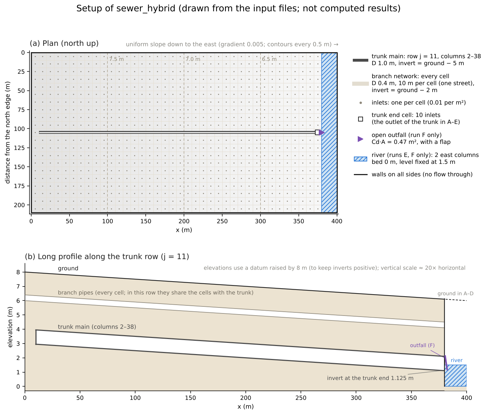
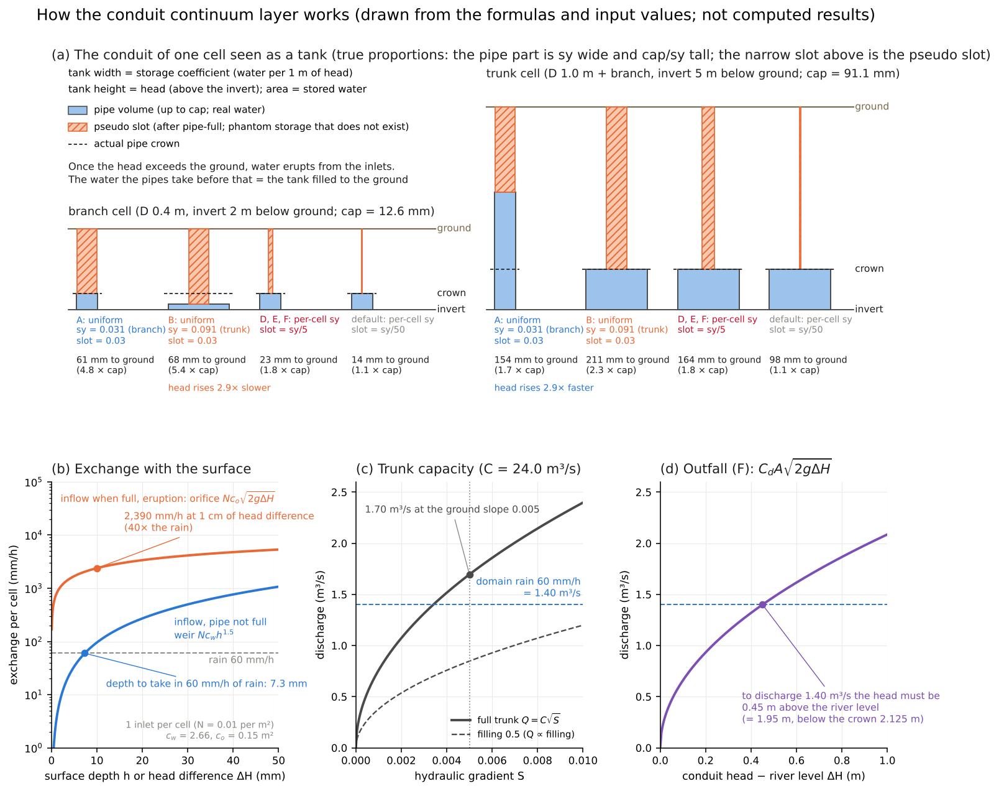
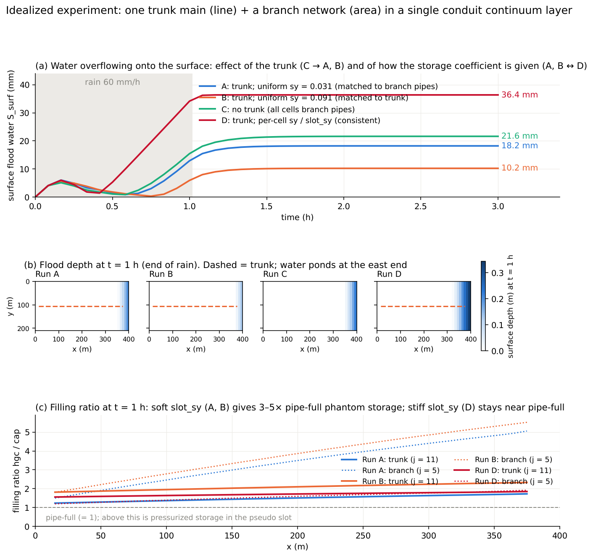
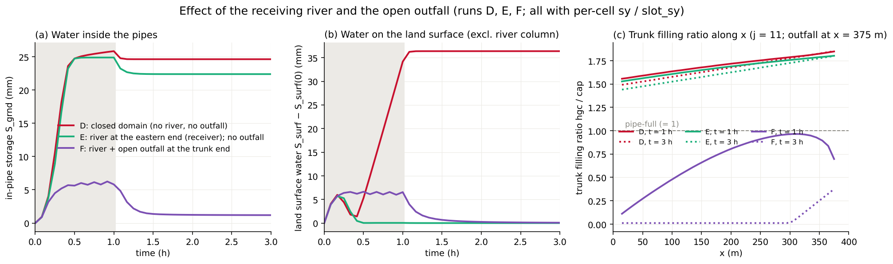

# sewer_hybrid — an idealized urban-drainage experiment representing one trunk main (a line) and a branch network (an area) in a single conduit continuum layer

> English mirror of examples/sewer_hybrid/README.md. The Japanese file is the master copy.

[日本語](../README.md)

A town's storm sewer system consists of a network of thin **branch pipes**
running under each street and thick **trunk mains** that collect their
water and carry it to a river or the sea. ENCflow represents this network
as **one underground layer**, the "conduit continuum layer"
(`f_gwconduit`). Instead of tracing each pipe individually, every cell is
given numbers for "how much water the pipes can store" and "how much can
flow to the neighbouring cell", and the underground water level (the
conduit head) is tracked cell by cell.

This example is an idealized experiment that checks **whether a thick trunk
main and thin branch pipes can share the same single layer**, and **how
much the answer then depends on how the storage coefficient is given**, by
raining 60 mm/h for one hour on a uniform slope of 400 m × 210 m (the
design record is developer.md §46.5, in Japanese). No code change is
needed; everything is assembled from input files alone. The following
explains, in order, the meaning of the parameters, the configuration of
each run, and how to read the results.



(a) Plan (north up). Every cell has branch pipes (D 0.4 m, 10 m per cell)
and one inlet, and the trunk main (D 1.0 m) runs along row j = 11. The cell
at the trunk end has 10 inlets; in A–E the water of the trunk leaves to the
surface there. In runs E and F the two easternmost columns are a river
(level fixed at 1.5 m), and in run F the trunk end has an open outfall.
(b) Long profile along the trunk row (vertical scale about 20 times the
horizontal). The branch inverts are 2 m below the ground and the trunk
inverts 5 m below it; the invert at the trunk end, 1.125 m, lies below the
river level of 1.5 m. Drawn from the input files; not computed results.

## 1. The five parameters of the conduit continuum layer

Five values are given per cell. All of them are written out by gen_data.py,
which **converts them from the pipe specifications** (diameter D,
roughness n, pipe length within one cell, burial depth).

| Parameter | Meaning | Conversion (this case) |
|---|---|---|
| `cap` (storage capacity, m) | The total pipe volume divided by the cell area, a "columnar depth". The amount of water underground when the pipes are full | A·L/Δx². Branch pipe D = 0.4 m, L = 10 m → 0.0126 m (12.6 mm) |
| `cnd` (conveyance density, m²/s) | The discharge per unit width that can be conveyed when pipe-full at unit hydraulic gradient. Ease of flow to the neighbouring cell | C/Δx, C = (1/n)·A·R^(2/3). Branch 0.208, trunk 2.40 |
| `bot` (invert elevation, m) | The elevation of the pipe bottom. The datum of the head (the water level inside the pipe) | Branch pipes at ground − 2 m, trunk at ground − 5 m |
| `sy` (storage coefficient) | How many metres of columnar water are added when the head rises 1 m. The value **until the pipe is full** (unconfined): cap ÷ pipe height | Branch 0.0126/0.4 = 0.031, trunk cell 0.0911/1.0 = 0.091 |
| `slot_sy` (pseudo-slot storage coefficient) | The amount of water added when the head rises 1 m **after** the pipe is full (confined = pressurized). The smaller, the "stiffer" the pressure response | Physically ≈ 0, but 1/5 to 1/50 of sy is given for numerical stability |

In addition there are the **inlet density** (`inlet`, 1/m²), which governs
the exchange of water with the surface, and the **outfall**
(`fn_gwc_outfall`, run F), the outlet of the pipes. Rain falls on the
surface, enters the pipes through the inlets (weir type; once pipe-full,
the orifice type applies and water **erupts** only when the conduit head
rises above the surface), and collects inside the pipes toward the trunk
main.

**The pseudo slot and "phantom storage"**: when water is forced into a
pipe that is already full, in reality only the pressure rises and the
amount of water hardly increases. A numerical model treats this as a thin
slot (groove) standing on the pipe ceiling: the water is allowed to
increase by slot_sy, which corresponds to the slot width, and the pressure
(head) is computed from that (the Preissmann slot). A large slot_sy makes
the computation easier, but a large amount of non-existent water
accumulates in the slot, hiding underground the water that should have
overflowed onto the surface. This is "phantom storage", one of the main
characters of this example.



(a) The conduit of one cell drawn as a tank whose width is the storage
coefficient and whose height is the head (widths and heights each in true
proportion). Above the pipe part (blue; sy wide and cap/sy tall) the pseudo
slot used after pipe-full (orange hatching; slot_sy wide) stands up to the
ground. Once the head exceeds the ground, water erupts from the inlets, so
the pipes take water only up to the area of the tank filled to the ground;
the orange part is the non-existent "phantom storage". With the soft
slot_sy of A and B a branch cell stores 4.8–5.4 times cap, D (slot = sy/5)
1.8 times and the default (sy/50) 1.1 times. When sy does not match the
pipe, the head also rises at the wrong rate (2.9 times faster in a trunk
cell of A, 2.9 times slower in a branch cell of B). (b) Strength of the
exchange with the surface (per cell). Inflow into pipes that are not full
(weir) needs 7.3 mm of depth to take in 60 mm/h of rain. Inflow into full
pipes and eruption while pressurized (orifice) reach 40 times the rain at
a head difference of 1 cm, so the head in full pipes quickly follows the
surface water level. (c) What the trunk can carry: 1.70 m³/s when full at
the ground slope 0.005, thick enough for the 1.40 m³/s of rain on the
domain (less in proportion to the filling ratio when not full). (d) What
the outfall (run F) can pass: discharging 1.40 m³/s needs a head of the
river level + 0.45 m, below the outfall crown (2.125 m). Drawn from the
formulas and input values; not computed results.

## 2. Setup

| Item | Value |
|---|---|
| Domain and grid | 400 m × 210 m, 40 × 21 cells (Δx = 10 m). Uniform slope descending eastward (gradient 0.005). Surface roughness n = 0.03. Walls on all four sides (in runs E and F the two easternmost columns are a river) |
| Rainfall | 60 mm/h for one hour (0–60 min), falling to 0 at 61 min. Total rainfall 61.0 mm |
| Branch network | Every cell: D = 0.4 m, n = 0.013, 10 m per cell (one street), buried 2 m. One inlet per cell (0.01 /m²) |
| Trunk main | D = 1.0 m, n = 0.013, buried 5 m at i = 2–38 of row j = 11. Trunk cells have the combined "trunk + branch" cap, and the head datum is the trunk invert. Pipe-full capacity 1.70 m³/s (gradient 0.005), against a rainfall runoff of 1.40 m³/s from the domain |
| Computation | dt = 0.02 s, 3 hours. The lateral flux of the conduit layer follows the square-root-gradient law (`f_gwc_fluxlaw = 2`). No other groundwater layer is used |
| Output | Distributions of surface depth H, water level E and conduit storage Hgc every 30 minutes; the water budget in Log.txt (S_surf = surface, S_grnd = in the pipes) |

| Run | Trunk | sy / slot_sy | River and outfall | Purpose |
|---|---|---|---|---|
| A | Yes | Uniform 0.0314 / 0.03 (values matched to the branch pipes) | None | The storage coefficient of the trunk cells is too small (the head rises about 3 times too high) |
| B | Yes | Uniform 0.0911 / 0.03 (values matched to the trunk) | None | The storage coefficient of the branch cells is too large (the branch response is about 3 times too sluggish) |
| C | None (all cells branch pipes) | Uniform 0.0314 / 0.03 | None | Control for seeing the effect of the trunk |
| D | Yes | **Per-cell map** (trunk 0.0911, branch 0.0314; slot = sy/5) | None | The "correct answer", consistent for both trunk and branches. `fn_gwc_sy` / `fn_gwc_slot_sy` (§46.5 (5)) |
| E | Yes | Same as D | The two easternmost columns become a river (water level fixed at 1.5 m). No outfall | Effect of surface flood water dropping into the river and leaving the system |
| F | Yes | Same as D | River + an open outfall at the trunk end (38, 11) (`fn_gwc_outfall`, Cd·A = 0.47 m²) | Conduit head and flooding when the trunk can discharge directly into the river |

The slot_sy = 0.03 of A and B is a "soft" value of the same order as sy.
It relaxes the upper limit of the explicit time step (dt ≤ 0.061 s from the
trunk conveyance) but creates the "phantom storage" described above. Run D
and later use the physically stiffer slot_sy (sy/5). Time steps above the
limit are split automatically by subcycling (§46.5 (4)) (in this
configuration dt = 0.02 s is below the limit of 0.037 s, so the number of
subdivisions is N = 1).

| File | Contents |
|---|---|
| `gen_data.py` | Conversion from pipe specifications to cap / cnd / bot / sy / slot, and generation of all maps in `data_sewer/` (including the river system and outfall maps) |
| `param_A.txt` to `param_F.txt` | Parameters of each run. Output goes to `result_A/` to `result_F/` |
| `plot_schematic.py` | Two explanatory figures (`figs/setup.png`, `figs/mechanism.png`), drawn from the inputs and formulas only, so they can be drawn before the runs |
| `plot_sewer.py` | Two result figures (`figs/sewer_hybrid_result.png`, `figs/sewer_hybrid_outfall.png`); the outfall discharge is read from the screen output of run F, `Screen_F.log` |

## 3. Running

```bash
python3 gen_data.py                 # generate data_sewer/ (the converted values are printed on screen)
python3 plot_schematic.py           # explanatory figures figs/setup.png, mechanism.png (can be drawn before the runs)
for r in A B C D E F; do ../../bin/encflow param_$r.txt | tee Screen_$r.log; done   # 2–3 min each (4 cores)
python3 plot_sewer.py               # result figures figs/sewer_hybrid_result.png, sewer_hybrid_outfall.png
```

With the argument `en`, the figures are drawn with English labels into
en/figs/ (`python3 plot_schematic.py en`, `python3 plot_sewer.py en`).
Plotting needs Python 3, NumPy and matplotlib.

In the output of `gen_data.py`, compare the pipe-full conveyance of the
branch pipes C = 2.08 m³/s, that of the trunk 24.0 m³/s, the pipe-full
capacity of the trunk 1.70 m³/s (gradient 0.005), and the domain runoff of
1.40 m³/s from 60 mm/h of rain. The setting is "a trunk main just barely
thick enough to carry the rain".

## 4. Reading the figures (runs A–D)



**(a) Time series of the water overflowing onto the surface, S_surf.**
During the first 10 minutes of rain, 5–6 mm of rain that cannot enter the
pipes through the inlets ponds on the surface, then is drawn into the
pipes and decreases for a while (inflow into pipes that are not full
follows the weir law and needs about 7 mm of depth to take in the rain;
panel (b) of the mechanism figure). Once the pipes are full (about 25 min in
run D), the surface water starts to increase from the water **erupting**
from the inlets and the rain that cannot be absorbed, and nearly levels
off at the end of the rain (1 hour). Run A (18.2 mm), which has a trunk,
has 3.4 mm less than run C (21.6 mm) without one, and this difference is
almost the same as the volume of the trunk pipe (3.5 mm over the domain).
In a closed box the trunk cannot take water out of the system either, so
its effect is the volume it adds for storage. Run D with consistent
storage coefficients, however, gives **36.4 mm**, 2–3.6 times A and B.
Because of their soft slot_sy, A and B were hiding the water that should
have overflowed in underground "phantom storage" ((b)). **The choice of the
scalar sy (the A ↔ B difference of 8 mm) is larger than the effect of the
trunk itself (C − A = 3.4 mm)** and sways the answer. This is why sy and
slot_sy are given per cell (§46.5 (5)).

**(b) Where the rain is after 3 hours.** The box is closed, so all 61.0 mm
of rain is either on the surface or in the pipes. The water in the pipes is
split, cell by cell, into the part up to the pipe volume (cap) and the part
beyond it in the pseudo slot (phantom storage). A, B and C hide 27–35 mm in
the non-existent slot, and that much less is on the surface. The slot part
of D is 8.6 mm. A and C have the same slot part (26.9 mm) and differ only
in the pipe volume (the trunk). The slot part of B is 8 mm larger than that
of A because the large sy matched to the trunk makes the pipe part of the
tank of a branch cell lower, so the slot starts lower (panel (a) of the
mechanism figure). The surface water flows east down the uniform slope and
ponds at the eastern end, since all four sides are walls. This is not an
experiment for seeing "which blocks get flooded" but one for comparing
totals and time series.

**(c) Filling ratio of the pipes hgc / cap at the end of the rain.** 1 is
pipe-full. With the soft slot_sy of A and B, at the eastern end the
branch pipes (dotted) hold 5–5.5 times and the trunk (solid) 1.7–2.3 times
the pipe-full volume in the "slot". The part beyond the pipe volume is
non-existent water. With the stiff slot_sy of D, both trunk and branches
stay within 1.9 times even at the east end (1.2 times on the upstream branch),
and the excess has overflowed onto the surface
(that it is still nearly 2 is because sy/5 is still soft; in practice sy/50
is the default. §64). The ratio grows downstream because the head in the
pipes is closer to the ground there; at the eastern end the head reaches
the ground, and the values exceed the amounts up to the ground in panel (a)
of the mechanism figure (4.8 times for the branch cells of A, 5.4 times for
those of B, 1.8 times for D) by the depth of the water ponded on the
surface.

## 5. Effect of the river and the outfall (runs E, F)



A–D are closed boxes with walls on all four sides and no outlet for the
pipes. In a real sewer system the end of the trunk opens into a river or
the sea through an **outfall**. In E and F the two easternmost columns are
made a "river" (the sea mask `fn_sw` with the water level fixed at 1.5 m
by the tide module), so that the surface water drops from the cliff into
the river and leaves the system. F additionally places an open outfall at
the trunk end (38, 11) (the receiving head is the water level of the
adjacent river; with a backflow-prevention flap). The trunk invert at its
end is 1.125 m, so the outfall sits slightly above the river surface.

**(a) Water inside the pipes, S_grnd.** In run E, with only the river, the
pipes are full (25 mm) after 30 minutes, and 22 mm stays in the pipes even
after the rain stops (there is no outlet, so it cannot drain). In run F
with the outfall, the water in the pipes stays at most 6.5 mm and drains to
1.4 mm within 30 minutes after the rain stops. The effect of **the trunk
being able to discharge into the river** is seen directly.

**(b) Water on the land surface.** S_surf in the Log is the mean over the
land cells only. In run E,
after about 6 mm ponds during the first 10 minutes of rain, the surface
stays nearly dry. The full pipes have their head right around the surface,
carry the rain that enters through the inlets through the pipes to the
downstream end, and **erupt** it from the inlets near the river to drop it
into the river. The network works as "a conveyor passing water while
pipe-full": numerically no flooding occurs, but in reality this is a state
in which every inlet is spouting. In run F, 6–7 mm of water lies on the
land during the rain. Inflow into pipes that are not full follows the weir
type (q = cw·h^1.5), and swallowing 60 mm/h of rain needs about 7 mm of
depth around the inlets. After the rain stops it falls below 1 mm within
30 minutes.

**(c) Longitudinal profile of the trunk filling ratio.** D and E stay at
1.5–1.8 times pipe-full (pressurized in the pseudo slot), unchanged for
3 hours. In F, at the end of the rain it rises from 0.1 at the upstream end
toward downstream, reaches pipe-full (1.0) at x = 235–355 m and drops to
0.8 near the outfall (the outfall passes the rain at a head below its
crown; panel (d) of the mechanism figure); after 3 hours the upstream side is nearly empty
(0.01); only the water set by the river level remains in the 80 m reach
from the outfall (the outfall invert 1.125 m < river level 1.5 m, so the
pipe below the river surface does not empty).

**(d) Where the rain is after 3 hours (mean over the land).** Out of the
total rainfall of 61.0 mm, in E 38.6 mm drops from the cliff into the river
and 22.4 mm (6.8 mm of it in the slot) remains in the pipes; in F 57.3 mm
goes **from the outfall into the river** and 2.4 mm from the cliff into the
river, while 1.2 mm remains in the pipes and 0.1 mm on the surface. The
trunk of F carries more than 90 % of the rain, consistent with the estimate
pipe-full capacity 1.70 m³/s ≳ runoff 1.40 m³/s (panel (c) of the mechanism
figure).

## 6. Findings (numbers)

| Run | Final S_surf (surface, mm) | Final S_grnd (in pipes, mm) | S_total (mm) | Remarks |
|---|---:|---:|---:|---|
| A | 18.2 | 42.8 | 61.0 | Flooding underestimated by phantom storage |
| B | 10.2 | 50.8 | 61.0 | Ditto (more strongly) |
| C | 21.6 | 39.4 | 61.0 | No trunk |
| D | 36.4 | 24.6 | 61.0 | Consistent storage coefficients |
| E | 0.0 (land) | 22.4 | 22.4 | With river. 38.6 mm from the cliff into the river |
| F | 0.1 (land) | 1.2 | 1.3 | River + outfall. 57.3 mm (4573 m³) from the outfall into the river, 2.4 mm from the cliff |

- In the closed runs A–D, S_total = the total rainfall of 61.0 mm is
  conserved to a rounding of 1e-13. The S columns of the Log in E and F are
  means over the land (798 cells), excluding the river cells of the sea
  mask, and S_total
  decreases only by the water that left into the river (the drop from the
  cliff and the outfall discharge). The cumulative volume discharged from
  the outfall into the river is printed on screen at the end of the run
  (F: "outfall discharge total = 4.5730E+03 m3").
- The trunk conveyance governs the upper limit of the explicit time step
  (24 m³/s per edge; dt ≤ 0.061 s at Δx = 10 m, and 0.037 s with the stiff
  slot_sy). This example stays within the limit at dt = 0.02 s, but with a
  stiffer slot_sy or a finer grid the subcycling subdivides the step
  automatically ("subcycles = N" on screen).
- The same configuration turned into a short 30-minute regression test is
  [test/sewer_wq](../../../test/sewer_wq/en/README.md), which adds the
  water-quality module and follows the spread of coliform bacteria in the
  erupted water as sewage. Drainage of a system below sea level (negative
  inverts, sea outfalls, pumping stations) is in
  [test/coastal_drain](../../../test/coastal_drain/en/README.md), and
  groundwater collection by a gallery in
  [examples/qanat](../../qanat/en/README.md).

## 7. What this experiment shows

1. **The conversion from pipe specifications to parameters can be done in
   preprocessing** (no code change needed). `pipe_params()` in gen_data.py
   is the model to follow.
2. **Without an open outfall** (`fn_gwc_outfall`; §46.5 (3), (8b)), the only
   path from the conduits to the surface is the eruption while pressurized,
   and the water in the pipes does not drain after the rain (S_grnd of A–D
   stays at 25–51 mm). Run F demonstrates the outfall.
3. **sy and slot_sy are given per cell** (`fn_gwc_sy` / `fn_gwc_slot_sy`;
   §46.5 (5)), because the choice of a uniform value (the A ↔ B difference)
   is of the same order as the effect of the trunk and sways the answer.
   Run D demonstrates the per-cell maps.
4. **A stiff slot_sy is handled by subcycling** (§46.5 (4)).
5. **Trunk and branch pipes can coexist in one layer.** The conveyance
   between cells takes the smaller of the two at the edge (the min
   convention), so the branch → trunk connection being limited on the
   branch side is represented naturally. Multiple instances are unnecessary
   unless separate systems must be used in the same cell (sewers × bedrock).
6. `z_of` in gen_data.py raises the ground datum by +8 m so that the invert
   elevations are positive. Invert elevations may also be negative
   (§46.5 (7)), so inverts below sea level can be given as they are.

## 8. Limitations and extensions

- Being an idealized experiment with a uniform gradient and closed
  boundaries, it is not suited to verifying the spatial pattern of
  inundation. For a real city, combine elevation data, per-cell maps
  converted from the sewer network drawings, and a receiving river or sea
  (the procedure is in the urban-sewer section of
  [users_guide/gwflow.md](../../../docs/en/users_guide/gwflow.md)).
- Since the pipes are represented by a single head, the head difference
  between trunk and branch pipes within one cell (the loss in the
  connecting pipe) cannot be represented. There is no quasi-1-D conduit
  model with a cross-section shape.

## Related documents

- [docs/users_guide/gwflow.md](../../../docs/en/users_guide/gwflow.md) — all parameters of the conduit continuum layer (`&list_gwflow_conduit`), outfalls and conversion formulas
- [docs/users_guide/tide.md](../../../docs/en/users_guide/tide.md) — the tide module that fixes the river or sea level (runs E and F)
- developer.md §46.5 (decisions on the extension policy and implementation record), §64 (default values) (in Japanese)
- [docs/gwconduit_plan.md](../../../docs/gwconduit_plan.md) (in Japanese) — the plan for the conduit layer (staged proposal)
