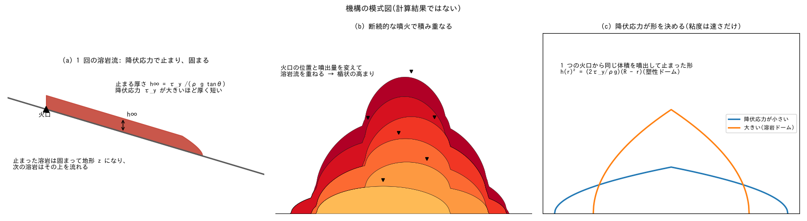
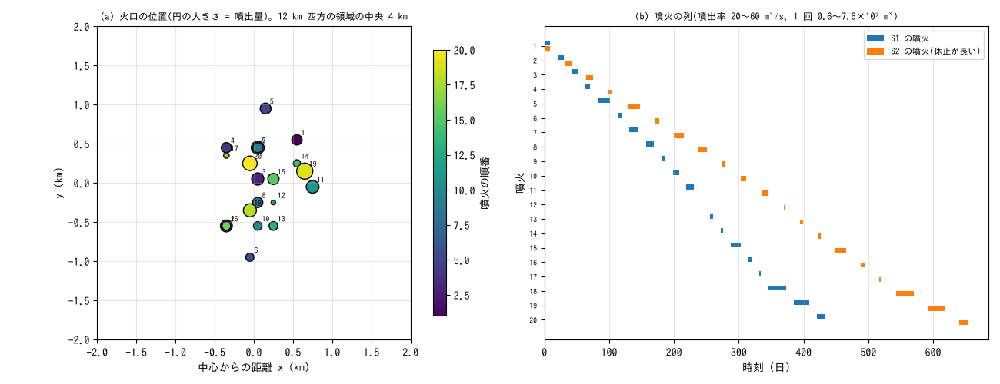
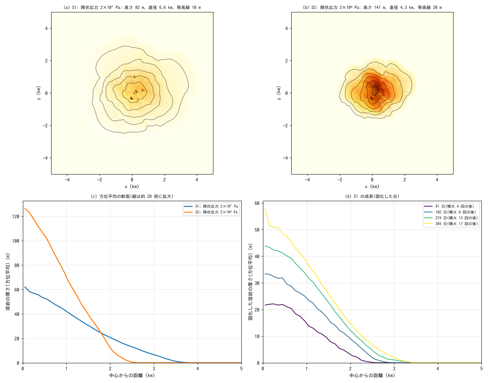
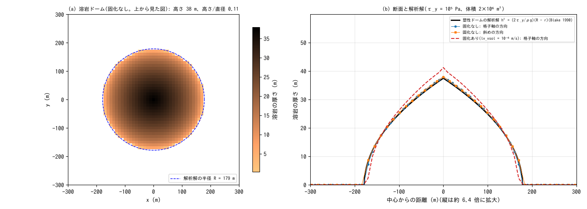

# shield_volcano — 断続的な噴火で育つ楯状火山と、粘い溶岩の溶岩ドーム

[English](en/README.md)

平らな地面の中央付近で、火口の位置と噴出量を変えながら溶岩を 20 回噴出させ、固まった溶岩流が
重なって楯状火山の高まりが育つ過程を計算します([ユーザーガイドの溶岩流の章](../../docs/users_guide/lavaflow.md))。
溶岩の降伏応力を 10 倍にした場合と比べ、形を決めるのが粘度ではなく降伏応力であること、実在の
楯状火山の形に近づけるには降伏応力を「冷えて止まる効果を含めた実効値」として与える必要があることを
見ます。補足として、1 つの火口から粘い溶岩を噴出させて溶岩ドームを作り、その形を解析解と比べます。
値は現象を見やすくするための模式値で、特定の火山の再現ではありません。

## 実際の楯状火山・溶岩ドームで起きていること

- **楯状火山**: 流れやすい玄武岩質の溶岩が、山頂や割れ目の火口から何度も流れ出て薄く重なり、
  なだらかな高まりを作ります(ハワイ、アイスランド)。アイスランドの楯状火山(かんらん石
  ソレアイト質 24 座)の中央値は、勾配 2.7°、高さ 60 m、直径 3.6 km、高さ/直径 0.019、体積
  0.2 km³ です(Rossi 1996)。世界の楯状火山の高さ/底面の幅は多くが 0.01〜0.1 で、平均勾配 12°・
  高さ/底面の幅 0.1 あたりがおおよその成層火山との境です(Grosse & Kervyn 2018)。
- **溶岩流が止まる理由**: 玄武岩質の溶岩流は、流れながら冷えて表面が固まり、止まります。流れの
  長さを主に決めるのは噴出率です(Walker 1973)。
- **溶岩ドーム**: 粘い(SiO₂ の多い)溶岩は流れ広がらず、火口の上に盛り上がります。その形は、溶岩の
  降伏応力で支えられた形(塑性ドーム)の模型で説明されてきました(Blake 1990)。実際のドームの急な
  側面は、表面が割れて崩れた岩塊の斜面(崖錐)であることが多く、内側から膨らむ成長や、崩落による
  火砕流を伴います(雲仙普賢岳 1991〜1995 年など)。
- 楯状火山・溶岩ドームは、古い形の分類(シュナイダー 1911)のアスピーテ・トロイデにおおよそ
  対応しますが、今はこの分類語はあまり使いません。

## 再現に必要な機構



模式図(計算結果ではない)。(a) 1 回の溶岩流は降伏応力で止まり、止まった溶岩は固まって地形になる。
(b) 火口の位置と噴出量を変えて溶岩流を重ねると楯状の高まりになる。(c) 1 つの火口から噴出して止まった
形は降伏応力で決まり、同じ体積なら降伏応力が大きいほど高く狭い溶岩ドームになる。

| 実際の現象 | ENCflow での表し方 | 設定 |
|---|---|---|
| 溶岩が火口から湧き出す | 噴火口のセルに噴出率の時系列を与える(運動量なし) | `lv_cell`・`lv_val` |
| 溶岩が流れ、厚さが足りなくなると止まる | 等温の Bingham 粘性重力流(潤滑近似)。溶岩面の勾配の大きさ S に対し、厚さが τ_y/(ρgS) を超える所だけ流れる | `lv_visc`・`lv_tauy` |
| 止まった溶岩が固まって地形になる | 流速が閾値を下回ったセルの溶岩を一定レートで地盤高 z へ移す(数値的な閉じ方。冷却は計算しない) | `lv_vsol`・`lv_wsol` |
| 噴火のたびに火口と噴出量が変わる | 20 個の噴火口を時間をずらして 1 回ずつ使う | `lv_cell(1:2,1,k)`・`lv_val(1:2,m,k)`(k = 1〜20) |
| 噴火と噴火の間の休止 | 溶岩が止まって固まる時間だけ空けて縮める(水も侵食もないので、休止期間には何も起きない) | 噴出率の時系列の時刻 |
| (補足)粘い溶岩の溶岩ドーム | 降伏応力の大きい溶岩を 1 つの火口から噴出する | `lv_tauy = 1.0e5` |

## 幾何と設定



(a) 火口の位置(円の大きさが噴出量、色が噴火の順番)。(b) 噴火の列。S2 は流れが遅いので休止を長くしてある。

12 km 四方、Δx = 100 m(120 × 120 セル)の平坦面(z = 0)です。火口は中心から標準偏差 400 m の
正規分布で散らし、噴出量は中央値 3×10⁷ m³ の対数正規分布(1 回 0.6〜7.6×10⁷ m³、20 回で計
0.68 km³)、噴出率は 20〜60 m³/s(1 回 1.9〜27 日)です。噴火の列は `make_param.py` が乱数の種
(`--seed 1`)から作り、S1 と S2 は同じ列を使います。溶岩は領域の端に届きません。

| 項目 | S1(主ケース) | S2(比較) | dome / dome_sol(補足) |
|---|---|---|---|
| 降伏応力 τ_y | 2×10³ Pa(玄武岩質のアア溶岩の実測の範囲) | 2×10⁴ Pa(冷えて止まる効果を含めた実効値) | 10⁵ Pa(溶岩ドームの目安) |
| 粘度 η | 10⁶ Pa s | 10⁸ Pa s | 10¹⁰ Pa s |
| 停止判定の閾値 lv_vsol | 5×10⁻⁵ m/s | 5×10⁻⁶ m/s | dome: 固化なし / dome_sol: 10⁻⁶ m/s |
| 噴火 | 20 回、噴火の間 10⁶ s(約 12 日) | 同じ 20 回、噴火の間 2×10⁶ s | 中央の 1 セルから 2 m³/s を 10⁶ s(2×10⁶ m³) |
| 格子・時間刻み | Δx = 100 m、dt = 300 s | Δx = 100 m、dt = 1800 s | 101 × 101、Δx = 10 m、dt = 300 s |
| 計算の長さ | 456 日(最後の噴火の 23 日後まで) | 711 日(57 日後まで) | 6×10⁶ s |

粘度は実際の玄武岩質の溶岩(10²〜10⁴ Pa s)より大きくして時間を縮めています。止まった形は粘度に
よらないためです(下の「注意」)。表の「日」は計算の中の時間で、実際の噴火の時間ではありません。
停止判定の閾値は、それぞれの流れの速さに比べて小さい値にしてあり、止まった厚さの上振れの目安は
S1 で約 11%、S2 で約 6% です(「注意」)。

## 実行方法

```bash
make              # ../../bin/ の実行ファイルへのリンク
make run          # S1(約 6 分)と S2(約 1.5 分)。4 スレッドの目安
make run-dome     # dome と dome_sol(各約 40 秒)
python3 plot_results.py      # 図と形の数値(引数 en で英語版の図を en/figs/ に)
```

設定ファイルはリポジトリに入れてあります。噴火の回数・火口の散らばり・乱数の種などを変えるときは
`make_param.py` の引数を変えて `make params` で作り直します(「感度実験の入口」)。

## 結果



(a)(b) 最終の地形(陰影と等高線)。(c) 方位平均の断面(縦は約 28 倍に拡大)。(d) S1 の固化した溶岩の
断面の時間変化。

| 形の数値 | S1(τ_y = 2×10³ Pa) | S2(τ_y = 2×10⁴ Pa) | アイスランドの楯状火山の中央値(Rossi 1996) |
|---|---:|---:|---:|
| 体積 | 0.68 km³ | 0.68 km³ | 0.2 km³ |
| 高さ(最高点。中心から 200 m 以内の平均) | 82 m(60 m) | 141 m(124 m) | 60 m |
| 直径(厚さ 0.5 m 以上の面積の等価直径) | 6.6 km | 4.3 km | 3.6 km |
| 高さ/直径 | 0.012 | 0.033 | 0.019 |
| 勾配(覆われたセルの中央値) | 1.0° | 3.5° | 2.7° |
| 計算の終わりにまだ流れている溶岩 | 噴出量の 0.2% | 3.4% | — |

- **溶岩流が重なって楯状の高まりになる**: どちらも、ほぼ円形のなだらかな高まりになります
  (格子の軸の方向と斜めの方向の扇形の面積等価半径の比は S1 で 0.97、S2 で 1.02)。新しい溶岩は
  先に固まった溶岩の低い所を埋めながら広がるので、火口の位置がばらばらでも全体は丸くまとまります。
  (d) のように、噴火を重ねるごとに中心が高くなり(噴火 4 回の後 22 m → 17 回の後 58 m)、裾が
  広がります。火口を ±400 m に散らしたので、山頂は平らです。
- **形を決めるのは降伏応力**: 同じ噴火の列でも、降伏応力を 10 倍にした S2 は直径が 2/3、高さが
  1.7 倍、勾配が 3.5 倍になります。溶岩は、厚さが止まる厚さ h∞ = τ_y/(ρ g tanθ) まで薄く広がって
  から止まるので、降伏応力が大きいほど厚く短い流れが重なり、急な高まりになります。
- **実在の楯状火山との比較**: 玄武岩質の溶岩の実測の範囲の降伏応力(S1)では、実在の楯状火山より
  平たく広くなり(勾配 1.0°)、10 倍の値(S2)で勾配 3.5°・高さ/直径 0.03 と、アイスランドの楯状
  火山の中央値(2.7°・0.019)と同じ程度になります。どちらも世界の楯状火山の範囲(高さ/底面の幅
  0.01〜0.1)にあり、成層火山との境(12°・0.1)より緩やかです。差の理由は、このモデルが温度を計算
  しないことです。実際の溶岩流は冷えて表面が固まって止まり(Walker 1973)、薄く広がりきる前に
  止まりますが、このモデルの溶岩は降伏応力で止まるまで広がります。そのため、降伏応力は流動の実測値
  ではなく、冷えて止まる効果を含めた実効値として、実在の溶岩流の厚さや火山の勾配に合わせて決める
  必要があります。体積が違う(この例題は Rossi の中央値の 3.4 倍)ので、比較は目安です。
- **停止判定の閾値の影響**: 形は降伏応力だけでなく、溶岩を「止まった」とみなす閾値 `lv_vsol` にも
  依存します。S2 の閾値を 1/10(5×10⁻⁷ m/s)にすると、溶岩はなかなか止まったと判定されず、同じ
  計算時間では止まりきりません(終了時に噴出量の 30% がまだ流れている)。その時点の勾配は 2.5° で、
  閾値 5×10⁻⁶ m/s の 3.5° より緩やかです。止まりきるまで計算した形は確かめていません。降伏応力
  10 倍の差(勾配 1.0° と 3.5°)に比べれば小さいものの、数値は閾値の選び方込みの目安です。

## 補足: 溶岩ドーム(dome・dome_sol)



(a) 固化なしの溶岩ドームを上から見た図(破線は解析解の半径)。(b) 断面と塑性ドームの解析解。
赤の破線は固化ありの場合。

- 1 つの火口から粘い溶岩(τ_y = 10⁵ Pa)を 2×10⁶ m³ 噴出させると、溶岩は火口のまわりに盛り上がり、
  高さ 38 m、直径 354 m(高さ/直径 0.11)のドームになります。止まった形は、降伏応力で支えられた
  塑性ドームの解析解 h(r)² = (2τ_y/ρg)(R − r)(Blake 1990)と、高さ +1.4%、半径 −0.6% で一致し、
  格子の軸の方向と斜めの方向の断面が重なります。
- 塑性ドームの高さ/直径は、降伏応力の 0.6 乗に比例し、体積の 0.2 乗に反比例します。同じ体積で
  S1 の降伏応力(2×10³ Pa)なら高さ/直径は約 0.01 で、溶岩は 1 つの火口からでも平たく広がります。
- **固化の判定が形を変える(dome_sol)**: 固化を入れると(lv_vsol = 10⁻⁶ m/s)、噴出が続いている
  うちに、止まりかけた縁から固まって溶岩を受け止めるので、中央が 41 m(解析解より 10% 高い)になります。
  これは停止判定の閾値という数値的な閉じ方の影響で、冷えて固まる過程を計算したものではありません。
  閾値を小さくするほど固化なしの形に近づきますが、止まりきるまでの計算時間が長くなります
  (lv_vsol = 10⁻⁷ m/s では 6×10⁶ s の時点でまだ噴出量の 27% が固まっていません)。

## このモデルで表せないこと(実際の現象との違い)

- **溶岩の冷却**: 温度を計算しないので、流れの長さが噴出率と冷却で決まる関係(Walker 1973)は
  出ません。降伏応力を実効値として校正する必要があります(「結果」)。
- **溶岩トンネル・溶岩湖・カルデラの陥没・割れ目帯への貫入・山体の膨張や崩壊**: 扱いません。
  ハワイの楯状火山のように割れ目帯に沿って伸びた形には、火口を線状に並べれば近づけられるはずです
  (「感度実験の入口」。この例題では確かめていません)。
- **侵食と風化**: ありません。できる地形は噴火が続いている若い火山の姿で、谷に刻まれた古い楯状
  火山にはなりません。
- **爆発的な噴火・降灰**: 扱いません。降下火砕物の積もった急な円錐と、それが雨で流された裾野を
  持つ成層火山は、溶岩だけでは作れません。
- **溶岩ドームの崖錐・内側からの膨らみ・崩落と火砕流**: 計算できるのは降伏応力で支えられた静止形の
  概算までです(崩落は、崩壊深の分布 `fn_dbinit` を与える土石流の瞬時流動化で別に与えられます)。
- **時間**: 粘度を実際より大きくし、休止期間を縮めているので、計算の中の日数は実際の噴火の時間
  ではありません。
- **格子**: 100 m 格子では、1 本の溶岩流の舌は数セルの幅です。流動は 8 近傍の 9 点
  (`lv_diagratio = 1/3`。既定)で計算します(降伏と停止は勾配の大きさで判定するので、止まった形は
  格子の向きによりません)。
- **噴火の回数**: 1 回の計算で使える噴火口は 20 個までです。もっと多くの噴火を重ねるときは、状態を
  保存して(`f_state_save`)、噴火口を書き換えた設定で再開(`f_state_restore`)してつなぎます。
- **水**: この例題は雨を降らせません。地下水の計算と一緒に使うと、固化した溶岩の下の土層は埋まり、
  溶岩の上には雨がしみ込みません(実際の新しい溶岩は水を通すことが多い。ユーザーガイドの制約の節)。

## 注意

- **粘度と時間**: 止まった形は粘度によらず、粘度は流れの速さ(時間の尺度)だけを決めます。同じ
  降伏応力のまま粘度を k 倍にするときは、噴火と休止の時間も k 倍にし(噴出量は同じ)、停止判定の
  閾値 `lv_vsol` と固化レート `lv_wsol` を 1/k にすると、同じ形になります。実際の値(10²〜10⁴ Pa s)を使うと、拡散の安定条件のために計算が
  数十〜数百倍長くなります。
- **停止判定の閾値の目安**: 停止判定による止まった厚さの上振れは、およそ
  √(2 lv_vsol η ρ g S)/τ_y の割合です(S は斜面の勾配。lava_plan.md §5 の式を止まる厚さで割った
  もの)。この例題の値では S1 で約 11%(勾配 1°)、S2 で約 6%(勾配 3.5°)です。閾値を小さくすると
  上振れは減りますが、止まったと判定されるまでの時間が長くなります(「結果」の S2 の例)。
- 計算の終わりにまだ流れている溶岩(最後の噴火の溶岩)は、終了時の台帳の molten と分布 Hl9998 に
  残ります。図と表の厚さはこれを含みます。

## 感度実験の入口

確かめたのは S1・S2・dome・dome_sol の 4 ケースだけです。以下の予想は、この例題では確かめていません。

- **降伏応力**(`lv_tauy`): 高まりの急さを決めます。S1 と S2 の間の値で、実在の楯状火山の勾配に
  合う値を探せます。
- **噴出量と噴火の回数**(`make_param.py` の `VMED`・`--neru`。回数は 20 まで): 1 つの火口の
  ドームでは体積が大きいほど高さ/直径が小さくなるので(「補足」)、楯状火山でも同じ傾向が予想されます。
- **火口の散らばり**(`--sigma`): 小さくすると山頂がとがり、大きくすると平らで広い高まりになると
  予想されます。
- **割れ目帯**: `lv_cell` の火口を一直線に並べると、割れ目帯に沿って伸びた形になると予想されます。
- **初期地形**(`--cone 0.02` など): 緩い円錐から始めると、溶岩は斜面を下って麓に広がると予想されます。
- **乱数の種**(`--seed`): 噴火の列を変えたときの形のばらつきを見ます。

## 参考文献

- Blake, S. (1990): Viscoplastic models of lava domes. In: Fink, J. H. (ed.), *Lava Flows and Domes:
  Emplacement Mechanisms and Hazard Implications*, IAVCEI Proceedings in Volcanology 2, Springer, Berlin.
- Grosse, P. and Kervyn, M. (2018): Morphometry of terrestrial shield volcanoes. *Geomorphology*, 304, 1–14.
- Rossi, M. J. (1996): Morphology and mechanism of eruption of postglacial shield volcanoes in Iceland.
  *Bulletin of Volcanology*, 57, 530–540.
- Walker, G. P. L. (1973): Lengths of lava flows. *Philosophical Transactions of the Royal Society of
  London A*, 274, 107–118.
